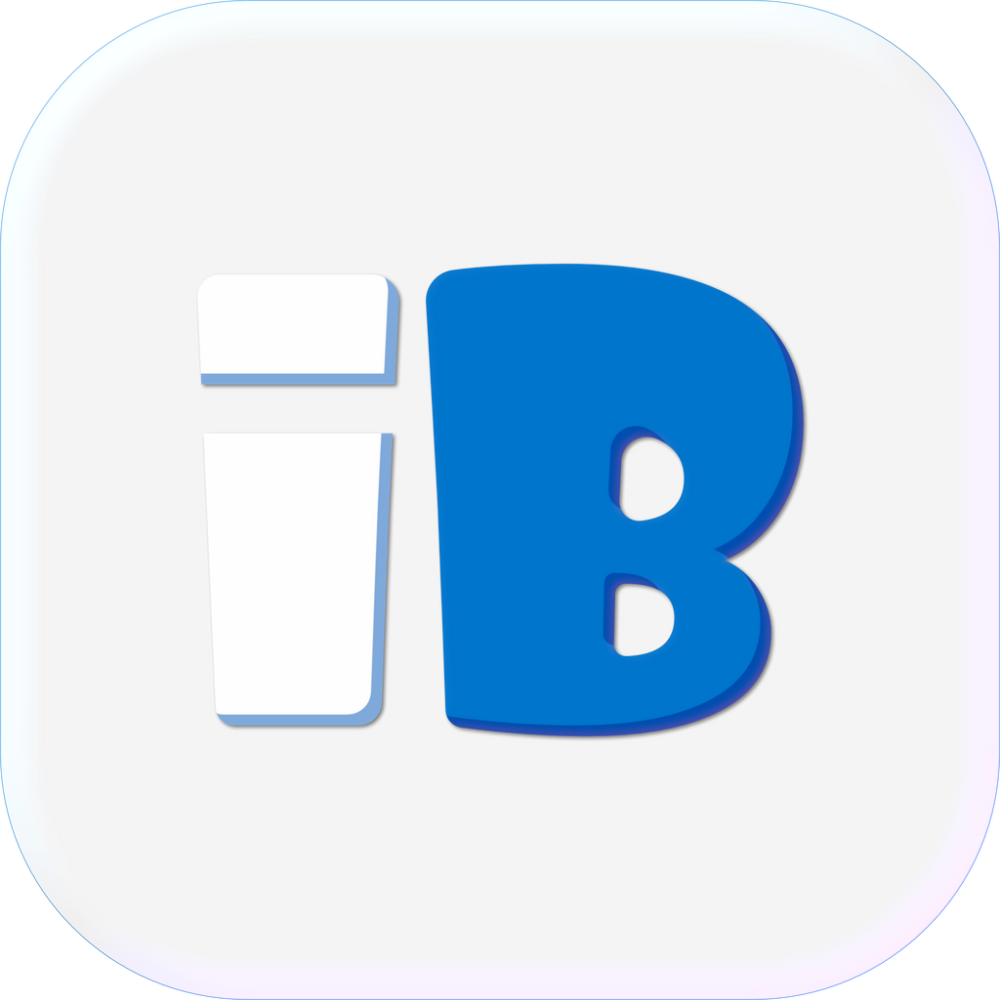

<div align="center">



# ID BOX

**把知末网下载的模型 / 贴图压缩包拖进来，就变成一个能分类、有封面、可预览的本地素材库。**


</div>

> **当前是 Preview 测试版**（顶栏 `ID BOX` 右边那颗紫色胶囊就是它），功能快速迭代、数据结构仍在演进。
> 遇到问题请用「设置 → 数据与备份 → 日志文件 → 导出日志」，日志里有足够定位的信息。
> 数据保全承诺：重扫不覆盖你改过的字段；设置写盘走串行队列，连点开关不会互相覆盖；
> 每次目录结构变更都走迁移 + 快照，不会让你下次打开发现库空了。

---

## 它解决什么问题

在知末网（znzmo.com）下模型，流程基本是：下载 → 解压 → 里面躺着一堆
`微信扫码.jpg`、`知末SU-xxxx.html`、`知末网说明.txt` → 把 `.skp` 拎出来 → 改名 →
自己放进某个文件夹 → 过两个月忘了它在哪。一个项目几十上百个包，全靠文件夹记忆。

**ID BOX 把这一串动作变成一次拖拽**，并且在你三个月后想找「那个中古风的壁灯」时，真的能找到。
素材、缩略图、索引全在本机，本地优先，删除软件不删你的文件。

---

## 功能

**① 导入与分类**

- 拖入文件即可导入：压缩包自动解压（`.zip` / `.rar`(zip 内容) / `.7z`，含 GBK 编码修复），单张图片、模型 / CAD / HDR / D5A 直接进库；单个 `.skp` / `.max` 也能直接拖入（复制入库，源文件不动）
- 自动剔除杂质：微信扫码图、站方 HTML、说明文本、`__MACOSX` 等落盘后真删（不进回收站）；递归下钻找到压缩包里的真正模型
- 分类词表逐项照抄知末网、不自创；按文件名 + 包内文件名匹配，模型 / 材质 / CAD 分册互不串，一级 / 二级都支持自定义词条
- 三源交叉验证（标题语义 / 站方面包屑 / 站方三级名），一级冲突一律不定案、进「待确认」队列，对不上绝不硬猜

**② 封面与预览**

- 知末封面自动抓取：从资产名里的 `ID_<数字>` 反查详情页主图，瞬时失败自动重试
- 材质球：`three.js` 离屏渲染 PBR，可调反光 / 凹凸 / UV，形态可选球 / 平面 / 圆角盒，「保存」直接成为卡片封面
- Quick Look：选中卡片按空格全屏快览，`←` / `→` 切图，空格或 `Esc` 关闭且不清选中
- HDR 全景预览：主进程流式降采样后以「HDR 背景 + 白球 + 银球」呈现，可 0–360° 旋转、可拍照当封面

**③ 首页与快速访问**

- 打开先落在一页封面：粒子海浪与自定义壁纸二选一，方形数据看板，中央搜索条点开变形为命令面板
- 新建项目：首页「新建项目」卡片走四步向导（选模板 → 填编号名称 → 选位置 → 确认），模板可自定义、随打包一起导出
- 快速访问：右键把常用磁盘文件夹钉到首页，可排序 / 移除，双击钉选卡进应用内文件浏览器（只读）直接翻文件
- 文件夹气泡「全部 / 素材板块 / 项目文件夹」一键切着看；右键「更换底纹」给文件夹换本地图片

**④ 打包与同步**

- 一键打包：设置 → 数据与备份 → 素材打包与同步，把整库打成一个文件，可带别名与首页布局，换台电脑导回按原分类落地
- 导入前先报账，同名项逐条给跳过 / 覆盖 / 保留两份，一条决定可套用到全部；只按清单精确提取、每文件带指纹，坏包当场拦下
- 全程只在本机完成，不上传任何东西；也可把库目录放进 Syncthing / NAS 等同步文件夹由同步工具搬文件

**⑤ SketchUp 插件**

- SketchUp 原生工具栏 + 面板，浏览同一个素材库，只显示模型与材质（带封面）
- 双击模型卡片插入场景（`Ctrl+Z` 一步撤销）；双击材质建材质并设为当前，不自动贴面
- 右键「导出至 IDBOX」存回库并截视口当封面；右键「更新 IDBOX 中的这个模型」只覆盖模型本体，不动分类 / 参数 / 封面
- 插件与本体必须同号；设置 → 同步插件 读真实安装版本，贴图按长边 1000mm 插入；排序补齐 8 档与主程序同口径

---

## 下载与安装

从 [GitHub Releases](https://github.com/chengcheng067/ID-BOX/releases) 下载 `IDBOX-Setup-1.2.0.exe` 直接安装；
覆盖安装时库与设置原地保留。仅支持 Windows 10/11，插件要求 SketchUp 2021 及以上。

- 浏览器可能把未签名的 exe 拦下来：用发布页同时提供的 `.zip`，解压后是同一个 exe，通常更顺。
- 首次运行 Windows 提示「未知发布者」是因为安装包没有代码签名证书，不是文件被改过；想核对就比对发布页的 SHA256。
- 插件与本体必须同号：装好本体后到「设置 → 同步插件」点「安装插件 / 更新到 1.2.0」，导出后在 SketchUp 扩展管理器里覆盖安装并重启；装了多个 SketchUp 版本要逐台更新。

---

## 数据与隐私

- 素材、索引、缩略图全部**只在本机**：库目录由你自己指定，缩略图缓存在本机
- 会联网的地方只有两处，且都能关：**检查新版本**（只读 GitHub 发布信息，不自动下载安装，设置里可关）、**知末封面抓取**（设置里可关）
- 不收集遥测，不上传任何素材或路径
- 诊断日志写在本地，只在你自己点「导出」时才会被打包

## 跨机同步

想换电脑继续用同一批素材：用 Syncthing 或 绿联 NAS 这类同步工具，把 ID BOX 的库目录放进它们的同步文件夹，让同步工具替你搬文件；ID BOX 只读取这个目录，不参与同步本身，也不关心文件怎么过去。

---

## 开发

环境：**Windows 10/11** + **Node.js 20+**。

```bash
npm install
npm run dev       # 开发（HMR）
npm run verify    # 两个 typecheck + test + build 全量验证
npm run test      # Vitest 纯逻辑与源码守卫用例
```

---

## 许可证

© 2026 杨雯丞（Chengcheng）。**保留所有权利（All rights reserved）。**
仓库公开仅供阅读、克隆和本地评估；未经作者书面许可，不得再分发、修改后发布、商用或作为其他产品的一部分。
`ID BOX` 名称、徽标与界面设计均归作者所有。

---

> 更详细的变更记录见仓库 `docs/` 目录与 [GitHub Releases](https://github.com/chengcheng067/ID-BOX/releases)；README 不再维护历史日志。
