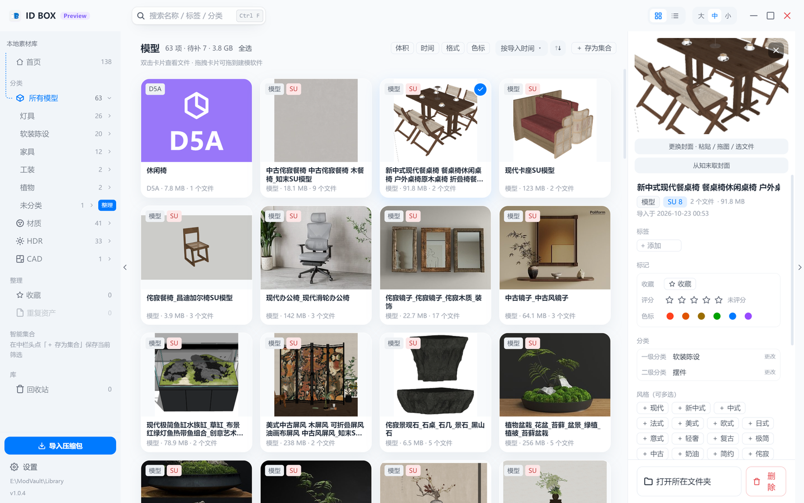
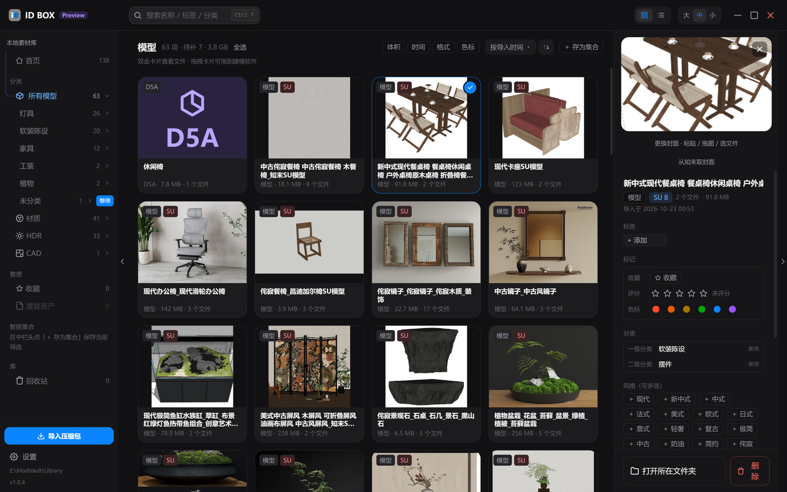
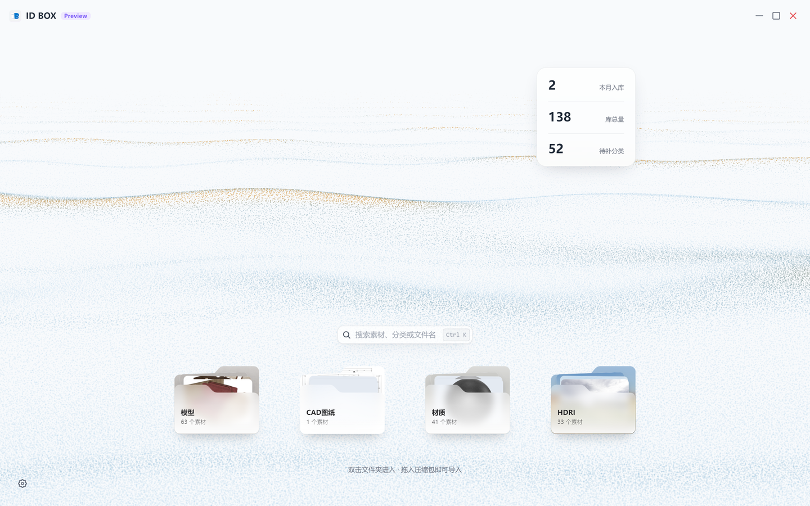
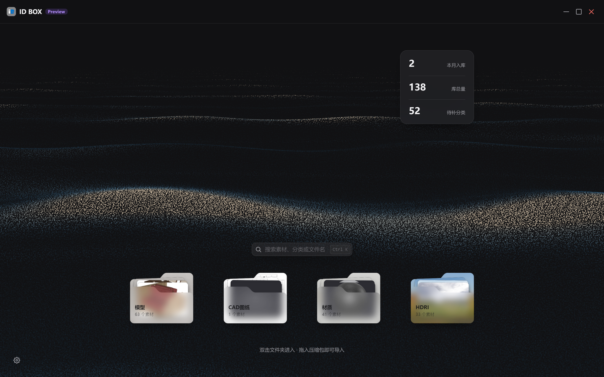
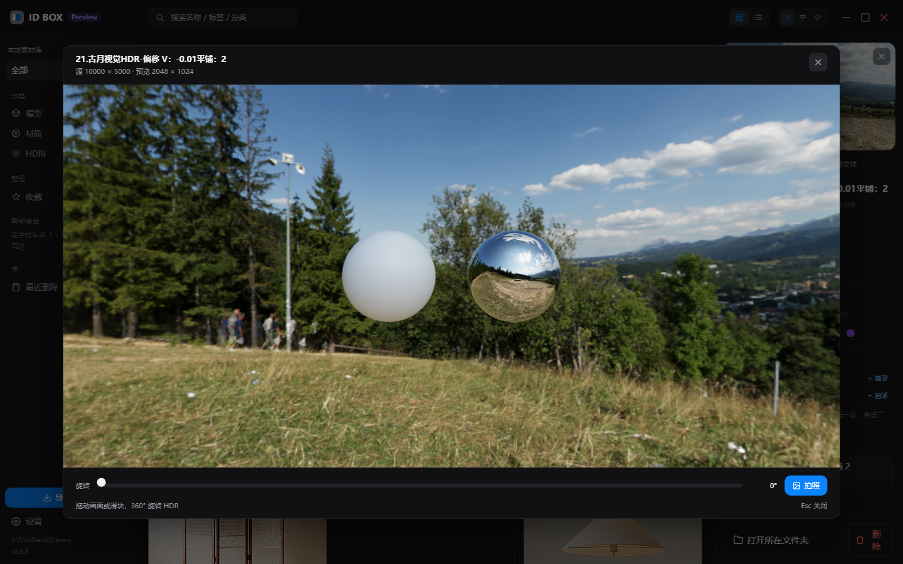
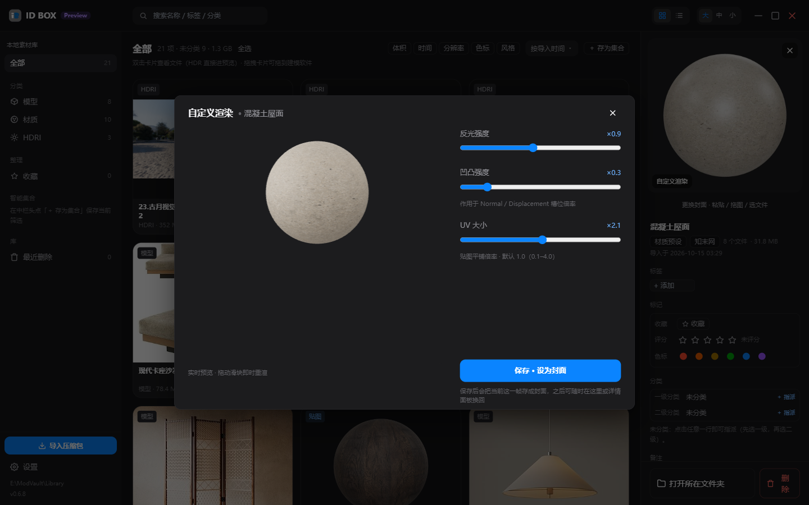

<div align="center">


# ID BOX

**把知末网下载的模型 / 贴图压缩包拖进来，就变成一个能分类、有封面、可预览的本地素材库。**


</div>

> **当前是 Preview 测试版**（顶栏 `ID BOX` 右边那颗紫色胶囊就是它）。功能在快速迭代，
> 数据结构仍在演进；遇到问题请用「设置 → 数据与备份 → 日志文件 → 导出日志」，
> 日志里有足够定位的信息。
>
> 0.7.x–0.9.x 做过两轮数据保全：重扫不再覆盖你改过的字段（覆盖前先落一份快照），
> 设置写盘改成串行队列（连点开关不会再互相覆盖或报 ENOENT）。
> 所以调好的材质球参数与设置，不会因为一次重扫或一次连点被抹掉；
> 真要回退，设置里也有「恢复上次备份」。
>
> 目录结构确实可能随版本调整，但每次调整都是**迁移 + 快照**，不会让你下次打开发现库空了。

---

## 它解决什么问题

在知末网（znzmo.com）下模型，流程基本是这样：下载 → 解压 → 里面躺着一堆
`微信扫码.jpg`、`知末SU-xxxx.html`、`知末网说明.txt` → 把 `.skp` 拎出来 → 改名 →
自己放进某个文件夹 → 过两个月忘了它在哪。

一个项目下来几十上百个包，全靠文件夹记忆。**ID BOX 把这一串动作变成一次拖拽**，
并且在你三个月后想找「那个中古风的壁灯」时，真的能找到。

---

## 界面

<div align="center">
  
  
</div>

> 以上为 **1.0.4 实际运行截图**（1440×900，本地真实素材库）。深色是作者的日常主题。

---

## 核心能力

### 1 · 首页

打开软件先落在一页封面，不是一张网格。侧栏第一项就是「首页」，从哪儿点回来都回到这一页；
这一页里左右侧栏自动折起，整屏留给封面。

粒子背景铺满整屏，鼠标划过会推开它；浅色与深色各一套配色，粒子浓淡跟设置里的「动效性能」走。

| | |
|---|---|
| 文件夹入口 | 屏幕下方一排磨砂玻璃文件夹，**只放有素材的大类**（空的整张不占位）；悬停能看到里面三张封面 |
| 数据看板 | 右上角一张方形磨砂卡，三个数字：本月入库 / 库总量 / 待补分类；点「待补分类」直接进待补清单，不想要这张卡可在设置里关掉 |
| 搜索 | 中央搜索条点开后**变形为命令面板**，结果带缩略图，也记得最近搜过的词 |
| 进入 | 双击文件夹：文件夹飞向屏幕正中、其余信息退场，网格从两侧边缘滑入 |

> **「待补分类」的口径（2026-11-11）**：**只认一级**——一级已指派就算已分类，不再因为二级空着而
> 一直挂在「待补」上；该频道**没有二级级联词表**的资产（比如 HDR）本来就没法填二级，不计入待补。
> 这个数字与左栏「未分类」节点、整理流水线的待办集是**三套不同判据**，本就不必相等（见 `docs/25`）。

「所有进入网格的场景」共用同一套入场语言 —— 从文件夹返回、侧栏切换、搜索、分类跳转，卡片都是
从画面两侧滑进来。

首页刻意不放回收站、重复资产、排序与筛选：那些属于网格态，这一页只回答「我现在要看哪一堆」。

<div align="center">
  
  
</div>

> 左浅右深。「有素材的大类」才落成文件夹卡 —— 库还空着的时候，这一页就只有背景、看板与搜索条。

### 2 · 拖入即归档

- **一次拖入压缩包 / 单张图片**，自动解压（`.zip` / `.rar`(zip 内容) / `.7z`，含 GBK 编码修复）
- **自动剔除杂质**：微信扫码图、站方 HTML、说明文本、`__MACOSX` 等一律不进库
- **杂质是真删，不是"不索引"**：落盘完成后直接从磁盘删掉（不进回收站），批次结束会报「已清理 N 个」。
  判定刻意做得**很窄** —— 只删扩展名本身不是素材的（`.html` `.htm` `.txt` `.url` `.lnk`）
  和文件名带站方推广专属短语的（微信扫码 / 二维码 / 知末网说明 …）。
  `设计说明.dwg`、`施工说明.dwg`、`下载的模型.skp` 这些**不会被误删**（「说明」「下载」是正经专业名）
- **递归下钻**：压缩包套一层 `attachment_xxxx/` 目录也能找到真正的模型
- **原包去向可选**：保留原位 / 移入系统回收站 / 彻底删除（默认移入回收站）
- **`.skp` 内嵌预览图提取**，无封面时也能立刻看到是什么东西
- **3DMAX（`.max`）支持**：与 SKP 同管线导入归档，卡片是青蓝底 + 小写 `max`（和 `SU` / `CAD` 同视觉语言；
  无内嵌预览，图标占位兜底）
- **D5A（`.d5a`）按模型格式收录**：整包存档**不解包**、单文件直接进库，无封面时是紫色 `D5A` 占位卡。
  它是**模型的一种格式，不是独立大类** —— 侧栏「所有模型」、中栏「格式」筛选项、首页「模型」卡三处口径一致
- **单个工程文件直接拖入**：手上只有一个 `.skp` / `.max`（别处整理过的旧素材）也能进库 ——
  自动建资产文件夹、**复制**入库（**源文件原地不动**），SKP 内嵌预览当封面；文件名带知末 ID 还会自动抓主图

### 3 · 自动分类（不另造分类体系）

分类词表**逐项照抄知末网的分类结构**，不自创、不翻译、不臆造——这样你在软件里看到的
类目，和你在网站上看到的是同一套。

- 导入时按**文件名 + 包内文件名**匹配受控词表做预分类（`src/shared/taxonomy.ts`）
- 命中二级 → `<大类>/<一级>/<二级>/`；只命中一级 → 落 `未分类`；全不命中 → 进「未分类」等指派
- **词表纪律**：词条只能来自站方原始抄录（`docs/05`、`docs/07`、`docs/34`）。缺的类目先补抄录，不靠猜
- **按大类分册**：模型 / 材质 / CAD 各有独立词表，且**互不串册**（模型的一级不会出现在材质树里）。
  HDR 用站方照抄的 5 个一级词，且只在 HDR 通道内匹配、不回落通用词表；未命中仍停「未分类」，可自由输入（见 §3.5）
- **用户自定义词条**：一级 / 二级分类都允许新增自定义词（覆盖模型 / 材质 / HDR），
  自动分类仍只认站方词表；被资产使用的自定义词条不可删除

#### 3.1 · 三源交叉验证（对不上就交给你）

只信「标题关键词」一个来源时，标题写得含糊就必然分错。现在**三个来源交叉比对**：

| 来源 | 是什么 |
|---|---|
| S1 标题语义 | 词表按标题关键词匹配的结果 |
| S2 站方面包屑 | 知末详情页里站方自己的分类路径 |
| S3 站方三级名 | 站方分类树最深节点的名字（仅作旁证） |

五档判定，**对不上就绝不硬猜**：

- **high** —— 两个来源一致，直接定案
- **medium-s2 / medium-s1** —— 只有一方有依据，采用但不越权搬目录
- **conflict** —— 两个来源一级分类不同 → **一律不定案，进「待确认」**
- **none** —— 两边都空，留在未分类

#### 3.2 · 「待确认」队列

判不了的那批不静默落到未分类，而是进一个专门的待办入口：

- 侧栏「待确认」行（**0 条时整行不渲染**，不占位置）
- 浮层里逐条显示**三个来源的原始判断**，一眼看出分歧在哪
- 你确认后写库并打上定案时间戳，之后不再进任何队列

#### 3.3 · 连续整理（滑动手势）

未分类资产以前只能一个个点开右栏改派。现在有连续整理的路径：**一屏一张 + 一键归类 + 自动跳下一张**。

手势参考常用的卡片式交互：**确认往右飞、跳过往左飞**，下一张从反方向滑进来。
动效档位跟设置里的「动效性能」联动；系统开启「减少动态效果」时降级成纯淡出，不做位移。

侧栏「未分类 N」旁的「整理」按钮**只整理当前大类** —— 在哪一类里点，就只过那一类。
（「待确认」队列刻意不跟大类走：它的侧栏计数本身就是全库口径，跟着收窄反而会对不上。）

#### 3.4 · CAD 图纸是独立大类

`.dwg` / `.dxf` 以前被当普通模型收进去，和 `.skp` 混在一起，既筛不出也认不出。现在是独立一类：

- 侧栏有「CAD图纸」节点，点它只筛图纸
- 落入 `<库>/CAD/<一级>/<二级>/<资产名>`，四层深度和其他大类一致
- 文件视图里 `.dwg` 卡片是**框内「CAD」三个红字**（AutoCAD 红）
- 同时含 `.skp` 和 `.dwg` 的包仍判「模型」（模型是主内容，图纸是附件）
- 词表同样照抄站方：一级 **10** / 二级 **102** / 三级 **368**，且**只在 CAD 词表里匹配**，
  不回落通用词表（避免「家具」这类词把图纸吸走）
- 封面两条来源：**DWG 内嵌缩略图**（本地立刻可用）→ **知末 sgt 频道图**（文件名带 `ID_<数字>` 时反查）→ 红色占位

#### 3.5 · HDR 的分类：站方一级词表已接入

HDR 的一级词表照抄知末 HDR 频道，就 5 个：`天空HDR` / `城市HDR` / `小区HDR` /
`室内HDR` / `户外HDR`（`taxonomy.ts::HDRI_LEVEL1_LIST`）。**只在 HDR 通道内匹配**、不回落通用词表 ——
自动分类靠 `level2Scope === 'hdri'` 跳过贴图通道的 round 1，不会把 HDR 塞进贴图的一级类目；
闸门对 HDR 也不再无条件拒绝。

**知末标准包能自动归类**：它下载下来是单个 `.hdr` 文件（没有压缩包），文件名带
`ID_<数字>`，例如 `现代小区HDRID_1223468004.hdr` → 落 `小区HDR`。判定前会先剥掉
ID 尾巴再匹配词表，**磁盘上的文件夹名仍是原名、一个字都不改**。

只有自己收集、命名里不带场景词的素材会停「未分类」—— 例如
「N.古月视觉HDR-偏移U：0.23」既不带这 5 个尾锚词，也不带知末 ID。这不是 bug，
是命名里没有可判的信息。

未命中之后，手动链路照旧可用：

- 右栏「分类」区块对 HDR 正常显示，一级 / 二级都能点开改派
- **自由输入**：手输的值会自动进**自定义词表**，下次直接可选、带「自定义」角标
- 落盘、搬目录、缩略图重生、左栏计数刷新，这一整条链和改派模型时**完全一样**

### 4 · 浏览与整理

| | |
|---|---|
| 三种视图 | 资产网格（大/中/小密度）、列表、**双击进软件内文件浏览器** |
| 多选 | 复选框 + Shift 范围选 + 全选 + **框选**（拖拽套索） |
| 筛选 | 大类 / 一级 / 二级 / 风格 / 标签 / 色标 / 体积 / 分辨率 / 模型格式（SU / 3DMAX / D5A）/ 导入时间，多维度可叠加 |
| 排序 | 六档：**最近使用** / **最常使用** / 按导入时间 / 按名称 / 按大小 / 按 SU 版本；每档可一键切**正序 / 倒序** |
| 智能集合 | 把当前筛选条件存成一组，一键切回 |
| 重复检测 | 同名副本聚合，**同名的不同知末 ID 不会被误判成重复** |
| 回收站 | 软删 + 保留期设置，误删可还原 |
| 删除撤销 | 宽限期可在设置里调 **不等待 / 3 秒 / 5 秒**（默认 5 秒；选「不等待」仍保留二次确认） |
| 批量重命名 | 命名模板 + 预览，只改文件夹名，不动包里的文件 |
| 右键菜单 | 卡片 / 文件 / 空白处各一套；**空白处右键一定有一条「刷新」**（真有筛选时多一条「清除筛选」） |
| 布局 | **左右侧栏可折叠**（边缘 chevron 唤出，状态记忆），小屏或「只想看素材」时把画布让出来 |

> 跨大类的全库视角（「收藏」「重复资产」这类入口）里，**体积 / 分辨率 / 格式**三个筛选入口不显示 ——
> 那里是总览，不需要这层细筛。
> 但也不能让它们**隐形生效**：真存在隐形筛选时，中栏头会显示「全部视图已隐去 N 个筛选」，点一下清掉。
>
> 「最近使用」「最常使用」按真实使用累计：**打开大图、双击进文件夹、拖进建模软件、插件插入各记一次**。
> 选中、全选、悬停、只是出现在结果里都不算 —— 那些是「浏览」不是「使用」，
> 计进来就会退化成「最常路过」，按一次全选就能把整库刷成同一档。

### 5 · 预览

- **知末封面自动抓取**：从资产名里的 `ID_<数字>` 反查详情页主图，比 SKP 内嵌预览（约 256px）清楚得多。
  瞬时网络失败会自动重试一次，不会「点一下报错」
- **知末风格自动填充**：同一次请求顺手解析站方风格，命中本地词表才写，且只在你没选过时写
- **材质球**：`three.js` 离屏渲染 PBR 材质球（单图 / 多图 PBR 贴图集），可调反光、凹凸、UV 重复，
  「保存」直接变成卡片封面
- **形态可选**：自定义渲染弹窗里可切 **球 / 平面 / 圆角盒** —— 球看整体质感，平面看平铺接缝，
  圆角盒看棱角处的拉伸与法线。形态参与球图缓存命名，切形态会重渲一次，之后走缓存
- **Quick Look（空格）**：选中卡片按空格 → 全屏快览，`←`/`→` 在**当前视图序列**里切上一张/下一张，
  **空格或 `Esc` 关闭**且**不清选中**；纯预览不带编辑控件，比素材时不必进详情面板
- **HDR 全景预览**：`.hdr` 入库后在**主进程流式降采样**（16384×8192 的文件直接喂 GPU 必然 OOM），
  预览里是「HDR 当背景 + 白球（看光分布）+ 银球（看环境反射）」，可 0–360° 旋转、可拍照当封面

<div align="center">
  
  
</div>

> 左：HDR 预览（源 10000×5000，降采样到 2048×1024 后预览）。右：材质球自定义渲染，三个滑块实时生效，
> 「保存」即写成卡片封面。

### 6 · 接回你的工作流

- **拖出到 SketchUp / D5**：原生拖拽，拽到建模软件里就是那个 `.skp`
- **双击**卡片进文件视图，Esc 返回
- **别名映射**：软件内显示中文别名，磁盘上的文件名一个字不动
- **诊断日志**：一键导出成 zip，用于反馈问题（不联网、只落本地）
- **设置**：7 个分页（外观 / 导入 / 分类 / 库 / 别名 / 数据与备份 / 关于），统一卡片语言
- **反馈入口**：「设置 → 关于」里有作者微信二维码与「在 GitHub 提 Issue」两条途径

### 7 · SketchUp 插件

插件不是「导出一个文件再手动打开」，而是把库挂进 SketchUp：装好之后 SketchUp 里多一条 ID BOX
工具栏，点开面板就是同一个素材库。

- **真工具栏按钮**：SketchUp 原生工具栏（图标 + 悬停提示 + 状态栏文案），不是菜单里的一项
- **面板**：模型与材质两块，卡片带封面。只显示这两类（HDR / CAD / D5A 不在面板里）
- **单击插入**：点模型卡片即插入当前场景，插错了 `Ctrl+Z` 一步撤销
- **材质双击即用**：双击一张材质 → 建好 SketchUp 材质并设为**当前材质**，油漆桶就绪，接着怎么贴由你决定。
  **不会自动贴面**，多选面也不贴
- **右键「导出至 IDBOX」**：在 SketchUp 里选中模型一键存回库，自动截当前视口当封面；导出前可以先命名
- **右键「更新 IDBOX 中的这个模型」**：减面、清完场景后原样回写 —— **只覆盖模型本体**，
  分类、材质球参数、自定义封面都不动，不新建资产
- **版本必须与本体一致**：两者版本不同时插入与建材质会被禁用，并直接告诉你把两边升到同一版本。
  这条是刻意留的 —— 错版插进去比不能用更糟

---

## 技术栈

| 层 | 选型 |
|---|---|
| 壳 | Electron 33（Chromium 130 / Node 20） |
| UI | React 18 + Tailwind CSS 3（全 token 化，浅色/深色两套） |
| 状态 | Zustand |
| 本地库 | Dexie（IndexedDB） |
| 3D | three.js（材质球、HDR 环境光、PMREM） |
| 构建 | electron-vite + electron-builder |
| 测试 | Vitest（纯逻辑层 + 源码守卫，**4633 条通过**；默认跳过 6 条真机 / 真实样本用例，合计 4639 条） |

设计原则：**本地优先**。素材、缩略图、索引全在本机，删除软件不删你的文件。

---

## 快速开始

环境要求：**Windows 10/11**、**Node.js 20+**。

```bash
npm install

npm run dev       # 开发（HMR）
npm run build     # 编译到 out/
npm run test      # 4633 条通过 + 6 条默认跳过（真机 7-Zip / 真实样本）
npm run typecheck:node && npm run typecheck:web
```

出安装包：

```bash
npm run build
npx electron-builder --win nsis -c.directories.output=release
# → release/IDBOX-Setup-<version>.exe
```

> 解压能力依赖真实 7-Zip 做兜底回归。设置环境变量可以把那 4 条真机测试也跑起来：
> `MODVAULT_7Z="C:\Program Files\7-Zip\7z.exe" npx vitest run`

### 品牌资源

应用图标、顶栏 Logo、关于页二维码由 `scripts/build-app-icon.cjs` 从 `resources/brand/` 一次性生成：

```bash
npm run brand
```

> 仓库里的 `src/renderer/assets/brand/contact-qr.png` 是**占位图**（浅灰叉，扫不出内容），
> 真实二维码不在公开仓库里。正式发布版的图标 / Logo / 二维码由作者在本地私有品牌资源中生成，
> 不随仓库分发——所以你 clone 下来自己构建，拿到的是占位图，这是**预期行为**，不是 bug。
>
> 脚本语义就这一句：从 `resources/brand/` 一次性生成图标 / Logo / 二维码；源图缺失时跳过对应产物、
> 保留占位图，不报错。
>
> **二维码与打赏码是作者的身份标识。请勿替换成他人的二维码后分发本软件，也不要替换后改名发布。**
> 如果你 fork 只是为了自己用，正确做法是**删掉「设置 → 关于」里的二维码 / 打赏区域**，而不是换成你自己的。

---

## 项目结构

```
src/
├─ main/          Electron 主进程：导入/解压、缩略图、HDR 降采样、知末抓取、协议、日志
├─ preload/       contextBridge 暴露的 IPC 契约（渲染层唯一入口）
├─ renderer/      React UI：组件 / 逻辑（纯函数，可单测）/ 样式 token
└─ shared/        主进程与渲染层共用：类型、分类词表、三源交叉验证、命名与别名规则

docs/             47 篇编号文档（编号 01–48，缺 30 号）+ 发布说明（PRD、架构、分类体系、变更设计、测试报告、性能诊断…）
tests/            Vitest 用例（纯逻辑 + 源码守卫）
build/            应用图标
resources/        打包资源（品牌素材、拖拽图标）
```

几条贯穿全局的约定：

- 资产的唯一 id 是**相对目录路径**，所以重命名/移动分类就是目录操作
- 分类词表的唯一真相源是 `src/shared/taxonomy.ts`，任何 UI 都从它派生
- 交叉验证的判定只在 `src/shared/classifyCrossCheck.ts` 一处，导入与重排共用
- 渲染层拿不到 Node 能力，只能走 `preload` 白名单

---

## 数据与隐私

- 素材、索引、缩略图全部**只在本机**：库目录由你自己指定，缩略图缓存在 `%APPDATA%/idbox/thumbs`
- 会联网的地方只有三处，且都能关：**检查新版本**（只读 GitHub 上的发布信息，把这一版改了什么展示给你，
  不自动下载安装；设置里可关掉启动时自动检查）、**知末封面抓取**、**可选的 AI 分类**（自填 API）
- 不收集遥测，不上传任何素材或路径
- 诊断日志写在本地，只在你自己点「导出」时才会被打包

---

## 关于分类体系

这套词表是照知末网抄下来的（`docs/05` 模型频道 / `docs/07` 贴图材质频道），
落到 `src/shared/taxonomy.ts`，并整理成 `docs/06-分类体系设计.md`。

之所以坚持「不自创类目」：**分类的价值在于和你平时找素材的直觉一致**。
自己发明一套更漂亮的名字，反而会让"我记得网站上归在哪"这条线索断掉。

`docs/06` 里还记了历次词表修订的来由（哪次是因为站方改版、哪次是因为实测漏分），
改词表之前建议先读它。

---

## 文档

| 文档 | 内容 |
|---|---|
| [`docs/01`](docs/01-PRD-模库.md) | 产品需求（含竞品调研、需求池、风险） |
| [`docs/02`](docs/02-架构设计-模库.md) | 系统架构与任务分解 |
| [`docs/06`](docs/06-分类体系设计.md) | 分类体系与词表纪律（**改词表前必读**） |
| [`docs/24`](docs/24-变更设计-知末封面抓取.md) | 知末封面抓取的设计与失败语义 |
| [`docs/25`](docs/25-待办-用户反馈.md) | 用户反馈台账（每条含原话、根因、验收口径） |
| [`docs/26`](docs/26-性能诊断-材质球切换.md) | 材质球卡顿的量化诊断（瓶颈在解码，不在 GPU） |
| [`docs/34`](docs/34-知末CAD频道词表-原始抄录.md) | 知末 CAD 频道词表原始抄录 |
| [`docs/35`](docs/35-变更设计-分类三源交叉验证与待确认队列.md) | 分类三源交叉验证与「待确认」队列设计 |
| [`docs/36`](docs/36-插件接口-调研.md) | 插件接口调研（三个 DCC / 协议形态 / ≤5 端点 MVP） |
| [`docs/37`](docs/37-插件逆向-可搭鸭.md) | 可搭鸭插件逆向（功能面 / 可借鉴的工程形态 / 加密分发与实现逻辑） |
| [`docs/38`](docs/38-插件产品需求-SketchUp-V1.0.md) | SketchUp 插件 V1.0 产品需求（功能分档 / 索引 JSON 为主 / 点一下即插入） |
| [`docs/39`](docs/39-插件架构-索引快照与包规范.md) | 插件架构定稿（快照由谁写 / `manifest.json`+`index.json` 规范 / 插件包规范 / 错误码归属） |
| [`docs/08`](docs/08-测试报告.md) | 测试报告与各轮验收结论 |

---

## 更新日志

> 完整安装包与历史版本见 [Releases](https://github.com/chengcheng067/ID-BOX/releases)。
> 每条都对应真实的装机反馈，改动细节与验收证据在 [`docs/08`](docs/08-测试报告.md)。

### v1.0.4 · 2026-11-09

> 上一版发布是 v0.9.2。中间做过的若干版**都没有单独发过安装包**，内容已全部并入本版 ——
> 所以这一节比往常长。细节与验收证据在 [`docs/08`](docs/08-测试报告.md)。

**新增 · 首页封面页**

- 打开软件先落在一页封面，不是一张网格：粒子背景铺满整屏、鼠标划过会推开它，浅色与深色各一套配色，
  浓淡跟设置里的「动效性能」走
- 下方一排磨砂玻璃文件夹，**只放有素材的大类**（空的整张不占位）；悬停能看到里面三张封面
- 右上角一张方形磨砂卡，三个数字：本月入库 / 库总量 / 待补分类
- 中央搜索条点开后**变形为命令面板**：结果带缩略图、记得最近搜过的词，中文输入法组词时回车与上下键不抢
- 双击文件夹：文件夹飞向屏幕正中、其余信息退场，网格从两侧边缘滑入
- **所有进入网格的场景**统一成同一套入场（从文件夹返回、侧栏切换、搜索、分类跳转），
  修掉以前「返回时先按最终位置画一帧再跳回」的卡顿观感

**新增 · SketchUp 插件**

- SketchUp 里多一条 ID BOX 工具栏，面板直接浏览同一个素材库（只显示模型与材质）
- 面板预览大小三档（大 / 中 / 小 = 2 / 3 / 4 列），下次打开记得你选的哪档
- 单击模型插入当前场景；双击材质建好材质并设为当前材质、自动切到油漆桶，**不替你贴面**
- 右键「导出至 IDBOX」把 SketchUp 里的模型存回库（自动截当前视口当封面），导出前可先命名
- 右键「更新 IDBOX 中的这个模型」原样回写：只覆盖模型本体，分类、材质球参数、自定义封面都不动
- 插件与本体版本不一致时禁用插入与建材质，并提示把两边升到同一版本
- 面板只多一个自绘的**折叠**按钮（顶栏 Logo 右侧，与右上角的系统按钮错开），点了整窗收成一条窄栏；
  关闭仍用 SketchUp 自带的窗口 × —— 不去仿造一个假的，SketchUp 的 HTML 对话框拿不到系统标题栏的控制权，
  自绘关闭只会和系统那个重复
- 侧栏分类树按大类分开算：停在「全部」时不再把模型和材质的一级分类混成一张表

**新增 · D5A 格式**

- `.d5a` 按**模型格式**收录（不是独立大类）：整包存档不解包、单文件直接进库，
  无封面时是紫色 `D5A` 占位卡
- 侧栏「所有模型」、中栏「格式」筛选、首页「模型」卡三处口径一致 —— 同一个东西不该有第四种说法

**新增 · 排序与使用习惯**

- 排序新增「最近使用」「最常使用」两档，并支持每档**正序 / 倒序**切换
- 打开大图、双击进文件夹、拖进建模软件、插件插入各记一次使用；用得多的与最近用过的自动靠前
- 同一个资产 2 秒内重复打开只算一次（来回比图不会把计数刷爆）；「最常使用」对久远的使用做衰减，
  两周前的那次大约只算一半
- 选中、全选、悬停、只是出现在结果里**都不算使用** —— 否则按一次全选就能把整库刷成同一档

**新增 · 更新说明弹窗**

- 有新版本时启动即弹窗，把这一版改了什么直接展示给你看；可以「稍后」（本次启动不再弹）
  或「跳过这个版本」（永不再弹）
- 焦点默认落在「稍后」，避免顺手回车就把安装包下下来；弹窗里的链接一律交给系统浏览器，
  不在应用内跳转

**改进 · 侧栏换皮**

- 侧栏改成一条竖直轨道 + 选中项一段圆角折线（标签滑进位置，悬停时补一段灰线接在后面），
  一级 / 二级分类收进可展开的子层
- **折叠后保留一条 48px 窄轨**：文字收走、只剩图标，轨道本身还在，随时能唤出；
  折没折记在设置里，重启还是那样

**修复 · HDR 分类被包名的 ID 尾巴带偏**

- 知末的 HDR 是单文件、文件名带标准包 ID 尾巴，词表尾锚会被这段尾巴咬住，
  本该命中的「小区HDR」之类判据反而失效。判据改用剥掉 ID 后的显示名，
  其余大类逐字节等价、零影响

**修复 · 「未分类」四处口径各自为政**

- 以前判定写在四个地方，口径会漂。现在收敛成同一处判据，中栏文案统一改称「待补」，
  「重跑自动分类」的候选数也用同一个来源 —— 看到的数字和实际会动的条目对得上

**改进 · 用户可见文案统一**

- 界面里不再出现文件名、字段名、内部编号这类实现概念；出错时给的是中文人话，
  原始报错只进日志。插件面板允许出现文件名（排查时要在资源管理器里对上），但仍不出现字段名
- 导入重复弹窗、导入队列、撤销提示等处的措辞一并对齐

**其他**

- **别名表可以搬机器了**：设置里新增「导出别名表 / 导入别名表」；导入是**合并**不是覆盖，
  做完会告诉你写进去多少条、因格式不对跳过多少条
- **覆盖导入的旧版本有了交代**：旧版本能进回收站就进；被建模软件占用进不去时，
  就地改名成「原名.旧版本」留在原文件夹，并明确告诉你
- **从 SketchUp 导出的模型不再夹带中间文件**，导出过程产生的临时件不进库、也不算资产的一部分
- 插件索引写盘默认仍是关的，但第一次进到那个开关时有一段一次性说明讲清写到哪、什么时候写

### v0.9.2 · 2026-11-02

> 上一版发布是 v0.9.1。这一版**没有新功能**，是一轮代码自查与加固：
> 把几处「平时不显、出事就伤数据」的边界补上，细节与验收证据在 [`docs/08`](docs/08-测试报告.md)。

**加固 · 破坏性 IPC 的运行期边界守卫**

- 新增 `src/main/ipcGuard.ts`：`openPath` / `reveal` / `trashPaths` 三个通道在真正动手前
  先校验路径还在库根之内，越界直接拒，不再只靠调用方自觉；配套 86 条用例

**加固 · 分类移动的事务一致性**

- `assignCategory` 改成逐条 `db.assets.put`，中途失败把已搬的**反向搬回**；
  回滚时顺带把缩略图重生，避免「库里回去了、封面还指着新目录」

**加固 · 顶层 React 错误边界**

- 新增 `ErrorBoundary.tsx`：渲染层整片崩了也不白屏，给一块可诊断的兜底界面
- 无边框窗口没有系统标题栏，兜底界面补了「重新加载窗口」和关闭两个逃生口

**改进 · 导入批次可取消**

- `ImportStatus` 加 `cancelled`、新增 `import:cancel` 通道，用代次计数器判定取消，
  **只停止还没开始的条目**，已经在处理的不硬掐，避免留下半个包

**加固 · 目录移动硬化**

- `moveDir` 只对 `EXDEV`（跨卷）才退化成复制 + 删除，其它错误不再被误当跨卷吞掉
- `moveAssetCategory` 串行化，杜绝同批资产并发搬同一目录
- `isWithinRoot` 在 Windows 上大小写不敏感；`trash.ts` 复用硬化后的 `moveDir`

### v0.9.1 · 2026-10-30

> 上一版发布是 v0.9.0。这一版做两件「补旧账」的事：
> 把 0.9.0 之前遗留的 CAD 旧记录归位，以及把 HDR 的一级分类词表接上，
> 细节与验收证据在 [`docs/08`](docs/08-测试报告.md)。

**修复 · 存量 CAD 记录迁移到 CAD 大类**

- 0.9.0 之前拖入的 `.dwg` / `.dxf`，旧记录里 `files[].kind` 还写着 `model`，
  于是明明是图纸却混在模型里、筛不出来。现在启动后按扩展名判据把它们迁到 CAD 大类
- 新增 `src/main/kindMigrate.ts`，plan / apply 两步分离 —— 中间结果要是带函数，
  过 IPC 结构化克隆会直接抛错，所以计划与执行必须拆开传

**新增 · HDR 一级词表接入自动分类**

- 从知末 HDR 频道照抄 5 个一级词：`天空HDR` / `城市HDR` / `小区HDR` / `室内HDR` / `户外HDR`，
  落到 `taxonomy.ts::HDRI_LEVEL1_LIST`
- `autoClassify.ts` 新增 `level2Scope === 'hdri'` 分支，让 HDR 跳过贴图通道的 round 1，
  不再被贴图的一级词表接管；`classifyAsset.ts` / `logic/category.ts` 一并接线
- 只在 HDR 通道内匹配，不回落通用词表；未命中的仍停「未分类」，可手动改派或自由输入（见 §2.5）

### v0.9.0 · 2026-10-30

> 上一版发布是 v0.8.4。中间的 **0.8.5** 未单独发过 Release，其内容已并入本版。
> 每条都对应真实装机反馈，细节与验收证据在 [`docs/08`](docs/08-测试报告.md)。

**新增 · CAD 图纸成为独立大类**

- 侧栏多出「CAD图纸」节点，只筛 `.dwg` / `.dxf`；落 `<库>/CAD/<一级>/<二级>/<资产名>`
- 卡片是框内「CAD」三个红字（AutoCAD 红），和 `SU` / `max` 同一套封面语言
- 封面两条来源：DWG 内嵌缩略图 → 知末 sgt 频道图 → 红色占位
- CAD 词表接入：一级 10 / 二级 102 / 三级 368，**只在 CAD 词表里匹配**不回落通用词表；
  实测二级命中率 33.6% → 42.5%

**新增 · 分类三源交叉验证 + 「待确认」队列**

- 标题语义 / 站方面包屑 / 站方三级名三方比对，五档判定，**一级冲突一律不定案**
- 判不了的进侧栏「待确认」行（0 条时不渲染），逐条展示三个来源的原始判断，你确认后写库定案

**新增 · 连续整理 + 滑动手势**

- 侧栏「未分类 N」旁的「整理」按钮进一屏一张的连续归类；确认往右飞、跳过往左飞
- 动效档位跟「动效性能」联动；系统开了「减少动态效果」时降级成纯淡出

**新增 · 材质球形态可选（球 / 平面 / 圆角盒）**

- 自定义渲染弹窗里可切形态，参与缓存命名，切一次重渲一次之后走缓存

**新增 · webp / tiff 尺寸识别**

- 分辨率筛选以前对这两种格式一律「未知」→ 永远进不了任何档位。现在探测链补齐 PNG → JPEG → WEBP → TIFF

**新增 · 「全部」视图专注模式**

- 体积 / 分辨率 / 格式三个入口在「全部」下不显示；真有隐形筛选时中栏头给「已隐去 N 个筛选」的兜底

**修复 · 整理队列串类（HDR 点整理弹出材质）**

- 侧栏数字按当前大类算、队列却是全库口径 → 从 HDR 点进去装的是整个库。现在队列按当前大类收窄，两边同口径
- 「待确认」刻意不跟大类走：它的侧栏计数本身就是全库口径

**修复 · 筛选值隐形生效且取消不掉（五条同类死角）**

- 起因是「模型里选了格式，没取消就切到全部，看不到 SU 模型」
- 根因是同一份判定被手写三遍：侧栏「全部」的清理列表漏 2 个字段、高亮判定漏同样 2 个、
  「重复资产」漏 6 个、标签跌出前 12 个后入口消失、智能集合存下的快照自带矛盾状态
- 收敛成唯一定义，清理只发生在落盘/读盘两个持久化边界 → 「模型 → 全部 → 模型」来回切，格式选择不丢

**修复 · 导入后杂质文件没被删**

- 以前只做到「不进索引」，磁盘上照样留着。现在落盘后物理删除，批次结束报「已清理 N 个」
- 判定刻意很窄：扩展名非素材（`.html` `.htm` `.txt` `.url` `.lnk`）+ 站方推广专属短语。
  实测宽松规则会把 `设计说明.dwg` / `施工说明.dwg` / `下载的模型.skp` 全判成垃圾，删除不可逆，不能赌

**改进 · 全局焦点环统一成品牌蓝**

- 根因是 Chromium 在 Windows 上用系统强调色画默认 `:focus-visible` 轮廓，点哪都冒橙框
- 现在键盘 Tab 显示品牌蓝环，鼠标点击不出环，输入框豁免

**改进 · 侧栏「整理」按钮不再压住数字 / 整理浮层改成实心页面感 / 中栏提示按大类分场合**

**删除 · 侧栏「词表待补」标签**

- 它只提出问题、不给任何动作：用户看到不知道该去哪补、也不知道怎么让它消失。已整个移除

### v0.8.4 · 2026-10-28

**新增 · 单个工程文件直接拖入**

- 手上只有一个 `.skp` / `.max`（在别处整理过的旧素材，没有我们的资产文件夹）也能进库：
  自动建 `<大类>/<一级>/<二级>/<名>`，**复制**入库、**源工程文件原地不动**
- 封面按优先级补：知末主图（文件名带 `ID_<数字>`，自动抓）→ SKP 内嵌预览（本地立刻可用）→ 类型占位
- 覆盖范围是整张模型扩展名表（`.skp` `.max` `.obj` `.fbx` `.3ds` `.blend` …），不只这两种

**修复 · 重装后预览图只回来一部分（客户实测）**

- 重装 / 换目录后缩略图缓存被清空，却被当成「读盘失败」跳过 → 记录一直停在「已就绪」，
  谁都不负责重生。现在能区分「读不出来」和「确实是空的」，启动后自动成批补回
- 补齐队列原先单轮最多 120 张、跑完就停 → 大库只补前 120 张。现在有进展就继续，
  零进展才收手（每轮让出主线程，不卡首屏）

### v0.8.3 · 2026-10-28

**新增 · Quick Look（空格全屏快览）**

- 空格打开全屏快览，**空格或 `Esc` 关闭**，`←`/`→` 在当前视图序列里切上一张 / 下一张
- 关浮层**不清选中**（第二次 `Esc` 才清）；画框尺寸固定，小图放大、大图缩小，翻页时版面不跳
- 空格键改判为 Quick Look，卡片多选移到 `Shift` / `Ctrl`+空格；卡片的键盘激活键是 `Enter`

**新增 · 左右侧栏可折叠**

- 折叠后宽 0 + 边缘 chevron 唤出，状态写进 `settings.json`，重启仍折叠

**修复**

- **重装后卡片缺封面、但盘上明明有 `*.cover.jpg`**：旧版重扫不认这个命名，索引没指向它，
  而「一键补抓」又按规则跳过它 —— 死锁。现在启动自愈（幂等），不需要再点任何按钮
- **「一键重扫 · 从知末获取封面」点了没反应**：汇总现在区分「跳过 N 条（已有封面文件）」与真失败
- **拖出到 SketchUp / D5 偶发闪退**：杀软瞬时锁住刚落盘的临时图会让读图失败，
  现在按「卡片图 → 缩略图 → 内嵌图」分级降级，本函数自身不再抛异常，并同步冲刷日志
- **封面写不进库（`ENOENT`）**：数据库里的目录与磁盘不同步时，按相对路径重建并先探测核实，
  探不到（整棵目录真没了）只记一条警告、不改数据

---

## 未来功能展望

> **以下都是方向，不是承诺**；优先级会随实际使用反馈调整，未完成的功能不会写进发布说明。

**封面与调参统一**

**当前已裁定「手动封面优先，暂不改」—— 这是刻意保留的现状，不是漏做的待办。**

现状是「手动封面优先」：设过封面的资产，卡片就固定显示那张图，之后再调参数卡片不会自己变，
要点两次才更新。将来想区分「自己渲的球」和「用户挑的图」，让前者跟着参数走、后者保持不变。
这个区分的前提是封面能可靠地记住来源，所以排在数据层稳定之后。

**材质球切换性能**

已做过多轮优化（见 `docs/26`），解码池 / 预热仍是候选方向。
继续加渲染特效只会让解码压力更大，方向是反的。

**其他建模软件**

SketchUp 已经接上了（见「SketchUp 插件」）。3ds Max / Rhino / D5 还在方向里：
每个宿主的插件生态都不一样，不是一个面板复用过去就能跑，
所以要先在 SketchUp 上把形态跑稳，再逐个谈。

**首页的分类占比图**

V1.0 的首页数据看板只放了三个能算准的数字。按大类算占比的环形图本来在同一条线上，
细节不够就下架了 —— 宁可少一个好看的东西，也不摆一个口径含糊的数字。

**插件的拖入**

现在从插件面板里是「点一下插入」。直接拖进视口要过宿主软件的拖放限制，
行业里也没有可靠先例，先不做承诺。

**更多格式与平台**

只支持 Windows（拖出、回收站、文件关联都用了平台能力）。跨平台不是不愿意做，
是这三件事在 macOS / Linux 上都要另写一套，成本远高于它现在能带来的收益。

**分类词表继续补抄**

词表纪律不变：只从站方原始抄录补，不自创；缺的类目先补抄录，再进代码。
先抄后写看起来慢，但能避免「为了分得准自己发明类目」——短期好看，长期会把
「和网站上归在同一处」这条最值钱的线索弄断。HDR 一级词表已于 0.9.1 接入，
后续是二级词表与真实命名命中率。

---

## 已知限制

- 仅支持 Windows（拖出、回收站、文件关联都用了平台能力）；SketchUp 插件要求 SketchUp 2021 及以上
- **首页不再有「一屏看全库」的资产网格** —— 这是封面页形态的代价，看全库请用搜索或从分类进
- 材质球 / HDR 预览需要可用的 WebGL；显卡过老时会降级成封面缩略图
- HDR 首次打开要在主进程降采样（大文件几十秒），第二次走缓存
- **HDR 自动分类依赖命名**：知末标准包（带 ID、名字里有场景词）会自动归类；自己收集的素材若命名里没有这 5 个一级词，仍停「未分类」，需手动改派或自由输入
- 知末抓取依赖站方页面结构，站方改版可能失效（失败会明确报原因，不影响封面其它来源）
- **SketchUp 插件只显示模型与材质**：HDR / CAD / D5A 不在面板里；左栏分类树是「大类 → 一级 → 二级」
  三层，二级只给**真实有二级值**的一级画展开箭头（渐进披露，不画空箭头）；
  插件版本必须与本体一致，不一致时插入与建材质会被禁用
- **D5A 只能入库管理**：不能插入 SketchUp（它的宿主是 D5 Render），也不做自动封面
- 素材包里夹带的 HTML / TXT 会被物理删除（**不进回收站**）——这是刻意选的边界：
  素材包里纯文本与网页没有资产意义。但历史库存量杂质不会追溯清理，只有重新导入才会删

---

## 许可证

© 2026 杨雯丞（Chengcheng）。**保留所有权利（All rights reserved）。**

本仓库公开是为了展示与交流：你可以阅读、克隆、在本地构建用于自己评估。
**未经作者书面许可，不得再分发、修改后发布、商用，或把它作为其他产品的一部分。**

`ID BOX` 名称、徽标与界面设计均归作者所有。

---

<div align="center">
<sub>Built with Electron · React · three.js ｜ 关于、打赏与反馈入口在「设置 → 关于」</sub>
</div>
