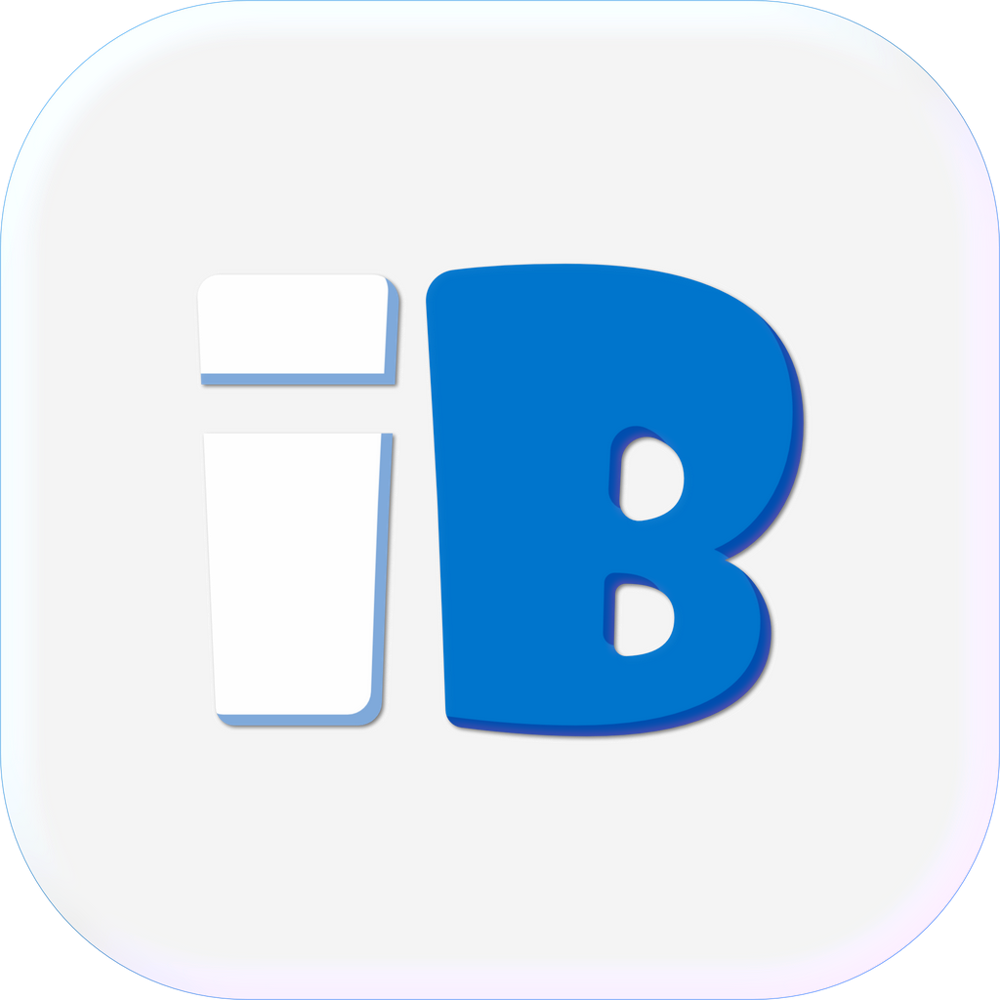
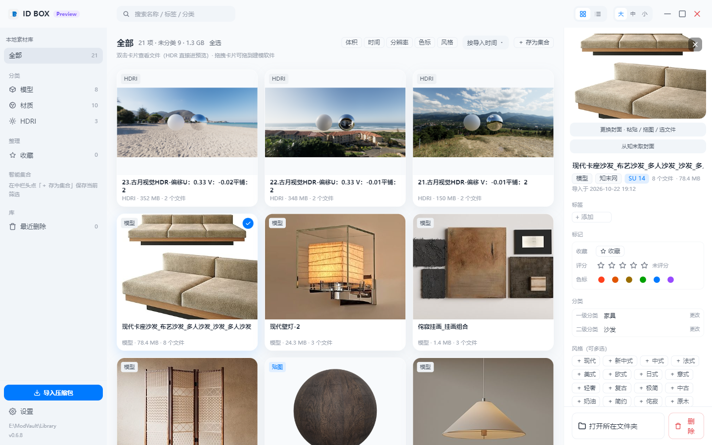
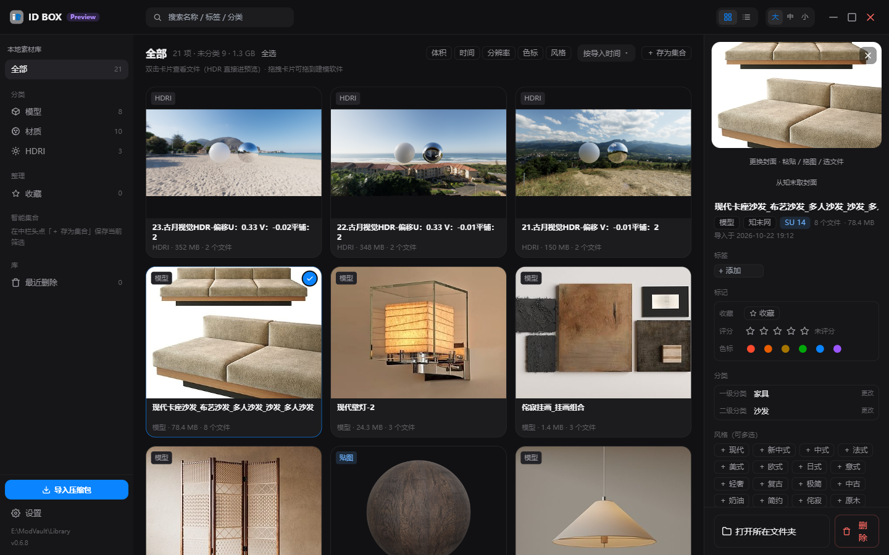
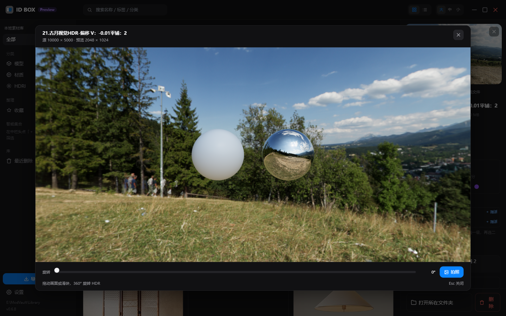
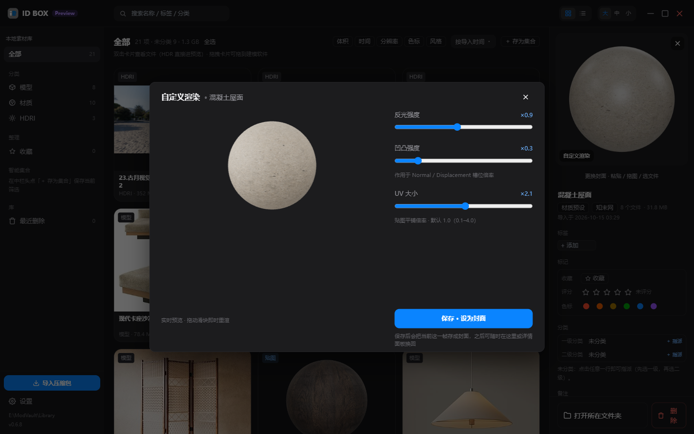

<div align="center">



# ID BOX

**把知末网下载的模型 / 贴图压缩包拖进来，就变成一个能分类、有封面、可预览的本地素材库。**


</div>

> **当前是 Preview 测试版**（顶栏 `ID BOX` 右边那颗紫色胶囊就是它）。功能在快速迭代，
> 数据结构可能随版本调整；遇到问题请用「设置 → 数据与备份 → 日志文件 → 导出日志」，
> 日志里有足够定位的信息。
>
> 0.7.x–0.8.x 做过两轮数据保全：重扫不再覆盖你改过的字段（覆盖前先落一份快照），
> 设置写盘改成串行队列（连点开关不会再互相覆盖或报 ENOENT）。
> 所以调好的材质球参数与设置，不会因为一次重扫或一次连点被抹掉。

---

## 它解决什么问题

在知末网（znzmo.com）下模型，流程基本是这样：下载 → 解压 → 里面躺着一堆
`微信扫码.jpg`、`知末SU-xxxx.html`、`知末网说明.txt` → 把 `.skp` 拎出来 → 改名 →
自己放进某个文件夹 → 过两个月忘了它在哪。

一个项目下来几十上百个包，全靠文件夹记忆。**ID BOX 把这一串动作变成一次拖拽**，
并且在你三个月后想找「那个中古风的壁灯」时，真的能找到。

---

## 界面

<div align="center">
  
  
</div>

> 以上为**实际运行截图**（1440×900，本地真实素材库）。深色是作者的日常主题。

---

## 核心能力

### 1 · 拖入即归档

- **一次拖入压缩包 / 单张图片**，自动解压（`.zip` / `.rar`(zip 内容) / `.7z`，含 GBK 编码修复）
- **自动剔除杂质**：微信扫码图、站方 HTML、说明文本、`__MACOSX` 等一律不进库
- **递归下钻**：压缩包套一层 `attachment_xxxx/` 目录也能找到真正的模型
- **原包去向可选**：保留原位 / 移入系统回收站 / 彻底删除（默认移入回收站）
- **`.skp` 内嵌预览图提取**，无封面时也能立刻看到是什么东西
- **3DMAX（`.max`）支持**：与 SKP 同管线导入归档，卡片显示专属 "3DS" 徽标（无内嵌预览，图标占位兜底）

### 2 · 自动分类（不另造分类体系）

分类词表**逐项照抄知末网的分类结构**，不自创、不翻译、不臆造——这样你在软件里看到的
类目，和你在网站上看到的是同一套。

- 导入时按**文件名 + 包内文件名**匹配受控词表做预分类（`src/shared/taxonomy.ts`）
- 命中二级 → `<大类>/<一级>/<二级>/`；只命中一级 → 落 `未分类`；全不命中 → 进「未分类」等指派
- **词表纪律**：词条只能来自站方原始抄录（`docs/05`、`docs/07`）。缺的类目先补抄录，不靠猜
- 可选**模型 API 兜底**：只在词表完全命中不了时调用，自己填地址/密钥/模型名，默认关闭，
  且**绝不覆盖**已有分类
- **用户自定义词条**：一级 / 二级分类都允许新增自定义词（覆盖模型 / 材质 / HDR），
  自动分类仍只认站方词表；被资产使用的自定义词条不可删除

### 3 · 浏览与整理

| | |
|---|---|
| 三种视图 | 资产网格（大/中/小密度）、列表、**双击进软件内文件浏览器** |
| 多选 | 复选框 + Shift 范围选 + 全选 + **框选**（拖拽套索） |
| 筛选 | 大类 / 一级 / 二级 / 风格 / 标签 / 色标 / 体积 / 分辨率 / 导入时间，多维度可叠加 |
| 智能集合 | 把当前筛选条件存成一组，一键切回 |
| 重复检测 | 同名副本聚合，**同名的不同知末 ID 不会被误判成重复** |
| 回收站 | 软删 + 保留期设置，误删可还原 |
| 批量重命名 | 命名模板 + 预览，只改文件夹名，不动包里的文件 |
| 布局 | **左右侧栏可折叠**（边缘 chevron 唤出，状态记忆），小屏或「只想看素材」时把画布让出来 |

### 4 · 预览

- **知末封面自动抓取**：从资产名里的 `ID_<数字>` 反查详情页主图，比 SKP 内嵌预览（约 256px）清楚得多。
  瞬时网络失败会自动重试一次，不会「点一下报错」
- **知末风格自动填充**：同一次请求顺手解析站方风格，命中本地词表才写，且只在你没选过时写
- **材质球**：`three.js` 离屏渲染 PBR 材质球（单图 / 多图 PBR 贴图集），可调反光、凹凸、UV 重复，
  「保存」直接变成卡片封面
- **Quick Look（空格）**：选中卡片按空格 → 全屏快览，`←`/`→` 在**当前视图序列**里切上一张/下一张，
  **空格或 `Esc` 关闭**且**不清选中**；纯预览不带编辑控件，比素材时不必进详情面板
- **HDR 全景预览**：`.hdr` 入库后在**主进程流式降采样**（16384×8192 的文件直接喂 GPU 必然 OOM），
  预览里是「HDR 当背景 + 白球（看光分布）+ 银球（看环境反射）」，可 0–360° 旋转、可拍照当封面

<div align="center">
  
  
</div>

> 左：HDR 预览（源 10000×5000，降采样到 2048×1024 后预览）。右：材质球自定义渲染，三个滑块实时生效，
> 「保存」即写成卡片封面。

### 5 · 接回你的工作流

- **拖出到 SketchUp / D5**：原生拖拽，拽到建模软件里就是那个 `.skp`
- **双击**卡片进文件视图，Esc 返回
- **别名映射**：软件内显示中文别名，磁盘上的文件名一个字不动
- **诊断日志**：一键导出成 zip，用于反馈问题（不联网、只落本地）
- **设置**：7 个分页（外观 / 导入 / 分类 / 库 / 别名 / 数据与备份 / 关于），统一卡片语言
- **反馈入口**：「设置 → 关于」里有作者微信二维码与「在 GitHub 提 Issue」两条途径

---

## 技术栈

| 层 | 选型 |
|---|---|
| 壳 | Electron 33（Chromium 130 / Node 20） |
| UI | React 18 + Tailwind CSS 3（全 token 化，浅色/深色两套） |
| 状态 | Zustand |
| 本地库 | Dexie（IndexedDB） |
| 3D | three.js（材质球、HDR 环境光、PMREM） |
| 构建 | electron-vite + electron-builder |
| 测试 | Vitest（纯逻辑层 + 源码守卫，**3087 条**；带真机 7-Zip 为 3091 条） |

设计原则：**本地优先**。素材、缩略图、索引全在本机，删除软件不删你的文件。

---

## 快速开始

环境要求：**Windows 10/11**、**Node.js 20+**。

```bash
npm install

npm run dev       # 开发（HMR）
npm run build     # 编译到 out/
npm run test      # 3087 条测试
npm run typecheck:node && npm run typecheck:web
```

出安装包：

```bash
npm run build
npx electron-builder --win nsis -c.directories.output=release
# → release/IDBOX-Setup-<version>.exe
```

> 解压能力依赖真实 7-Zip 做兜底回归。设置环境变量可以把那 4 条真机测试也跑起来：
> `MODVAULT_7Z="C:\Program Files\7-Zip\7z.exe" npx vitest run`

### 品牌资源

应用图标、顶栏 Logo、关于页二维码由 `scripts/build-app-icon.cjs` 从 `resources/brand/` 一次性生成：

```bash
npm run brand
```

> 仓库里的 `src/renderer/assets/brand/contact-qr.png` 是**占位图**（浅灰叉，扫不出内容），
> 真实二维码不在公开仓库里。正式发布版的图标 / Logo / 二维码由作者在本地私有品牌资源中生成，
> 不随仓库分发——所以你 clone 下来自己构建，拿到的是占位图，这是**预期行为**，不是 bug。
>
> 脚本语义就这一句：从 `resources/brand/` 一次性生成图标 / Logo / 二维码；源图缺失时跳过对应产物、
> 保留占位图，不报错。
>
> **二维码与打赏码是作者的身份标识。请勿替换成他人的二维码后分发本软件，也不要替换后改名发布。**
> 如果你 fork 只是为了自己用，正确做法是**删掉「设置 → 关于」里的二维码 / 打赏区域**，而不是换成你自己的。

---

## 项目结构

```
src/
├─ main/          Electron 主进程：导入/解压、缩略图、HDR 降采样、知末抓取、协议、日志
├─ preload/       contextBridge 暴露的 IPC 契约（渲染层唯一入口）
├─ renderer/      React UI：组件 / 逻辑（纯函数，可单测）/ 样式 token
└─ shared/        主进程与渲染层共用：类型、分类词表、自动分类、命名与别名规则

docs/             32 篇工程文档（PRD、架构、分类体系、变更设计、测试报告、性能诊断…）
tests/            Vitest 用例（纯逻辑 + 源码守卫）
build/            应用图标
resources/        打包资源（品牌素材、拖拽图标）
```

几条贯穿全局的约定：

- 资产的唯一 id 是**相对目录路径**，所以重命名/移动分类就是目录操作
- 分类词表的唯一真相源是 `src/shared/taxonomy.ts`，任何 UI 都从它派生
- 渲染层拿不到 Node 能力，只能走 `preload` 白名单

---

## 数据与隐私

- 素材、索引、缩略图全部**只在本机**：库目录由你自己指定，缩略图缓存在 `%APPDATA%/idbox/thumbs`
- 只有两处会联网，且都可以关：**知末封面抓取**、**可选的 AI 分类**（自填 API）
- 不收集遥测，不上传任何素材或路径
- 诊断日志写在本地，只在你自己点「导出」时才会被打包

---

## 关于分类体系

这套词表是照知末网抄下来的（`docs/05` 模型频道 / `docs/07` 贴图材质频道），
落到 `src/shared/taxonomy.ts`，并整理成 `docs/06-分类体系设计.md`。

之所以坚持「不自创类目」：**分类的价值在于和你平时找素材的直觉一致**。
自己发明一套更漂亮的名字，反而会让"我记得网站上归在哪"这条线索断掉。

`docs/06` 里还记了历次词表修订的来由（哪次是因为站方改版、哪次是因为实测漏分），
改词表之前建议先读它。

---

## 文档

| 文档 | 内容 |
|---|---|
| [`docs/01`](docs/01-PRD-模库.md) | 产品需求（含竞品调研、需求池、风险） |
| [`docs/02`](docs/02-架构设计-模库.md) | 系统架构与任务分解 |
| [`docs/06`](docs/06-分类体系设计.md) | 分类体系与词表纪律（**改词表前必读**） |
| [`docs/24`](docs/24-变更设计-知末封面抓取.md) | 知末封面抓取的设计与失败语义 |
| [`docs/25`](docs/25-待办-用户反馈.md) | 用户反馈台账（每条含原话、根因、验收口径） |
| [`docs/26`](docs/26-性能诊断-材质球切换.md) | 材质球卡顿的量化诊断（瓶颈在解码，不在 GPU） |
| [`docs/08`](docs/08-测试报告.md) | 测试报告与各轮验收结论 |

---

## 未来功能展望

> **以下都是方向，不是承诺**；优先级会随实际使用反馈调整，未完成的功能不会写进发布说明。

**渐变贴图的透明度按灰度映射**

现在的透明度判定偏二值，柔和的半透明边缘容易被压成硬边。作者的原话是「渐变的透明不该是非黑即白，
要识别灰度」，并且要配一个「反转灰度」开关——哪里透明交给用户抉择，而不是由默认值替用户决定。
这条已记录、**明确推迟**：它改的是贴图管线的语义，会让已经在库里调好的球得到不同结果，
得和缓存键、封面一致性一起想清楚，不适合塞进一个小版本。

**材质球形态可选（球 / 平面 / 圆角盒）**

渲染与缓存已支持三种形态，也参与球图命名，但**地基已有、入口未做**。之所以先不放按钮：
形态一换，卡片封面、缓存键、拖出行为都要重新对齐，等设计与交互定稿再放出来，
比先给一个半成品开关更省事。

**封面与调参统一**

现状是「手动封面优先」：设过封面的资产，卡片就固定显示那张图，之后再调参数卡片不会自己变，
要点两次才更新。将来想区分「自己渲的球」和「用户挑的图」，让前者跟着参数走、后者保持不变。
这个区分的前提是封面能可靠地记住来源，所以排在数据层稳定之后。

**材质球切换性能**

`docs/26` 已经量化过：瓶颈在**贴图解码**，不在 GPU。下一步做解码池 / 预热，
而不是继续加渲染特效——特效只会让解码压力更大，方向是反的。

**更多格式与平台**

目前只解析 png / jpg / hdr / exr 的尺寸，webp / tif 还不认；也只支持 Windows
（拖出、回收站、文件关联都用了平台能力）。跨平台不是不愿意做，是这三件事在 macOS / Linux
上都要另写一套，成本远高于它现在能带来的收益。

**分类词表继续补抄**

词表纪律不变：只从站方原始抄录补，不自创；缺的类目先补抄录，再进代码。
先抄后写看起来慢，但能避免「为了分得准自己发明类目」——短期好看，长期会把
「和网站上归在同一处」这条最值钱的线索弄断。

---

## 已知限制

- 仅支持 Windows（拖出、回收站、文件关联都用了平台能力）
- 材质球 / HDR 预览需要可用的 WebGL；显卡过老时会降级成封面缩略图
- HDR 首次打开要在主进程降采样（大文件几十秒），第二次走缓存
- 知末抓取依赖站方页面结构，站方改版可能失效（失败会明确报原因，不影响封面其它来源）

---

## 许可证

© 2026 杨雯丞（Chengcheng）。**保留所有权利（All rights reserved）。**

本仓库公开是为了展示与交流：你可以阅读、克隆、在本地构建用于自己评估。
**未经作者书面许可，不得再分发、修改后发布、商用，或把它作为其他产品的一部分。**

`ID BOX`、`ID BOX` 徽标与界面设计均归作者所有。

---

<div align="center">
<sub>Built with Electron · React · three.js ｜ 关于、打赏与反馈入口在「设置 → 关于」</sub>
</div>
