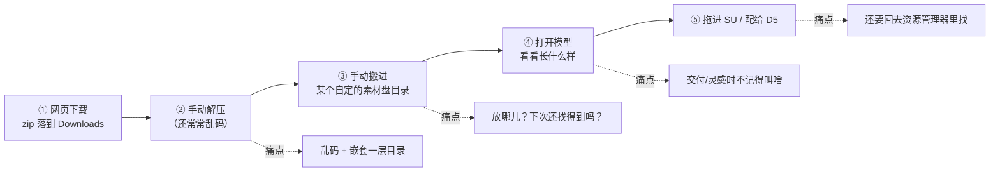
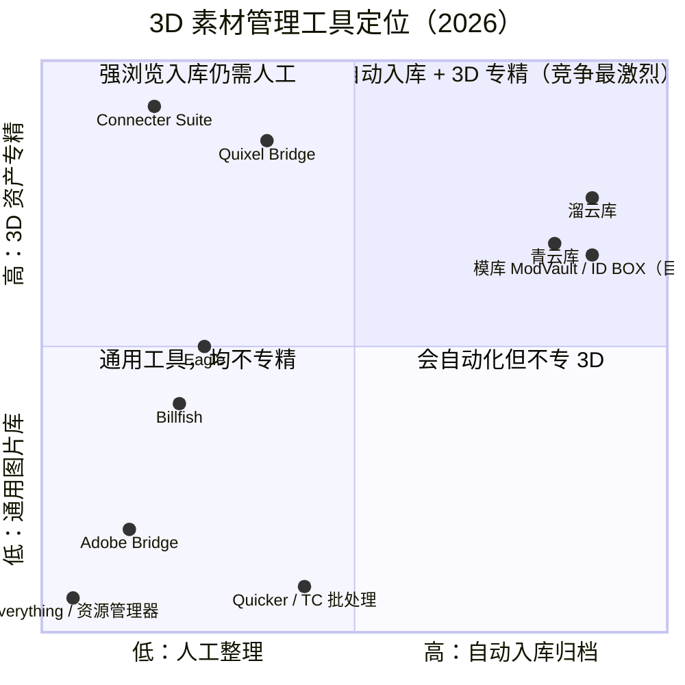
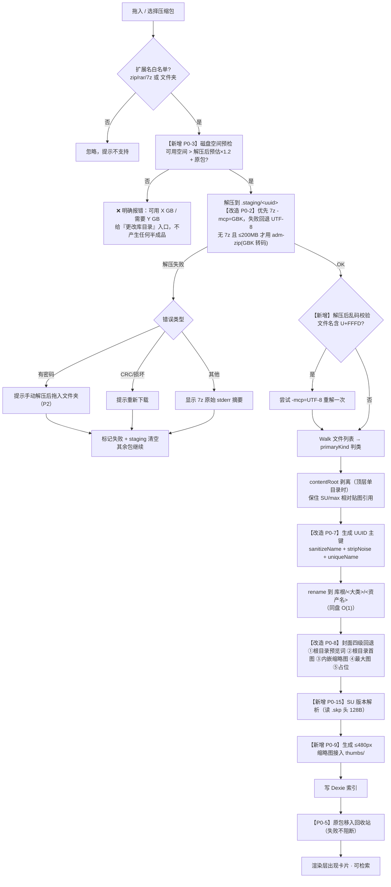
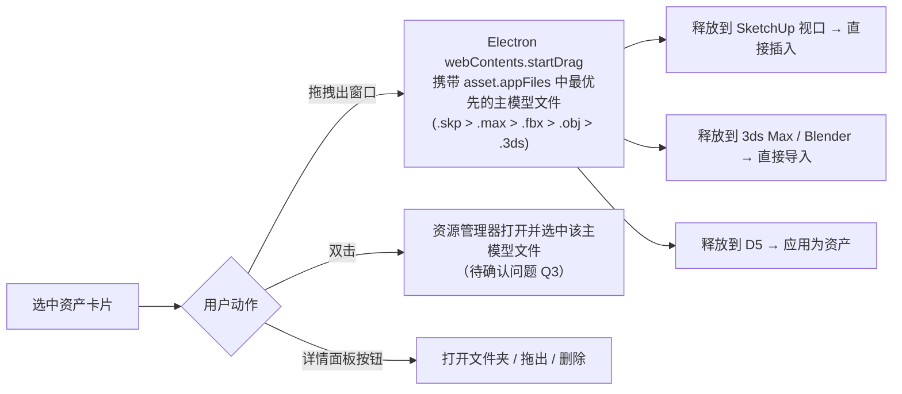

# 模库 ModVault — 产品需求文档（完整档）

> 文档版本：v1.1 ｜ 撰写：许清楚（产品经理） ｜ 语言：简体中文
> 目标读者：架构师（高见远）、工程师（寇豆码）、QA（严过关）、验收方（杨雯丞）
> 状态：待架构评审 → 待用户批注拍板
>
> **变更记录**
> - 2026-10-15 ｜ v1.1 ｜ 竞品调研增补：溜云库/青云库/Eagle/Billfish（主理人检索，用户拍板收录）；§2.3 新增国内直接竞品小节、修订差异化定位与象限图结论
> - 2026-10-13 ｜ v1.0 ｜ 初版（完整档：调研 + 原型评估 + P0/P1/P2 + 载体设计稿）

---

## 1. 项目信息

| 项 | 内容 |
| --- | --- |
| 项目名 | `modvault`（中文名：**模库 ModVault**） |
| 一句话 | 把知末网下载的模型压缩包拖进来，自动解压、自动分类归档、自动清理原包，并给你一个能**看图检索**的本地素材浏览器。 |
| 原始需求（用户原文，逐字引用） | 「知末网每次下载模型都要手动解压，弄个拖到软件自动解压然后自动删除压缩包，并且分类的本地浏览器软件，可以看本地下载分类好的模型以及贴图等等」 |
| 交付形态 | Windows 桌面应用（Electron），**离线优先、数据不出本机、无账号、无云端** |
| 技术栈 | Electron + React + Vite + TypeScript + Tailwind CSS + Zustand + Dexie（沿用现有原型，与用户自研 ID Plan 同构） |
| 目标用户 | 杨雯丞（空间/主案设计师 + 独立开发者），主力工具 SketchUp / AutoCAD 天正 / D5 Render，辅 3ds Max / Blender / PS / ComfyUI |
| 现有资产 | `E:/workbuddy/2026-10-13-01-03-46/modvault/` 已有未验证原型（约 1990 行，3 个单测，类型检查未通过） |

---

## 2. 调研结论（本档核心）

> 调研方法：关键词 3 组 × 搜索 + 目标站点实测抓页（知末网真实详情页 2 个）+ 竞品官方文档/评测交叉验证。
> **事实可信度分级**：🟢 站点实测 / 官方文档；🟡 多个第三方来源交叉印证；🔴 单一来源或推断（PRD 中不作为硬性依据）。

### 2.1 知末网（znzmo.com / 3d.znzmo.com）下载生态

#### 2.1.1 站点事实（🟢 实测）

| 维度 | 事实 | 对产品的含义 |
| --- | --- | --- |
| 主体与域名 | 南京喵熊网络科技有限公司，苏 ICP 备 18050492 号；模型频道为 `3d.znzmo.com/3dmoxing/<id>.html` | 网上流传的 `zhimoe.com` / `zm123.com` / `zhimow.com` 等均为 SEO 仿冒站，**其内容不可作为需求依据**（本次调研已剔除） |
| 下载门槛 | 需登录（手机号验证码）；免费 + VIP/积分混合 | 我们只处理"已经躺在下载目录里的包"，不碰下载环节 |
| 官方桌面端 | 站点首页有「安装知末桌面端」入口 🟡 | **官方解决的是"下载"，不是"下载之后"。** 我们的战场在官方客户端的下游，不冲突 |
| 分类体系 | 家具/家装/工装/硬装构件/装饰品/灯具/用品器材/景观/植物/窗帘布艺/建筑/人物动物/展厅展台/广告美陈/舞台/其他模型/3D材质/家装鸟瞰 | 这是**平台的**分类学，不是用户的。用户找不到东西恰恰是因为他的本地目录跟这个分类学对不上 |
| 风格标签 | 现代/新中式/中式/法式/美式/欧式/日式/意式/轻奢/复古/极简/中古/奶油/简约/侘寂/原木/北欧/禅意/简欧/工业 | **可直接复用为导入时的标签候选词**（P1），成本极低、用户认知零门槛 |

#### 2.1.2 单包实测数据（🟢 抓取真实详情页）

| 模型 ID | 名称 | 核心参数 | 面数 | 文件大小 |
| --- | --- | --- | --- | --- |
| 1174510473 | 现代衣柜 转角衣柜 | MAX 2020 · CR 9，有材质贴图，CR 灯光 | 607 万+ | **350.61 MB** |
| 1217063123 | 奶油风大平层客餐厅 | MAX 2022 · CR，10 相机 | 1353 万+ | **1.28 GB** |

**这条数据改变了 4 个设计决策：**

1. **导入必须是异步、可取消、有真实进度的主进程任务**，渲染层不能假装在 loading；
2. **磁盘空间必须预检**：解压 1.28 GB 的包，峰值占用 = 原包 1.28 GB + 解压后 ~1.3 GB ≈ **2.6 GB**。必须在解压前校验目标盘剩余空间（建议要求 `剩余 > 包大小 × 2.5`），否则要给出**明确的分级提示**（继续 / 改库目录 / 取消），而不是解压到一半失败；
3. **默认库目录不能是系统盘**：原型默认 `E:\ModVault\Library` 判断正确（用户 E 盘已有 `E:/PIC` 长期归档习惯，说明 E 盘是素材盘）；
4. **不允许用纯 JS 库兜底 GB 级包**：7-Zip 子进程是主路径，adm-zip 只能做小包兜底。

#### 2.1.3 压缩包侧面

| 问题 | 结论 | 可信度 | 依据与含义 |
| --- | --- | --- | --- |
| 什么格式 | 主流 **ZIP**，存在部分 rar / 7z | 🟡 多来源交叉印证 | 3 条以上独立教程内容一致；因此三种格式都要支持 |
| 有没有密码 | 未见官方普遍加密证据；下载站付费资源偶有密码 | 🔴 | 不做破解。检测到加密 → 明确报错 + 跳过 + 告诉用户"手动解压后拖入文件夹"，其余包继续 |
| **文件名编码** | ⚠️ **这是最大的隐性杀手** | 🟢 | ZIP 格式本身不强制规定文件名编码。Windows 中文版打包的 ZIP 用 **GBK**，而 7-Zip 默认按系统/UTF-8 识别 → **中文文件名乱码**。多份第三方实测均把"知末/WinRAR 打的包解压乱码"列为头号问题，解法就是 7-Zip 加 `-mcp=GBK` 或 Bandizip 切代码页 |
| 包有多深 | 常见**单个顶层目录**（以站点/模型名命名，常带水印后缀），内含主模型 + `Textures/` 或 `maps/` + `Materials/` + 预览图 + readme/尺寸说明 | 🟡 | 支持"`top.length===1 && dirs.length===1` 时取该目录为内容根"是**正确且关键**的，它保住了 SU/max 模型的**相对贴图引用不断裂** |
| 水印后缀 | 常见 `(知末网)`、`(www.znmo.com)`、`[3d66]`、`(2)`、`-副本` | 🟡 | 原型 `stripNoise` 已有对应规则，保留 |
| 预览图命名 | **无统一规范**。常见：`预览图.jpg`、`效果图.jpg`、`preview.jpg`、`thumbnail.jpg`、`render01.jpg`、`封面.jpg`，也有纯数字或截图名 | 🟡 | 单靠文件名正则**一定会漏**。必须有"手动指定封面"兜底，且要有 skp/max 内嵌缩略图作为第二来源（见 2.4、6-P1） |

> ✱ **这条编码结论直接推翻了原型的一个实现细节**（见 §3 改造项 C1），是本次调研最有价值的发现之一。

#### 2.1.4 常见文件类型清单（供 `EXT_KIND` 校准）

| 大类 | 高频 | 中低频 | 说明 |
| --- | --- | --- | --- |
| 模型 | `.skp` `.max` `.fbx` `.obj` `.3ds` | `.dwg` `.dxf` `.rvt` `.rfa` `.blend` `.glb/.gltf` `.stl` `.dae` `.c4d` `.3dm` | SU/max 用户主要用前四种；dwg/dxf/rvt 属于图纸，建议**单独归类而不是塞进"模型"**（见 §3 改造项 C6） |
| 贴图 | `.jpg/.jpeg` `.png` `.tga` `.tif/.tiff` | `.bmp` `.webp` `.dds` `.jpeg XR` | 4K 贴图常见，分辨率是选型依据 |
| HDRI | `.hdr` `.exr` | — | 渲染环境照明用，独立成类是懂行的判断，保留 |
| 材质预设 | `.mat` `.vismat` `.sbsar` | `.matlib` `.mi` `.ies` | VRay/Corona/Substance 预设，用户 D5+Vray 工作流会用到 |
| 其他 | `.txt` `.pdf` `.docx` `.url` `.html` | — | readme / 材质清单 / 尺寸说明 |

### 2.2 用户真实工作流：本地浏览器到底要帮他解决什么

#### 2.2.1 现状五步（每次下载的必经之路）



#### 2.2.2 三问归因

用户的问题只有一句话，但底下藏着三个不同性质的问题。调研后结论如下：

| 问题 | 回答 | 权重 | 依据 |
| --- | --- | --- | --- |
| **找得到**？ | **是。这是主战场。** | ★★★★★ | 用户的记忆锚点是**看到的样子**和**当时为了什么下的**，不是文件名。三周后他只记得"那个带转角的白色衣柜"，资源管理器按文件名搜不到；Everything 也只能搜文件名。且他是 `E:/PIC` 按 `YYYY_MM_DD` 归档的人——**照片能按日期归档，模型不能**，因为模型的检索键从来不是日期 |
| **看得清**？ | **是。必要支撑。** | ★★★☆☆ | "看得清"≠ 旋转 3D。他要的是"一眼认出这是哪个沙发"。**一张封面图就够** |
| **拿得走**？ | **是。临门一脚。** | ★★★★☆ | 找到了、认出来了，最后还得回资源管理器里双击/拖走 = 白绕一圈。**这是原型的实际断点**（见 §3） |

> **产品结论：做一个"入口自动化 + 内容可视化"的最小交集产品。**
> 「自动解压 → 自动分类 → 自动清包」解决**入口**；「封面墙 + 中文模糊搜 + 标签」解决**找得到**；「直接拖出到 SU/3ds Max/D5」解决**拿得走**。三者缺一不可，但各自都要做到最小可用，不许膨胀。

### 2.3 竞品分析

#### 2.3.1 竞品表（9 个；🆕 溜云库 / 青云库为 2026-10-14 增补）

| 竞品 | 定位 | 价格 | 强项 | 对本用户的适配度 | **为什么没解决他这个痛点** |
| --- | --- | --- | --- | --- | --- |
| 🆕 **溜云库** ⚠️ | **3D 溜溜网（3d66.com）官方客户端**，深圳特鹏网络，2017 立项，官方称 100w+ 用户，4.0 版 2026-09 仍在更新（安装包约 227 MB） | 免费（绑定 3d66 账号） | **与 ID BOX 重叠度最高**：下载素材自动解压、自动整理分类、本地管理模型/材质/贴图/灯光、一键拖拽到 3ds Max、批量添加 AI 智能识别、以图搜图、云渲染（最高 768 线程）、VR 全景合成、企业协同共享、MAX/SU 脚本库 | **高** | ① **本质是素材站获客客户端**：下载要走 3d66，本地目录锁死在 `3D66/LiuYunKu` 私有结构，需登录，**离开软件库不可用**——与"文件还在我自己盘上、卸载软件照样能用"（G3）正面冲突；② 用户素材来源是知末/3d66/网盘混着来，溜云库只认真自己家的下载流；③ 不做 SKP 内嵌预览提取这类中立管道能力。**详见 §2.3.2** |
| 🆕 **青云库** | 青模网官方客户端 | 免费（绑定青模网账号） | 压缩包导入自动解压、自动分类命名、重复检测、**自动识别 MAX 版本/渲染器**、本地管理模型材质贴图灯光、局域网共享、断网离线可用 | 中高 | 同样**绑定青模网素材生态**，库结构私有；本地化能力是同组里最接近我们的（含离线可用），但入口被锁在青模网。**详见 §2.3.2** |
| **Eagle** | 灵感/图片素材库（大陆设计师事实标准） | ¥199 买断 / 2 台设备（黑五约 7 折） | 支持预览 106 种格式（含 fbx/obj/3ds/ply/stl/glb、**skp**、psd/dwg）；标签/智能文件夹/评分/颜色搜索/批量；浏览器扩展采集；UI 打磨成熟 | 中 | ① **按"文件"入库，而 3D 模型是"包"**——一个含 skp + `Textures/` 的目录拖进 Eagle，会炸成一堆散图 + 一个孤立 skp，上下文全丢；② 官方明确承认**不支持 FBX/OBJ 自动挂贴图材质**，要手工把贴图拷到同目录再重链——等于没解决；③ 素材进 Eagle 私有库后被结构锁定，与用户"文件还在我自己盘上、我自己能管"的诉求冲突。**2026-10-14 复核：结论不变**——它不做压缩包解压流水线、不懂模型分类词表、不动物理目录 |
| **Billfish** | Eagle 的免费平替（国产） | 免费 | 保留原始文件夹结构（数据库与素材分离，删隐藏目录即等于删库）；原生中文/国内字体友好；云同步（免费 1G） | 中 | ① 更新频率低（社区反馈半年~1 年一次）；② 素材 >5000 后打开与搜索有明显延迟，而 GB 级模型资产会迅速破千；③ 同样**不做"解压→归档→删包"这条入口侧的事**——它假设你已经整理好了。**2026-10-14 复核：结论不变**——图片/视频/文档为主，3D 支持弱，与 Eagle 同局限 |
| **Adobe Bridge** | Adobe 生态的资源浏览器 | $9.99/月（订阅） | 元数据/XMP/批处理/CC Libraries 联动 | 低 | ① 订阅制 + 需联网登录，**违反"离线优先、无账号"底线**；② 面向平面（psd/ai/id），对 skp/max/fbx 基本无预览；③ 用户主力不是 Adobe 系（是 SU/天正/D5/ComfyUI），生态不匹配 |
| **Connecter Suite** | **形态上最接近的竞品**：3D/AEC 本地优先 DAM（DesignConnected） | Personal 免费；Solo €49/年；团队 €79–129/月；60 天全功能试用 | 原生嵌入预览 **3ds Max/C4D/Revit/Rhino/Blender/SketchUp/AutoCAD**；OpenGL 交互预览 FBX/OBJ/3DS/STL/DAE；PBR 贴图/IES/Substance 实时预览；布尔搜索、去重、标签层级、颜色编码；DCC 插件直拖入 3ds Max/Blender/UE | 高（**产品形态上学它**） | ① **只做"浏览"，不做"入库"**——它假设你的资产已经在本地某个整理好的目录树里。它不会帮你解压、不会分类归档、不会删压缩包。**而这恰恰是用户唯一抱怨的事**；② 即便 Personal 免费，**也要联网做 license 校验与团队管理**，不符合"空气隔离也能用"；③ 英语界面 |
| **Quixel Bridge** | Megascans 云端素材管道 | 订阅 / UE 账号免费 | PBR 扫描资产质量高；一键导出 UE/DCC；LOD 与分辨率选择 | 低 | ① **它管的是它自己的 Megascans 库，管不了你从知末下回来的东西**；② 强依赖联网与账号；③ 不是本地资产管家，是 CDN 客户端 |
| **Everything + 资源管理器** | 本机文件名秒级搜索 | 免费 | NTFS 索引极快、几乎零资源占用 | 中（**这是用户目前的隐性方案**） | ① **只能搜文件名与路径，看不到内容**——而用户恰恰记不住文件名；② 对 GB 级 zip 的内部结构一无所知；③ 搜到之后仍然要手动解压、手动判断、手动搬运。**它解决的是"哪个文件夹"，不是"哪个沙发"** |
| **Quicker 动作 / Total Commander 批处理** | 手动半自动脚本 | 免费 / 低价 | 灵活可组合，高手能拼出任意流程 | 中 | ① 需要用户自己写、自己维护动作；② **没有持久索引、没有可视化封面墙**——做完批处理之后，"找得到"的问题原封不动还在；③ 本质是半自动，不是产品 |

#### 2.3.2 国内直接竞品增补（2026-10-14 主理人检索，用户拍板收录）

> 回答用户的原始问题——「ID BOX（原模库 ModVault）在国内有没有竞品」：**有，而且比 v1.0 调研承认的更直接。** 溜云库把"下载自动解压 + 自动分类 + 本地浏览"这条链路已经做了近十年。v1.0 里"右上象限是空的"这个结论**据此修正**（见 §2.3.4）。

**溜云库 vs ID BOX 逐项对照**（重叠度最高的一个，值得单独拉表）：

| 维度 | 溜云库 | ID BOX（本产品） |
| --- | --- | --- |
| 链路本身（拖入→解压→分类→本地浏览） | ✅ 有，做了近十年 | ✅ 有 |
| 处理哪个站的下载 | **只有 3d66 自己家的** | **任何站**（知末/3d66/建E/网盘/任意 zip） |
| 是否要登录 | 必须（绑 3d66 账号） | **不需要** |
| 本地库结构 | `3D66/LiuYunKu` **私有结构**，离开软件库不可用 | `大类/一级/二级/资产名` **四层语义目录直接落磁盘**，资源管理器原生可用，卸载软件文件照常用 |
| 定位本质 | **素材站获客客户端**（下载入口） | **中立管道**（下载落地之后的处理） |
| 细节能力 | 云渲染、以图搜图、VR 全景、企业协同 | 杂质剔除（微信扫码图/说明 txt 自动清）、SKP 内嵌预览提取、three.js 材质球渲染、回收站 5 秒宽限删除 |
| 百万级在线素材 / 云渲染 / MAX·SU 插件深度集成 | ✅ 强 | ❌ 不做（短期不碰，见 Scope Out） |

**青云库**：能力清单上与溜云库同构（自动解压/分类命名/重复检测/识别 MAX 版本与渲染器/局域网共享/**断网离线可用**），是同组里本地化程度最接近我们的；但同样绑定青模网素材生态、库结构私有。**它验证了一件事：这条链路在国产工具里是被反复做过的成熟需求，不是伪需求。**

**诚实评估（写进 PRD 就不许再回避）**：
1. 「下载自动解压 + 自动分类 + 本地浏览」链路本身**不是独创**——溜云库做了近十年，青云库又做了一遍；
2. ID BOX 赌的缝隙是：**「设计师不想要被素材站绑架的本地库」**——要任何站都能进、不要登录、库结构是资源管理器原生可读的明文目录、离线无账号；
3. 竞品强在**供给侧**（百万级在线素材、云渲染、以图搜图、十年用户积累、MAX/SU 插件深度集成），这些 ID BOX 短期不碰、也碰不过；ID BOX 只做**需求侧的落地管道**。两边的胜负条件完全不同：竞品赢在"素材多"，ID BOX 赢在"不绑架"。

#### 2.3.3 差异化定位（v1.1 修订）

> **v1.0 口径**："竞品都在做'你已经整理好的素材怎么找'，没人做'刚下载落地的素材怎么变成已整理的'。"
> **v1.1 修正**：这句话在国内不成立——溜云库/青云库恰好就在做"刚下载落地的素材怎么变成已整理的"。修正后的口径：
>
> **一句话：国内竞品做的是"自家素材站的下载落地管道"，ID BOX 做的是"不绑定任何平台的中立下载落地管道"。**
> 竞品的自动化是**获客手段**（自动化做到入口，是为了让你留在它的站上）；ID BOX 的自动化是**产品本体**（拖进来的是任何站的包，落地的是资源管理器原生可读的明文目录，全过程无账号、可离线、不锁库）。

#### 2.3.4 竞品象限图

> **为什么换轴**：原建议的横轴「本地化/离线程度」在这组竞品里**区分度不够**——Everything / Billfish / Eagle / 资源管理器全部 95%+ 本地，会挤在同一条竖线上，画不出决策信息。改用区分度最高的两轴：
> - **X 轴 = 下载落地自动化**（解压 → 分类归档 → 清理原包 → 自动建索引）
> - **Y 轴 = 3D 资产专业度**（能否预览 SU/MAX/FBX/HDRI/PBR 与携带专业元数据）



**读图结论（v1.1 修订——v1.0 的"右上象限是空的"结论作废）**：

- **右上象限不再是我们独占**：溜云库（X 0.88 / Y 0.76）已在这条链路上跑了近十年，青云库紧随其后。**"链路本身"不是我们的差异化，不能再拿它当卖点。**
- 真正的分层在**象限图看不见的第三个维度**：**库的归属权**。溜云库/青云库/Quixel Bridge 的自动化是"获客手段"（把你锁进自家素材站与私有库结构）；ID BOX 的自动化是"产品本体"（不绑平台、不登录、明文目录、离线可用）。同一象限内，我们和它们的胜负条件不同：**它们赢在素材多，我们赢在不绑架。**
- Connecter（左上）在 3D 专业度上比我们强，是我们**预览元数据能力的对标对象**，但它 X 轴几乎为零：它不管入库。
- Quixel Bridge（左上偏右）虽然 Y 高，但它 X 轴的自动化只服务于自家云端库，**对本地资产无能为力**，且联网——**与溜云库是同一种"获客型自动化"，只是云的方向不同**。
- Eagle/Billfish（中）是"灵感图"工具，不是"资产"工具。它们解决的是**灵感收集**，不是**刚下载落地的东西怎么变成资产**。
- 我们把 Y 轴定在 0.66 而不是 0.9：**明确放弃交互 3D 预览**（见 §2.4 取舍），把精力放在"入库自动化 + 够用的封面与元数据"上。这是本产品的**成本结构决定**——注意溜云库 Y 值比我们高，靠的是云渲染/以图搜图这类供给侧能力，**不在我们的战场内**（见 §2.3.3 与 §9 Scope Out）。

### 2.4 关键取舍结论

| # | 议题 | **结论** | 理由（依据） |
| --- | --- | --- | --- |
| T1 | **自动删除原压缩包** | **必须可配置；默认「移入回收站」而非硬删除** | 用户原文写的是"自动删除"，但实测单包 350 MB~1.28 GB，**一个误删的代价不可承受**。回收站在体验上等价于删除（下载目录不再堆积），但保留了后悔权。设置项提供三档：`移入回收站（默认）` / `彻底删除` / `保留原包不动` |
| T2 | **下载目录自动监控** | **做，但默认关闭，排 P1** | 值得做——它是"零思考"的终极形态。但风险真实：浏览器边下边写会产生半成品、临时文件误触发、下 OSS 大文件时误判。**必须**三重保险（`awaitWriteFinish` 稳定期 ≥3s + 扩展名白名单 + 显式忽略 `.crdownload/.part/.tmp/.!ut`）。**v1 先只做拖拽**（这也是用户原话里的交互），监控在 P1 验收后再开 |
| T3 | **3D 预览 vs 封面图** | **封面图。明确不做交互 3D 预览** | 3D 预览需要引入 OpenGL/WebGL 渲染器 + 多格式解析器（FBX/OBJ/MAX 各一套），成本是整个产品其余部分的数倍，且与"本地零依赖"冲突。用户要的是"一眼想起这模型长啥样"，**一张渲染封面完全够**。折中红利：`.skp` 自带内嵌缩略图 PNG、`.max` 在 OLE `SummaryInformation` 流里有预览位图，**提取它们比渲染便宜三个数量级**（见 P1） |
| T4 | **SU 版本元数据** | **做，且优先级提到 P0** | 调研确认 🟢：`.skp` 头部就是 UTF-16LE 字符串 `SketchUp Model {24.0.594}`（magic `FF FE FF 0E`），**读前 64~128 字节即可得到版本**。而"旧版 SU 打不开新版 skp"是 SU 用户**第一痛点**（官方 SKP 文档明确"格式是版本绑定的，这是 skp 打不开的最常见原因"）。**成本接近零，收益极高——这是本次调研推翻原型的最大增量** |
| T5 | **贴图分辨率元数据** | **做，P1** | 读 JPEG/PNG/TGA 文件头即可得宽高，几乎零成本。知末贴图常见 4K，能否用于近景是判断能否启用的第一标准，值得出现在列表/卡片上并支持筛选 |
| T6 | **去重** | **轻量去重（P1），不做全量哈希去重（P2 以后再说）** | 用户会无意识重复下载（隔几周忘了下过），原型已有 `dedupeKey`。但 GB 级包做内容哈希 = 全盘 IO，性价比低。**v1 只做：导入时若命中同名/同 dedupeKey，弹「已存在，是否仍要导入？」** |
| T7 | **批量改名** | **不做（Scope Out）** | 名字已有「包内根目录名 + 去水印 + 防重」三重处理，够用。"事后批量改"属于噪点需求，且它是危险的写操作 |
| T8 | **adm-zip 纯 JS 兜底** | **降级保留 + 强制 GBK 转码 + 体积上限保护** | 见 §3-C1/C2。GB 级包不得走纯 JS |
| T9 | **是否做「图纸」独立分类** | **做，但排 P1（先跑通模型/贴图主线）** | `.dwg`/`.dxf`/`.rvt`/`.rfa` 与 3D 模型是完全不同的资产类型，混在「模型」里会让该分类迅速失真。但用户当前主诉求是模型与贴图，图纸归类放到 v1.1 做，避免 v1 范围膨胀 |

---

## 3. 现有原型评估（保留 / 改造 / 推翻）

> 评估对象：`E:/workbuddy/2026-10-13-01-03-46/modvault/`，约 1990 行，24 个源文件，3 个单测。
> 已读：`main/importer.ts`、`main/extractor.ts`、`main/fsutil.ts`、`main/watcher.ts`、`main/index.ts`、`main/protocol.ts`、`shared/classify.ts`、`shared/naming.ts`、`shared/types.ts`、`renderer/store.ts`、`renderer/App.tsx`、`renderer/components/{Sidebar,AssetGrid}.tsx`。

### 3.1 结论速览

| 结论 | 数量 | 清单 |
| --- | --- | --- |
| ✅ **保留** | 11 项 | R1…R11 |
| 🔧 **改造** | 8 项 | C1…C8 |
| ❌ **推翻** | 3 项 | D1…D3 |
| ➕ **新增（原型完全没有）** | 6 项 | N1…N6 |

**总体判断：架构方向是对的，可以直接增量改造，不需要重写。** 判断对的地方主要是**主进程/渲染进程分层、staging 同盘 rename、保留包内相对路径、回收站而非硬删**；漏掉的地方集中在 **GBK 编码、缩略图性能、拖出到 DCC、SU 版本元数据、删除安全** 这五处——**全部是"真实下载生态环境"带来的问题，只有动手调研才会暴露**。

### 3.2 ✅ 保留（11 项）

| # | 模块 | 判断对在哪 |
| --- | --- | --- |
| R1 | 技术栈：Electron + React + Vite + TS + Tailwind + Zustand + Dexie | 与用户自研 ID Plan 技术栈几乎完全一致，处于他的能力圈内，后续他自己能改能维护。这条比"技术最优"更重要 |
| R2 | 分层：`src/main`（IO 密集）/ `src/shared`（纯函数）/ `src/renderer`（视图） | 纯函数层天然可单测，`classify/naming/format` 已有测试覆盖，这是能把 Write 测试写出来的前提 |
| R3 | **导入管线：`.staging/<uuid>` 解压 → `walkFiles` → 判类 → `moveDir` → 写 Dexie** | 关键设计。staging 与库根同盘 → `fs.rename` 是 O(1)，对 1.28 GB 包是决定性的。`fsutil.moveDir` 还有跨盘退化 fallback，考虑周全 |
| R4 | **`contentRoot` 剥离逻辑**（顶层只有 1 个目录时取其内部作为内容根） | 正确且关键：保证 `.skp`/`.max` 与 `Textures/` 的**相对路径引用不断裂**。调研也确认这是知末包的典型结构。改这个类会因为=模型变"白模" |
| R5 | 五分类 + `KIND_PRIORITY`（model > material > hdri > texture > other） | 合理。`HDRI` 独立成类是懂渲染的人才写得出来的判断，保留 |
| R6 | 原包进**回收站**（`trash` 库）而非 `fs.unlink`，且失败不阻断导入 | 与 §2.4-T1 判断一致。稳 |
| R7 | `vault://` 自定义协议 + `path.resolve` 目录穿越防护 | 正确绕开 Electron 对 `file://` + CSP 的限制，且**做了 `startsWith(lib + sep)` 的越界检查**，安全意识到位 |
| R8 | `App.tsx` 全窗拖拽用 `depth` 计数器处理 `dragleave` 抖动 | Electron/Renderer drag 的经典坑，处理对了 |
| R9 | `rescan()` 用 `folder` 绝对路径做锚点，**保留本地 tags/note/source 不被扫描结果覆盖** | 这是"用户在库外动了文件"之后的正确合并策略，很多同类工具做错这一步 |
| R10 | 设置项颗粒度：库目录 / 删除策略 / 监控开关+目录 / 7-Zip 路径 | 不多不少，正好对应 §2.4 的取舍结论 |
| R11 | 已有 3 个单测（classify / format / naming）覆盖纯函数 | 保留并作为回归基线强制扩容 |

### 3.3 🔧 改造（8 项）

| # | 位置 | 问题 | 改法 | 优先级 |
| --- | --- | --- | --- | --- |
| **C1** | `main/extractor.ts` | ⚠️ **最严重**。7-Zip 调用 `['x','-y','-o'+dest, src]` **没有指定代码页**。Windows 中文版打的 ZIP 用 GBK，7-Zip 按默认识别 → **中文文件名与目录名乱码**；而 SU/max 靠相对路径找贴图，**路径一乱码模型就变花脸/白模**。adm-zip 同样默认按 UTF-8 解码 | ① 7z 命令加 `-mcp=GBK`，并做**二次重试**：先用 `-mcp=GBK` 解，若结果检测到替代符 `U+FFFD` 或高比例可疑字符，回退 `-mcp=UTF-8` 再解；② adm-zip 兜底路径用 `iconv-lite` 把 GBK buffer 转 UTF-8；③ 解压后**校验**：若任一文件名含 `U+FFFD`，整包标记「疑似乱码」并在 UI 醒目提示 | **P0** |
| **C2** | `main/extractor.ts` | `execFile` 无超时、无 stderr 结构化解析；GB 级包交给纯 JS adm-zip 风险高；`.tar/.gz` 在 Windows 下载场景基本用不到 | ① 加 `timeout`（建议 10 分钟，可配置）与 `maxBuffer`；② 设 **adm-zip 兜底体积上限（如 ≤ 200 MB）**，超限则强制要求装 7-Zip 并给出下载指引；③ 移除 `.tar/.gz/.tgz` 白名单，聚焦 zip/rar/7z | **P0** |
| **C3** | `shared/classify.ts` `pickCover()` | 启发式太弱：`sort((a,b)=>a.name.length-b.name.length)` 意味着 `01.jpg` 会赢过 `预览图.jpg`。而调研发现知末包的预览图命名**无统一规范**，纯靠名字必漏 | 改为**四级回退**：① 名字命中预览词正则（含 `预览/效果/preview/thumbnail/cover/render/主图/封面/展图`）**且位于资产根目录层**（不是 `Textures/` 子目录里的）；② 位于根目录下的第一张图片；③ 从 `.skp`/`.max` **提取内嵌缩略图**；④ 最大那张图；⑤ 类型占位图标。并且**必须支持用户手动指定封面** | **P0** |
| **C4** | `main/protocol.ts` + `AssetGrid.tsx` | ⚠️ **性能陷阱**。`` 直连 `vault://` 加载**原图**。知末预览图常见 3000~4000 px / 数 MB，200 张卡片滚动会明显掉帧 + 吃几百 MB 内存 | 加**缩略图缓存层**：导入时（或首次渲染时异步）生成 `~480px` WebP 缩略图存到 `%LOCALAPPDATA%/ModVault/thumbs/<assetId>.webp`，网格只读缩略图，详情面板才读原图。加必要的**緩存淘汰（LRU / 按 asset 删除时清理）** | **P0** |
| **C5** | `main/watcher.ts` | 只按扩展名白名单判断，未排除浏览器临时文件；`.crdownload`（Chrome/Edge）、`.part`（Firefox）、`.!ut`（uTorrent/迅雷）会触发误导入；`depth:3` 可能漏 | ① 忽略规则加临时扩展名黑名单；② `awaitWriteFinish.stabilityThreshold` 提到 `3000ms` 且加 `pollInterval: 500`；③ **先按文件大小稳定校验**：连续两次轮询 size 相同且非 0 才放行；④ 监控导入前在 UI 弹一个可关闭的「检测到新包，导入？」（P1 开启监控时再配） | P1 |
| **C6** | `shared/classify.ts` `EXT_KIND` | `.dwg`/`.dxf`/`.rvt`/`.rfa` **被归进 `model`**。但用户的 CAD 图纸跟 3D 模型是完全不同的东西，混在一起会让"模型"分类迅速失真 | 新增 `drawing`（图纸）大类；`KIND_ORDER` = 模型 / 贴图 / HDRI / 材质预设 / 图纸 / 其他。注：这个改动会影响既有库的 relFolder，需要配合 rescan 迁移 | P1 |
| **C7** | `renderer/App.tsx` | `Delete`/`Backspace` 直接删资产，**无二次确认**，且删的是动辄 1 GB 的东西 | ① 删除必须弹确认（显示资产名 + 大小 + 文件数）；② 统一走**回收站**；③ 提供 **5 秒撤销（Undo toast）**；④ 多选删除时显示总数与合计大小 | **P0** |
| **C8** | `package.json` scripts | `npm run verify`（typecheck×2 + test + build）是好的约定，但**当前类型检查尚未通过**、无端到端验证 | 把 `verify` 全绿设为**Definition of Done 的硬门槛**；QA 阶段再补一条 smoke  checklist（见 §10） | **P0** |

### 3.4 ❌ 推翻（3 项）

| # | 位置 | 为什么必须推翻 | 替代方案 |
| --- | --- | --- | --- |
| **D1** | `shared/types.ts` `Asset.id = relFolder`，`store.ts renameAsset` 里这行：<br/>`newFolder.slice(asset.folder.length - asset.relFolder.length + newName.length)` | **这是定时炸弹。** ① `id` 用相对路径 = 把主键绑死在磁盘布局上，改库目录、重命名、`KIND_LABEL` 改文案都会让主键漂移；② 上面这行字符串 slice 运算混了三种长度，**一旦 `libraryDir` 路径长度变化或 `relFolder` 含中文，算出来的 `relFolder` 就是错的**，而这正是 C1 乱码场景会触发的；③ Dexie 主键漂移会导致 tags/note 全丢 | `Asset.id` 改为 **导入时生成的稳定 UUID**，`folder`/`relFolder`/`name` 降级为普通属性。重命名时直接重算 `relFolder = ${kindFolder}/${newName}`，不再玩字符串切片。**同时提供一次性的 Dexie 迁移（旧库 reindex）** |
| **D2** | `renderer/components/AssetGrid.tsx` 无任何 drag-out 实现 | 这是 **§2.2.2「拿得走」的断点**。用户找到沙发了，还得回资源管理器里找文件夹再往 SU 里拖——整个产品价值打折一半 | 新增 N2「拖出到 DCC」，见 §3.5 |
| **D3** | `main/importer.ts` 缺少**磁盘空间预检** | 按 §2.1.2 实测单包可达 **1.28 GB**，当前实现直接开解，磁盘不够会解到一半失败，且**此时 staging 已产生垃圾、原包未删、Dexie 无记录**，用户面对的是一个半残状态 | 解压前必须校验：`目标盘可用空间 > 预估解压后体积 × 1.2 + 原包大小`。不足则**不解**，直接返回明确错误（可用空间 X GB / 需要 Y GB），给用户「换库目录」入口。预估值取压缩包内 `Uncompressed Size` 之和（7z `l` 可得）或体积上限保护值 |

### 3.5 ➕ 新增（原型完全没有，6 项）

| # | 新增项 | 来源 | 优先级 |
| --- | --- | --- | --- |
| **N1** | **SU 版本解析**：读 `.skp` 前 128 字节提取 `SketchUp Model {23.1.340}` → 显示「SU 2023」并支持按版本筛选 | 调研 T4（🟢 Trimble 官方 SKP 格式文档 + 社区实测），成本近零、收益最高 | **P0** |
| **N2** | **拖出到 DCC**：从卡片/详情面版把资产（或其中某个具体文件，如 `.skp` / 贴图 / `.hdr`）拖出到 SU / 3ds Max / D5 / Blender。**用 Electron `webContents.startDrag` + `filePath`，Drag-out.png 同理** | 调研 §2.2.2「拿得走」 | **P0** |
| **N3** | **缩略图缓存层**（见 C4） | 调研 §2.1.2 大体积 | **P0** |
| **N4** | **内嵌缩略图提取**：`.skp` 扫描 PNG 签名 `89 50 4E 47 0D 0A 1A 0A`（SU 2021+ 更是标准 ZIP，直接读 `meta/model_thumbnail.png`）；`.max` 读 OLE `\x05SummaryInformation` 流中的预览位图 | 调研 T3（🟢skp / 🟡max） | P1 |
| **N5** | **来源 URL 与备注**：`sourceUrl` 字段 + 「当初为了哪个项目下的」自由备注字段，二者都进搜索 haystack | 调研 §2.2.2「记忆锚点是当时用途」 | P1 |
| **N6** | **导入时的标签建议**：用站点风格词（奶油/侘寂/中古/原木…）做候选标签一键勾选 | 调研 §2.1.1 站点分类体系直接可复用 | P2 |

---

## 4. 产品目标

> 三条目标，每条带**可验证**的成功标准。口径统一为本仓库 `npm run verify` 与手工冒烟可复现。

| # | 目标 | 成功标准（可验证） |
| --- | --- | --- |
| **G1** | **让"下载落地"变成零操作**：拖进来就完事，不再手工解压、手工搬运、手工删包 | ① 单包从拖入到出现在库中（可检索）≤ **30 秒**（基准：500 MB zip，NVMe SSD，已装 7-Zip）；② 批量拖入 20 个混合包，**单个失败不阻断其余**，失败项有明确可行动的错误文案；③ 手工操作步骤从 5 步（下载→解压→搬运→打开→再拖）降到 **1 步** |
| **G2** | **让"找得到"不再依赖文件名**：靠封面 + 模糊搜 + 标签定位，而不是回忆文件名 | ① 在 **300 个资产**的库里，给定一段"样子/用途"的自然语言描述（如"那个带转角的白色衣柜"），**检索命中率 ≥ 90%**（由用户盲测 10 条）；② 搜索输入到结果渲染完成 ≤ **200 ms**；③ 网格首屏渲染 ≤ 300 ms，200 项列表滚动无可见掉帧（缩略图缓存生效后） |
| **G3** | **守住"本地优先、离线可用、数据不出本机"的底线** | ① 断网状态下全流程可用（导入/检索/打开/拖出/设置），**无任何网络请求**（可用 Fiddler/关闭网卡验证）；② 无需注册/登录/激活；③ 库文件保持**用户可读的原始文件夹结构**——`E:\ModVault\Library\模型\<资产名>\...`，卸载软件后文件仍在、且能直接用资源管理器打开 |
| **G4** | **不能丢数据**（这条是底线，不是加分项） | ① 删除资产 100% 进回收站，且提供 5 秒撤销；② 导入中途取消/崩溃，**不产生半成品资产**，staging 100% 清理（可由 QA 注入崩溃验证）；③ 原压缩包默认进回收站而非删除；④ 磁盘不足时**拒绝导入**而不是解到一半失败 |
| **G5** | **工程质量达标**（Definition of Done 硬门槛） | ① `npm run verify`（typecheck×2 + vitest + build）**全绿**；② 纯函数逻辑（classify / naming / skp 版本解析 / 空间预检）单测覆盖率 ≥ **80%**；③ QA 冒烟清单（§10）全通过 |

---

## 5. 用户与用户故事

### 5.1 两类视角

| 视角 | 角色 | 关注点 |
| --- | --- | --- |
| **最终用户 / 验收方** | 杨雯丞，空间/主案设计师（SU + 天正 + D5 + 3ds Max + Blender + ComfyUI） | 手感、速度、不丢文件、不联网、能自己改 |
| **团队内部** | 主理人（齐活林）负责编排交付；架构师/工程师需要可落地的验收口径 | 需求边界清晰、每条可验证、不返工 |

### 5.2 用户故事

| # | 用户故事 | 验收标准 |
| --- | --- | --- |
| **US-1** | 作为**下载完一堆模型的空间设计师**，我想把下载目录里的 5 个压缩包一起拖进软件，就不用挨个右键解压再把文件夹搬来搬去，好让下载目录立刻恢复干净 | ① 支持多选拖拽 + 文件选择器两种入口；② 全窗任意位置可接收拖拽（含空状态页）；③ 20 包并发分批（建议并发 ≤ 3）处理，逐条显示 `解压中 / 归档中 / 完成 / 失败`；④ **1 个失败不影响其余 19 个**，失败项显示可行动文案（如"需要 7-Zip"、"有密码"、"磁盘空间不足 2.6 GB"） |
| **US-2** | 作为**三天后就忘了文件名的人**，我想用中文关键词 + 标签找到那个模型，而不是靠回忆它叫什么 | ① 搜索覆盖 `名称 + 标签 + 备注 + 来源 + 文件列表文件名`；② 空格分隔多关键词按 AND 处理；③ 支持 `分类 / 标签 / 来源` 三轴筛选叠加；④ ≤200 ms 出结果；⑤ 支持按 名称/时间/大小 排序 |
| **US-3** | 作为**靠"样子"认东西的人**，我想在网格里看到每个模型的封面图，而不是一排看不出差别的图标 | ① ≥ 95% 的含图资产有封面（四级回退兜底）；② 无封面时显示**类型图标 + 主文件名**占位；③ 封面走缩略图缓存，200 项滚动无卡顿；④ 支持**手动指定/更换封面** |
| **US-4** | 作为**接下来要建模的人**，我想直接从软件里把这个模型拖到 SketchUp / D5 里，而不是记下路径再去资源管理器翻 | ① 卡片与详情面板均可发起拖出；② 拖出的是**主模型文件**（`.skp`/`.max`/`.fbx` 优先级最高）；③ 贴图资产可单独拖出某个贴图文件；④ 拖出后目标应用能正常接收（至少在 SU 2021+ 与 D5 上实测通过） |
| **US-5** | 作为**被"旧版 SU 打不开新版 skp"坑过的人**，我想在卡片上直接看到这个 skp 是哪个版本的，别等打开才报错 | ① 涉及 `.skp` 的资产，卡片/详情显示「SU 2022」字样；② 版本解析**不依赖打开 SU**（纯读文件头）；③ 支持按 SU 版本筛选；④ 解析失败时静默降级，不显示为的错误 |
| **US-6** | 作为**对数据极度敏感的人**，我想这个软件完全离线、不注册、不上云，并且删了软件我的文件还在 | ① 全流程断网可用；② 零账号；③ 库文件是**明文的普通文件夹**，卸载后可直接用资源管理器打开；④ 删除资产进回收站 + 5 秒撤销 |
| **US-7**（开发者视角） | 作为**会自己改代码的独立开发者**，我想代码结构清晰、能一条命令验证通过，好让我接手改造 | ① `npm run verify` 一键全绿；② 技术栈与 ID Plan 对齐；③ 纯函数层有单测可回归 |

---

## 6. 需求池 P0 / P1 / P2

> **优先级定义**：P0 = 没有它这个产品不成立（MVP 必须）；P1 = 明显提升价值，v1.1 补齐；P2 = 有则更好，不做也无妨。
> 每条含「验收要点」与「原型落地状态」（✅保留 / 🔧改造 / ❌推翻 / ➕新增）。

### 6.1 P0 — 必做（MVP）

| ID | 需求 | 验收要点 | 原型状态 |
| --- | --- | --- | --- |
| **P0-1** | **拖拽/选择导入**：全窗拖拽 + 文件选择器，支持 zip/rar/7z 与已解压文件夹，支持多选 | 单选/多选均可；空目录Zip("压缩包内没有文件") 有明确报错；文件夹路径也可导入 | ✅ 已有，🔧 补并发上限补丁 |
| **P0-2** | **GBK 安全解压**（C1） | 用**真实 GBK 中文名样本**测试：解压后文件名/目录名**零乱码**，SU 打开不丢贴图；7z 缺失时给明确指引；adm-zip 兜底同样不乱码；检测到 `U+FFFD` 时 UI 标记「疑似乱码」 | 🔧 **改造（新增）** |
| **P0-3** | **磁盘空间预检**（D3） | 空间不足时**拒绝导入**并返回明确文案（可用 X GB / 需要 Y GB），不产生半成品；staging 100% 清理 | ➕ **新增** |
| **P0-4** | **自动分类归档**：按 `模型/贴图/HDRI/材质预设/其他` 五大类落盘，保留包内相对结构 | GBK 中文名资产正确归类；同名资产不覆盖，自动追加 `-2`/`-3`；归类结果与设计稿 §7.1 目录树一致 | ✅ 已有（R4/R5） |
| **P0-5** | **原压缩包自动清理**：默认移入**回收站**，可配为彻底删除/保留 | 导入成功后 `trash` 生效；**trash 失败不阻断导入**；设置三档可切换并即时生效 | ✅ 已有（R6）🔧 补三档设置项 |
| **P0-6** | **本地索引（Dexie）**：资产/文件列表/标签/备注持久化 | 重启后数据完整；异常退出不产生破损记录 | ✅ 已有 |
| **P0-7** | **稳定主键重构**（D1） | `Asset.id` 为 UUID；重命名后 tags/note/source **不丢失**；提供旧数据一次性迁移 | ❌ **推翻重做** |
| **P0-8** | **封面四级回退 + 手动指定**（C3） | 预览名命中优先（且在根目录层）；无则根目录首图；再无则 最大图；再无则类型占位；支持手动换封面 | 🔧 **改造** |
| **P0-9** | **缩略图缓存层**（C4/N3） | 导入时生成 ≤480px 缩略图；网格只读缩略图；详情读原图；删除资产时清理对应缓存；200 项滚动无明显掉帧 | ➕ **新增** |
| **P0-10** | **网格视图 + 列表视图** | 双视图可切换；列表显示 名称/分类/文件数/大小/导入时间 | ✅ 已有，🔧 列表补「SU 版本」列 |
| **P0-11** | **检索**：中文关键词覆盖 名称+标签+备注+来源+内部文件名；多关键词空格 AND | ≤200 ms 出结果；大小写不敏感；中英文混搜可用 | ✅ 已有，🔧 补 haystack 字段（备注优先级提高） |
| **P0-12** | **侧边筛选**：分类 / 标签 / 来源 三轴，带计数 | 计数字段正确；组合筛选可用 | ✅ 已有（R11 Sidebar） |
| **P0-13** | **详情面板**：封面大图、改名、标签增删、备注、来源、文件列表、打开文件夹 | 改名立即同步磁盘目录名且不丢元数据；文件列表可点击单项打开 | ✅ 已有 |
| **P0-14** | **拖出到 DCC**（D2/N2） | 拖出到 SU 能正常接收；模型资产拖出主模型文件；贴图资产可拖单个文件；HDRI 同理 | ➕ **新增** |
| **P0-15** | **SU 版本解析与展示**（N1） | 读文件头（前 128B）得到版本；卡片/列表/详情显示；支持按版本筛选；解析失败静默降级 | ➕ **新增** |
| **P0-16** | **删除安全**（C7） | 二次确认 + 回收站 + 5 秒撤销 toast；多选删除显示总数与合计大小 | 🔧 **改造** |
| **P0-17** | **库 Rescan 与合并** | 库外手工增删能被识别；本地 tags/note 不被覆盖；缺失资产从索引移除 | ✅ 已有（R9） |
| **P0-18** | **零联网 / 零账号 / 明文目录结构** | 断网卡巴西бул测试全流程可用；卸载后 `E:\ModVault\Library` 可直接资源管理器浏览 | ✅ 已有（架构天然满足），🔧 需 QA 出验证报告 |
| **P0-19** | **工程质量门槛** | `npm run verify` 全绿；纯函数单测覆盖 ≥80%；补齐 importer/extractor/文件路径安全 的测试 | 🔧 **改造（C8）** |

### 6.2 P1 — 应该做（v1.1）

| ID | 需求 | 验收要点 | 原型状态 |
| --- | --- | --- | --- |
| **P1-1** | **下载目录监控**（默认关闭） | `awaitWriteFinish ≥3s` + 临时扩展名黑名单；浏览器边下边写不误触发；开关在设置里显式暴露 | 🔧 **改造（C5）** |
| **P1-2** | **skp/max 内嵌缩略图提取**（N4） | skp 提取成功率 ≥90%（2021+ 读 ZIP 内 `meta/model_thumbnail.png`，旧版扫 PNG 签名）；max 走 OLE `SummaryInformation`；失败静默降级到 P0-8 下一级 | ➕ **新增** |
| **P1-3** | **贴图分辨率元数据 + 筛选** | 读图片头得宽高；列表/详情显示（如 `4096×4096`）；支持"≥2K / ≥4K"筛选 | ➕ **新增** |
| **P1-4** | **来源 URL + 项目备注**（N5） | 详情页可填来源链接与备注；两者都进搜索 haystack | ➕ **新增** |
| **P1-5** | **轻量去重提示** | 导入时命中同名/同 dedupeKey → 弹「已存在：<名字>，是否仍导入？」；可选"跳过/覆盖/两者都留" | ✅ 已有 `dedupeKey`，🔧 补 UI |
| **P1-6** | **图纸单独分类**（C6） | 新增 `drawing` 大类，dwg/dxf/rvt/rfa 归入；配合 rescan 迁移 | 🔧 **改造** |
| **P1-7** | **7-Zip 自动探测 + 手动指定** | 常见安装路径自动探测；探测失败时在设置页给出下载链接与手动路径入口 | ✅ 已有（`paths.ts`），🔧 补 UI 引导 |
| **P1-8** | **导入队列可视化** | 队列面板显示进度/失败原因；失败项「重试 / 打开原包位置 / 忽略」 | ✅ 已有（`ImportQueue`），🔧 补重试 |
| **P1-9** | **键盘可达性** | ↑↓←→ 选择、Enter 打开详情、空格多选、Ctrl/Cmd+A 全选 | ➕ **新增**（需先移除 P0-16 之前的裸 Delete） |

### 6.3 P2 — 锦上添花

| ID | 需求 | 说明 |
| --- | --- | --- |
| **P2-1** | 加密压缩包处理 | 检测到密码 → 明确报错 + 跳过 + 引导手动解压后拖入文件夹（**不做破解**）。原因：AES-256 无已知有效破解方式，网上"破解工具"多为木马 |
| **P2-2** | 导入时风格标签建议（N6） | 用知末站点风格词（奶油/侘寂/中古/原木…）做一键候选 |
| **P2-3** | 内容哈希去重 | 成本高（GB 级 IO），放到最后；只对 ≤50 MB 资产启用 |
| **P2-4** | SU 插件侧联动 / 3D Warehouse 回溯 | 明确不做的联动，留作未来可能 |
| **P2-5** | 多机同步 / 备份到 NAS | 与"本地优先"不冲突但优先级低；且用户目前单机 |

---

## 7. 载体设计稿

### 7.1 库目录结构（磁盘上的真实布局）

```
E:\ModVault\Library\                     ← 库根（可在设置里改）
├─ .staging\                             ← 解压暂存（同盘 → rename O(1)）；进程退出/异常必须清空
│  └─ <uuid>\…
├─ 模型\
│  ├─ 现代衣柜 转角衣柜\
│  │  ├─ 现代衣柜.max                     ← 主模型文件（拖出时的默认目标）
│  │  ├─ Textures\ *.jpg / *.tga          ← 相对引用，位置不可动（P0-4 保住这条）
│  │  └─ 预览图.jpg                       ← 封面候选 ①
│  └─ 奶油风大平层客餐厅\
├─ 贴图\
│  ├─ 大理石 白\
│  └─ 木地板 橡木 浅拼花\
├─ HDRI\
├─ 材质预设\                              ← .mat / .vismat / .sbsar / .ies
├─ 图纸\                                  ← P1-6：dwg/dxf/rvt/rfa 独立成类
└─ 其他\

%LOCALAPPDATA%\ModVault\
├─ settings.json                          ← 设置
├─ index\                                 ← Dexie(IndexedDB) 索引
└─ thumbs\                                ← P0-9 缩略图缓存
   └─ <asset-uuid>.webp
```

> ⚠️ `.staging` 必须与库根**同盘**，否则 `moveDir` 退化为 copy，1.28 GB 包会多花几十秒。

### 7.2 界面区块

```
┌──────────┬──────────────────────────────────────────────┬─────────────┐
│ 侧边栏   │ 工具栏：搜索 │ 排序 │ 网格/列表 │ ⚙ 设置       │ 详情面板    │
│ 216px    ├──────────────────────────────────────────────┤ 320px       │
│          │ 统计条：128 个资产 · 42.7 GB · Ctrl+K 检索     │             │
│ 🗂 模库   ├──────────────────────────────────────────────┤ ┌─────────┐ │
│          │                                              │ │ 封面大图 │ │
│ 全部 128 │  ┌────────┐ ┌────────┐ ┌────────┐ ┌────────┐ │ │ (16:9)  │ │
│          │  │ 封面   │ │ 封面   │ │ 占位   │ │ 封面   │ │ └─────────┘ │
│ 分类     │  │ [模型] │ │ [贴图] │ │ [HDRI] │ │ [SU22] │ │ 名称（可改） │
│  模型 62 │  │ 现代衣柜│ │ 大理石 │ │ 阴天   │ │ ……    │ │             │
│  贴图 41 │  │ 12文件 │ │ 4K     │ │ HDRI   │ │        │ │             │
│  HDRI 9  │  │ 351 MB │ │ 8文件  │ │ 2.1 GB │ │        │ │ 标签 +     │
│  材质 7  │  └────────┘ └────────┘ └────────┘ └────────┘ │ 备注        │
│  其他 9  │                                              │ ─────────── │
│          │  （网格：封面墙；列表：名称/分类/SU版本/文件数/大小/时间）│ 文件列表    │
│ 标签     │                                              │  ├🥇 现代衣柜.max│
│  奶油 12 │                                              │  └ 📁 Textures/│
│  侘寂 8  │                                              │ ─────────── │
│          │                                              │ [打开文件夹]  │
│ 来源     │                                              │ [拖出到SU]    │
│  知末 118│                                              │ [删除]        │
│          │                                              │             │
│ ────────│                                              │             │
│ 📂 E:\…  │  ← 拖入任意位置覆盖全窗的 DropOverlay         │             │
│ ⚙ 设置  │                                              │             │
└──────────┴──────────────────────────────────────────────┴─────────────┘
```

**视觉基调**（对齐用户审美偏好）：纸白底 `#F7F6F3` + 极细描边 + 一次性重音色（建议低饱和的**苔绿/赭石**而非蓝紫）；无玻璃拟态、无大圆角投影堆砌、无渐变。**封面图是画面里唯一的"颜色"**，UI 必须退让。

### 7.3 关键交互流程

#### 7.3.1 导入主流程（P0，含本次新增的预检与编码环节）



#### 7.3.2 「拿得走」流程（P0-14，原型完全缺失）



> **注**：拖出必须带**文件本身**而不是资源管理器里的 alias。Electron `startDrag` 支持 `file` 与 `filePath` 两个字段，Windows 下 `.skp` 可被 SU 直接接收。

---

## 8. 待确认问题（≤3 条，每条附建议默认答案）

> 请主理人**逐条**问用户（一次一个问题），不要一次全抛。

### Q1 — 自动删除原压缩包的默认策略？

| 选项 | 说明 |
| --- | --- |
| **A（建议默认）移入 Windows 回收站** | 下载目录立刻干净＝满足了你要的效果；但解压失败/资产有问题时可以随时从回收站捞回来。对 350 MB~1.28 GB 的单包，这一步后悔药很值钱 |
| B 彻底删除 | 最省磁盘，但删了就是删了 |
| C 保留原包不动 | 最安全，但下载目录还是会堆（等于没解决你说的那一半问题） |

**建议答案：A。** 设置里保留 B / C 供随时切换。
**为什么不用问"C 移到指定备份目录"**：多一个目录要管，反而增加心智负担，先不做。

> **✅ 已拍板（2026-10-13，用户杨雯丞）：A — 移入回收站为默认。**
> 设置里三档「回收站 / 直接删除 / 保留原包」都要做出来，默认落在「回收站」。
> 实现约束：`trash` 包走系统回收站，失败时**保留原包并告警**，绝不静默吞掉失败。

### Q2 — 库里的资产要不要按"语义"再分一层子目录？

语境：现在是 `E:\ModVault\Library\模型\<资产名>`，**只有一层**。要不要变成 `模型\家具\沙发\<资产名>`？

| 选项 | 说明 |
| --- | --- |
| **A（建议默认）v1 只分 5 大类一层，语义靠"标签 + 搜索"承载** | 强制先想分类学是这套东西失败的主要方式（调研里 SU 组件库指南自己也承认"随意命名文件夹是低效根源"，而"先定义完美分类学"的学习成本更高、更容易半途而废）。先用起来，等库里东西真的多了，用标签批量补层级也很容易 |
| B 落盘时也建语义子目录（如 模型/家具/沙发/） | 资源管理器里也整齐，但**导入时必须先弹出一个分类选择器**——又多了一步点击，违背"拖进来就完事" |

**建议答案：A。** 语义用标签，标签随时能加能改；目录结构保持扁平、稳定、可迁移。

> **✅ 已拍板（2026-10-13，用户杨雯丞）：B — 落盘也建语义子目录。**（用户否决了 PM 的建议默认 A）
> 形如 `E:\ModVault\Library\模型\家具\沙发\<资产名>`。
>
> **主理人补充的实现约束（守住"拖进来就完事"这条底线，PM 选项 B 描述里那个"必须弹分类选择器"是错的）：**
> 1. **导入流程零打断**——不弹任何分类选择器。新资产一律先落 `<大类>/未分类/<资产名>`。
> 2. 分类在**导入之后**再指派：详情面板 / 右键菜单 / 多选批量改，随时能改。
> 3. 改分类 = 移动文件夹 + 更新 `relFolder`；`Asset.id` 是 UUID 永不变更，**禁止 delete+put**（会丢 tags/note）。
> 4. 未指派分类的资产在 UI 里统一显示在「未分类」分组，不隐藏、不特殊对待。
> 5. 分类层级固定两层（`<大类>/<语义>/`），不做无限嵌套——嵌套深度是这套东西失控的主要方式。

### Q3 — 双击资产的默认动作是什么？

| 选项 | 说明 |
| --- | --- |
| **A（建议默认）在资源管理器中打开并选中「主模型文件」** | 双击 → 资源管理器跳出来且那个 `.skp` 已经被选中 → 再按 Enter 就用 SU 打开了。好处：不猜用户想用什么软件打开（同一个 `.skp` 可能要进 SU，也可能要拖进 D5），零误操作 |
| B 直接用系统默认程序打开主模型文件（＝启动 SU / 3ds Max） | 更"一键"，但启动 SU 要十几秒，而有时用户只是想看看文件列表；且一旦 `.skp` 版本比本地 SU 新，会直接弹一个看不懂的版本错误框 |

**建议答案：A。** 同时把「打开」「拖出」「复制路径」放进右键菜单与详情面板按钮，给高阶用法留出口。

> **✅ 已拍板（2026-10-13，用户杨雯丞）：A — 资源管理器打开并选中主模型文件。**
> 双击 → `shell:reveal(主模型文件绝对路径)`；资产没有可识别的主模型文件时，回退为 `reveal(资产文件夹)`。
> 主模型文件优先级 `.skp > .max > .fbx > .obj > .3ds > 首个模型文件 > files[0]`，由 `shared/classify.ts` 的 `pickPrimaryFile()` 决定。

---

## 9. Scope Out（明确不做）

| # | 不做的事 | 为什么不做 |
| --- | --- | --- |
| S1 | **交互 3D 预览**（旋转/缩放/Wireframe） | 需要引入渲染器 + 多格式解析器，成本是其余部分总和的数倍，且与"零依赖"冲突。**封面图足够解决"看得清"**（§2.4-T3）。Connecter 已经做了这件事，我们要做的是它没做的入库那一半 |
| S2 | **任何形式的联网**：云同步、账号、遥测、自动更新上报、AI 打标 | 用户数据敏感 + 明确要求离线优先。这是**底线**，不是取舍 |
| S3 | **破解/绕过压缩包密码** | AES-256 无已知有效破解方式；网上"破解工具"绝大多数捆绑木马。遇到加密包明确报错 + 跳过（P2-1） |
| S4 | **私有/闭源素材格式**：素材必须保持为**磁盘上的明文文件夹** | 用户卸载软件后文件必须还在、还能直接用资源管理器打开（G3）。这条也是对 Eagle 那种"素材进私有库即锁定"的明确拒绝 |
| S5 | **下载环节**：浏览器插件、直连知末 API、自动登录、VIP 权益对接 | 官方已有桌面端做这件事；我们的边界是"文件已经落地之后"。不涉及任何站点认证，也避免 ToS/合规风险 |
| S6 | **批量改名 / 批量移动 / 批量转换格式** | 属于噪点需求，且是危险的批量写操作（§2.4-T7） |
| S7 | **DCC 插件**（SU 插件面板、3ds Max MAXScript 面板、D5 插件） | 插件要与各软件版本矩阵做兼容维护，成本失控。v1 用**原生拖拽**（P0-14）达到同样的"拿得走"效果，零维护 |
| S8 | **内容级去重（哈希比对）** | GB 级 IO 成本高，v1 只做轻量 dedupeKey 提示（P1-5） |
| S9 | **多机 / 团队 / NAS 同步** | 用户当前单机；团队场景 Connecter/Eagle Server 已有成熟方案，不与它们正面竞争 |
| S10 | **macOS / Linux 支持** | 用户是 Windows（SU + 天正主战场在天正这侧，天正只有 Windows）。先做透一个平台 |

---

## 10. 风险与依赖

| # | 风险 | 等级 | 影响 | 缓解措施 |
| --- | --- | --- | --- | --- |
| **K1** | **GBK 乱码导致贴图相对路径断裂**（调研发现的最大隐性风险） | 🔴 高 | 模型变白模/花脸，用户会认为"这个软件把我的模型搞坏了"——**信任一次性崩塌** | P0-2 强制落地；**QA 必须用真实 GBK 样本验收**（不能用英文名样本糊弄）；解压后主动检测 `U+FFFD` 并告警 |
| **K2** | **GB 级包的磁盘峰值**（实测单包 1.28 GB，峰值 ≈ 2.6 GB） | 🔴 高 | 解一半失败 + staging 垃圾 + 用户磁盘被占满 | P0-3 预检；`.staging` 进程退出钩子强制清理；提供"导入前显示需要空间"的确认 |
| **K3** | **7-Zip 依赖**：rar/7z 必须有本机 7-Zip；用户机器上是否有未知 | 🟡 中 | rar/7z 导入直接失败 | P1-7 三条常见路径自动探测 + 设置页手动指定 + 一键跳官方下载页；**首次启动做一次探测并把结果告诉用户**（不要等到导入失败才说） |
| **K4** | **D1 主键重构牵动 Dexie 迁移** | 🟡 中 | 用户已导入的资产 tags/note 全丢 | 提供一次性迁移脚本 + 迁移前自动备份 `index/`；QA 用"旧库 → 新版"路径专项验证 |
| **K5** | **封面提取失败率高**（知末预览图命名无规范，调研已确认） | 🟡 中 | 网格里一堆占位图标，"看得清"崩了 | 四级回退 + **手动指定封面**（P0-8 必须有）；P1 补 skp/max 内嵌缩略图作为第三来源；**验收口径写死：含图资产 ≥95% 有封面** |
| **K6** | **Electron `startDrag` 拖出到 D5 的兼容性未知** | 🟡 中 | "拿得走"在 D5 上不生效 | P0-14 验收至少覆盖 **SU 2021+** 与 **D5** 两款；不通过时降级方案：详情面板提供"复制文件路径"按钮 |
| **K7** | **`.max` 内嵌缩略图解析脆弱**（OLE `SummaryInformation` 流结构未公开） | 🟢 低 | P1-2 部分失败 | 只允许静默降级到下一级封面来源；**不许因解析失败中断导入**；try/catch 包死 |
| **K8** | **下载目录监控误触发**（浏览器临时文件） | 🟡 中 | 用户还在下载就被拖进库，解出来是半成品 | P1-1 三重保险；**且默认关闭**，由用户显式开启；开启时先跑 3 天观察期 |
| **K9** | **删除误操作**（原型的裸 Delete/Backspace 快捷键） | 🟡 中 | 1 GB 资产误删 | P0-16 二次确认 + 回收站 + 5 秒撤销；撤销期内不物理删除 |
| **K10** | **原型类型检查未通过就继续堆功能** | 🟡 中 | 错误滚雪球 | P0-19：`npm run verify` 全绿作为**每个阶段的硬门槛** |

**依赖清单**

| 依赖 | 说明 | 若缺失的影响 |
| --- | --- | --- |
| 7-Zip（本机可选安装） | 处理 rar / 7z，以及 GB 级 zip 的主路径 | zip ≤200 MB 仍可用 adm-zip 兜底；rar/7z 完全不可用 |
| Node 20+ / Electron 33 | 现有 package.json 已声明 | 无法构建 |
| NVMe/SSD 素材盘（建议 ≥ 200 GB 可用） | GB 级包的解压性能与峰值空间（实测单包 1.28 GB） | 机械盘导入会慢 3~5 倍，G1 的 30 秒标准要相应放宽并重测 |
| 真实 GBK 中文样本压缩包 | QA 验证 K1 的唯一依据 | 无法验证最核心的风险，K1 不可放行 |

---

## 附：给架构师的接口提示（非约束，供参考）

1. `shared/` 保持纯函数，新增的 `skpVersion.ts`（解析文件头）、`imageMeta.ts`（读宽高）、`encoding.ts`（GBK 转码）都应放这里，全部可单测。
2. `extractArchive(src, dest, opts)` 建议签名收敛为 `opts: { sevenZipPath, codepage: 'gbk'|'utf8'|'auto', timeoutMs, maxBytesForJsFallback }`，让"编码策略"成为一等的、可测试的参数。
3. 封面决策建议抽成纯函数：`pickCover(files, skpThumbPath?): { rel, source: 'named'|'root'|'embedded'|'largest'|'placeholder' }`，把 `source` 落库，后续才能统计"各级命中率"（K5 的度量依据）。
4. 建议给 `Asset` 加 `coverSource` 与 `suVersion` 两个可选字段（结构化、进索引），不要把它们塞进 `note` 字符串。

---

*文档结束 · 请批注*
