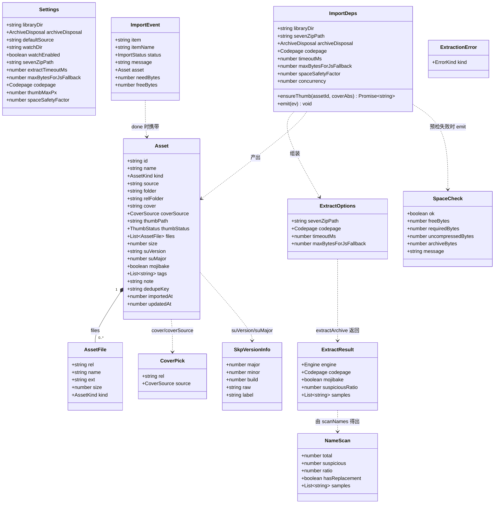
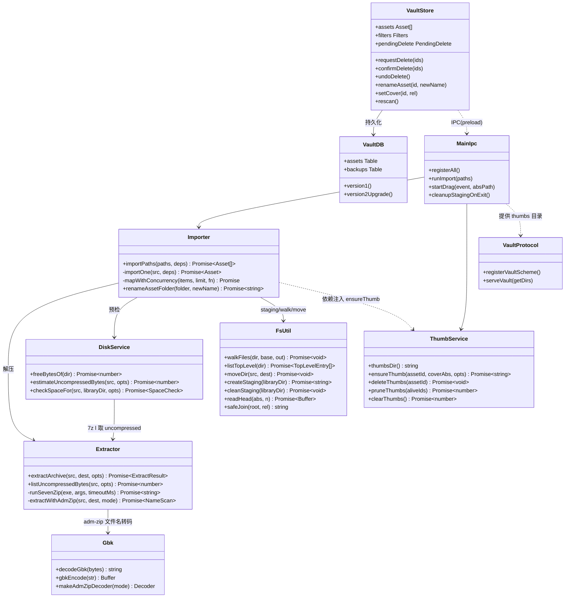
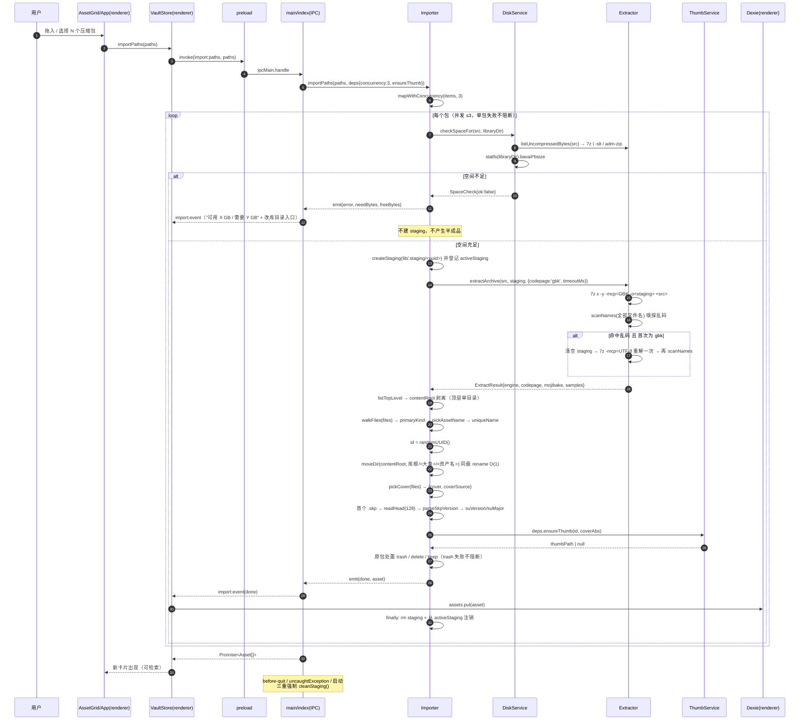
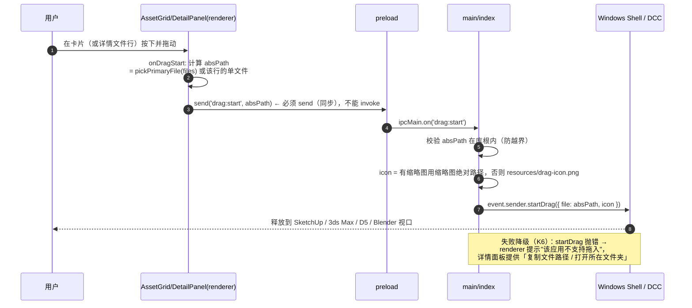
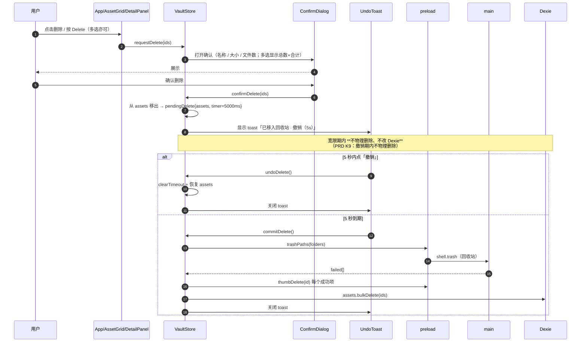
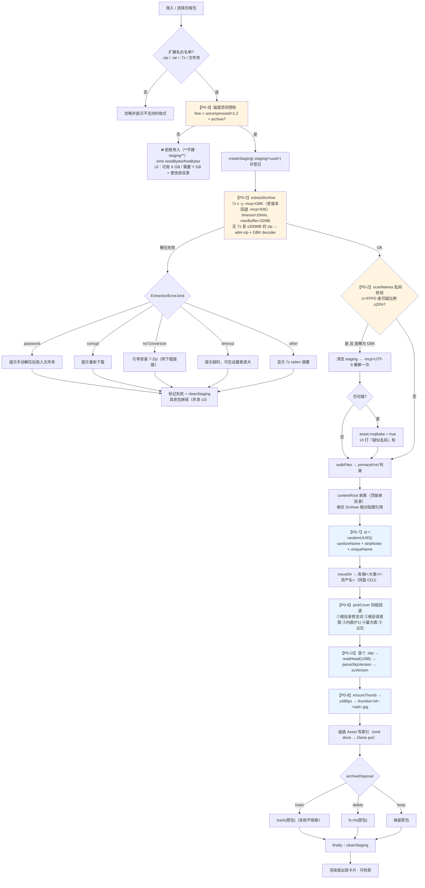
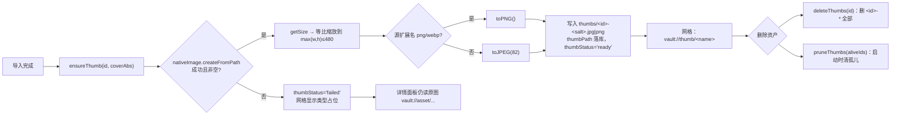
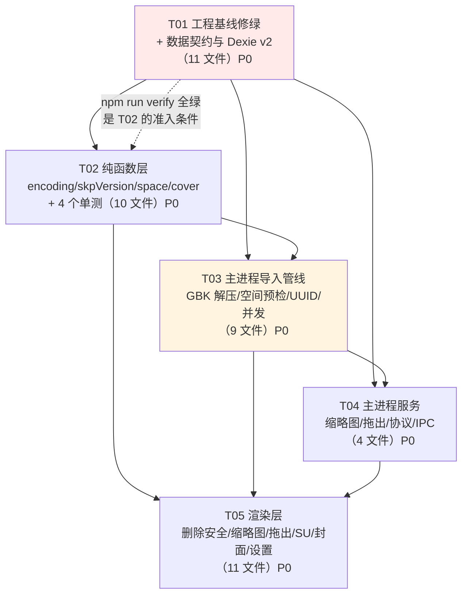

# 模库 ModVault — 增量系统设计与任务分解

> 文档版本：**v1.2** ｜ 撰写：高见远（架构师） ｜ 语言：简体中文
> 上游输入：`docs/01-PRD-模库.md`（许清楚）＋ 现有未验证原型（24 源文件 / ~1990 行）
> 读者：寇豆码（工程师）、严过关（QA）、齐活林（主理人）
> 本轮范围：**仅 P0（19 条）**；P1/P2 不实现（下载目录监控代码保留、默认关闭）

> ## 🔺 v1.2 增量（2026-10-13）：分类体系工程化（覆盖 v1.1 的部分口径）
> v1.1 的"三层布局 / 单字段 `category` / 两级树"已被取代：用户确认筛选区是**三排**（一级分类 / 二级分类 / 风格），
> 语义两级 = 一级分类 + 二级分类，落盘改为**固定四层** `<大类>/<一级分类>/<二级分类>/<资产名>`（双哨兵），风格做**多选标签**不进目录。
> **现行权威口径 = `docs/06-分类体系设计.md` v1.0.1**（含 taxonomy 词表数据结构、`normalizeCategoryPair` 校验、
> `Asset` 三字段 + Dexie v3、受影响文件清单、134 条基线的测试影响清单、`dwg/dxf` 裁定、落地顺序 T05→T06→T07）。
> `docs/03-变更设计-语义子目录.md` 已升 **v1.0.1** 并加 ⛔ 作废标注（仍保留有效的部分：哨兵论证、禁止跨大类、缩略图重生、DB 驱动迁移）。
> 下文 🔺v1.1 标注中与 06 冲突的（§1.3.3 `category` 字段、§1.3.4 Dexie v3 定义、§2.4 任务图、§2.3 库布局口径），**一律以 06 v1.0.1 为准**。
>
> ## 🔺 v1.1 增量（2026-10-13）：语义子目录（已被 v1.2 部分取代）
> 用户在 PRD Q2 否决 PM 建议默认 A、选择 **B：落盘也建语义子目录**。
> 完整口径见 **`docs/03-变更设计-语义子目录.md`**（v1.0.1）。
> **本文不再重复该部分内容**：下文凡标注 🔺v1.1 的位置均为**指引性标注**。

---

## 0. 基线实测（先修正一个前提）

> 🔺 **v1.1 补充**：本节记录的是**变更前的历史快照**。截至 2026-10-13 04:28，实现侧的实测基线已变为
> **`vitest run` 134 passed / 10 files 全绿**（typecheck ×2 与 build 亦绿）。
> 语义子目录变更会让其中 **4 条断言变红**，逐条清单见 `docs/03-变更设计-语义子目录.md` §6，**不要在本文深究**。

我在动手前实跑了一遍 `npm run verify`，**结论与"类型检查是红的"这个前提不一致**，必须先把事实摆正，否则工程师会去找不存在的错误：

| 步骤 | 命令 | 实测结果（2026-10-13） |
| --- | --- | --- |
| 主进程类型检查 | `tsc -p tsconfig.node.json` | ✅ **通过（0 error）** |
| 渲染进程类型检查 | `tsc -p tsconfig.web.json` | ✅ **通过（0 error）** |
| 单元测试 | `vitest run` | ❌ **3 条断言失败（2 个文件）** |
| 构建 | `electron-vite build` | ✅ **通过（main 18.5 kB / preload 1.8 kB / renderer 423 kB）** |

失败的 3 条（这就是红灯的全部来源）：

| # | 文件 | 断言 | 实际 | 性质 |
| --- | --- | --- | --- | --- |
| 1 | `tests/format.test.ts:29` | `vaultUrl('模型/某 沙发/a.png')` = `vault://asset/模型/某%20沙发/a.png` | 实际每段都被 `encodeURIComponent` | **测试期望写错**（实现是对的：路径分段必须各自编码，否则中文/空格会破坏协议解析）→ **改测试** |
| 2 | `tests/naming.test.ts:14` | `sanitizeName('///')` = `未命名` | `___` | **实现有 bug**：只在最后 `|| '未命名'` 兜底，替换后的 `___` 不算空 → **改实现**（替换后再判空） |
| 3 | `tests/naming.test.ts:47` | `pickAssetName('沙发合集.zip', 散装)` = `沙发合集` | `沙发合集.zip` | **测试期望写错＋调用方该负责**：`pickAssetName` 的契约是"接收已去扩展名的 base"，`importer.ts:67` 已经传了 `path.basename(src, ext)` → **改测试**（把用例改成传 `沙发合集`），并在 `pickAssetName` 内做一次**防御性去扩展名**（幂等，不破坏现有用例） |

> **对工程师的硬要求**：T01 结束时 `npm run verify` 必须全绿，且此后 **每加一个模块都必须保持全绿**（PRD P0-19 / K10）。不允许"先堆功能最后统一修类型"。

环境实测（用于技术选型依据）：Node **v22.22.2**（`zlib.crc32` ✅、`fs.statfs` ✅、`new TextDecoder('gbk')` ✅ 全 ICU）、Electron **33.4.11**。

---

## 1. Part A · 系统设计

### 1.1 实现方案与技术选型

#### 1.1.1 五处真正的难点

| 难点 | 为什么难 | 本设计的解法 |
| --- | --- | --- |
| **① GBK 文件名（K1）** | ZIP 不强制编码；知末包多为 WinRAR/GBK 打包。7-Zip 默认按 UTF-8 解 → 中文目录名乱码 → `.skp`/`.max` 相对贴图引用断裂 → 模型变白模，且**不可逆**（用户会认为是软件搞坏了他的模型） | 编码策略提升为**一等参数** `codepage`，`extractArchive` 返回 `EngineResult{ engine, codepage, mojibake, samples }`；解压后 `scanNames()` 主动嗅探乱码，命中则**换码页重解一次**；仍可疑 → `asset.mojibake=true` 在 UI 打「疑似乱码」标 |
| **② GB 级包（K2）** | 实测单包 1.28 GB，峰值 ≈ 2.6 GB；解到一半失败会留下 staging 垃圾 + 未删原包 + 无索引的半残状态 | 解压**前**预检（`uncompressed×1.2 + 原包`）；不足直接拒绝、**不建 staging**；staging 生命周期登记在 `activeStaging`，`before-quit` / `uncaughtException` / 启动三重清理 |
| **③ 缩略图性能（C4）** | 网格 `` 直连原图（3000–4000 px、数 MB），200 张滚动掉帧 + 数百 MB 内存 | 导入时生成 ≤480 px 缩略图落 `%LOCALAPPDATA%/ModVault/thumbs/`；网格只读缩略图，详情读原图 |
| **④ 拖出到 DCC（K6）** | 渲染进程无权发起系统级拖拽，必须回主进程 `webContents.startDrag`，且在 `dragstart` 事件窗口内完成 | renderer `dragstart` → `ipcRenderer.send(IPC.dragStart, absPath)` → 主进程 `event.sender.startDrag({ file, icon })`；**icon 非空**（Windows 硬要求） |
| **⑤ 主键漂移（D1/K4）** | `Asset.id = relFolder` 把主键绑死在磁盘布局上；`store.renameAsset` 用三种长度混算的字符串切片，中文路径必错，且 delete+put 会丢 tags/note | `id` 改 UUID 且**永不变更**；rename 直接用 `${kindFolder}/${newName}` 重算 `relFolder`；Dexie v1→v2 迁移（先快照备份再换主键） |

#### 1.1.2 选型决策（含被否掉的选项）

| 决策 | 选择 | 被否掉的选项与理由 |
| --- | --- | --- |
| **缩略图引擎** | **Electron `nativeImage`**（`createFromPath` → `resize` → `toPNG/toJPEG`） | ❌ `sharp`：需按 Electron ABI 重新编译原生模块（`electron-rebuild`），破坏"离线优先 / 一条命令装好"，打包体积 +30 MB；❌ 浏览器端 `canvas` 缩放：要在渲染进程解码 4000px 原图，正是我们要避免的性能陷阱 |
| **GBK 解码** | **运行时**：`new TextDecoder('gbk')`（Node 22 / Electron 全 ICU，已实测可用）；**兜底与测试编码**：`iconv-lite`（`TextEncoder` 不支持 GBK，测试 fixture 必须用 iconv-lite 产出 GBK 字节） | ❌ 纯 `iconv-lite` 也能跑，但 `TextDecoder` 零依赖路径更稳；两者在 `main/gbk.ts` 里做成"首选→兜底" |
| **磁盘剩余空间** | `fs.statfs(dir).bavail * bsize`（Node 19.6+，已实测） | ❌ `check-disk-space`：多一个依赖，且 Windows 下要 spawn `wmic`/`dir`，慢且脆弱 |
| **7-Zip 调用** | `execFile` + `timeout` + `maxBuffer` + `-mcp=GBK`（老版本回退 `-mcp=936`） | 见 §5 风险 R2 |
| **并发导入** | 主进程内自建 `mapWithConcurrency(items, 3)`（~25 行） | ❌ `p-limit`：为一个函数引一个包不值（且 ESM/TS 配置易踩坑） |
| **架构模式** | **保持现有分层**：`main`（IO）/ `shared`（纯函数）/ `renderer`（视图 + Dexie）。主进程**不持有** Dexie，缩略图通过 `ImportDeps.ensureThumb` **依赖注入**给 importer | 这样 `importer.ts` 可以被 vitest 直接单测（传 stub thumb），不需要 mock electron |

#### 1.1.3 分层与依赖方向（不可逆向）

```
shared/  (纯函数，零 IO，100% 可单测)   ← 被 main/ 与 renderer/ 共同依赖
   ↑                       ↑
main/ (fs、7z、electron、缩略图、IPC)   renderer/ (React、Zustand、Dexie)
   └────────── IPC (shared/ipc.ts) ──────────┘
```
**硬规则**：`shared/**` 不得 import `electron` / `node:fs` / 任何运行时依赖（否则渲染进程 bundle 会被污染、单测会失败）。GBK 字节解码这种需要 `iconv-lite` 的能力放 `main/gbk.ts`。

---

### 1.2 文件级清单（保留 / 改造 / 新增 / 删除）

> 🔺 **v1.1：本节的下表不再更新，语义子目录会把下表 7 个文件的职责改写。**
> 受影响文件（`src/shared/types.ts`、`src/shared/naming.ts`、`src/main/importer.ts`、`src/main/rescan.ts`、
> `src/main/index.ts`、`src/preload/index.ts`、`src/renderer/db.ts`、`src/renderer/store.ts`、
> `src/renderer/components/Sidebar.tsx`、`src/renderer/components/DetailPanel.tsx`、`src/renderer/components/AssetGrid.tsx`）
> 以及新增文件（`src/main/layout.ts`、`src/renderer/components/CategoryPicker.tsx`、
> `src/renderer/components/AssetContextMenu.tsx`、`tests/layout.test.ts`、`tests/rescan.test.ts`）
> 的**权威清单见 `docs/03-变更设计-语义子目录.md` §3**。实现以 03 为准。

> 动作定义：**保留**＝不改或仅注释级改动；**改造**＝原地重写逻辑；**重写**＝文件整体重新实现；**新增**＝新建；**删除**＝移除。
> 行数＝改造后预估总行数（非增量）。

#### A. 新增文件（12 个源文件 + 1 资源 + 6 测试）

| 路径 | 职责 | 预估行数 | 依赖 |
| --- | --- | --- | --- |
| `src/shared/encoding.ts` | **纯**：乱码嗅探。`hasReplacementChar` / `isMojibakeSuspect` / `scanNames` / 阈值常量 | ~90 | 无 |
| `src/shared/skpVersion.ts` | **纯**：`.skp` 头部 UTF-16LE 解析 → `{major,minor,build,raw,label}`；`suLabel(major)` | ~85 | 无 |
| `src/shared/space.ts` | **纯**：`requiredBytesFor()` / `evaluateSpace()` / `humanGB()`，磁盘预检的计算部分 | ~60 | 无 |
| `src/main/gbk.ts` | `decodeGbk(bytes)`（TextDecoder('gbk') 优先、iconv-lite 兜底）、`gbkEncode(str)`、`makeAdmZipDecoder(mode)` | ~55 | iconv-lite |
| `src/main/disk.ts` | `freeBytesOf(dir)`（statfs）、`estimateUncompressedBytes()`（7z `l -slt` / adm-zip 精确值 / 保守估算）、`checkSpaceFor()` | ~120 | shared/space |
| `src/main/thumb.ts` | 缩略图缓存：`thumbsDir()` / `ensureThumb()` / `deleteThumbs()` / `pruneThumbs()` / `clearThumbs()` | ~130 | electron nativeImage, paths |
| `src/renderer/components/ConfirmDialog.tsx` | 删除二次确认（资产名 + 大小 + 文件数；多选显示总数与合计） | ~70 | Modal |
| `src/renderer/components/UndoToast.tsx` | 5 秒撤销 toast（含倒计时进度条） | ~80 | store |
| `src/renderer/components/CoverPicker.tsx` | 手动指定封面（列出资产内图片，缩略小图选择） | ~90 | store |
| `resources/drag-icon.png` | `startDrag` 的兜底拖拽图标（Windows 要求非空） | — | 需加进 `package.json build.files` |
| `tests/fixtures/gbkZip.ts` | **合成 GBK 中文名 zip fixture**：手工拼装 ZIP（STORED），可指定文件名原始字节与 UTF-8 flag | ~110 | iconv-lite, zlib.crc32 |
| `tests/encoding.test.ts` | 乱码嗅探单测（含 `U+FFFD` 与拉丁扩展连缀两类） | ~70 | — |
| `tests/skpVersion.test.ts` | 合成 skp 头 / 空 / 随机字节 / 边界 major | ~80 | — |
| `tests/cover.test.ts` | 封面四级回退各级命中 + `pickPrimaryFile` 优先级 | ~110 | — |
| `tests/space.test.ts` | 预检公式与边界（刚好够 / 差 1 字节 / 取不到 uncompressed） | ~60 | — |
| `tests/extractor.test.ts` | **K1 核心**：GBK zip → `codepage:'gbk'` 解得正确中文名；`codepage:'utf8'` 解得乱码且 `mojibake=true`；无 7z 时 adm-zip 兜底同样不乱码；超时/超限错误分类 | ~150 | fixtures/gbkZip |
| `tests/importer.test.ts` | 端到端（tmpdir 库目录）：UUID 主键、relFolder、coverSource、suVersion、原包三档处置、并发 ≤3、单包失败不阻断、staging 清空 | ~180 | fixtures/gbkZip |

#### B. 改造 / 重写文件（20 个）

| 路径 | 动作 | 改造要点 | 预估行数 |
| --- | --- | --- | --- |
| `package.json` | 改造 | +`iconv-lite`；`build.files` +`resources/**/*`；scripts 不变 | ~65 |
| `src/shared/types.ts` | 重写 | `Asset` v2（UUID id / `coverSource` / `suVersion` / `suMajor` / `thumbPath` / `thumbStatus` / `mojibake`）；`Settings` v2（7→11 项）；`ArchiveDisposal` 三档；`ImportEvent` +`needBytes/freeBytes` | ~130 |
| `src/shared/ipc.ts` | 改造 | +6 通道：`drag:start` `thumb:ensure` `thumb:delete` `thumb:prune` `thumb:clear` `disk:free` `index:backup`（共 7） | ~40 |
| `src/shared/classify.ts` | 改造 | `pickCover` 改返回 `CoverPick`（四级回退）；新增 `pickPrimaryFile()`、`CoverSource`、`PRIMARY_MODEL_EXTS`、`PREVIEW_NAME_RE`（加强 + 根目录层判定） | ~130 |
| `src/shared/naming.ts` | 改造 | 修 `sanitizeName` 空值兜底（替换后判空）；`pickAssetName` 防御性去扩展名 | ~70 |
| `src/shared/format.ts` | 改造 | +`thumbVaultUrl(name)`；`vaultUrl` 保持分段编码（改测试不改实现） | ~45 |
| `src/main/extractor.ts` | **重写** | `extractArchive(src,dest,opts)` 新签名 + `ExtractResult`；`-mcp=GBK`（回退 `936`）；timeout/maxBuffer；adm-zip 自定义 decoder + ≤200 MB 上限；移除 `.tar/.gz/.tgz`；错误分类 `ExtractionError.kind`；`listUncompressedBytes()` | ~200 |
| `src/main/importer.ts` | **重写** | 预检 → 解压 → 乱码校验/重解 → contentRoot → UUID → rename → 封面 → SU → 缩略图（注入）→ 清包；并发池 ≤3；staging 登记/清理；`archiveDisposal` 三档 | ~260 |
| `src/main/fsutil.ts` | 改造 | +`cleanStaging()` / `createStaging()` / `readHead(abs,n)` / `safeJoin()`；`walkFiles` 不变 | ~110 |
| `src/main/disk.ts` | 新增（见上） | | |
| `src/main/thumb.ts` | 新增（见上） | | |
| `src/main/gbk.ts` | 新增（见上） | | |
| `src/main/paths.ts` | 改造 | +`thumbsDir()` / `userDataDir()`；7-Zip 探测候选 +`%LOCALAPPDATA%`、+`E:\APP\7-Zip` | ~60 |
| `src/main/settings.ts` | 改造 | Zod schema v2（新增 5 项带默认值）；**读旧档迁移**：`trashArchiveAfterImport:true→'recycle'`、`false→'keep'`；写入前规范化 | ~70 |
| `src/main/rescan.ts` | 改造 | 生成 UUID；`id` 由 `folder` 查表保持稳定（库外改名也算改名，不再用 relFolder 当主键）；补 `coverSource`/`suVersion`/`thumbPath=null` | ~110 |
| `src/main/protocol.ts` | 改造 | 按 `url.host` 路由：`asset`→库根，`thumb`→thumbs 目录；沿用目录穿越防护 | ~70 |
| `src/main/index.ts` | 改造 | staging 三重清理钩子；新 IPC 注册（`drag:start` 走 `event.sender.startDrag`、thumb 系列、`disk:free`、`index:backup`）；把真实 `ensureThumb` 注入 importer | ~250 |
| `src/main/watcher.ts` | 改造 | 扩展名收敛 `zip/rar/7z`；临时文件黑名单 `.crdownload/.part/.tmp/.!ut`；`stabilityThreshold:3000`、`pollInterval:500`（P1 功能，本轮只做代码，默认关） | ~60 |
| `src/preload/index.ts` | 改造 | +`startDrag(absPath)`（**必须 `send` 不是 `invoke`**）、`ensureThumb`、`deleteThumb`、`pruneThumbs`、`clearThumbs`、`diskFree`、`exportIndexBackup` | ~60 |
| `src/renderer/db.ts` | **重写** | Dexie v2：`assets` 新索引 + `backups` store；`upgrade()` 先快照 v1 全量到 `backups` 再换主键写回 | ~90 |
| `src/renderer/store.ts` | **重写** | `renameAsset` 修切片 bug（不再 delete+put）；删除宽限期 + undo；`setCover`；`thumbEnsure` 落库；haystack 补 `suVersion`/`thumbPath`；`rescan` 合并键改 `folder` | ~260 |
| `src/renderer/App.tsx` | 改造 | **移除裸 Delete/Backspace 删资产**；挂 `UndoToast` / `ConfirmDialog`；`Delete` 改为"请求删除（弹确认）" | ~170 |
| `src/renderer/components/AssetGrid.tsx` | **重写** | 读缩略图（失败走占位）；`draggable` + `onDragStart`；SU 版本徽标；双击=资源管理器选中**主模型文件**；列表视图 +「SU 版本」列 | ~220 |
| `src/renderer/components/DetailPanel.tsx` | 改造 | 详情读原图；「更换封面」入口；文件行可拖出单个文件；SU 版本展示；删除按钮走 ConfirmDialog | ~290 |
| `src/renderer/components/SettingsDialog.tsx` | 改造 | 原包处置三档下拉；+「清除缩略图缓存」；7-Zip 未就绪时给下载链接 + 手动路径 | ~210 |
| `src/renderer/components/Sidebar.tsx` | 改造 | +「SU 版本」筛选组（带计数） | ~140 |
| `src/renderer/components/Toolbar.tsx` | 改造 | 排序 +`suVersion`；轻改 | ~110 |
| `src/renderer/components/ImportQueue.tsx` | 改造 | 失败文案可行动化（含"需要 X GB / 可用 Y GB"+"更改库目录"按钮）；+重试 | ~110 |
| `tests/naming.test.ts` | 改造 | 修 2 条用例期望（见 §0） | ~60 |
| `tests/format.test.ts` | 改造 | 修 1 条用例期望 | ~40 |
| `tests/classify.test.ts` | 改造 | `pickCover` 返回结构变化后同步更新 | ~70 |

#### C. 保留不动（10 个）

`src/renderer/main.tsx`、`src/renderer/icons.tsx`、`src/renderer/styles.css`、`src/renderer/env.d.ts`、`src/renderer/components/Modal.tsx`、`src/renderer/components/DropOverlay.tsx`、`electron.vite.config.ts`、`vitest.config.ts`、`tsconfig*.json`（3 个）、`tailwind.config.js`、`postcss.config.js`、`index.html`

#### D. 删除

**无。** 不删除任何现有源文件（`trashArchiveAfterImport` 字段在 `types.ts` 中标记为 `@deprecated` 保留一个版本用于读取旧 settings.json，Zod 里可选）。

---

### 1.3 数据结构与接口

#### 1.3.1 类图（数据模型 + 服务）



#### 1.3.2 服务类图（主进程 / 渲染进程模块关系）



#### 1.3.3 关键 TypeScript 定义（可直接抄写）

```ts
// ── src/shared/types.ts ──────────────────────────────────────────
export type AssetKind = 'model' | 'texture' | 'hdri' | 'material' | 'other'
/** 原压缩包处置三档（P0-5，替代旧布尔值） */
export type ArchiveDisposal = 'recycle' | 'delete' | 'keep'
/** 解压码页策略 */
export type Codepage = 'gbk' | 'utf8' | 'auto'
export type ThumbStatus = 'ready' | 'failed' | 'none'
/** 封面来源（PRD 附录 3/4，落库用于统计各级命中率 K5） */
export type CoverSource = 'named' | 'root' | 'embedded' | 'largest' | 'manual' | 'placeholder'
export type ImportStatus = 'extracting' | 'organizing' | 'done' | 'error'

export interface AssetFile { rel: string; name: string; ext: string; size: number; kind: AssetKind }

export interface Asset {
  /** 稳定主键：导入时 randomUUID()，永不因改名/改库目录/改大类而变（P0-7） */
  id: string
  name: string
  kind: AssetKind
  source: string
  /** 绝对路径 */
  folder: string
  /**
   * 库根相对路径（posix 分隔），vault://asset/ 用
   * 🔺 v1.1：格式由 `<大类>/<资产名>` 改为 `<大类>/<语义分类>/<资产名>`，
   * 未指派分类时段位为哨兵 `未分类`，例：`模型/未分类/现代衣柜`。详见 03 §4.2
   */
  relFolder: string
  /**
   * 🔺 v1.1 新增：语义分类（posix 相对路径，当前深度上限 1；缺省/哨兵 = '未分类'）
   * 完整字段定义、是否为必填、Dexie 索引与迁移方案见 03 §4
   */
  category?: string
  /** 封面相对资产文件夹的路径；无封面时 undefined */
  cover?: string
  coverSource?: CoverSource
  /** 缩略图缓存文件名（相对 thumbs 目录），如 'a1b2c3-9f.jpg' */
  thumbPath?: string
  thumbStatus?: ThumbStatus
  files: AssetFile[]
  size: number
  /** 'SU 2024'；解析失败静默降级为 undefined */
  suVersion?: string
  suMajor?: number
  /** 解压后文件名疑似乱码（GBK 嗅探命中） */
  mojibake?: boolean
  tags: string[]
  note: string
  dedupeKey: string
  importedAt: number
  updatedAt: number
}

export interface ImportEvent {
  item: string
  itemName: string
  status: ImportStatus
  message?: string
  asset?: Asset
  /** 空间不足时给出可行动数字（UI 显示"需要 X / 可用 Y" + 改库目录入口） */
  needBytes?: number
  freeBytes?: number
}

export interface Settings {
  libraryDir: string
  archiveDisposal: ArchiveDisposal   // 默认 'recycle'
  defaultSource: string              // 默认 '知末网'
  watchDir: string | null
  watchEnabled: boolean              // 默认 false（P1 功能，本轮不开放 UI 强引导）
  sevenZipPath: string | null
  extractTimeoutMs: number           // 默认 600_000（10 分钟）
  maxBytesForJsFallback: number      // 默认 200 * 1024 * 1024
  codepage: Codepage                 // 默认 'auto'（auto = 先 GBK，嗅探失败重解 UTF-8）
  thumbMaxPx: number                 // 默认 480
  spaceSafetyFactor: number          // 默认 1.2
  /** @deprecated 仅用于读取旧 settings.json，读到后映射为 archiveDisposal */
  trashArchiveAfterImport?: boolean
}

export const DEFAULT_SETTINGS: Settings = {
  libraryDir: 'E:\\ModVault\\Library',
  archiveDisposal: 'recycle',
  defaultSource: '知末网',
  watchDir: null,
  watchEnabled: false,
  sevenZipPath: null,
  extractTimeoutMs: 600_000,
  maxBytesForJsFallback: 200 * 1024 * 1024,
  codepage: 'auto',
  thumbMaxPx: 480,
  spaceSafetyFactor: 1.2
}
```

```ts
// ── src/shared/classify.ts（新增部分） ───────────────────────────
export interface CoverPick { rel: string; source: CoverSource }
/** 拖出/双击时的主文件优先级（P0-14 / Q3） */
export const PRIMARY_MODEL_EXTS = ['skp', 'max', 'fbx', 'obj', '3ds'] as const
/** 根目录层预览词（必须是资产根目录层，不能是 Textures/ 里的） */
export const PREVIEW_NAME_RE =
  /预览|效果|主图|封面|展图|晒图|thumbnail|preview|cover|render|poster/i

/**
 * 封面四级回退（P0-8 / PRD C3）：
 * ① named 根目录层名字命中预览词 → ② root 根目录层首图
 * → ③ embedded 内嵌缩略图（P1-2 预留，本轮传 undefined）
 * → ④ largest 全资产最大图 → ⑤ null（placeholder）
 */
export function pickCover(files: AssetFile[], opts?: { embeddedThumbRel?: string }): CoverPick | null

/** 主模型文件：.skp > .max > .fbx > .obj > .3ds > 首个模型 > files[0] */
export function pickPrimaryFile(files: AssetFile[]): AssetFile | undefined
```

```ts
// ── src/shared/skpVersion.ts ─────────────────────────────────────
export interface SkpVersionInfo { major: number; minor: number; build: number; raw: string; label: string }
/** 读 .skp 前 128 字节：magic FF FE FF 0E + UTF-16LE "SketchUp Model {24.0.594}" */
export function parseSkpVersion(head: Uint8Array): SkpVersionInfo | null
/** major>=17 → `SU ${2000+major}`；major<=16 → `SU ${major}`（SU 8/13/15/16 旧版） */
export function suLabel(major: number): string
```

```ts
// ── src/shared/encoding.ts ───────────────────────────────────────
export const MOJIBAKE_RATIO_THRESHOLD = 0.2
export function hasReplacementChar(s: string): boolean                 // 含 U+FFFD
export function isMojibakeSuspect(s: string): boolean                  // U+FFFD 或 ≥2 连缀拉丁扩展字符
export function scanNames(names: string[], opts?: { ratioThreshold?: number }): NameScan
```

```ts
// ── src/shared/space.ts ──────────────────────────────────────────
/** required = uncompressedBytes * safetyFactor + archiveBytes（PRD D3） */
export function requiredBytesFor(o: { uncompressedBytes: number; archiveBytes: number; safetyFactor?: number }): number
export function evaluateSpace(freeBytes: number, o: { uncompressedBytes: number; archiveBytes: number; safetyFactor?: number }): SpaceCheck
export function humanGB(bytes: number): string                          // '12.4 GB'
```

```ts
// ── src/main/extractor.ts（PRD 附录 2 收敛签名） ──────────────────
export type Engine = '7z' | 'admzip'
export type ErrorKind = 'password' | 'corrupt' | 'unsupported' | 'no7z' | 'oversize' | 'timeout' | 'other'
export class ExtractionError extends Error { constructor(msg: string, public kind: ErrorKind) }

export async function extractArchive(src: string, dest: string, opts: ExtractOptions): Promise<ExtractResult>
/** 7z l -slt 求和；取不到 → adm-zip 精确值；再取不到 → archiveBytes * 3（保守） */
export async function listUncompressedBytes(src: string, opts: Pick<ExtractOptions, 'sevenZipPath' | 'maxBytesForJsFallback'>): Promise<{ bytes: number; exact: boolean }>
```

```ts
// ── src/main/thumb.ts ────────────────────────────────────────────
/** 返回缓存文件名（如 'a1b2-9f3c.jpg'），失败返回 null（UI 走占位） */
export async function ensureThumb(assetId: string, coverAbs: string | null, opts?: { salt?: string; maxPx?: number }): Promise<string | null>
export async function deleteThumbs(assetId: string): Promise<void>   // 删除 <assetId>-* 全部
export async function pruneThumbs(aliveIds: string[]): Promise<number>
export async function clearThumbs(): Promise<number>
```

#### 1.3.4 Dexie v2 与迁移方案（P0-7 / K4）

> 🔺 **v1.1：本节保留为 v2 的原始设计记录。语义子目录变更已把 Dexie 升到 `version(3)`**
> （新增 `category` 索引 + 回填；**不改 v2**，因为已存在于开发机的 v2 库不会重跑同版本 upgrade）。
> 磁盘侧遗留 2 段布局由一次性 DB 驱动迁移消化。
> **请以 `docs/03-变更设计-语义子目录.md` §4.3 / §4.4 为准，本节的 `relFolder` 两段格式已被取代。**

```ts
// src/renderer/db.ts
export class VaultDB extends Dexie {
  assets!: Table<Asset, string>
  backups!: Table<{ id: string; at: number; json: string }, string>

  constructor() {
    super('modvault')
    this.version(1).stores({
      assets: 'id, kind, source, importedAt, updatedAt, *tags, dedupeKey'
    })
    this.version(2)
      .stores({
        assets: 'id, kind, source, importedAt, updatedAt, *tags, dedupeKey, suVersion, suMajor, folder, coverSource',
        backups: 'id, at'
      })
      .upgrade(async (tx) => {
        // ① 迁移前快照备份（v1 全量 → backups 表，永不自动清理）
        const old = await tx.table('assets').toArray()
        if (old.length > 0) {
          await tx.table('backups').put({
            id: `v1-${Date.now()}`,
            at: Date.now(),
            json: JSON.stringify(old)
          })
        }
        // ② Dexie 不允许 modify 改主键 → 全量读出 + clear + 用新 UUID 写回
        const migrated = old.map((a: Asset) => ({
          ...a,
          id: looksLikeUuid(a.id) ? a.id : randomUUID(),
          relFolder: a.relFolder ?? a.id,     // 旧 id 就是 relFolder
          coverSource: a.cover ? 'root' : 'placeholder',
          thumbStatus: 'none' as ThumbStatus,
          tags: a.tags ?? [], note: a.note ?? ''
        }))
        await tx.table('assets').clear()
        await tx.table('assets').bulkAdd(migrated)
      })
  }
}
```

**备份策略（双保险）**：
1. **库内快照**：`upgrade()` 里把 v1 全量 JSON 写入新增的 `backups` store（id `v1-<ts>`）——零 IO、零风险、迁移失败也能回滚。
2. **磁盘导出**：renderer 启动后若发现 `backups` 里有 `v1-` 记录且尚未导出过，则通过新 IPC `index:backup` 把 JSON 写到 `%LOCALAPPDATA%/ModVault/index-backup-v1-<ts>.json`，并弹一条提示"已为旧索引创建备份"。

**旧 `folder` 变化的合并键**：`rescan` 与 renderer 合并一律以 **`folder` 绝对路径**为锚（不再是 `id`），保证"库外手工改名/移动"能被正确识别为新资产，而不是主键漂移。

---

### 1.4 程序调用流

#### 1.4.1 导入主流程（序列图）



#### 1.4.2 拖出到 DCC（序列图，P0-14）



#### 1.4.3 删除 + 5 秒撤销（序列图，P0-16）



#### 1.4.4 导入主流程（流程图，含全部 P0 新增环节）



#### 1.4.5 缩略图生命周期（P0-9）



---

### 1.5 Anything UNCLEAR（架构侧的未决点）

见 §5「待明确事项 ≤3 条」，每条都给了建议默认答案；工程师按默认实现即可，不必等确认。

---

## 2. Part B · 任务分解

### 2.1 Required Packages（新增依赖）

| 包 | 版本 | 用途 | 说明 |
| --- | --- | --- | --- |
| `iconv-lite` | `^0.6.3` | GBK ↔ UTF-8 转码（运行时兜底 + **测试 fixture 生成 GBK 文件名**） | 纯 JS、无原生编译、离线可装。若 TS 报无类型则加 `@types/iconv-lite@^0.6` |
| `@types/iconv-lite` | `^0.6.3` | 类型（仅当 iconv-lite 未自带 d.ts 时） | 装完先 `npm run typecheck:node`，不报错就不装 |

**不新增**：缩略图用 Electron 内置 `nativeImage`（拒绝 sharp）；磁盘用内置 `fs.statfs`（拒绝 check-disk-space）；并发用自写 25 行（拒绝 p-limit）。
**已有依赖沿用**：`adm-zip`（zip 兜底 + 自定义 decoder）、`trash`（回收站）、`dexie`、`zod`、`chokidar`、`zustand`、`electron@33`。

### 2.2 任务列表（按依赖顺序，5 个任务）

---

#### T01 · 工程基线修绿 + 数据契约与存储底座

| 项 | 内容 |
| --- | --- |
| **优先级** | **P0（最高）—— 不完成不许开始任何功能开发** |
| **依赖** | 无 |
| **对应需求** | P0-19（verify 全绿）、P0-7（数据结构与 Dexie 迁移）、P0-5（三档设置的数据基础） |
| **验收** | `npm run verify` **全绿**（typecheck×2 + vitest + build）；旧 settings.json 能被正确迁移；Dexie v1→v2 升级后旧资产 tags/note 不丢且 `backups` 表有快照 |
| **🔺 v1.1 增量** | `shared/types.ts` 加 `category`、`shared/naming.ts` 加 relFolder/category 四个纯函数、`renderer/db.ts` 升 Dexie **v3**。详见 `docs/03-变更设计-语义子目录.md` §4 |

**源文件**

| 文件 | 动作 | 要点 |
| --- | --- | --- |
| `package.json` | 改造 | +`iconv-lite`；`build.files` +`"resources/**/*"` |
| `resources/drag-icon.png` | 新增 | 64×64 PNG 占位拖拽图标（可用任意纯色图，T04 会用到） |
| `src/shared/types.ts` | 重写 | 按 §1.3.3 完整实现 `Asset` v2 / `Settings` v2 / `ArchiveDisposal` / `ImportEvent` 扩展 |
| `src/shared/ipc.ts` | 改造 | 新增 `drag:start`、`thumb:ensure`、`thumb:delete`、`thumb:prune`、`thumb:clear`、`disk:free`、`index:backup` |
| `src/shared/naming.ts` | 改造 | 修 `sanitizeName` 空值兜底（替换后判空）；`pickAssetName` 防御性去扩展名 |
| `src/shared/format.ts` | 改造 | 保持 `vaultUrl` 分段编码；新增 `thumbVaultUrl(name)` → `vault://thumb/<encodeURIComponent(name)>` |
| `src/main/settings.ts` | 改造 | Zod schema v2（5 个新键带默认值）；`loadSettings` 读旧档后 `migrateSettings()`：`trashArchiveAfterImport:true→'recycle'`、`false→'keep'`，并删掉 deprecated 键 |
| `src/main/paths.ts` | 改造 | +`thumbsDir()` = `app.getPath('userData')/thumbs`；7-Zip 候选 +`%LOCALAPPDATA%\\7-Zip\\7z.exe`、`E:\\APP\\7-Zip\\7z.exe` |
| `src/renderer/db.ts` | 重写 | 按 §1.3.4 实现 Dexie v2 + `backups` store + `upgrade()` 快照 + 换主键 |
| `tests/naming.test.ts` | 改造 | 修 2 条用例期望（见 §0） |
| `tests/format.test.ts` | 改造 | 修 1 条用例期望（`vaultUrl` 期望值改为全段编码） |

> 本任务**不碰** importer/extractor/UI，只保证"新 schema 已就位、旧数据可迁移、verify 全绿"。

---

#### T02 · 纯函数层（零 IO，全单测）

| 项 | 内容 |
| --- | --- |
| **优先级** | P0 |
| **依赖** | T01 |
| **对应需求** | P0-2（乱码嗅探）、P0-8（封面四级回退）、P0-15（SU 版本）、P0-3（空间公式）、P0-14（主文件挑选） |
| **验收** | 新增 4 个测试文件全绿；纯函数行覆盖率 ≥80%；`npm run verify` 保持全绿 |
| **🔺 v1.1 增量** | `shared/naming.ts` 追加 `UNCLASSIFIED` / `CATEGORY_MAX_DEPTH` / `normalizeCategory` / `sanitizeCategory` / `composeRelFolder` / `parseRelFolder`，并在 `tests/naming.test.ts` 补对应 describe（`dedupeKeyOf` **保持不变**）。详见 03 §4.2 |

**源文件**

| 文件 | 动作 | 要点 |
| --- | --- | --- |
| `src/shared/encoding.ts` | 新增 | `hasReplacementChar` / `isMojibakeSuspect`（U+FFFD 或 ≥2 连缀 `[\u00C0-\u024F]`）/ `scanNames` / `MOJIBAKE_RATIO_THRESHOLD=0.2` |
| `src/shared/skpVersion.ts` | 新增 | 前 128 字节 UTF-16LE（跳过 `FF FE` BOM）→ 正则 `/\{?(\d+)\.(\d+)(?:\.(\d+))\}/` 与 `/SketchUp\s*Model/` 双保险；`suLabel()`；失败返回 `null`（静默） |
| `src/shared/space.ts` | 新增 | `requiredBytesFor` / `evaluateSpace` / `humanGB` |
| `src/shared/classify.ts` | 改造 | `pickCover` → `CoverPick \| null` 四级回退；`PREVIEW_NAME_RE`；`pickPrimaryFile()`；`PRIMARY_MODEL_EXTS` |
| `tests/encoding.test.ts` | 新增 | `'预览图\ufffd.jpg'` → true；`'æ²™å\x8f‘.jpg'` → true；`'Café Munir.skp'` → false（**防误伤**：单个重音字符不算乱码）；比例阈值边界 |
| `tests/skpVersion.test.ts` | 新增 | 合成 `{24.0.594}`→`'SU 2024'`；`{17.1.174}`→`'SU 2017'`；`{15.3.331}`→`'SU 15'`；空 Buffer / 随机字节 / 缺 BOM → `null` |
| `tests/cover.test.ts` | 新增 | ①`预览图.jpg` 在根目录层胜出（source=`named`）②根目录首图（`root`）③只有 `Textures/a.png` 时用最大图（`largest`）④纯 `.skp` → `null`（`placeholder`）⑤`pickPrimaryFile`：`a.max` 与 `b.skp` 同时存在取 `skp` |
| `tests/space.test.ts` | 新增 | 公式边界（刚好够/差 1 字节）、`safetyFactor` 生效、`humanGB` 格式 |
| `tests/classify.test.ts` | 改造 | `pickCover` 返回结构变化后同步更新 |
| `tests/fixtures/gbkZip.ts` | 新增 | **合成 GBK zip**（详见 §4）：`buildZip(entries)` 支持 `nameBytes` 原始字节 + `utf8Flag` 开关，STORED 方式，CRC32 用 `zlib.crc32` |

---

#### T03 · 主进程导入管线重写

| 项 | 内容 |
| --- | --- |
| **优先级** | P0（最高风险 K1/K2 都在这里） |
| **依赖** | T01、T02 |
| **对应需求** | P0-1、P0-2、P0-3、P0-4、P0-5、P0-7、P0-15、P0-17 |
| **验收** | `tests/extractor.test.ts` + `tests/importer.test.ts` 全绿；GBK 中文名 zip 解压后**零乱码**；空间不足时**不产生 staging**；20 包并发峰值 ≤3 且单包失败不阻断；进程被杀后 `.staging` 无残留 |
| **🔺 v1.1 增量** | 落盘路径加一层 `<大类>/未分类/<资产名>`；**新增 `src/main/layout.ts`**；`rescan.ts` 改三层遍历；`tests/importer.test.ts` 有 4 条断言要改期望值 + 新增 `tests/layout.test.ts`、`tests/rescan.test.ts`。**详见 03 §3 / §5 / §6（尤其是 03 §6 的逐条测试影响清单）** |

**源文件**

| 文件 | 动作 | 要点 |
| --- | --- | --- |
| `src/main/gbk.ts` | 新增 | `decodeGbk(bytes)`：先 `new TextDecoder('gbk')`，抛错则 `iconv-lite.decode`；`gbkEncode(str)`；`makeAdmZipDecoder(mode)` → `{ efs:false, encode, decode }`（adm-zip 支持 `new AdmZip(src,{decoder})`，已核实 0.5.16 源码） |
| `src/main/disk.ts` | 新增 | `freeBytesOf(dir)`：`fs.statfs` + 目录不存在时向上找存在的祖先；`estimateUncompressedBytes()`：7z `l -slt` 解析 `Size = N` 求和 → adm-zip 精确值 → `archiveBytes*3` |
| `src/main/extractor.ts` | **重写** | `extractArchive(src,dest,opts)`：① 7z 优先，参数 `['x','-y','-mcp=GBK','-o'+dest,src]`，`stderr` 含 `unknown switch`/`不支持` 时回退 `-mcp=936`；② `timeout:opts.timeoutMs`、`maxBuffer:32MB`；③ 7z 失败且是 zip 且 `size ≤ maxBytesForJsFallback` → adm-zip + GBK decoder；④ 超限时抛 `ExtractionError('oversize')` 引导装 7-Zip；⑤ 移除 `.tar/.gz/.tgz`；⑥ 解压后 `scanNames` 嗅探；⑦ 返回 `ExtractResult`。另导出 `listUncompressedBytes()` |
| `src/main/fsutil.ts` | 改造 | +`createStaging(libraryDir)`（返回路径）、`cleanStaging(libraryDir)`（清空整个 `.staging`）、`readHead(abs,n)`、`safeJoin(root,rel)`（防目录穿越，protocol 与 dragout 共用） |
| `src/main/importer.ts` | **重写** | 按 §1.4.1/§1.4.4 全流程；`ImportDeps` 新增 `codepage/timeoutMs/maxBytesForJsFallback/spaceSafetyFactor/concurrency/ensureThumb?`；`mapWithConcurrency(items,3)`；`id=randomUUID()`；`renameAssetFolder` 保留；**不得 import electron / thumb**（thumb 走注入） |
| `src/main/rescan.ts` | 改造 | 资产 `id` 由调用方（renderer）按 `folder` 查表决定，rescan 自身对新目录生成 UUID；补 `coverSource`/`suVersion`/`suMajor`/`thumbPath=null`/`thumbStatus='none'` |
| `src/main/watcher.ts` | 改造 | 扩展名收敛为 `zip/rar/7z`；忽略 `.crdownload/.part/.tmp/.!ut`；`stabilityThreshold:3000`、`pollInterval:500`（代码就位，默认关闭） |
| `src/main/index.ts` | 改造（**只改 runImport 与退出钩子区**） | `runImport` 组装新 `ImportDeps`；维护 `activeStaging`；注册 `before-quit` / `window-all-closed` / `uncaughtException` / `unhandledRejection` → `cleanStaging()`；启动时先 `cleanStaging()` |
| `tests/extractor.test.ts` | 新增 | 见 §4 |
| `tests/importer.test.ts` | 新增 | 见 §4 |

---

#### T04 · 主进程服务层：缩略图 / 拖出 / 协议 / IPC

| 项 | 内容 |
| --- | --- |
| **优先级** | P0 |
| **依赖** | T01、T02、T03 |
| **对应需求** | P0-9、P0-14、P0-13（打开/定位） |
| **验收** | 手工冒烟：网格读 `vault://thumb/...`（DevTools Network 可见 ≤480px、几十 KB）；拖卡片到 SU 能插入；拖到 D5 失败时给出降级提示；删除资产后 thumbs 目录对应文件被清 |
| **🔺 v1.1 影响** | 本任务**本身不因语义子目录改变**，但 `index.ts` / `preload/index.ts` 与 03 的新增 IPC 接线重叠 → 按 03 §8 的顺序，**先让 T04 收尾绿了再接**:`asset:moveCategory` / `library:migrateLayout`。另注意：`thumbSalt` 依赖 `coverAbs`，改分类后必须重生成缩略图（03 §2.2 反驳三） |

**源文件**

| 文件 | 动作 | 要点 |
| --- | --- | --- |
| `src/main/thumb.ts` | 新增 | `thumbsDir()`；`ensureThumb(id, coverAbs, {salt,maxPx})`：`nativeImage.createFromPath` → `isEmpty()` 判失败 → `getSize()` 等比缩放（`Math.round` 后 ≥1）→ `toJPEG(82)`（png/webp 源用 `toPNG()`）→ 写 `thumbs/<id>-<salt>.<ext>`；`salt` 用 `coverAbs` 的短哈希（换封面即换文件名，天然破缓存）；全程 try/catch，失败返回 `null` |
| `src/main/protocol.ts` | 改造 | `serveVault(getDirs: () => ({ libraryDir, thumbsDir }))`；按 `url.host` 路由：`asset`→库根、`thumb`→thumbs 目录；沿用 `startsWith(lib+sep)` 穿越防护；thumbs 目录同样做越界检查 |
| `src/main/index.ts` | 改造（**只改 IPC 注册区**） | 注册：`thumb:ensure` / `thumb:delete` / `thumb:prune` / `thumb:clear` / `disk:free` / `index:backup`；`drag:start` 用 `ipcMain.on`（**不是 handle**）+ `event.sender.startDrag({ file, icon })`，icon 优先用该资产的缩略图绝对路径，否则 `resources/drag-icon.png`；把真实 `ensureThumb` 注入 `runImport` 的 `ImportDeps` |
| `src/preload/index.ts` | 改造 | `startDrag(absPath)` 用 `ipcRenderer.send`；`ensureThumb/deleteThumb/pruneThumbs/clearThumbs/diskFree/exportIndexBackup` |

---

#### T05 · 渲染层：删除安全 / 缩略图渲染 / 拖出交互 / SU 展示 / 手动封面 / 设置

| 项 | 内容 |
| --- | --- |
| **优先级** | P0 |
| **依赖** | T01、T02、T03、T04 |
| **对应需求** | P0-16、P0-9（UI）、P0-14（UI）、P0-15（UI）、P0-8（手动封面）、P0-5（三档 UI）、P0-10、P0-11、P0-12 |
| **验收** | 删除必须二次确认 + 5s 撤销且撤销期内文件仍在；**按 Delete 不再直接删资产**；双击=资源管理器选中主模型文件；卡片显示 `SU 2024` 徽标；列表有 SU 版本列；侧栏可按 SU 版本筛选；设置里三档可切换并即时生效 |
| **🔺 v1.1 增量** | `renameAsset` 的 `relFolder` 改用 `composeRelFolder(...)`（**不得沿用本文 §2.2 里那个两段的硬拼写法**）；侧栏改**两级树**；新增 `CategoryPicker` / `AssetContextMenu`；store 新增 `selectedIds` 多选状态与 `assignCategory`（T05 的批量删除复用它）。UI 交互稿见 03 §7 |

**源文件**

| 文件 | 动作 | 要点 |
| --- | --- | --- |
| `src/renderer/store.ts` | **重写** | ① `renameAsset`：**删除那行切片**，改 `relFolder = 🔺v1.1 见 03 §4.2 的 composeRelFolder(...)`，且**不再 delete+put**（id 不变，直接 `put`）② `requestDelete/confirmDelete/undoDelete/commitDelete` + `pendingDelete` 状态（5s 宽限期，见 §1.4.3）③ `setCover(id, rel)` → 更新 `cover/coverSource='manual'` + `ensureThumb` 换 salt ④ `rescan` 合并键用 `folder` ⑤ `useVisibleAssets` haystack 补 `suVersion`，新增 `suVersion` 筛选项 |
| `src/renderer/App.tsx` | 改造 | **移除裸 `Delete/Backspace` 直接删资产**（改为 `requestDelete([selectedId])` 弹确认）；挂 `<UndoToast/>` 与 `<ConfirmDialog/>` |
| `src/renderer/components/ConfirmDialog.tsx` | 新增 | 复用 `Modal`；显示名称 + 大小 + 文件数；多选显示「N 个资产 · 合计 X GB」 |
| `src/renderer/components/UndoToast.tsx` | 新增 | 5s 倒计时 + 「撤销」按钮；到期自动 `commitDelete()` |
| `src/renderer/components/CoverPicker.tsx` | 新增 | 列出 `files` 中 `kind==='texture'|'hdri'` 的图片，用小缩略图网格选择，确认后 `setCover` |
| `src/renderer/components/AssetGrid.tsx` | **重写** | ① `thumbStatus==='ready'` → `thumbVaultUrl(thumbPath)`，否则占位图标（**不回退原图**，避免性能陷阱）② `draggable` + `onDragStart` → `startDrag(主文件绝对路径)` ③ `suVersion` 徽标 ④ 双击 → `reveal(主文件绝对路径)`（Q3）；无主文件时回退 `reveal(folder)` ⑤ 列表视图新增「SU 版本」列 ⑥ `mojibake` 资产打「疑似乱码」标 |
| `src/renderer/components/DetailPanel.tsx` | 改造 | 详情读原图 `vaultUrl`；「更换封面」按钮 → `CoverPicker`；文件行 `draggable` 可拖单个文件（贴图/HDRI 场景）；SU 版本 chip；删除按钮走 `requestDelete` |
| `src/renderer/components/SettingsDialog.tsx` | 改造 | 原包处置改三档下拉（移入回收站（默认）/ 彻底删除 / 保留原包）；+「清除缩略图缓存」按钮（显示当前缓存数量）；7-Zip 未就绪时给 `https://7-zip.org/` 链接 + 手动指定路径 |
| `src/renderer/components/Sidebar.tsx` | 改造 | +「SU 版本」筛选分组（按 `suVersion` 计数，降序）｜🔺v1.1：**再加两级树（大类 → 语义分类）**，见 03 §7.1 |
| `src/renderer/components/Toolbar.tsx` | 改造 | 排序下拉 +「SU 版本」 |
| `src/renderer/components/ImportQueue.tsx` | 改造 | 失败项显示 `needBytes/freeBytes` 文案 + 「更改库目录」按钮 + 「重试」按钮 |

---

### 2.3 Shared Knowledge（跨任务共享约定）

| 类别 | 约定 |
| --- | --- |
| **路径** | 所有 `rel` / `relFolder` 一律 **posix 分隔符 `/`**；磁盘绝对路径用 `path.join`；跨进程只传绝对路径或库根相对路径，不传混合形态 |
| **主键** | `Asset.id` 是 UUID，**永不变更**；`folder`/`relFolder`/`name` 是普通属性；任何"改名"都不得 `delete+put`（会丢 tags/note） |
| **时间** | 一律 epoch **毫秒**（`number`） |
| **大小** | 一律 **字节**（`number`）；展示用 `formatBytes` / `humanGB` |
| **IPC** | 新增通道必须同时改 `shared/ipc.ts` + `preload/index.ts` + `main/index.ts`，三处缺一不可；`startDrag` 必须 `send` |
| **错误** | 主进程错误统一 `ExtractionError(message, kind)`；用户可见文案必须**可行动**（"需要 X GB / 可用 Y GB"、"请安装 7-Zip"、"请手动解压后拖入文件夹"），禁止裸抛 stderr |
| **失败不阻断** | 批量导入、缩略图生成、`trash` 原包 —— 三者失败都只记录/告警，不阻断主流程 |
| **纯函数** | `shared/**` 禁止 import `electron`、`node:*`、任何 npm 运行时依赖；新增逻辑优先放 `shared/` 并配单测 |
| **编号** | 代码注释里引用需求用 PRD 编号（`P0-2`、`K1`、`C3`、`D1`、`N1`）；任务编号 `T01`–`T05` |
| **术语** | 资产（Asset）= 库内一个文件夹；主文件（Primary File）= 拖出/定位的目标；封面（Cover）/ 缩略图（Thumb）；staging = `.staging/<uuid>` |
| **协议 URL** | `vault://asset/<库根相对路径>`（原图，仅详情用）、`vault://thumb/<缓存文件名>`（缩略图，网格用） |
| **导入并发** | 固定 ≤3（`Settings.concurrency` 暂不暴露到 UI） |
| **不得引入** | sharp / electron-rebuild / 任何需要按 Electron ABI 重编的原生模块（违反"离线优先、一条命令装好"） |
| 🔺 **库内布局（v1.1）** | canonical 布局 = **`<大类>/<语义分类>/<资产名>`**（三层，语义深度上限 `CATEGORY_MAX_DEPTH=1`）；未指派分类一律落哨兵目录 **`未分类`**。`relFolder` 必须**恒为 3 段**，任何地方都不要按 2 段去拼，也不要靠解析目录名猜语义 |
| 🔺 **改分类语义（v1.1）** | ① 父目录**只**由 `kindFolder(asset.kind)` 计算 → **禁止跨大类移动**，`kind` 永不因目录变化 ② **先动磁盘、成功后再改索引**（`fs.rename` 同盘原子，天然回滚安全）③ `id` 不变、**禁止 delete+put** ④ folder 变了 → `coverAbs` 变了 → **必须重新 `ensureThumb` 并清旧 salt 文件** |
| 🔺 **文档口径（v1.1）** | 布局/分类相关的实现细节**只在 `docs/03-变更设计-语义子目录.md` 里维护**；本文只做指引，发现两处冲突时以 03 为准并回来修 02 |

### 2.4 任务依赖图



**并行建议**：T02 与 T03 可并行起头（T03 先写不依赖纯函数的骨架），但 T03 联调必须等 T02 完成；T04 必须在 T03 之后；T05 最后。
**每任务出口条件**：`npm run verify` 全绿 + 本任务新增单测全绿。

---

## 3. 依赖与风险

### 3.1 新增依赖说明

| 依赖 | 必要性 | 体积/风险 |
| --- | --- | --- |
| `iconv-lite ^0.6.3` | **必要**：① `TextEncoder` 不支持 GBK，测试 fixture 必须靠它产出 GBK 文件名字节；② 运行时 `TextDecoder('gbk')` 不可用时的兜底（小 ICU 构建） | ~100 KB 纯 JS，无原生编译，离线可装 |

### 3.2 风险与缓解

| # | 风险 | 等级 | 缓解 |
| --- | --- | --- | --- |
| **R1** | **K1 依赖真实 GBK 样本** | 🔴 | **不依赖用户提供样本**：`tests/fixtures/gbkZip.ts` 手工拼装 ZIP（STORED），文件名写入 iconv-lite 编码出的 GBK 字节且**不置 UTF-8 flag**，100% 可复现（详见 §4） |
| **R2** | **7-Zip 版本对 `-mcp` 支持不一致**（老版本可能不认 `-mcp`） | 🟡 | 三级回退：`-mcp=GBK` → stderr 含 `unknown switch`/`不支持` 时用 `-mcp=936` → 再失败则不带码页参数并强制 `mojibake` 嗅探；所有失败都不阻断，只告警 |
| **R3** | **K6 `startDrag` 拖到 D5 兼容性未知** | 🟡 | ① icon 必须非空（Windows 要求）② 失败时 catch 并通知 renderer ③ **降级方案**：详情面板常驻「复制文件路径」+「打开所在文件夹」+「拖出」按钮，D5 可从资源管理器拖入（等价于原工作流，不倒退） |
| **R4** | **nativeImage 不支持 TGA/TIF/PSD/DDS/EXR/HDR** | 🟡 | `isEmpty()` 判定失败 → `thumbStatus='failed'` → 网格显示类型占位（**不回退原图**，守住性能底线）；P1-2 内嵌缩略图可补一部分 |
| **R5** | **Dexie 迁移丢数据（K4）** | 🟡 | v2 `upgrade()` 先写 `backups` 快照再换主键；QA 必须验证"旧库 → 新版"路径（构造 v1 数据后启动） |
| **R6** | **GB 级包时间/峰值（K2）** | 🟡 | 预检 + staging 三重清理 + `.staging` 与库根同盘（rename O(1)）；`timeout` 默认 10 分钟可调 |
| **R7** | **`fs.statfs` 在库目录不存在时报错** | 🟢 | `freeBytesOf` 向上回溯到存在的祖先目录 |
| **R8** | **乱码嗅探误伤合法外文名**（如 `Café`） | 🟢 | `isMojibakeSuspect` 要求 **≥2 个连缀**的拉丁扩展字符，单个重音字符不触发；有 `encoding.test.ts` 守着 |
| **R9** | **TextDecoder('gbk') 在小 ICU 构建下抛错** | 🟢 | `main/gbk.ts` 首选 TextDecoder、兜底 iconv-lite；单测覆盖两条路径 |

---

## 4. 测试策略

### 4.1 原则

1. **K1 必须靠合成样本验证，不能等用户给真实包**（PRD K1 依赖清单最后一条）。
2. 纯函数（`shared/**`）100% 单测，行覆盖 ≥80%。
3. 涉及 `electron` 的模块（`thumb.ts`、`index.ts`）**不写单测**，走手工冒烟；它们通过依赖注入与纯函数解耦，保证可测部分都被覆盖。

### 4.2 合成 GBK 中文名 zip fixture（核心）

`tests/fixtures/gbkZip.ts`：

```ts
import zlib from 'node:zlib'
import iconv from 'iconv-lite'

export interface ZipEntrySpec {
  /** 文件名的原始字节（可用 gbkBytes() 生成）；不传则用 utf8Bytes() */
  nameBytes: Buffer
  /** 是否置 UTF-8 flag（bit 11）。知末/WinRAR 打的包通常为 false */
  utf8Flag: boolean
  content: Buffer
}
export const gbkBytes = (s: string): Buffer => iconv.encode(s, 'gbk')
export const utf8Bytes = (s: string): Buffer => Buffer.from(s, 'utf8')
/** STORED（method=0）拼装：local header × N + central directory × N + EOCD */
export function buildZip(entries: ZipEntrySpec[]): Buffer
```

拼装要点（工程师照抄即可）：
- Local file header：`PK\x03\x04` + version(20) + flags(bit11) + method(0) + modTime/modDate + **crc32**（`zlib.crc32(content)`，Node 22 已实测可用）+ compSize + uncompSize + nameLen + extraLen(0) + nameBytes + content
- Central directory：`PK\x01\x02` + …（同 crc/size）+ diskStart + internalAttr + externalAttr + localHeaderOffset + nameBytes
- EOCD：`PK\x05\x06` + disk(0) + diskCd(0) + entriesOnDisk + totalEntries + cdSize + cdOffset + commentLen(0)
- 目录项：nameBytes 以 `/` 结尾、content 为空、externalAttr 置 `0x10`

**为什么不用 adm-zip 生成**：adm-zip 的 `addFile` 会用 `Utils.decoder.encode`（默认 UTF-8）并置 `efs` flag，**无法产出"GBK 字节 + 无 UTF-8 flag"这一真实场景**，而这一场景正是 K1 的全部内容。手工拼装是唯一可靠路径，且只有 ~110 行。

### 4.3 测试用例清单

| 文件 | 关键用例 |
| --- | --- |
| `tests/encoding.test.ts` | `U+FFFD` 命中；UTF-8 当 GBK 解的产物（`'æ²™å\x8f‘'`）命中；`Café` 不命中；阈值 0.2 边界；空数组 |
| `tests/skpVersion.test.ts` | `{24.0.594}`→`SU 2024`；`{17.1.174}`→`SU 2017`；`{15.3.331}`→`SU 15`；空 Buffer/随机字节/截断头 → `null`；带 BOM 与不带 BOM |
| `tests/cover.test.ts` | 四级回退各级分别命中；`Textures/` 里的 `预览图.jpg` **不**算 `named`（必须根目录层）；`pickPrimaryFile` 优先级 |
| `tests/space.test.ts` | `requiredBytes = uncompressed*1.2 + archive`；刚好够 → ok；差 1 字节 → 不 ok；`humanGB` |
| `tests/extractor.test.ts` | ① **GBK zip + `codepage:'gbk'`** → 解出的文件名 === `'现代衣柜/贴图/木纹 01.jpg'`（零乱码）② 同包 + `codepage:'utf8'` → `mojibake === true` ③ UTF-8 flag zip + 任意 codepage → 正确 ④ **无 7z 时 adm-zip 兜底（≤200MB）同样零乱码** ⑤ `.zip` 超过 `maxBytesForJsFallback` 且无 7z → `ExtractionError('oversize')` ⑥ `.rar` 无 7z → `ExtractionError('no7z')` ⑦ 加密包 → `ExtractionError('password')` ⑧ 真 7z 存在时用 `describe.skipIf(!sevenZip)` 跑真机用例（`-mcp=GBK` 生效） |
| `tests/importer.test.ts` | ① 正常导入 → `id` 是 UUID、`relFolder === '模型/<名>'`、`coverSource`、`thumbPath` 走 stub ② 磁盘不足（mock `freeBytesOf` 或用超大 uncompressed）→ emit `error` 且 **`.staging` 不存在** ③ 20 个包其中 3 个损坏 → 17 个成功、并发峰值 ≤3（计数器断言）④ `archiveDisposal` 三档分别生效（`trash` 用 stub 注入）⑤ 单个失败后 `.staging` 已清空 ⑥ 改名后 `id` 不变（**回归守卫**：这条在 renderer 侧，用 store 层测试或手工冒烟） |

### 4.4 QA 手工冒烟（P0 放行前必做，PRD §10）

1. 断网 → 全流程可用（导入/检索/打开/拖出/设置）。
2. 真实 GBK 中文包（1 个即可）→ 解压零乱码 + SU 打开贴图不丢。
3. 拖卡片到 SketchUp 视口 → 直接插入；拖到 D5 → 记录结果（通过/降级）。
4. 删除 → 确认弹窗 → 回收站 → 5s 内撤销 → 文件与索引都在。
5. 导入中途强杀进程（Task Manager）→ `.staging` 无残留、无半成品资产。
6. 设一个 1 GB 的假需求（或把库目录指到小盘）→ 触发空间不足提示且无半成品。
7. 构造 v1 旧索引 → 升级 v2 后 tags/note 不丢，`backups` 有快照。

---

## 5. 待明确事项（≤3 条，每条附建议默认答案）

| # | 事项 | 影响 | **建议默认答案（工程师照此实现，不必等确认）** |
| --- | --- | --- | --- |
| **U1** | **7-Zip 码页参数兼容性**：`-mcp=GBK` 在 7-Zip 老版本（<21）上可能不被识别 | 若不支持，GBK 包仍会乱码 | 采用**三级回退**：`-mcp=GBK` → 检测 stderr 含 `unknown switch`/`不支持`/`Incorrect` 时改用 `-mcp=936` → 仍失败则不带码页参数，并强制走 `scanNames` 嗅探，命中即标「疑似乱码」。三档都不阻断导入 |
| **U2** | **缩略图编码选择**：JPEG(有损) vs PNG(无损但大) | 缓存体积与画质 | **默认混合策略**：源为 `png/webp` → `toPNG()`；其余 → `toJPEG(82)`。目标：单张 ≤480px、通常 30–80 KB，1000 个资产 ≈ 50 MB，可接受。缓存**不设自动上限**，仅按「资产删除时清理 + 启动时 prune 孤儿 + 设置里手动清空」三条路径回收 |
| **U3** | **默认库目录 `E:\ModVault\Library` 在目标机不存在怎么办**（如无 E 盘或 E 盘剩余 <20 GB） | 首次启动即解压失败 | **默认改为启动探测**：按 `E:` → 剩余空间最大的固定盘 → 用户目录，选第一个"存在且可用空间 ≥20 GB"的位置作为 `libraryDir`；若都不满足，仍用 `E:\ModVault\Library` 但在设置页顶部常驻黄色提示条「当前库目录所在盘不可用/空间不足，建议更改」+ 「更改库目录」按钮。**默认值常量不变**（保持与既有用户习惯一致），只在首次运行（无 settings.json）时改写 |

---

## 附：给工程师的落地顺序提示

1. **先 T01**：修 3 条断言 + 落新 schema + Dexie v2，`npm run verify` 全绿后再动别的。红灯只有 3 条断言，别去改 `vaultUrl` 的实现。
2. **T03 的 importer 绝对不要 import `electron` 或 `thumb.ts`** —— thumb 用 `ImportDeps.ensureThumb` 注入，否则 `tests/importer.test.ts` 会在 vitest 里炸掉。
3. **T05 的 `renameAsset` 是本次唯一的"数据丢失"级 bug 修复**，改完必须手工验证：改名前加 tags/note → 改名后仍在。
4. 每完成一个任务立刻 `npm run verify`，红着不许进下一个任务。
5. 🔺 **v1.1**：语义子目录变更请按 `docs/03-变更设计-语义子目录.md` §8 的顺序落地 —— 先做完零冲突文件（纯函数 → 主进程 layout/importer/rescan），把与 T04 重叠的 `index.ts` / `preload/index.ts` 接线压到最后一步。

---

## 版本历史

| 版本 | 日期 | 变更内容 |
| --- | --- | --- |
| v1.0 | 2026-10-13 | 初版：P0 增量设计与 T01–T05 任务分解（基于 PRD 建议默认 A：扁平一层） |
| **v1.1** | 2026-10-13 | **Q2 决策反转**：用户在 PRD 里否决了建议默认 A、选择 B（落盘建语义子目录）。<br/>本文 **不重写原内容**，仅在受影响章节加 🔺v1.1 指引性标注（§0 / §1.2 / §1.3.3 / §1.3.4 / §2.2 各任务 / §2.3），<br/>完整变更单见 **`docs/03-变更设计-语义子目录.md`**。<br/>被取代的口径：① 库内布局（两层 → 三层）② `relFolder` 格式与拼法 ③ Dexie v2 → **v3** ④ 侧栏单层分组 → 两级树 |
| **v1.2** | 2026-10-13 | **分类体系工程化**：用户确认三排筛选器，语义两级 = 一级 + 二级分类，落盘固定**四层**（双哨兵），风格做多选标签不进目录。<br/>本文不重写，仅在本头部标注；现行权威口径见 **`docs/06-分类体系设计.md` v1.0.1**（taxonomy 词表 / `normalizeCategoryPair` / `Asset.category1+category2+styles` + Dexie v3 / 测试影响清单 / `dwg,dxf` 维持 model 的裁定 / **落地顺序 T05→T06→T07**）。<br/>03 已升 v1.0.1 并标注其「可变深度判据」整节作废。冲突优先级：**06 > 03 > 本文** |

---

*文档结束 · 实现请以本文 + `docs/03`（v1.0.1）+ `docs/06`（v1.0.1）为共同口径，冲突优先级：**06 > 03 > 本文***
