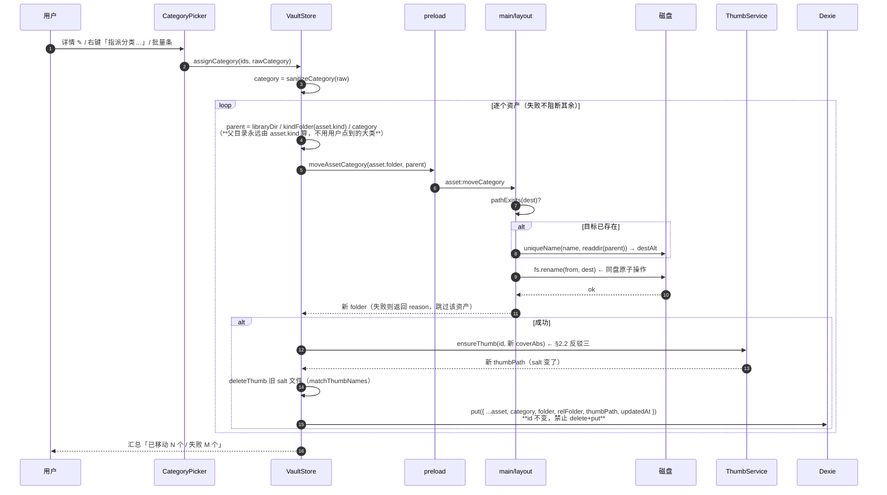
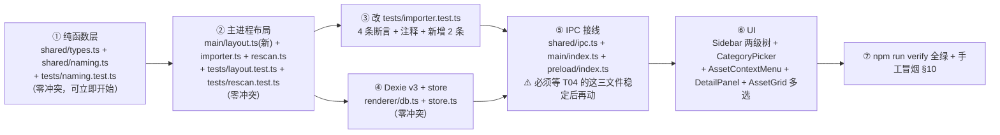

# 模库 ModVault — 增量变更设计 · 语义子目录

> 文档版本：**v1.0.1** ｜ 撰写：高见远（架构师） ｜ 语言：简体中文
> 变更来源：用户在 PRD Q2 否决了 PM 的建议默认 A、选择 **B（落盘也建语义子目录）**，主理人补充 5 条实现约束（`docs/01-PRD-模库.md:463` 起）
> 上游文档：`docs/01-PRD-模库.md`（PRD）、`docs/02-架构设计-模库.md`（架构 v1.2）
> 读者：寇豆码（工程师）、严过关（QA）、齐活林（主理人）
> **本文档只写 `docs/**`，不改代码实现**（工程师正在并行做 T04，避免冲突）

> ## ⛔ v1.0.1 修订公告（2026-10-13）：本文的部分结论已被 `docs/06` v1.0.1 取代
>
> 分类需求在本文定稿后再次演进：用户补充 6 张截图确认筛选区是**三排**（一级分类 / 二级分类 / 风格），
> 用户拍板**语义两级 = 一级分类 + 二级分类**，落盘改为**固定四层** `<大类>/<一级>/<二级>/<资产名>`（双哨兵）。
> 因此本文以下内容**作废，禁止照着实现**（细节与原因见 `docs/06-分类体系设计.md` v1.0.1）：
>
> | 作废内容 | 位置 | 取代方案（06 v1.0.1） |
> | --- | --- | --- |
> | 「可变深度下的资产/分类判定」思想（EXT_KIND 结构判据 / 深度预算 / Track A/B） | §2.2 反驳一、§5 | 固定四层 → **纯路径解析 + 忽略上报**，零启发式（06 §1.3/§5.2/§11.2） |
> | 单字段 `Asset.category?: string`（posix 相对路径，1~2 段） | §4.1 | **`category1` + `category2` 两个独立字段** + `styles: string[]`（06 §10.1） |
> | `relFolder` 三段（`<大类>/<category>/<name>`） | §4.2 | **恒四段** `<大类>/<一级>/<二级>/<资产名>`（06 §9.3） |
> | Dexie v3 = 加 `category` 单字段索引 | §4.3 | v3 = `category1, category2, *styles`（06 §10.2） |
> | `composeRelFolder(kindFolder, category, name)` 三参 | §4.2 | 四参（06 §9.3）；**`parseRelFolder` 删除** |
> | 侧栏两级树（大类 → 语义分类） | §7 | **三级树**（大类 → 一级 → 二级）+ 风格维度，移交 T07（06 §12.1） |
> | 落地顺序 T05→…（本文 §8） | §8 | **T05 → T06 后端分类 → T07 前端分类 UI**（06 §12.4） |
> | 测试影响清单（本文 §6） | §6 | **以 06 §12.2 为准**（路径加两级而非一级：`'模型/未分类/未分类/现代衣柜'`） |
>
> **本文仍然有效、且被 06 沿用的内容**：§2.1（「未分类」必须是真实磁盘目录的四条理由 + 虚拟分组方案否决）、
> §2.2 反驳二（**禁止跨大类移动**，kind 不由目录决定）、§2.2 反驳三 + §5.4（**`thumbSalt` 依赖 coverAbs，改分类必须重生缩略图**）、
> §2.3 + §5.5（哨兵幂等映射、`dedupeKey` 不混入分类）、§5.1–5.3（改分类 = 先动磁盘后改索引、失败回滚、重名防御）、
> §4.4（遗留布局迁移用 **DB 驱动**而非磁盘启发式——06 §10.2 沿用，仅目标路径改为 4 段）。
> 版本规则：同版本号不重复发布不同内容，故本文升 **v1.0.1** 并以标注方式修订，原文保留。修订记录见文末。

---

## 0. 一句话摘要

> ⛔ **v1.0.1：本节描述的"三层布局"已被"固定四层"取代，权威口径见 `docs/06` v1.0.1 §0/§9/§11。**

把库内布局从 **两层** `<大类>/<资产名>` 改为 **三层** `<大类>/<语义分类>/<资产名>`，其中未指派分类的资产统一落在哨兵目录 `<大类>/未分类/<资产名>`；导入流程零打断，分类在导入之后由用户在 UI 里指派，指派动作 = 移动文件夹 + 更新索引（**`Asset.id` 不变，禁止 delete+put**）。

**受影响的现有测试：4 条断言必须改、1 条注释建议同步、1 条是隐含契约（不改但不能被打破）、39 条经核实确定不受影响。**
同时发现 **2 个零覆盖高危模块**（`rescan`、磁盘搬移），本次必须补测试（详见 §6）。

---

## 1. 事实核对（动手前先摆正）

| 项 | 我实测到的值 | 备注 |
| --- | --- | --- |
| 当前测试基线 | **134 passed / 10 files**（2026-10-13 04:28） | 主理人转述的"95 条"是 04:19 的快照；工程师在 04:21 又新增了 `thumb.test.ts`(25) 与 `vault.test.ts`(14)，数字**仍在增长**，所以本变更的影响清单必须**按行号给**，不能按条数给 |
| `typecheck:node` / `typecheck:web` | ✅ 绿 | |
| `electron-vite build` | ✅ 绿 | |
| 版本控制 | **无 git 仓库**（`git rev-parse` → fatal） | ⚠️ 没有回滚网。§9 的落地顺序必须按"串行 + 低冲突"来排 |
| 遗留脏文件 | 仓库根目录出现 `.3ds` `.fbx` `.max` `.obj` `files[0]` `首个模型文件` 六个 0 字节文件 | 疑似有人把 PRD Q3 那行原文（`> 主模型文件优先级 .skp > .max > .fbx > .obj > .3ds > 首个模型文件 > files[0]`）当成 shell 执行过，`>` 被当成重定向建了空文件。**建议立即删除**，否则会污染后续打包 |
| 受影响的行(token)位置已确认 | `importer.ts:204/:220`、`rescan.ts:34-59`、`store.ts:126`、`ImportQueue.tsx:44` | 见 §3 |

---

## 2. 结论先行：我确认什么、反驳什么

### 2.1 确认（你的判断是对的）

**「未分类」必须是磁盘上的真实目录，不能只在 UI 里虚拟分组 —— 确认，你的理由成立，而且理由比你说的更强。**

你的判断：`<大类>/现代衣柜` 在 rescan 时无法区分"资产文件夹"还是"分类文件夹"。

我确认这个歧义成立，并补充 **4 条独立理由**（任意一条单独就足以否掉虚拟分组方案）：

1. **rescan 无法判定**（你的理由）：rescan 必须确定遍历深度。混合布局下只能靠启发式（"有没有文件""子目录占比"）猜，而"资产包根目录只有子目录"是合法形态（贴图包常 Folder-per-map），启发式必然误判。
2. **`relFolder` 会失去双射性**：`vault://asset/<relFolder>/<cover>` 的解析、`isWithinRoot` 的越界判定、`ImportQueue` 的 `relFolder.split('/')[0]`，全都假设 `folder ↔ relFolder` 一一对应且段数固定。段数漂移会让这三处的边界条件同时失稳。
3. **写入冲突**：改分类 = 在同一父目录下 `fs.rename`。父目录若不唯一确定，重名防御（`uniqueName`）的"已存在集合"就取错，可能静默覆盖另一个资产。
4. **PRD S4 的明文约束**：Alternative 里唯一能消歧的办法是塞隐藏标记文件（`.category` / `index.json`），这与 PRD S4「素材必须是磁盘上的明文文件夹，卸载后仍能直接用资源管理器打开」直接冲突 —— **一票否决**。

**结论：`<大类>/未分类/<资产名>` 采纳，虚拟分组方案评估掉，不再讨论。**

### 2.2 反驳 / 必须修正的三条

> 主理人要求直接反驳，不附和。以下三条我认为你的 5 条约束里有 **1 处内部矛盾** 和 **1 处推论不完整**，第三条是我在复核时发现的新坑。

#### ❗反驳一：约束 5「两层」和用户自己的示例互相打架，必须二选一才能写 rescan

> ⛔ **v1.0.1 已裁决**：用户最终选择**语义两级**（= 知末的一级分类 + 二级分类），落盘**固定四层**，本文的"深度 ≤1 + `CATEGORY_MAX_DEPTH` 预埋"方案作废。见 `docs/06` v1.0.1 §0/§1.3。本节保留为决策过程记录。

- 约束 5 写的是：层级固定两层 `<大类>/<语义>/` → 语义 **只有 1 级**，形如 `模型/家具/<资产名>`。
- 但 PRD Q2 里**用户自己写的示例**是：`E:\ModVault\Library\模型\家具\沙发\<资产名>` → 语义 **2 级**（家具 → 沙发）。

这两个只能活一个，而 rescan 的遍历深度取决于它 —— 这是**唯一必须现在就定死**的事，不能拖到实现时。

**我的建议：本轮实现"语义深度 ≤1"（`模型/家具/<资产名>`），用户示例里的 `家具/沙发` 暂不支持。**
理由：① 深度是可加不可减的（先做浅的，将来放开是纯增量；先做深的再收回要动数据）；② 团队协作/ learning cost 角度看，PRD 自己也写了"嵌套深度是这套东西失控的主要方式"。

**架构上的兜底（关键）**：把 `Asset.category` 的类型设计成 **posix 相对路径字符串**（今天是单段 `'家具'`，将来可以是 `'家具/沙发'`），配套常量 `CATEGORY_MAX_DEPTH = 1`。
这样将来放开到 2 级时，只需要改常量 + `rescan` 多一层循环，**schema、IPC、UI 组件一行不动**。这是我要在这里预埋的唯一一件事。

**→ 需要你向用户确认一次："您示例里的 `家具/沙发` 是要两级嵌套，还是只是举了 `家具` 一个例子？"** 在用户回答前，工程师按 ≤1 实现。

#### ❗反驳二：约束 3「改分类」隐含允许跨大类移动，而这与你自己的结论（kind 不由目录决定）矛盾

你说"跨大类改分类时 kind 不该跟着变，kind 由文件内容决定不是由目录决定，需你确认" —— **前半句我完全同意，但正因为同意，就必须禁止跨大类移动**，否则你的结论守不住：

- 若允许把 `模型/现代衣柜` 挪到 `贴图/布纹/现代衣柜`：
  - `Asset.kind` 仍是 `'model'`（按你的结论不改），但 `folder` 落在 `贴图/` 下 → **布局不变式 `folder === libraryDir/kindFolder(kind)/category/name` 直接崩**；
  - `rescan.ts:58` 的兜底 `detected !== 'other' ? detected : kindFromFolder(folderName)` 在内容判不出大类时（比如一个只有 `.txt` 说明文档的资产）会用**目录名**反推 kind → 内容判不出时 kind 被目录拐走 → **kind 在两次 rescan 之间漂移**；
  - `ImportQueue` 显示的 `relFolder.split('/')[0]`（大类）与侧栏按 `kind` 的分组会对不上。

**结论：改分类 = 只在本大类内部移动，父目录永远由 `kindFolder(asset.kind)` 计算，绝不使用用户在树里点到的那个大类。**
这条比"要不要改 kind"更根本，写进约束里就不存在"要不要改 kind"这个问题了（kind 恒定）。

> 副作用（可接受）：分类天然按大类隔离，`模型/家具` 与 `贴图/家具` 是两个独立分类，互不干扰。这符合直觉，无需处理合并。

#### ❗反驳三（新坑）：`thumb` 的 salt 是封面绝对路径的哈希 → **改分类会打碎缩略图**

工程师刚落地的 `src/shared/thumb.ts`（已在 `tests/thumb.test.ts` 验证）：

```ts
thumbSalt(coverAbs)          // 封面绝对路径 → 8 位 hex
thumbFileName(id, salt, ext) // <id>-<salt>.<ext>
```

`salt` 依赖 **`coverAbs`**，而 `coverAbs = path.join(asset.folder, asset.cover)`。改分类会移动 folder → `coverAbs` 变 → **salt 变 → 缩略图文件名变 → 旧缓存变成孤儿、新文件名下没有文件 → 网格集体变占位**。

这条你在 5 条约束里没提到，但它会让"改分类"上线即 bugs（用户改一次分类，网格里那批卡片全变灰格）。

**处理（见 §5.4）**：改分类成功后必须 ① 用新 `coverAbs` 重新 `ensureThumb` ② 删掉该 id 的**全部**旧 salt 文件（用已有的 `matchThumbNames(names, id)`，不要按精确文件名删）。这是复用现有能力，几乎零成本。

### 2.3 顺带消解的一个隐患：`未分类` 作为保留字怎么办

如果用户在新建分类时手打了 `未分类`，就会和哨兵目录撞车。

**不需要报错拒绝，用幂等映射解决**：`sanitizeCategory('未分类')` → `'未分类'`（哨兵自身）。
即"把资产指派到 `未分类`"语义上等于"清除分类"，永远不可能创建第二个竞争目录。`rescan` 侧把名为 `未分类` 的目录一律识别为 `category='未分类'`。零新增校验逻辑，零可能产生冲突。

---

## 3. 受影响文件清单

> ⛔ **v1.0.1 作废，以 `docs/06` v1.0.1 §12.1 为准**：新增 `src/shared/taxonomy.ts`（词表数据）等，`shared/naming.ts` 改四段组合并删 `parseRelFolder`。

> **新增 / 改造 / 只改测试** 三类。行数为改后**预估总行数**（非增量）。

### 3.1 新增（5 个文件）

| 路径 | 职责 | 预估行数 | 为什么必须新增 |
| --- | --- | --- | --- |
| `src/main/layout.ts` | **库布局操作**：`moveAssetFolder()`（同盘 rename + 重名防御）、`planLayoutMigration()`（为遗留 2 段记录生成搬移计划）、`applyLayoutMigration()`、`assetFolderOf()` | ~120 | 目前磁盘布局操作散落在 `importer.ts` / `renameAssetFolder` 里；新增"搬移 + 迁移"两类操作需要一个可单测的落点。**这也是本次风险最高的代码**（批量移动 GB 级文件夹），必须有独立测试，见 §6 |
| `tests/layout.test.ts` | `moveAssetFolder` 同盘 rename / 目标存在→`uniqueName` / 计划生成 / 幂等（跑两次不产生第二层嵌套） | ~140 | 覆盖上面那个新模块 |
| `tests/rescan.test.ts` | 用 tmpdir 搭真目录结构，验证 rescan 能读出 kind/category/relFolder | ~120 | **`rescan.ts` 目前零测试**，而它是本次改动最大的文件之一。这是当前最大的覆盖率黑洞 |
| `src/renderer/components/CategoryPicker.tsx` | 分类选择器（复用 `Modal`）：输入框 + 已有分类自动补全 + 新建 + 「未分类（清除分类）」；单选/批量共用 | ~110 | 详情面板与批量操作条共用同一个交互 |
| `src/renderer/components/AssetContextMenu.tsx` | 卡片/列表行右键菜单：指派分类 / 打开所在文件夹 / 选中主模型文件 / 复制主文件路径 / 删除 | ~90 | 主理人指定的入口之一；当前代码里还没任何右键处理 |

### 3.2 改造（12 个文件）

| 路径 | 改什么（具体要求） | 预估行数 |
| --- | --- | --- |
| `src/shared/types.ts` | `Asset` 新增 `category?: string`（**建议先用可选**，理由见 §4.1）；新增常量 `UNCLASSIFIED = '未分类'`；`Filters` 无变化（由 renderer store 持有） | ~140 |
| `src/shared/naming.ts` | 新增 `UNCLASSIFIED` / `CATEGORY_MAX_DEPTH` / `normalizeCategory()` / `sanitizeCategory()` / `composeRelFolder()` / `parseRelFolder()`（含遗留 2 段容忍解析）。**`dedupeKeyOf` 保持不变**（见 §5.5） | ~130 |
| `src/main/importer.ts` | ① `kindDir` 之后多加一层 `categoryDir = <kindDir>/未分类`，`fs.mkdir(categoryDir,{recursive:true})` ② `uniqueName` 的"已存在集合"改为 `readdir(categoryDir)` ③ `target = <categoryDir>/<finalName>` ④ `relFolder = composeRelFolder(folderName, '未分类', finalName)`（**替换掉 `:220` 的模板串拼接**）⑤ Asset 字面量补 `category: '未分类'` ⑥ **保持预检（`checkSpaceFor`）早于任何 mkdir**（这是 `importer.test.ts:163` 的隐含契约） | ~270 |
| `src/main/rescan.ts` | **改成三层遍历**：`lib/<大类>/*`（分类层，只认目录）→ `lib/<大类>/<分类>/*`（资产层）→ 产出 `category = 分类层目录名`、`relFolder = <大类>/<分类>/<资产名>`。**不再兼容 2 段遗留布局**（遗留由 §4.3 的 DB 驱动一次性迁移消化，不需要在 rescan 里做启发式分支） | ~130 |
| `src/main/index.ts` | ⚠️ **T04 正在改这个文件**，建议 T04 落地后再动。新增 IPC：`asset:moveCategory`（内部调用 `layout.moveAssetFolder`）、`library:migrateLayout` | ~290 |
| `src/shared/ipc.ts` | 新增 `assetMoveCategory: 'asset:moveCategory'`、`libraryMigrateLayout: 'library:migrateLayout'` | ~38 |
| `src/preload/index.ts` | ⚠️ **T04 正在改这个文件**。新增 `moveAssetCategory(fromAbs, category)`、`migrateLayout()` | ~80 |
| `src/renderer/db.ts` | Dexie **升 v3**（不是改 v2）：`assets` 索引加 `category`；`upgrade()` 先快照再回填。详见 §4.2 | ~110 |
| `src/renderer/store.ts` | ① `renameAsset` 的 `relFolder` 改用 `composeRelFolder(kindFolder(asset.kind), normalizeCategory(asset.category), newName)`（**替换 `:126` 的硬拼**）② 新增 `assignCategory(ids, category)` ③ 新增多选状态 `selectedIds: string[]`（批量操作要用，T05 的批量删除也复用）④ `Filters` 加 `category: string \| null` ⑤ `rescan` 合并键仍用 `folder`（不变）⑥ `useVisibleAssets` 加 category 过滤 | ~330 |
| `src/renderer/components/Sidebar.tsx` | 两级树：大类可展开/收起，子项是分类（含「未分类」）。详见 §7 | ~190 |
| `src/renderer/components/DetailPanel.tsx` | 详情头部的 chip 区加一行「分类：家具 ✎」→ 打开 `CategoryPicker`；文件行逻辑不变 | ~310 |
| `src/renderer/components/AssetGrid.tsx` | 卡片加 hover checkbox（多选）与右键触发 `AssetContextMenu`；列表视图同样支持。`vaultUrl(relFolder + '/' + cover)` 逻辑**不变**（relFolder 已含三层） | ~210 |

### 3.3 只改测试（2 个文件）

| 路径 | 改什么 |
| --- | --- |
| `tests/importer.test.ts` | 4 条断言改期望值 + 1 处注释同步 + 新增 2 条断言（详见 §6.2） |
| `tests/naming.test.ts` | 新增 describe：`UNCLASSIFIED` / `normalizeCategory` / `sanitizeCategory` / `composeRelFolder` / `parseRelFolder`（详见 §6.3） |

### 3.4 确认不受影响、可放心不动的文件（经逐行核实）

| 文件:现状 | 为什么不受影响 |
| --- | --- |
| `tests/thumb.test.ts`(25) | 断言的输入是**字面量路径串**（`'/lib/模型/沙发/预览图.jpg'`），不断言磁盘布局。注意点只有 §2.2 反驳三的"产物一致性"，属于业务顺序问题，不是测试断言问题 |
| `tests/vault.test.ts`(14) | `isWithinRoot(root, 'E:\\...\\Library\\模型\\沙发\\a.png')` 判断的是"是否为子路径"，增加一层深度仍然成立 |
| `tests/classify.test.ts`(18) / `encoding`(13) / `skpVersion`(11) / `space`(11) / `extractor`(12) / `format`(6) | 纯函数，输入不含库布局。**超过一半的测试量天然免疫** |
| `src/main/fsutil.ts` | `walkFiles` / `moveDir` / `createStaging` 不关心层级，无需改 |
| `src/main/protocol.ts` + `src/shared/vault.ts` | `vault://asset/<relFolder>/...` 靠 `relFolder` 字符串，多一层段不影响路由与越界判定 |
| `src/renderer/components/ImportQueue.tsx:44` | `relFolder.split('/')[0]` 取的仍是第 0 段（大类），**结果不变**。（可选优化：改成展示 `未分类` 或完整三级，但不改也不会错） |
| `src/shared/classify.ts` | `kindFolder()` 语义不变（`大类→中文目录名`），无需改 |

---

## 4. 数据模型变更

### 4.1 `Asset` 新增字段

> ⛔ **v1.0.1 作废**：本节的单字段 `category`（posix 相对路径）已改为 `category1` + `category2` + `styles` 三字段，见 `docs/06` v1.0.1 §10.1。

```ts
/** 语义分类的哨兵目录名。改名的"清空分类"目标也是它 */
export const UNCLASSIFIED = '未分类'

export interface Asset {
  // ...既有字段全部不动...
  /**
   * 语义分类 = `<大类>/` 之下的那一层目录名。
   * 类型是 **posix 相对路径**（今天受 `CATEGORY_MAX_DEPTH = 1` 限制恒为单段，如 `'家具'`；
   *   将来放开到 2 级时可以是 `'家具/沙发'`，届时只需改常量与 rescan 循环，**schema 不动**）。
   * 缺失 / 空串 / 仅空白一律等价于 `'未分类'`（读时用 `normalizeCategory()` 归一化）。
   */
  category?: string
}
```

| 属性 | 值 |
| --- | --- |
| 字段名 | `category` |
| 类型 | `string`（**建议本期声明为可选 `category?: string`**） |
| 默认值 | `'未分类'` |
| 是否索引 | **是**：Dexie v3 的 `assets` stores 串里加 `category`（用于侧栏分组统计与未来 `where('category').equals()`） |
| 何时写入 | ① 导入（恒 `'未分类'`）② rescan（读盘 derive）③ 改分类（用户指定）④ v3 迁移回填 |

> **为什么推荐"可选"而不是"必填"**：
> 必填更干净（TS 会强制所有构造点跟上），现在只有 `importer.ts:260` 和 `rescan.ts:79` 两个构造点，改起来其实很快。
> 但**工程师正在并行做 T04，而且本项目没有 git**（§1），把类型改严会在他下一次 `npm run verify` 时同步变红、且无法 `git stash` 隔离。
> **建议本期 `category?: string` + 全局用 `normalizeCategory(a.category)` 读取**；等本变更整体落地、verify 全绿后，再把类型收紧为必填（一个纯机械改动，约 10 分钟）。
> 如果你更看重长期干净、愿意让工程师先把 T04 收尾再动 `types.ts`，那就直接必填 —— 这是取舍不是技术问题，请你定。

### 4.2 `relFolder` 的新格式与读写 API

> ⛔ **v1.0.1 作废**：三段格式与三参 `composeRelFolder`/`parseRelFolder` 已被四段版取代，见 `docs/06` v1.0.1 §9.3。

新格式（canonical，写侧唯一产出）:

```
relFolder = `${kindFolder(kind)}/${category}/${name}`
// 例：'模型/未分类/现代衣柜'    '贴图/布纹/亚麻布'
// 段数恒为 3 + CATEGORY_MAX_DEPTH - 1
```

`src/shared/naming.ts` 新增（全部纯函数、零 IO）：

```ts
export const UNCLASSIFIED = '未分类'
export const CATEGORY_MAX_DEPTH = 1

/** 读侧归一化：undefined / 空 / 空白 / 哨兵别名 → '未分类' */
export function normalizeCategory(c?: string | null): string

/** 写侧净化：按 '/' 切段 → 每段 sanitizeName → 去空段 → 截断到 CATEGORY_MAX_DEPTH 段 → 归一。
 *  '未分类' 自身幂等（指派到它就是"清除分类"），因此永远不会产生第二个竞争目录。 */
export function sanitizeCategory(raw: string): string

/** canonical 组合，importer / store.renameAsset / layout 迁移三处共用 */
export function composeRelFolder(kindFolderName: string, category: string, name: string): string

/** 容忍式解析（仅供迁移与防御，canonical 路径不该依赖它）：
 *  2 段 → category = '未分类'（遗留布局）；3+ 段 → 首段大类、末段资产名、中间 join 为 category */
export function parseRelFolder(relFolder: string): { kindFolder: string; category: string; name: string }
```

> `dedupeKeyOf()` **保持不变**（§5.5），`sanitizeName()`、`uniqueName()`、`pickAssetName()` 全部不动 —— 现有 15 条 naming 用例一个都不用改。

### 4.3 Dexie 迁移：**升 v3**（不是改 v2）

> ⚠️ **v1.0.1 部分修订**：「升 v3 而非回改 v2」的结论**仍然有效**（06 §10.2 沿用）；但 v3 的目标定义改为 `category1, category2, *styles` 索引 + 回填，见 `docs/06` v1.0.1 §10.2。

**为什么不是"v2 里加字段"**：
v2 的定义已经在代码里、也可能已经存在于任何跑过开发版的人的机器上（IndexedDB 只在**版本号递增**时才跑 `upgrade`）。若直接改 v2 的 `stores/upgrade`，已经处于 v2 的库**不会重跑**升级 → `category` 缺失、索引缺失 → 侧栏 `where('category')` 查不到、UI 靠 `normalizeCategory` 兜底勉强能跑但看起来"随机缺失"。叠加本项目**无 git 无法回滚**，这个风险不值得冒。

**为什么可以不是 v3**：如果愿意承担"所有开发者的 IndexedDB 手动清库一次"的成本，改 v2 也行。但这就是拿"省 20 行代码"换"一次静默数据不一致"，不做。

```ts
this.version(2).stores({ /* 保持现状，一个字符都别动 */ })

this.version(3)
  .stores({
    // 仅新增 category 索引，其余与 v2 完全一致
    assets: 'id, kind, category, source, importedAt, updatedAt, *tags, dedupeKey, suVersion, suMajor, folder, coverSource',
    backups: 'id, at'
  })
  .upgrade(async (tx) => {
    // ① 迁移前快照（与 v2 同策略）
    const old = (await tx.table('assets').toArray()) as Asset[]
    if (old.length > 0) {
      await tx.table('backups').put({ id: `v2-${Date.now()}`, at: Date.now(), json: JSON.stringify(old) })
    }
    // ② v3 不改主键 → 可以直接 modify（v2 因为要换主键才不得不用 clear + bulkAdd）
    await tx.table('assets').toCollection().modify((a) => {
      a.category = normalizeCategory(a.category ?? parseRelFolder(a.relFolder ?? '').category)
    })
  })
```

> Dexie 的 `modify` 不允许改主键，但**允许改普通字段**，所以 v3 的迁移比 v2 温和得多，也不需要 `clear`。

### 4.4 磁盘侧遗留布局迁移（我的追加建议：**用 DB 驱动，不要用磁盘启发式**）

v3 迁移只动索引，**不动磁盘**。要把遗留的 `<大类>/<资产名>` 真正搬到 `<大类>/未分类/<资产名>`，有两种做法：

| 方案 | 问题 |
| --- | --- |
| ❌ 启动时扫磁盘，把"疑似资产目录"递归搬一层 | 又要靠启发式判歧义 —— 正是 §2.1 否掉虚拟分组的同一个理由 |
| ✅ **DB 驱动**：Dexie 里 `relFolder` 只有 2 段的记录就是遗留记录，**不需要猜** | 精确、可枚举、可预演、可跳过失败 |

实现：`src/main/layout.ts`

```ts
export interface LayoutMove { id: string; from: string; to: string }
/** 从 DB 记录着眼生成计划：2 段 relFolder → 3 段；源目录不存在则 skip（只更新索引） */
export function planLayoutMigration(
  assets: Pick<Asset, 'id' | 'folder' | 'relFolder' | 'kind' | 'name' | 'category'>[],
  libraryDir: string
): { moves: LayoutMove[]; skipped: string[] }
export async function applyLayoutMigration(moves: LayoutMove[]): Promise<{ ok: string[]; failed: Array<{ id: string; reason: string }> }>
```

触发时机（renderer `init()`，一次性，用 `v3` 升级标记驱动）：
1. `db` 打开后，若存在 `category` 缺失或 `relFolder` 段数 < 3 的记录 → 调 `IPC.libraryMigrateLayout`；
2. 安全上限：计划条数 **> 50** 时不在启动时自动执行，改为在设置页显示一条提示 + 「整理库目录」按钮（避免没见过的批量 IO 在用户机器上裸奔）；
3. 失败的条目跳过并汇总提示，**不影响启动**。

> 用户实际是 0 资产起步，这条路径大概率一次都不跑；但它是"v1 已经有人用了"这个假设下的唯一正解，成本很低，建议做。

---

## 5. 改分类的操作语义

### 5.1 步骤（严格顺序，先磁盘后索引）



### 5.2 失败回滚

- **`fs.rename` 是同盘原子操作**（源和目标都在 `libraryDir` 下，必然同盘），不存在"移了一半"；失败原路返回，磁盘状态保持原样。
- **索引只在磁盘成功之后才更新** ⇒ 天然回滚安全。磁盘是唯一真相，索引落后最多导致一次 404，下一次 `rescan` 会自愈。
- 唯一可观测的副作用：目标分类目录可能已被 `mkdir` 出来但资产没移成功 → **空目录**。无需清理（rescan 会跳过无资产的目录，侧栏只对计数 > 0 显示）。**不要反过来去 rmdir 源分类目录**（有并发误删风险，且用户手工建的空目录会被误删）。
- 若 `fs.rename` 因跨盘抛出（理论上不会），`layout.moveAssetFolder` **不要**退化成 `cp+rm`（`fsutil.moveDir` 会这么做）：因为同一 `libraryDir` 内跨盘不成立，退化意味着路径算错了 —— 应当直接报错并记录，让上层暴露。

### 5.3 跨大类：`kind` 不动 + **禁止跨大类移动**

见 §2.2 反驳二。要点：

- 目标父目录恒为 `libraryDir / kindFolder(asset.kind) / category` ⇒ 不变量 `folder === libraryDir/kindFolder(kind)/category/name` **永远成立**；
- UI 上：批量选中项若跨大类，禁用「指派分类」并给提示（文案：`批量指派分类仅支持同一大类内的资产，请先按大类筛选`）；
- `Asset.kind` 除 `rescan` 外永不被改（保持"kind 由内容决定"）。

### 5.4 缩略图必须重生（否则改一次分类网格全变灰格）

因为 `thumbSalt(coverAbs)` 依赖 `coverAbs = folder + '/' + cover`（见 §2.2 反驳三）：

1. 移动成功后立即 `ensureThumb(id, 新的 coverAbs)` → 得到新 `thumbPath`；
2. 用 `matchThumbNames(names, id)` **通配**删掉该 id 的旧 salt 文件（不能用精确名删 —— 旧 salt 已经算不出来了，或者说不必算）；
3. 顺序：先生成新的，再删旧的，避免中间态出现"一个都没有"。

### 5.5 重名冲突与 `dedupeKey`

- **改名冲突**：`layout.moveAssetFolder` 先 `pathExists(dest)`，命中则用 `uniqueName()` 追加 `-2/-3…`（与导入一致）。**永不覆盖**。
- **`dedupeKeyOf(name, kind)` 保持不变**（**明确提醒：不要顺手把 category 混进去**）。
  理由：`dedupeKey` 的语义是"这个资产是不是已经有了"，与它放在哪个分类无关；把 category 加进去会让"分到不同类的同名资产"逃过重复提示（P1-5），属于换汤不换药的假去重。
  → 现有 2 条 dedupeKey 用例不受影响。

---

## 6. 对现有测试的影响清单（最重要的一节）

> ⛔ **v1.0.1 作废，以 `docs/06` v1.0.1 §12.2 为准**：布局是加**两级**（`未分类/未分类`）而非一级，
> 四条断言的期望值应为 `'模型/未分类/未分类/现代衣柜'` / `path.join(lib,'模型','未分类','未分类','现代衣柜')` / `:115` 同理 / `'贴图/未分类/未分类/已解压'`。
> 免疫统计也更新为 129 条（新增 thumb/vault 两个测试文件后基线为 134 条）。

> 基线：**134 passed / 10 files**（含工程师刚加的 `thumb.test.ts` 25 条 + `vault.test.ts` 14 条）。
> ⚠️ 测试数量仍在实时增长，请以**行号**为准。
> 结论：**必须改 4 条断言 + 1 处注释；1 条隐含契约不能破；39 条经核实确定不受影响；建议新增 2 个测试文件 + 2 条断言。** 其余 88 条天然免疫（纯函数/不改的部分）。

### 6.1 必须由工程师改的断言（4 条）

| # | 位置 | 现在的期望 | 应改成 | 备注 |
| --- | --- | --- | --- | --- |
| **1** | `tests/importer.test.ts:90` | `expect(a.relFolder).toBe('模型/现代衣柜')` | `expect(a.relFolder).toBe('模型/未分类/现代衣柜')` | ✅ 你已列出 |
| **2** | `tests/importer.test.ts:91` | `expect(a.folder).toBe(path.join(lib, '模型', '现代衣柜'))` | `expect(a.folder).toBe(path.join(lib, '模型', '未分类', '现代衣柜'))` | ✅ 你已列出 |
| **3** | `tests/importer.test.ts:115` | `await expect(fs.stat(path.join(lib, '模型', '现代衣柜', '预览图.jpg'))).resolves.toBeTruthy()` | `path.join(lib, '模型', '未分类', '现代衣柜', '预览图.jpg')` | ❗**你漏列了**：这条是唯一真正验证"磁盘落位"的断言，比 `:90/:91` 更重要 —— 只改 `:90/:91` 会让这条变红，且错误信息是 `ENOENT`，很有迷惑性 |
| **4** | `tests/importer.test.ts:263` | `expect(assets[0]!.relFolder).toBe('贴图/已解压')` | `expect(assets[0]!.relFolder).toBe('贴图/未分类/已解压')` | ❗**你漏列了**：这条覆盖"直接拖入已解压文件夹"这条独立路径（`importOne` 的 `isDir` 分支），与 `:90` 不是同一条代码路径，漏改会留下一个绿里带红的假象 |

### 6.2 建议同步的注释 + 隐含契约（2 条）

| # | 位置 | 现状 | 处理 |
| --- | --- | --- | --- |
| **5** | `tests/importer.test.ts:114` 注释 | `// 磁盘上确实落到了 库根/模型/现代衣柜` | 改成 `// 库根/模型/未分类/现代衣柜`。不断言，但留着旧注释会让下一个人误判 |
| **6** | `tests/importer.test.ts:163` | `await expect(fs.readdir(lib)).resolves.toHaveLength(0)`（P0-3 预检失败用例） | **不要改期望值**，但这是**隐藏契约**：`checkSpaceFor` 必须**严格早于**任何 `mkdir`（包括新的分类目录）。如果实现时把 `ensureCategoryDir()` 提到预检之前，这条会变红 —— 这正是它存在的价值，请保留并在附近加一行注释说明 |

### 6.3 建议新增的断言 / 用例（补齐零覆盖黑洞）

| 位置 | 新增什么 | 为什么 |
| --- | --- | --- |
| `tests/importer.test.ts`（第 85–116 行那一条里） | `expect(a.category).toBe('未分类')`；`await expect(fs.stat(path.join(lib,'模型','未分类'))).resolves.toBeTruthy()` | 锁住"未指派分类必须落在哨兵目录"这条新契约 |
| `tests/naming.test.ts` 新 describe | `normalizeCategory`：undefined/''/空白/'未分类' 都 → `'未分类'`<br/>`sanitizeCategory`：`'家具'`→`'家具'`；`' 家具 '`→`'家具'`；`'未分类'`→`'未分类'`（幂等）；`'家具/沙发'`→**按 `CATEGORY_MAX_DEPTH=1` 截断为 `'家具'`**（锁住当前深度决策，未来放开时这条会红，**这是提醒，不是 bug**）；`'a<b'`→清理非法字符<br/>`composeRelFolder('模型','未分类','衣柜')` → `'模型/未分类/衣柜'`<br/>`parseRelFolder`：`'模型/未分类/衣柜'`→`{kindFolder:'模型',category:'未分类',name:'衣柜'}`；**遗留 `'模型/衣柜'`→`{kindFolder:'模型',category:'未分类',name:'衣柜'}`**（迁移路径依赖这条） | 纯函数，零成本，把 §4.2 的 API 契约钉死 |
| **`tests/rescan.test.ts`（新）** | 用 tmpdir 造真目录：`模型/未分类/现代衣柜/{预览图.jpg, 贴图/木纹.jpg}` + `模型/家具/吊灯/a.skp` + `贴图/布纹/亚麻/1.jpg` → 断言 rescan 产出 3 条，各自的 `kind`/`category`/`relFolder`/`name` 正确；空分类目录不产出资产；`.staging` 被跳过 | **`rescan.ts` 现在零测试**，而它是本次改动第二大的文件。不补这个等于让 QA 手测（他有 4 款 DCC + GBK 样本要验，不该再手工数目录） |
| **`tests/layout.test.ts`（新）** | `moveAssetFolder`：源存在→目标到位；目标已存在→按 `uniqueName` 追加 `-2` 且**不覆盖**；源不存在→报错不吞<br/>`planLayoutMigration`：2 段记录生成计划、3 段记录不进计划、**跑两次计划相同**（幂等，防止第二次扫描把 `模型/未分类/衣柜` 再识别成 2 段搬一次）<br/>`applyLayoutMigration`：成功后 `folder` 落在新位置 | 这里是唯一会**批量搬动 GB 级真实文件**的代码，必须有测试守着 |

### 6.4 已核实确定不受影响的量（可放心跳过）

| 文件 | 条数 | 核实结论 |
| --- | --- | --- |
| `tests/thumb.test.ts` | 25 | 输入是字面量路径串，不断言磁盘布局 |
| `tests/vault.test.ts` | 14 | `isWithinRoot` 判断"是否子路径"，多一层深度仍成立 |
| `tests/classify.test.ts` | 18 | `kindFolder`/`pickCover`/`pickPrimaryFile` 与层级无关 |
| `tests/encoding.test.ts` | 13 | 纯字符串 |
| `tests/skpVersion.test.ts` | 11 | 纯 Buffer |
| `tests/space.test.ts` | 11 | 纯计算 |
| `tests/extractor.test.ts` | 12 | 解压目标用 tmpdir，不涉及库布局 |
| `tests/format.test.ts` | 6 | `vaultUrl` 逐段编码，段数无关 |
| `tests/naming.test.ts` | 15 | 现有 15 条全部不受影响（只新增 describe） |
| **合计** | **125** | 其中 `importer.test.ts` 的 9 条里有 4 条要改，见 §6.1 |

---

## 7. UI 交互稿

> ⛔ **v1.0.1 作废并移交 T07**：两级树改为**三级树**（大类 → 一级分类 → 二级分类）+ 风格多选维度，交互稿见 `docs/06` v1.0.1 §12.1（T07 范围）。本节的「未分类永远排最后 / 计数为 0 隐藏 / 展开收起」等原则仍可参考。

### 7.1 侧栏两级树

```
全部                                        128
─────────────────────────────────────────────
分类
 ▾ 模型                                      42      ← 点 ▸/▾ 展开收起；点文字 = 只看该大类（category 清空）
    家具                                     17      ← 点 = {kind:'model', category:'家具'}
    灯具                                      9
    沙发布料                                  3
    未分类                                   13      ← 永远排在最后；计数为 0 时隐藏（若正被选中则保留）
 ▸ 贴图                                      58
 ▸ HDRI                                       6
 ▸ 材质预设                                   4
─────────────────────────────────────────────
标签   · Modern 12 · 北欧 8 …
─────────────────────────────────────────────
来源   · 知末网 96 · 3d66 20
─────────────────────────────────────────────
SU 版本 · SU 2024 33 · SU 2021 12           （T05 已有）
```

规则：
- **展开/收起**：`store.expandedKinds: AssetKind[]`，默认折叠；点大类名称做筛选时自动展开该项；再点同一项等于再次筛选（不切换折叠）。
- **计数**：`Map<kind, Map<category, number>>`，用 `useMemo` 派生；`未分类` 计的是 `normalizeCategory(a.category)` 命中哨兵的资产。
- **选中态**：`filters.category === name && filters.kind === parentKind`。
- 「未分类」不隐藏（PRD 约束 4），但当计数为 0 且与当前选中无关时可以隐藏，避免空噪音（与现有 kind 的隐藏策略一致）。

### 7.2 分类指派入口（三处，共用 `CategoryPicker`）

| 入口 | 触发 | 行为 |
| --- | --- | --- |
| **详情面板**（主） | 名称下方的 chip 行新增「分类：家具 ✎」 | 单选指派 |
| **右键菜单** | 卡片 / 列表行右键 → 「指派分类…」 | 单选；多选状态下对全部选中项生效 |
| **批量操作条** | Ctrl/Shift 点选或卡片 hover checkbox 勾多个之后，顶部浮出 `已选 3 项 · 指派分类 · 删除 · 取消` | 批量；跨大类时禁用按钮 |

`CategoryPicker` 内容：
1. 输入框（自动补全已有分类，支持 Enter 直接新建）
2. 「已有分类」列表（本大类内，带计数，点击即指派）
3. 底部一行：`未分类` = 清除分类（语义等价 §2.3）
4. 批量时提示：`将把 3 个资产移动到「模型/家具」`，并显示目标路径预览

### 7.3 批量流程

```
多选 → 顶部批量条 → 指派分类
  ├─ 选中项单一大类 → 正常执行
  └─ 选中项跨大类   → 按钮禁用 + tooltip：「批量指派分类仅支持同一大类内的资产，请先按大类筛选」
执行：逐个 moveAssetCategory，成功 N / 失败 M 汇总于右下角 toast
（失败项不阻断其余，与导入的"单包失败不阻断"同一套语汇）
```

> 多选状态 `selectedIds` 是 T05 批量删除也需要的前置能力；建议本变更先把 `selectedIds` 落到 store，T05 的批量删除直接复用，避免重复建一套。

---

## 8. 实施顺序（避开与 T04 的冲突）

> ⛔ **v1.0.1 作废**：现行顺序为 **T05（渲染层，进行中，不含分类 UI）→ T06（后端分类体系）→ T07（前端分类 UI）**，见 `docs/06` v1.0.1 §12.4。本节的「零冲突文件先行、IPC 接线压最后」原则仍沿用。

工程师正在改 `src/main/index.ts`、`src/preload/index.ts`、`src/main/protocol.ts`、`src/main/thumb.ts`。本变更**不需要碰** `protocol.ts` / `thumb.ts` / `thumb.ts` 内部；只有 `index.ts` 与 `preload/index.ts` 与 T04 重叠。



**排序原则**：把零冲突的文件排在前面做满做完，把与 T04 重叠的 `index.ts` / `preload/index.ts` 压到最后一步集中接线 —— 这样 T04 与本次变更不需要互相等待到最后一刻。

> 补充建议：由于**没有 git**，请 T04 落地时先跑一次完整 `npm run verify` 并把结果贴出来，作为本变更介入前的基线快照。

---

## 9. 风险清单

| # | 风险 | 等级 | 缓解 |
| --- | --- | --- | --- |
| **RA1** | **批量移动 GB 级文件夹**：改分类会触发真实磁盘 rename，虽然原子但**不可撤销**（本次没有"撤销分类变更"入口） | 🟡 | ① 先做准备参数、后执行；② 单次批量 >20 个时二次确认并显示目标路径预览；③ 失败不阻断其余并汇总 |
| **RA2** | **`rescan.ts` 零测试**却要重写遍历逻辑 | 🔴 | 本次强制补 `tests/rescan.test.ts`（§6.3），并要求 QA 在 §10 里加一条外部手工改目录后的 rescan 对账 |
| **RA3** | **缩略图 salt 失效**（§2.2 反驳三）→ 改一次分类网格全变灰 | 🟡 | 移动成功后强制 `ensureThumb` + 通配删旧文件；此为**必做项**不是优化项 |
| **RA4** | **Dexie v2 已存在于开发机**导致改 v2 无效 | 🟡 | 升 v3（§4.3），并在 QA 流程里加"构造 v2 数据 → 升级 v3"专项 |
| **RA5** | **`index.ts` / `preload/index.ts` 与 T04 撞车**（无 git 保护） | 🟡 | 按 §8 排序到最后一步；接线前先确认 T04 已 verify 绿 |
| **RA6** | **导入并发改名竞态**：`uniqueName` 的"已存在集合"是 `readdir(categoryDir)` 的快照，并发下两个同名包可能算出同一个 target | 🟢（预存在，非本次引入） | 建议（可选）在 `moveDir` 之前用 `fs.mkdir(target)` 独占占位，命中 `EEXIST` 则重算；本次不强制，纳入 T05 hardening |
| **RA7** | **根因性清理**：仓库根目录有 6 个误建的 0 字节文件 | 🟢 | 立即删除（§1），它们会被 `electron-builder` 打进安装包 |

---

## 10. QA 补充冒烟项（在 PRD §10 之上）

1. 拖 GBK 中文包 → 资产落在 `模型/未分类/现代衣柜`（**资源管理器里肉眼确认目录真实存在**）。
2. 详情改分类为「家具」→ 资源管理器里文件夹真的从 `未分类` 挪到了 `家具`，且**网格封面没有变灰**（验证 RA3）。
3. 改回「未分类」→ 挪回去，tags/note/source/suVersion 全部保留（验证没有 delete+put）。
4. 侧栏展开/收起、点大类、点分类三级筛选，计数与实际一致。
5. 多选 3 个同类 → 批量指派 → 3 个都到位；多选跨大类 → 按钮禁用且有提示。
6. 外部手工在 `模型/` 下新建一个分类目录并丢几个文件进去 → 「重新扫描」能正确识别为新资产（验证 rescan 三层遍历）。
7. 构造 v2 旧索引 → 升级 v3 → `category` 被回填为「未分类」，`backups` 表里有 `v2-*` 快照。
8. 拖外也无法省略的一条：**改分类不能让 SU 打开模型时丢贴图**（相对引用不受移动影响，因为整个资产文件夹整体移动 —— 这条要真的用 SU 打开一次确认）。

---

---

## 11. 修订记录

| 版本 | 日期 | 作者 | 变更 |
| --- | --- | --- | --- |
| v1.0 | 2026-10-13 | 高见远（架构师） | 初版：三层布局方案 + 「未分类」真实目录论证 + 改分类语义 + 测试影响清单 |
| **v1.0.1** | 2026-10-13 | 高见远（架构师） | 分类需求二次演进（用户确认三排筛选器，语义两级 = 一级 + 二级分类）：固定四层取代三层；本文 §0/§3/§4.1/§4.2/§6/§7/§8 加 ⛔ 作废标注，§2.2 反驳一裁决存档；**仍然有效并沿用**：§2.1 哨兵论证、§2.2 反驳二（禁止跨大类）/反驳三（缩略图重生）、§2.3 哨兵幂等、§4.4 DB 驱动迁移、§5 操作语义、§5.5 dedupeKey 不混分类。现行权威口径：`docs/06-分类体系设计.md` v1.0.1 |

*文档结束 · 现行权威口径 = `docs/06-分类体系设计.md` v1.0.1；本文仅保留仍有效部分与决策过程记录*
