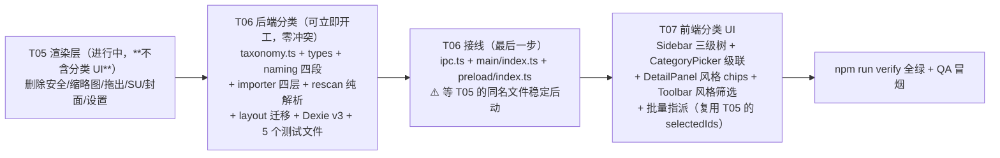

# 分类体系设计 · 工程版 v1.0.14

> **状态**：v1.0（主理人齐活林按经验拍板的初版，用户睡前指示先行拟稿）→ **v1.0.1（架构师高见远工程化，2026-10-13）** → **v1.0.2（整合 `docs/07` 贴图词表 + 主理人追加裁定，2026-10-13）** → **v1.0.3（T06 落地复裁定：重名共存 + 材质键澄清，2026-10-13）** → **v1.0.4（材质「其他」保留裁定，2026-10-13）** → **v1.0.5（重名白名单变更流程规则，2026-10-13）** → **v1.0.6（self-target 幂等 + rescan 返回结构对齐实现，2026-10-13）** → **v1.0.7（ignored 类型引用勘误 + 「签名以 types.ts 为唯一权威」规则，2026-10-13）** → **v1.0.8（材质大类合并：目录名与显示名解耦 + 一级词表 33 项并集 + 目录迁移，2026-10-19）** → **v1.0.9（词表修正：3 条并列复合词条改斜杠写法 + `TAIL_FAMILY_ROOTS` 增 `床具 → 床`，零新增词条，2026-10-20）** → **v1.0.10（三级树补抄：硬装构件补 3 个站方二级 + 新增 `LEVEL3_ALIAS` 三级归并表，2026-10-20）** → **v1.0.11（知末 `ID_<数字>` 尾巴剥离「规则 B-2」+ 软装陈设补站方二级 `挂画`，只加不删，2026-10-20）** → **v1.0.12（闸门改按材质容器并集 33 项校验 + 一级回退，修好"材质资产永远选不中一级"，2026-10-20）** → **v1.0.13（分类判定抽到 `shared/classifyAsset` + 设置页「重跑自动分类」/「撤销上次重跑」，让升级前已入库的未分类资产能被重新判定，2026-10-20）** → **v1.0.14（材质频道二级词表接入：`MATERIAL_LEVEL2_MAP` 20 键 / 106 项 + `level2Scope` 开关；docs/07「材质无二级」勘误，2026-10-20）**
> **v1.0.1 做了什么**：**保留 v1.0 的全部拍板结论与词表原文**（仅修正 §6 表格中一个逻辑漏洞，见文末修订记录），
> 补齐落地所需的工程细节：级联枚举数据结构、校验与降级规则、`Asset` schema 与 Dexie v3 迁移、
> 受影响文件清单、134 条基线中的测试影响清单、`dwg/dxf` 裁定、两项【推断】的风险评估、落地顺序 T05→T06→T07。
>
> **来源标注原则沿袭 v1.0**：
> - **【事实】** = 用户提供的知末网截图 / 网页原文，逐项照抄，见 `docs/05-知末分类词表-原始抄录.md`
> - **【推断】** = 主理人按行业经验补全，**未经知末网确认**，用户批注时可直接划掉
> - **【决策】** = 主理人的设计取舍，可以被推翻
> - **【裁定】** = 架构师按本次任务要求拍板（v1.0.1 新增）
> - **【工程】** = 落地必需的规格（v1.0.1 新增）
>
> 关联文档：`docs/07-贴图材质分类词表-原始抄录.md`（贴图频道词表）｜`docs/03-变更设计-语义子目录.md`（v1.0.1，可变深度判据已作废）｜`docs/02-架构设计-模库.md`（v1.2）

---

## 0. 一句话结论（v1.0 原文，已由架构师确认）

```
模型 / 家具 / 沙发 / 北欧布艺沙发
贴图 / 未分类 / 未分类 / 木纹 01
        ↑        ↑
     一级分类  二级分类        （风格 → 标签，不进目录）
```

**落盘结构固定四层**：`<大类> / <一级分类> / <二级分类> / <资产名>`  
**风格做成多选标签**，不进目录。

---

## 1. 为什么这么定（v1.0 原文 + 架构师裁定）

### 1.1 三级筛选器里有两级是「分类」，一级是「风格」

知末 SU 模型频道的筛选区实际是**三排**（用户 2026-10-13 截图 + `su.znzmo.com/sumoxing.html`）：

| 排 | 名称 | 性质 |
| --- | --- | --- |
| 1 | 一级分类 | **分类**，19 项 |
| 2 | 二级分类 | **分类**，随一级分类联动（级联） |
| 3 | 风格 | **平行的风格维度**，20 项 |

关键证据：用户此前举的例子是 `模型\家具\沙发\<资产名>` —— 而「家具 → 沙发」正好就是知末的**一级分类 → 二级分类**。**所以他要的两级语义就是这两级，不是「分类 + 风格」。**【决策】

### 1.2 风格必须做标签，不能做目录

一个模型经常同时是「现代 + 极简」或「侘寂 + 原木」。目录只有一个父节点，把风格塞进目录会**强制用户单选**，与素材的真实性质冲突。知末自己也是把风格单列一排、与分类平行，没有做成父子关系。→ **风格 = 多选标签**。【决策】

### 1.3 层级固定 = 不需要任何启发式判定

之前卡住的那个难题（`<大类>/家具/沙发` 到底是「分类 + 资产」还是「两级分类」）依赖"层级数可变"才存在。现在固定四层 + 每级都有 `未分类` 哨兵，歧义自动消失，`rescan` 不需要猜。**这条很重要：靠目录深度猜语义的代码一定会出 bug，能不用就不用。**【决策】

> **✅ 三条结论全部确认（【裁定】），但各补一条工程约束：**
> - **1.1/1.2（固定四层 + 风格标签）→ 确认**，补 §4 的 schema 与 §1.4 的级联一致性、§11-RA2 的 MAX_PATH 风险。
> - **1.3（免启发式）→ 确认**，但"不做启发式"≠"对不合结构的目录装看不见"：
>   `rescan` 必须做**结构符合性检查 + 忽略上报**（§5.2）——用户手工拖进来的散装文件夹会被静默跳过，
>   不上报就会被当成 bug。`docs/03` 的「可变深度判据」一节**整节作废**（03 v1.0.1 已标注）。

---

## 2. 一级分类（19 项）【事实 · 照抄】

家装、工装、景观、建筑、家具、灯具、软装陈设、植物、硬装构件、厨卫五金、电器/器材、家装户型、SU材质、美陈装置、标识广告、人物/动物、交通工具、展厅/展台、舞台

（另有「全部」= 不筛选，不是分类，不进枚举）

### 2.1 对这套词表的两点观察【决策】

1. **它不是单一维度**，混了「场景尺度」（家装/工装/景观/建筑/展厅展台/舞台）与「物件类型」（家具/灯具/植物/厨卫五金/…）。所以一个沙发既属于「家装」也属于「家具」。**我决定照单全收，不改正交**——理由：这套词表是你找素材时的真实心智，改成正交的分类学反而更难用（也更容易半途而废）。
2. **用户是商业空间设计师**（茶空间/书店/民宿/零售/展厅）。按使用频率我建议分三档，但**本轮一个都不删**，等你批注：

| 档位 | 一级分类 | 说明 |
| --- | --- | --- |
| **高频** | 家具、灯具、软装陈设、硬装构件、工装、厨卫五金、植物、展厅/展台 | 商业空间方案里反复用 |
| **中频** | 景观、建筑、美陈装置、标识广告、家装、家装户型、SU材质 | |
| **低频（建议默认折叠，不删）** | 人物/动物、交通工具、舞台、电器/器材 | 你大概率用不上，但删了万一要用就没了 → UI 里收进「更多」 |

> 【工程】低频折叠只影响 **T07 的 UI 展示**（收进「更多」分组），**不影响枚举与落盘**，数据层照单全收。

---

## 3. 二级分类（随一级分类级联）

### 3.1 已由用户截图确认（6 组）【事实 · 照抄】

| 一级分类 | 二级分类 |
| --- | --- |
| **家装** | 客厅、客餐厅、餐厅、家居吧台区、卧室、儿童房、卫生间、厨房、阳台、玄关、书房、茶室、衣帽间、洗衣房、休闲娱乐室、家装整体方案、单身公寓 |
| **工装** | 通用空间、办公空间、酒店民宿、商业空间、商场、餐饮空间、公共空间、休闲娱乐、文教空间、体育空间、医疗空间 |
| **景观** | 景观小品、雕塑小品、景观铺装、景观小建筑、庭院景观、小区景观、公园景观、儿童游乐区、广场景观、滨水景观、商业景观、办公景观、校园景观、生态停车场 |
| **建筑** | 住宅建筑、办公建筑、商业建筑、文教建筑、体育建筑、医疗建筑、工业建筑、农业建筑、交通建筑、特色建筑、城市规划、公共建筑、路桥工程、建筑构件、空间部品、商务配套、康健配套、休闲配套、艺术配套、构筑物 |
| **家具** | 沙发、床具、茶几、桌子、椅子/凳子、柜子、架子、家具组合、户外家具、**Minotti**、**Poliform** |
| **灯具** | 吊灯、壁灯、落地灯、台灯、吸顶灯、筒灯射灯、装饰灯、景观灯、格栅灯、路灯、灯笼、灯具组合、其他灯具 |

> ⚠️ **家具的二级分类里混进了两个品牌名**（Minotti、Poliform）。品牌不是分类层级——按品牌归档会导致「Minotti 的沙发」和「沙发」互相争位置。
> **【决策】**：把 Minotti / Poliform 从二级分类枚举里**剔除**，品牌改做独立标签（与风格同级）。批注时你若想要品牌维度，我就把它做成一等标签。
> → **【评估 B 见 §8】：本轮不做一等维度，剔除后进品牌词表做自动补全。**

### 3.2 其余 13 组 —— 主理人补全【推断 · 未经知末确认】

以下全部是**我按行业经验猜的**，你批注时直接改或划掉即可。也可以下次打开知末点开对应分类，我照抄替换。

| 一级分类 | 二级分类（推断） |
| --- | --- |
| 软装陈设 | 装饰画、摆件、花艺、地毯、窗帘布艺、抱枕、床品、餐具、书籍摆件、雕塑摆件 |
| 植物 | 乔木、灌木、地被花卉、草坪、盆栽、绿篱、竹类、棕榈科、水生植物、多肉 |
| 硬装构件 | 门、窗、楼梯、栏杆、墙面装饰、吊顶、地面铺装、柱式、踢脚线、壁炉、背景墙 |
| 厨卫五金 | 水龙头、水槽、花洒、马桶、浴缸、浴室柜、厨房电器、五金配件、晾衣架 |
| 电器/器材 | 冰箱、洗衣机、空调、电视、音响、厨房电器、办公设备、健身器材 |
| 家装户型 | 小户型、中户型、大平层、复式、别墅、LOFT、单身公寓 |
| SU材质 | 木材、石材、金属、玻璃、布艺、皮革、涂料、壁纸、瓷砖、混凝土 |
| 美陈装置 | 节日美陈、商场美陈、橱窗陈列、DP点、气球装置、灯饰装置 |
| 标识广告 | 导视牌、门头招牌、灯箱、展架、LOGO墙、广告牌、指示牌 |
| 人物/动物 | 人物、动物、卡通形象、雕塑人像 |
| 交通工具 | 汽车、摩托车、自行车、船、飞机、火车、工程车辆 |
| 展厅/展台 | 企业展厅、展会展台、博物馆展陈、展柜、展板、接待台 |
| 舞台 | 舞台背景、灯光架、音响设备、演出道具、桁架 |

> 【工程】13 组推断的风险评估与词表配置化结论见 **§7**。

### 3.3 贴图 / 材质大类 —— 词表**缺失**【待补】

用户给的截图只覆盖 SU 模型频道。知末的「贴图材质」「CAD图纸」等 Tab 各有**另一套**分类，与上面 19 项不通用。

**【决策】**：贴图与材质预设本轮先只落 `未分类`，枚举位置留空、结构先建好。**不阻塞开发。** 你方便时截一张贴图材质频道的筛选区给我，我照抄补上。

> 【工程·v1.0.1 更新】本节写于"词表缺失"假设下。**交付前发现 `docs/07-贴图材质分类词表-原始抄录.md` 已补录**
> （贴图频道：一级 22 项含「推荐」+ 级联二级 + 风格 20 项；材质频道：一级 20 项无级联，见 07 §5.11）。
> 由此对本节裁定做三点更新：
> ① **贴图 / 材质预设现在要建真实键**（不再是"不建键"），取值见 07；**「推荐」必须剔除**——07 §5.3 明确它指向频道首页信息流，不是内容类目；
> ② ~~07 §5.11：**材质频道没有二级分类排** → `LEVEL2_MAP['材质预设']` 建键但给空数组~~
>   **⛔ v1.0.3 更正**：占位键不建——`LEVEL2_MAP` 的 key 语义是**一级分类名**，`材质预设` 是大类名，
>   材质类资产的 `category1` 永远不会等于它，这个键**不可被合法查询**，是死键且正是键名歧义的来源。
>   材质频道本轮 Scope Out **不建键**；一级词表归属改记在 `CHANNEL_LEVEL1`（§9.1）。删除该键后行为不变：
>   `level2Of(<材质一级名>) → undefined → []` → UI「可自由输入」；详见 §15 v1.0.3-②；
> ③ 07 §5.7：贴图频道的二级**混有材质种类/颜色/商品名**（黑白大理石、爵士白大理石等），且**无品牌名**——这反向验证了 §8"品牌不做一等维度"的判断：品牌只在 SU 家具组出现过一次。
> 另：**两个频道的风格词表不是同一份**（已程序化核对：两份各 20 项，19 项共有，**仅差一项**——SU 有「简洁」、贴图有「简欧」，07 §5.10）。
> **v1.0.2 修订：风格枚举按大类分册，不合并**（主理人裁定，架构师确认并工程化）——见 §9.1 的 `STYLE_LIST_BY_KIND`。
> 数据分册保留来源与可追溯性；「全部」视图下筛选器用派生并集，不落库、不进 schema。这再次验证"风格=标签"：标签天然容纳跨频道差异，目录做不到。

---

## 4. 风格（20 项 → 标签维度）【事实 · 照抄】

现代、新中式、中式、法式、美式、欧式、日式、意式、轻奢、复古、极简、中古、奶油、简约、侘寂、原木、北欧、禅意、简洁、工业

**【决策】**：做成**多选标签**，与用户自定义的 tags 并列但分开展示（风格是受控词表，标签是自由输入）。

**观察**（供批注）：这 20 项里有明显的近义重叠——`极简 / 简约 / 简洁` 几乎同义，`禅意 / 侘寂 / 原木 / 北欧` 大面积交叉。**做多选标签时不需要合并**（多选天然容纳"既是现代又是极简"），但 UI 上建议按「地域 / 时代 / 情绪」分三组展示，否则 20 个 chip 会糊成一片。

> 【工程】风格做标签的三条落地规格（§4.1-4.3 of v1.0 → 本文 §4.4）：
> ① **独立字段** `Asset.styles: string[]`，与 `tags: string[]`（自由）分离——受控词表需要独立索引（`*styles`）、独立 UI 分组、将来"重命名某风格"时可按词表批量迁移；混进自由标签后三件事都退化成字符串匹配。
> ② **筛选语义**：风格维度内 **OR**（命中任一即出），与其他维度（大类/一级/二级/标签/搜索）之间 **AND**——刻面检索标准语义。
> ③ **搜索命中**：`useVisibleAssets` 的 haystack 必须纳入 `styles.join(' ')`，否则搜"侘寂"搜不到打该风格的模型。

---

## 5. 知末顶层 Tab → 我们的 5 大类【决策】

| 知末 Tab | 归入 | 说明 |
| --- | --- | --- |
| 3D模型 | 模型 | |
| SU模型 | 模型 | |
| 贴图材质 | 贴图 | 词表待补 |
| PS素材 | 贴图 | `.psd` 在 `EXT_KIND` 里已归 texture |
| CAD图纸 | **待定** | 与现有实现冲突：`EXT_KIND` 把 `dwg`/`dxf` 归 **model**，但"图纸"语义上更像「其他」。**这条我留给架构师裁定，不自己拍** |
| 全球案例 / 灵感图库 / 效果图 | 其他 | 参考资料类，不是可导入资产；若下载了也不该当模型用 |
| 方案文本 | 其他 | |
| 课程 / 校园专区 | **不做** | Scope Out，不是素材 |

> **【裁定】CAD图纸一行已定：`dwg/dxf` 维持归 `model`，不改「其他」。完整理由与扩建触发条件见 §6。**

---

## 6. 【裁定】`dwg` / `dxf` 归「模型」，不归「其他」

**结论：维持 `EXT_KIND` 现状（`dwg: 'model'` / `dxf: 'model'`），不改。**

| # | 理由 |
| --- | --- |
| 1 | **「其他」是垃圾桶，不是第四个大类**。归入 `其他` 的资产在侧栏分类树里等于没有分类——把 CAD 图纸从"语义不太贴"挪到"完全不可检索"，是可找性的**净损失** |
| 2 | **`kind` 在本系统的真实语义是"用什么软件打开、怎么取出去"**，不是内容学分类。证据：`pickPrimaryFile` 决定拖出目标、`suVersion` 只对 `.skp` 有意义、封面四级回退只认 texture/hdri。DWG 的行为与模型资产完全同构（独占文件夹、有配套引用、要拖进 CAD/天正），与「其他」的典型成员（说明书/效果图/PSD 拆层）**不同构** |
| 3 | **管线零成本**：`dwg` 归 model 时，主文件挑选、拖出、reveal、缩略图占位、`primaryKind` 优先级（`dwg + jpg` 的包正确判为模型）**全部直接复用**；改到 `other` 不带来任何新能力，只换一个中文目录名 |
| 4 | **改动代价与收益不对称**：新增第 6 大类「图纸」要动 `AssetKind` union、`KIND_LABEL/ORDER`、Sidebar 图标、Dexie 索引、筛选器——在渲染层并行开发期做这种横切改动，风险不成比例 |

**扩建触发条件（写死，避免以后再议）**：当库内 `dwg/dxf` 类资产 **> 30 个**，或用户主动提出一次，再把「图纸」升为第 6 大类。届时词表另立（知末 CAD 频道有自己的一套，需补截图）。

**测试影响**：`classify.test.ts` 目前**没有** dwg 断言（已核实 `grep dwg tests/classify.test.ts` 为空），
本裁定不会让任何现有用例变红——但也意味着该语义无守卫。
**建议补 1 条**：`expect(kindOfExt('dwg')).toBe('model')`，把裁定钉住，防止未来被"顺手修正"。

---

## 7. 【评估 A】13 组推断词表的风险 + 词表要不要可配置/可热更新

### 7.1 推断词表的风险定性

13 组推断（§3.2）的风险不是"错"，而是**粒度不合用户心智**（比如「软装陈设 → 抱枕」，用户可能想要「抱枕靠垫」）。
这类错误的**代价极低**：词表只影响自动补全建议与 UI 分组，**不影响已落盘的目录名**（磁盘是唯一真相，词表改了旧目录照常工作）。
所以不需要为"猜错"做技术兜底，只需要把核对成本降到最低——这就是 §9.2 的 `CONFIDENCE` 数据标记（UI 显示「待核对」灰标）。

### 7.2 用户自己改词表的可能性：**低频但必然发生**

用户是设计师不是开发者，让他手改配置文件的概率很低（估 <10%）；
但"想加自己的分类/风格"一年内几乎必然发生——尤其贴图/材质词表目前整体缺失，等截图补录就是第一次扩充。
**结论：不为"他自己改"做功能，为"我们帮他改"降低成本。**

### 7.3 三个方案对比与结论

| 方案 | 说明 | 判定 |
| --- | --- | --- |
| A. 硬编码散落在组件里 | 每处 UI 自己写一份枚举 | ❌ 否决：同一词表出现 N 份必然漂移 |
| B. 外部 JSON 配置（`userData/taxonomy.json`，可热更新） | 不发版即可改 | ❌ **本轮否决**：引入 4 条新失败路径（文件缺失/损坏/版本冲突/手改错），全是 K4 类**静默**风险；收益只是省一次发版，而本项目发版成本本来就低（`npm run package`） |
| ✅ C. **独立 TS 数据模块 `shared/taxonomy.ts` + 查询函数导出** | 类型安全、可单测、单一数据源；将来支持用户自定义时**只需在查询函数里加一段"合并 overrides.json"**，调用方一行不动 | **采纳** |

**给 PM/主理人的操作建议**：词表扩充走三步——用户截图（或如 07 那样有头浏览器抓取）→ 抄进 `taxonomy.ts` → 把 `CONFIDENCE` 改为 `fact`，单次 ≈10 分钟；
等真的出现"用户长期自己维护词表"的需求（而非一次性补录）时，再启用方案 C 的 overrides 接缝。
**本结论已被实战验证一次**：07（贴图材质词表，445 行）就是在本文 v1.0 定稿后、按此路径一次性并入的——改的只是 `LEVEL2_MAP` 的键与风格词表分册（`STYLE_LIST_BY_KIND`），schema/IPC/UI 零改动。

---

## 8. 【评估 B】品牌（Minotti / Poliform）要不要做一等维度

**结论：本轮不做一等维度，并入自由标签 + 词表驱动自动补全。**

**判据（以后复用）**：一个维度值得独立成 schema 字段，当且仅当同时满足——
① 需要属于自己的**常驻筛选区**（像三排筛选器那样）；② 需要**独立索引**支撑跨资产统计；③ 取值需要**跨资产一致校验**。

品牌现状：只有 **2 个**取值样本、来自一个频道截图、且不是每个资产都有品牌（HDRI/贴图没有品牌）——三条全不满足。
对照：风格 20 项、三排筛选器常驻、每类素材都可能带——三条全满足，所以风格升 `styles` 字段、品牌不升。

**落地方式（【工程】）**：
1. `Minotti/Poliform` 从 `LEVEL2_MAP['家具']` 剔除（v1.0 已决策），进入 `BRAND_LIST`；
2. 用户打品牌写进 `tags`（自由标签），输入框用 `BRAND_LIST` 自动补全——保证拼写一致，避免 "Minotti/minotti/米诺提" 三种写法分裂；
3. **将来升等是一次性成本**：届时加 `Asset.brands: string[]` + `*brands` 索引 + 复用同一套受控词表机制与 UI 组件。触发条件：品牌词表 > 10 个，或用户主动要求品牌筛选区两次。

---

## 9. 【工程】数据结构与校验

### 9.1 级联枚举 —— `src/shared/taxonomy.ts`（新增，纯数据零 IO）

```ts
export const UNCLASSIFIED = '未分类'

/** 一级分类：19 项【事实 · docs/05 §2 照抄】 */
export const LEVEL1_LIST: readonly string[] = [
  '家装','工装','景观','建筑','家具','灯具','软装陈设','植物','硬装构件',
  '厨卫五金','电器/器材','家装户型','SU材质','美陈装置','标识广告',
  '人物/动物','交通工具','展厅/展台','舞台'
]

/**
 * 一级 → 二级 级联映射。
 * - SU 频道：6 组【事实】+ 13 组【推断】（§3.1/§3.2）
 * - 贴图频道：21 组 195 项【事实 · docs/07 §3】（每组首行「全部」**不进枚举**；「推荐」无二级排）
 * - 材质频道：**本轮不建键**（Scope Out，v1.0.3 裁定，见 §3.3-② 与 §15）；一级词表归属见 CHANNEL_LEVEL1
 * - **排除清单**（见 EXCLUDED_TERMS）从入库值中剔除，剔除是数据、可审计，不是静默省略
 */
export const LEVEL2_MAP: Readonly<Record<string, readonly string[]>> = { /* SU §3.1+§3.2 + 贴图 07 §3（剔除推荐/全部/排除项）；不建材质键 */ }

/**
 * 【v1.0.3 新增】频道 → 一级分类词表的归属表（含**已抄录但未建键**的频道）。
 * 作用：① CategoryPicker 的「一级下拉」按大类取来源，不靠 LEVEL2_MAP 的 keys 巧合推导；
 *      ② 把「材质频道 20 项一级已抄录（07 §5.11）、本轮未建键」这一观察记录钉在数据里，将来做材质时不会丢。
 *
 * ⚠️ **显式不变式（v1.0.3 起生效）**：`LEVEL2_MAP` 的 key = 一级分类名，且**当前已建键全局唯一**
 * （SU 19 项与贴图 21 项经核对零交集）。将来建材质频道时，它与贴图有 **9 个同名一级**
 * （石材/木材/木地板/地毯/金属/皮革/玻璃/涂料/外景，07 §5.11）——届时**必须**把 LEVEL2_MAP
 * 升级为按大类嵌套（`Record<大类, Record<一级, 二级[]>>`）或引入频道前缀键，**禁止**维持扁平 map 硬塞。
 */
export const CHANNEL_LEVEL1: Readonly<Record<'model' | 'texture' | 'material', readonly string[]>> = {
  model: [ /* SU 19 项，docs/05 §2 */ ],
  texture: [ /* 贴图 21 项（剔除「推荐」），docs/07 §2 */ ],
  /**
   * 材质 21 项【事实 · docs/07 §5.11，剔「全部」后逐项照抄】——已抄录，本轮未建 LEVEL2_MAP 键。
   * 【裁定 v1.0.4】末项「其他」**保留，不剔除**（主理人提议剔除，被驳回）：
   * - 「全部」「推荐」被剔除的判据是"导航控件，不是内容类目"（全部=自身聚合页、推荐=首页信息流）；
   *   「其他」不满足该判据——它是站方真实的可筛选内容桶，有自己的列表页。
   * - 全局原则是"照单全收、不改正交"（§2.1：连 皮肤器官/液体/食物 都保留了），
   *   为凑两频道口径一致而删一个真实类目，违背自己立的原则；工程师「不为凑数删项」的判断正确。
   * - 语义上「其他」≠「未分类」：其他 = "不属于任何已列类目"（终态），
   *   未分类 = "还没指派"（待办，应趋近 0）。删掉前者会把"永远不会有类"的资产挤进未分类，
   *   污染「待整理」清单的语义。
   * - 工程面零风险：与 SU/贴图一级及 LEVEL2_MAP 键均无重名（不触发键唯一性守卫）；
   *   与大类「其他」（KIND_LABEL.other）同名但分属不同层级，落盘 `<材质预设>/其他/...` 合法；
   *   kind 仍由内容决定、不由目录决定（既有规则），不受此同名影响。
   */
}

/**
 * 风格词表：**按大类分册**（主理人裁定 v1.0.2，架构师确认）。
 * 已程序化核对：两册各 20 项、19 项共有，仅差一项——SU 有「简洁」、贴图有「简欧」（07 §5.10）。
 * 分册理由：① 保留词表来源与可追溯性（用户对溯源敏感）② 两频道词表后续会各自演化。
 * 「全部」视图下的筛选器用派生并集 `styleListAll()`，**派生结果不落库、不进 schema**。
 */
export const STYLE_LIST_BY_KIND: Readonly<Record<'model' | 'texture', readonly string[]>> = {
  model: [ /* docs/05 §3 的 20 项（含「简洁」） */ ],
  texture: [ /* docs/07 §4 的 20 项（含「简欧」） */ ]
}
export function styleListOf(kind: 'model' | 'texture'): readonly string[]
export function styleListAll(): readonly string[]   // 两册并集（21 项），仅用于 kind=all 的筛选视图

/**
 * 词表排除清单：从枚举中剔除、转做自由标签的词条。**排除必须在此登记（可审计），禁止在抄录时静默省略。**
 * - 品牌（SU 家具组）：Minotti、Poliform → 品牌（§8）
 * - 花色商品名（贴图大理石组，07 §3.3）：冷翡翠、宝格丽大理石、潘多拉大理石、爵士白大理石 → 与品牌同性质，
 *   是"商品变体/流行词"不是稳定分类层级，且会持续膨胀（每个新花色都要发版）→ 剔除，进自由标签
 */
export const EXCLUDED_TERMS: Readonly<Record<string, readonly string[]>> = {
  家具: ['Minotti', 'Poliform'],
  大理石: ['冷翡翠', '宝格丽大理石', '潘多拉大理石', '爵士白大理石']
}

/** 贴图频道「属 性」排（随一级联动的搜索热词，07 §5.8）与「颜 色」排（11 个无文字色块，07 §5.9）
 *  ——【裁定 v1.0.2】两排**均不进落盘枚举**：属性是热词聚合不是稳定分类树（且未全录），颜色无名称无法成目录。
 *  未来出口：属性 → 自由标签的"热门建议源"；颜色 → 复用风格那套受控标签机制（11 色受控词表），两者都不新增 schema 字段。 */
export const OBSERVED_NOT_ENUMERATED = ['属性(热词)', '颜色(11色块)']
export const BRAND_LIST: readonly string[] = ['Minotti', 'Poliform']

/** 词表可信度：'fact'（截图确认）| 'inferred'（推断，UI 显示「待核对」灰标） */
export const CONFIDENCE: Readonly<Record<string, 'fact' | 'inferred'>> = {
  家装:'fact', 工装:'fact', 景观:'fact', 建筑:'fact', 家具:'fact', 灯具:'fact' /* 其余 13 组 → 'inferred' */
}

/** 查询 API（全部纯函数，renderer / main 共用，无 IPC 需要） */
export function level2Of(level1: string): readonly string[]   // 未知一级 → []
export function isKnownLevel1(v: string): boolean
export function isKnownCombo(level1: string, level2: string): boolean
export function isStyle(v: string): boolean
export function isReservedName(v: string): boolean            // === UNCLASSIFIED
export function taxonomySummary(): { level1Count: number; factGroups: number; inferredGroups: number; styleCount: number }
```

> **【v1.0.8 更新 · 材质大类合并，2026-10-19】** 用户拍板把「贴图」「材质预设」两个**大类目录**合并为一个「材质」目录，`kind` 降级为资产属性（筛选器仍可单独筛）。本节随之有四点补充，**权威细节见 `docs/14-变更设计-材质大类合并.md`**：
> 1. **`LEVEL2_MAP` 键空间不变（仍 40 键，一个都不加）**。材质频道**无二级分类排**（`docs/07` §5 第 11 条），故 §9.1 不变式里"9 个同名一级的二级词表不同"的前提**不成立**——本次不触发嵌套升级，但**触发器保留**（哪天真采到材质二级，必须回来按嵌套升级）。
> 2. 材质独有（相对贴图册）的 12 项一级**不建 `[]` 空键**。原因是 `autoClassify.ts:159` 会遍历 `Object.keys(LEVEL2_MAP)` 做一级匹配，`墙面 / 地面 / 其他` 这类通用词会让模型包被误分（真实回归）。行为无损失：`level2Of(缺键) === []`，与空键一致。
> 3. 材质语境的**一级词表改为 33 项并集**（贴图 21 ∪ 材质 12），以派生常量 `MERGED_MATERIAL_LEVEL1` 表达，**不进** `LEVEL2_MAP` 键空间；`CHANNEL_LEVEL1` 三频道原册保留不动（可追溯）。
> 4. **目录名与显示名解耦**：新增 `KIND_FOLDER`（`texture` 与 `material` 均映射「材质」），`KIND_LABEL` 退回纯显示用（仍为「贴图」「材质预设」）。§11.1 的 `kindFolder()` 语义由"返回 KIND_LABEL"改为"查 KIND_FOLDER"，`composeRelFolder` 签名不变。

**三条使用规则（防词表被误用）**：
1. **受控词表用于"建议"，不用于"强制"**——未知但格式合法的值放行落盘（§9.2 规则 4）。词表缺失（贴图/材质）时不能卡住用户自己的分类。
2. **"是否属于词表"不落库**——它是派生信息（对照 `LEVEL2_MAP` 即可算出），落库会随词表更新过期成脏数据；UI 要展示"自定义"标记时实时计算。
3. **【推断】标记进数据**（`CONFIDENCE`）——用户核对某组后只改数据一个字符串，UI 一行不动。

### 9.2 校验与降级 —— `normalizeCategoryPair`（放 `src/shared/naming.ts`）

**级联一致性（对 v1.0 §6 的修正，见 §10）**：

```
合法状态空间：(已知一级, 已知二级 | 未分类)  ∪  (未分类, 未分类)
非法状态空间：(未分类, 已知二级)  →  强制降级为 (未分类, 未分类)
```

```ts
export const MAX_SEGMENT_LEN = 40   // 单段目录名上限，防 MAX_PATH（§12-RA2）

export function normalizeCategoryPair(
  raw1: string | null | undefined,
  raw2: string | null | undefined
): { category1: string; category2: string; changed: boolean }
```

| # | 规则 | 失败降级 |
| --- | --- | --- |
| 1 | **trim + Windows 非法字符清洗**（复用 `sanitizeName`；`/` 被替换为 `_`，恰好保证单段） | 清洗后为空 → 规则 2 |
| 2 | **哨兵幂等**：值 === `未分类`（含前后空白差异）→ `未分类`，语义 = "清除该级分类"，**不报错、不产生第二个竞争目录** | — |
| 3 | **级联一致性**：`category1 === '未分类'` ⇒ 强制 `category2 = '未分类'` | 降级，不抛错 |
| 4 | **词表放行**：未知一级、或二级不在 `LEVEL2_MAP[一级]` 内 —— **放行**（§9.1 规则 1）。`家具/客厅` 这类"值在词表但属于另一一级"的组合同样**保留**：磁盘是唯一真相，降级会让用户找不到自己手工建的目录；其"非法性"由 UI 实时计算展示（「跨类组合」标记），不做持久化 | 放行 |
| 5 | **长度上限**：任一段超 `MAX_SEGMENT_LEN=40`，用 `Array.from(s)` 按**码点**截断（不能用 `slice`，避免割开 emoji 代理对） | 截断 + `console.warn` 一次 |
| 6 | **changed 标记（v1.0.3 正式化，T06 实现已按此落地）**：`changed = true` ⇔ 存在一级或二级，其「**非空且非哨兵**的原始输入」与归一化输出不一致。两种情况**不算** changed：① 空/缺失输入落位为 `未分类`（默认落位，不是改写）② 输入「未分类」（含前后空白）输出 `未分类`（幂等）。用途：调用方**仅在 changed=true 时**提示用户，避免每次指派都弹提示 | — |

### 9.3 `composeRelFolder`（四段，替换 03 里的三段签名）

```ts
export function composeRelFolder(
  kindFolderName: string, category1: string, category2: string, name: string
): string   // `${kindFolderName}/${category1}/${category2}/${name}`
```
调用方：`main/importer.ts`（导入落盘）、`renderer/store.ts`（改名/改分类后重算）、`main/layout.ts`（迁移）。
**`parseRelFolder` 删除**——深度固定后不存在容忍解析，需要段就 `split('/')` 并校验 `length === 4`。

---

## 10. 【工程】`Asset` schema 变更 + Dexie 迁移

### 10.1 字段

| 字段 | 类型 | 默认值 | 是否索引 | 说明 |
| --- | --- | --- | --- | --- |
| `category1` | `string` | `'未分类'` | **是**（等值） | 一级分类，单段目录名 |
| `category2` | `string` | `'未分类'` | **是**（等值） | 二级分类，单段目录名 |
| `styles` | `string[]` | `[]` | **是**（`*styles` 多值索引） | 风格（受控多选），与 `tags`（自由）分离 |

三字段**本期声明为可选**（`category1?: string` 等）：无 git + 渲染层并行开发，收紧类型会让工程师下一次 `verify` 变红且无法隔离。
读取一律走 `normalizeCategoryPair(...)` / `(asset.styles ?? [])`，整体落地全绿后再收紧为必填（机械改动，约 10 分钟）。

### 10.2 Dexie 迁移：**升 v3**（不回改 v2）

`db.ts` 目前是 v1/v2（已核实，v3 从未发布），**v3 目标定义直接按下面写**（03 里"v3 = 加单字段 category 索引"的方案作废）：

```ts
this.version(3)
  .stores({
    assets: 'id, kind, category1, category2, *styles, source, importedAt, updatedAt, *tags, dedupeKey, suVersion, suMajor, folder, coverSource',
    backups: 'id, at'
  })
  .upgrade(async (tx) => {
    const old = (await tx.table('assets').toArray()) as Asset[]
    if (old.length > 0) {
      await tx.table('backups').put({ id: `v2-${Date.now()}`, at: Date.now(), json: JSON.stringify(old) })
    }
    // v3 不改主键 → modify 即可（不需要 v2 那种 clear + bulkAdd）
    await tx.table('assets').toCollection().modify((a) => {
      a.category1 = a.category1 ?? '未分类'
      a.category2 = a.category2 ?? '未分类'
      a.styles = a.styles ?? []
    })
  })
```

**老数据补默认值**：无三字段的记录 → `category1/category2 = '未分类'`、`styles = []`。
**磁盘侧遗留布局**（T06 之前导入的资产落在两段 `<大类>/<资产名>`）由 `main/layout.ts` 一次性 DB 驱动迁移处理：
目标改为 **4 段双哨兵**（`<大类>/未分类/未分类/<资产名>`），计划/执行/幂等规格沿袭 03 §4.4（DB 驱动、>50 条改手动触发、失败跳过汇总），仅目标路径变。

---

## 11. 【工程】落盘与 rescan（固定四层）

### 11.1 导入（`main/importer.ts`）

```ts
const kindDir = path.join(libraryDir, kindFolder(kind))              // :204 保留
const cat2Dir = path.join(kindDir, UNCLASSIFIED, UNCLASSIFIED)
await fs.mkdir(cat2Dir, { recursive: true })                          // 一次建两级
const finalName = uniqueName(assetName, new Set(await fs.readdir(cat2Dir)))  // :214 去重集合改二级目录
const target = path.join(cat2Dir, finalName)
const relFolder = composeRelFolder(kindFolder(kind), UNCLASSIFIED, UNCLASSIFIED, finalName)  // 替换 :220
// Asset 字面量补 category1: UNCLASSIFIED, category2: UNCLASSIFIED, styles: []
```

> **【v1.0.8 更新 · 2026-10-19】** 上段代码里的 `kindFolder(kind)` **语义已变**：由"返回 `KIND_LABEL[kind]`"改为"查 `KIND_FOLDER[kind]`"。因此 `texture` 与 `material` **落盘首段同为「材质」**，而 `KIND_LABEL` 仍是「贴图」「材质预设」（纯显示）。`composeRelFolder` 签名与四段结构**均不变**。
> 连带约束：`main/index.ts` 的 `assignCategory` 安全门必须从 `Object.values(KIND_LABEL).includes(name)` 改为 `isKindFolderName(name)`，否则渲染层传「材质」会被拒、**改分类整链路静默失效**。历史目录 `贴图/` `材质预设/` 只读兼容（扫描认、反解认、永不新写）。

**self-target → no-op（v1.0.6 补，T08 实现已落地 `src/main/layout.ts`，含 2 条单测 + 幂等场景测试）**：
`assignCategory` 对**已在目标分类**的资产重复指派时，main 侧直接返回 `moved: false`，**不产生「名字-2」竞争目录**；
迁移路径 `from === to`（库目录整理场景的孪生问题）同样按幂等成功处理，计入 `ok` 原样返回而非 `failed`——
"已在目标位置"不是失败，是幂等成功。这是 §9.2 规则 2（哨兵幂等不产生竞争目录）的精神在目录操作层的延伸；
`docs/03` §5.1 时序图假定"指派必移动"，没有此分支，以本条为准。

### 11.2 rescan（`main/rescan.ts`，纯路径解析 + 忽略上报）

```ts
export async function rescanLibrary(
  libraryDir: string,
  opts?: { onIgnored?: (relPath: string, reason: 'depth' | 'not-dir') => void }
): Promise<{ assets: Asset[]; ignored: IgnoredEntry[] }>
// v1.0.7 对齐实现（RA6 落地）：返回结构化忽略清单；onIgnored 回调保留向后兼容。
// `IgnoredEntry`（`src/shared/types.ts:195`：{ relPath: string; reason: IgnoredReason }，
// IgnoredReason = 'depth' | 'not-dir'，types.ts:193）——渲染层提示文案「N 个…（X 个深度不符、Y 个位置是文件）」消费 reason 字段。
// ⚠️ 规则：**文档签名以 `src/shared/types.ts` 为唯一权威**——doc 引用类型时只写**类型名 + types.ts 行号**，不手抄字段
// （v1.0.6 手抄 `string[]` 漏掉了 reason，即此规则的由来）。
```

- 三层循环固定下钻：`<大类>/*` → `<一级>/*` → `<二级>/*`，第 4 层的**目录**即资产；
- `relative(libraryDir, assetDir)` 按 `/` 切开后**段数 !== 4 → 跳过 + `onIgnored(rel, 'depth')`**（§1.3 裁定 3 的替换方案）；
- `.staging`、`.` 开头目录照旧跳过；
- **空壳目录（v1.0.3 正式化，T06 实现已按此落地）**：不含任何文件也不含可索引子资产的分类目录 → **静默跳过且不计入 `onIgnored`**。理由：空分类目录是合法中间状态（改分类时 mkdir 后移动失败的残留、用户预建的空目录），与"深度不符"的**结构违规**性质不同，上报只会制造噪音；侧栏对计数为 0 的分类本来就不显示；
- `kind` 仍由 `primaryKind(files)` 决定（**kind 不由目录决定**，这条不变）；
- `category1/category2` 直接取**磁盘目录名**（不清洗——外部手工命名是用户意志，rescan 照抄；只有导入/指派路径才走 `normalizeCategoryPair`）。

---

## 12. 【工程】受影响文件清单 / 测试影响 / 风险 / 落地顺序

### 12.1 受影响文件

**新增**：`src/shared/taxonomy.ts`（~180）、`src/main/layout.ts`（~130）、
`tests/taxonomy.test.ts`（~120）、`tests/layout.test.ts`（~140）、`tests/rescan.test.ts`（~120）。

**T06 后端改造**：`shared/types.ts`（+三字段）、`shared/naming.ts`（四段组合/校验/删 parseRelFolder）、
`main/importer.ts`（四层落盘）、`main/rescan.ts`（纯解析 + onIgnored）、`renderer/db.ts`（v3）、
`shared/ipc.ts` + `main/index.ts` + `preload/index.ts`（⚠️ 与 T05 冲突，最后接线：`asset:assignCategory` / `library:migrateLayout`）。

**T07 前端改造**：`components/Sidebar.tsx`（**三级树**：大类→一级→二级，inferred 组灰标「待核对」）、
`components/CategoryPicker.tsx`（新，**级联**选择器）、`components/DetailPanel.tsx`（分类 chip 两级 + 风格多选 chips）、
`components/Toolbar.tsx`（风格多选筛选）、`components/AssetGrid.tsx`（列表加一级/二级列）、`store.ts`（assignCategory / styles / Filters）。

### 12.2 测试影响清单（基线 **10 文件 / 134 条全绿**，04:49 实测）

> ⚠️ 行号以 04:49 快照为准（已逐行核实 `importer.test.ts:90/:91/:115/:163/:263` 未漂移）。
> ⚠️ **与 03 v1.0 的区别：路径是加两级（`未分类/未分类`），不是一级。**
> **结论：必改 4 条断言 + 1 处注释；1 条隐含契约必须保住；129 条免疫；建议新增 5 个测试文件。**

**必改 4 条**（全在 `tests/importer.test.ts`）：

| # | 行号 | 现状 → 应改成 |
| --- | --- | --- |
| 1 | `:90` | `'模型/现代衣柜'` → `'模型/未分类/未分类/现代衣柜'` |
| 2 | `:91` | `path.join(lib,'模型','现代衣柜')` → `path.join(lib,'模型','未分类','未分类','现代衣柜')` |
| 3 | `:115` | `fs.stat(path.join(lib,'模型','现代衣柜','预览图.jpg'))` → 加两级 `'未分类','未分类'` |
| 4 | `:263` | `'贴图/已解压'` → `'贴图/未分类/未分类/已解压'` |

**注释同步 + 隐含契约**：`:114` 注释改为 `// 库根/模型/未分类/未分类/现代衣柜`；
`:163`（`readdir(lib)` 长度为 0）**期望不改**——它是隐藏契约：`checkSpaceFor` 必须严格早于**两级** mkdir，提前建目录会让它变红（这正是其价值）。

**免疫 129 条**：thumb 25 + vault 14 + format 6 + encoding 13 + skpVersion 11 + space 11 + extractor 12 = 92（字面量/纯函数，与布局无关）；
classify 18（`dwg/dxf` 维持 model，零改动，建议补 1 条钉住裁定）；naming 15（现有全不动，新增 describe）；
importer 其余 5 条（并发/UUID/staging 断言不受影响）。

**建议新增**：`tests/importer.test.ts` 补 `a.category1 === '未分类'`、`a.category2 === '未分类'`、`fs.stat(lib/模型/未分类/未分类)`；
`tests/naming.test.ts` 补 describe（哨兵幂等 / 级联一致性 `('未分类','沙发')→('未分类','未分类')` / 非法字符 / `MAX_SEGMENT_LEN` 码点截断 emoji 不割半 / `changed` 标记 / 四段组合）；
`tests/taxonomy.test.ts`（模型一级 19 项 / 贴图一级 21 项剔除「推荐」/ 6 fact + 13 inferred / **风格分册**：`styleListOf('model')` 含「简洁」不含「简欧」、`styleListOf('texture')` 反之、`styleListAll()` 并集 21 项 / **排除清单守卫**：`EXCLUDED_TERMS` 六词条不得出现在任何 `LEVEL2_MAP` 值里 / **重名守卫（v1.0.3 修订，v1.0.5 补流程规则）**：`findDuplicateLevel2Names()` 断言重名**恰为已知 8 组**（新重名出现 → 变红提醒决策；已知 8 组不误报），8 组明细见 §15 v1.0.3-①。
> ⚠️ **流程规则（v1.0.5，主理人提出、架构师确认）**：**重名白名单（已知 N 组）的任何变更，必须经架构师确认后方可合入**——
> 禁止工程师看到测试变红就自行往白名单加一行。否则守卫会退化回"报错器"并被静默稀释：
> 白名单从"变更探测器"变成"豁免清单"，恰恰庇护了它本来要抓的那类决策。
> 正确动作：测试变红 → 判断是"真实的词表扩充"还是"数据错误" → 带着判断来找架构师裁定 → 裁定通过后由架构师更新本文 §15 并同步白名单。 / 「全部」不在任何枚举 / `isKnownCombo('家具','客厅')===false` 且**放行** / `level2Of('未知')===[]`）；
`tests/rescan.test.ts`（四层产出正确 / 深度不符 → onIgnored 且不产出 / `.staging` 跳过）；
`tests/layout.test.ts`（2 段→4 段双哨兵 / 计划幂等 / 失败跳过汇总）。

### 12.3 风险

| # | 风险 | 等级 | 缓解 |
| --- | --- | --- | --- |
| RA1 | 13 组推断级联粒度不合用户心智 | 🟢 | `CONFIDENCE` 数据标记 + UI「待核对」灰标；词表错误不影响已落盘目录 |
| **RA2** | **MAX_PATH**：四层 + 双哨兵比两层至少多 8 字符，叠加长资产名与内部 `贴图/` 子树可能触 260 限制 | 🟡 | ① `MAX_SEGMENT_LEN=40`（码点截断）② 资产名入库前 `stripNoise` + 超长截断 ③ 设置页提示可启用 Windows 长路径（Win10 1607+ LongPathsEnabled）④ **QA 冒烟：80 字资产名 + 3 层贴图子目录验证可建/可开/可拖** |
| RA3 | 改分类 = 移动文件夹 → `thumbSalt(coverAbs)` 失效，网格集体变灰 | 🟡 | 沿袭 03 §5.4：移动成功后强制 `ensureThumb(新 coverAbs)` + `matchThumbNames` 通配删旧文件，**先生成后删除** |
| RA4 | Dexie v2 已存在于开发机，回改 v2 不会重跑 upgrade | 🟡 | 升 v3（§10.2）；QA 加"构造 v2 数据 → 升级 v3"专项 |
| RA5 | `index.ts` / `preload/index.ts` / `store.ts` 与 T05 并行撞车（无 git） | 🟡 | §12.4 顺序：T06 接线压到最后；T07 等 T05 全绿后开工 |
| RA6 | 散装目录被 rescan 静默忽略 → 用户以为 bug | 🟢 | `onIgnored` 上报 + UI 提示「N 个目录不符合库结构，未被索引」 |

### 12.4 落地顺序：T05 → T06 → T07



- **T05 → T06 硬依赖**：T05 改 `store.ts`（selectedIds/删除宽限期）与 `index.ts`/`preload/index.ts`（thumb/drag IPC）。
  T06 的 `assignCategory`（store + IPC）**必须等 T05 落地后再加**，否则两边在无 git 状态下互相覆盖。
- **T06 内部可先行**：`taxonomy.ts`、`types.ts`、`naming.ts`、`importer.ts`、`rescan.ts`、`layout.ts`、`db.ts` 与全部测试**不与 T05 冲突**，立即开工。
- **T07 依赖 T05**（selectedIds / 多选 / 右键骨架）与 T06（数据与 IPC）。

---

## 13. 本版遗留问题（沿袭 v1.0 §7，标注去向）

| # | v1.0 遗留 | 去向 |
| --- | --- | --- |
| 1 | 13 组推断的二级分类等核对 | **已缓解**：`CONFIDENCE` 数据标记 + UI「待核对」灰标（§7.1/§9.1），核对后改数据即可 |
| 2 | 贴图/材质词表缺失 | **不阻塞**：不建键 + UI「可自由输入」（§3.3），截图到后 10 分钟补录 |
| 3 | `dwg/dxf` 归属 | **已裁定**：维持 model（§6） |
| 4 | 品牌是否一等维度 | **已裁定**：本轮不做，词表自动补全（§8） |
| 5 | 低频一级分类默认折叠 | **已工程化**：仅影响 T07 UI 展示，数据层照单全收（§2.1） |

---

## 14. 修订记录

| 版本 | 日期 | 作者 | 变更 |
| --- | --- | --- | --- |
| v1.0 | 2026-10-13 | 齐活林（主理人） | 初版拍板：固定四层、风格做标签、层级固定免启发式；词表照抄 + 13 组推断；§7 遗留 5 问 |
| **v1.0.1** | 2026-10-13 | 高见远（架构师） | ① 三条结论**全部确认**，各补工程约束（§1）<br/>② **反驳修正 1**：修正 §6 表格——删除「未指派一级但有二级」形态（级联一致性裁定，§9.2 规则 3），合法落盘形态从 4 种收敛为 3 种<br/>③ **反驳修正 2**：03 里的单字段 `category`（posix 路径）方案作废，改 `category1/category2` 独立字段（§10.1）<br/>④ 【裁定】`dwg/dxf` 维持 model（§6）<br/>⑤ 【评估】词表配置化 → 方案 C（§7）；品牌不做一等维度（§8）<br/>⑥ 补齐：`taxonomy.ts` 规格、`normalizeCategoryPair` 六条校验、Asset schema + Dexie v3、受影响文件清单、测试影响清单（**4 改 / 1 契约 / 129 免疫 / 5 新增**）、风险（含 MAX_PATH）、落地顺序 T05→T06→T07<br/>⑦ **交付前集成 `docs/07`**（贴图材质词表已抓到）：贴图/材质预设**建真实键**（原"不建键"裁定作废）、「推荐」剔除、`STYLE_LIST` 取两频道并集 21 项（§3.3/§7.3/§9.1） |

---

## 15. 修订记录（续）

| 版本 | 日期 | 作者 | 变更 |
| --- | --- | --- | --- |
| **v1.0.2** | 2026-10-13 | 高见远（架构师） | 整合 `docs/07` + 主理人追加裁定：① **风格枚举改按大类分册** `STYLE_LIST_BY_KIND`（SU 20 项含「简洁」/ 贴图 20 项含「简欧」，已程序化核对仅差一项；「全部」视图用派生并集 `styleListAll()` 不落库），**撤销 v1.0.1 的"并集 21 项"方案** ② **花色商品名剔除**：新增 `EXCLUDED_TERMS` 排除清单机制（品牌 2 + 花色 4），排除是可审计数据而非静默省略 ③ 【裁定】贴图频道「属性」与「颜色」两排**均不进落盘枚举**（热词聚合非分类树 / 无名称色块），留未来出口（属性→热门标签建议源、颜色→受控标签） ④ **边界用例实测**：跨频道二级重名 = 无（SU 86 ∩ 贴图 195 = ∅，频道内部亦无重名），按大类隔离本就不会撞，另加 taxonomy 测试守卫未来重名 ⑤ 每组二级首行「全部」不进枚举 ⑥ taxonomy 测试用例扩充（分册/排除/重名守卫/全部） |

| **v1.0.3** | 2026-10-13 | 高见远（架构师） | **T06 落地复裁定**（工程师上报两处，先程序化复核再裁）：① **勘误 §15 v1.0.2-④**——「跨频道重名 = ∅」不成立，根因是我上轮只比对了 SU 的 6 组**事实**词表、漏了 13 组**推断**词表。正确数据：SU 二级 **184** 项（剔除品牌后；含品牌 186）、贴图 **191** 项（剔除花色后）、重名**恰 8 组**，且组别归类修正为 **2 组 SU 内部**（单身公寓[家装/家装户型]、厨房电器[厨卫五金/电器·器材]——工程师列入跨频道的「厨房电器」两侧实均在 SU 频道）+ **6 组跨 SU↔贴图**（装饰画、抱枕、门、吊顶、踢脚线、壁纸）② 【裁定】**接受同名共存**：8 组均为真实类目重合，剔除削词表；落盘零冲突（父链含大类+一级）、查询零冲突（isKnownCombo 二元组/等值索引/筛选三元组）；**禁止把重名词条加入 EXCLUDED_TERMS**（那是"非类目词"机制，混用会毁掉其语义）；UI 自动补全显示「一级/二级」对 ③ 【裁定·部分反驳主理人倾向】**材质频道不建键，且删除 `LEVEL2_MAP['材质预设']=[]` 占位键**——该键把大类名混进"一级分类名"键空间，不可被合法查询，是死键；但新增 `CHANNEL_LEVEL1` 记录三频道一级归属（材质 20 项已抄录未建键），并把「LEVEL2_MAP 键全局唯一 / 未来建材质须升级嵌套或前缀键（9 个同名一级）」写成显式不变式 ④ 两条 T06 实现层补全**升格为正式规则**：`changed` 判定（§9.2 规则 6）与 rescan 空壳目录静默跳过不计入 onIgnored（§11.2） |

| **v1.0.4** | 2026-10-13 | 高见远（架构师） | 【裁定】材质频道一级词表的「其他」**保留**（接受 21 项，驳回剔除提议）：① 剔除判据是"导航控件非内容类目"（全部/推荐），「其他」是真实可筛选内容桶，不满足；② 全局原则"照单全收"（§2.1），不为口径一致删真实类目；③ 「其他」（终态）≠「未分类」（待办），删掉会污染待整理清单语义；④ 与 SU/贴图一级及 LEVEL2_MAP 键零重名、与大类「其他」同名但层级不同，工程零风险。**顺带勘误**：v1.0.3 写"材质 20 项"是笔误，07 §5.11 剔「全部」后为 **21 项**，工程师按 21 录入正确。**知会存档**：材质频道一级与 SU 重名 1 个（植物）、与贴图重名 9 个——均不进 LEVEL2_MAP 键，不触发键唯一性守卫；未来建材质时撞键总数为 10，嵌套/前缀升级更无悬念 |

| **v1.0.5** | 2026-10-13 | 高见远（架构师） | 【流程规则】**重名白名单（已知 8 组）的任何变更，必须经架构师确认后方可合入**（§12.2），禁止测试变红就自行加白名单——否则守卫退化回报错器并被静默稀释。另：工程师已把"嵌套升级精确判据"（嵌套键=大类，大类内多频道贡献且一级撞名才加频道前缀，撞键总数 10）存档进 `src/shared/taxonomy.ts` 的 `LEVEL2_MAP` docblock——本项目无 git、成员会轮换，口头规则必须落盘，做法认可，表述与架构师本意核对一致 |

| **v1.0.6** | 2026-10-13 | 高见远（架构师） | ① 【规则】§11.1 补 **self-target → no-op**：assignCategory 对已在目标分类的资产重复指派返回 `moved:false`、不产生「名字-2」竞争目录；迁移 `from===to` 计入 `ok` 原样返回（幂等成功而非失败）。§9.2 规则 2 精神在目录操作层的延伸；03 §5.1 时序图"指派必移动"的假定以本条为准（T08 实现 `layout.ts:154`，2 条单测 + 幂等场景测试）② §11.2 `rescanLibrary` 返回结构对齐实现：`{ assets, ignored }`（RA6 落地），`onIgnored` 回调保留向后兼容 |

| **v1.0.7** | 2026-10-13 | 高见远（架构师） | ① 【勘误】§11.2 签名 `ignored: string[]` → **`ignored: IgnoredEntry[]`**（`src/shared/types.ts:195`，含 `reason: 'depth'\|'not-dir'`）——v1.0.6 手抄字段漏了 reason，而 T08 的渲染层提示文案正在消费它 ② 【规则】**文档签名以 `src/shared/types.ts` 为唯一权威**：doc 引用类型只写类型名 + types.ts 行号，不手抄字段。手抄是本次偏差的来源，也是文档腐化的主要路径。已核实行号：`IgnoredReason` types.ts:193 / `IgnoredEntry` types.ts:195 |

| **v1.0.8** | 2026-10-19 | merge-architect（架构师） | **材质大类合并**（用户杨雯丞 2026-10-19 拍板，完整设计见 `docs/14-变更设计-材质大类合并.md`）：① 【裁定】**目录名与显示名解耦**——新增 `KIND_FOLDER`（`texture`/`material` **均映射「材质」**），`KIND_LABEL` 退回纯显示用（仍「贴图」「材质预设」）；`kindFolder()` 改查 `KIND_FOLDER`，`composeRelFolder` 签名与四段结构不变；`main/index.ts` 的 assignCategory 安全门须改用 `isKindFolderName()`（否则传「材质」被拒、改分类静默失效）② 【裁定】**`LEVEL2_MAP` 键空间零变化（仍 40 键）**：材质频道**无二级分类排**（`docs/07` §5 第 11 条），故 v1.0.3 不变式所指"9 个同名一级二级词表不同"的前提不成立，**本次不触发嵌套升级，触发器保留**；材质独有 12 项**不建 `[]` 空键**（`autoClassify.ts:159` 遍历 keys 做一级匹配，`墙面/地面/其他` 会造成模型误分，且空键与缺键行为一致）③ 【裁定】材质语境一级词表改为 **33 项并集**（贴图 21 ∪ 材质独有 12），以派生常量 `MERGED_MATERIAL_LEVEL1` 表达，不进键空间；`CHANNEL_LEVEL1` 三册原样保留 ④ 【裁定】**`Asset.id` 是 UUID（v2 起），目录迁移不动主键**——只 `put` 局部字段（`folder/relFolder/name`），禁止 delete+put；`rescan` 合并键是 `folder`，因此**不能靠 rescan 自愈路径变化**（会删旧建新丢 tags/note）⑤ 【裁定】迁移**逐资产 rename**（非整目录）+ 同名一级自然 merge + 目标重名 `uniqueName(-2)` 永不覆盖 + manifest（`<库根>/.idbox/merge-material/`，先写后动、幂等、可回滚）+ 先合并后布局迁移 ⑥ 【裁定】筛选模型 `KindFilter` 扩为 `AssetKind \| 'materialGroup' \| 'all'`（单值哨兵，**不能**命名为 `'material'`，与 `AssetKind.material` 同名会静默混淆）；分组计数 = 两类之和 ⑦ 【裁定】旧库 `贴图/` `材质预设/` **只读兼容**：rescan 不校验大类目录名（只查深度）→ 旧库可正常索引与显示，启动探测 + 一键迁移兜底。测试影响：必改 7 处（6 处目录段 + 1 处 33 项长度）、假阳性 11 处明确禁改 |

| **v1.0.9** | 2026-10-20 | taxonomy-fix-engineer（工程师） | **词表修正小批（零新增词条）**——审计员逐条核对 `docs/05`（SU 频道）与 `docs/07`（贴图材质频道）原始抄录后裁定，本轮**不新增任何分类词**：① **3 条并列复合词条改斜杠写法**：`筒灯射灯` → **`筒灯/射灯`**（`docs/05:115` 原文 `…吸顶灯、筒灯射灯、装饰灯…`）、`金箔银箔` → **`金箔/银箔`**（`docs/07:262`）、`酒店民宿` → **`酒店/民宿`**（`docs/05:111`）。依据：站方对同类并列词条本身就用斜杠（`椅子/凳子` docs/05:114、`灯膜/灯罩` docs/07:384），故此为**格式对齐**，拆出的子词可命中、落盘值仍是完整词条，**词条集合未变、不是新增**（`LEVEL2_MAP` 键数仍 40、二级总项数不变）② **`autoClassify.ts` 的 `TAIL_FAMILY_ROOTS` 增加 `床具 → 床`**：词表家具组只有集合词「床具」（`docs/05:114` `沙发、床具、茶几…`，站方无单件词），「床」在中文构词里作**中心语后缀**（双人床 / 单人床 / 儿童床 / 榻榻米床），非材料前缀——与被刻意排除的「竹」性质相反，故入显式白名单（构词法派生，**非新增词条**）；「床头柜」以「柜」结尾由 `柜子` 命中，单测钉住不冲突 ③ **留档（防止下次又被提起）**：**屏风 / 隔断 / 花瓶 / 绿植 / 床 / 双人床 / 单人床 / 边几 / 卡座** 在知末原始抄录（`docs/05` / `docs/07`）中**均不存在**，按「逐项来自原始抄录、禁止自创」纪律，**本轮一条都不新增**；将来要收，必须先按 §12.2 走"补抄录 → 架构师裁定 → 再入词表"流程 ④ 说明：§2/§3.1 的【事实 · 照抄】表格保持 `docs/05` 原文写法（含连写形态），**实现层 `taxonomy.ts` 用斜杠形态**，两者差异即本条 ①，不视为文档腐化。测试影响：`tests/taxonomy.test.ts:55` 期望字符串 1 处改斜杠；`tests/autoClassify.test.ts` 新增 7 条（斜杠子词命中 3 条 + 床具词根 2 条 + 词根不越界 1 条 + 「屏风」仍 null 的反例 1 条），原有用例零改动 |

| **v1.0.10** | 2026-10-20 | taxonomy-fix-engineer-2（工程师） | **三级树补抄（只加不改）**——2026-10-20 用真实浏览器（用户本机 Edge 已登录态）从 `su.znzmo.com` **分类筛选树**实地核查 23 分钟，确认**知末的分类树是三级，我们此前只抄到二级**：`docs/05` 之所以"没有屏风/隔断/花瓶/绿植/边几/卡座"，是因为它们都在**第三级**，不是站方缺类目。完整抄录见 **`docs/17-知末分类树补充抄录.md`**（含节点 URL 与 `<title>` 佐证）。本轮三件事：① **`LEVEL2_MAP['硬装构件']` 补 3 个站方二级**：`屏风隔断` / `装饰线条` / `电梯`（站方全表 = 门/窗/吊顶/背景墙·墙面/屏风隔断/装饰线条/楼梯/电梯/栏杆）；**既有 `墙面装饰`/`地面铺装`/`柱式`/`踢脚线`/`壁炉` 一项不删不改名**，注释标明「本地补充、站方无此二级」——删掉会孤立库里可能已存在的 `category2` 值。② **新增 `LEVEL3_ALIAS`（`Level3Alias` 接口）—— 三级节点 → 上级二级的归并表**：`屏风`/`隔断`→硬装构件/屏风隔断；`花瓶花艺`/`花瓶`→软装陈设/摆件；`绿植`→植物/盆栽、`绿植摆件`→软装陈设/摆件；`边几角几`/`边几`→家具/茶几；`卡座沙发`/`卡座`→家具/沙发。每行带站方节点 URL（派生中心语除外，注释写明由哪个节点派生）。**归并只影响匹配，不改落盘枚举**——`LEVEL2_MAP` 仍是唯一权威，三级名**不得**写进二级词表（`tests/taxonomy.test.ts` 有守卫）。③ **接进 `autoClassify` 第一轮匹配**：`LEVEL3_ALIAS` 与二级词条走同一个 `matchTerm`（CJK token 后缀/全等、rule A 词根、rule B 尾部剥离全部复用），同属"二级强度"，**最长优先、等长时二级原文优先**（候选数组二级在前，`pickBest` 只在严格更长时替换）；命中后 `category2` 取归并表指定的二级、`matchedTerm` 记**实际命中的词**，并附加**可选**字段 `matchedLevel:'l3-alias'`（二级命中**不写**该字段 → 既有 `toEqual` 断言与调用方零影响）。**④ 补上一道更严重的洞——`kind ↔ 一级频道` 一致性闸门**：核查时发现 `isKnownCombo()` 只校验"一级/二级成对"、**不校验一级属于哪个频道**，且全仓无调用方 → 贴图名命中**模型频道**一级时会落出 `材质/硬装构件/…` 这种跨频道错位目录（该洞本来就有，归并表把它放大）。新增 `taxonomy.isLevel1AllowedForKind(kind, level1)`（纯函数，查 `CHANNEL_LEVEL1`；`texture`/`material` 落盘同为「材质」但**一级各按各的册**；`hdri`/`other` 无词表 → 一律 false），在 `src/main/importer.ts` 两处 `autoClassify()` 之后**丢弃整个 hit → 落双哨兵**（宁可不分，不可分错），逻辑只有一份。**词表计数**：SU 二级 184 → **187**（`LEVEL2_MAP` 键数仍 40、重名仍 8 组，零新增重名）。**测试影响（已实测）**：`tests/taxonomy.test.ts` 计数 1 处（184→187，属事实变更）+ 新增归并表结构守卫 5 条 + 闸门单测 5 条；`tests/autoClassify.test.ts` 新增 12 条（三级归并 9 + 闸门 3）、**改 4 条既有用例**（`中古侘寂屏风…` 由 `null` 改为 `硬装构件/屏风隔断`；另有 3 条「屏风 → null」因事实变更改为正向断言，且一律**保留 `category1 !== '木材'` 这条红线**）；`tests/importerJunk.test.ts` 新增闸门端到端 2 条，并把 2 条**与词表耦合的路径断言改成基于 `a.category1/a.category2`、`a.folder` 拼装**（垃圾处理测试不再被词表绑架）。**加闸门后没有任何既有断言变红**（0 条，小于"≤3 条"的口径）。**留档**：`3D模型` 频道一级与 SU 频道不同（独有 `装饰品`/`用品·器材`/`窗帘布艺`），**两频道混用会导致类目对不上**；商品详情页底部的「艺术隔断/玄关/博古楼」是**适用场景标签不是分类**，禁止抄入词表 |

| **v1.0.11** | 2026-10-20 | classify-idfix-engineer（工程师） | **「知末 `ID_<数字>` 尾巴」导致的分类全灭（用户实测：材质资产全落未分类）**。根因两条：① **分词副作用**——知末文件名普遍 `标题ID_站点id` 收尾，`_` 是 `CJK_TOKEN_SPLIT_RE` 的分隔符，`ID` 于是**粘在前一段中文词尾**（`无堺黑色木纹ID_1151853396` 的 token = `无堺黑色木纹ID`），而规则 B 只剥「3d模型/模型/组合/套装/贴图」与版本号（`\d{1,3}$`），**两条都匹配不到结尾的 `ID`** → 后缀匹配全灭。修法：`autoClassify.ts` 新增 **规则 B-2（`stripCjkTrailingId`）**，三条判据同时满足才剥——token 以 `ID`/`id` 结尾（`i` 标记兜住大小写）、**`ID` 前一字符是 CJK**、剥完长度 ≥ 2；剥完**回到同一循环**继续走功能词/版本号（`挂画组合ID` → `挂画组合` → `挂画`）。「前一字符必须 CJK」是防误伤红线：`grid`/`rapid`/`invalid`/`loftid` 一律不剥（否则 `loftid` → `loft` 会把 LOFT 误命中，有单测钉住）。② **词表缺项**——`软装陈设` 组不含站方二级 `挂画`（该组原 10 项全为 v1.0 推断/本地补充）。本轮 **只加不删** 补 `挂画`（用户实测 `传薇佳画_挂画组合ID_1186414883` 应落本类），`装饰画`/`花艺`/`抱枕`/`床品`/`餐具`/`书籍摆件`/`雕塑摆件`（站方无此二级）原样保留。**词表计数**：SU 二级 187 → **188**（`LEVEL2_MAP` 键数仍 40、重名仍 8 组——`挂画` 在二级维度无重名，`findDuplicateLevel2Names().size` 不变）。**测试影响**：`tests/taxonomy.test.ts` 计数 1 处（189→190 抄录口径 / 187→188 落盘口径，属事实变更）+ 新增「只加不删」守卫 1 条；`tests/autoClassify.test.ts` 新增 8 条（2 条真实文件名 + 大小写 + 边界 3 条 + 反例 2 条），**既有断言零变红**。**⚠️ 遗留缺口（已上报主理人，待裁定）**：`kind='material'` 的闸门查 `CHANNEL_LEVEL1.material`（材质频道 21 项，**无 `木纹`/`砖材`/`瓷砖` 等贴图频道一级**），而 UI 下拉与材质容器用的是并集 `MERGED_MATERIAL_LEVEL1`（33 项）——于是 `无缝黑色木纹ID_…` 在**匹配层**已能命中 `木纹`，但在**导入闸门**处被丢弃，材质资产仍落双未分类。修法二选一：材质容器按并集放行（推荐，与 UI 同源）或维持现状（材质资产只能命中两侧共有的 9 个一级）。**→ 已于 v1.0.12 按"并集放行"裁定并落地，见下条。** |

| **v1.0.12** | 2026-10-20 | classify-idfix-engineer（工程师） | **闸门改按"材质容器"口径校验（并集 33 项）+ 一级回退**（主理人裁定，属 v1.0.10 加闸门时留下的错）。①【裁定落地】**`isLevel1AllowedForKind` 对 `texture`/`material` 一律查 `MERGED_MATERIAL_LEVEL1`（33 项）**——两者落盘同属「材质」树、UI 下拉（`level1OptionsFor`）也用同一份并集，闸门再按"单个频道册"（21 项）校验就会造成「UI 能选、自动分类永远选不中」：只存在于贴图册的 `木纹`/`砖材`/`瓷砖`/`挂画`/`布纹`… 对材质资产（kind=`material`）全被拒，用户实测 10 个材质资产全落未分类。**这不削弱原始目的**：`硬装构件`/`软装陈设`/`家具` 等模型频道一级不在 33 项里，`屏风贴图 → 硬装构件` 依旧被挡。`CHANNEL_LEVEL1` 三册原样保留（只作抄录来源追溯，不再是本函数判据）；`hdri`/`other` 仍一律 false。②【新规则】**二级被拒时回退到一级**（`main/importer.ts` 抽出唯一的 `classifyForKind()`，压缩包与单图直导共用）：全量命中 → 一级过闸即采用；否则 `autoClassify(name, undefined, { level1Only: true })` 再问一次"一级对不对"，过闸则落 `{ 一级, 未分类 }`；都不过才双哨兵。原则：**宁可不分二级，也要保住正确的一级**。典型：`北欧挂画` 的二级 `软装陈设/挂画` 被拒（软装陈设不在容器词表）→ 回退拿到一级 `挂画` → `材质/挂画/未分类`（**修复 v1.0.11 引入的次生回归**：改前该名字能落 `材质/挂画/未分类`，加了 `挂画` 二级后反而掉进双未分类）。③`autoClassify` 新增**可选**第三参 `AutoClassifyOptions { level1Only?: boolean }`——加可选、不改既有签名与返回值结构，`level1Only` 跳过"二级 + 三级归并"两轮直接走一级尾锚定（匹配强度/剥离规则原样复用）。**测试影响（实测）**：`tests/taxonomy.test.ts` 既有断言 **1 处翻转**（`isLevel1AllowedForKind('material','瓷砖')` false→true，属本次裁定的直接结果）+ 两条用例标题/注释改口径 + 新增 3 条断言；`tests/autoClassify.test.ts` 新增 5 条（容器口径 2 + `level1Only` 2 + 导入侧判定复现 1），既有 `无堺黑色木纹ID_…` 用例里"material 闸门 false"翻成 true（同一裁定的结果）；`tests/importerJunk.test.ts` 新增 **4 条端到端**（真实名 `无堺黑色木纹ID_1151853396`→`材质/木纹/未分类`、`现代仿古砖ID_1100000001`→`材质/砖材/仿古砖`、`北欧挂画`→`材质/挂画/未分类`、`屏风贴图`→`材质/未分类/未分类` 红线）。**词表零改动**（`LEVEL2_MAP` 键数 40 / 二级 188 / 重名 8 组均不变）。**未修（如实留档）**：`原木色原木清晰纹理贴图ID_…`（`纹理` 无词条）、`现代红砖_外墙_墙砖ID_…`（`墙砖` 无词条，`外墙砖` 不是它的后缀）、`混凝土地面/屋面`、`dizhuan` 仍落双未分类——这是**词表覆盖**问题（材质频道站方无二级排、一级无 `木纹/砖/混凝土` 之外的颗粒度），不是匹配规则问题，需另起"材质词表补抄"任务。 |

| **v1.0.13** | 2026-10-20 | classify-idfix-engineer（工程师） | **让"升级前已入库的未分类资产"能被重新判定**。背景：分类只在**导入那一刻**跑一次，v1.0.11/v1.0.12 修好匹配规则与闸门后，旧资产仍躺在未分类里（用户库里 10 个材质资产）——看上去就像没修。① **判定实现上收到 `src/shared/classifyAsset.ts`（`classifyAssetName(assetName, fileNames, kind)`）**：`autoClassify` → 容器闸门 → 一级回退 → 双哨兵，逻辑**逐字搬**自 `main/importer.ts` 的 `classifyForKind`（一行未改），`importer.ts` 两个入口改为 import 它 → 主进程与渲染层用**同一份**判定，不会漂移；② **store 新增 `reclassifyUnclassified()`**：候选只取 `未分类/未分类`（**已分类的一个都不碰**，避免重跑冲掉人工归类）→ 纯判定（判不出计 `missed`，不产生任何移动）→ **先写 `reclass-*` 备份**（`db.backups`，含 `id/name/folder/relFolder/原 category1/2`，**早于任何移动**）→ 按分类对**分组**逐组调既有 `assignCategory`（真实移动 + 缩略图重生 + 写库，不复制移动逻辑）→ 一条 notice `重跑分类：移动 X / 未识别 Y / 失败 Z`；模块级 `reclassifyRunning` 防重入，备份**只保留最近 3 条**；③ **`undoLastReclassify()`**：按备份里的原分类对搬回（同样走 `assignCategory`），索引里已不存在的资产跳过并计 `failed`；无备份 → `{restored:0,failed:0}` 且**不报错**；还原成功后**消费掉该备份**（"撤销"是消费型操作，否则按钮长亮且行为不可预期）；④ **设置页「导入」tab → 库维护区新增「重跑自动分类」**：显示候选数 + 二次确认弹窗（写明 N 与"会真实移动目录"）+ 跑完显示三数字；旁边「撤销上次重跑」仅在有 `reclass-*` 备份时可用；复用 `btn`/`SectionTitle`/`Modal`，不新造颜色。**测试**：新增 `tests/classifyAsset.test.ts` 8 条（4 个真实文件名 + `屏风贴图` 红线 + fileNames/kind 透传）；新增 `tests/reclassifyStore.test.ts` 12 条（候选筛选、分组只调一次 store 层 `assignCategory`、missed 不移动、备份早于移动、只留 3 条、撤销搬回、无备份、已删资产计 failed、候选 0 零 IPC 零写库、notice 文案）；**既有断言 0 改动**。 |

| **v1.0.14** | 2026-10-20 | classify-idfix-engineer（工程师） | **材质频道二级词表接入（推翻 v1.0.8 的"材质无二级"前提）**。事实来源 `docs/18-知末材质频道词表-原始抄录.md`（2026-10-20 真实浏览器逐个点进一级页抄录）：21 个一级里 **20 个有二级、共 106 项**，仅「其他」无二级排。旧结论（`docs/07` §5.11「材质无二级分类排」）是在**频道首页**观察的——首页不显示二级排，必须先点进一级页，属采集深度不足；`docs/07` 已加勘误 §6/E1。① **新增 `MATERIAL_LEVEL2_MAP`（20 键 / 106 项，逐项照抄 docs/18）**：材质频道**专属**的「一级→二级」表，**不并进 `LEVEL2_MAP`、不进其键空间**。理由：`LEVEL2_MAP` 是模型+贴图共用的键空间，材质二级并进去会让模型资产的「植物」去匹配「材质/植物」的花草/树木/绿植（跨频道污染）；且 9 个同名一级的二级清单**没有一个与贴图一致**（docs/18 §4：木材零重合、石材/金属/涂料仅 1–2 项偶合），复用贴图二级会系统性错分。分表后 `LEVEL2_MAP` 一个键不动（40 键 / 188 二级 / 8 组重名的守卫全部不受影响）。「其他」一级站方无二级排 → **不建键**（不是漏抄）。② **`autoClassify` 新增可选 `level2Scope: 'material'`**：`'material'` 时**先扫 106 项**（遍历 20 个一级，走同一个 `matchTerm`：CJK 后缀/全等 + 规则 A/B/B-2，最长优先），命中即返回 `{ category1: 该二级所属一级, category2: 该二级, matchedTerm, matchedLevel:'material-l2' }`；未命中才落回既有通用流程（二级词条 → 三级归并 → 一级）。`matchedLevel` 新增取值 `'material-l2'`，**不传该参数时永不出现**（既有 `toEqual` 断言零影响）。③ **`classifyAssetName` 的接入口径**：`kind==='material'` 时携带 `level2Scope:'material'`；`texture` **本轮不携带**——实测材质二级会截胡贴图侧更具体的二级（`大理石瓷砖` → `石材/瓷砖` 而非 `瓷砖/大理石瓷砖`；`鱼肚白大理石` → `石材/大理石`），会让既有断言变红并降低贴图分类精度；`texture`/`material` 是**两套不同的切分维度**，与"不能复用贴图二级"是同一条理由的对称面。主理人 2026-10-20 复核后**裁定维持不开**（终态）：`kind` 本来就是**频道身份**（texture=贴图频道 / material=材质预设频道），两个频道二级清单零一致，就应当**各用各的频道词表**——这是"9 个同名一级不能互相复用"的正面表述，不是妥协；并明确"不要为了材质覆盖更广把 texture 加进白名单"（`石材 > 瓷砖` 会把 `大理石瓷砖/鱼肚白大理石` 退化成 `石材/瓷砖`，属精度损失）。④ **闸门核对**：20 个一级全部在 `MERGED_MATERIAL_LEVEL1`（33 项）内，`isLevel1AllowedForKind('material'|'texture', …)` 全为 true，无缺口、**未往并集里加任何词**。**词表计数**：`LEVEL2_MAP` 不变（40 键 / SU 二级 188 / 贴图二级 191 / 重名 8 组）；新增 `MATERIAL_LEVEL2_MAP` 20 键 / 106 项。**测试影响**：新增 `tests/materialLevel2.test.ts` 11 条（表结构 20/106/无「其他」键 + 逐组数量与 docs/18 一致 + 20 个一级全部过闸门 + 每组以「其他××」兜底 + 组内不重复；真实名 5 条 `哑光木纹`/`工字拼木地板`/`室内盆栽绿植组合`/`不锈钢`+`铝合金`/`无堺黑色木纹ID_…`；红线 3 条：model 仍走三级归并 盆栽、texture 仍落 `瓷砖/大理石瓷砖`、不传参数行为不变）；**既有断言 0 条变红**（实测）。**已知行为（如实留档）**：金属组的单字二级「金/银/铜/铁/铝」在尾锚定下会把 `铝合金` 判成 `金属/金`（不是 `金属/铝`）——这是既有匹配规则的直接结果，要更准需另设"最长前缀材料词"规则，本轮不做。 |

*v1.0.14 · 词表事实来源 `docs/05`（SU）+ `docs/07`（贴图/材质）+ `docs/17`（三级树补抄）· 落盘布局权威口径 = 本文 §0/§9.2/§11 + `docs/14`（材质大类合并）· 类型权威 = `src/shared/types.ts` · 与 `docs/03` 冲突时以本文为准*