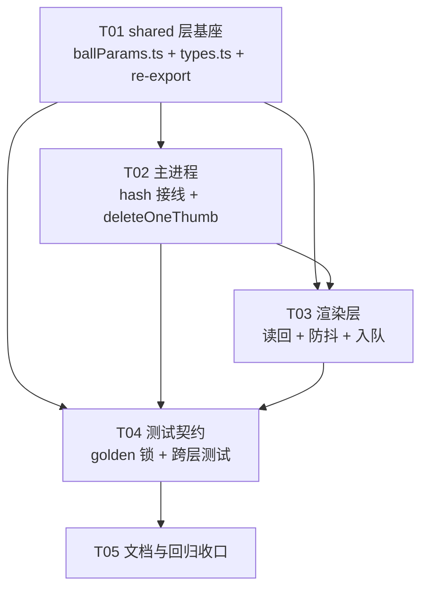

# 12 · 设计确认：材质球调参持久化（`renderParams`）与缓存键扩展

> **状态**：设计确认，**不改任何代码**。依据用户已拍板的「调参参数持久化进 `renderParams`」+ 主理人三条倾向，逐条核对源码后给出可执行结论。
> **基线**：Electron 33 + React 18 + TS strict + Dexie，ESM，无 git 仓库。所有行号均为本文撰写时（2026-10-14）的实测行号。
> **本文不含任何源码改动**；§9 的任务清单是交给 Engineer 的执行分解，不是已完成的实现。

---

## 0. 事实核对结果（逐条）

| # | 主理人陈述 | 核对 | 备注 |
|---|---|---|---|
| 1 | `BallParamScales` 220-224 / `DEFAULT_PARAM_SCALES` 227 / `clampScale` 230 / `clampUv` 236 / `effectiveUvRepeat` 245 | ✅ 全部一致 | `clampScale` 非法输入回落 **1**（不是 0），`clampUv` 同理 —— 这条对 hash 规范化很关键（见 §3.2） |
| 2 | `slotsHash` 274-282（FNV-1a 32bit → 8 位 hex）、`ballThumbName` 290-291 只 hash 槽位集合 | ✅ 一致 | **核心缺陷确认**：`ballThumbName` 签名里没有参数，改滑块 → 名字不变 → `ballThumbIsFresh`（store.ts:690）判为命中 → 网格继续读旧 JPG |
| 3 | `parseThumbFileName` 55-59 正则 `^(.+)-([0-9a-f]+)\.(jpg\|png)$`；`isThumbOf` 84-87 / `matchThumbNames` 90-92 / `findOrphanThumbs` 95-101 | ✅ 一致 | 正则的 `.+` 是贪婪的 → id 取「最后一个 `-` 之前」的全部。**因此参数只能进 hash，不能进文件名字面**（任何非十六进制的参数串会让整套缓存管理失效） |
| 4 | `VaultDB` 43 / `version(1)` 49-51 / `version(2)` 52-77 / `version(3)` 81-86；无 `renderParams` | ✅ 一致 | v3 的 `stores()` 是 81-86，`upgrade()` 是 87-102。确认全库无 `renderParams` |
| 5 | `Asset` 59-102，含 `materialMeta?` 96（非索引字段先例）；`Settings` 116+ | ✅ 一致 | `materialMeta` 是**先例且未开 version(4)** —— 这是 §2 结论的直接依据 |
| 6 | `ballSlotsOf` 680-684 / `ballThumbIsFresh` 687-690 / `enqueueBallThumb` 694-709 / `runBallQueue` 774+ / 746 `saveBallThumb` | ✅ 一致 | **额外发现（必须一并修）**：`renderBallThumbFor` 在 store.ts:742 调 `renderBallToJpeg(asset.relFolder, slots)` **没传 params** → 落盘图永远是默认参数，与 hash 里的参数不符 |
| 7 | `ballThumbFileName` 29-31 / `saveBallThumbBytes` 54-76（`isWithinRoot`）/ `ipc.ts` 42 | ✅ 一致 | `main/ballThumb.ts:4` 从 `renderer/logic` import —— 层向违规，§1 顺带修正 |
| 8 | `CustomRenderDialog.tsx` 41 `useState(DEFAULT_PARAM_SCALES)`；`MaterialBall.tsx` 514、687 | ✅ 一致 | 弹窗背景点击（`CustomRenderDialog.tsx:83` `onClick={onClose}`）会**直接关闭而不保存** → 影响 §5 的持久化时机选择 |
| — | 「`tests/ballParams.test.ts` line 15 断言含 `uv: 1`」 | ⚠️ **行号更正** | line 15 是 import 块的收尾 `}`；该断言实际在 **line 18**（`expect(DEFAULT_PARAM_SCALES).toEqual({ roughness: 1, bump: 1, uv: 1 })`）。结论不变：**该断言不需要改** |

**补充核对（主理人未提但影响结论）：**

- `SaveBallThumbPayload`（`shared/types.ts:247-254`）只有 `assetId / slots / base64Jpeg` —— 需要加 `params`。
- `main/thumb.ts:84-94` 的 `deleteThumb(id)` 是**按 id 通配全删**（`matchThumbNames`），**没有单文件删除能力**。`clearThumbs`（111-125）是全清。→ §4 的失效策略不能直接复用 `thumb:delete`。
- `store.ts:158-181` 的 RA3 三段式（先建新、再通配删、再补）依赖「`deleteThumb` 无排除参数」这一事实 —— 材质球不能照抄，见 §4.2。
- `store.ts:736`：`coverSource === 'named'` 的资产直接 return，不渲球。这类资产的 `thumbPath` 是**封面缩略图**而不是球图 —— §4 的删除必须只删球图，不能全删。
- `store.ts:804-815`（`ensureMissingThumbs`）用 `!ballThumbIsFresh(a)` 作为「跳过材质球」的守卫。参数变化后该守卫翻转会引入竞态，见 §4.3。
- `ballAttempted`（`store.ts:39`）是 `Map<id, 期望名>` —— 参数进 hash 后**天然获得重渲能力**（名字变 → 重新入队），这一处不需要改逻辑，但注释（35-37）需要补一句。

---

## 1. `renderParams` 的类型定义落点

### 1.1 结论

**`renderParams` 挂在 `Asset` 上（每材质各存），主理人的倾向成立。** 理由（不是偏好，是三条硬事实）：

1. **`effectiveUvRepeat`（materialBall.ts:245）与 `effectiveRoughness`（257）的语义是「形态基准 × 倍率」** —— 基准本身是**每个材质各自的属性**（平面形态基准 2、球/盒基准 1，见 `MaterialBall.tsx:76` `PLANE_REPEAT = 2`）。倍率若全局共享，同一套值会作用在不同基准上 → 石材 UV 0.5 与织物 UV 2 无法共存。这是功能语义层面的冲突，不是 UX 偏好。
2. **`Settings`（types.ts:116-144）是单例、无 per-asset 维度**，且已有 `thumbMaxPx` 这类全局渲染参数。把「每材质」的语义塞进单例会污染 `Settings` 的既有契约（`settingsMigration.test.ts` 依赖它）。
3. **`materialMeta?`（types.ts:96）已经确立了先例**：材质专属元数据放 Asset、非索引、不开 version。`renderParams` 与它同构。

### 1.2 落点：`src/shared/types.ts`（不是 renderer/logic）

```ts
// src/shared/types.ts —— Asset 内，紧邻 materialMeta（line 96 之后）
import type { BallParamScales } from './ballParams'

export interface Asset {
  // ...
  materialMeta?: { name?: string; tags?: string[] }
  /**
   * 该材质的调参倍率（2026-10 调参持久化，docs/12）。
   * 可选：undefined = 未调参 = DEFAULT_PARAM_SCALES（不强制回填，见 §2.3）。
   * 存的是**已规范化**的值（clamp + 2 位小数），保证 DB 值与 hash 输入一致。
   * 非索引字段（不参与筛选）—— 与 materialMeta 同处理。
   */
  renderParams?: BallParamScales
  // ...
}
```

### 1.3 `BallParamScales` 移到 shared：新建 `src/shared/ballParams.ts`

**不要直接塞进 `shared/types.ts`** —— `types.ts` 是纯类型文件（无函数值），而 `DEFAULT_PARAM_SCALES`、`clampScale`、`clampUv`、`paramsKey` 是运行时值。

新建 `src/shared/ballParams.ts`（纯计算、不 import electron / three / DOM，可 vitest 直测 —— 与 `shared/thumb.ts:2` 的纪律一致）：

```ts
export interface BallParamScales { roughness: number; bump: number; uv: number }
export const DEFAULT_PARAM_SCALES: BallParamScales = { roughness: 1, bump: 1, uv: 1 }
export function clampScale(v: number): number          // 从 materialBall.ts:230 搬来，逐字不变
export function clampUv(v: number): number             // 从 materialBall.ts:236 搬来，逐字不变
export function normalizeParams(p?: BallParamScales): BallParamScales   // 新增：clamp + 2dp
export function paramsKey(p: BallParamScales): string                   // 新增：hash 输入串
export function isDefaultParams(p: BallParamScales): boolean            // 新增：§3.4 用
export function resolveRenderParams(a: Asset): BallParamScales          // 新增：§2.3 用
```

**保持既有 import 不破的关键手法 —— re-export，不改调用方：**

```ts
// src/renderer/logic/materialBall.ts —— 原 220-265 段改为转发
export type { BallParamScales } from '../../shared/ballParams'
export { DEFAULT_PARAM_SCALES, clampScale, clampUv } from '../../shared/ballParams'
```

这样以下三处**一行都不用改**：

| 位置 | 现有 import | 是否需改 |
|---|---|---|
| `tests/ballParams.test.ts:7-14` | `from '../src/renderer/logic/materialBall'` | ❌ 不改（re-export 生效） |
| `MaterialBall.tsx:49-62` | `from '../logic/materialBall'`（含 `type BallParamScales`） | ❌ 不改 |
| `CustomRenderDialog.tsx:3` | `from '../logic/materialBall'` | ❌ 不改 |

> `type` re-export 在 TS strict + `isolatedModules` 下必须写 `export type { ... }`（不能写 `export { type X }`），否则 `tests/` 的直测会报 `TS1484`。这是本方案唯一需要留意的语法点。

**顺带修正层向违规**：`main/ballThumb.ts:4` 目前 `import { ballThumbName } from '../renderer/logic/materialBall'` —— main 反向依赖 renderer。把 hash 函数放进 `shared/ballParams.ts` 后，main 改 import shared，违规消除，且保证**主进程与渲染进程算出同一个 hash**（这是 §3 正确性的前提）。

---

## 2. Dexie `version(4)` 迁移方案

### 2.1 结论：**不需要 `version(4)`**

`renderParams` 是可选非索引字段。Dexie 对「只加非索引字段」的变更**不需要 version bump** —— `materialMeta`（types.ts:96）就是活证据：它被加入时没有开 version(4)，现有库仍在 `version(3)`（db.ts:81-86），读写正常。

开 `version(4)` 的唯一理由是「沿用 v2/v3 的 backups 快照惯例」。我的判断：**这次不要开**，三条理由：

1. **零数据可迁移** —— 没有字段需要改，`upgrade()` 里能做的事只有「给 undefined 补默认值」，而 §2.3 明确建议**不回填**。一个只做快照、不改数据的 upgrade 是纯成本。
2. **快照惯例的前提是「有不可逆的结构变更」**（v2 改主键、v3 补默认值）。本次没有不可逆变更，回滚窗口没有意义。
3. **RA4 风险**：`db.ts:79` 已写明「已处于 v2 的库不会重跑 upgrade」。多开一个 version 就多一个「用户库已停在 v4、将来真要改时无法重跑」的坑。

**如果主理人坚持要开**（例如为了「升级即留一份可回滚快照」的运营口径），最小形态如下 —— 必须**只读、不改数据**：

```ts
this.version(4)
  .stores({
    // 索引串与 v3 逐字相同：renderParams 不进索引
    assets:
      'id, kind, category1, category2, *styles, source, importedAt, updatedAt, *tags, dedupeKey, suVersion, suMajor, folder, coverSource',
    backups: 'id, at'
  })
  .upgrade(async (tx) => {
    const old = (await tx.table('assets').toArray()) as Asset[]
    if (old.length > 0) {
      await tx.table('backups').put({ id: `v3-${Date.now()}`, at: Date.now(), json: JSON.stringify(old) })
    }
    // 不 modify、不回填 —— renderParams 保持 undefined
  })
```

### 2.2 索引：**不需要**

确认主理人判断。`renderParams` 不参与任何筛选/排序：`logic/filters.ts` 的 `applyFilters` 只读 `kind / category1 / category2 / styles / tags / source / suMajor` 一类字段。参数是「渲染输入」，不是「检索维度」。加索引只会让 `db.assets` 的索引串变长、`rescan` 变慢，没有收益。

### 2.3 `renderParams === undefined` 的处理：**helper 回落，不回填**

```ts
// src/shared/ballParams.ts
export function resolveRenderParams(asset: Asset): BallParamScales {
  if (!asset.renderParams) return DEFAULT_PARAM_SCALES
  return normalizeParams(asset.renderParams)   // 读时再规范化一次：防历史脏值（0.30000000000000004）
}
```

不回填的理由：回填会把「用户从未调参」和「用户调参调成了默认值」两种状态在 DB 里混为一谈，而 §3.4 的缓存兼容方案恰好依赖这个区分（历史缓存文件名是「只 hash 槽位」）。读时回落是零成本、零迁移、可回滚的。

---

## 3. hash 方案

### 3.1 规范化规则（`paramsKey`）

```ts
/** 规范化：clamp 到各自区间 + 固定字段顺序 + 2 位小数 */
export function normalizeParams(p?: BallParamScales): BallParamScales {
  const s = p ?? DEFAULT_PARAM_SCALES
  return {
    roughness: round2(clampScale(s.roughness)),
    bump:      round2(clampScale(s.bump)),
    uv:        round2(clampUv(s.uv))
  }
}

/** hash 输入串：固定顺序 roughness,bump,uv（不是对象键序） */
export function paramsKey(p: BallParamScales): string {
  const n = normalizeParams(p)
  return `${n.roughness.toFixed(2)},${n.bump.toFixed(2)},${n.uv.toFixed(2)}`
}
```

四条规则，每条都有实测依据：

| 规则 | 为什么 |
|---|---|
| **先 clamp 再 round** | `clampScale`（230）/ `clampUv`（236）的非法输入回落是 **1**，不是 0。若先 round 再 clamp，`NaN.toFixed(2)` → `"NaN"` → hash 里出现非 hex 字符 → `parseThumbFileName`（thumb.ts:56）解析失败 → 该资产的缓存管理全线失效。顺序不可颠倒 |
| **固定字段顺序**（roughness, bump, uv） | `MaterialBall.tsx` 与 `CustomRenderDialog.tsx` 都用 `{ ...s, roughness: x }` 构造对象（CustomRenderDialog.tsx:141/157/175）。展开语法保留插入顺序，但**不保证**跨进程一致。hash 必须与键序无关 —— 与 `slotRelPaths`（materialBall.ts:198-205）的 `sort()` 同理 |
| **2 位小数** | 滑块 `step={0.1}`（CustomRenderDialog.tsx:139/151/163），所以 2 位是「超集」。但 `Number(e.target.value)` 会带浮点噪声：实测 `0.30000000000000004.toFixed(2) === '0.30'` → 噪声被吸收。若用 1 位小数，`0.05` 与 `0.1` 会撞车；若不用 `toFixed`，`0.3` 与 `0.30000000000000004` 会算出两个名字 → 缓存无限膨胀。**主理人这条倾向成立，且 2 位是下限** |
| **`-0` 归一** | 实测 `(-0).toFixed(2) === '0.00'`（不是 `'-0.00'`）。`clampScale(-0)` 走 `Math.min(2, Math.max(0, -0))` → `-0` → 字符串 `'0.00'`。无风险，但值得在测试里锁一条 |

### 3.2 与 `slotsHash` 的组合方式

```ts
// src/shared/ballParams.ts（FNV-1a 从 materialBall.ts:274-282 搬来，与 thumb.ts:24 的 thumbSalt 同算法）
export function ballHash(slots: BallSlots, params: BallParamScales): string {
  const base = slotRelPaths(slots).join('\n')                 // 与 materialBall.ts:276 逐字一致
  const key  = isDefaultParams(params) ? '' : '\n' + paramsKey(params)
  return fnv1a(base + key)                                    // 8 位小写 hex
}

export function ballThumbName(assetId: string, slots: BallSlots, params?: BallParamScales): string {
  return `${assetId}-${ballHash(slots, normalizeParams(params))}.jpg`
}
```

**格式不变**：仍是 `<id>-<8位hex>.jpg`，`parseThumbFileName` / `isThumbOf` / `matchThumbNames` / `findOrphanThumbs` / `deleteThumb` / `pruneThumbs` / `thumbStats` / `clearThumbs` 全部原样生效 —— 主理人这条倾向成立，且这是唯一可行的做法（参数串不能进文件名，§0-3）。

### 3.3 关键设计选择：默认参数是否参与 hash（**这是本次唯一需要主理人拍板的点**）

上面写成 `isDefaultParams(params) ? '' : ...`，即**默认参数不贡献 hash**。两种方案对比：

| | **方案 B（推荐：默认参数不贡献 hash）** | **方案 A（无条件贡献）** |
|---|---|---|
| 现有磁盘缓存 | **全部保留**（未调参的球图不用重渲） | **全部作废** → 全库材质重渲 |
| 首次升级代价 | 0（懒重渲，只有真调过参的才重渲） | 全量重渲（见 §4.4 的量级估算） |
| 既有测试 | 全部原样通过 | 全部原样通过（无一条硬编码 hash 值） |
| 复杂度 | hash 输入多一个分支 | 最纯净 |

**推荐方案 B**，理由：`resolveRenderParams` 对 `undefined` 回落 `DEFAULT_PARAM_SCALES`，而绝大多数材质从未调参 —— 方案 A 会让这些资产的**磁盘缓存无意义地全量作废**，而它们的渲染结果与 hash 输入完全等价（参数是 1,1,1）。方案 B 不是「兼容 hack」，而是「hash 输入的最短表示」：`paramsKey(default)` 的贡献是空串，因为默认参数不改变渲染结果（`ballParams.test.ts:19-25` 已经锁死了「1 倍时三个 effective* 恒等于基准」这条回归）。

**方案 B 的 golden hash 锁（实测值，写进测试防漂移）：**

| 输入 | hash | 对应既有测试 |
|---|---|---|
| `slotRelPaths = ['vh1sbjl_2K_Albedo.jpg','vh1sbjl_2K_Normal.jpg']` | `7694126f` | `tests/ballThumb.test.ts:40` |
| `slotRelPaths = ['a.jpg','b.jpg']` | `8f3f48d0` | `tests/materialBall.test.ts:226-227` |
| `slotRelPaths = []`（空 slots） | `811c9dc5` | `tests/materialBall.test.ts:232` |
| 上述第一组 + `paramsKey({1,1,1})` = `'1.00,1.00,1.00'` | `c2dbee32` | 方案 A 下会取代 `7694126f` |
| 上述第一组 + `paramsKey({1.5,1,0.5})` | `340ed45f` | 参数变化 → 名字变 |

> 若主理人最终选方案 A，上表第 4 行就是新的 golden 值，且 §4.4 的全量重渲代价必须一并接受。

### 3.3.1 0.7.6 追加：灰度透明的 `paramsKey` 口径（`A1` / `I1`）

「渐变贴图按灰度做透明度」落地时新增两个布尔参数（详见 docs/25 该条目的实现结论）：

| 字段 | 默认 | 进 key 的条件 | key 片段 |
|---|---|---|---|
| `alphaFromMap` | `false` | 为 `true` 时 | `A1` |
| `invertAlpha` | `false` | `alphaFromMap === true` 且为 `true` 时 | `I1`（紧跟在 `A1` 后） |

```text
默认                          → '1.00,1.00,1.00'          （逐字符不变）
开灰度                        → '1.00,1.00,1.00,A1'
开灰度 + 反转                 → '1.00,1.00,1.00,A1,I1'
开灰度 + 整体不透明度 50%     → '1.00,1.00,1.00,A0.50,A1'
```

三条口径必须一起成立，否则缓存会白膨胀或白作废：

1. **默认不贡献**：两个都是 `false` 时一个字符都不加 → 存量 `paramsKey` / hash /
   磁盘文件名**逐字符不变**（`tests/ballParams.test.ts` 的 golden 锁 + 新增的 0.7.6 用例）。
2. **没有灰度图就没有反转**：`normalizeParams` 在 `alphaFromMap !== true` 时把
   `invertAlpha` 一律归 `false`。否则 `{alphaFromMap:false, invertAlpha:true}` 与
   `{}` 是同一张成像却算出两个名字（无意义重渲 + 缓存多一份）。
3. **`A1` 与不透明度 `A0.50` 不冲突**：后者永远带两位小数，`A1` 是纯整数。

**`RENDER_REV` 保持 4，不 +1**。理由：没开灰度图的资产 `alphaMap` 为 `null`，
shader 补丁整段包在 `#ifdef USE_ALPHAMAP` 里 → 连 define 都不存在，成像一个像素都不变；
开了的资产靠 `paramsKey` 的 `A1` / `I1` 自动换名。+1 只会让**全库**球图白作废一次。

**为什么灰度源必须是 albedo、不能新增 PBR 槽位**：

- 用户要的是「手上这张颜色贴图自己当透明度」，不是"再挑一张蒙版图" → 不需要文件选择器；
- 一旦把灰度图做成第 6 个 PBR 槽位，它就会进 `ballSlotsRelPaths`。而该函数用
  **`Set` 去重**（`shared/ballParams.ts:220-227`）——把 albedo 的 rel 再喂一遍不会
  产生新元素，**同一张图换不出新名字** → "开了灰度图但缓存名没变"的静默 bug；
- 现行口径下 hash 天然正确：albedo 换图 → rel 集合变 → 名字变；开关变 → `A1`/`I1` 变。
  两个维度各自独立，不需要在 hash 里再拼一次路径。
- 采样语义也不受影响：three 原生是 `a = opacity × map.a × alphaMap.g`，
  灰度图只是**分布**，现有「透明度」滑块天然乘在最外层（整体强度），不做乘算改动。
  唯一的偏离是采样通道：我们把原生 `.g` 换成亮度
  `dot(rgb, vec3(0.2126, 0.7152, 0.0722))`，因为用户说的是"识别灰度"，
  彩色贴图（砖红/木纹）按亮度算才符合直觉；纯灰度图上两者等价。

### 3.4 `ballThumbName` 签名变更的影响面（逐文件逐行）

| 文件 | 行 | 现状 | 需要改什么 |
|---|---|---|---|
| `src/shared/ballParams.ts` | 新文件 | — | `BallParamScales` / `DEFAULT_PARAM_SCALES` / `clampScale` / `clampUv` / `normalizeParams` / `paramsKey` / `isDefaultParams` / `resolveRenderParams` / `fnv1a` / `ballHash` / `ballThumbName` |
| `src/renderer/logic/materialBall.ts` | 220-265 | 类型 + 常量 + clamp 定义在此 | 改为 `export type` / `export` 转发到 shared |
| `src/renderer/logic/materialBall.ts` | 274-282 | `slotsHash`（私有） | 删除或改为委托 `shared/ballParams` 的 `fnv1a`；`slotRelPaths`（198-205）**留在原处**（它依赖 `SLOT_ORDER` 与 `MaterialSlots`） |
| `src/renderer/logic/materialBall.ts` | 290-291 | `ballThumbName(assetId, slots)` | 加第三参 `params?: BallParamScales`，委托 `shared` 的 `ballHash` |
| `src/shared/types.ts` | 96 后 | `Asset` 无 `renderParams` | 加 `renderParams?: BallParamScales` |
| `src/shared/types.ts` | 247-254 | `SaveBallThumbPayload` | 加 `params?: BallParamScales` |
| `src/main/ballThumb.ts` | 4 | `import { ballThumbName } from '../renderer/logic/materialBall'` | 改 import shared（消除层向违规） |
| `src/main/ballThumb.ts` | 29-31 | `ballThumbFileName(assetId, slots)` | 加第三参 |
| `src/main/ballThumb.ts` | 54-76 | `saveBallThumbBytes(assetId, slots, jpeg, thumbsRoot)` | 加 `params` 参；line 65 `const name = ballThumbFileName(assetId.trim(), slots ?? {})` → 传入 `normalizeParams(params)` |
| `src/main/index.ts` | 386-392 | `saveBallThumbBytes(payload.assetId, payload.slots ?? {}, buf)` | 传入 `payload.params` |
| `src/shared/ipc.ts` | 42 | `saveBallThumb: 'thumb:saveBall'` | **不改**（payload 加字段即可，通道名不变）；新增 §4 的删除通道 |
| `src/preload/index.ts` | 108-109 | `saveBallThumb(payload: SaveBallThumbPayload)` | **不改**（类型自动带 params）；新增 §4 的 `deleteOneThumb` |
| `src/renderer/store.ts` | 12 | `import { ballThumbName, ... }` | 加 `resolveRenderParams` |
| `src/renderer/store.ts` | 690 | `asset.thumbPath === ballThumbName(asset.id, slots)` | 传入 `resolveRenderParams(asset)` |
| `src/renderer/store.ts` | 702 | `const want = ballThumbName(asset.id, slots)` | 同上 |
| `src/renderer/store.ts` | 742 | `mod.renderBallToJpeg(asset.relFolder, slots)` | **必须补 params**（§0 补充发现的 bug） |
| `src/renderer/store.ts` | 746 | `saveBallThumb({ assetId, slots, base64Jpeg })` | 加 `params` |
| `src/renderer/components/CustomRenderDialog.tsx` | 41 | `useState(DEFAULT_PARAM_SCALES)` | `useState(() => resolveRenderParams(asset))` |
| `src/renderer/components/MaterialBall.tsx` | 514 | `useState<BallParamScales>(params ?? DEFAULT_PARAM_SCALES)` | 详情面板侧改为读 `resolveRenderParams(asset)`（组件本身不动，由调用方传入） |
| `src/renderer/components/MaterialBall.tsx` | 687 | 「恢复默认」按钮 | 语义要确认：是「重置 UI」还是「重置并落库」（§5.3） |

---

## 4. 旧缓存失效策略

### 4.1 `thumb:delete` 不够用

`main/thumb.ts:84-94` 的 `deleteThumb(id)` 是**按 id 通配全删**（`matchThumbNames` → `matchThumbNames` 走 `parseThumbFileName`，salt 通配）。它不能「只删旧的那一张球图」。三个不能照抄的场景：

1. `coverSource === 'named'` 的材质（`store.ts:736` 早退）—— 它的 `thumbPath` 是**封面缩略图**，不是球图。全删会连官方渲染图的缓存一起删。
2. 一个材质既有封面缩略图又有球图（用户手动换封面后 `setCover` → `regenThumbSweep`（store.ts:170-181）产出封面 salt；之后球图也可能在盘上）—— 全删会误删。
3. `findOrphanThumbs`（thumb.ts:95-101）只认「id 不在 liveIds」—— 参数变化产生的旧 JPG 属于 live id，**永远不会被判孤儿**（主理人这条判断正确）。`pruneThumbs`（main/thumb.ts:97-108）与 `clearThumbs`（111-125）都救不了它。

**结论：需要新增一条「按文件名精确删」的通道。** 建议：

```ts
// src/shared/ipc.ts（在 line 25 thumbDelete 附近）
thumbDeleteOne: 'thumb:deleteOne'

// src/main/thumb.ts（新函数，复用 thumbAbsPath:78-81）
export async function deleteOneThumb(id: string, name: string): Promise<boolean> {
  const p = parseThumbFileName(name)
  if (!p || p.id !== id) return false                 // 必须是该 id 的缩略图
  const dir = await ensureThumbsDir()
  const abs = path.resolve(path.join(dir, name))
  if (!isWithinRoot(dir, abs, path.sep)) return false // 与 ballThumb.ts:67 同一道防线
  await fs.rm(abs, { force: true }).catch(() => {})
  return true
}
```

三道校验缺一不可：`parseThumbFileName`（防非缩略图文件）、`p.id === id`（防跨资产误删）、`isWithinRoot`（防渲染层被注入后写任意路径 —— 与 `ballThumb.ts:50-52` 的安全口径一致）。

### 4.2 参数变化时的删除时序（**先建新、再删旧，不能反**）

```
1. 参数落库（normalizeParams 后的值）
2. newName = ballThumbName(id, slots, newParams)
3. 渲染 → saveBallThumb → 磁盘上出现 newName
4. deleteOneThumb(id, oldName)          ← oldName 是落库前的 thumbPath
5. commitAsset({ ...asset, thumbPath: newName, thumbStatus: 'ready' })
```

**不能先删后建**：RA3（store.ts:158-181）已经解释过原因 —— 网格此刻仍引用旧文件，先删会让格子闪灰。这里更进一步：`deleteOneThumb` 只删旧球图，网格在状态切换时必然已拿到新文件。

**渲染失败时不删旧文件**（与 `store.ts:757-770` 的「静默降级、保留旧缓存」口径一致）：失败 → 保留旧 JPG + `thumbPath` 不变 → 网格仍有图。参数已落库，下次入队会重试。

### 4.3 一个必须避开的竞态

`ensureMissingThumbs`（store.ts:804-815）的守卫是 `a.cover && a.thumbStatus !== 'ready' && !ballThumbIsFresh(a)`。参数变化后 `ballThumbIsFresh` 翻转 false，如果此时把 `thumbStatus` 置成非 `ready`，该资产会**被封面缩略图分支抢走**（`ensureThumb(coverAbs)` 的 salt 是封面路径哈希，不是球图 hash）→ 网格变回封面图、球图丢失。

**规避**：参数变化时**不要**先把 `thumbStatus` 置 pending；保持 `ready`，等渲染成功再原子更新 `thumbPath`。或者在 `ensureMissingThumbs` 的守卫里加一条 `asset.kind !== 'material'`。

### 4.4 首次升级的全量重渲代价

按方案 B（§3.3）：**代价为 0** —— 未调参资产的 hash 输入不变，磁盘缓存原样有效，只有真正调过参的资产才重渲。

按方案 A：全库材质球重渲。量级：

- 每个球要**自建自销一个 WebGL 上下文**（`MaterialBall.tsx:735-736` 注释：Chromium 上限 8-16），所以队列**严格串行**（`runBallQueue` store.ts:774-788）。
- `BALL_THUMB_BATCH = 40`（store.ts:30）是**队列长度上限**，不是「每轮处理 40 个后继续」—— `enqueueBallThumb`（704）在队列满时直接 `return`，剩下的要等下一次 `init`/`rescan` 才入队。所以 2000 个材质不会在一轮内跑完。
- 单球成本：加载 5 张贴图 + 渲一帧 + `toDataURL`。实测产物几十 KB（`ballThumb.ts:22` 注释），但**贴图 IO 是主要开销**，2K 贴图 × 5 × 2000 = 大库要跑几十分钟。

**建议**：选方案 B，并且**不做主动全量重渲** —— 走既有的懒路径（`select` 时 `enqueueBallThumb`，store.ts:239-245）。若主理人坚持方案 A，需要额外加节流：把 `ensureMissingBallThumbs`（store.ts:791-794）改成「每轮最多 N 个 + 空闲时跑」，而不是现在的一次性 for 循环。

---

## 5. 持久化时机

### 5.1 结论：**滑块 change 时防抖写库（400ms），不是弹窗关闭时写**

三条依据：

1. **弹窗关闭路径不可靠**：`CustomRenderDialog.tsx:83` 的遮罩 `onClick={onClose}` 会**直接关闭而不保存**。当前 `save()`（48-78）只在点「保存 · 设为封面」时执行。若把持久化挂在关闭上，用户拖完滑块点遮罩 → 参数丢失。
2. **网格需要参数才能重渲球图**：`ballThumbIsFresh`（store.ts:690）与 `enqueueBallThumb`（702）都要读 `resolveRenderParams(asset)`。如果参数只在弹窗内 `useState` 里，网格永远算出默认 hash → 网格与弹窗显示不一致。这是功能正确性问题，不只是「保存与否」。
3. **防抖是必需的**：滑块 `onChange` 每次拖动都触发（141/157/175）。不防抖 → 每帧一次 `db.assets.put` + 一次 WebGL 上下文。400ms 静默窗口足够。

### 5.2 建议形态

```
store 新增：persistRenderParams(assetId, scales)
  - normalizeParams(scales) → 与 hash 输入完全一致的值（§3.1）
  - 与 asset.renderParams 比较（规范化后），无变化则直接 return（防无意义写库）
  - db.assets.put + commitAsset
  - 然后 enqueueBallThumb(asset)（走 §4.2 的「先建新再删旧」）
```

`normalizeParams` 后的值落库，**不是原始值** —— 否则 DB 里存 `0.30000000000000004`、hash 用 `0.30`，两者会漂移，`ballThumbIsFresh` 判错。副作用：渲染实际值与存储值差 ≤ 5e-3，视觉不可辨，换来确定性。

弹窗内 `useState` 仍保留（即时重渲预览需要），只是初值来自 `resolveRenderParams(asset)`（§3.4 表）。

### 5.3 「恢复默认」（`MaterialBall.tsx:687`）的语义需要主理人确认

当前是 `setScales(DEFAULT_PARAM_SCALES)` —— 纯 UI 重置，不落库。两种选择：

- **A（推荐）**：保持纯 UI 重置，但**同时走 `persistRenderParams(asset, DEFAULT)`** → `renderParams` 被写成规范化后的默认值（不是 `undefined`）。这样「用户显式恢复默认」与「用户从未调参」在 DB 里可区分，且 hash 仍走 §3.3 的最短表示（默认参数不贡献 hash）→ 缓存命中既有文件，不重渲。
- **B**：把 `renderParams` 置 `undefined`（回到「从未调参」）。语义更干净，但会丢掉「用户主动选择默认」这个意图，且与 A 的 hash 结果相同 —— 所以 A 与 B 在缓存层等价，只在 UI 文案上不同。

建议 A，并在 UI 上把按钮文案从「恢复默认」改为「恢复默认（并保存）」，避免用户以为只是预览。

---

## 6. 测试契约

### 6.1 既有断言：**一条都不用改**

`tests/ballParams.test.ts`（line 18 的 `uv: 1` 断言、20-25 的回归、27-35 的 clamp、56-69 的 clampUv）**全部保持原样**。§1.3 的 re-export 手法保证它的 import 路径不变。

### 6.2 依赖旧 hash 契约的既有测试（主理人要求列出）

| 文件 | 行 | 断言内容 | 是否受影响 |
|---|---|---|---|
| `tests/materialBall.test.ts` | 202-234 | `ballThumbName` 的格式、`parseThumbFileName` 兼容、换贴图→名字变、顺序无关、空 slots | **不受影响**（无一条硬编码 hash 值；2 参调用在 §3.4 的可选第三参下仍合法） |
| `tests/ballThumb.test.ts` | 38-57 | 同上 + `parseThumbFileName(name)` 可解析 | **不受影响**（同上） |
| `tests/ballThumb.test.ts` | 95 | `expect(name).toBe(ballThumbFileName(ID, SLOTS))` | **不受影响**，但建议补一条「传非默认 params → name ≠ 不传 params 的 name」 |
| `tests/thumb.test.ts` | 61-86 | `parseThumbFileName` 的 id/salt 切分 | **不受影响**（格式不变是 §3.2 的硬约束） |
| `tests/thumb.test.ts` | 143-156 | `findOrphanThumbs` | **不受影响** —— 但这条测试恰好**证明**了 §4.1 的缺陷：live id 名下的旧球图不是孤儿 |
| `tests/importer.test.ts` | 100 | `a.thumbPath === '${a.id}-stub.jpg'` | **不受影响**（stub，不走 hash） |
| `tests/storeFlow.test.ts` | 147 | `saved.thumbPath` 不变 | **不受影响** |

**没有一条既有测试硬编码 hash 值** —— 这是好消息：方案 A / 方案 B 都不会破坏既有测试。但正因为没有硬编码，**必须新增 golden 锁**（§3.3 表），否则将来任何人改 hash 输入格式都不会被测试拦住。

### 6.3 `tests/ballParams.test.ts` 需要新增的用例

1. **规范化幂等**：`normalizeParams(normalizeParams(p)) === normalizeParams(p)`
2. **浮点噪声吸收**：`paramsKey({roughness: 0.30000000000000004, bump: 1, uv: 1}) === paramsKey({roughness: 0.3, bump: 1, uv: 1})`（实测 `'0.30'`）
3. **`-0` 归一**：`paramsKey({roughness: -0, bump: 1, uv: 1}) === '0.00,1.00,1.00'`
4. **非法输入走 clamp 而非 NaN**：`paramsKey({roughness: NaN, bump: Infinity, uv: 5}) === '1.00,1.00,4.00'` —— 这条是 §3.1「先 clamp 再 round」的直接回归
5. **键序无关**：`paramsKey({bump: 1.5, uv: 2, roughness: 1}) === paramsKey({roughness: 1, bump: 1.5, uv: 2})`（固定字段顺序的回归）
6. **golden 锁**：§3.3 表的 5 个实测值
7. **参数变化 → hash 变化**：同 slots、不同 params → 不同名字
8. **规范化后相等 → hash 相等**：`0.30000000000000004` 与 `0.3` 同 slots → **同一个名字**（防缓存膨胀的核心回归）
9. **格式不变**：`ballThumbName(id, slots, params)` 仍匹配 `^<id>-[0-9a-f]{8}\.jpg$` 且 `parseThumbFileName` 能解析出同一 id
10. **`resolveRenderParams` 回落**：`resolveRenderParams({renderParams: undefined}) === DEFAULT_PARAM_SCALES`；`resolveRenderParams({renderParams: {roughness: 9, bump: -1, uv: 0.05}}) === {2, 0, 0.1}`

### 6.4 建议新增 `tests/ballCache.test.ts`（跨层契约）

- `deleteOneThumb` 的三道校验：非缩略图名 → false；`p.id !== assetId` → false；路径穿越 → false（与 `ballThumb.test.ts:115-122` 同口径）
- 「先建新再删旧」时序：新文件在磁盘上时旧文件仍在，删旧后只剩新文件
- `ballThumbIsFresh` 在参数变化后翻转 false（这条是本次缺陷的直接回归）
- `ensureMissingThumbs` 不会把材质球资产抢去生成封面缩略图（§4.3 竞态）

---

## 7. 备选方案：如果用户改选「全局参数」（10 行内）

1. 落点：`Settings.renderParams`（types.ts:116-144 加字段），无 Dexie 迁移（Settings 走 `settings.json`，非 DB）。
2. hash 输入改为 `slots + globalParams`，格式仍 `<id>-<8hex>.jpg`，§3 全部照用。
3. **致命问题**：`effectiveUvRepeat`（materialBall.ts:245）的基准是形态相关的（平面 2、球/盒 1，`MaterialBall.tsx:76`），同一倍率作用在不同材质上视觉含义不同 → 石材 0.5 与织物 2 无法共存，用户每次换材质都要重调。
4. 缓存层无法补救：hash 会随全局参数变，但**用户期望的是「这个材质长这样」**，全局参数一变，所有材质的缓存同时失效 → 全库重渲。
5. 唯一优势：实现少一个字段、少一次 per-asset 写库。
6. 唯一适用场景：把参数当「个人偏好模板」（新材质继承全局值），但**不能**作为渲染真值的唯一来源。
7. 若两者都要：`Settings.renderParams` 作**默认值来源**，`Asset.renderParams` 作**覆盖**（`resolveRenderParams` 优先 asset，回落 settings，再回落 DEFAULT）。这是最小改动的折中，且与 §2.3 的 helper 完全兼容。
8. 结论：**不推荐纯全局**；若用户坚持，按第 7 条做「全局默认 + 每材质覆盖」，hash 与测试契约不变。

---

## 8. 类图与时序图

见 `docs/class-diagram.mermaid` 与 `docs/sequence-diagram.mermaid`。

---

## 9. 任务分解（交给 Engineer，本文不执行）

> 本项目无 git 仓库；「提交」在本项目语境下 = 跑 `vitest` + `tsc` 后报告通过。
> 依赖声明：**零新增第三方包**（FNV-1a 是零依赖实现，`shared/thumb.ts:23` 已确立该口径）。因此 T01 的「基础设施」是 shared 层基座，而非 package.json。

### 9.1 所需包

无新增。既有：`dexie`、`three`、`zustand`、`vitest`、`electron`。

### 9.2 任务清单

| ID | 名称 | 源文件 | 依赖 | 优先级 |
|---|---|---|---|---|
| **T01** | shared 层基座：`ballParams` 纯计算 + Asset 字段 | `src/shared/ballParams.ts`（新）、`src/shared/types.ts`（Asset 96 后 + `SaveBallThumbPayload` 247-254）、`src/renderer/logic/materialBall.ts`（220-265 改 re-export、274-291 委托） | — | **P0** |
| **T02** | 主进程：hash 接线 + 精确删除通道 | `src/main/ballThumb.ts`（4、29-31、54-76）、`src/main/thumb.ts`（新增 `deleteOneThumb`，复用 78-81）、`src/shared/ipc.ts`（25 附近）、`src/preload/index.ts`（66 附近、108-109）、`src/main/index.ts`（386-392） | T01 | **P0** |
| **T03** | 渲染层：读回 + 防抖持久化 + 重渲入队 | `src/renderer/store.ts`（12、690、702、742、746、791-794、804-815 守卫）、`src/renderer/components/CustomRenderDialog.tsx`（41）、`src/renderer/components/MaterialBall.tsx`（514、687） | T01, T02 | **P0** |
| **T04** | 测试契约：golden 锁 + 跨层缓存测试 | `tests/ballParams.test.ts`（新增 §6.3 的 10 条，**不改既有断言**）、`tests/ballThumb.test.ts`（补 params 用例）、`tests/materialBall.test.ts`（补 golden 锁）、`tests/ballCache.test.ts`（新，§6.4） | T01, T02, T03 | **P1** |
| **T05** | 文档与回归收口 | `docs/12-设计确认-材质球调参与缓存键.md`、`docs/04-代码摘要.md`（材质球章节 + Dexie version 段）、`docs/11-UI需求-IDBOX.md`（§3.7 持久化语义）、`docs/class-diagram.mermaid`、`docs/sequence-diagram.mermaid` | T01-T04 | **P2** |

### 9.3 任务依赖图



---

## 10. 共享约定（给 Engineer）

- **hash 输入必须走 `shared/ballParams.ts` 的唯一实现** —— 主进程与渲染进程必须算出同一个值。任何一侧自行拼字符串都会导致「渲染的文件名 ≠ store 期望的文件名」→ 网格读不到图。
- **落库的 `renderParams` 必须是 `normalizeParams` 后的值**（§5.2），否则 DB 值与 hash 输入漂移。
- **`paramsKey` 的字段顺序固定为 roughness, bump, uv**，不依赖对象键序。
- **先建新、再删旧**（§4.2），与 RA3（store.ts:158-181）同口径；删除失败不阻断，静默降级。
- **材质球删除必须用 `deleteOneThumb`**，不能用 `deleteThumb(id)`（§4.1）。
- **既有测试断言不得修改**（§6.1）；新增用例只能追加。
- **格式硬约束**：缓存文件名仍是 `<id>-<8位hex>.jpg`，参数串不得出现在文件名字面中。

---

## 11. 未明确 / 需要主理人拍板

1. **§3.3 方案 A vs 方案 B** —— 默认参数是否参与 hash。这是本次唯一有实质代价分歧的点（B：零重渲；A：全库重渲）。我推荐 B。
2. **§5.3「恢复默认」的语义** —— 纯 UI 重置还是落库。我推荐落库（A）。
3. **§2.1 是否开 `version(4)`** —— 我判断不需要；若为了运营口径的升级快照，用 §2.1 的只读形态。
4. **§4.4 是否做主动全量重渲** —— 选 B 则不需要；选 A 则必须加节流（当前 `ensureMissingBallThumbs` 是一次性 for 循环，不满足）。
5. **`coverSource === 'named'` 的材质**（store.ts:736 早退）：这类资产调参后**网格不会显示球**（官方渲染图优先）。参数是否仍应落库、是否应重渲，需要产品口径确认 —— 我倾向「落库但不重渲，等用户手动设为封面时才生效」，因为 `CustomRenderDialog` 的保存走 `setCoverImage` + `setCover`（61-69），与 thumbs 缓存是两条独立路径。
6. **`CustomRenderDialog` 的保存路径与 thumbs 缓存不同源**（弹窗存进资产文件夹，网格读 thumbs 目录）—— 参数持久化后，弹窗保存的封面与网格的球图可能不一致。这是既有行为，本次不改变，但值得在 UI 文案上说明。
