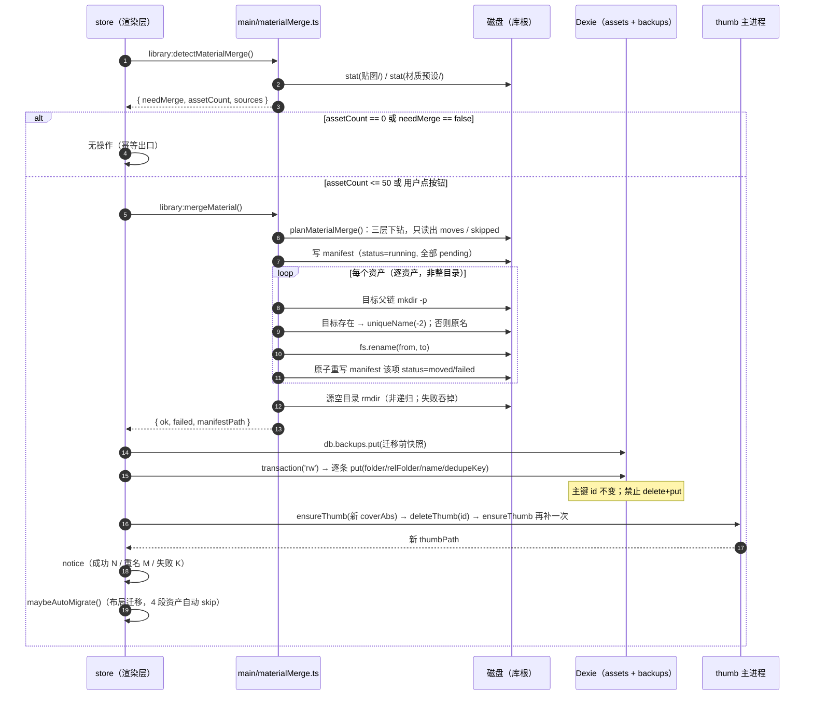
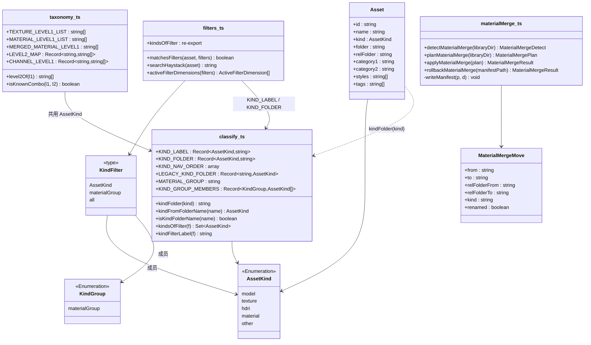
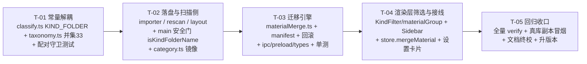

# ID BOX — 增量变更设计 · 材质大类合并（贴图 + 材质预设 → 材质）

> 文档版本：**v1.0** ｜ 撰写：merge-architect（架构师） ｜ 日期：**2026-10-19** ｜ 语言：简体中文
> 变更来源：产品决策方杨雯丞 **2026-10-19 拍板**——「把『贴图』和『材质预设』两个大类合并为一个『材质』大类，去掉的只是目录层级，『贴图/材质预设』降级为资产的 `kind` 属性（筛选器里仍可单独筛），一级/二级分类精度一点不丢」。
> 上游文档：`docs/06-分类体系设计.md`（**v1.0.7**，§15 裁定历史）、`docs/03-变更设计-语义子目录.md`（体例参照）、`docs/07-贴图材质分类词表-原始抄录.md`（词表事实源）
> 读者：工程师（software-engineer / round2-engineer / material-ui-engineer）、QA、主理人
> **本文档只写 `docs/**`，不改任何 `src/` 代码、不动 `E:/ModVault/Library` 用户库文件。** 代码改动由任务分解表派单。

---

## 0. 一句话摘要

**把大类目录 `<大类>` 的取值从 5 个（模型 / 贴图 / HDRI / 材质预设 / 其他）收敛为 4 个（模型 / **材质** / HDRI / 其他），四层落盘深度不变；`kind` 仍保留 `texture` / `material` 两个值，只作属性维度用于筛选与图标；一级词表取两频道并集 33 项。**

| 维度 | 变更前 | 变更后 |
| --- | --- | --- |
| 磁盘大类目录 | `贴图/`、`材质预设/` 两个 | **`材质/` 一个** |
| `Asset.kind` | `texture` / `material` | **不变**（仍是两个值，仍是属性） |
| 目录名来源 | `kindFolder()` 直接返回 `KIND_LABEL[kind]` | **`KIND_FOLDER[kind]`**（与显示名解耦） |
| 侧栏大类节点 | 「贴图」「材质预设」两行 | **「材质」一行**（计数 = 两类之和），展开后顶部两个 kind chip 可单独筛 |
| 一级分类词表（材质语境） | 贴图 21 项 / 材质 21 项 两套 | **并集 33 项**（两者共用一份词表） |
| 二级分类（材质语境） | 贴图 21 组 191 项；材质无二级 | **完全不变**（贴图那 21 组原样，材质仍无二级） |
| `LEVEL2_MAP` 键 | 40 个（SU 19 + 贴图 21） | **仍是 40 个**（不新增键，理由见 §2.2） |
| Dexie schema | v3 | **仍是 v3**（不升版本，理由见 §2.3.6） |

### 0.1 给工程师的 5 条硬约束（先看这个再动手）

1. **`KIND_LABEL` 只用于 UI 显示，永远不能用来拼路径**；拼路径只准用 `kindFolder()`。
2. **`贴图/` 与 `材质预设/` 只读兼容、绝不新写**：新导入、改分类、改名、布局迁移一律落 `材质/`。
3. **迁移逐资产搬，禁止整目录 `rename`**（否则同名一级目录会"覆盖或失败"，不是 merge）。
4. **迁移永不覆盖**：目标已存在同名资产 → `uniqueName` 追加 `-2`（与导入/改分类同一规则）。
5. **`Asset.id` 是 UUID，永不改主键**；迁移只 `put` 更新 `folder / relFolder / name`，**禁止 delete+put**（会丢 tags / note / styles / renderParams）。

---

## 1. 事实核对（动手前先摆正）

### 1.1 已逐行核实的源码事实

| # | 位置 | 事实 |
| --- | --- | --- |
| 1 | `src/shared/classify.ts:31-37` | `KIND_LABEL` = `{model:'模型', texture:'贴图', hdri:'HDRI', material:'材质预设', other:'其他'}`，注释明写"**同时是库内的文件夹名**"——这就是本次要拆的点 |
| 2 | `src/shared/classify.ts:226-228` | `kindFolder(kind)` = `KIND_LABEL[kind]`，**目录名与显示名共用同一个常量** |
| 3 | `src/shared/classify.ts:40` | `KIND_ORDER = ['model','texture','hdri','material','other']`，仅 `Sidebar.tsx:3` 消费 |
| 4 | `src/shared/classify.ts:43` | `KIND_PRIORITY = ['model','material','hdri','texture','other']`，**只用于内容判 kind，与目录名无关，不动** |
| 5 | `src/shared/taxonomy.ts:84-176` | `LEVEL2_MAP` 扁平 40 键（SU 19 + 贴图 21），键全局唯一，有守卫测试 `tests/taxonomy.test.ts:242-245` |
| 6 | `src/shared/taxonomy.ts:51-63` | `CHANNEL_LEVEL1` 三频道分册：`model` 19 / `texture` 21 / `material` 21（材质含末项「其他」） |
| 7 | `src/shared/taxonomy.ts:183-194` | `STYLE_LIST_BY_KIND` 只按 `'model' \| 'texture'` 分册；材质**无风格词表**（07 §5-11 原文：材质频道无风格排） |
| 8 | `src/shared/autoClassify.ts:129` | 二级匹配遍历 `Object.entries(LEVEL2_MAP)` 的值 |
| 9 | `src/shared/autoClassify.ts:159` | **一级匹配遍历 `Object.keys(LEVEL2_MAP)`** ← 决定"能不能为材质独有一级建空键"的关键 |
| 10 | `src/main/importer.ts:234 / :442` | 两处落盘都走 `kindFolder(kind)`（压缩包 / 单图直导） |
| 11 | `src/main/rescan.ts:22-27` | `kindFromFolder()` 用 `KIND_LABEL` **反查**目录名 → kind；`rescan.ts:180` 仅在 `primaryKind(files)==='other'` 时用它兜底 |
| 12 | `src/main/rescan.ts:131-133` | `listDirs(base)` **不校验大类目录名**，任意顶层目录都会被当作大类扫描 ← 这是旧库天然向后兼容的机制（§2.6） |
| 13 | `src/main/layout.ts:45` | 布局迁移目标 = `kindFolder(a.kind)/未分类/未分类/<name>` |
| 14 | `src/main/index.ts:442-443` | `kindFolderNameOf()` = `Object.values(KIND_LABEL).includes(name)`，是 `asset:assignCategory` 的**安全门**；`kindFolder` 改成「材质」而这里不改 → **改分类 100% 失效**（返回 null） |
| 15 | `src/renderer/store.ts:401` | `assignCategory` 传 `kindFolderName: kindFolder(asset.kind)` |
| 16 | `src/renderer/store.ts:536-545` | `renameAsset` 只替换 `relFolder` **末段**，首段大类原样保留 → 改名不会把 `贴图/…` 改成 `材质/…`（正确，迁移是独立动作） |
| 17 | `src/renderer/store.ts:553-581` | `rescan` 合并键是 **`folder` 绝对路径**；路径变了就命中不到旧记录 → 会删旧建新、**丢 tags/note**（迁移必须在 DB 里先改 folder，不能靠 rescan 自愈） |
| 18 | `src/renderer/logic/filters.ts:12` | `KindFilter = AssetKind \| 'all'`；`matchesFilters:81` 是单值等值判断 |
| 19 | `src/renderer/logic/filters.ts:159` | 空结果提示的大类标签也走 `KIND_LABEL[f.kind]` |
| 20 | `src/renderer/logic/category.ts:85-105 / :111-124` | `countLevel1/countLevel2/duplicatedLevel2Names` 签名都是单个 `AssetKind` |
| 21 | `src/renderer/db.ts:52-102` | Dexie v1/v2/v3 已发布；`v2` 已把主键从 `relFolder` 迁到 **UUID** |
| 22 | `src/shared/types.ts:62-63` | `Asset.id`：**"稳定主键：导入时生成的 UUID，永不因改名 / 改库目录 / 改大类而变"** |
| 23 | `docs/07-贴图材质分类词表-原始抄录.md:444`（§5 第 11 条） | 材质频道：**"无二级分类排、无风格排"**，另含 VR/CR 渲染器筛选 |

### 1.2 三条上游口径勘误（必须先纠正，否则设计会建在错前提上）

> 这三条不影响用户拍板的目标，但影响实现细节。写在最前面，避免工程师照着错前提写代码。

#### 勘误 ①：`docs/06` 当前版本是 **v1.0.7**，不是 v1.0.4

任务说明里写的"v1.0.4 / 升到 v1.0.5"是 2026-10-13 的快照。`docs/06` 已迭代到 **v1.0.7**（v1.0.5「重名白名单变更流程」、v1.0.6「self-target 幂等」、v1.0.7「ignored 类型勘误」均已发布）。
**本次升到 v1.0.8**——版本号不可回退、不可复用（06 §15 的既定纪律）。见 §2.7。

#### 勘误 ②：`Asset.id` 是 UUID，**不是** `relFolder`

任务说明里的"`Asset.id = relFolder` → 主键变化 → Dexie 主键迁移方案"是 **v1 时代的旧结论**，早已被 `db.ts` v2 迁移修掉（P0-7 / D1）：

- `src/renderer/db.ts:66-76`：旧 `id`（就是 relFolder）→ 新 UUID，`clear + bulkAdd`，旧值搬进 `relFolder` 字段；
- `src/shared/types.ts:62-63`：`id` 明文"永不变更"。

**所以：本次目录改名完全不动主键，不需要 clear+bulkAdd，也不需要在事务里"删旧重建"。** 迁移只做 `put` 局部字段更新。见 §2.3.5。

#### 勘误 ③：材质频道**没有二级分类**，所以「9 个同名一级的二级词表不同」不成立

任务说明的前提是"石材在贴图频道下的二级 ≠ 石材在材质频道下的二级"。按 `docs/07` §5 第 11 条原文：

> 材质（`/caizhi.html`，3D材质，一级分类为 …21 项…，**无二级分类排**、无风格排，另有 VR/CR 渲染器筛选）

即：**材质频道对二级分类的贡献是 0 项**。合并后这 9 个同名一级（石材/木材/木地板/地毯/金属/皮革/玻璃/涂料/外景）的二级词表**与今天完全一致，一条都不增加、一条都不减少**。

这条勘误直接决定了 §2.2 的裁定（不需要嵌套、不会产生无意义组合、`isKnownCombo` 不会放松）。同时它也让 06 v1.0.3 立的"将来建材质频道必须升级嵌套/前缀键"这条不变式**本次不触发**——不是撤销它，而是它约束的场景（材质频道有二级且与贴图撞名）在数据上不存在。**触发器保留**：哪天真采到材质的二级排，必须回来走嵌套升级。

### 1.3 术语（全文统一，避免歧义）

| 词 | 含义 | 代码位置 |
| --- | --- | --- |
| **大类** | 磁盘第 1 段。取值从 5 个收敛为 4 个：模型 / **材质** / HDRI / 其他 | `KIND_FOLDER`（新增） |
| **kind** | 资产的**属性**维度，5 值：`texture` / `material` / … 永不合并 | `AssetKind` |
| **kindGroup** | 本次新增的**筛选分组**概念 = `'materialGroup'`，代表 `{texture, material}` 两类 | `KindGroup`（新增） |
| **一级 / 二级** | 磁盘第 2 / 第 3 段（`category1` / `category2`），与 kind 正交 | `LEVEL2_MAP` |
| **并集词表** | 材质语境下的一级词表 33 项（贴图 21 ∪ 材质 21） | `MERGED_MATERIAL_LEVEL1`（新增） |

---

## 2. 七个设计问题的裁定

### 2.1 Q1：`kindFolder()` 怎么解耦

**问题**：目录名要变成「材质」，但 `KIND_LABEL.texture` 仍是「贴图」用于 UI 显示。当前 `kindFolder()` 直接返回 `KIND_LABEL[kind]`（`classify.ts:226-228`），二者是同一个常量。

#### 裁定：新增 `KIND_FOLDER` 数据表，`kindFolder()` 改为查它；**不写 switch**

```ts
/** 大类文件夹名（落盘用）。与 KIND_LABEL（显示用）解耦：texture 与 material 共用「材质」。 */
export const KIND_FOLDER: Record<AssetKind, string> = {
  model: '模型',
  texture: '材质',     // ← 与 KIND_LABEL.texture('贴图') 不同
  hdri: 'HDRI',
  material: '材质',    // ← 与 KIND_LABEL.material('材质预设') 不同
  other: '其他'
}

/** 侧栏/导航显示顺序（texture 与 material 合并为一个节点，见 §2.4）
 *  ⚠️ 声明顺序：必须先声明 `MATERIAL_GROUP`（§2.4 的 const，存在 TDZ），再声明本常量；
 *     若为省事，数组里直接写 'materialGroup' 字面量也可以（但类型仍是 KindGroup）。 */
export const KIND_NAV_ORDER: ReadonlyArray<AssetKind | KindGroup> =
  ['model', MATERIAL_GROUP, 'hdri', 'other']

/** 落盘大类名；未知 kind 返回空串（保留既有 truthiness 守卫语义） */
export function kindFolder(kind: AssetKind): string { return KIND_FOLDER[kind] ?? '' }

/** 历史大类目录名 → kind（**只读兼容**，永远不新写）。'材质' 有歧义，见下方裁定。 */
export const LEGACY_KIND_FOLDER: Readonly<Record<string, AssetKind>> = {
  贴图: 'texture',
  材质预设: 'material'
}

/** 目录名 → kind。'材质' 无法反推 kind（两类共用）→ 返回 null，由调用方按内容兜底 */
export function kindFromFolderName(name: string): AssetKind | null

/** 是否是合法大类目录名（含历史别名，供 main 侧入参校验） */
export function isKindFolderName(name: string): boolean
```

**为什么用数据表而不是 `switch`**：
① 目录名是**数据**，会随兼容期演化（历史别名），数据表可被测试整体遍历（`Object.entries(KIND_FOLDER)`），switch 只能逐支测；
② `main/index.ts:443` 现在用 `Object.values(KIND_LABEL).includes(name)` 做安全门——它需要"合法目录名集合"这个概念，而 `KIND_FOLDER` 正好就是它，switch 无法复用；
③ "哪些 kind 共用一个目录"是查询（`kindFolder(a)===kindFolder(b)`），表天然可查。

#### `'材质' → kind` 的反解裁定：返回 `null`，由内容兜底；`rescan` 的兜底值取 `texture`

`rescan.ts:180` 的形态是 `detected !== 'other' ? detected : kindFromFolder(kindFolderName)`。合并后 `kindFromFolderName('材质')` 无解，必须给一个兜底：

**裁定：`rescan` 里 `'材质'` 的兜底 kind = `texture`。** 理由：

1. 该分支**只在内容完全判不出大类时**触发（`primaryKind(files)==='other'`，即没有任何已知扩展名）；此时任何猜法都不比另一种更"正确"，选 error 成本更低的一侧。
2. `material` 的识别链路本身**不依赖目录**：`.vismat/.mat/.mi/.sbsar/.ies` 在 `EXT_KIND` 里（`classify.ts:26-27`），PBR 材质包由 `detectMaterialPack` 判定（`:73-99`），且判定优先级高于 hdri/texture（`:163-169`）。所以**真实材质资产的 kind 几乎总由内容决定**，兜底分支几乎不会作用在材质资产上。
3. `texture` 是历史默认（旧 `贴图/` 目录的兜底值），选它使"只有说明文件的散装包"行为与升级前一致，不引入新行为。

**禁止**的做法：按"目录里文件扩展名再猜一次""按资产名猜"——这会把 06 §1.3「层级固定 = 免启发式」的裁定重新打开。宁可选一个固定默认值，也不加启发式。

#### 影响面清单（全部 `kindFolder` / `KIND_LABEL` 调用点，逐个列出）

> 行号为 2026-10-19 快照。`out/**`、根目录 `index.js` 是**构建产物/历史遗留包**，不手改（见 §3.4）。

| # | 文件:行号 | 现状 | 处置 | 不改会怎样 |
| --- | --- | --- | --- | --- |
| 1 | `src/shared/classify.ts:31-37` | `KIND_LABEL` 注释"同时是文件夹名" | **改注释**：明确只做显示名；新增 `KIND_FOLDER` / `KIND_NAV_ORDER` / `LEGACY_KIND_FOLDER` / 两个反解函数 | — |
| 2 | `src/shared/classify.ts:226-228` | `kindFolder = KIND_LABEL[kind]` | 改为查 `KIND_FOLDER` | 新资产仍落 `贴图/`，合并无效 |
| 3 | `src/main/importer.ts:17` | `import { kindFolder … }` | 不改（签名不变） | — |
| 4 | `src/main/importer.ts:234` | 压缩包落盘 `folderName = kindFolder(kind)` | 不改代码（值自动变「材质」） | — |
| 5 | `src/main/importer.ts:442` | 单图直导 `folderName = kindFolder(kind)` | 同上 | — |
| 6 | `src/main/rescan.ts:5` | `import { KIND_LABEL … }` | 改 import：`KIND_FOLDER` / `kindFromFolderName` | 反查字典缺「材质」→ 只有说明文件的材质包被判 `other` |
| 7 | `src/main/rescan.ts:22-27` | `kindFromFolder` 遍历 `KIND_LABEL` | **删本地函数**，改用 `shared/classify.kindFromFolderName` + 显式 `'材质'→'texture'` 兜底（见上） | 同上；且两处反查逻辑漂移 |
| 8 | `src/main/layout.ts:5` | `import { kindFolder }` | 不改 | — |
| 9 | `src/main/layout.ts:45` | 迁移目标 `kindFolder(a.kind)` | 不改代码（值自动变「材质」） | 遗留两段资产会被搬回 `贴图/`，与迁移结果打架 |
| 10 | `src/main/layout.ts:139` | 注释里的不变式 `folder === libraryDir/kindFolder(kind)/…` | **改注释**：`kindFolder` 已等于 `KIND_FOLDER[kind]`，不变式本身仍成立，写清"两种 kind 可能同目录" | 文档腐化 |
| 11 | `src/renderer/store.ts:5 / :401` | 传 `kindFolderName: kindFolder(asset.kind)` | 不改代码 | — |
| 12 | `src/renderer/store.ts:536` | 注释提到旧的 2 段退化 bug | **加一句**：改名不动首段，因此**改名不会完成大类合并**（迁移是独立动作） | 有人误以为改名能迁移 |
| 13 | `src/main/index.ts:28 / :442-443` | 安全门 `Object.values(KIND_LABEL).includes(name)` | **必须改**为 `isKindFolderName(name)` | ⛔ **改分类整条链路失效**：渲染层传「材质」→ 安全门返回 null → `assignCategory` 返回 null |
| 14 | `src/main/index.ts:454-455` | 注释"大类目录名必须真实存在于 KIND_LABEL" | 同步改注释 | — |
| 15 | `src/renderer/logic/category.ts:18 / :42` | `if (!kindFolder(a.kind)) return false`（truthiness 守卫） | 不改（`KIND_FOLDER` 全覆盖，空串语义保留） | — |
| 16 | `src/renderer/logic/category.ts:55` | `planLegacyMoves` 用 `kindFolder` 算目标 | 不改代码 | 遗留资产迁回 `贴图/` |
| 17 | `src/renderer/components/Sidebar.tsx:3 / :148` | `KIND_LABEL` 显示 + `KIND_ORDER` 遍历 | 显示改用 `KIND_LABEL` 不变；遍历改 `KIND_NAV_ORDER`（§2.4） | 侧栏仍显示两行大类 |
| 18 | `src/renderer/components/DetailPanel.tsx:248` / `AssetGrid.tsx:251/:308/:323` / `App.tsx:122` | 用 `KIND_LABEL` 显示大类/kind | **不改**（这正是"kind 降级为属性"的呈现：详情页仍显示「贴图」「材质预设」） | — |
| 18b | `src/renderer/components/CategoryPicker.tsx:141` | 文案「确认后会把资产目录移动到「`{KIND_LABEL[kind]}` / 一级 / 二级 /」下」——**这是在描述落盘路径** | **必须改**为 `kindFolder(kind)`（否则提示"移动到 贴图/…"，实际落 `材质/…`，用户会以为没生效） | 用户可见的**错误路径提示** |
| 18c | `src/renderer/components/CategoryPicker.tsx:59` | 「大类：`{KIND_LABEL[kind]}`」 | 改成 **「材质（贴图）」/「材质（材质预设）」** 形式（`kindFolder` + `KIND_LABEL`）：既说清落盘目录，又说清 kind | 合并后只说「贴图」会让用户不知道落到哪个目录 |
| 18d | `src/renderer/components/Sidebar.tsx:21` | 顶部 doc 注释「分类（模型/贴图/HDRI/材质预设/其他）」 | 改成「（模型/材质/HDRI/其他）」 | 注释腐化 |
| 19 | `src/renderer/logic/filters.ts:72 / :159` | `searchHaystack` 与空结果提示用 `KIND_LABEL` | `:159` 改用 `kindFilterLabel()`；`:72` **追加** `KIND_FOLDER[a.kind]`（搜「材质」能同时命中两类） | 搜「材质」搜不到；空结果提示遇到 `materialGroup` 会 `undefined` |
| 20 | `tests/classify.test.ts:124-127` | `kindFolder('model')==='模型'`、`KIND_LABEL.hdri==='HDRI'` | 保留，**新增** 4 条配对守卫（§5.4） | 解耦关系无守卫，未来会被"顺手改回去" |

---

### 2.2 Q2：`LEVEL2_MAP` 键空间怎么改

**事实前提（已核实）**：
- 贴图册 21 键，材质册 21 项，**同名 9 个**（石材/木材/木地板/地毯/金属/皮革/玻璃/涂料/外景）；
- 材质册**无二级分类排**（07 §5-11）→ 对二级的贡献 **0**；
- 材质独有（相对贴图册）**12 项**：布料、塑料、陶瓷、墙面、地面、植物、皮肤器官、液体、食物、纸制品、半透明体、其他；
- 其中 **「植物」已经有一个键**（SU 频道的 `LEVEL2_MAP.植物`，10 项），所以"全局无键"的是 **11 项**；
- 并集 33 项 = 贴图 21 + 材质独有 12。

#### 三个候选的取舍

| 候选 | 方案 | 判定 | 否决理由（写死，避免以后再议） |
| --- | --- | --- | --- |
| **A. 按大类嵌套** | `Record<'model'\|'texture'\|'material', Record<一级, 二级[]>>` | ❌ 不采用 | ① **数据模型里 `category1` 不带 kind 身份**（`Asset` 只有一个 `category1` 字符串），嵌套会凭空引入一个 schema 不存在的维度，查询必须额外知道"这个资产属于哪个频道"，而 kind 是**属性**不是频道来源；<br>② 与用户目标**相反**：合并就是为了让「石材」在筛选器里是一个节点、同时看到贴图与材质两类；嵌套会把同名一级拆成两份；<br>③ 改动面最大（`level2Of/isKnownCombo/autoClassify/level2OptionsFor` 全部换签名），而**收益为 0**——材质二级是空集，没有冲突需要隔离；<br>④ 06 v1.0.3 的不变式约束的是"材质频道有二级且撞名"，该前提不成立（§1.2-③） |
| **B. 频道前缀键** | `tex:石材` / `mat:石材` | ❌ 不采用 | ① **前缀会泄漏到磁盘目录名**：`composeRelFolder` 用 `category1` 原样落盘（`naming.ts:166-171`），用户会看到 `材质/tex_石材/…`；<br>② 违反"磁盘是唯一真相、目录名即分类名、卸载后资源管理器可读"的 PRD 硬约束；<br>③ 同样无冲突可解，纯增负担；<br>④ 会让 `relFolder` 与词表失去可读对应，检索/排障成本上升 |
| **C. 并集单键（保持 40 键不动，不新建空键）** | 现有 21 个贴图键原样保留；材质独有 12 项**不建键**；33 项并集用**独立的派生列表** `MERGED_MATERIAL_LEVEL1` 表达 | ✅ **采用** | 见下 |

#### 裁定 C 的完整规格

```ts
/** 材质频道一级（21 项，docs/07 §5.11 照抄，剔「全部」）—— 从 CHANNEL_LEVEL1.material 提为具名常量 */
export const MATERIAL_LEVEL1_LIST: readonly string[] = [
  '石材','木材','木地板','地毯','布料','金属','皮革','玻璃','塑料','陶瓷',
  '涂料','墙面','地面','植物','外景','皮肤器官','液体','食物','纸制品','半透明体','其他'
]

/**
 * 材质大类语境下的**一级词表并集（33 项）**——「材质」目录下贴图/材质预设共用一份。
 * 顺序：贴图册原序（21） + 材质独有项按 07 §5.11 原序（12）。
 * ⚠️ 这是**派生列表**，不进 LEVEL2_MAP 键空间；它只用于 UI 下拉与校验展示。
 */
export const MERGED_MATERIAL_LEVEL1: readonly string[] = [
  ...TEXTURE_LEVEL1_LIST,
  ...MATERIAL_LEVEL1_LIST.filter((v) => !TEXTURE_LEVEL1_LIST.includes(v))
]   // length === 33
```

- `level1OptionsFor('texture' | 'material')` → **都返回 `MERGED_MATERIAL_LEVEL1`**（两者共用一个目录树，词表必须同源，否则会出现"贴图能选、材质选不到"的同一目录两套选项）。
- `CHANNEL_LEVEL1` **保持三频道原册不变**（可追溯、来源可核对）；`material` 改用 `MATERIAL_LEVEL1_LIST` 引用，值一字不改。
- `LEVEL2_MAP` **零新增键**，键数仍是 40；`isKnownLevel1` 语义不变。

#### 为什么不为材质独有的 12 项建 `[]` 空键（关键，别改）

| # | 理由 |
| --- | --- |
| 1 | **会污染 `autoClassify` 的一级匹配**：`autoClassify.ts:159` 遍历 `Object.keys(LEVEL2_MAP)` 做一级命中，而 `墙面 / 地面 / 其他` 是极高频通用词——一个叫「墙面装饰板」的**模型**会命中一级 → 落 `模型/墙面/未分类`。这是真实回归，不是理论风险（`autoClassify.test.ts:79-80` 正是防这类误伤） |
| 2 | `isKnownLevel1` 的语义会从"有级联词表登记"退化成"被提到过"，`tests/taxonomy.test.ts:150-155` 的守卫失去区分力 |
| 3 | 行为零收益：`level2Of(未知) === []`，**缺键与空键返回完全一致**，UI 都走「可自由输入」（`category.ts:140-144`） |
| 4 | 空键会让 `taxonomySummary` / 词表自检产生"已登记但无内容"的假信号 |

#### 「9 个同名一级的二级列表会变长吗 / 会不会有无意义组合 / `isKnownCombo` 会不会放松」

逐条回答（这是主理人点名要的）：

| 问题 | 结论 | 依据 |
| --- | --- | --- |
| 9 个同名一级的二级列表变长？ | **不变**（0 项增减） | 材质频道无二级排（§1.2-③），并集键的列表仍是贴图册原值 |
| 会产生无意义组合（贴图才有的二级出现在材质语境）？ | **不会新增**。唯一既有的跨界现象是 **「植物」**：它已因 SU 频道而有 10 项二级（乔木/灌木/地被花卉/草坪/盆栽/绿篱/竹类/棕榈科/水生植物/多肉）。材质资产选「植物」时，UI 会把这些**物种名**作为二级建议 | 见下方"植物特例" |
| `isKnownCombo` 判定放松？ | **完全不放松**。40 个键、191+184 项值一字未改，`isKnownCombo` 是纯查表，输出与今天逐字节一致 | `taxonomy.ts:276-278` |

**「植物」特例的裁定：接受，不做特判。**
理由：① 材质频道的「植物」语义是"植物类材质贴图"（叶/枝/树皮纹理），SU 的二级是**物种**（乔木/竹类…），当一个植物贴图属于"竹"时，建议「竹类」并不算错，只是粒度偏粗；② 二级值本来就允许自由输入（§9.2 规则 4），建议列表粗一点不阻塞任何操作；③ 做特判就得引入"按 kind 分册的二级表"，等于偷偷引入候选 A，与本次裁定冲突。**若用户明确反馈困扰，再按 A 升级（那时才是真需要）。**

**守卫测试（把上面三条钉住）**：

```ts
const MATERIAL_ONLY = MATERIAL_LEVEL1_LIST.filter((v) => !TEXTURE_LEVEL1_LIST.includes(v))

expect(MERGED_MATERIAL_LEVEL1.length).toBe(33)
expect(new Set(MERGED_MATERIAL_LEVEL1).size).toBe(33)                       // 无重复
expect(MATERIAL_ONLY.length).toBe(12)                                        // 材质独有
expect(MERGED_MATERIAL_LEVEL1.filter(v => TEXTURE_LEVEL1_LIST.includes(v))).toHaveLength(9)
for (const v of ['石材','木材','木地板','地毯','金属','皮革','玻璃','涂料','外景']) {
  expect(level2Of(v)).toEqual(/* 07 §3 原值，逐项 */)                          // 二级列表不得增长
}
for (const v of ['布料','塑料','陶瓷','墙面','地面','皮肤器官','液体','食物','纸制品','半透明体','其他']) {
  expect(LEVEL2_MAP).not.toHaveProperty(v)                                    // 禁止建空键
  expect(level2Of(v)).toEqual([])
}
expect(level2Of('植物')).toHaveLength(10)                                     // 记录既有事实，不做特判
```

---

### 2.3 Q3：迁移方案（磁盘两目录 → 一个「材质」）

#### 2.3.1 总体形态：**plan / apply 两段式**，照抄 `main/layout.ts` 的既定体例

新增 `src/main/materialMerge.ts`：

```ts
export interface MaterialMergeMove {
  /** 源资产目录绝对路径（= 目标记录的 asset.folder，渲染层据此找 id） */
  from: string
  /** 目标绝对路径（可能因重名追加了序号） */
  to: string
  /** 源 relFolder（4 段，首段为 贴图 / 材质预设） */
  relFolderFrom: string
  /** 目标 relFolder（4 段，首段固定「材质」） */
  relFolderTo: string
  /** 源目录对应的大类（诊断/日志用，不写回 schema） */
  kind: 'texture' | 'material'
  /** 目标已存在同名资产 → 已追加序号 */
  renamed: boolean
}

export interface MaterialMergePlan {
  moves: MaterialMergeMove[]
  /** 源根不存在 / 已空 → 无需处理（幂等依据） */
  sources: Array<{ name: '贴图' | '材质预设'; dir: string; exists: boolean; assetCount: number }>
  /** 结构不符（3 段以内、第 4 层是文件等）→ 跳过并上报，防静默丢资产 */
  skipped: Array<{ relPath: string; reason: 'depth' | 'not-dir' | 'empty' }>
}

export interface MaterialMergeResult {
  ok: MaterialMergeMove[]
  failed: Array<{ from: string; reason: string }>
  /** manifest 绝对路径（无 move 时为 null） */
  manifestPath: string | null
}

/** 只读探测：启动时用，不做任何写入 */
export async function detectMaterialMerge(libraryDir: string): Promise<{
  needMerge: boolean
  sources: MaterialMergePlan['sources']
  assetCount: number
}>

/** 生成计划：只读磁盘，幂等（连跑两次结果相同） */
export async function planMaterialMerge(libraryDir: string): Promise<MaterialMergePlan>

/** 执行：逐资产 fs.rename；失败跳过并汇总；先写 manifest 再动盘 */
export async function applyMaterialMerge(plan: MaterialMergePlan): Promise<MaterialMergeResult>

/** 回滚：按 manifest 逆序搬回；只处理 status==='moved' 的项 */
export async function rollbackMaterialMerge(manifestPath: string): Promise<MaterialMergeResult>
```

#### 2.3.2 合并语义：**逐资产搬，不整目录 rename**（这是"merge 而不是覆盖"的唯一可靠实现）

```
贴图/石材/水磨石/木纹01        ──rename──▶  材质/石材/水磨石/木纹01
贴图/未分类/未分类/某贴图       ──rename──▶  材质/未分类/未分类/某贴图
材质预设/未分类/未分类/某材质   ──rename──▶  材质/未分类/未分类/某材质
```

**为什么不能整目录搬**：若 `材质/` 已存在（部分迁移 / 用户手工建过），`fs.rename(贴图, 材质)` 在 Windows 上会 `EEXIST/ENOTEMPTY` 失败；要先"清空再搬"等于自己实现递归合并，且中途崩溃会留下半个目录。**逐资产搬（第 4 层粒度）天然就是 merge**：同名一级目录逐层 `mkdir -p` 后自然汇聚，不存在"覆盖目录"这个动作。

**实际会撞的同名一级（举实例）**：贴图册与材质册同名 9 项 —— 石材、木材、木地板、地毯、金属、皮革、玻璃、涂料、外景。但**真正高频的冲突面不是这 9 个，而是 `未分类/未分类`**：材质预设资产导入后多数未指派一级（材质频道本次才首次进词表），会全部落在 `材质预设/未分类/未分类/<资产名>`；贴图的散装包也在 `贴图/未分类/未分类/<资产名>`。两者合并时最容易在这里重名。

#### 2.3.3 目标已存在同名资产 → **不覆盖，`uniqueName` 追加 `-2`**（裁定）

| 方案 | 判定 |
| --- | --- |
| 覆盖 | ❌ 绝对禁止（`fs.rename` 在 Windows 上会静默替换文件，等于删用户数据） |
| **追加序号（`uniqueName`）** | ✅ **采用**。与导入（`importer.ts:255/:462`）、布局迁移（`layout.ts:102`）、改分类（`layout.ts:164`）**同一条既定规则**，用户已经熟悉「名字-2」的语义；manifest 记录 `renamed:true`，UI 汇总提示「N 个因重名已加序号」 |
| 留待人工（跳过） | ❌ 否决：会让合并永远做不完（每次启动都重试同一批），且用户不知道"该人工做什么" |

#### 2.3.4 幂等 与 可回滚（manifest）

**幂等**（重复跑不产生副作用）由三条保证：

1. **源不存在 → 0 move**：完整迁移后 `贴图/`、`材质预设/` 已被清空并 `rmdir`，「检测」直接 `needMerge:false`；
2. **源里已无该资产 → 不可能再搬**（搬走的目录不在源路径上了）；**不会因为"上次搬过"而再造一个 `-2`**；
3. **计划是只读纯函数**：连跑两次 `planMaterialMerge()` 结果逐项相同（测试直接断言两次 `moves` 深相等）。

**边界（必须写清，否则会误判为不幂等）**：若上次运行**部分失败**，源里还剩未搬项 → 第二次只搬剩下的；上次因真重名被改成 `-2` 的项，源已不在，不会被二次改名。这是幂等，不是重复执行。

**manifest（可回滚的凭据）**

- 路径：`<库根>/.idbox/merge-material/<ISO8601>.json`（点开头的目录，`rescan.ts:83` 的 `name.startsWith('.')` 会整目录跳过，不会污染索引；`.staging` 的清理逻辑不碰它）；
- 写入时机：**先写全量计划（`status:'pending'`），再动第一个文件**；每完成一项就原子重写一次（写 `.tmp` → `fs.rename` 覆盖），崩溃最多丢最后一项的状态；
- 内容：

```jsonc
{
  "version": 1,
  "at": "2026-10-19T12:34:56.789Z",
  "libraryDir": "E:\\ModVault\\Library",
  "status": "running | completed | partial | rolledBack",
  "summary": { "total": 128, "moved": 126, "failed": 2, "renamed": 3 },
  "items": [
    { "from": "...\\贴图\\石材\\水磨石\\木纹01", "to": "...\\材质\\石材\\水磨石\\木纹01",
      "relFolderFrom": "贴图/石材/水磨石/木纹01", "relFolderTo": "材质/石材/水磨石/木纹01",
      "kind": "texture", "renamed": false, "status": "moved", "error": null }
  ]
}
```

- 保留策略：只保留最近 **5** 份 manifest（成功后 best-effort 清理更早的），避免长期堆积；**不自动删除最新一份**（回滚要有据）。
- **回滚能力**：`rollbackMaterialMerge()` 逆序处理 `status==='moved'` 的项 → 校验 `to` 存在且 `from` 不存在 → `fs.rename` 搬回。**DB 侧回滚**由渲染层用迁移前快照 `bulkPut` 恢复（见 2.3.5）。
- **裁定：本轮回滚不自动触发**，只提供 `manifest + 函数 + 单测`；设置页「回滚上次合并」按钮定为 **P2**（可选）。理由：自动回滚会把"磁盘成功、DB 更新失败"与"磁盘半失败"混成一种处理，风险高于收益；`manifest` 让任何一次事故都可人工复原。

#### 2.3.5 Dexie 侧：**主键不动，事务内 `put` 局部字段**（不需要主键迁移）

**先纠正前提**：`Asset.id` 是 UUID（§1.2-②），目录改名**不改变主键**。所以：

```ts
// 渲染层（store 新增 action 内）
const affected = assets.filter(a => moveByFrom.has(a.folder))
await db.backups.put({                                  // ① 先快照（与 v3 升级同款）
  id: `material-merge-${Date.now()}`, at: Date.now(), json: JSON.stringify(affected)
})
await db.transaction('rw', db.assets, async () => {      // ② 单事务批量 put
  for (const a of affected) {
    const m = moveByFrom.get(a.folder)!
    await db.assets.put({                                // ✅ put 原地覆盖，tags/note/styles/renderParams 全保留
      ...a,
      folder: m.to,
      relFolder: m.relFolderTo,
      name: m.renamed ? m.relFolderTo.split('/').at(-1)! : a.name,
      dedupeKey: m.renamed ? dedupeKeyOf(新名, a.kind) : a.dedupeKey,
      updatedAt: Date.now()
    })
  }
})
```

**四条禁令（写进代码注释）**：

| # | 禁令 | 原因 |
| --- | --- | --- |
| 1 | **禁止 `delete + add/put`** | 会丢 `tags / note / styles / renderParams / thumbPath / materialMeta`（`02-架构设计` D1 已记一次事故） |
| 2 | **禁止依赖 `rescan` 自愈路径变更** | `rescan` 合并键是 `folder`（`store.ts:558`）；folder 变了就命中不到旧记录 → 删旧建新 → **tags/note 全丢**。必须先改 DB，再（可选）rescan |
| 3 | **禁止在 `rescan()` 里顺手算迁移** | 迁移要写 manifest、要能失败重试、要能回滚；塞进 rescan 会让"重扫"变成有副作用的操作，QA 无法隔离 |
| 4 | **不升 Dexie 版本** | 字段集合与索引都没变（`folder` 在 v2 起已索引，`db.ts:54`），升 v4 只会多一次无意义 upgrade + 一份无意义快照。**裁定：db 仍为 v3** |

**缩略图（RA3，必须做，否则网格集体变灰）**：`folder` 变 → `coverAbs` 变 → `thumbSalt` 变。按既有 `regenThumbSweep`（`store.ts:200-222`）**先生成新、再通配删旧**。
**材质球缓存不用重生**：`ballThumbName` 的 hash 输入是**槽位相对路径 + 渲染参数**（`docs/12` §6.4 golden 锁），不含绝对路径 → 改名后缓存仍命中。⚠️ 但 `asset.folder` 变了，`slotUrls` 拼出的 URL 会变——只要 hash 未变、文件名未变，缓存文件仍可复用（`vault://` 由新 folder 解析）。

#### 2.3.6 触发时机 与 失败恢复

| 场景 | 行为 | 裁定 |
| --- | --- | --- |
| 启动时 | `init()` 完成后调 `detectMaterialMerge()`（只读） | 有源目录且有资产 → 进入下一步 |
| 资产数 ≤ 50 | **自动执行**（`applyMaterialMerge` → DB 事务 → 重缩略图 → notice） | 沿用 `AUTO_MIGRATE_LIMIT = 50` 的既定策略（`store.ts:722-737`），不新造阈值 |
| 资产数 > 50 | **不自动**，`notice` 提示 + 设置页卡片按钮 | 批量搬 GB 级目录必须让用户知情（03 §4.4 精神） |
| 设置页 | 「库目录升级 · 合并材质大类目录」按钮 + 计划预览（N 项 / 冲突 M 项） | 用户手动执行，幂等可重复点 |
| 单项失败 | `catch` → 记 `failed` + 继续下一项 | 绝不整批回滚（已成功的搬回去风险更大） |
| 结束后 | `notice`：成功 N / 重名加序号 M / 失败 K；失败项**下次启动自动重试** | 幂等保证重试安全 |
| 并发保护 | main 侧模块级互斥 `mergingMaterial`；渲染层迁移期间禁用「重扫」入口 | 迁移中 rescan 会读到半个目录 → 资产"消失"再"出现" |
| 顺序 | **先材质合并，再遗留布局迁移**（`planLayoutMigration`） | 理由见下 |

**为什么先合并、后布局迁移**：布局迁移的目标路径由 `kindFolder(kind)` 算，改完 `KIND_FOLDER` 后它会直接产出 `材质/未分类/未分类/<name>`——两者最终收敛，但顺序必须固定，否则同一资产可能被搬两次（先被布局迁移搬到 `材质/…`，合并计划里还留着一条指向旧 `贴图/…` 的 move → `from` 不存在 → 计 failed，噪音）。**固定顺序 = 合并先跑，布局迁移的 `relFolder` 段数判定会把已合并的 4 段资产自动 skip（`layout.ts:41-43`）**。

#### 2.3.7 迁移的时序图



---

### 2.4 Q4：筛选模型影响（`Filters.kind`）

**问题**：`Filters.kind` 是单值 `AssetKind | 'all'`（`filters.ts:12`）。合并后侧栏「材质」节点计数 = `texture + material`，点击应筛出**两类**。

#### 裁定：`KindFilter` 扩为 `AssetKind | 'materialGroup' | 'all'`，**不引入第二个筛选字段**

```ts
// ── 以下 4 个符号放在 src/shared/classify.ts（kind 的分组是 kind 自身的属性，
//    放这里避免 shared → renderer 的反向依赖）；filters.ts 直接 re-export 供渲染层使用 ──
export const MATERIAL_GROUP = 'materialGroup' as const
export type KindGroup = typeof MATERIAL_GROUP
export type KindFilter = AssetKind | KindGroup | 'all'

/** 分组 → 成员的唯一定义处（不要再在组件里写 ['texture','material']） */
export const KIND_GROUP_MEMBERS: Readonly<Record<KindGroup, readonly AssetKind[]>> = {
  materialGroup: ['texture', 'material']
}

/** 过滤语义的唯一入口：null = 不筛；Set = 命中任一即出 */
export function kindsOfFilter(f: KindFilter): ReadonlySet<AssetKind> | null
/** 显示名：'all'→'全部'；AssetKind→KIND_LABEL；materialGroup→'材质' */
export function kindFilterLabel(f: KindFilter): string
```

- `matchesFilters`：`if (f.kind !== 'all' && !kindsOfFilter(f.kind)!.has(a.kind)) return false`。
- `activeFilterDimensions`：`push('kind', kindFilterLabel(f.kind))`（`materialGroup` 显示「材质」）。
- `App.tsx:122` 的中栏标题：改用 `kindFilterLabel(filters.kind)`。

#### 为什么不选另外两种

| 候选 | 判定 | 理由 |
| --- | --- | --- |
| `kind: AssetKind[]`（数组化） | ❌ | 会破坏「单值 = 单选语义」的既有契约：`filters.kind === k` 的 12 处比较（Sidebar 的 4 处高亮判定、`nextExpandKind`、`全部` 行的清空判定）全部要改成 `includes`，且"空数组"与"全选"的语义歧义需要额外约定；测试面远大于收益 |
| 新增 `filters.kindGroup` 字段 | ❌ | 两个字段表达同一件事 → 必然出现"kind=texture 且 kindGroup=materialGroup 且 kindGroup=null"的矛盾态；`setFilter` 是浅合并（`store.ts:268`），漏传一个字段就会留下幽灵筛选。**单一状态源原则**（`nextExpandKind` 注释里刚为同类问题付过代价，`filters.ts:171-176`） |
| **单值 union + `materialGroup` 哨兵值** | ✅ | 仍是单值、仍是 `setFilter({kind})` 一次赋值；`AssetKind` 的既有 12 处比较**语义不变**（`'model' === 'model'`）；新增的只有"这个值可能是分组"的一处分派（`kindsOfFilter`） |

**命名注意**：分组值**必须**叫 `'materialGroup'`，**不能**叫 `'material'`——后者与 `AssetKind.material` 同名，`filters.kind === 'material'` 会同时命中"只看材质预设"和"看整个材质大类"，是这类设计最典型的静默 bug。测试里加一条：`expect(MATERIAL_GROUP).not.toBe('material')`。

#### 计数函数签名

`countLevel1 / countLevel2 / duplicatedLevel2Names`（`category.ts:85/:96/:111`）接受 `AssetKind | readonly AssetKind[]`，内部转 `Set` 后判断。**向后兼容**：现有 22 条 categoryLogic 用例传的都是单值字符串，无需改断言。

#### 「材质」节点展开后的结构（三级树不变，只多两个 chip）

```
材质            128        ← kind = materialGroup，计数 = texture + material
  ├ [贴图] 96  [材质预设] 32   ← 两个 kind chip（一行，缩进 4），单选，可清空
  ├ 石材         21
  │   ├ 水磨石    7
  │   └ 岩板      6
  └ 未分类       38
```

- 点「材质」节点 → `kind: 'materialGroup'`（计数/树 = 两类合集）；
- 点 `[贴图]` chip → `kind: 'texture'`（树只显示贴图类；chip 高亮）；
- 再点同一 chip → 回到 `kind: 'materialGroup'`（不是 `'all'`，保持"我还在材质里"的上下文）；
- `[材质预设]` 同理。

#### 对现有测试的影响（**零断言必改**，附实测清单）

| 文件 | 涉及用例数 | 影响 |
| --- | --- | --- |
| `tests/rendererLogic.test.ts`（filters 区，行 65-235） | **21 条**（`searchHaystack` 3 / `matchesFilters` 2 / `sortAssets` 5 / `applyFilters+countSuVersions` 3 / `activeFilterDimensions` 5 / `nextExpandKind` 3） | **零改**。用的是 `'model' \| 'texture' \| 'all'`，union 加宽后仍合法，行为逐字节一致（见下方"等价性"） |
| `tests/categoryLogic.test.ts:223-226` | 1 条（`matchesFilters` 风格 × 大类） | **零改** |
| `tests/categoryLogic.test.ts:190-192` | 1 条（`isCrossKind`） | **零改**（§2.4 末尾说明不改 `isCrossKind`） |
| `tests/classify.test.ts:124-127` | 1 条 | 零改（`kindFolder('model')` 仍是「模型」） |

> 主理人提到的"33 个测试"：按当前快照实测，与筛选直接相关的用例是 **21 + 1 = 22 条**，其余为 sort / haystack / 派生计数。无论按哪种口径，结论都是**零断言需改**。

**等价性证明（写进测试注释，防止未来有人"优化"成不等价）**：
旧实现 `if (f.kind !== 'all' && a.kind !== f.kind) return false`；
新实现 `if (f.kind !== 'all' && !kindsOfFilter(f.kind)!.has(a.kind)) return false`；
当 `f.kind ∈ AssetKind` 时，`kindsOfFilter` 返回单元素集合 `{f.kind}` → 两式等价。新增测试：对 5 个 `AssetKind` 值逐一断言新旧语义一致（用表驱动）。

#### 明确**不改**的两处（并记录理由）

| 位置 | 现状 | 裁定 |
| --- | --- | --- |
| `isCrossKind`（`category.ts:154-161`） | 批量指派时跨 kind 直接禁止 | **保持禁止**。合并后 `texture+material` 的父目录确实同为「材质」，技术上已可批量；但放开会让"父目录由 kind 算"的不变式从"单射"变成"多对一"，`assignCategory` 仍是逐条 IPC（无批量路径），用户收益为零。记为 P2，等真有抱怨再放开 |
| `styleOptionsFor('material')` | 返回 `[]`（材质无风格词表） | **不改**。07 §5-11 明文材质频道无风格排；侧栏风格计数从数据派生，不受影响 |

---

### 2.5 Q5：`autoClassify` 词表命中 与 落盘路径

**结论：`src/shared/autoClassify.ts` 一行都不用改。** 落盘路径由 `importer.ts` 用 `kindFolder(kind)` 拼装，`autoClassify` 只产出 `category1 / category2`，与"大类目录叫什么"无关。

但对它的影响必须**显式确认**，因为它决定了 §2.2 的裁定：

| 关注点 | 改前 | 改后 | 说明 |
| --- | --- | --- | --- |
| 二级匹配（`:129`） | 遍历 40 键的值 | 遍历 40 键的值（不变） | 材质零贡献 → 无新增词条可命中 |
| 一级匹配（`:159`） | 遍历 40 个键 | **仍是 40 个键** | 若为材质独有 12 项建空键，`墙面/地面/其他` 会让模型包被误分（真实回归）→ 这是不建空键的决定性理由 |
| 命中后的大类目录 | `kindFolder(kind)` = 贴图 | `kindFolder(kind)` = **材质** | 自动生效，无需改代码 |
| kind 判定 | 由 `primaryKind(files)` 决定 | **不变** | 贴图包仍 `texture`，PBR 包/`.vismat` 仍 `material` |
| `alternativeCategories1`（同名二级备选） | 按 8 组重名产出 | **不变** | 键集合未变 |

**需要改的函数**：**无**（`autoClassify.ts` 零改动）。
**需要改的调用方**：**无**（`importer.ts:239 / :444` 只取 `category1/category2`）。

#### 现有测试断言里写死 `'贴图' / '材质预设'` 路径的清单（逐条给文件:行号）

⚠️ **先看"假阳性"表（§5.2）再动手**——grep 出来的 `贴图/` 有一半是**资产包内部子目录**，不是大类目录，改了就是把测试改坏。

##### 必改（**断言的是大类目录段**，共 6 处）

| # | 文件:行号 | 现状 | 应改成 | 说明 |
| --- | --- | --- | --- | --- |
| 1 | `tests/importer.test.ts:271` | `expect(relFolder).toBe('贴图/未分类/未分类/已解压')` | `'材质/未分类/未分类/已解压'` | 文件夹直导，kind=texture |
| 2 | `tests/importerSingleImage.test.ts:74` | `expect(a.relFolder).toBe('贴图/未分类/未分类/MyTexture')` | `'材质/…'` | 单图直导 |
| 3 | `tests/importerSingleImage.test.ts:75` | `expect(a.folder).toBe(path.join(lib,'贴图','未分类','未分类','MyTexture'))` | `'材质'` | 绝对路径 |
| 4 | `tests/importerSingleImage.test.ts:106` | `expect(relFolder).toBe('贴图/瓷砖/大理石瓷砖/大理石瓷砖')` | `'材质/瓷砖/…'` | autoClassify 命中场景，用例标题 `:97` 同步改 |
| 5 | `tests/layout.test.ts:53` | `expect(plan.moves[2].relFolder).toBe('贴图/未分类/未分类/木纹 01')` | `'材质/未分类/未分类/木纹 01'` | 遗留 2 段 texture 的迁移目标 |
| 6 | `tests/categoryLogic.test.ts:99 / :100` | `'贴图/未分类/未分类/木纹贴图'`、`toContain('\\贴图\\未分类…')` | `'材质/…'` | `planLegacyMoves` 镜像；用例标题 `:96` 「贴图资产用「贴图」目录」→「…用「材质」目录」 |

##### 建议改（**锁住新布局**，但不改也能通过）

| # | 文件:行号 | 现状 | 建议 |
| --- | --- | --- | --- |
| 7 | `tests/rescan.test.ts:56` | `makeAsset(lib, '贴图', '石材', '水磨石', '木纹 01', …)` | 改成 `'材质'`；`:77` 的查找键同步改 |
| 8 | `tests/rescan.test.ts:77` | `byRel.get('贴图/石材/水磨石/木纹 01')` | `'材质/石材/水磨石/木纹 01'` 并断言 `kind === 'texture'`（钉住"kind 由内容定、不由目录定"） |

> `tests/rescan.test.ts:125 / :137`（`贴图/布纹/某贴图包` 深度不符用例）**故意保留旧名**：它是"历史目录仍可被扫描、结构不符仍会上报"的兼容性守卫，改成「材质」反而丢了覆盖。

##### 只改注释/标题（无断言变化）

| # | 文件:行号 | 内容 |
| --- | --- | --- |
| 9 | `tests/importer.test.ts:91-92 / :118 / :120` | 都是**模型**资产，路径不变，零改动（仅确认，不要误改） |
| 10 | `tests/naming.test.ts:177 / :188-189` | `composeRelFolder('贴图', …)` 的 `'贴图'` 是**入参字面量**，函数只是拼接，断言仍成立。语义上已过时，可选改成 `'材质'`（非必须，改了也不影响其他用例） |

---

### 2.6 Q6：旧库（还是两个目录）被新版扫描会怎样

#### 结论：**不会坏，也不会丢数据，只是"看起来没合并"**，直到用户执行迁移。

逐条说明为什么安全：

| # | 机制 | 结果 |
| --- | --- | --- |
| 1 | `rescan.ts:131` 用 `listDirs(base)` **不校验大类目录名**（只查深度） | `贴图/石材/水磨石/x`、`材质预设/未分类/未分类/y` 仍被正常索引，`relFolder` 保留旧首段 |
| 2 | `vault://asset/<relFolder>/…` 按 `relFolder` 直接解析到库根（`protocol.ts:63-70`） | 旧路径的封面/贴图**照常显示**，不 404 |
| 3 | 侧栏按 **kind** 分组，不按目录名分组（`Sidebar.tsx:48-52` + `countLevel1` 按 `a.kind` 过滤） | 旧库的贴图与材质预设资产**自动归到同一个「材质」节点**下，UI 上已经是合并后的样子 |
| 4 | `kind` 由 `primaryKind(files)` 决定（`rescan.ts:179`） | 旧库资产 kind 不漂移 |
| 5 | 旧目录名反解 kind（`kindFromFolderName` 接受 `贴图/材质预设` 别名） | 只有说明文件的散装包仍能判对 kind（不会全变 `other`） |
| 6 | 缩略图以 `id + coverAbs` 哈希 | 未迁移 = 路径未变 = 缓存仍命中，不重新生成 |

#### 兜底策略（裁定）

1. **启动探测**：`detectMaterialMerge()` 读两个源目录的存在与资产数（只读，零副作用）。
2. **UI 提示**（两条，不阻塞）：
   - `notice`（现有 toast）：`检测到旧版「贴图」「材质预设」目录（共 N 个资产）。已在「材质」大类下正常显示，建议合并为一个目录。`
   - 设置页新增卡片「库目录升级」：显示两个源目录的资产数 + 「合并为材质目录」按钮 + `> 50 条需手动` 的说明。
3. **一键迁移**：见 §2.3；幂等、可重复点、失败项下次启动重试。
4. **不做"只读降级提示后禁止操作"**：旧库在合并前**完全可用**（导入会落 `材质/`，形成三目录共存；扫描/筛选/拖出都正常）。唯一副作用是"同一分类在磁盘上有两处"，UI 上看不出来，但用户用资源管理器会看到——这正是要提示迁移的原因。
5. **部分迁移态（三目录共存）**：允许。`detectMaterialMerge` 会继续报 `needMerge:true`，直到两个源目录被清空并 `rmdir`。

---

### 2.7 Q7：版本与文档纪律

| 项 | 裁定 |
| --- | --- |
| `docs/06` | **v1.0.7 → v1.0.8**（不是 v1.0.5；v1.0.5 已于 2026-10-13 发布）。**只追加**：文首状态行 + §9.1 一段 v1.0.8 更新块 + §11.1 一句目录名来源说明 + §15 一条修订记录。**历史版本内容一个字不改** |
| 本次设计 | 新文件 `docs/14-变更设计-材质大类合并.md`（本文），体例照 `docs/03` |
| 06 与 14 冲突时 | **以 14 为准**（本文是本次变更的权威口径；06 是累计裁定史） |
| 06 §9.1 的"键全局唯一"不变式 | **保留不撤销**。本次不触发它（材质零二级），但触发器保留：一旦材质频道采到二级排且与贴图同名，**必须**回来升级嵌套 |
| 06 §12.2 的重名白名单规则 | **继续有效**：本次改动 **不新增任何二级重名**（键与值都没变），白名单仍为 8 组；若测试变红说明有人动了词表，必须找架构师 |
| `docs/02-架构设计` | 本次不改（`kindFolder` 语义在 02 里只作为"父目录由 kind 算"的不变式出现，该不变式**依然成立**） |

---

## 3. 受影响文件清单

### 3.1 新增（3 个）

| 文件 | 内容 | 量级 |
| --- | --- | --- |
| `src/main/materialMerge.ts` | `detect / plan / apply / rollback` + manifest 读写（零 electron 依赖，可单测） | ~260 行 |
| `tests/materialMerge.test.ts` | 计划幂等 / 同名 merge / 重名加序号 / manifest 内容 / 回滚 / 空源 | ~180 行 |
| `tests/materialFilter.test.ts` | `KindFilter` 分组语义 / 等价性表驱动 / 计数 union / 标签 | ~90 行 |

### 3.2 改造（12 个源文件）

| 文件 | 改动 | 量级 |
| --- | --- | --- |
| `src/shared/classify.ts` | `KIND_FOLDER` / `KIND_NAV_ORDER` / `LEGACY_KIND_FOLDER` / `kindFromFolderName` / `isKindFolderName`；`kindFolder` 改写；`KIND_LABEL` 注释纠正；分组符号 `MATERIAL_GROUP` / `KindGroup` / `KindFilter` / `KIND_GROUP_MEMBERS` / `kindsOfFilter` / `kindFilterLabel` | ~70 行 |
| `src/shared/taxonomy.ts` | `MATERIAL_LEVEL1_LIST` 提为具名常量；新增 `MERGED_MATERIAL_LEVEL1`（33）；`CHANNEL_LEVEL1.material` 改为引用（值不变）；**`LEVEL2_MAP` docblock 追加一段**：材质合并后材质频道零二级，故 v1.0.3 的嵌套升级不变式**本次不触发、触发器保留**（口头规则必须落盘，v1.0.5 纪律） | ~40 行 |
| `src/main/rescan.ts` | 删本地 `kindFromFolder`，改用共享反解 + `'材质'→'texture'` 兜底；注释补"不校验大类目录名是兼容性设计" | ~15 行 |
| `src/main/index.ts` | `kindFolderNameOf` → `isKindFolderName`（**安全门，必须与 classify 同批**）；新增 2 个 IPC handler（detect / merge） | ~35 行 |
| `src/main/layout.ts` | 仅注释（不变式表述 + 迁移顺序说明） | ~5 行 |
| `src/shared/ipc.ts` | 新增 `detectMaterialMerge: 'library:detectMaterialMerge'`、`mergeMaterial: 'library:mergeMaterial'` | ~4 行 |
| `src/shared/types.ts` | 新增 `MaterialMergeMove / MaterialMergePlan / MaterialMergeResult / MaterialMergeDetect` 接口（**迁移入参/出参类型权威仍在此**） | ~40 行 |
| `src/preload/index.ts` | 暴露 `detectMaterialMerge()` / `mergeMaterial()` | ~10 行 |
| `src/renderer/logic/filters.ts` | 从 `shared/classify` re-export 分组符号；`matchesFilters` 与 `activeFilterDimensions` 改分派；`searchHaystack` 追加 `KIND_FOLDER`；`nextExpandKind` 类型加宽 | ~20 行 |
| `src/renderer/logic/category.ts` | `level1OptionsFor`：texture/material → `MERGED_MATERIAL_LEVEL1`；`countLevel1/countLevel2/duplicatedLevel2Names` 接受 `AssetKind \| readonly AssetKind[]` | ~25 行 |
| `src/renderer/store.ts` | 新增 `mergeMaterial()` action（检测 → 调 main → DB 事务 put → 重缩略图 → notice → 布局迁移）；`init` 增加检测触发；互斥与进度状态 | ~90 行 |
| `src/renderer/App.tsx` | `headerTitle` 用 `kindFilterLabel` | ~2 行 |
| `src/renderer/components/CategoryPicker.tsx` | `:141` 路径文案改 `kindFolder(kind)`；`:59` 改「材质（贴图）」双标注 | ~2 行 |
| `src/renderer/components/Sidebar.tsx` | `KIND_NAV_ORDER` 遍历；「材质」节点计数 = 两类之和；展开后两个 kind chip；计数函数传 kinds 集合 | ~45 行 |
| `src/renderer/components/SettingsDialog.tsx` | 「库目录升级」卡片（探测结果 + 合并按钮 + 结果摘要 + P2 回滚按钮） | ~60 行 |

### 3.3 只改测试（7 个文件）

`tests/classify.test.ts`（+4 条配对守卫）、`tests/taxonomy.test.ts`（+33 项并集与"不建空键"守卫）、`tests/importer.test.ts:271`、`tests/importerSingleImage.test.ts:74/:75/:106`、`tests/layout.test.ts:53`、`tests/categoryLogic.test.ts:99/:100`（+ `:162` 长度 21→33）、`tests/rescan.test.ts:56/:77`。

### 3.4 明确不动（避免误伤）

| 文件/目录 | 原因 |
| --- | --- |
| `out/**`、根目录 `index.js` | **构建产物 / 历史遗留包**。`index.js`（58 KB，2026-10-14）是被 `electron-vite build` 取代的旧打包入口；改它不会生效，还会与 `src/` 漂移。重新构建即可 |
| `tests/importer.test.ts:106`（`'贴图/木纹 01.jpg'`） | 这是**模型包内部的子目录**，不是大类目录 |
| `tests/extractor.test.ts:36/:38/:72/:99`、`tests/extractorReal7z.test.ts:60/:62/:78/:88/:104` | 同上，zip 内结构 |
| `tests/junkClassify.test.ts:63`、`tests/encoding.test.ts:16`、`tests/rendererLogic.test.ts:245`、`tests/thumb.test.ts:37` | 同上，路径字面量只用于展示/哈希，与大类无关 |
| `tests/ballCache.test.ts:134-135`、`tests/materialBall.test.ts:246` | 同上，fixture 字符串；hash 只依赖相对路径 |
| `tests/importerJunk.test.ts:197-198/:253` | 断言 `kind==='material'`，与目录名无关，**必须保持绿**（kind 未被合并的证明） |
| `src/shared/classify.ts:43 KIND_PRIORITY` | 内容判 kind 的优先级，与目录名无关 |
| `src/renderer/logic/category.ts:154 isCrossKind` | 见 §2.4 末尾裁定 |

---

## 4. 数据模型与接口

### 4.1 类图（本次新增/变更部分）



**读图要点（图上放不下的语义，以文字为准）**：

- `KIND_LABEL[texture] = '贴图'` 而 `KIND_FOLDER[texture] = '材质'`；`material` 同理 → **同一目录、两种 kind**；
- `KindFilter` 是**三值 union**（不是枚举）：`AssetKind` 任一值 / `'materialGroup'` / `'all'`；
- `kindsOfFilter()` 返回 `Set<AssetKind> | null`（null = 不筛）；
- `MaterialMergeMove.kind` 取值 `'texture' | 'material'`（源目录决定，仅诊断用）；
- `Asset.relFolder` 恒 4 段，首段 ∈ `Object.values(KIND_FOLDER)`（= 模型 / 材质 / HDRI / 其他）；
- `LEVEL2_MAP` 的键集与值**本次零变化**（40 键），`MERGED_MATERIAL_LEVEL1` 是**独立派生列表**，不是键。

### 4.2 迁移时序

见 §2.3.7（`sequenceDiagram`）。要点复述：**检测 → 计划 → manifest → 逐资产 rename → DB 事务 put → 重缩略图 → notice → 布局迁移**。

### 4.3 新增 IPC 契约

| 通道 | 入参 | 出参 | 备注 |
| --- | --- | --- | --- |
| `library:detectMaterialMerge` | — | `{ needMerge, assetCount, sources }` | **只读**，init 时调；幂等 |
| `library:mergeMaterial` | — | `{ ok, failed, manifestPath }` | main 侧自建计划（不信任渲染层路径）；模块级互斥，重入直接返回"正在进行" |

**为什么不把 moves 从渲染层传给 main**：与 `migrateLayout` 不同，磁盘目录的**真相只有 main 看得见**（渲染层索引可能落后于磁盘）。让 main 自己 `plan` 一次，避免"渲染层据旧索引算出的计划"与磁盘实际不符。

---

## 5. 测试影响清单（最重要的一节）

### 5.1 必改断言（**7 处**：6 处"大类目录段" + 1 处"33 项长度"）

| # | 文件:行号 | 现状 → 应改成 |
| --- | --- | --- |
| 1 | `tests/importer.test.ts:271` | `'贴图/未分类/未分类/已解压'` → `'材质/未分类/未分类/已解压'` |
| 2 | `tests/importerSingleImage.test.ts:74` | `'贴图/未分类/未分类/MyTexture'` → `'材质/…'` |
| 3 | `tests/importerSingleImage.test.ts:75` | `path.join(lib,'贴图',…)` → `path.join(lib,'材质',…)` |
| 4 | `tests/importerSingleImage.test.ts:106` | `'贴图/瓷砖/大理石瓷砖/大理石瓷砖'` → `'材质/瓷砖/…'`（用例标题 `:97` 同步） |
| 5 | `tests/layout.test.ts:53` | `'贴图/未分类/未分类/木纹 01'` → `'材质/…'` |
| 6 | `tests/categoryLogic.test.ts:99` + `:100` | `'贴图/…'` / `'\\贴图\\…'` → `'材质/…'`（标题 `:96` 同步） |

**必改的口径类断言（1 处，与目录名无关但值变了）**

| # | 文件:行号 | 现状 → 应改成 | 原因 |
| --- | --- | --- | --- |
| 7 | `tests/categoryLogic.test.ts:162` | `expect(level1OptionsFor('material')).toHaveLength(21)` → `toBe(33)` | 材质语境的一级下拉改为 33 项并集（`docs/14 §2.2`） |

> 该用例的 `:163`（含「皮肤器官」）、`:164`（不含「全部」）继续成立，无需改；建议补 `expect(level1OptionsFor('texture')).toContain('布料')` 钉住"两 kind 同表"。

### 5.2 假阳性清单（**grep 命中但绝对不能改**）

| 文件:行号 | 为什么不能改 |
| --- | --- |
| `tests/importer.test.ts:106` | `'贴图/木纹 01.jpg'` 是**模型包内部**的子目录，属于资产内容 |
| `tests/extractor.test.ts:36 / :38 / :72 / :99` | zip 内条目 |
| `tests/extractorReal7z.test.ts:60 / :62 / :78 / :88 / :104` | 同上（`:104` 是解压目标内结构） |
| `tests/junkClassify.test.ts:63` | 只取 basename 判 junk |
| `tests/encoding.test.ts:16` | 乱码检测的样本字符串 |
| `tests/rendererLogic.test.ts:245` | `assetFileAbs` 的分隔符测试 |
| `tests/thumb.test.ts:37` | `thumbSalt` 只做路径哈希，值变了要多改一条无意义断言 |
| `tests/ballCache.test.ts:134-135` | fixture 的 `folder/relFolder`，hash 不依赖它 |
| `tests/materialBall.test.ts:246` | `slotUrls` 只做字符串拼接 |
| `tests/importerJunk.test.ts:197-198 / :253` | 断言 `kind==='material'`——**这次要保持绿的证据**，说明 kind 没被合并 |
| `tests/rescan.test.ts:125 / :137` | 深度不符用例，**故意用旧目录名**做兼容守卫 |

### 5.3 零改动确认（可放心跳过）

| 区域 | 用例数（实测） | 依据 |
| --- | --- | --- |
| `rendererLogic.test.ts` filters 区（65-235） | 21 | `KindFilter` 是**加宽**，AssetKind 分支语义等价（§2.4） |
| `categoryLogic.test.ts` 计数/级联/风格区 | 21（22 总 - 1 必改） | 计数函数签名向后兼容（单值仍可用） |
| `classify.test.ts` | 19 | `EXT_KIND / primaryKind / pickCover / detectMaterialPack` 与目录名无关 |
| `taxonomy.test.ts` | 32 | 键与值零变化 → 现有守卫**必须继续全绿**（这是"没动词表"的证据） |
| `storeFlow.test.ts` / `deleteFlowFix.test.ts` / `ballCache.test.ts` 等 | — | 不涉及 `kindFolder` |
| `pbrSlots / materialBall / ballParams / ballThumb` | — | 材质球链路与目录名无关（相对路径） |

### 5.4 建议新增的用例（与实现同批交付）

| 文件 | 用例 |
| --- | --- |
| `tests/classify.test.ts` | ① `kindFolder('texture')==='材质'` 且 `KIND_LABEL.texture==='贴图'`（**配对守卫，最重要**）② 同 `material` ③ `kindFolder('texture')===kindFolder('material')` ④ `kindFromFolderName('贴图')==='texture'` / `('材质预设')==='material'` / `('材质')===null` ⑤ `isKindFolderName` 接受 4 现行 + 2 历史、拒绝 `'模型 '`（带空格）/`'贴图材质'` |
| `tests/taxonomy.test.ts` | §2.2 末尾那组守卫（33 / 无重复 / 12 独有 / 9 同名 / 9 组二级长度不变 / 11 项无键 / 植物 10 项） |
| `tests/materialMerge.test.ts` | ① 计划幂等（两次深相等）② 两源同名一级 merge 后资产都在 ③ 目标同名 → `-2` 且 `renamed:true` ④ manifest 先写 pending、成功后 moved ⑤ `rollback` 逆序复原 ⑥ 源不存在 → 0 move ⑦ 3 段目录 → `skipped:'depth'` ⑧ 只搬第 4 层目录，父链 `mkdir -p` |
| `tests/materialFilter.test.ts` | ① `kindsOfFilter('materialGroup')` = `{texture,material}` ② 5 个 AssetKind 的等价性表驱动 ③ `kindFilterLabel('materialGroup')==='材质'` ④ `MATERIAL_GROUP !== 'material'` ⑤ `countLevel1(assets, ['texture','material'])` 计数合并、`未分类` 仍排最后 |
| `tests/categoryLogic.test.ts` | `level1OptionsFor('texture')` 与 `('material')` **返回同一个数组引用/同内容**（`toEqual` + `toHaveLength(33)`） |

---

## 6. UI 交互稿

### 6.1 侧栏（`Sidebar.tsx`）

```
分类
├ 模型                312
├ 材质                128        ← 新增：图标 IconMaterial，kind = materialGroup
│   [贴图 96] [材质预设 32]      ← 展开后第一行两个 kind chip（缩进 4，12px，单选）
│   ├ 石材             21
│   │   ├ 水磨石        7
│   │   └ 岩板          6
│   ├ 布纹             18
│   └ 未分类           38
├ HDRI                 14        ← 位置不变（仍在第 3）
└ 其他                  3
```

- `KIND_NAV_ORDER = ['model','materialGroup','hdri','other']`；`texture` / `material` 不再各自成节点。
- 计数：`materialGroup` = `countLevel1(assets, ['texture','material'])` 的合计；chip 计数 = 单 kind 合计。
- 选中态：`filters.kind === 'materialGroup'` 时父节点高亮；`=== 'texture'` 时 chip 高亮（父节点保持"在材质里"的浅高亮可选，实现从简：父节点不高亮，避免两个高亮源）。
- **切 chip 不清空一级/二级**：两类共用同一套 33 项一级词表（§2.2），「石材 → 贴图」切到「石材 → 材质预设」是合法的收窄动作；若结果为空，走既有的"筛选结果为 0"提示（`activeFilterDimensions` 会显示「大类：材质预设 / 一级分类：石材」），不额外弹窗。
- 零资产时不显示（沿用 `count===0 && 未选中 && 未展开 → return null`）。
- 展开状态：`expandKind` 的类型同步改为 `AssetKind | KindGroup | null`。

### 6.2 详情面板 / 网格（**不改**）与指派弹窗（**改 2 行文案**）

`KIND_LABEL[kind]` 继续显示「贴图」「材质预设」——这正是"kind 降级为属性"的可见证据。`AssetGrid` 列表视图的大类列同理。

**唯一例外是 `CategoryPicker`**（它描述的是"要搬到哪"，不是"这是什么"）：

| 位置 | 改前 | 改后 |
| --- | --- | --- |
| `CategoryPicker.tsx:59` | 大类：**贴图** | 大类：**材质（贴图）** |
| `CategoryPicker.tsx:141` | 移动到「**贴图** / 一级 / 二级 /」下 | 移动到「**材质** / 一级 / 二级 /」下 |

### 6.3 设置页「库目录升级」卡片

| 状态 | 展示 |
| --- | --- |
| 无旧目录 | 卡片不显示 |
| 有旧目录、未迁移 | 标题「合并材质大类目录」；正文「检测到 `贴图`（96 个）、`材质预设`（32 个）。合并后统一为 `材质`，资产分类不变。」；按钮「开始合并」（> 50 条时按钮上方加一行「共 128 项，建议先备份库目录」） |
| 迁移中 | 按钮禁用 + 「正在合并…（12/128）」 |
| 完成 | 绿色摘要「已合并 126 个，3 个因重名加序号，2 个失败（下次启动自动重试）」+ 「查看记录」（打开 `.idbox/merge-material/` 目录） |
| 有 manifest | P2：「回滚上次合并」 |

### 6.4 文案（统一，避免各处不一致）

| 场景 | 文案 |
| --- | --- |
| 启动 notice | `检测到旧版「贴图」「材质预设」目录（共 N 个资产），已在「材质」大类下正常显示，建议合并为一个目录` |
| 完成 notice | `已合并材质目录：成功 N 个，重名加序号 M 个，失败 K 个` |
| 失败残留 | `K 个资产未能合并，下次启动会自动重试（记录见 .idbox/merge-material）` |
| 空结果提示（`materialGroup`） | 维度值显示「材质」 |
| 迁移中重扫 | `合并进行中，暂不能重扫` |

---

## 7. 实施顺序



**硬依赖说明**：

- **T-01 → T-02 必须串行且同批可编译**：`kindFolder` 改值而 `main/index.ts` 安全门没改 → **改分类全链路失效**（T-02 里必须包含这条，不能拆到 T-04）。
- **T-02 → T-03**：迁移引擎的目标路径依赖 `kindFolder` 新值；manifest 的 `relFolderTo` 依赖 `KIND_FOLDER`。
- **T-03 → T-04**：渲染层要消费 `MaterialMergeResult`；DB 事务与重缩略图在 store 里，离不开 main 的返回结构。
- **T-04 内部顺序**：先 `filters.ts` 纯逻辑 + 测试（可与 T-03 并行起草，但合并需在 T-03 之后），再 `Sidebar`，最后 `store` 接线（store 是本项目最易撞车的文件，放最后）。

---

## 8. 任务分解表（供主理人直接派单）

| ID | 任务名 | 目标文件 | 改动概述 | 依赖 | 可独立验收的判据 | 量级 |
| --- | --- | --- | --- | --- | --- | --- |
| **T-01** | 常量解耦 + 一级词表并集 + 筛选类型 | `src/shared/classify.ts`、`src/shared/taxonomy.ts`、`tests/classify.test.ts`、`tests/taxonomy.test.ts`、**新增** `tests/materialFilter.test.ts`（仅纯符号） | 新增 `KIND_FOLDER`（texture/material 均「材质」）、`KIND_NAV_ORDER`、`LEGACY_KIND_FOLDER`、`kindFromFolderName`、`isKindFolderName`；`kindFolder` 改查表；`KIND_LABEL` 注释纠正。**分组符号**（`MATERIAL_GROUP`/`KindGroup`/`KindFilter`/`KIND_GROUP_MEMBERS`/`kindsOfFilter`/`kindFilterLabel`）一并放这里。`MATERIAL_LEVEL1_LIST` 具名化 + `MERGED_MATERIAL_LEVEL1`（33 项）。**不动** `LEVEL2_MAP`（仅在 docblock 追加"材质零二级 → 不触发嵌套升级、触发器保留"一段） | 无 | `npm run typecheck` 绿；classify/taxonomy 测试全绿；新增配对守卫（`kindFolder('texture')==='材质' && KIND_LABEL.texture==='贴图'`）通过；33/12/9/11 四项计数守卫通过；`LEVEL2_MAP` 键数仍 40；`kindsOfFilter('materialGroup')` = `{texture,material}` 且 `'material'` 仍是单值 | **M** |
| **T-02** | 落盘与扫描侧对齐新目录名 | `src/main/importer.ts`（不改代码，只加注释）、`src/main/rescan.ts`、`src/main/layout.ts`、`src/main/index.ts`（**仅安全门**）、`src/renderer/logic/category.ts`（仅注释/无逻辑改动亦可）、`src/renderer/components/CategoryPicker.tsx`（**仅 2 处文案**）、`tests/importer.test.ts`、`tests/importerSingleImage.test.ts`、`tests/layout.test.ts`、`tests/rescan.test.ts`、`tests/categoryLogic.test.ts` | `rescan` 反解改共享函数 + `'材质'→'texture'` 兜底；`main/index.ts:442` 改 `isKindFolderName`；`CategoryPicker:141` 路径文案改 `kindFolder(kind)`（否则提示与实际不符）；§5.1 六处断言改「材质」；`rescan.test.ts:56/:77` 锁新布局（`:125/:137` 保留旧名） | T-01 | 新导入的贴图/材质资产**磁盘首段为 `材质`**；改分类（`assignCategory`）传「材质」能成功返回（安全门不拦）；rescan 后 `kind` 仍分别 `texture`/`material`；六处断言更新后全绿；指派弹窗提示的路径与磁盘实际一致；`tests/importerJunk.test.ts:197-198` 仍绿 | **M** |
| **T-03** | 材质目录迁移引擎（plan/apply/manifest/rollback） | 新增 `src/main/materialMerge.ts`、`tests/materialMerge.test.ts`；改 `src/shared/ipc.ts`、`src/shared/types.ts`、`src/main/index.ts`（+2 handler）、`src/preload/index.ts` | 逐资产 rename + 同名一级 merge + 重名 `uniqueName`；manifest `.idbox/merge-material/<ts>.json`（先写后动、原子重写、留 5 份）；`rollbackMaterialMerge`；`detect` 只读；main 侧互斥 | T-02 | 单测 8 条全绿（幂等两次计划深相等 / merge / `-2` / manifest 状态 / 回滚 / 空源 / 3 段 skip / 父链 mkdir）；迁移后**两源目录为空且被 rmdir**（非递归）；重复跑 `moves.length===0`；`rollback` 后目录树与迁移前逐项一致 | **L** |
| **T-04** | 筛选模型（materialGroup）+ 侧栏合并节点 + 迁移接线 | `src/renderer/logic/filters.ts`、`src/renderer/logic/category.ts`、`src/renderer/components/Sidebar.tsx`、`src/renderer/components/SettingsDialog.tsx`、`src/renderer/store.ts`、`src/renderer/App.tsx`；**扩充** `tests/materialFilter.test.ts` | 从 `shared/classify` re-export 分组符号；`matchesFilters`/`activeFilterDimensions` 改分派；`searchHaystack` 追加 `KIND_FOLDER`；计数函数收 kinds 集合；侧栏一个「材质」节点 + 两个 kind chip；`store.mergeMaterial()`（检测 → main → 备份 → DB 事务 put → `regenThumbSweep` → notice → 布局迁移）；init 触发（≤50 自动 / >50 提示）；设置页卡片 | T-03 | 点「材质」筛出 texture+material 两类（计数=两者之和）；点 `[贴图]` 只出 texture、再点回 `materialGroup`；`filters.kind==='material'` 仍只筛材质预设（不与分组混淆）；22 条既有筛选/计数用例**零修改全绿**；迁移后 `tags/note/styles/renderParams` 保留（构造 1 条带 tag 的资产验证）；迁移后封面缩略图非 `none` | **L** |
| **T-05** | 全量回归 + 真库副本冒烟 + 文档终校 + 升版本 | `package.json`（版本号）、`docs/06-分类体系设计.md`（若实现期有偏差则补记）、测试与验收记录 | `npm run typecheck && npm run test` 全绿；在**用户库的副本**（必须拷贝，禁止操作 `E:/ModVault/Library` 原库）跑：旧库扫描 → 迁移 → 筛选 → 拖出 → 详情 → 重扫，逐项记录；版本号 +1 并出包 | T-01～T-04 | 全部测试绿 + typecheck 绿 + 5 步冒烟通过（三次重复迁移幂等）；`git`-less 环境下留存迁移前后的目录树快照对照 | **M** |

> **派单提醒**：T-03 与 T-04 都改 `src/main/index.ts` / `store.ts`，本项目**无 git**，必须串行，不能并行两人同时改同一文件。

---

## 9. 风险清单

| # | 风险 | 等级 | 缓解 |
| --- | --- | --- | --- |
| RM1 | `kindFolder` 改值而 `main/index.ts:443` 安全门未同步 → **改分类整链路静默失效**（返回 null，UI 只表现为"没反应"） | 🔴 | T-02 的验收判据里**必须**有一条"assignCategory 传「材质」成功"；代码层把 `Object.values(KIND_LABEL)` 全部替换为 `isKindFolderName`（grep 兜底：`KIND_LABEL` 只允许出现在显示层） |
| RM2 | 迁移搬了文件夹但 DB 没更新 → 下次 rescan 按 `folder` 匹配不到 → **删旧建新，tags/note/styles 全丢** | 🔴 | 顺序固定「先 main 搬盘 → 再 DB 事务 put」；DB 失败时**保留 manifest 与源状态**并提示"请勿重扫"；迁移前 `backups` 快照 |
| RM3 | 重名冲突静默覆盖（Windows `fs.rename` 会覆盖文件） | 🔴 | 目标存在一律先 `uniqueName`；`apply` 前再 `stat(to)` 复核；单测覆盖"目标已存在"场景 |
| RM4 | 迁移中途崩溃 / 断电 → 半个库 | 🟡 | manifest 逐项原子重写；重跑幂等只搬剩余；源目录只 `rmdir`（非递归）不 `rm -rf` |
| RM5 | 缩略图集体变灰（coverAbs 变 → salt 变） | 🟡 | 迁移后逐条 `regenThumbSweep`（先生成后删旧）；冒烟项必查"封面非占位" |
| RM6 | 材质球缓存失效误判 | 🟢 | `ballThumbName` hash 只用**相对路径 + 参数**，改名不失效；冒烟确认材质球仍显示 |
| RM7 | `LEVEL2_MAP` 被"顺手"加了材质空键 → `autoClassify` 一级误命中（墙面/地面/其他） | 🟡 | 守卫测试"11 项无键"；06 §12.2 白名单流程规则复用（词表变更须架构师确认） |
| RM8 | 用户在同一台机上有多个库（旧库 + 新库） | 🟡 | 迁移按 `settings.libraryDir` 逐个执行；切换库目录后重新 `detect` |
| RM9 | 迁移期间用户点「重扫」或拖入新包 | 🟡 | main 侧互斥 + 渲染层禁用重扫；导入落 `材质/` 与迁移目标同目录但不同资产名，即使并发也只是"多一项待搬"，幂等可收敛 |
| RM10 | `MAX_PATH`：`材质预设` → `材质` 实际**缩短** 2 字符，风险下降 | 🟢 | 无新增风险；RA2 的 40 字符单段上限继续有效 |
| RM11 | 文档与代码漂移（本项目无 git、成员轮换） | 🟡 | 关键不变式写进 `classify.ts` 的 docblock（`KIND_LABEL` ≠ 目录名、`材质` 反解为 null）；本文 §0.1 五条硬约束作为 code review 清单 |

---

## 10. QA 冒烟项（在既有清单之上追加）

| # | 场景 | 期望 |
| --- | --- | --- |
| Q1 | 旧库（贴图 96 / 材质预设 32）启动 | 侧栏**只有一个「材质」节点**，计数 128；两源目录资产都在，封面正常 |
| Q2 | 执行合并 | `材质/` 下同名一级已 merge（不是两个 `石材`）；两个源目录为空并消失；`.idbox/merge-material/` 有 1 份 manifest |
| Q3 | 再执行一次 | `needMerge:false`，`moves=0`，磁盘无 `-3/-4` 新增 |
| Q4 | 制造重名（两源各一个同名资产同分类） | 一个保持原名，另一个 `名字-2`；notice 报"重名加序号 1" |
| Q5 | 合并后筛选 | 「材质」= 128；`[贴图]` = 96；`[材质预设]` = 32；三者切换无闪烁 |
| Q6 | 合并后改分类 / 改名 / 拖出 / 双击定位 / 换封面 | 全部正常；`relFolder` 首段始终「材质」；缩略图重生 |
| Q7 | 合并后 rescan | 资产数不变、无新增 ignored、tags/note 不丢 |
| Q8 | 合并后删除资产 | 进回收站，索引同步 |
| Q9 | 新导入（贴图 jpg / PBR 包 / `.vismat`） | 分别落 `材质/<一级>/<二级>/…`；kind 分别为 `texture`/`material`/`material`；详情页 chip 显示「贴图」/「材质预设」 |
| Q10 | 搜索「材质」 | 两类资产都能命中（`searchHaystack` 追加了 `KIND_FOLDER`） |
| Q11 | 回滚（P2） | 目录树与 DB 均回到迁移前；再筛选计数还原 |
| Q12 | 迁移中禁止重扫 | 按钮禁用 / 提示文案正确 |

---

## 11. Shared Knowledge（工程师必读）

```
1. KIND_LABEL = 显示名（贴图 / 材质预设）；KIND_FOLDER = 目录名（材质 / 材质）。
   拼路径只准用 kindFolder()，显示只准用 KIND_LABEL。任何"两者混用"都是 bug。
2. '材质' 无法反解成单个 kind（texture 与 material 共用）。反解返回 null，
   内容判不出时 rescan 的兜底是 'texture'；不要为此加任何启发式。
3. 贴图/ 与 材质预设/ 是只读历史目录：扫描要认、反解要认、写入永不用。
4. LEVEL2_MAP 仍是 40 个键，本次一个都不加。材质独有的 11 项没有级联词表 → UI 自由输入。
   不要为了"看起来完整"建 [] 空键（会自动开一级匹配，污染 autoClassify）。
5. Asset.id 是 UUID，永不变。迁移只 put 局部字段；禁止 delete+put（丢 tags/note/styles/renderParams）。
   也不要指望 rescan 自愈路径变化（合并键是 folder，会删旧建新）。
6. 迁移永不覆盖：目标存在 → uniqueName 追加 -2（与导入/改分类同一规则）。
7. 迁移先写 manifest 再动盘，逐项原子重写；源目录只 rmdir（非递归）。
8. 迁移与布局迁移的顺序固定：先材质合并，再 planLayoutMigration。
9. KindFilter 的分组值必须叫 'materialGroup'，不能叫 'material'（与 AssetKind 同名会静默混淆）。
   分组符号与成员表只有一处定义：src/shared/classify.ts 的 KIND_GROUP_MEMBERS（filters.ts 只 re-export）。
10. out/ 与根目录 index.js 是构建产物/历史遗留，不手改；类型权威是 src/shared/types.ts；
    文档签名与 types.ts 冲突时以 types.ts 为准（06 v1.0.7 规则）。
```

---

## 12. 修订记录

| 版本 | 日期 | 作者 | 变更 |
| --- | --- | --- | --- |
| **v1.0** | 2026-10-19 | merge-architect（架构师） | 初版。按用户 2026-10-19 拍板给出材质大类合并的完整增量设计：<br/>① 七问全部裁定（Q1 `KIND_FOLDER` 解耦 + 20 处影响面清单；Q2 保持 40 键、不建空键、33 项并集派生列表，否决嵌套与前缀键；Q3 逐资产迁移 + manifest + 幂等/回滚，主键为 UUID 故不迁移；Q4 `KindFilter` 加 `materialGroup` 单值哨兵；Q5 `autoClassify` 零改动 + 断言清单；Q6 旧库只读兼容 + 一键迁移；Q7 06 升 v1.0.8）<br/>② **三条上游口径勘误**：06 实为 v1.0.7（不是 v1.0.4/v1.0.5）；`Asset.id` 是 UUID（不是 relFolder）；材质频道**无二级分类**（故"9 个同名一级二级词表不同"不成立，嵌套升级不触发）<br/>③ 测试影响：必改 7 处（6 处目录段 + 1 处 33 项长度）、假阳性 11 处、零改动 22+ 条、新增 5 组用例<br/>④ 任务分解 T-01～T-05（M/M/L/L/M）+ 风险 11 条 + 冒烟 12 项 |
