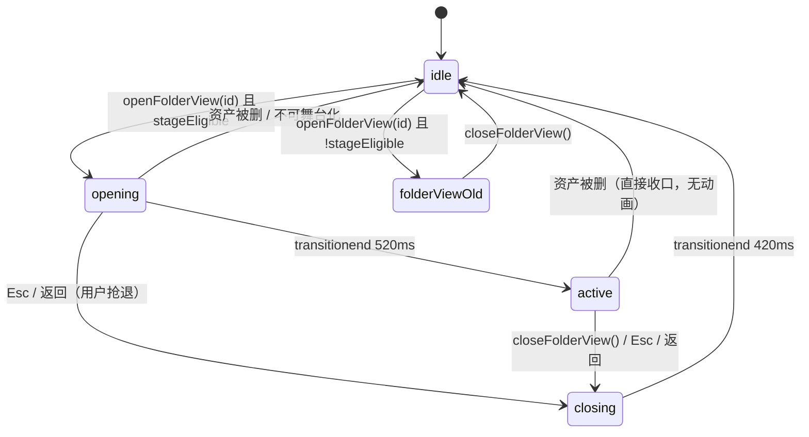

# 19 · 变更设计：材质球舞台（双击材质卡 → 包球入顶栏）

> 架构师：高见远 ｜ 2026-10 ｜ **只写文档，不改代码**
> 上游：用户 2026-10 拍板原话（逐字）：「主界面选了我们的材质球，双击进入以后，其他界面或者说其他的卡片都有消隐后退的动效，材质球从卡片位置慢慢浮现在顶栏中间，不停地旋转。下面是材质文件夹里面的固有卡片。」「其实我倒是希望在面板的位置不显示这个球。比如我们双击了这个材质，材质马上加一个过渡动画，包成一个球，然后跑到顶栏去。」
> 性能证据：`prototype/double-click-stage/`（Edge 155 / 2000 卡）已实测，本文**直接采信不重测**：O(1) 消隐（逐卡过渡 95ms 长任务 → 容器 transform 2 条 54ms）、顶栏不动 height（fixed 覆盖层 + transform，p95 10.5→9.2ms）、返回不逐卡 `transitionDelay`（-112ms）。三项合计 44.6→58.2 fps，p95 50.1→16.8ms。
> 既有现状：`MaterialBall.tsx`（820 行，three.js，内嵌调参面板）当前只被 `CustomRenderDialog` 使用；材质资产的网格缩略图**已是离屏渲的球 JPG**（`ballThumbName` / `thumbVaultUrl`）；双击已等于 `openFolderView(id)`（`AssetGrid.tsx:881`）；`vault://` 的 CORS 已修（`protocol.ts:32-38` `corsEnabled:true` + `Access-Control-Allow-Origin` 响应头，任务 #19 已落地）。

---

## 1. 交互口径与状态机

| # | 触发 | 期望 | 时长 |
| --- | --- | --- | --- |
| 1 | 双击材质卡（可舞台化） | 该卡封面**就地压成薄片 → 吹成球**，同时飞向顶栏中央 | 520ms |
| 2 | 飞行中 | 其余卡片**整体后退消隐**（网格容器 `scale(.96) translateY(8px)` + 一层 scrim，**1 个元素**，不逐卡） | 同 1 |
| 3 | 落定 | 顶栏中央常驻小球**持续自转**；下方铺开**该资产文件夹内的卡片** | — |
| 4 | 返回（Esc / 返回键 / 关闭） | 逆过程：球回卡片位置、压回薄片、卡片恢复、网格复原 | 420ms（比进入短，退出要利落） |
| 5 | 右侧详情面板 | **不显示材质球**（用户明确拍板）；入口改为静态提示 + 「保存为封面」 | — |



**分流规则**：`stageEligible(asset, settings)` 为真才进舞台；否则**完全沿用现有行为**（`AssetGrid.tsx:712-714` 的 `FolderFileList`，一行不改）。
`stageEligible = settings.materialStage === true && MATERIAL_KINDS.has(asset.kind) && hasMaterialSlots(effectiveMaterialSlots(asset.files))`
——三个谓词全部复用既有实现（`DetailPanel.tsx:112-117` 同源），**不新造判定**。

---

## 2. 六项裁定

### ① 画布归属：根级单例 + 命令式 transform，改造复用 `MaterialBall`

**结论：canvas 挂在 App 根部的单例 `<MaterialStage>` 里（脱离网格/详情面板的 React 子树）；位置动画用命令式 `style.transform`，不走 React 逐帧渲染；`MaterialBall` 改造复用，不新写第二个球。**

- **挂载点**：`App.tsx:257` 根 `<div class="flex h-full flex-col">` 的直接子节点，与 `<ImportQueue/>` 等浮层同级（`App.tsx:494-505` 区），**不在 AssetGrid 内**——网格会因筛选/空态/文件视图整体卸载，球不能跟着死。
- **唯一上下文纪律**（硬约束）：
  - 组件挂载时创建 renderer，**关闭舞台不 dispose**（保留上下文，只 `pause()` rAF 并 `visibility:hidden` 容器）；重新进入复用同一 renderer/场景，避免 100–300ms 重建 + 贴图重传。
  - 仅在 **feature flag 关闭 / App 卸载**时 `dispose()` + `forceContextLoss()`（沿用 `MaterialBall.tsx:393-407` 既有纪律）。
  - **stage 活跃期间禁止打开 `CustomRenderDialog`**（详情面板入口改静态提示），保证 Chromium 活跃上下文恒为 1。
- **不触发重渲染**：`<MaterialStage>` 只订阅两个极轻的值——`folderViewAssetId`（string|null）与 `settings.materialStage`（bool）；其余（资产对象、slots、rect）一律 `useVault.getState()` 快照读取。动画全部写 `ref.current.style`，只有 `phase` 变化才 setState（每次交互 4 次，不是每帧）。
- **与 `MaterialBall.tsx` 的关系**：**改造复用**，新增 3 个可选 prop（默认值保证既有调用零改动）：
  ```ts
  autoRotate?: boolean                                  // 默认 true（现有行为）；opening 期间传 false
  apiRef?: (api: { setPose(z: number): void; pause(): void; resume(): void } | null) => void
  chrome?: 'panel' | 'bare'                             // 默认 'panel'；stage 传 'bare' 隐藏内嵌面板/形态切换
  ```
  `api.setPose(z)` 只写 `mesh.scale.z`（0.04→1），不重建几何；`chrome='bare'` 时 `enableParamPanel` 与 `showShapeSwitch` 被忽略。

> **修订（实施反馈，2026-10）**：`setRunning` 的停条件以 `phase === 'idle'` 为准，**不是**「只在 active 时跑」。P0 浮出、P1 放大、P2 收进顶栏、closing 返回全程都需要 rAF 重绘——`setPose` 改的是 `mesh.scale.z`，循环一停画布就停在上一帧，过场会变成「一帧静止的球在滑」。「关闭舞台不 dispose」的纪律不变，只是改为 `setRunning(false)`。

### ② 状态机：复用 `folderViewAssetId`，**不新增 `stageAssetId`**

**结论：语义状态只有一个——`folderViewAssetId`；舞台的 `opening/active/closing` 是纯展示态，只活在 `<MaterialStage>` 内部，不进 store、不持久化。**

理由与收口：
- 双击的语义本来就是"进入这个资产"（`store.ts:1402` 已有存在性守卫），新增第二套 id 必然出现"两个 id 谁为准"的双真相 bug。
- `openFolderView` **签名与实现零改动**；舞台只是它的一个**呈现者**——与 `FolderFileList` 平级，由 `stageEligible` 决定用哪个。
- **Esc / 返回键**：沿用现有 `closeFolderView()`（全局快捷键已接）。**closing 必须先拍快照再置 null**：`closeStage()` 里先存 `{assetId, rect}`，再调 `closeFolderView()`；否则网格/右栏会在动画第一帧就回归，出现"球还在飞、下面已经变回网格"的穿帮。
- **筛选切换**：**不关闭舞台**（与现有"文件视图与筛选无关"一致）；网格背景按新筛选重排，舞台覆盖层不受影响。
- **资产被删**：`store.ts:1003` 已把 `folderViewAssetId` 置 null → 自动收口；若快照里的资产已不存在，直接 `idle`，**不播关闭动画**（避免对不存在的卡片做动画）。
- **连续双击另一张材质卡**（active 状态下切换）：允许——跳过 closing，直接以新卡 rect 重播 opening（复用同一 renderer，只换 slots）。这是唯一需要防的竞态，用 `transitionend` 的 `event.target` 校验 + 单调递增的 `runId` 丢弃过期回调。

### ③ "包成球"落地口径（参数写死，不做顶点变形）

**结论：不做真变形。用"卡片同源贴图 + 球体 Z 轴压扁/吹胀 + 位置平移"三者合一，等价实现"卡片被包成球"。**

事实基础（这是本方案能成立的关键）：材质卡的缩略图**本来就是同一个材质球离屏渲出来的 JPG**（`ballThumbName(asset.id, slots, params)` → `thumbVaultUrl`），所以"卡片→球"是**同源贴图的形态连续变化**，不是两个不同物体的替换。

| 参数 | 值 | 说明 |
| --- | --- | --- |
| 起始态 | 容器 `position:fixed` 精确覆盖卡片 `getBoundingClientRect()`；`border-radius:12px`；球径 ≈ 卡片短边；`mesh.scale.z = 0.04` | 0.04 让球看起来像"有厚度的卡片"，不是完全平面（完全 0 会 z-fighting） |
| 容器变换 | `translate3d(卡片中心 → 顶栏中心)` + `scale(→ 0.18)`（72px/卡片短边） | 只动 transform，不触发布局 |
| 吹胀 | `scale.z: 0.04 → 1`，与容器变换同时长 520ms | 缓动 `cubic-bezier(.22,1,.36,1)` |
| 自转 | `autoRotate=false` during opening；`active` 时置 true（`autoRotateSpeed=1.2`，沿用现值） | 飞行中自转会显廉价，落定后才转 |
| 卡片淡出 | **只给被点的那一张卡**加 `data-stage-source` 类，`opacity 1→0` 在 0–140ms | 不是 1999 张，只有 1 张 |
| canvas 淡入 | `opacity 0→1` 在 60–200ms | 与卡片淡出重叠 80ms，避免"闪一下" |
| 网格消隐 | 网格**容器**整体：`scale(.96) translateY(8px)` + scrim `opacity 0→1`，同 520ms | 逐卡过渡会 95ms 长任务（已实测），禁止 |
| 返回 | `scale.z 1→0.04` + 容器回卡片 rect + canvas 淡出 + 卡片淡入，420ms；**禁止逐卡 transitionDelay / 反向错峰** | 已实测 112ms 收益 |

**贴图预载（必须，否则过渡破功）**：
- 触发：卡片 `pointerdown` 与 `mouseenter` 停留 ≥120ms 都调 `warmStageTextures(asset)`——用 `new Image()` + `img.decode()` 预热 5 个槽位 URL（去重、上限 5），只暖 HTTP/解码缓存，**不建 WebGL 纹理、不占上下文**。
- `dblclick` 时若未 ready：**不阻塞**。球以 `thumbVaultUrl(asset.thumbPath)`（必然已加载，就是用户正看着的那张图）作平面贴图起步，`scale.z` 保持在 0.04；ready 后 80ms 内替换 albedo 并放行吹胀；400ms 仍未 ready → 继续占位灰 + `console.warn` 一次，动画照常走完（宁可有 0.4s 灰球，不要卡住交互）。
- 2K/4K 单张 decode 100–300ms 是常态，所以**必须**有上面这条"不阻塞"路径。

### ④ 参数滑块：搬到顶栏球旁的 popover；详情面板不再有球

**结论：反光 / 凹凸两个滑块 + 恢复默认 + 保存为封面，全部移入**舞台顶栏球右侧的「调节」popover**（锚定球，宽 208px，仅 `phase==='active'` 可开）。`renderParams` 的读写协议**零改动**。**

- 读写不变：`onParamsChange → useVault.getState().persistRenderParams(asset.id, s)`；读取仍 `resolveRenderParams(asset)`；防抖仍复用 `PARAM_PERSIST_DEBOUNCE_MS = 400`（`MaterialBall.tsx:59`）——**不要造第二个窗口**，否则滑块两处落库节奏不一致。
- 右侧详情面板：stage eligible 时**不渲染**「自定义渲染」入口（`DetailPanel.tsx:268-276` 分支），改为一行静态提示「材质球已在顶栏 · 可拖动旋转 / 点调节调参数」+ 「保存为封面」按钮（复用 `CustomRenderDialog` 同一套 `setCoverImage → setCover` 胶水，不新 IPC）。
- `CustomRenderDialog`：**保留不动**——flag 关闭时它是唯一的调参入口；flag 开启且 stage 活跃时不从详情面板进入（单上下文纪律）。
- 理由：让用户对着一个看不见的球调参数是荒谬的；而球在顶栏，调参也必须贴着球。

### ⑤ 功能开关：`Settings.materialStage`，默认 `false`

**结论：新增必填布尔 `materialStage: boolean`，默认 `false`；关闭时新代码路径在"分流处"一处短路，旧行为完全不变。**

| 项 | 规格 |
| --- | --- |
| 字段 | `Settings.materialStage: boolean`（`shared/types.ts`），`DEFAULT_SETTINGS` 加 `materialStage: false` |
| 读旧档 | `main/settings.ts` zod 加 `materialStage: z.boolean().optional().catch(false)`——旧档缺键/脏值只让**这一项**回落，不拖垮整份 settings（与 `verboseLogging` 同策略） |
| UI | 设置·外观 tab 一个开关：「双击材质卡进入材质球舞台（实验）」，默认关 |
| 短路点 | ① `AssetGrid` 双击分流：`stageEligible` 为假 → 原 `openFolderView` + `FolderFileList`；② `<MaterialStage>` 在 flag 为假时 **`return null` 且不 import**（`lazy()`，见下） |
| 包体 | `const MaterialStage = lazy(() => import('./MaterialStage'))`，只在 flag 为真时挂 `<Suspense>`；three 已被 `CustomRenderDialog` 懒加载隔离，首屏零增量 |

### ⑥ 风险清单

| # | 风险 | 等级 | 缓解 |
| --- | --- | --- | --- |
| R1 | **2K/4K 贴图解码 100–300ms**，首次进入先见灰球 | 🟡 | `pointerdown`/hover 预热 + `decode()`；未 ready 时用卡片同源 JPG 起步、不阻塞；400ms 兜底（§2-③） |
| R2 | **WebGL 上下文唯一性**：stage + CustomRenderDialog 同时开 = 2 个 | 🟡 | stage 活跃时隐藏 Dialog 入口；关闭舞台不 dispose（复用 1 个）；仅 flag 关/卸载时 `forceContextLoss()`。QA 需验证"开→关→开"10 次后 `WEBGL_lose_context` 计数不增长 |
| R3 | **顶栏空间冲突**：落点在搜索框与分段控件之间，窄窗可能被挤 | 🟡 | 目标点 = 顶栏几何中心，宽度预留 72+16px；scrim 与球层 `pointer-events:none`，只有球本体可拖。1280 窗宽需实测（§4-U1） |
| R4 | **右侧面板失去球后的版面空档** | 🟢 | 静态提示 + 「保存为封面」按钮占位；不新增控件，避免版面二次改动 |
| R5 | **`vault://` 贴图在 WebGL 的 CORS** | 🟢 | **已解决**：`corsEnabled:true` + `applyVaultCorsHeaders`（`protocol.ts:32-38,75-79`），`MaterialBall` 注释里那条"已知阻塞点"已过期，实施时顺手更新注释即可 |
| R6 | **过场期间 store 高频变化**（导入进度事件）导致 stage 重渲染 | 🟡 | stage 只订阅 `folderViewAssetId` + `materialStage`；导入事件只进 `imports` 切片，不触达 stage |
| R7 | **连续双击竞态**（opening 未完又点另一张） | 🟡 | `runId` 单调递增 + `transitionend` 校验 target；过期回调丢弃，只保留最后一次 |

---

## 3. 受影响文件与调用点

| 文件 | 动作 | 改什么（含现有锚点） |
| --- | --- | --- |
| `src/shared/types.ts` | 改造 | `Settings` + `materialStage: boolean`；`DEFAULT_SETTINGS.materialStage = false` |
| `src/main/settings.ts` | 改造 | zod 加 `materialStage: z.boolean().optional().catch(false)`（`SettingsSchema`，`:50` 起） |
| `src/renderer/logic/ballStage.ts` | **新增** ~130 | 纯函数：`stageEligible`、`STAGE_TIMING`（520/420/140/200）、`nextPhase`、`prefetchSlotUrls`、`stageTargetRect` |
| `src/renderer/components/MaterialStage.tsx` | **新增** ~360 | 单例舞台：scrim + 顶栏球容器 + 底部文件卡片 + 调节 popover + 状态机 + 命令式动画 |
| `src/renderer/components/MaterialBall.tsx` | 改造 | 新增 3 个可选 prop（`autoRotate`/`apiRef`/`chrome`，`:411-459`）；`setPose(z)` 只写 `scale.z`；过期注释更新（CORS 已修） |
| `src/renderer/components/AssetGrid.tsx` | 改造 | 双击分流（`:881`）：eligible → `setStageOrigin(rect)` + `openFolderView`；非 eligible 原路。文件视图分支（`:712-714`）保持 |
| `src/renderer/App.tsx` | 改造 | 根节点挂 `<Suspense><MaterialStage/></Suspense>`（`:494-505` 浮层区），仅 flag 开时 |
| `src/renderer/components/DetailPanel.tsx` | 改造 | `canCustomRender` 分支（`:117`, `:268-276`）在 stage eligible 时不渲染入口，换静态提示 + 保存封面；`CustomRenderDialog`（`:531`）保留 |
| `src/renderer/components/SettingsDialog.tsx` | 改造 | 外观 tab 加开关（默认关） |
| `src/renderer/store.ts` | 改造 | 仅新增**易失**字段 `stageOrigin: DOMRectLike \| null` + `setStageOrigin`（不进 Dexie、不进 settings）；`openFolderView/closeFolderView` 零改动 |

---

## 4. 任务分解

| ID | 标题 | 依赖 | 产出 | 验收 |
| --- | --- | --- | --- | --- |
| **T-01** | 契约与开关 | — | `types.ts` + `settings.ts` + `SettingsDialog` 开关 + `logic/ballStage.ts`（纯函数 + 常量） | 旧档无键→false；脏值 `"yes"`→false 且不拖垮整份设置；`ballStage.test.ts` 全绿 |
| **T-02** | `MaterialBall` 改造 | T-01 | `autoRotate` / `apiRef` / `chrome` 三个可选 prop；`setPose(z)` | 既有 `CustomRenderDialog` 行为零变化（默认值兜底）；`chrome='bare'` 不渲染面板 |
| **T-03** | 舞台壳 + 状态机 + 分流 | T-01,T-02 | `MaterialStage.tsx`（无动画版：直接定位到顶栏）、App 挂载、AssetGrid 分流、DetailPanel 入口切换 | 双击进/退可用；flag 关时**逐像素**等同旧行为；Esc/删资产/切筛选收口正确 |
| **T-04** | 过场动画 | T-03 | 卡片→球（Z 压扁/吹胀）、容器 transform、scrim、网格 O(1) 消隐、预载 | 2000 卡场景 opening 无 >50ms 长任务；掉帧门限见 T-06 |
| **T-05** | 舞台内容 | T-03 | 底部资产内文件卡片（复用 `FolderFileList` 的卡片口径，`view` 跟随顶栏）、调节 popover（两滑块 + 恢复默认 + 保存封面） | 滑块落库走 `persistRenderParams`（400ms 防抖）；保存封面走既有 `setCoverImage → setCover` |
| **T-06** | 性能验收与回填 | T-04,T-05 | 用 `prototype/double-click-stage/` 同套脚本复测；把实测值回填本文 | fps/p95 不劣于原型：p95 ≤ 20ms；三次开合无上下文泄漏 |

---

## 5. 测试影响

- **现有 14 测试文件 / 222 条断言：0 条需要改。** 理由：`Settings` 新增字段带默认值 + zod `.optional().catch(false)`；`tests/aiClassify.test.ts:359` 只比较 `aiClassify` 子对象，不受影响；无 API 签名变更（`openFolderView`/`closeFolderView`/`persistRenderParams` 全部原样）。
- **新增单测**：`tests/ballStage.test.ts` — `stageEligible`（4 类资产 × flag 开关 = 8 例）、`nextPhase` 迁移（6 条合法边 + 3 条非法边丢弃）、`STAGE_TIMING` 不变量（进入 > 返回，且与 CSS 变量同源）、`prefetchSlotUrls`（去重/上限 5/空 slots）；`tests/settingsStage.test.ts` — 缺键/脏值/真值三例。
- **手工验收（无 E2E 框架）**：① flag 关时双击/返回/筛选/删除四路径与旧版逐项对照；② 2000 卡导入后双击，DevTools Performance 无 >50ms 长任务；③ 开→关→开 10 次，`about:gpu` 上下文数不增长；④ 2K albedo 资产首次进入，灰球可见时长 <400ms。

---

## 6. 不做清单

1. 不做真 3D 顶点变形/uv 扭曲——"包成球"用贴图 + Z 轴缩放等价实现。
2. 不做多球并列、不做卡片间 morphing（一次只进一个资产）。
3. 不新增第二个 WebGL 上下文，不为舞台新写一套球组件。
4. 不改 `vault://` 协议、不加新 IPC、不改 `renderParams` 落库格式。
5. 不改动网格缩略图管线（球 JPG 仍由既有 `ballThumbName` 产出）。
6. 不做触屏手势/移动端适配（用户是 Windows 桌面）。
7. 不做舞台深链/URL 路由、不做"舞台历史栈"。
8. 不在舞台上做文件拖出（沿用详情面板既有拖出）。

---

## 7. 需实测（不混进结论）

| # | 待测 | 为什么不能拍脑袋 | 若结果不利的预案 |
| --- | --- | --- | --- |
| U1 | 1280 / 1440 / 1920 三档下顶栏几何中心是否被搜索框/分段控件挤压 | 只能量 DOM，不能估 | 目标点改为"顶栏可用区的视觉中心"而非绝对中心；或球缩到 56px |
| U2 | 2K/4K albedo `decode()` 的 p50/p95 分布 | 决定 400ms 兜底是否要放宽到 600ms | 放宽阈值 + 提前到 `mouseenter` 即预热 |
| U3 | `scale.z 0.04→1` 在低端集显上的观感（是否像吹气球过冲） | 观感必须肉眼验，参数靠试 | 起始改 0.12、或加 1 次轻微 overshoot（1.06→1） |
| U4 | scrim 用纯色 vs `backdrop-filter: blur(2px)` 在 2000 卡下的帧耗 | 全屏 blur 代价随面积变化 | 掉帧则固定纯色 scrim（原型已验证纯 scrim 足够） |

---

*本文是唯一口径；与 `docs/10`（材质球渲染）、`docs/16`（as-is 架构）冲突时以本文为准。实施前先确认 T-01 的开关能独立回退。*
