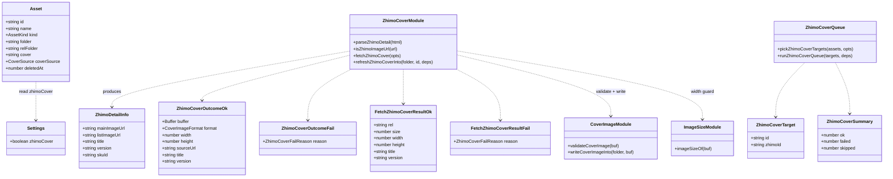
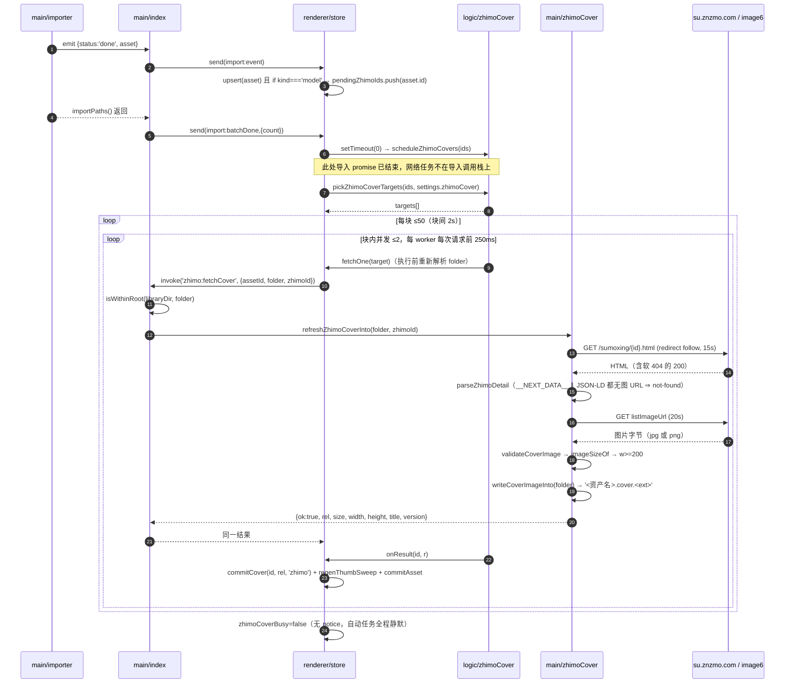
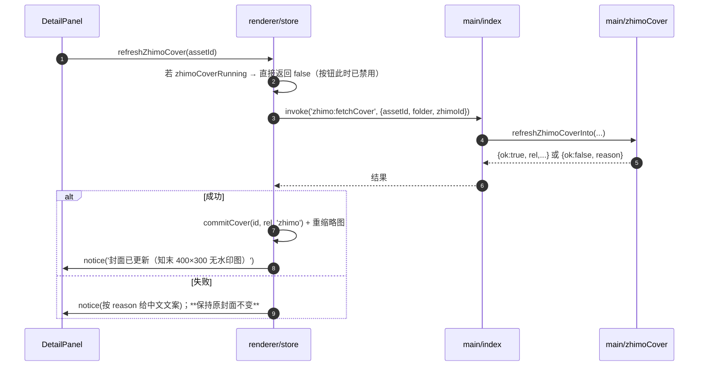

# 24 · 变更设计 · 知末封面抓取（导入自动 + 详情手动）

> 上游：`docs/21` 需求 B（用 ID 去知末抓主图当封面）→ `docs/23`（可行性结论，A 档绿灯，实测证据在 `docs/probe/`）。
> 用户（杨雯丞）2026-10-22 拍板实施形态 = **C：导入后自动 + 详情面板手动可重取**。
> 本文只做设计，**不改任何源码**。当前版本 0.6.2。
> 状态：**待实施**（任务分解见 §9，待用户拍板项见 §10）。

---

## 0. 口径先行（这些是已拍板/已实测的既定条件，实施时不要重新讨论）

| # | 结论 | 依据 |
|---|---|---|
| 1 | 详情页固定 `https://su.znzmo.com/sumoxing/{ID}.html`，`redirect: 'follow'`；材质 ID 由站点 301 送到 `tietu` | `docs/23` §1.1 |
| 2 | **取图唯一首选 = `props.pageProps.res.listImageUrl`**（`image6`，400×300，**无水印**，7/7 实测）；`mainImageUrl`（`image2`，1600px，**带水印**）只在 `listImageUrl` **字段缺失**时兜底（可接受降级）。**JSON-LD 的 `contentUrl` 不参与取图**——它指向的就是 `image2` 的带水印大图 | 主理人 2026-10-22 复核（优先级高于 `docs/23` §1.2 里"JSON-LD 备选"那条写法） |
| 3 | 零 cookie / 零签名 / 零 Referer；**不做内置登录**。材质详情页 HTML 里 `登录后`/`请登录`/`立即登录` 计数为 **0** → **登录墙只挡源文件下载，不挡预览图与元数据**；设计里**不得出现"需要登录"的任何分支或降级路径** | `docs/23` §1.3 + 主理人复核 |
| 4 | **状态码一律不看**：软 404 是 `200`（约 18KB，title「知末网」）、裸 Next.js 404 是 `404`（6–7KB，无 title）、WAF 品牌 404 是 `404`（7730B，「云防护系统」，**仅** `/caizhi/` 路径，我们不走这条路）。**唯一成功判据 = 解析出图 URL 且宽度 ≥200px** | 主理人复核 + 本文 §4.5 |
| 5 | 小图 jpg / png 都有（`1193950340` 是 PNG），落盘必须嗅 magic bytes | `docs/23` §1.4 |
| 6 | 干净版分辨率封顶 400×300，加任何 OSS 参数都出不来更大 | `docs/23` §2 |
| 7 | 节流：并发 ≤3、间隔 ≥250ms、单批上限 50 | `docs/23` §1.3 |
| 8 | **只对 `AssetKind === 'model'` 做**；材质 / 贴图不做（本地 `.cover.jpg` 已是 1K 级贴图本体，比知末图更准） | 用户拍板 |
| 9 | 封面优先级：`manual > zhimo > embedded > named/root/largest > placeholder`；**其中 `zhimo` 压过 `named/root/largest` 这一层由设置 `zhimoCoverReplacePacked` 控制（默认开）** | 用户拍板 + 2026-10-22 裁定（§3.5） |
| 10 | 失败语义：**自动任务全程静默**（不弹错、不 notice、不阻塞导入）；**手动按钮必须给反馈**（用户点了就得知道结果） | 用户拍板 + §4.4 |
| 11 | 不做"裁水印"逻辑（用无水印小图，整套裁剪不需要） | 用户拍板 |
| 12 | **导入链路（`importer.ts`）一行不改**：封面抓取是后置任务，不是导入步骤 | 本文 §2.1 选型理由 |
| 13 | **JSON-LD 只做一件事：有效性判据**。`__NEXT_DATA__` 与 JSON-LD 两条路径**都**解析不出图 URL ⇒ 判资产失效（静默跳过）。取图永远只用 `__NEXT_DATA__` 的 `listImageUrl → mainImageUrl` | 主理人复核（比只看 `__NEXT_DATA__` 更稳） |
| 14 | `pageProps.breadcrumb_data` **只解析、不接线**（低成本预埋）：本批不落库、不改 `Asset` schema、不参与自动分类 | 主理人裁定，理由见 §4.12 与 §11 |
| 15 | 两个设置开关：`zhimoCover`（自动抓，默认开）+ `zhimoCoverReplacePacked`（包内已有预览图时是否仍替换，默认开）。**开关只约束自动任务；手动按钮永远替换** | 用户 2026-10-22 裁定（§3.5 / §5.4） |
| 16 | 落盘扩展名按**实际字节魔数**决定（PNG 源 → `.cover.png`，JPEG 源 → `.cover.jpg`）。**禁止**给 `style/list` 追加 `/format,jpg` 之类参数（OSS 返回 **400**） | 调研员实测：`1193950340` = 400×300 **PNG / 301KB**（是同尺寸 JPEG 的 5–7 倍，但压不得） |
| 17 | **取图 URL 原样使用**：禁止换 host（image6↔image2）、禁止增改任何 `x-oss-process` 参数、禁止由 ID 拼 URL。错版图也是 200/400×300/体积更小，**状态码·尺寸·体积都查不出来** | 两路互查矩阵（§4.7）：`image2+style/list` = 满屏水印 |

---

## 1. 现状与改造点

| 位置 | 现状 | 本次改动 |
|---|---|---|
| `src/shared/types.ts:160` | `CoverSource = 'named'｜'root'｜'embedded'｜'largest'｜'manual'｜'placeholder'` | 加一个 `'zhimo'` |
| `src/shared/types.ts:340-426` | `Settings`（含 `aiClassify` 等） | 加 `zhimoCover: boolean` + `zhimoCoverReplacePacked: boolean` |
| `src/shared/types.ts:428-467` | `DEFAULT_SETTINGS` | 两个开关都加，默认 `true` |
| `src/shared/types.ts` 尾（≈:861） | — | 新增 `FetchZhimoCoverPayload` / `ZhimoCoverFailReason` / `FetchZhimoCoverResult` |
| `src/shared/naming.ts:53-62` | 两条知末 ID 正则，**只用于 `displayName()` 剥名字**，没有取 ID 的函数 | 新增导出 `zhimoIdOf(name)`（复用同两条正则） |
| `src/shared/ipc.ts:101`（`trashSweep` 之后） | 60+ 条通道 | 加 `fetchZhimoCover: 'zhimo:fetchCover'` |
| `src/preload/index.ts:166`（`setCoverImage` 之后） | — | 暴露 `fetchZhimoCover(payload)` |
| `src/main/index.ts:793`（`setCoverImage` handler 之后） | — | 新增 IPC handler（路径校验 + 调核心 + 记日志） |
| `src/main/settings.ts:98` / `:341` | zod schema / `normalizeSettings` | 加**两个**字段：`zhimoCover` + `zhimoCoverReplacePacked`，各 `.optional().catch(true)`，归一化**各自独立**收口 |
| `src/renderer/store.ts:401` / `:902` | state 定义 / 初值 | 加 `zhimoCoverBusy` |
| `src/renderer/store.ts:937-939` | `onImportBatchDone → scheduleAiClassify()` | 同一处追加 `scheduleZhimoCovers()` |
| `src/renderer/store.ts:960-965` | `import:done` 里 `upsert` 资产 + 排队球图 | 同一处收集 `pendingZhimoIds` |
| `src/renderer/store.ts:1999-2010` | rescan 合并只保活 `coverSource === 'manual'` | 扩为 `manual 或 zhimo`（**关键坑，见 §4.9**） |
| `src/renderer/store.ts:2269-2284` | `setCover()` 写死 `coverSource='manual'` | 抽出 `commitCover(id, rel, source)`，三处共用 |
| `src/renderer/components/DetailPanel.tsx:364-372` | 「更换封面」28px 条 | 下方新增「从知末取封面」28px 条（仅 model；**不受两个设置开关约束**） |
| `src/renderer/components/SettingsDialog.tsx:1124` | 导入 tab「同时解压任务数」之后 | 新增 **2 个** `Row + Toggle`（主开关 + 子开关「包内已有预览图时也替换」） |
| `src/renderer/db.ts` | `ASSETS_V5_STORE_SCHEMA` 含 `coverSource` 索引 | **不动**（理由见 §6） |

新增文件见 §2.2。

---

## 2. 模块边界与数据流

### 2.1 为什么"抓取/落盘"在主进程，"编排/写库"在渲染层

两件事必须分开看：

1. **抓取 + 落盘**只能在主进程。
   渲染进程有 CORS / CSP 约束（与 `aiClassify` 的选型理由一致）；而且封面必须写成资产文件夹内的真实文件 `<资产名>.cover.<ext>`，否则 `vault://asset/…` 读不到、rescan 会把封面洗掉。
   → 复用现成轮子 `src/main/coverImage.ts`：`validateCoverImage()`（≤20MB + 魔数）+ `writeCoverImageInto(folder, buf)`（同族清理 + 落盘）。**不另写一套落盘**。
2. **写 Dexie 只能在渲染层**（主进程拿不到 IndexedDB）。
   → 落盘成功后 IPC 返回 `rel`，渲染层照抄写库。这与既有 `setCoverImage` / `assignCategory` / `renameFolders` 的分工完全一致（磁盘动作在主进程，索引动作在渲染层）。

**触发形态选型：渲染层驱动（逐资产 IPC），不是主进程自驱。**
参照 `aiClassify` 先例（`store.ts:2346-2424`：模块级布尔防重入 + 渲染层循环 + 主进程只发 HTTP），理由三条：

- **失败隔离最彻底**：`aiClassify` 与本次任务都从 `import:batchDone` 后 `setTimeout(0)` 起跑，网络任务**物理上**不在导入的 Promise 链上。导入耗时与"是否开了封面抓取"严格无关（可回归验证）。
- **增量落库**：每抓到一个就 `commitAsset` 一次，卡片封面逐个变化，用户看得到进度；主进程自驱批处理只能等一批结束再回传，中途关窗就全丢。
- **可中止**：循环里读 `shouldStop()`，窗口关闭 / 用户关开关能立刻停；长 IPC 调用没有这个能力。

代价：N 个资产 = N 次 IPC 往返。但每次 IPC 内部本来就有一次网络往返（~0.6s），IPC 开销可忽略。

### 2.2 模块清单

| 文件 | 类型 | 职责 | 可测性 |
|---|---|---|---|
| `src/main/zhimoCover.ts` | 新增 | 纯逻辑：HTML 解析（`__NEXT_DATA__` 取图 + JSON-LD 只判有效性 + breadcrumb 预埋）、URL 白名单、抓字节、校验尺寸/格式、落盘。**不 import electron、不 import logger** | 注入 `fetcher` + tmpdir 即可全单测 |
| `src/renderer/logic/zhimoCover.ts` | 新增 | 纯逻辑：候选筛选 `pickZhimoCoverTargets()`、节流队列 `runZhimoCoverQueue()`（注入 `fetchOne`/`sleep`） | 注入桩函数单测，不碰网络/DB |
| `src/renderer/store.ts` | 改造 | 编排：触发点、并发锁、成功写库 + 重缩略图 | 走既有 `storeFlow` 风格的 store 测试 |
| `src/main/index.ts` | 改造 | 只做：库内路径校验 + 调 `refreshZhimoCoverInto` + `logWarn` | 真机 |
| `src/shared/naming.ts` | 改造 | `zhimoIdOf()` | 纯函数单测 |
| `src/main/coverImage.ts` | **复用不改** | 魔数校验 + 落盘 + 同族清理 | 已有测试 |
| `src/shared/imageSize.ts` | **复用不改** | `imageSizeOf(buf)` 读宽高（<200px 护栏） | 已有测试 |
| `src/main/importer.ts` | **不改** | — | — |
| `src/renderer/db.ts` | **不改** | — | — |

### 2.3 数据流（一句话版）

```
导入完成（importer 原逻辑定封面） → batchDone → 渲染层排候选（model + 有 ID + 未 manual/zhimo）
  → 逐资产 IPC：主进程 抓详情页 → 解 __NEXT_DATA__ → 抓 listImageUrl → 魔数+尺寸校验
    → writeCoverImageInto(folder) 落盘 `<资产名>.cover.<ext>` → 回 {rel,size,w,h}
  → 渲染层 commitCover(id, rel, 'zhimo') + regenThumbSweep（换 salt）
```

---

## 3. 数据结构与接口

### 3.1 `CoverSource`（`src/shared/types.ts:160`）

```ts
export type CoverSource =
  | 'named' | 'root' | 'embedded' | 'largest' | 'manual' | 'placeholder'
  | 'zhimo'
```

注释必须写明：`'zhimo'` = 从知末详情页抓的无水印小图（400×300），**只用于 `kind === 'model'`**。

### 3.2 `zhimoIdOf(name)`（`src/shared/naming.ts`）

```ts
/**
 * 从资产名里取出知末商品 ID（纯数字串）；取不到返回 null。
 *
 * 复用 displayName() 的同两条正则，口径与"剥名字"严格一致：
 * - 位数门槛 6 位（真实 ID 是 9–10 位，4 位常是年份/型号）；
 * - 名字里有多个 ID 段时取**最右**一个（下载器把站点 ID 追加在尾巴上，
 *   最右那个才是真正的 sku）。
 *
 * ⚠️ `ZHIMO_ID_MID_RE` 带 `g`：调用前 `lastIndex = 0`，用完再复位 0
 * （与 hasZhimoId() 同款习惯，避免上一处 matchAll/exec 的残留影响下一次）。
 */
export function zhimoIdOf(name: string): string | null
```

实现要点（`matchAll` 取最后一个 MID，再退回 TAIL）：

```ts
const s = String(name ?? '').trim()
if (!s) return null
let last: string | null = null
ZHIMO_ID_MID_RE.lastIndex = 0
for (const m of s.matchAll(ZHIMO_ID_MID_RE)) {
  const digits = /\d{6,}/.exec(m[0])?.[0]
  if (digits) last = digits
}
ZHIMO_ID_MID_RE.lastIndex = 0
if (last) return last
const tail = ZHIMO_ID_TAIL_RE.exec(s)?.[0]
return tail ? (/\d{6,}/.exec(tail)?.[0] ?? null) : null
```

**必须成立的样本**（全部进单测）：

| 输入 | 期望 | 说明 |
|---|---|---|
| `传薇佳画_挂画组合ID_1186414883` | `'1186414883'` | TAIL 命中（绝大多数） |
| `中古木纹_无缝中古樱桃木_樱桃木木纹ID_1166965084_resize` | `'1166965084'` | **MID 命中**：lookahead `(?=[\s_\-.])` 吃掉 `_resize` 前的 `_`，所以成立 |
| `无堺黑色木纹ID_1151853396-2` | `'1151853396'` | `uniqueName` 追加的 `-2` 也在 lookahead 的 `[\s_\-.]` 里 |
| `ID_1234567_拷贝` | `'1234567'` | ID 在开头（MID） |
| `椅子ID_1111111_版本ID_2222222` | `'2222222'` | 多 ID 取最右 |
| `grid123` / `rapid42` / `Brick_Rough_ID_42` / `型号ID2024` | `null` | 位数门槛 6 位；英文词尾不误伤 |
| `''` / `'   '` | `null` | 空值 |

> 结论：`…ID_1166965084_resize` **成立**，且不新增第三条正则（新增必然与 `displayName()` 漂移）。

### 3.3 `src/main/zhimoCover.ts`（新增，零 electron 依赖）

```ts
/** 站方面包屑条目（**只解析、不接线**，见 §4.12 / §11） */
export interface ZhimoBreadcrumbItem {
  termId: number
  name: string
  /** 站方层级真值：`f{termId}` / `f{父}s{子}` / `f{祖}s{父}s{子}` */
  href: string
  /** 由 `href` 里 `s` 的个数推导（`f706`→1、`f17032s706`→2）；**不用数组下标** */
  level: number
}

export interface ZhimoDetailInfo {
  /**
   * 详情页 `res` 里的主图（**带水印**，`image2`）。
   * 用途只有一个：`listImageUrl` **字段缺失**时的取图兜底，以及"这一页是不是真详情页"的判据。
   */
  mainImageUrl: string | null
  /** **取图唯一首选**：无水印 400×300（`image6`）；字段缺失时为 null */
  listImageUrl: string | null
  title: string | null
  version: string | null
  skuId: string | null
  /** 站方面包屑；解析不出有效条目时**不写该字段**（undefined，不写空数组） */
  breadcrumb?: ZhimoBreadcrumbItem[]
}

/**
 * 给定详情页 HTML → 解析结果（**纯函数**）。
 *
 * 返回 `null` 的唯一条件：`__NEXT_DATA__` 与 JSON-LD **两条路径都解析不出图 URL**（= 资产失效）。
 * 只要有一条能解析出图 URL，就返回对象（可能 `listImageUrl` 与 `mainImageUrl` 都为 null，
 * 此时由调用方按 `no-image` 处理——见 §4.11）。
 */
export function parseZhimoDetail(html: string): ZhimoDetailInfo | null

/** 图片来源主机白名单（防 JSON 被投毒后让主进程去请求任意地址） */
export const ZHIMO_IMAGE_HOSTS: readonly string[]  // ['image6.znzmo.com', 'image2.znzmo.com']
export function isZhimoImageUrl(url: unknown): url is string

/** 最小 HTTP 抽象：globalThis.fetch 结构兼容，测试可注入桩 */
export interface ZhimoHttpResponse {
  ok: boolean
  status: number
  text(): Promise<string>
  arrayBuffer(): Promise<ArrayBuffer>
}
export type ZhimoFetcher = (
  url: string,
  init: { signal?: AbortSignal; redirect?: 'follow'; headers?: Record<string, string> }
) => Promise<ZhimoHttpResponse>

export type ZhimoCoverFailReason =
  | 'no-id'        // 入参不是 6+ 位数字
  | 'not-found'    // 两条解析路径都拿不到图 URL（软404 / 裸404 / 结构变了）
  | 'no-image'     // 页面有效（JSON-LD 有 contentUrl），但 __NEXT_DATA__ 没有 list/main 图 URL
  | 'timeout'      // 详情页或图片请求超时
  | 'network'      // 连接失败 / 非 2xx
  | 'bad-url'      // 图片 URL 主机不在白名单
  | 'bad-image'    // 不是 PNG/JPEG，或超过 20MB，或宽高解析不出
  | 'too-small'    // 宽度 < minWidth（默认 200）
  | 'write-failed' // 落盘失败（目录不存在 / 权限）

export type ZhimoCoverOutcome =
  | { ok: true; buffer: Buffer; format: CoverImageFormat; width: number; height: number;
      /** 实际请求的图片 URL（**原样取自详情页**，禁止任何改写，见 §4.7） */
      sourceUrl: string
      /** 实际取图的 host：'image6.znzmo.com' | 'image2.znzmo.com' */
      sourceHost: string
      /** true = 走了 mainImageUrl 兜底（即带水印）。主路径成功时必须为 false */
      watermarked: boolean
      title: string | null; version: string | null }
  | { ok: false; reason: ZhimoCoverFailReason }

/** 只抓字节，不碰磁盘（可单测） */
export async function fetchZhimoCover(opts: {
  id: string
  fetcher?: ZhimoFetcher            // 默认 (u, i) => globalThis.fetch(u, i)
  pageTimeoutMs?: number            // 默认 15_000
  imageTimeoutMs?: number           // 默认 20_000
  minWidth?: number                 // 默认 200
}): Promise<ZhimoCoverOutcome>

/** 抓 + 校验 + 落盘（写 `<资产名>.cover.<ext>`，清理同族旧文件）；**绝不抛错** */
export async function refreshZhimoCoverInto(
  folder: string,
  id: string,
  deps?: { fetcher?: ZhimoFetcher; minWidth?: number }
): Promise<FetchZhimoCoverResult>
```

> **与上游建议的偏差（有意）**：`fetchZhimoCover` 不返回 `… | null`，而是返回**带 `reason` 的可辨别联合**。
> 理由：① 手动按钮要给出可区分文案（「知末上没有这个 ID 的页面」≠「网络请求失败」）；
> ② 单测要能钉住「软 404 → `not-found`」与「超时 → `timeout`」是**两个不同结论**，返回 null 就退化成只能断言"失败了"。

**`fetchZhimoCover` 的固定顺序（不可调换）：**

1. `id` 不过 `^\d{6,}$` → `no-id`（**不发任何请求**）。
2. GET 详情页（`redirect: 'follow'`，UA 固定 `Mozilla/5.0 (IDBOX cover fetcher)`，`AbortSignal.timeout(pageTimeoutMs)`）。
3. **网络层只判"拿到字节了没有"，不按状态码判有效/失效**：请求抛超时（`AbortError`/`TimeoutError`）→ `timeout`；连接失败 / `text()` 抛错 → `network`。**`status` 不参与任何判断**（软 404 是 200、裸 404 是 404，判据全在下一步）。
4. `parseZhimoDetail(html)` → `null` → **`not-found`**（两条解析路径都没有图 URL = 资产失效，覆盖软 404 / 裸 404 / WAF 404，见 §4.5）。
5. 选图（**只从 `__NEXT_DATA__` 取，永不用 JSON-LD `contentUrl`**）：`listImageUrl` 优先；**为 null 才**用 `mainImageUrl`；两者都 null → **`no-image`**（页面还在，但没有可取的无水印图）。
6. `isZhimoImageUrl(url)` 不过 → `bad-url`。**同时记下 `sourceHost = new URL(url).hostname`**。
7. GET 图片 → 非 2xx / 异常 → `network`/`timeout`（**不回落另一张图**，理由见 §4.7）。图片请求这里**按 2xx 判**是安全的：软 404 那套「200 也可能是空壳」只发生在 HTML 页面上，OSS 对象 404 就是真的没了。
8. `validateCoverImage(buf)`（≤20MB + 魔数）不过 → `bad-image`。
9. `imageSizeOf(buf)` → null → `bad-image`；`w < minWidth` → `too-small`。
10. 返回 `{ ok: true, buffer, format, width, height, sourceUrl, sourceHost, watermarked, title, version }`。

**⚠️ 取图 URL 必须"原样使用"（这是会静默产出错封面的坑，2026-10-22 两路互查确认）：**

```
唯一允许的用法 = fetch(listImageUrl) —— 字符串一个字符都不改
- 禁止替换 host（image6 → image2，或反过来）
- 禁止追加/替换任何 x-oss-process 参数（style/list、/format,jpg、m_lfit、w_*、h_* …）
- 禁止用 URL 模板由 ID / 文件名自己拼（实测文件名是"毫秒时间戳_4位随机数"，拼不出来）
- 唯一允许的"改造"：无
```

**为什么这条是硬约束（`image2` 与 `image6` 是两份不同对象，不是同一对象的两种样式）：**

| 请求 | 尺寸 | 体积 | 水印 |
|---|---|---|---|
| `image6` + `style/list`（= 页面给的 `listImageUrl`） | 400×300 | 81,808 B | **无** ✅ |
| `image2` + `style/list`（**自己拼 host**） | 400×300 | 75,889 B | **有（满屏平铺）** ❌ |
| `image2` + 原图 | 1600×3217 | 4,132,767 B | 有 |
| `image6` + 原图 | 400×300 | 99,357 B | 无 |

**危险点**：错版响应也是 **200、400×300、体积甚至更小** —— 只看状态码 / 尺寸 / 体积**完全查不出来**，只有校验域名或肉眼看图才能发现。另外 `style/list` 是 **4:3 裁切**，`m_lfit` 是**等比不裁**（竖长源会出 400×804 长条），两者**不等价、不能互换**。

**落盘扩展名必须按实际字节决定（PNG 保留 PNG）**：`format` 已在第 8 步由魔数得出，`writeCoverImageInto()` 内部再嗅一次并按 `coverImageExt(format)` 命名 → PNG 源落 `<资产名>.cover.png`，JPEG 源落 `<资产名>.cover.jpg`。

实测依据（调研员 2026-10-22）：`1193950340` 的 `style/list` 返回的是 **400×300 PNG**，**301KB**（同尺寸 JPEG 约 40–60KB，大 5–7 倍）。**不能"顺手压成 jpg"**：

- ✅ `fetch(listImageUrl)` 原样取字节 → 嗅魔数 → 按原格式落盘；
- ❌ 不要给 `style/list` 追加 `/format,jpg`：**OSS 不接受该参数组合，返回 HTTP 400**（实测）。这一条写进「不要做的事」（§4.10 末尾）。

**`parseZhimoDetail` 的实现契约（两条解析路径，各司其职）：**

```ts
// ── 路径 ①：__NEXT_DATA__（**取图的唯一来源**）──────────────────────
const next = /<script[^>]*\bid=["']__NEXT_DATA__["'][^>]*>([\s\S]*?)<\/script>/i.exec(html)
let pageProps: any = null
if (next) {
  try { pageProps = JSON.parse(next[1])?.props?.pageProps ?? null } catch { pageProps = null }
}
const res = pageProps?.res
const listImageUrl = nonEmptyString(res?.listImageUrl)   // 无水印 400×300
const mainImageUrl = nonEmptyString(res?.mainImageUrl)   // 带水印大图（仅兜底）

// ── 路径 ②：JSON-LD（**只做有效性判据 + 面包屑，永不取图**）──────────
// 页面有 2 个 ld+json：一个 BreadcrumbList（带频道名），一个 ImageObject（contentUrl 指向 image2 带水印大图）
const ld = parseJsonLdBlocks(html)                        // 逐个 JSON.parse，坏块跳过
const ldImageUrl = ld.find(b => b?.['@type'] === 'ImageObject')?.contentUrl
const ldHasImage = typeof ldImageUrl === 'string' && ldImageUrl.trim() !== ''

// ── 有效性判据：两条路径都拿不到图 URL ⇒ 资产失效 ────────────────────
if (!listImageUrl && !mainImageUrl && !ldHasImage) return null

return {
  listImageUrl,
  mainImageUrl,          // 允许为 null（见 §4.11）
  title: nonEmptyString(res?.title),
  version: nonEmptyString(res?.version),
  skuId: res?.skuId == null ? null : String(res.skuId),
  breadcrumb: parseBreadcrumb(pageProps?.breadcrumb_data)  // 无有效条目 → 字段不写
}
```

**`parseBreadcrumb` 的三条硬规则：**

```ts
// ① 层级由 href 推导，不看数组下标：
//    ^f(\d+)$            → level 1
//    ^f(\d+)s(\d+)$      → level 2
//    ^f(\d+)s(\d+)s(\d+)$→ level 3
//    level = 1 + (href 里 's' 的个数)
// ② termId 必须与 href 末段一致（不一致的条目丢弃：站方数据脏过就别信）
// ③ showName 为空 / termId 非正整数的条目丢弃；结果为空 → 返回 undefined（不写空数组）
const parseBreadcrumb = (raw: unknown): ZhimoBreadcrumbItem[] | undefined => { /* … */ }
```

> 不引 cheerio：两个 `script` 标签取内容即可（`docs/23` §1.2 已定）。DOM 选择器带构建 hash，不稳，不用。
> JSON-LD 的 `contentUrl` **只用来回答"这一页是不是有效详情页"**，绝不进 `sourceUrl`——这一点由单测钉住（§7.1 #22）。

### 3.4 IPC 载荷与返回值（`src/shared/types.ts` 新增段）

```ts
export interface FetchZhimoCoverPayload {
  /** 仅日志/排错用（main 不用它做路径决策） */
  assetId: string
  /** 资产文件夹绝对路径（**必须在库目录内**，main 侧校验） */
  folder: string
  /** 渲染层用 zhimoIdOf(asset.name) 取出的 ID（main 侧再校验一次格式） */
  zhimoId: string
}

export type FetchZhimoCoverResult =
  | { ok: true; rel: string; size: number; width: number; height: number;
      /** 实际取图 host（白名单内）。正常必须是 'image6.znzmo.com' */
      sourceHost: string
      /** true = 走 mainImageUrl 兜底（带水印）。主路径成功时必须为 false */
      watermarked: boolean
      title: string | null; version: string | null }
  | { ok: false; reason: ZhimoCoverFailReason }
```

**handler 侧的两条附带义务（`src/main/index.ts`）**：

```ts
const r = await refreshZhimoCoverInto(folder, zhimoId)
if (r.ok) {
  // 兜底（带水印）发生率要能统计，不靠用户上报；每个资产只记一次
  if (r.watermarked) logWarn('zhimo:cover-watermarked', { id: zhimoId, host: r.sourceHost })
} else {
  logWarn('zhimo:cover-failed', { id: zhimoId, reason: r.reason })
}
return r
```

### 3.5 两个设置项

```ts
/** 导入后自动从知末抓模型封面（总开关，默认 true）。失败静默，不影响导入。 */
zhimoCover: boolean
/** 包内已有预览图时，是否仍用知末图替换（默认 true = 替换）。
 *  ⚠️ 只约束**自动任务**；详情面板手动按钮永远替换。 */
zhimoCoverReplacePacked: boolean
```

zod（`src/main/settings.ts`，与 `verboseLogging` 同区）：

```ts
/** 知末封面（默认 **true**）。`.catch(true)`：单项降级，脏值不拖垮整份 settings.json；
 *  方向与 materialStage / verboseLogging **相反**（那两个默认关，这个默认开）。 */
zhimoCover: z.boolean().optional().catch(true),
/** 包内已有预览图时是否仍替换（默认 **true**）。同上：单项降级 + 默认开。 */
zhimoCoverReplacePacked: z.boolean().optional().catch(true),
```

`normalizeSettings` 收口（两个都"只有严格 `false` 才关"）：

```ts
// 知末封面：只认严格 false（'false' / 0 之类脏值一律按开；缺键 = 默认开）
merged.zhimoCover = merged.zhimoCover === false ? false : true
// ⚠️ 子开关**独立归一化**：即使 zhimoCover === false 也保留它的值。
//    绝不能因为"总开关关了"就把它强制写成 false —— 用户关一次总开关会丢掉子偏好。
merged.zhimoCoverReplacePacked =
  merged.zhimoCoverReplacePacked === false ? false : true
```

**`zhimoCover` 默认开的三条理由（与 `aiClassify` 默认关不矛盾）：**

1. `aiClassify` 要把资产名发到**用户自己填的第三方服务**、还要用户填 key —— 默认关是隐私与可用性的双重底线；
   知末封面只向**固定站点**请求一个**已在资产名里公开的 sku id**，不携带本地路径 / 用户名 / 文件名。
2. 失败全静默 + 单批上限 50 + 节流，最坏结果只是"没用上"，不会制造任何打扰。
3. 默认关 = 绝大多数用户永远不会去设置里打开它（这类纯增益功能必须默认开）。

**`zhimoCoverReplacePacked` 默认 `true`（替换）的理由 —— 用户 2026-10-22 裁定 + 不对称风险分析：**

用户原话（`docs/21` 需求 B 的延伸裁定）：

> 「主要包内的一些预览图，不一定是模型的预览图，有可能是模型内含的材质。所以我觉得这个问题加一个开关，交给用户吧。另外，我们的材质是不需要去知末上面扒图的，只有模型需要。」

点出的事实：**包内那张图的来源不可信**——它可能是模型内含的**材质贴图**（`pickCover` 的 `named`/`root`/`largest` 只看"是不是图片"，看不出"是不是模型预览"）。拿一张砖纹当模型封面，比 400px 营销图**更糟**：它不是"略软"，是**误导**。

两种失败模式不对称：

| 选择 | 若判断错了，代价是 |
|---|---|
| 默认**替换**（`true`） | 把包里一张真实 1K 渲染图换成 400px 营销图 → 只是"略软"，不误导 |
| 默认**保留**（`false`） | 把一张材质贴图留在模型封面上 → 封面**说错了东西** |

→ 默认取"错得轻"的那一边（替换），把"保留包内图"交给用户显式选择。

**不做「只在模型类生效」子开关**：模型类是**写死的规则**（材质抓封面技术上是降级，见 §4.8），不是用户偏好——这一点没有变。`zhimoCoverReplacePacked` 是"怎么覆盖"的偏好，与"覆盖哪些大类"无关。


### 3.6 `src/renderer/logic/zhimoCover.ts`（新增）

```ts
export interface ZhimoCoverTarget {
  /** 稳定主键（不参与磁盘决策，只用于回写 Dexie） */
  id: string
  /** 抓取用的 sku id */
  zhimoId: string
}

export interface ZhimoCoverQueueDeps {
  /** 执行前**重新解析**一次资产（拿当前 folder/coverSource；资产已删 → 返回 null） */
  resolve: (id: string) => ZhimoCoverTarget & { folder: string } | null
  /** 单资产抓取（生产 = IPC；测试 = 桩） */
  fetchOne: (t: ZhimoCoverTarget & { folder: string }) => Promise<FetchZhimoCoverResult>
  /** 落库（生产 = commitCover + regenThumbSweep） */
  onResult: (id: string, r: FetchZhimoCoverResult) => Promise<void> | void
  concurrency?: number   // 默认 2（上限 3，硬夹紧）
  gapMs?: number         // 每个 worker 每次请求前等待，默认 250
  chunkSize?: number     // 单批上限，默认 50
  chunkPauseMs?: number  // 块间停顿时长，默认 2000
  sleep?: (ms: number) => Promise<void>
  shouldStop?: () => boolean
}

export interface ZhimoCoverSummary {
  ok: number
  failed: number
  skipped: number
  /** 最近一次失败原因（只给手动按钮拼文案；自动任务不看它） */
  lastReason?: ZhimoCoverFailReason
}

/**
 * 纯筛选（**不读 store、不读 settings**，策略全部由入参给）：
 * ① 硬条件：`kind==='model'` + 未软删（`deletedAt === undefined`）+ 名字里有 ID；
 * ② `force=false`（自动任务）：
 *    - `coverSource ∈ {manual, zhimo}` → 跳过；
 *    - `replacePacked === false` 时，`coverSource ∈ {named, root, largest}`（包内自带图）**也跳过**；
 *    - `embedded` / `placeholder` **一律覆盖**（SKP 内嵌只有 256px，不存在"更好的包内图"）。
 * ③ `force=true`（手动按钮）：跳过 ①②之外的**全部策略过滤**（手动 = 用户显式要换）。
 * 顺序：按 `importedAt` 倒序（新导入的优先）。
 */
export function pickZhimoCoverTargets(
  assets: Asset[],
  opts: {
    /** 包内已有预览图时是否仍替换（生产传 settings.zhimoCoverReplacePacked） */
    replacePacked: boolean
    /** 只处理这些 id（自动任务 = 本批次；手动 = 单元素数组） */
    ids?: string[]
    limit?: number
    /** true = 手动模式，绕过 manual/zhimo/replacePacked 三道过滤 */
    force?: boolean
  }
): ZhimoCoverTarget[]

/** 节流队列：分块（≤50）→ 块内并发（≤3，默认 2）→ 每 worker 每次前 gapMs */
export async function runZhimoCoverQueue(
  targets: ZhimoCoverTarget[],
  deps: ZhimoCoverQueueDeps
): Promise<ZhimoCoverSummary>
```

### 3.7 类图



### 3.8 调用流程（自动）



### 3.9 调用流程（手动）



---

## 4. 逐条裁定

### 4.1 封面优先级（与现有四级回退的关系）

现有四级回退（`shared/classify.ts:275` `pickCover`：`named → root → embedded → largest`）**一个字都不改**，它只负责"导入瞬间从包内挑图"。新增的 zhimo 是**导入之后**的一层覆盖。

| 时机 | 谁决定 `cover` / `coverSource` |
|---|---|
| 导入瞬间 | `importer.ts:360-390` 原逻辑：`embedded`（SKP 内嵌，256px）> `pickCover` 四级 > `placeholder`。**不改**（`docs/23` §4 的"优先级"靠后置覆盖实现，不是靠改导入） |
| 导入后数秒（自动任务） | `kind==='model'` 且有名内 ID 且 `coverSource ∉ {manual, zhimo}`；**若 `zhimoCoverReplacePacked === false`，`named`/`root`/`largest` 也跳过** → 其余覆盖为 `zhimo` |
| 用户点详情按钮 | 无条件覆盖为 `zhimo`（含 `manual`；**两个设置开关都不约束它**，见 §4.6 / §5.4） |
| 用户手动换封面 | `manual`，**自动任务永不覆盖** |
| rescan | `manual` / `zhimo` 保活；其余按磁盘重算 |
| rescan 时封面文件已被用户删掉 | 保活失效 → 回落到磁盘能算出的那一档 |

最终生效顺序（给人看的版本）：

```
manual（用户手动设置）
  > zhimo（400×300 无水印）   ← 默认（zhimoCoverReplacePacked=true）；
                                若关掉子开关，这一层只压过 embedded / placeholder，
                                named / root / largest（包内自带图）保持原样
  > embedded（SKP 内嵌 256px）
  > named / root / largest（包内图）
  > placeholder（类型图标）
```

### 4.2 缓存与跳过（不留"视情况"）

| 场景 | 自动任务 | 手动按钮 |
|---|---|---|
| `coverSource === 'zhimo'`（已抓过） | **跳过** | **允许**（强制重抓） |
| `coverSource === 'manual'`（用户自己设的） | **跳过** | **允许**（按钮 title 已写明会替换当前封面） |
| `coverSource === 'embedded'`（SKP 内嵌 256px） | 抓并覆盖（256px 必换） | 抓并覆盖 |
| `coverSource === 'placeholder'` | 抓并覆盖 | 抓并覆盖 |
| `coverSource ∈ {named, root, largest}` 且 `zhimoCoverReplacePacked === true`（**默认**） | 抓并覆盖 | 抓并覆盖 |
| `coverSource ∈ {named, root, largest}` 且 `zhimoCoverReplacePacked === false` | **跳过**（保留包内图） | **仍替换**（手动不受开关约束） |
| `kind !== 'model'`（含 `texture`/`material`/`hdri`/`other`） | 不入选（零请求） | 按钮不渲染（零请求） |
| `deletedAt` 有值（库内回收站） | 不入选 | 按钮不渲染 |
| 资产名里没有 ID | 不入选（零请求） | 按钮禁用 + 文案说明 |
| `settings.zhimoCover === false` | 整批不跑 | **仍允许**（用户显式点击，与总开关无关） |
| 同一资产连点两次手动 | — | 第二次直接覆盖同族文件，不产生副本 |

> `replacePacked` 只约束**自动任务**。手动按钮是用户显式动作，点了就是要换——再被开关拦住只会让人困惑（用户裁定，见 §3.5）。

**不做磁盘级缓存**（`<资产名>.cover.<ext>` 本身就是缓存），**不做 ID 级字节缓存**：
同一个 ID 的多个资产各抓一次。理由：① 重复资产本该被「重复资产」视图合并掉，为它引入 TTL/LRU + 内存上限不划算；② 单批上限 50 已经把最坏请求数框死；③ 少一处状态就少一类"缓存过了保质期还在用"的 bug。

### 4.3 并发与节流

| 参数 | 值 | 理由 |
|---|---|---|
| 并发 | **2**（硬夹紧到 1–3） | 实测串行 20 个 12.5s（`docs/23` §1.3）；2 路约 7s/20 个，仍在"浏览器 UA 常规访问"量级 |
| 间隔 | **250ms**（每个 worker 每次请求前） | `docs/23` 建议值；纯图片 GET 的 CDN 更宽松，无需为图片单独加 |
| 单批上限 | **50** | `docs/23` 建议值；超过则**分块串行、不丢弃**，块间停 2s |
| 超时 | 详情页 15s / 图片 20s | `docs/23` §3 配方 |
| 重试 | **不重试** | 失败静默 + 手动按钮兜底；批量任务里重试只会放大频控风险 |

**队列单位是"资产"，不是"ID"**（见 §4.2 最后一条）。

### 4.4 失败语义

| 场景 | 自动任务 | 手动按钮 |
|---|---|---|
| `no-image`（页面有效但没有无水印图） | 静默 | notice「知末页面上取不到无水印主图」 |
| `not-found`（两条路径都无图 URL） | 静默（主进程 `logWarn` 一条，带 reason） | notice「知末上没有这个 ID 的页面（可能已下架）」 |
| `timeout` | 静默 | notice「请求超时，稍后再试」 |
| `network` | 静默 | notice「网络请求失败，稍后再试」 |
| `bad-url` / `bad-image` / `too-small` | 静默 | notice「取到的图不可用（格式或尺寸不符）」 |
| `write-failed` | 静默（`logError`） | notice「封面写入失败，请检查库目录权限」 |
| `no-id` | 不入选（零请求） | 按钮禁用 |
| 成功 | **零打扰**（卡片封面自己变了） | notice「封面已更新」 |

**硬约束**：自动任务**永不** `set({ notice })`、**永不**弹对话框、**永不**让导入 promise reject（它根本不在导入链上）。

### 4.5 失效判据：不看状态码，只看"有没有图 URL"

#### 4.5.1 页面层面的三种"不是详情页"（实测）

| 形态 | 状态码 | 体积 | 特征 | 出现位置 |
|---|---|---|---|---|
| **软 404** | **200** | 约 18KB | title「知末网」，`res` 无主图 | 数字 ID 不存在（**最常见**） |
| 裸 Next.js 404 | 404 | 6–7KB | **无 title** | 路由不存在 |
| WAF 品牌 404 | 404 | 7730B | 正文含「云防护系统」 | **仅** `/caizhi/` 路径（我们不走这条路） |

→ 三种形态的**状态码不一致**（200 / 404 / 404），所以**状态码一律不看**。

#### 4.5.2 `__NEXT_DATA__.props.pageProps.res` 的三种畸形（实现细节）

| 样本 | `res` 实际形态 | 图 URL |
|---|---|---|
| 7 个真实详情页（`d-*.html`） | 对象，105 个键 | 有 |
| `nf-1234567890.html` | `{}`（空对象） | 无 |
| `nf-9999999999.html` | 字符键对象 `{"0":"F","1":"o",…}`（把错误文案按字符展开） | 无 |
| `err404.html` / `err404b.html` | `null` | 无 |

→ 取值一律经过 `nonEmptyString(res?.listImageUrl)` 这种**类型 + 非空**双重判定（不必先判 `res` 是不是对象：JS 里对 `null`/字符串取属性只会得到 `undefined`）。

#### 4.5.3 唯一成功判据（写进代码注释）

```
成功 ⇔ 拿到一张 可嗅出 PNG/JPEG 魔数 且 宽度 ≥200px 的图片字节
失效 ⇔ __NEXT_DATA__ 与 JSON-LD 两条路径都解析不出图 URL
```

**没有第三种**：`status === 200` 不代表有效（软 404 就是 200）；`status === 404` 也不必单独处理（走同一条失效判定）。

### 4.6 自动与手动互斥（一个必要的锁）

`writeCoverImageInto()` 会**删掉同族的其它 `*.cover.*`**。若同一资产同时跑自动与手动两只手：

```
手动写 jpg（删掉 png）→ 自动写 png（删掉 jpg）→ 手动最后 commit(rel=jpg) → DB 指向一个已被删除的文件
```

→ **模块级 `zhimoCoverRunning` 布尔同时锁住自动与手动**（手动点击时若在跑：按钮禁用，title「后台正在取封面…」）。
理由与 `aiClassifyRunning` / `reclassifyRunning` 一致：state 读取有微任务间隙，只有模块级布尔能在 `set()` 之前拦住重入。**不做排队**（排队会引入新的顺序幻觉，而按钮禁用已经给出了明确反馈）。

### 4.7 为什么不做水印大图兜底（含 JSON-LD 硬规则）

`mainImageUrl`（1600px，`image2`）**必然带水印**（模型底部约 37% 阵列、材质全图平铺）。所以：

- `listImageUrl` **字段缺失/为空** → 才用 `mainImageUrl`（可接受的降级，`docs/23` 原口径）；
- `listImageUrl` **存在但下载失败** → 直接失败（`network`/`timeout`），**不回落大图**；
- **JSON-LD 的 `ImageObject.contentUrl` 永不参与取图**：实测它和 `mainImageUrl` 指向**同一个** `image2` 对象（`?x-oss-process=style/detail`，1600×1144 带水印）。HTTP 侧调研员"主推 JSON-LD contentUrl"的建议**对封面用途是错的**——用它等于把水印问题请回来。

理由：宁可保留现有封面，也不要把水印图铺在卡片上；而且列表图失败通常意味着网络本身有问题，回落只会再失败一次。

> 落地约束：**任何代码路径都不得把 `contentUrl` 赋给 `sourceUrl` 或去 `fetch` 它**（单测 §7.1 #22 钉住）。JSON-LD 在取图链路里只有一个作用：回答"这一页是不是有效详情页"。

**取图 URL 必须原样使用（禁止改 host / 禁止拼参数）**

`image2` 与 `image6` 是**两份不同的对象**，不是同一对象的两种样式。同一文件名四路矩阵（两路互查确认）：

| 请求 | 尺寸 | 体积 | 水印 |
|---|---|---|---|
| `image6` + `style/list`（= 页面给的 `listImageUrl`） | 400×300 | 81,808 B | **无** ✅ |
| `image2` + `style/list`（自己拼 host） | 400×300 | 75,889 B | **有（满屏平铺）** ❌ |
| `image2` + 原图 | 1600×3217 | 4,132,767 B | 有 |
| `image6` + 原图 | 400×300 | 99,357 B | 无 |

错版响应也是 **200 / 400×300 / 体积更小** → 状态码、尺寸、体积**都查不出来**，只有域名或肉眼能发现。所以：

```
唯一允许的用法 = fetch(listImageUrl)   // 字符串一个字符都不改
禁止：替换 host；追加/替换任何 x-oss-process 参数（style/list、/format,jpg、m_lfit、w_*、h_*）
禁止：由 ID / 文件名拼 URL（文件名是"毫秒时间戳_4位随机数"，拼不出来）
```

**两个诊断字段（用于线上统计兜底发生率，不靠用户上报）：**

```ts
sourceHost: string     // new URL(sourceUrl).hostname，白名单内（image6 / image2）
watermarked: boolean   // 由 sourceHost === 'image2.znzmo.com' 推导，**不另加参数控制**
```

- 主路径（`listImageUrl`）成功时**必须** `sourceHost === 'image6.znzmo.com'` 且 `watermarked === false`；
- 只有 `listImageUrl` **字段缺失**走了 `mainImageUrl` 兜底时才可能 `watermarked === true`；
- 主进程 handler 在 `watermarked === true` 时记一条 `logWarn('zhimo:cover-watermarked', { id })`（**每个资产只记一次**，不刷屏）。

### 4.8 材质 / 贴图不做的理由（写死，不做开关）

**用户原话（2026-10-22 裁定）**：

> 「另外，我们的材质是不需要去知末上面扒图的，只有模型需要。」

补充技术理由：用户库里材质的封面是**贴图本体**（1K–4K 的 diffuse/albedo，`.cover.jpg` 由单图直导产生），它比知末 400×300 的**摆拍预览图**更准确（预览图有光照/构图/色偏）。抓了反而是降级。`hdri` / `other` 同理（知末没有对应详情页结构）。

**落地为硬约束（不是开关、不是可配置项）**：

| 位置 | 约束 |
|---|---|
| `pickZhimoCoverTargets` | 第一条硬条件就是 `kind === 'model'`，其余 kind 一律不入选（**零请求**） |
| `DetailPanel` | 按钮只在 `asset.kind === 'model'` 时渲染 → `texture/material/hdri/other` 连入口都没有 |
| `importer` / `rescan` | 不参与（封面抓取是后置任务） |
| IPC handler | 不校验 kind（渲染层已挡），但**也不提供批量入口** —— 没有任何路径能对材质发起抓取 |

### 4.9 rescan 必须保活 zhimo（**最容易漏的一处**）

`store.ts:1999-2010` 的合并逻辑今天只保活 `manual`：

```ts
const keepManualCover =
  local.coverSource === 'manual' && !!local.cover && s.files.some((f) => f.rel === local.cover)
```

不改的后果：**用户一重扫库，所有 zhimo 封面被打回 `embedded`/`named`，卡片封面集体变灰白 SU 视口图**，而封面文件其实还在磁盘上。更糟的是自动任务的跳过条件是 `coverSource==='zhimo'`，标签被打掉后每次重扫后都会再抓一遍。

改法（一行判定）：

```ts
// manual 与 zhimo 都是"库里已有的显式封面"，rescan 不得覆盖（文件仍在时保留）
const keepPinnedCover =
  (local.coverSource === 'manual' || local.coverSource === 'zhimo') &&
  !!local.cover && s.files.some((f) => f.rel === local.cover)
```

`keepThumb` 的既有判定（`local.cover === s.cover`）**不动**：rescan 的 `pickCover` 可能选中另一张根目录图，此时缩略图会被丢弃并由 `ensureMissingThumbs()` 重生成——`manual` 封面今天就是这个行为，不为 zhimo 另开一条分支。

### 4.10 合规与风险

| 风险 | 处置 |
|---|---|
| 站点改版（Next.js 结构变化） | 唯一真实风险。`parseZhimoDetail` 返回 null → `not-found` → 自动任务静默、手动按钮给文案。**结构变化绝不能让导入或应用出问题**（抓取不在导入链上） |
| 版权 | 抓的是**付费素材的公开预览图**，只作本地个人库封面、不对外分发 → 个人使用风险低。**若将来开源或对外分发库数据，需重新评估**（本句必须留在代码注释里） |
| 频控 | 并发 2 / 间隔 250ms / 上限 50 / 不重试；实测 20 串行 12.5s 零拦截 |
| 分辨率 | 400×300 低于 `thumbMaxPx` 默认 480，卡片上会被放大约 1.2 倍（可接受）；详情面板大图会略软 |
| SSRF | 图片 URL 走主机白名单 `image6/image2.znzmo.com`；落点走 `isWithinRoot(libraryDir, folder)` + `writeCoverImageInto`（只在资产文件夹内写 `*.cover.*`） |

**不要做的事（每条都有实测/口径依据，实施时别"顺手优化"）：**

| ❌ 不要 | 后果 / 依据 |
|---|---|
| 用 JSON-LD `contentUrl` 取图 | 那就是 `image2` 带水印大图（1600×1144，模型底部 37% 阵列） |
| **替换 host**（`image6` → `image2`，或反过来） | `image2+style/list` 是**满屏水印**，但仍返回 200/400×300/更小体积 → 静默产出错封面（§4.7 矩阵） |
| 自己拼 `x-oss-process` 参数（`m_lfit` / `w_*` / `h_*`） | `style/list` 是 4:3 裁切，`m_lfit` 是等比不裁（竖长源出 400×804 长条）→ 两套构图**不等价** |
| 给 `style/list` 追加 `/format,jpg`（或任何 OSS 参数"优化体积"） | **OSS 返回 HTTP 400**（实测）；原图 PNG 只有 301KB，压不压都无所谓 |
| 一律按 `.jpg` 落盘 | `1193950340` 是 PNG 源；扩展名与真实格式不符会让 `nativeImage` / rescan 的格式判定漂移 |
| 对材质 / 贴图 / HDRI 发起抓取 | 用户明确「材质不需要去知末上面扒图」；本地 1K 贴图比营销图更准 |
| 用状态码判有效/失效 | 软 404 是 200；三种"不是详情页"的形态状态码不一致 |
| 在自动任务里 notice / 弹窗 / 抛错 | 自动任务是纯静默的；失败只落 `logWarn` |
| 把 `zhimoCover=false` 时把 `zhimoCoverReplacePacked` 也写成 false | 用户关一次总开关就丢掉子偏好，再打开时行为被悄悄改变 |


### 4.11 两条解析路径的职责边界（JSON-LD 的定位）

这一条是为了消解一处**看起来互相矛盾**的要求，实施时按这里的结论写，不要再自行发挥：

| 要求 | 落地含义 |
|---|---|
| "JSON-LD 的 `contentUrl` 不参与取图" | `sourceUrl` **只能**来自 `__NEXT_DATA__` 的 `listImageUrl` / `mainImageUrl`；`contentUrl` 连 `fetch` 都不发起 |
| "`__NEXT_DATA__` 与 JSON-LD 两条路径都解析不出图 URL → 判失效" | 有效性判定要同时看两条路径（结构改版时 JSON-LD 往往还在，能少制造一批假 `not-found`） |
| "唯一成功判据 = 解析出图 URL 且宽度 ≥200px" | 取图成功仍以**实际下载到的字节**为准（魔数 + 宽 ≥200） |

于是三种结果互不混淆：

| 情形 | 结果 | 含义 |
|---|---|---|
| `__NEXT_DATA__` 有 list/main 图 URL | 正常抓图 | 最常见 |
| `__NEXT_DATA__` 无图 URL，JSON-LD 有 `contentUrl` | **`no-image`** | 页面有效，但只有带水印大图可用 → 跳过（不降级到水印图） |
| 两条路径都无图 URL | `not-found` | 资产失效（软 404 / 裸 404 / WAF 404） |

> 加 `no-image` 这个 reason 是**必要的**，不是枚举膨胀：它和 `not-found` 对用户意味着完全不同的事（"这个 ID 没了" vs "页面在但取不到干净图"），手动按钮的文案必须能区分。

### 4.12 `breadcrumb_data` 预埋：只解析，不接线

**本批做的两件事（只这两件）：**

1. `parseZhimoDetail()` 顺手把 `pageProps.breadcrumb_data` 解析成 `ZhimoBreadcrumbItem[]`（`termId / name / href / level`），挂在返回值的可选字段上；
2. 用真实 href 写 fixture 单测（三种形态，见 §7.1 #25–#27）。

**层级必须由 `href` 推导，不能按下标猜**（实测 7 个 ID 全部验证过）：

| href | level | 父子关系 |
|---|---|---|
| `f17130` | 1 | 无父 |
| `f783s1338` | 2 | 父 = `783` |
| `f17032s706` | 2 | 父 = `17032` |
| `f765s1035` | 2 | 父 = `765`（**不是**数组里前一条的 `806`） |

最后一行就是"按下标猜会错"的实证：`1186414883` 的三条是

```
软装陈设 f765  →  墙饰墙绘 f765s806  →  挂画 f765s1035
```

第 3 条（挂画）的父是**第 1 条**（765），中间那条 `806` 是**同级展示项**。层级只有 1~3 级，且级数不定（`1193950340` 只有 1 级）。

**本批明确不做**（理由已核过本地词表）：

- **不接进自动分类、不落库、不改 `Asset` schema**。
- 站方面包屑是**站方自己的分类轴**，与 `src/shared/taxonomy.ts` 的两级词表不是一一对应：
  `墙饰墙绘` 在本地词表里**根本不存在**（本地只有 `软装陈设 → 挂画`）；
  `木材` 在站方这里是 `木纹` 的**子级**，而本地 `木纹` 的二级里没有「木材」。
- 同一 `termId` 跨频道出现在不同层级（`706 木材` 在 `1148779647` 是一级 `f706`，在 `1151853396` 是二级 `f17032s706`）→ 只用 `href` 判层级还不够，真要映射得先建**站方 term → 本地一级/二级**的映射表并验证准确率。
- 那是一个独立任务。硬塞进封面这批，两件事都会做糙（见 §11）。

### 4.13 登录墙的最终结论（设计里不得出现登录分支）

材质详情页 HTML 里 `登录后` / `请登录` / `立即登录` 的计数为 **0**，标题、主图 URL、属性（`version` / `fileLength` / `propertyValue`）全部可取。

→ **登录墙只挡源文件（附件）下载，不挡预览图与元数据。**

因此设计里**不得出现**以下任何一样：内置登录窗口、cookie 注入、`"需要登录"` 的 reason 枚举、登录失败降级路径、"未登录只能拿低清"之类的分支。唯一与"权限"相关的失败原因是 HTTP 层的 `network` / `timeout`。

---

## 5. 渲染层接线细节

### 5.1 触发点（自动）

```ts
// 模块级（store.ts 顶部，与 aiClassifyRunning 同区）
let zhimoCoverRunning = false
/** 本批次已 done 的模型资产 id（import:batchDone 到达时一次性取走） */
let pendingZhimoIds: string[] = []
```

- `onImportEvent` 的 `done` 分支（`store.ts:960-965`，已有 `upsert`）：`if (ev.asset.kind === 'model') pendingZhimoIds.push(ev.asset.id)`。
- `onImportBatchDone`（`store.ts:937-939`）：取走并清空 → `scheduleZhimoCovers(ids)`。
- `scheduleZhimoCovers()` = `setTimeout(() => void get().runZhimoCovers(ids, { force:false }), 0)`（与 `scheduleAiClassify` 同款，理由同：把任务推到当前调用栈之外）。
- 前提：`import:event` 与 `import:batchDone` 同走一条 IPC 管道，到达顺序有保证（`done` 先于 `batchDone`）。兜底：`pendingZhimoIds` 为空 / id 在 `assets` 里找不到 → 直接跳过，**不报错**。

**为什么不用 `importPaths()` 的返回值触发**：那会漏掉监控目录（watcher 直接调 `runImport`，渲染层拿不到返回值），而 `import:done` + `import:batchDone` 两个入口都覆盖。也不要双触发（会重复排一遍队）。

### 5.2 store 新增

```ts
zhimoCoverBusy: boolean                                    // 自动任务进行中（UI 可用于禁用按钮）
runZhimoCovers: (ids: string[], opts?: { force?: boolean }) => Promise<ZhimoCoverSummary>
refreshZhimoCover: (id: string) => Promise<boolean>         // 手动，单资产，强制
```

`runZhimoCovers` 骨架：

```ts
async function runZhimoCovers(ids, opts) {
  if (zhimoCoverRunning) return EMPTY
  const s = get().settings
  if (!s) return EMPTY
  if (!opts?.force && s.zhimoCover !== true) return EMPTY   // 总开关（手动不受限）
  const targets = pickZhimoCoverTargets(get().assets, {
    ids,
    force: opts?.force,
    // 子开关只作用于自动任务；手动（force=true）在函数内部会绕过它
    replacePacked: s.zhimoCoverReplacePacked !== false
  })
  if (targets.length === 0) return EMPTY
  zhimoCoverRunning = true
  set({ zhimoCoverBusy: true })
  try {
    return await runZhimoCoverQueue(targets, {
      resolve: (id) => { const a = get().assets.find(x => x.id === id); return a ? { id, zhimoId: zhimoIdOf(a.name) ?? '', folder: a.folder } : null },
      fetchOne: (t) => window.modvault.fetchZhimoCover({ assetId: t.id, folder: t.folder, zhimoId: t.zhimoId }),
      onResult: (id, r) => r.ok ? commitCover(set, get, id, r.rel, 'zhimo', fileEntryOf(r)) : undefined,
      shouldStop: () => get().ready === false
    })
  } catch { return EMPTY }        // 兜底：后台任务任何异常都不冒泡
  finally { zhimoCoverRunning = false; set({ zhimoCoverBusy: false }) }
}
```

**手动入口的固定写法（两个开关都不许拦它）**：

```ts
async function refreshZhimoCover(id) {
  // force=true ⇒ pickZhimoCoverTargets 内部绕过 manual / zhimo / replacePacked 三道过滤；
  // 总开关也在这里被跳过（runZhimoCovers 里 force=true 时不看 s.zhimoCover）
  const r = await get().runZhimoCovers([id], { force: true })
  const ok = r.ok > 0
  set({ notice: ok ? '封面已更新（知末 400×300 无水印图）' : zhimoFailText(r.lastReason) })
  return ok
}
```

> `zhimoCoverBusy` 表示"有抓取任务在跑"（自动或手动都会短暂置 true）；手动按钮另有自己的 loading 态，不依赖它。两者仍共用 `zhimoCoverRunning` 锁（§4.6 的文件同族删除竞态）。

### 5.3 成功落库（抽 `commitCover`，三处共用）

现有 `setCover()` 写死 `coverSource='manual'`，`setCoverFromImage()` 又自己维护 `files`。本次抽一个内部函数，**避免第三份"改封面 + 重缩略图"逻辑**：

```ts
/**
 * 封面收口（唯一实现）：更新 cover/coverSource/files/体积 + RA3 缩略图重生。
 * @param fileEntry 新封面文件的 files 条目（写库前先去重同 rel，避免重复项）
 */
async function commitCover(set, get, id: string, rel: string, source: CoverSource,
                           fileEntry?: AssetFile): Promise<boolean>
```

- `setCover(id, rel)` → `commitCover(..., 'manual')`（行为与今天完全一致，`files` 不传）。
- `setCoverFromImage()` → 先算出 `fileEntry`，再 `commitCover(..., 'manual', entry)`（替代现在"先 commitAsset 再 setCover"的两步）。
- zhimo → `commitCover(..., 'zhimo', entry)`。
- 缩略图仍走既有 `regenThumbSweep(id, coverAbs)`（先生成新、再通配删旧；换封面即换 salt）。
- 体积：`size = files.reduce(...)`，与 `setCoverFromImage` 现有口径一致（不能只加不减）。

### 5.4 UI：详情面板按钮（`DetailPanel.tsx:364-372` 之后）

位置：既有「更换封面 · 粘贴 / 拖图 / 选文件」28px 条**正下方**，同尺寸、同圆角 token（`rounded-coverbar bg-sidebar text-secondary`）。**仅 `asset.kind === 'model' && !deleted` 渲染**。

四态：

| 态 | 判据 | 渲染 | title |
|---|---|---|---|
| 空闲（有 ID） | `zhimoIdOf(asset.name)` 非空且 `!busy` | 「从知末取封面」（可点） | 「按资产名里的知末 ID 抓一张 400×300 无水印主图；会替换当前封面」 |
| 抓取中 | 本地 `busy` 或 `settings.zhimoCoverBusy` | 「正在取封面…」（disabled） | 「正在请求知末网，最多几秒」 |
| 无 ID | `zhimoIdOf` 为 null | 「资产名里没有知末 ID」（disabled） | 「把名字改成 …ID_<数字> 后就能用；也可以手动更换封面」 |
| 已失败 | 无独立态：失败后回到"空闲"，用 notice 说明原因 | 按钮文案不变 | — |

- 成功：`notice('封面已更新')`；失败：按 `reason` 给中文（见 §4.4），**仍保持原封面**（不写库）。
- 本地 `busy` 用 `useState`，`finally` 里复位——轻量，不进全局 store。
- 软删态不渲染（目录在 `.trash/` 里，写不进去），与「更换封面」条同一判据。
- **手动按钮不受任何设置开关约束**：`settings.zhimoCover === false` 与 `settings.zhimoCoverReplacePacked === false` 都**不**禁用本按钮 —— 用户点了就是要换（调用 `runZhimoCovers([id], { force: true })`，`force` 在 `pickZhimoCoverTargets` 内部绕过 manual/zhimo/replacePacked 三道过滤）。

### 5.5 UI：设置开关（`SettingsDialog.tsx:1124` 之后，「导入」tab）

两个开关，第二个是第一个的**子项**（缩进一级 + 小一号字），视觉上从属：

```tsx
<Row
  title="导入后自动从知末取封面"
  desc="仅对模型类：按资产名里的 ID 抓一张 400×300 无水印主图当封面（比 SKP 内嵌预览更清晰）。取不到就保持原封面，不会提示、不会影响导入。"
>
  <Toggle
    checked={settings.zhimoCover !== false}
    onChange={(v) => { void saveSettings({ zhimoCover: v }); flash() }}
  />
</Row>

{/* 子项：缩进一级 + 字号小一号；总开关关闭时禁用（灰），但**不回写它的值** */}
<div className="pl-4">
  <Row
    title={<span className="text-[12px]">包内已有预览图时也替换</span>}
    desc="关闭后，压缩包里自带的图片会优先保留 —— 注意有些包自带的其实是材质贴图，不是模型预览。"
  >
    <Toggle
      checked={settings.zhimoCoverReplacePacked !== false}
      disabled={settings.zhimoCover === false}
      onChange={(v) => { void saveSettings({ zhimoCoverReplacePacked: v }); flash() }}
    />
  </Row>
</div>

<p className="mt-2 text-[10px] leading-relaxed text-muted">
  只请求知末网的公开详情页与预览图，不上传任何本地信息；材质 / 贴图类不抓（本地贴图比预览图更准）。
  详情面板的「从知末取封面」按钮不受这两个开关限制。
</p>
```

**禁用但保值（关键实现细节）**：`zhimoCover === false` 时子开关只是 `disabled`，**不写 `settings.zhimoCoverReplacePacked = false`** —— 否则用户关一次总开关就把"我偏好不替换"这个选择丢掉了，再打开总开关时行为被悄悄改变。

---

## 6. Schema / 迁移影响

| 问题 | 结论 | 理由 |
|---|---|---|
| 新增 `CoverSource = 'zhimo'` 需要 Dexie 版本升级吗？ | **不需要** | `coverSource` 自 v2 起就是索引（`ASSETS_V5_STORE_SCHEMA` 含 `coverSource`）。IndexedDB 的索引只对"值"建键，对**新的字符串取值**完全透明——加一个枚举值不改变索引结构，也不需要回填任何存量记录 |
| 存量数据要不要迁移？ | **不需要** | 旧记录的 `coverSource` 取值全部落在原枚举内，语义不变；`'zhimo'` 只由新代码写入 |
| 有没有 `where('coverSource')` 查询会漏？ | **没有** | 全仓库 0 处 `.where('coverSource')`（该索引目前只服务调试/统计口径），加值不影响任何筛选 |
| `Settings.zhimoCover` / `zhimoCoverReplacePacked` 缺键怎么办？ | 归一化各兜底 `true`（**互不牵连**） | `normalizeSettings` 收口（§3.5），旧 `settings.json` 不需要迁移；总开关关闭时**不**把子开关强制改成 false |
| 需要动 `src/renderer/db.ts` 吗？ | **不动** | 见上 |

---

## 7. 测试矩阵

### 7.1 纯函数（fixture / 构造缓冲，零网络）

| # | 用例 | 被测函数 | 手段 |
|---|---|---|---|
| 1 | 真实模型详情页解析出 `mainImageUrl` / `listImageUrl` / `title` / `version` | `parseZhimoDetail` | fixture `zhimo-detail-su.html`（裁剪自 `docs/probe/raw-browser/d-su-1200166260.html`，只留 `__NEXT_DATA__` + 少量外层标签） |
| 2 | 真实材质详情页的 `listImageUrl` 是 **.png**，且解析结果 `format === 'png'` | `parseZhimoDetail` | fixture `zhimo-detail-tietu.html`（裁剪自 `d-tietu-1193950340.html`） |
| 3 | 软 404 形态 A：`res={}` → null | `parseZhimoDetail` | fixture `zhimo-soft404-empty.html`（裁剪自 `nf-1234567890.html`） |
| 4 | 软 404 形态 B：`res={"0":"F",…}` → null | 同上 | fixture `zhimo-soft404-chars.html`（裁剪自 `nf-9999999999.html`） |
| 5 | 软 404 形态 C：`res=null`（`err404.html`）→ null | 同上 | fixture `zhimo-error404.html`（裁剪自 `err404.html`） |
| 6 | `__NEXT_DATA__` 缺失 / JSON 截断 / `props` 缺失 —— **且没有 ld+json** → null | 同上 | 内联字符串 ×3（有 ld+json 的情形见 #23） |
| 7 | `title`/`version` 缺失 → null 而不是 `''` | 同上 | 内联 |
| 8 | 白名单：`https://image6.znzmo.com/…` ✓；`http://evil.com/x.jpg` ✗；`//image6…` ✗ | `isZhimoImageUrl` | 纯字符串 |
| 9 | `zhimoIdOf` 全部样本（§3.2 表 7 行） | `zhimoIdOf` | 纯函数 |
| 10 | 格式嗅探：PNG / JPEG 头 → `format` 正确 | `fetchZhimoCover` | 注入 fetcher 返回 24 字节构造头 |
| 11 | 宽度 120 → `too-small` | 同上 | 构造 PNG IHDR（w=120,h=90） |
| 12 | 宽度 400×300 → `ok` | 同上 | 构造 PNG 头 |
| 13 | 返回 HTML（非图片）→ `bad-image` | 同上 | 注入 `text/plain` 字节 |
| 14 | 超 20MB → `bad-image`（走 `validateCoverImage` 的 too-large 分支） | 同上 | 注入 `Buffer.alloc(20MB+1)`（用 `vi.mock` 或直接构造，注意内存） |
| 15 | `listImageUrl` 为空 → 用 `mainImageUrl` | 同上 | fixture 改写（内联） |
| 16 | `listImageUrl` 有值但图片 404 → `network`，**不回落** | 同上 | 注入：详情页 200 + 图片 404 |
| 17 | 详情页 404 → `network`；详情页抛 `TimeoutError` → `timeout` | 同上 | 注入 |
| 18 | `id='abc'` / `'12345'` → `no-id`，且 fetcher **零调用** | 同上 | 注入 spy |
| 19 | 图片 URL 主机不是 image6/image2 → `bad-url` | 同上 | fixture 改写 |
| 20 | `refreshZhimoCoverInto`（**PNG 源**）：tmpdir 下写出 `<名>.cover.png`、旧 `<名>.cover.jpg` 被清掉；**文件名必须以 `.cover.png` 结尾** | 同上 | 注入 fetcher 返回真实 PNG 字节（把 `docs/probe/samples/clean400-1193950340.png`（301KB，400×300）复制为 `tests/fixtures/zhimo-clean400-1193950340.png`）+ tmpdir |
| 21 | 文件夹不存在 → `write-failed`（不抛） | 同上 | tmpdir + 不存在路径 |
| 22 | **JSON-LD 不参与取图**：`__NEXT_DATA__.res` 无 list/main，JSON-LD 有 `contentUrl` → 结果 `no-image`；且 fetcher **只被调用 1 次**（详情页），**没有**发往 `image2` 的请求 | `fetchZhimoCover` | 注入 fetcher spy + 内联 HTML |
| 23 | `__NEXT_DATA__` 坏掉但 JSON-LD 有图 URL → **不是** `not-found`（是 `no-image`） | 同上 | 内联 |
| 24 | 两条路径都解析不出图 URL → `not-found` | 同上 | 内联（`__NEXT_DATA__` 缺失 + 无 ld+json） |
| 25 | 面包屑 **2 级**：`灯具 f783` / `壁灯 f783s1338` → `level` 1/2，父可推出 783 | `parseZhimoDetail` | fixture `zhimo-detail-su.html`（真实 `1200166260`） |
| 26 | 面包屑 **1 级**：`砖材 f17130` → 只有 1 条、`level=1` | 同上 | fixture `zhimo-detail-tietu.html`（真实 `1193950340`） |
| 27 | 面包屑 **3 条但第 3 条父指向第 1 条**：`f765` / `f765s806` / `f765s1035` → level 1/2/2；**按 href 解析出的父是 765，不是 806**（防"按下标猜层级"回归） | 同上 | 新增 fixture `zhimo-breadcrumb-3level.html`（裁剪自 `d-su-1186414883.html`） |
| 28 | 面包屑脏数据：`href` 与 `termId` 不一致 / `showName` 空 / 全丢 → **不写该字段**（`undefined`，不是 `[]`） | 同上 | 内联改写 |
| 29 | 队列：8 个目标 / 并发 2 → 最大在跑数 = 2 | `runZhimoCoverQueue` | 注入 `fetchOne` 计数 + `sleep` 桩 |
| 30 | 队列：每次请求前间隔到 250ms（注入 `sleep` 记录调用序列） | 同上 | `sleep` 桩断言 |
| 31 | 队列：120 个目标 → 分 3 块（50/50/20），块间 sleep 2000 | 同上 | 计数断言 |
| 32 | 队列：`shouldStop()` 一真即停，剩余计 `skipped` | 同上 | 桩 |
| 33 | 候选筛选：材质不入选、`manual`/`zhimo` 跳过、无 ID 跳过、软删跳过；**`replacePacked=false` 时 `named`/`root`/`largest` 被排除，而 `embedded`/`placeholder` 仍入选**；`replacePacked=true` 时三种包内来源都入选；`force=true` 时绕过以上三道过滤 | `pickZhimoCoverTargets` | 构造 `Asset[]` |
| 34 | **7 个真实 ID 的 fixture 全部断言 `sourceHost === 'image6.znzmo.com'` 且 `watermarked === false`**（主路径绝不允许落到 image2） | `fetchZhimoCover` | 7 份详情页 fixture + 注入 fetcher（按 URL 返回构造的 400×300 JPEG/PNG） |
| 35 | `listImageUrl` 缺失（只有 `mainImageUrl`）→ 走兜底，`watermarked === true`、`sourceHost === 'image2.znzmo.com'` | 同上 | 内联改写 fixture（`< 日志只记一次` 无法在此断言——handler 依赖 electron，见 §7.3 M13） |

> #34 是**防"改 host / 拼参数"静默出错的唯一自动化防线**：错版图也是 200/400×300/体积更小，尺寸与体积断言拦不住它（见 §4.7 矩阵）。

### 7.2 store 级（mock `window.modvault`，参照 `tests/storeFlow.test.ts`）

| # | 用例 |
|---|---|
| 36 | 成功：`cover` 指向新 rel、`coverSource==='zhimo'`、`files` 多一条且无重复、`size` 重算、`thumbPath` 更新、`updatedAt` 变 |
| 37 | 失败：DB 与内存**零改动**（原 cover/coverSource/thumb 全部保留） |
| 38 | `settings.zhimoCover===false` → 自动任务零 IPC 调用；手动仍能跑 |
| 39 | `zhimoCoverBusy`：进入 true、`finally` 回 false；重入被 `zhimoCoverRunning` 拦住 |
| 40 | `coverSource==='manual'` 的资产：自动任务不碰（`fetchOne` 未被调用）；**手动 `force` 仍会替换**（同时验 `replacePacked=false` 下手动也照换） |
| 41 | rescan 合并：`coverSource==='zhimo'` 且封面文件仍在 `files` → 保活；文件被删 → 回落到扫描值 |
| 42 | 设置归一化：两项缺键 → `true`；`false` → `false`；`'false'`/`0`/`null` → `true`；**`zhimoCover=false` 时 `zhimoCoverReplacePacked` 的显式 false 被保留**（不被强制改写）；脏整份不崩 |
| 43 | `import:done` 只收 model；`import:batchDone` 触发一次（不重复） |

### 7.3 只能真机手动验证（无法自动化，必须在验收单里打勾）

| # | 项 | 判据 |
|---|---|---|
| M1 | 真实网络抓一个模型包（如 `1200166260`） | 导入后几秒卡片封面变成真实渲染图，无 notice、无对话框 |
| M2 | 真实 PNG 的 ID（`1193950340`） | 落盘文件是 `.cover.png`，卡片正常显示（不依赖扩展名猜格式） |
| M3 | 真实软 404 的 ID（`9999999999`） | 自动任务：无任何提示；手动按钮：一条「知末上没有这个 ID 的页面」 |
| M4 | 断网 / 拔网线后导入 5 个模型 | 导入**完全不受影响**（耗时与成功导入一致），无错误弹窗 |
| M5 | 站点限流场景（连续导入 60 个模型） | 分块执行、无卡死；失败的保持原封面 |
| M6 | 抓完后「重新扫描库」 | zhimo 封面**不被打回** SU 内嵌灰图（§4.9 的验证点） |
| M7 | 抓完后手动换封面 → 再重新扫描 | manual 封面仍最高优先 |
| M8 | 详情面板按钮三态（有 ID / 抓取中 / 无 ID） | 与 §5.4 表一致；按钮不撑破右栏 |
| M9 | 关掉设置开关 → 导入新模型 | 不发任何请求（看主进程日志无 `zhimo:` 记录） |
| M10 | **关掉子开关**（包内已有预览图时也替换）→ 导入一个包内带 `named`/`root` 封面的模型 | 自动任务后封面**仍是包内那张**；随后点详情面板「从知末取封面」→ **被替换**（手动不受开关约束） |
| M11 | 单图直导一个贴图（kind=`texture`）→ 看详情面板 | **没有**「从知末取封面」按钮；导入后主进程日志**零** `zhimo:` 记录 |
| M12 | **QA 抽查任意一张抓来的封面** | 「QA 抽查封面时，除"文件存在 / 尺寸 400×300 / 体积合理"外，必须额外核对 sourceHost=image6 或肉眼确认无水印 —— 只看尺寸与体积无法区分带水印错版（实测错版也是 200/400×300/更小体积）。」 |
| M13 | 造一个 `listImageUrl` 缺失的页面（或用改写的 fixture 走一遍真机 IPC） | 日志里出现**且只出现一条** `zhimo:cover-watermarked`（带 id 与 host）；同一资产重复抓不会刷屏 |

### 7.4 回归门（每次提交都要绿）

```
MODVAULT_7Z="C:\Program Files\7-Zip\7z.exe" npm run typecheck:node && npm run typecheck:web && npx vitest run
```

基线（**改动前实跑，2026-10-22 17:23**）：

| 形态 | 结果 |
|---|---|
| 带 `MODVAULT_7Z` | **82 files / 1379 passed / 0 skipped** |
| 不带 `MODVAULT_7Z` | **82 files / 1375 passed + 4 skipped** |

⚠️ **验收口径只写"相对增量"，不写死绝对数** —— 并行批次随时会抬基线（1328 → 1379 就是起草期间被另一批合的），写死会让这份文档的判据第二天就过期：

```
带 7z   ：全绿，且总数            = 1379 + 本批新增条数
不带 7z ：全绿，且 passed         = 1375 + 本批新增条数，4 skipped
```

本批新增 **43** 条（§7.1 #1–#35 纯函数/队列 + §7.2 #36–#43 store），即带 7z 应得 **1422** 全绿；不带 7z 应得 **1418 passed + 4 skipped**（数字仅作手算核对，判据以"基线 + 增量"为准）。

**特别关注**：`importer.test.ts` / `importerJunk.test.ts` / `importerSingleImage.test.ts`（封面相关断言必须一条不变）、`storeFlow.test.ts`（`setCover` 重构后语义不变）。

---

## 8. 任务分解

> 每个任务做完都必须能编译 + 跑绿（不允许"做一半编译不过"）。

### T-01 共享地基：类型 + ID 提取 + 设置项（P0，无依赖）

| 项 | 内容 |
|---|---|
| 文件 | `src/shared/types.ts`（`CoverSource` +`'zhimo'`；`Settings` 两个开关 `zhimoCover` / `zhimoCoverReplacePacked`；`DEFAULT_SETTINGS` 两项均 `true`；尾部新增 `FetchZhimoCoverPayload`/`ZhimoCoverFailReason`/`FetchZhimoCoverResult`（含 `sourceHost` / `watermarked` 诊断字段））<br>`src/shared/naming.ts`（新增导出 `zhimoIdOf`）<br>`src/main/settings.ts`（zod 两项各 `.optional().catch(true)` + `normalizeSettings` 两项**独立**收口）<br>`tests/naming.test.ts`（追加 8 条）<br>`tests/shellSettings.test.ts`（追加归一化 5 条 —— 该文件就是「新增设置字段」的既有落点，`theme`/`extractConcurrency` 同族） |
| 依赖 | 无 |
| 验收 | `npm run typecheck:node && npm run typecheck:web` 通过；`zhimoIdOf` 的 7 行样本全绿（含 `_resize` 与多 ID 取最右）；设置归一化 5 条全绿（**含"总开关关时子开关值保留"**）；**存量测试 0 变化** |

### T-02 主进程抓取核心（纯逻辑，`src/main/zhimoCover.ts`）（P0，依赖 T-01）

| 项 | 内容 |
|---|---|
| 文件 | `src/main/zhimoCover.ts`（新增：`parseZhimoDetail`（含 JSON-LD 有效性判定 + breadcrumb 解析）/ `isZhimoImageUrl` / `fetchZhimoCover` / `refreshZhimoCoverInto`）<br>`tests/fixtures/zhimo-detail-su.html`、`zhimo-detail-tietu.html`、`zhimo-soft404-empty.html`、`zhimo-soft404-chars.html`、`zhimo-error404.html`、`zhimo-breadcrumb-3level.html`（从 `docs/probe/raw-browser/` 裁剪）<br>`tests/fixtures/zhimo-clean400-1193950340.png`（301KB 真实 PNG，复制自 `docs/probe/samples/`，供 #20 用）<br>`tests/zhimoCover.test.ts`（新增，覆盖 §7.1 第 1–35 条） |
| 依赖 | T-01 |
| 验收 | 35 条用例全绿（含 JSON-LD 不得取图 #22、面包屑三形态 #25–#27、**PNG 源落 `.cover.png` #20**、**7 个真实 ID 的 `sourceHost=image6` + 无兜底 #34–#35**）；模块**零 electron / 零 logger import**；任何失败路径都是返回 `reason`、**没有一条 `throw`**（用 `expect(...).resolves` 断言不抛）；代码里**没有**任何改 host / 拼 OSS 参数的路径 |

### T-03 IPC 接线（P0，依赖 T-02）

| 项 | 内容 |
|---|---|
| 文件 | `src/shared/ipc.ts`（`fetchZhimoCover: 'zhimo:fetchCover'` + 注释块）<br>`src/preload/index.ts`（`fetchZhimoCover(payload)`）<br>`src/main/index.ts`（handler：`isWithinRoot` 越界拒绝 + 调 `refreshZhimoCoverInto` + 成功但 `watermarked` 时 `logWarn('zhimo:cover-watermarked',{id,host})` + 失败时 `logWarn('zhimo:cover-failed',{reason})`；import 区补引用） |
| 依赖 | T-02 |
| 验收 | `typecheck:node`/`typecheck:web` 通过；真机调用一次（DevTools 里 `window.modvault.fetchZhimoCover({...})`）能落盘并在资产目录看到 `.cover.jpg`/`.cover.png`；返回体带正确 `sourceHost` / `watermarked`；越界 folder 返回 `write-failed`/被拒且有 `logWarn` |

> 说明：handler 里的越界判定要返回 `{ok:false, reason:'write-failed'}` 还是 `null`？**统一返回 `{ok:false, reason}`**（IPC 表面只有一种形状，渲染层不用判空）。

### T-04 渲染层编排 + store 接线（P0，依赖 T-01/T-03）

| 项 | 内容 |
|---|---|
| 文件 | `src/renderer/logic/zhimoCover.ts`（新增：`pickZhimoCoverTargets`（**新签名，收 `replacePacked`**）/ `runZhimoCoverQueue`）<br>`src/renderer/store.ts`（模块级 `zhimoCoverRunning`/`pendingZhimoIds`；state `zhimoCoverBusy`；`commitCover` 抽取 + `setCover`/`setCoverFromImage` 改造；`runZhimoCovers`（透传 `replacePacked`）/ `refreshZhimoCover`（`force:true`）；`done` 收集 + `batchDone` 触发；`scheduleZhimoCovers`；rescan 保活 §4.9）<br>`tests/zhimoCoverStore.test.ts`（新增，覆盖 §7.2 第 36–43 条 + §7.1 第 29–33 条） |
| 依赖 | T-01、T-03 |
| 验收 | store 测试 13 条全绿；`storeFlow.test.ts` / `reclassifyStore.test.ts` / `materialMergeStore.test.ts` 一条不改仍绿（证明 `setCover` 重构无损）；`coverSource==='zhimo'` 在 rescan 后不变；**`replacePacked=false` 时自动任务不碰 `named/root/largest`、手动仍替换**（#33 / 第 40 条） |

### T-05 UI 接线（P1，依赖 T-04）

| 项 | 内容 |
|---|---|
| 文件 | `src/renderer/components/DetailPanel.tsx`（28px 按钮 + 四态，§5.4；**按钮不受两个开关约束**）<br>`src/renderer/components/SettingsDialog.tsx`（导入 tab **两个 Toggle**：主开关 + 子项「包内已有预览图时也替换」，§5.5）<br>`tests/zhimoCoverWiring.test.ts`（新增：源码级接线断言——按钮只在 `kind==='model'` 时渲染、无 ID 时 `disabled`、两个开关的 patch 键分别是 `zhimoCover` / `zhimoCoverReplacePacked`、子开关 `disabled` 条件绑定 `zhimoCover === false`；参照 `tests/aliasWiring.test.ts` 的写法） |
| 依赖 | T-04 |
| 验收 | 真机走 M1 / M2 / M3 / M8 / M9 / **M10 / M11**；右栏高度只增加 34px 且不出现滚动条错位；开关切换后 `settings.json` 出现 `"zhimoCover": false` / `"zhimoCoverReplacePacked": false`；**总开关关闭时子开关变灰但值不变** |

**顺序图**：T-01 → T-02 → T-03 → T-04 → T-05（T-02 与 T-03 可合并一次提交，但**不要**把 T-01 拆开——`CoverSource` 加值会让全仓库 `switch` 处提前暴露，必须第一个落地并跑全绿）。

---

## 9. 已拍板（原「待拍板」3 条全部关闭，不再作为开放项）

### ① 包内已有预览图时是否仍用知末图覆盖 → **已拍板：加开关，默认替换**

用户裁定原文（2026-10-22）：

> 「主要包内的一些预览图，不一定是模型的预览图，有可能是模型内含的材质。所以我觉得这个问题加一个开关，交给用户吧。另外，我们的材质是不需要去知末上面扒图的，只有模型需要。」

落地：新增 `Settings.zhimoCoverReplacePacked`（默认 `true` = 替换）；筛选逻辑与 UI 见 §3.5 / §3.6 / §4.2 / §5.5。
理由见 §3.5 的"不对称风险"分析（判断错时，替换只是"略软"，保留是"封面说错了东西"）。

### ② 老资产要不要「批量补封面」入口 → **已拍板：本期不做**

老资产用详情面板逐个点（用户拍板的 C 形态就是"老资产与失败的能手动补"）。批量补需要进度条/取消/失败汇总一整套 UI，收益低于成本。
→ 移入 §11 的 FU-3，可复用 T-04 的队列，不重写。

### ③ 手动按钮在「已手动设过封面」时是否二次确认 → **已拍板：不二次确认**

按钮 `title` 明确写「会替换当前封面」，成功后给 notice。按钮文案本身已是明确意图，再加弹窗是双重打扰；用户可随时用「更换封面」再设回来。

> 本期**无待拍板项**。§11 的 FU-1~FU-4 是明确的"本批不做"，不是开放问题。

---

## 10. 验收清单（交付时必须逐条打勾）

- [ ] `npm run typecheck:node && npm run typecheck:web` 通过
- [ ] 回归按**相对增量**（基线 1379，别写死旧数）：带 7z 全绿且总数 = **1379 + 本批新增 43 = 1422**；不带 7z 全绿且 passed = **1375 + 43 = 1418**、4 skipped
- [ ] `importer.ts` / `db.ts` / `coverImage.ts` / `imageSize.ts` **零改动**（`git` 不可用，用逐文件 diff 核对）
- [ ] 自动任务全程无 notice / 无对话框（M1、M3、M4）
- [ ] 导入耗时与开关状态无关（M4：关/开各导 5 个模型，耗时差 < 5%）
- [ ] 软 404 三种形态都被判成 `not-found`（fixture 已覆盖）+ 真机 M3
- [ ] **PNG 源按原格式落 `.cover.png`**（JPEG 源落 `.cover.jpg`；M2 + §7.1 #20）
- [ ] **代码里没有任何给图片 URL 追加 OSS 参数（如 `/format,jpg`）的路径**（会 400）
- [ ] rescan 后 zhimo 封面不被打回（M6）
- [ ] manual 封面永不被自动任务覆盖（§7.2 第 40 条 + M7）
- [ ] **`zhimoCoverReplacePacked=false` 时自动任务保留包内图（`named`/`root`/`largest`），但 `embedded`/`placeholder` 仍替换**（§7.1 #33 + M10）
- [ ] **手动按钮不受两个开关约束**：两个开关都关时，点按钮仍会替换封面（§7.2 第 40 条 + M10）
- [ ] **总开关关闭时子开关只是变灰、值不被改写**（§7.2 第 42 条 + T-05 验收）
- [ ] **材质/贴图/HDRI/其他类资产在任何路径下都不发起知末请求**（自动不入选 + 手动按钮不渲染 + 零 `zhimo:` 日志；M11）
- [ ] 详情面板三态正确、右栏布局不破（M8）
- [ ] 设置开关立即生效、落 `settings.json`（M9）
- [ ] **QA 抽查封面时，除"文件存在 / 尺寸 400×300 / 体积合理"外，必须额外核对 `sourceHost=image6` 或肉眼确认无水印 —— 只看尺寸与体积无法区分带水印错版（实测错版也是 200/400×300/更小体积）**（M12）
- [ ] **`grep` 全仓：取图 URL 只来自解析结果，不出现 `'image2.znzmo.com'` / `'style/list'` 的字符串拼接或替换**（`contentUrl` 之外再挡一道 host 改写）
- [ ] 兜底（`mainImageUrl`）发生时日志只有一条 `zhimo:cover-watermarked`（M13）
- [ ] **没有任何代码路径把 JSON-LD `contentUrl` 当取图地址**（`grep contentUrl src/` 只应出现在解析与注释里，不出现在 fetch 参数 / `sourceUrl` 赋值里）
- [ ] **breadcrumb 只解析、不接线**：`grep -r breadcrumb src/` 只命中 `main/zhimoCover.ts` 的解析与类型，**不命中** `importer.ts` / `classifyAsset.ts` / `store.ts` 的分类逻辑；`Asset` schema 无新字段
- [ ] 代码注释里保留合规提示（"若开源/对外分发需重新评估"）

---

## 11. 后续可选（本批明确不做）

| # | 事项 | 为什么本批不做 | 下一轮怎么做（已备好的地基） |
|---|---|---|---|
| FU-1 | **用面包屑校验/补充自动分类** | 站方面包屑是站方分类轴，与 `src/shared/taxonomy.ts` 的两级词表**不是一一对应**：`墙饰墙绘` 本地根本没有（只有 `软装陈设 → 挂画`）；`木材` 在站方是 `木纹` 的子级，本地 `木纹` 的二级里没有它。硬接会造出本地词表里不存在的目录，或把"木纹/木材"的父子关系搬错。 | ① 先建**站方 termId/名称 → 本地一级/二级**的映射表；② 用库里真实 ID 批量抽样跑准确率（建议 ≥100 个样本，逐条人工核对）；③ 只在准确率达标后才接进 `classifyAssetName` 的"建议"位（词表优先、面包屑次之、文件名最后）。地基已就位：`parseZhimoDetail().breadcrumb`（含 `termId/name/href/level`）本批就会返回。 |
| FU-2 | **用面包屑区分"同一 ID 是模型还是材质"** | 本批只对 `kind === 'model'` 抓封面，判定依据是**本地 `Asset.kind`**（由包内文件类型算出），不需要站方频道。多加一个判据只会引入"两边不一致时听谁"的新问题。 | 面包屑本身不带频道名，但 JSON-LD 的 `BreadcrumbList` 第 2 条是频道（`SU模型` / `贴图材质`），可与 `breadcrumb_data` 一起解析出来做交叉校验。等 FU-1 的映射表落地时一并做。 |
| FU-3 | **批量补封面入口**（老资产一次性补齐） | 用户拍板的 C 形态是"老资产手动补"；批量补要配套进度条/取消/失败汇总，是把一件事拆成两件做。 | T-04 的 `runZhimoCoverQueue` 已经是通用的（分块 + 节流 + `shouldStop`），加一个设置页按钮即可复用，不需要重写。 |
| FU-4 | **大图去水印 / 裁剪** | 已有无水印 400×300 小图，裁剪那套整体不需要（`docs/23` §2 路线 C 会切掉画面下半部）。 | 不建议做：1600px 大图的水印对材质是**全图平铺**，裁剪解决不了。 |

---

## 12. 交付后补充（2026-10-22 晚，两轮 QA 之后）

### 12.1 状态

- **QA 第 1 轮：PASS**（真实网络 7/7，且**字节级**与 `docs/probe/samples/clean400-*` 完全相同；软 404 实测 `status=200 / 17,557B`；失效路径 0 次 reject）。缺陷 6 条：P0×0、P1×2、P2×4。
- **QA 第 2 轮（窄回归）：PASS**。DEF-Z1 / DEF-Z2 均确认真关闭（构造复现，非看字段）；
  60 个模型 → 60 个目标、60 次请求、分块仍 50+10（`sleep(2000)` 恰好 1 次）。
  最终基线：`85 files / 1518 passed`（不带 7Z：`1514 passed + 4 skipped`）。
- 测试报告：`docs/08-测试报告.md` §（v0.6.2+ 知末封面抓取 + 第 2 轮回归）。

### 12.2 两处实施时对设计的修正（以实现为准）

| 项 | 设计原文 | 实际实现与理由 |
|---|---|---|
| 落库时合并 `asset.files` | §5.3 只写 `cover/coverSource/缩略图` | **必须同时合并封面文件并重算 `size`**（照 `setCoverFromImage` 的做法）。否则详情面板文件列表看不到该封面、资产体积偏差，要等一次 rescan 才自愈。并且过滤条件要从 `f.rel !== newRel` 收紧成「剔除资产根层所有 `.cover.*`」——`writeCoverImageInto()` 会删同族旧封面，换扩展名（`.cover.jpg` ↔ `.cover.png`）时会留下指向已删文件的幽灵条目。 |
| 手动触发的并发 | §4.6 要求"自动与手动共用一把锁" | 实现改成**手动复用自动队列**（`runZhimoCovers({items:[id], force:true, manual:true})`），不再第二份落库逻辑。锁被占用时返回 `{ok:false}` **不带 `reason`**（枚举里没有能诚实表达"忙"的值，且该枚举 main 侧共用），UI 靠 notice 反馈。 |

### 12.3 DEF-Z8 已关闭（按资产写入事务锁，2026-10-22 深夜）

**问题（原先记为"已知限制"）**：锁只串行化了"知末抓取"，`setCover` / `setCoverFromImage` 不在锁内 —— 同一资产上"写文件"与"写索引"被拆成两段，两个方向都能产生 `cover` 指向已删除文件：

```
方向 1  auto: 写 F_zhimo → 用户: 写 F_user（删 F_zhimo）→ 用户 commit → auto commit cover=F_zhimo
方向 2  用户: 写 F_user → auto: 写 F_zhimo（删 F_user）→ 用户 commit cover=F_user
```

**修法（三层，缺一不可）**：

1. `src/renderer/logic/coverLock.ts` —— 按资产 id 的 promise 链锁（纯模块、零依赖）：
   链上挂 `catch` 使前一个失败不阻断后一个；只有"自己仍是队尾"才删 Map 条目；**不同资产完全并行**。
2. **锁的粒度是"一次完整的封面写入事务"**，不是只锁索引：`setCoverFromImage` 锁住 `IPC + 合并 files + commitCover`；`setCover` 锁住 `regenThumbSweep + commitCover`；zhimo 每项锁住 `IPC(写盘) + commitCover`。
3. **自动项进锁后重查**：`coverSource === 'manual'`（或 `'zhimo'` 且非 `force`）→ 直接跳过（`skipped` 计数，零请求、不写盘）。这一步是"用户永远赢"的保证，且**必须在锁内**（`fetchOne` 有 await，锁外查就是新的 TOCTOU）。

**配套行为变更**：手动不再是"被批次锁拒绝 + 提示稍后再试"，而是**排队等锁**（约 0.5–0.6s）。仅当排队超过 `COVER_LOCK_NOTICE_MS = 3000` 才提示「正在后台写入封面，请稍候」；**锁空闲但写盘慢不提示**（区分"排队"与"慢"）。

**验证**（QA 第 3 轮，判据是 IPC 事件严格顺序 + `cover` 是否真实存在于 `files` + per-asset 并发计数）：

- 方向 1 不可达：用户那次调用**根本不进主进程**，事件序为 `zhimo:start → zhimo:end → user:start → user:end`；
- 方向 2 不可达：自动 `{ok:0, failed:0, skipped:1}`，zhimo IPC 调用 **0 次**；
- per-asset 峰值恒 1，**跨资产峰值 = 2**（未退化成全局串行）；不死锁；一次失败不阻断同 id 后续写入。

### 12.4 真机验收口径修正（**必须按新预期验**）

- **M5（拖 60 个模型）**：DEF-Z2 已修，**新预期 = 60 个全部有封面**（约 17s：`60×0.5s÷2 + 2s` 分块间隔）。原"50 有 / 10 没有"的旧预期作废。
- **M8（详情面板，口径已随 DEF-Z8 修复重写）**：自动批次运行中点**另一个**资产的「从知末取封面」→ 应**排队后成功**，中途**不弹**任何"请稍后重试"；仅当排队 **> 3s** 才会短暂出现「正在后台写入封面，请稍候」。
- **M12（新增）**：批次跑 ≥10 个包时，**立刻**对**同一个**正在抓的资产点按钮 → 预期进 loading、几秒后封面更新、**无错误弹窗**、最终封面是这次点出来的那张。
- **M13（新增）**：同时对**另一个**资产点「更换封面」选图 → 两边都成功，该资产最终封面**不会**被后到的自动抓取顶掉。
  （M12 / M13 目前只在渲染层用注入桩验过，**未装机**。）
- M1–M4 / M6 / M7 / M9–M11：仍需装机核对，**尚无一条已验**。
- 抽查封面时**不能**只看「文件在 / 400×300 / 体积合理」——带水印错版在这三项上全绿；必须看 `sourceHost=image6` 或肉眼看无水印。

---

## 13. 出包记录

| 项 | 值 |
|---|---|
| 版本 | **0.6.3**（`package.json` 由 0.6.2 升，因 0.6.2 已作为 `release-v031` 出过包，同号不同内容不允许） |
| 产物 | `release-v032/IDBOX-Setup-0.6.3.exe` |
| 体积 | 85,807,464 字节（82 MB） |
| SHA256 | `547e298d4346374a5759ffd5b5ec4bb79b9c84a7731da7adaa7460b4cb7098b0` |
| 包内校验 | 解 asar 核对：`package.json` version=0.6.3；`out/main/index.cjs` 含 `zhimo:fetchCover` / `IDBOX cover fetcher` / `image6.znzmo.com` / `listImageUrl`；`out/preload/index.cjs` 含通道名；renderer 含 `zhimoCoverReplacePacked` / `从知末取封面` / `正在后台写入封面` |
| 未推 GitHub | 按用户既定规则：小版本不主动推，等他装机验收后点名 |

---

## 14. 0.6.4 前置：知末 ID 的三来源与去重口径（2026-10-22 晚，用户装机反馈）

### 14.1 问题（用户原话）

> 「这个从知末获取封面的按钮我点不动」
> 「有一些文件是不含 ID 的前缀的，但是它有后面的一串数字，是否放宽这个获取的权限呢？」
> 「知末有很多它是文件夹，就是压缩包，它是含有 ID 信息的，但是它解包之后里面的模型是不含这一串 ID 数字的，这个也需要我们把它考虑到」

### 14.2 根因

0.6.3 只从 `asset.name` 用 `zhimoIdOf()` 取 ID（且正则只认字面量 `ID` 前缀）。三类真实资产因此取不到 ID → 详情面板按钮 `disabled` → 用户看到"点不动"：

| 形态 | 实例 | ID 在哪 |
|---|---|---|
| 站方预览命名 | `中古侘寂屏风_…` 包内 `znzmo-1180221079-1.skp` | **包内文件名** |
| 同上 | `现代中古吊灯_…` 包内 `znzmo-1191034576-1.preview.jpg` | **包内文件名** |
| 双层嵌套（用户附样本） | `现代壁灯ID_1232108421.rar` → `attachment_1786942463670\现代壁灯\现代壁灯.skp` | **只在压缩包名**，包内零痕迹 |

### 14.3 修法：`asset.zhimoId` 落库（不再每次现猜）

- `Asset.zhimoId?: string | null`（**不加 Dexie 索引**，纯内存字段）。
- 导入时按可信度取第一个非空：**① 源压缩包/源图片名 → ② 最终资产名 → ③ 包内文件 rel**。
  - 第 ③ 档**只认强证据**（`ID` 标记 / `znzmo-` 前缀），**不认裸数字** —— 贴图文件名里 9–10 位序号常见（`marble_123456789.jpg`），把裸数字当 ID 会把两套不同贴图包并成"重复副本"，正好复制用户抱怨的误删。
  - 第 ①② 档允许裸 9–10 位数字（覆盖用户"名字里就是一串数字"的情况）。
  - 硬反例（必须永远返回 null）：`attachment_1786942463670`（13 位）、`型号ID2024`（4 位）。
- `rescan` 时**本地已有值一律保留**（压缩包名的 ID 在磁盘上再也找不回），为空才用磁盘扫描值补。
- 老库一次性回填 `backfillZhimoIds()`：幂等、算出 null 不写库、**不改 `updatedAt`**。

### 14.4 连带修正：重复判定带上 ID

`duplicates.keyOf()`：有 `zhimoId` → `zhimo:<id>`；否则退回原 `dedupeKeyOf(name, kind)`（一字未改）。

- ID 不同 → **绝不同组**（即使同名）→ 修掉用户「同名不同 ID 被提示成重复副本、容易误删」的风险；
- ID 相同 → 同组（商品级主键，跨 kind 也同组）；
- 一个有一个没有 → 不同组（安全优先）。
- **可见影响**：侧栏「重复资产」计数、`dupOnly` 组数、详情「重复副本(N)」都会**变少** —— 这是预期，不是回归。

### 14.5 三处口径必须一致（已由 wiring 测试钉住）

```
落库（importer/rescan） → 手动按钮（DetailPanel） → 自动任务（pickZhimoCoverTargets）
全部 = asset.zhimoId || zhimoIdOf(asset.name)
```
少了任何一处，就会出现"按钮能点但后台不抓"（或反过来）的分裂。

### 14.6 出包记录（0.6.4）

| 项 | 值 |
|---|---|
| 版本 | **0.6.4**（`package.json` 0.6.3 → 0.6.4；0.6.3 已作为 `release-v032` 出过，同号不同内容不允许） |
| 产物 | `release-v033/IDBOX-Setup-0.6.4.exe` |
| 体积 | 85,813,210 字节（82 MB） |
| SHA256 | `3d1e1ba5c08ead0bd31b16a2e14522c2a0d1cd99c9846eacacfe6da35ae8d403` |
| 测试 | 带 7Z `89 files / 1620 passed`；不带 7Z `88 passed + 1 skipped / 1616 passed + 4 skipped`；`typecheck:node|web` exit 0；`npm run build` exit 0 |
| 包内校验 | 解 asar：`version=0.6.4`；main 含 `znzmo` 正则 / `image6.znzmo.com` / `zhimo:fetchCover`；renderer 含新 title 文案「把原始压缩包重新拖进来」与 `zhimo:` 重复键；css 含 `folder-tile-in/out`、`prefers-reduced-motion`、`190ms` |
| 未推 GitHub | 按既定规则：小版本不主动推，等用户装机验收后点名 |

**本批另一处必须让用户知道的物理边界**：`zhimoId` 只在「导入那一刻」可得。**老资产**若 ID 只存在于**已被处置的压缩包名**上（用户实例：`现代壁灯`，原包 `现代壁灯ID_1232108421.rar`），磁盘上再无痕迹 → 回填不出来 → 按钮仍为灰。唯一补法是**重新拖入原压缩包**。已在按钮 title 里写明。
