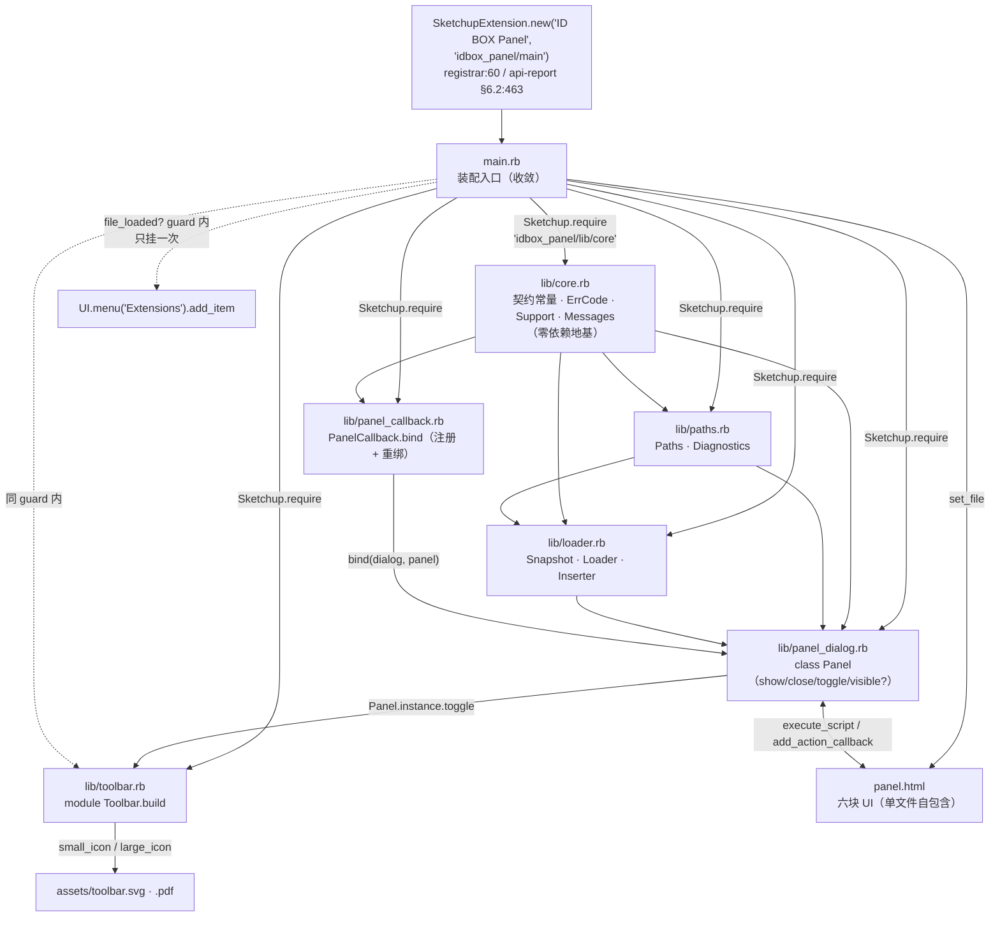
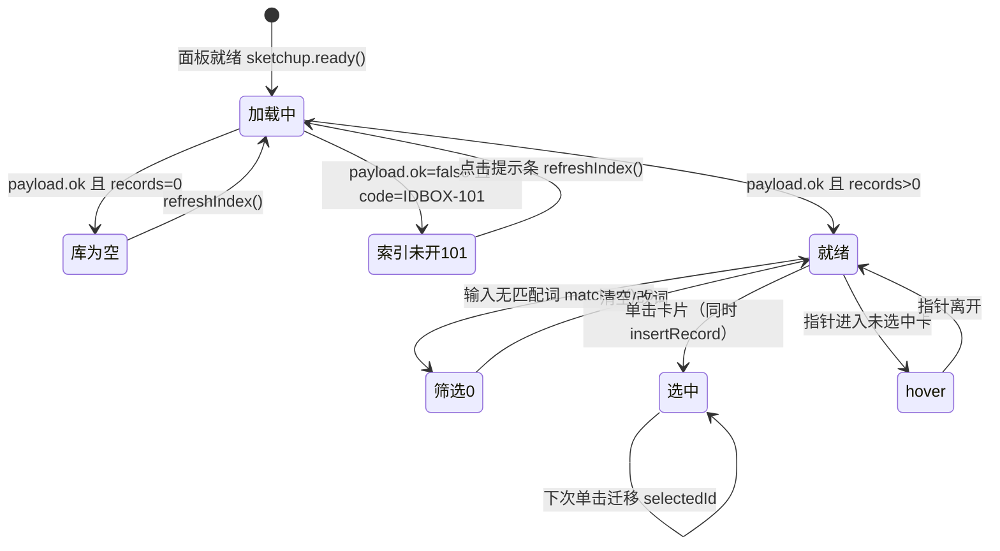
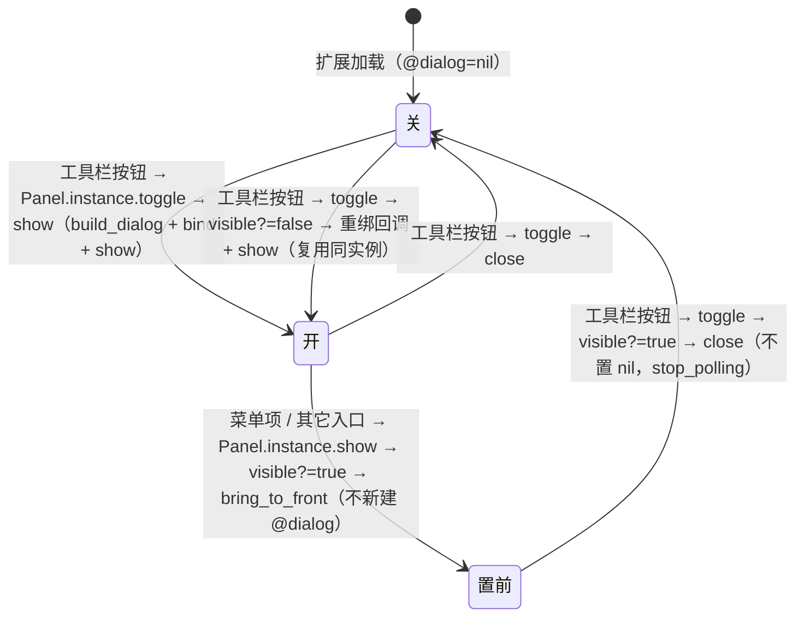
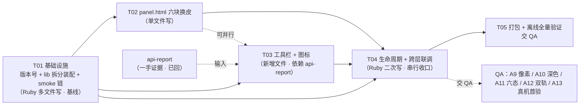
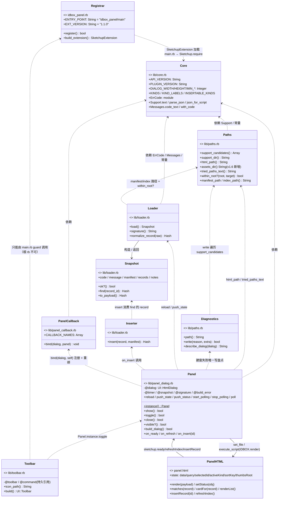
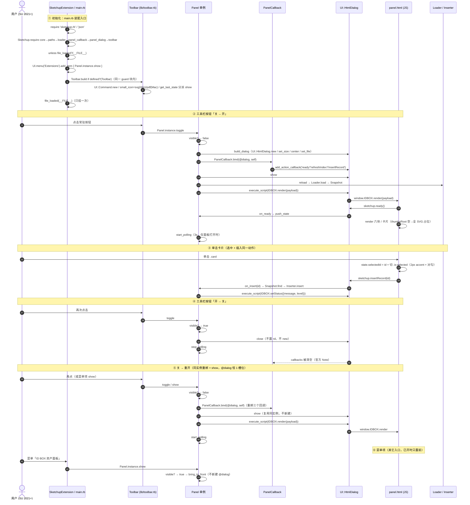

# 42 · SketchUp 插件 UI 与工具栏 —— 增量设计

> 文档版本：**v1.0** ｜ 撰写：su-ui-arch（架构师）｜ 日期：**2026-11-05** ｜ 语言：简体中文
> 性质：**增量架构设计 + 增量任务列表**。不写实现代码、不改任何 `src/` / `plugin-src/` / `scripts/` 源码、不 commit / 不 push。本轮只新建本文件，并按 `docs/41 §7` 拍板同步修改 `docs/39`（升 v1.6）。
> 权威需求：`docs/41-插件UI与工具栏-增量PRD.md`（209 行，本次唯一权威需求）｜ 方案母本：`docs/40-插件UI结构方案-待批注.md`｜ 架构定稿：`docs/39-插件架构-索引快照与包规范.md`
> 一手 API 证据：`docs/probe/su-toolbar-api-verified.md`（su-toolbar-api，2026-11-05；**派工时假设"尚未回来"，实际已在架构阶段产出并交付**，见 §0.2）
> 视觉规格：`docs/probe/idbox-ui-portable-spec.md`（下称 `portable-spec`）、`docs/probe/okducky-ui-structure.md`（下称 `okducky-probe`）、设计稿 `design-tmp/su-plugin-panel-light-final.png`（下称 `design-light`，已看实际像素）
> **三态标注**：`【查证】`＝有文件:行号 / 官方原文 / 像素实证 ｜ `【推断】`＝基于旁证的推理，不写成事实 ｜ `【待核实】`＝需真机或进一步调研才能定论。
> **引用简写**：`registrar` = `plugin-src/idbox_panel.rb` ｜ `main.rb` = `plugin-src/idbox_panel/main.rb` ｜ `panel.html` = `plugin-src/idbox_panel/panel.html` ｜ `smoke` = `scripts/plugin-smoke.rb` ｜ `api-report` = `docs/probe/su-toolbar-api-verified.md`。所有行号按 **2026-11-05 当前工作树**逐条复验。
> ⚠️ `docs/probe/` 按项目惯例被 `.gitignore` 忽略、不入库（`.gitignore:16`、`docs/40:6`、`docs/41:10`）；本设计把其关键结论并入正式编号文档，供后续施工与验收直接引用。

---

## 0. TL;DR

### 0.1 一句话结论

**把 `panel.html` 的 `<style>` + `<body>` 按 `design-light` 换成 ID BOX 原生六块 UI，新增一个真·常驻工具栏按钮，并把 1189 行的 `main.rb` 按用户拍板「拆」收敛为装配入口；`docs/39 §4.2` 的 `lib/` 口径同步改为「本批实际拆分」。**

| 段 | 内容 |
| --- | --- |
| ① 依据 | `【查证】` 用户 2026-11-05 拍板链（`docs/41 §0:18`、`:20`、`:155`）：「面板完全没做 UI」「没有工具栏按钮」→「往下推进 PM 增量 PRD 和真工具栏的实现」→ Q1「**拆（推荐）**」。三项缺口均属实：`panel.html:75-88`/`:118-155`/`:160-168` 是「搜索框 + 文字列表 + 26px 状态行」；`main.rb` 全文 `Toolbar`/`Command`/`small_icon`/`restore` 零命中，唯一入口是 `UI.menu('Extensions')`（`main.rb:1181-1187`）。 |
| ② 结论 | `【查证】` 本批 = 六块 UI 换皮（P0-1）+ 深色 token 适配（P0-3）+ 真工具栏（P0-2）+ 硬约束断言（P0-4）+ 缩略图双轨（P1-1）+ 101 提示条收口（P1-2）+ `lib/` 拆分（P1-3）。数据层 / 索引快照格式 / 回调契约「只增不删」（`docs/40:70`）。 |
| ③ 需求 | 详见 `docs/41 §3`（P0×4 / P1×3 / P2×4）、`§4`（六态）、`§5`（A1–A14）。 |
| ④ 判据 | 见本文 §9 验收映射表；A1–A14 逐条落到任务卡与检查方式。 |
| ⑤ 版本 | **插件版本由 1.0.3 升为 `1.1.0`**（架构师定，理由见 §11.1）；**`docs/39` 文档版本 v1.5 → v1.6**（U4 铁律，同版本号不重复发布不同内容，`docs/38 §9:193`）。两者是不同编号体系，勿混。 |

### 0.2 派工前提的一处变化（如实报备，不掩盖）

| 项 | 派工单口径 | 实际情况 | 本设计的处理 |
| --- | --- | --- | --- |
| 工具栏一手报告 | 「**尚未回来**，工具栏章节不要写死 API 名或图标格式，标 `【待核实】`；给出一手结论回来后需替换的 3–5 个决策点清单」 | `【查证】` `docs/probe/su-toolbar-api-verified.md` 已在架构阶段产出并交付（`§0–§16`：`§9` 逐行校正表 / `§10` 最小片段 / `§11` 真机首验 / `§15` D1–D5 决策卡 + D5 口径定案 + `Sketchup.require` 桩核实 / `§16` 防误抄补记），su-toolbar-api 已主动发我并三轮回写。**本文只按章节 + 行号区间引用，不引用报告总行数**——报告采用「末尾追加」方式迭代（§16 即末尾新增，`§0–§15` 全部行号不变，见 `§16:1011-1012`），写死总行数会过期 | ① **需求层 P0-2 行为不变**；② **实现层分两层落档**：官方一手证据已 `【查证】` 的 API 签名 / 图标格式 / 注册位置 / 版本门槛 → 写成可施工结论并挂「文件:行号」；仍无官方明文或需真机的 → 保留 `【待核实】` 并入 §10.1 真机首验；③ 派工要的「3–5 个决策点清单」照给，用 D1–D5 五条，逐条写「已替换结论 + 残留待核实」（§5.5）；④ 派工「不写死 API 名」的顾虑转成**反向纪律**：`docs/40 §4:74-92` 那段仍是 `【推断】` 反推链，**不得当作已证实结论引用**，本设计所有 API 名一律挂 `api-report` 的官方出处与 `Version:` 标签；⑤ **两份文档已闭环**：`api-report §15:985-1001` 回写了本设计的 D5 口径裁定（架构裁定与官方证据分层标注），`docs/42 §5.3` 为裁定源 |
| 被 API 报告阻塞的任务卡 | 派工假设「有一张卡必须等报告」 | 报告已回 | `【查证】` 原应被阻塞的 **T03（工具栏注册）阻塞已解除**；但 T03 仍依赖 `api-report` 的结论作为输入，且其 **A13 真机首验仍 `【待核实】`**（属 QA 阶段，不阻塞编码）。若按派工原前提执行，被阻塞的就是 T03 一张卡。详见 §8.3。 |

### 0.3 本轮交付物与纪律边界

| 文件 | 动作 | 说明 |
| --- | --- | --- |
| `docs/42-插件UI与工具栏-增量设计.md` | **新建** | 本文件 |
| `docs/39-插件架构-索引快照与包规范.md` | **改造** | 文档头 v1.5 → v1.6 + 新增 v1.6 变化说明 + `§4.2` 两处口径落档（保留历史说明）；**不改 `§4.1` 硬约束、不改 `§5` 错误码** |

`【查证】` 除上述两个文件外，本轮**未改** `src/`、`plugin-src/`、`scripts/`、`docs/40`、`docs/41`、README 或任何其它既有文档；未生成 `docs/class-diagram.mermaid` / `docs/sequence-diagram.mermaid`（二者已存在，改之即违反「只新建 docs/42 与改 docs/39」的纪律，故所有 Mermaid 图均**内嵌于本文件**，见 §3.1 / §5.4 / §8.5）。

---

## 1. 范围与不变量

### 1.1 本次唯一的口径变更：`lib/` 从「只立目录」改为「本批实际拆分」

| 段 | 内容 |
| --- | --- |
| ① 依据 | `【查证】` `docs/41 §7:155` Q1 已拍板（2026-11-05，用户原话「拆（推荐）」）：`lib/` 本批实际拆分，并同步把 `docs/39 §4.2` 的「V1.0 只立目录、不产出文件」口径改为「实际拆分」。`docs/40 §5:116` 原话「这是一条需要你点头的口径变更」。`docs/41 §8:186` 明确「口径变更由架构师在增量设计里同步落档（v1.5 → v1.6，按 U4 铁律升版）；PM 不擅自改既有文档」。 |
| ② 结论 | `【查证】` 这是**施工结构口径**变更，不是产品长相变更：拆与不拆决定工程师改 `main.rb` 的方式、`Sketchup.require` 加载链、`smoke:94` 的 require 重验范围、`.rbz` 内文件清单（`docs/41 §7:163`）。本设计按「拆」落地，`main.rb` 收敛为装配入口。 |
| ③ 需求 | 落档位置：`docs/39` 文档头 + `§4.2` 两处（见 §1.4）；实现：`lib/` 下 6 个 `.rb`（§2、§3）。 |
| ④ 判据 | A1（每个 `.rb` 都 `ruby -c` = `Syntax OK`）、A2（`smoke` 场景 A/B 全过）、A5（`.rbz` 顶层仍恰好两项）、A7（单一模块 / 无全局变量）。 |

> `【查证·一处需如实说明的原文偏差】` `docs/39 §4.2:186` 的 `lib/` 目录树行原文只写「纯 ASCII 文件名，纯 ASCII 内容标识」，**并未**明写「V1.0 不产出文件」；原文中「不产出文件」那句实际是针对 `native/<platform>/<rubyVer>/` 分叉目录（`:187`、`:193`）。`docs/40 §5:116` 与 `docs/41 §7` 把整个 `§4.2` 读作「`lib/` 只立约定、不产出文件」——这是团队沿用的**读法**而非逐字原文。本设计在 `docs/39 v1.6` 里如实保留这一区分：只改 `lib/` 口径，`native/` 的「只立约定、不产出文件」**保持不变**（零原生件硬约束未变，`docs/39 §4.1#3:169`）。

### 1.2 不可动项（Invariants，违反即不合格）

| # | 不变量 | 出处 |
| --- | --- | --- |
| 1 | **错误码 `IDBOX-101..106` 六条语义不变**：101 发现文件缺失 / 102 JSON 解析·校验失败（含半写）/ 103 路径失效 / 104 `.skp` 版本高于当前 SU / 105 路径越界被拒 / 106 SU 版本低于门槛 | `docs/39 §5:263`、`docs/41 P1-2` 判据③、`A14` |
| 2 | **Ruby↔JS 回调契约只增不删**：`sketchup.ready()` / `refreshIndex()` / `insertRecord(id)` / `window.IDBOX.render(payload)` / `setStatus(obj)` 全部保留且签名不变 | `panel.html:17-23`、`:477-480`、`docs/40:70`、`A8` |
| 3 | **`.rbz` 顶层恰好两项**：`idbox_panel.rb` + `idbox_panel/`；所有新增 `lib/`、`assets/` 都在支持目录内部，不新增第三项 | `docs/39 §4.2:176-188`、`A5` |
| 4 | **零网络**：包内 `http(s)://` / `socket` / `Net::HTTP` / `open-uri` / `fetch(` / `XHR` / `WebSocket` 命中数 = 0 | `docs/39 §4.1#2:168`、`P0-4①`、`A3` |
| 5 | **零原生件 / 零 gem**：无 `.so` / `.bundle` / `.dll`，`require` 仅 `sketchup.rb` / `extensions.rb` / `json` / `digest` + `Sketchup.require` | `docs/39 §4.1#3:169`、`§4.2:192`、`A4` |
| 6 | **零 token / 零端口 / 零后台服务**：仅面板打开时 3s 轮询、关闭即 `stop_timer`（`main.rb:1140-1157`） | `docs/39 §4.1#4:170`、`P0-4③` |
| 7 | **纯读方，唯一例外＝建窗失败写 `%TEMP%\idbox_panel_diag.txt`**：成功路径写盘动作 = 0 | `docs/39 §4.1#7:173`、`P0-4④`、`A6` |
| 8 | **单一唯一命名模块 `IDBoxPanel` + 无全局变量**（`$` 命中 0）；包内互相 require 一律 `Sketchup.require "idbox_panel/xxx"`（不带 `.rb`） | `docs/39 §4.2:192`、`api-report §6.2:462-464`、`A7` |
| 9 | **Ruby 2.7 写法 + SU 2021+ 门槛**：禁 `Hash#except` / endless method / `=>` 右赋值 / pattern matching；禁用门槛外 API（见 §5.5 D1） | `docs/39 §4.2:194`、`docs/38 §8.1:176`、`api-report §7:525-534` |
| 10 | **不解压 / 不读压缩包 / 不自删 / 不自升级** | `docs/39 §4.1#5/#6:171-172`、`P0-4⑥` |
| 11 | **只导出 `.rbz`，不自动复制到 Plugins 目录**；用户经「扩展 → 安装扩展」安装 | `docs/38 §8.1:175`（D3 已拍板）、`docs/39 §4.3:205-211` |
| 12 | **D1 路径** `%APPDATA%\idbox\plugin\` 下 `manifest.json` + `index.json` | `docs/38 §8.1:172`、`docs/39 §2.2:39-41` |
| 13 | **A1 触发集**：变化驱动写、debounce quiet 1.5s + max-wait 5s、缩略图涓流不入触发集、不设定时兜底 | `docs/38 §8.1:174`、`docs/39 §2.3:47-53` |
| 14 | **「点一下即插入」**：不做面板内真拖、不引入二次确认、保留 `Ctrl+Z` 可撤销 | `docs/38 §5:110` / `§3.3#1:79`、`docs/41 P2-4`、`A14` |
| 15 | **索引快照字段 / 文件格式不改**（`docs/39 §3` 已定稿）；`kind` 六值标签不变（模型/贴图/HDRI/材质/CAD/其他，`main.rb:57-68`） | `docs/41 §1:43`、`A14` |
| 16 | **视觉基准＝v0.2 Soft UI / Vibrancy + `#007AFF`（深 `#0A84FF`）**；不抄 `docs/32` 的 Windows 蓝（推翻性提案、未落地） | `portable-spec §0:16-17`、`§6.4:297`、`docs/40 §1:37`、`P0-3④` |
| 17 | **不照抄可搭鸭云端 `set_url` 与原生 DLL 无边框窗**（违反零网络 / 零原生件） | `okducky-probe §7.1:517-519`、`docs/39 §4.1#2/#3`、`docs/40 §1:35-36` |

### 1.3 范围内 / 范围外

| 范围内（本批） | 范围外（沿用或明确不做） |
| --- | --- |
| `panel.html` 六块 UI 换皮（`<style>` + `<body>`，`<script>` 契约保留） | 数据 / 回调骨架重写（`docs/40:70` 禁止） |
| 深色主题 token 全覆盖 | 主题切换 UI（P2-2）、密度三档行为（P2-3）、记住窗口位置（P2-1） |
| 新增真工具栏按钮 + 图标资源 | 云端主面板 / 无边框浮窗 / 面板内真拖（`docs/41 §6:141-145`） |
| `lib/` 实际拆分 + 加载链 + `smoke` 重验 | 面板内缩略图重渲染 / three.js 材质球 / 虚拟滚动 / 动效 |
| 缩略图双轨（P1-1）、101 提示条收口（P1-2） | 索引快照字段 / 文件格式改动 |
| `Panel#close` / `toggle` / `visible?` + 回调重绑修正 | 材质 / 贴图插入（D2 待真机，`docs/38 §8.2:184`） |

### 1.4 `docs/39` 口径变更落点（本轮已执行）

| 落点 | 动作 | 内容 |
| --- | --- | --- |
| `docs/39:3` 文档头 | 改造 | `v1.5` → `v1.6` |
| `docs/39:5` 前 | 新增 | 一条 `v1.6 变化` 说明：依据 `docs/41 §7` 用户 2026-11-05 拍板「拆」，`lib/` 从「V1.0 只立目录、不产出文件」改为「本批实际拆分、产出 6 个 `.rb`」；`native/` 口径与 `§4.1` 硬约束、`§5` 错误码不变；按 U4 铁律升版；配套 `docs/42` |
| `docs/39 §4.2:186-187`（目录树 `lib/` 行） | 改造 | 展开 `lib/` 实际文件清单；**保留原「纯 ASCII 文件名」读法为历史说明** |
| `docs/39 §4.2:193`（分叉目录条） | 改造 | 补一句界定：该条「不产出文件」仅指 `native/` 分叉目录，`lib/` 自 v1.6 起实际产出文件；原句不删 |

`【查证】` `native/<platform>/<rubyVer>/` 的「只立约定、不产出文件」**保持有效**——零原生件是 `docs/39 §4.1#3` 硬约束，本批未变；若连同它一起改，等于放开硬约束，违反派工「不改 `§4.1`」。

---

## 2. 文件级清单

### 2.1 逐文件表

> 「依赖」列指**文件级加载依赖**（见 §3.2 加载顺序）；「验收」列指 `docs/41 §5` 的 A 编号。

| # | 路径（相对 `plugin-src/`） | 动作 | 职责 | 依赖 | 验收 A |
| --- | --- | --- | --- | --- | --- |
| 1 | `idbox_panel.rb` | **改造** | **保持只注册**：`SketchupExtension.new(EXT_NAME, 'idbox_panel/main')`（`:60`）+ `Sketchup.register_extension(meta, true)`（`:50`）。唯一改动＝`EXT_VERSION` `1.0.3` → `1.1.0`（`:36`）。**不放任何工具栏逻辑**（`api-report §6.2:467` 官方明文：root RB should only register） | 无 | A1, A4, A5, A14 |
| 2 | `idbox_panel/main.rb` | **改造（收敛）** | **收敛为装配入口**：`require 'sketchup.rb'` / `require 'json'` + 6 条 `Sketchup.require "idbox_panel/lib/xxx"`（不带 `.rb`）+ 单个 `file_loaded?` guard 块（菜单 + 工具栏注册）。原 9 个模块与常量全部下沉到 `lib/`；不再有业务逻辑 | 全部 `lib/*` | A1, A2, A4, A5, A7, A8 |
| 3 | `idbox_panel/lib/core.rb` | **新增** | **无 IO / 无 UI 的纯地基**：契约常量（`main.rb:32-88`，含 `API_VERSION` / `PLUGIN_VERSION` / `MANIFEST_FILE` / `INDEX_FILE` / `SUPPORT_DIR_NAME` / `DIALOG_*` / `POLL_SECONDS` / `SHA_RETRY_*` / `MIN_SU_MAJOR` / `KINDS` / `KIND_LABELS` / `INSERTABLE_KINDS` / `OP_NAME` / `CODE_PREFIX` / `YES_*` / `HAS_DIGEST`）+ `ErrCode`（`:91`）+ `Support`（`:101`）+ `Messages`（`:432`） | 无 | A1, A4, A7, A14 |
| 4 | `idbox_panel/lib/paths.rb` | **新增** | `Paths`（`:220`，多候选路径 + `within_root?` 越界校验，`docs/39 §4.1#8:174`）+ `Diagnostics`（`:357`，**唯一写盘点**）。两者合并理由：`Diagnostics.write` 直接遍历 `Paths.support_candidates`（`:391`）并引用 `Paths.support_dir`（`:399`），强耦合；且都是「路径与诊断」横切关注 | `core` | A1, A4, A6, A7 |
| 5 | `idbox_panel/lib/loader.rb` | **新增** | **数据流三件套**：`Snapshot`（`:574`，`to_payload` 在此）、`Loader`（`:645`，读 manifest/index + SHA256 三轮重试 + `normalize_record`，`thumbRel` 在 `:816`）、`Inserter`（`:845`，`DefinitionList#load`）。理由：`Snapshot` 是 `Loader.load` 的返回载体，`Inserter.insert` 消费 `Snapshot#find` 的 record，三者内聚；拆开会造成跨文件常量/实例互引 | `core`, `paths` | A1, A4, A6, A7, A14 |
| 6 | `idbox_panel/lib/panel_callback.rb` | **新增** | **`add_action_callback` 集中分发 + 重绑**（新抽象）：`module PanelCallback`，`self.bind(dialog, panel)` 注册 `ready` / `refreshIndex` / `insertRecord` 三个回调（原 `main.rb:1033-1035`），回调体委托给 `panel.on_ready/on_refresh/on_insert`（仍为 `Panel` 实例方法）。`CALLBACK_NAMES` 常量收口回调名，供「关窗后重绑」复用（`api-report §15 D5:913`） | `core`（运行时通过参数拿 `panel`，加载期不引用 `Panel` 常量） | A1, A2, A8 |
| 7 | `idbox_panel/lib/panel_dialog.rb` | **新增** | `class Panel`（`:955-1178`）：`build_dialog` / `show` / **新增 `close` / `toggle` / `visible?`** / `reload` / `push_state` / `push_status` / `messagebox` / 轮询 `start_polling`·`stop_polling`·`poll` / 三个 `on_*` 处理器。`build_dialog` 调 `PanelCallback.bind(@dialog, self)` | `core`, `paths`, `loader`, `panel_callback` | A1, A2, A6, A8, A14 |
| 8 | `idbox_panel/lib/toolbar.rb` | **新增** | `module Toolbar`：`self.build` 注册 `UI::Toolbar` + `UI::Command`（`api-report §10.1:637-707`）；命令 block 调 `Panel.instance.toggle`。**持久引用** `@toolbar` / `@command` 防 GC。图标按 `Sketchup.platform` 二选一（§5.5 D2） | `panel_dialog`（运行时 `Panel.instance`） | A1, A4, A5, A7, A13 |
| 9 | `idbox_panel/panel.html` | **改造** | 重写 `<style>`（`:25-170`）与 `<body>`（`:172-196`）为六块 UI；**完整保留 `<script>` 契约**（`:198-504`：`state` / `render()` / `matches()` / `insertRecord()` / `refreshIndex()` / `window.IDBOX.render` / `setStatus`）。新增六态、选中态、双轨 JS、101 提示条 | 无（文件自包含） | A3, A8, A9, A10, A11, A12 |
| 10 | `idbox_panel/assets/toolbar.svg` | **新增** | 工具栏矢量图标（Windows，SU ≥ 2016）。**最终格式已 `【查证】`，渲染结果仍 `【待核实】`**（§5.5 D2） | — | A4, A5, A13 |
| 11 | `idbox_panel/assets/toolbar.pdf` | **新增** | 同上，macOS（SU < 2027）用。**与 `.svg` 成对、stem 同为 `toolbar`**（与 `lib/toolbar.rb` 的 rb 文件名严格同名，满足 `docs/41 P0-2` 判据④ / A13④） | — | A4, A5, A13 |
| 12 | `scripts/plugin-smoke.rb` | **改造** | 补 `Sketchup.require` 转发桩 + 最小 `UI::Toolbar` / `UI::Command` 桩，`require 'idbox_panel/main'`（`:94`）**保持不变**。精确到可直接照做，见 §3.4 | — | A2 |
| `—` | `scripts/plugin-stub/sketchup.rb` | **不改** | `file_loaded?` / `file_loaded` 桩保持；其全局 `$idbox_loaded`（`:4`）属**桩**，不在 `plugin-src/` 下，A7 的 grep 范围不会命中 | — | A2, A7 |

### 2.2 为什么是 6 个 `lib/` 文件（对派工清单的偏离，给理由）

派工点名 5 个：`paths.rb` / `loader.rb` / `panel_dialog.rb` / `panel_callback.rb` / `toolbar.rb`。本设计**保留全部 5 个**，额外增加 `lib/core.rb`：

| # | 理由 |
| --- | --- |
| 1 | `【查证】` 原 `main.rb:32-88` 的 20+ 契约常量、`ErrCode`（`:91`）、`Support`（`:101`）、`Messages`（`:432`）被**所有**其余模块引用：`Loader.load` 用 `API_VERSION`/`MANIFEST_FILE`/`ErrCode`（`:652` 起）、`Inserter.insert` 用 `Messages` / `CODE_PREFIX`、`Snapshot#to_payload` 用 `KIND_LABELS` / `INSERTABLE_KINDS` / `PLUGIN_VERSION`（`:613-641`）、`Diagnostics.write` 用 `Support` / `PLUGIN_VERSION`（`:379-382`）。派工的 5 文件名里**没有这些地基的落脚点**。 |
| 2 | 若把地基留在 `main.rb`，`main.rb` 仍有 ~350 行且承载业务常量，与派工「`main.rb` 收敛为装配入口」冲突；若塞进 `paths.rb` 或 `loader.rb`，则 `panel_dialog` / `panel_callback` 反向依赖业务文件，加载顺序出现 `NameError` 风险。 |
| 3 | `core.rb` 是**零依赖、无 IO、无 UI** 的纯函数 + 常量层，可最先加载，使 `Sketchup.require` 序列成为严格单向拓扑（§3.2），也让 A7「单一模块 / 无全局变量」的 grep 面清晰。 |

> `【查证】` `docs/40 §5:110` 提到 `html/` 子目录与 `assets/icons.svg` 精灵表（`:113`）——本设计**不建 `html/`、不外链 `icons.svg`**：`panel.html` 硬约束零外链（`:10-15`、A3），图标必须以内联 `<svg style="display:none"><symbol>` 精灵表放在同一个 `panel.html` 内（`portable-spec §6.1#3:276`）。故 `panel.html` 仍是单文件自包含。

### 2.3 `.rbz` 顶层恰好两项断言（A5）

```
idbox_panel-1.1.0.rbz                    ← 分发物（ZIP），顶层恰好两项
  idbox_panel.rb                         ← 根注册文件（ASCII 名，只注册）
  idbox_panel/                           ← 同名支持目录
    main.rb                              ← 装配入口
    panel.html                           ← 本地 HTML（set_file）
    lib/
      core.rb  paths.rb  loader.rb  panel_callback.rb  panel_dialog.rb  toolbar.rb
    assets/
      toolbar.svg  toolbar.pdf
```

`【查证】` 新增的 `lib/` 与 `assets/` **全部在 `idbox_panel/` 内部**，不产生第三个顶层条目（`docs/39 §4.2:176-188`、`docs/40 §2:51`）；`plugin-src/README.md` 不进包（`registrar:8-11`、A5）。检查命令见 §9 A5。

---

## 3. 模块依赖图与加载顺序

### 3.1 模块依赖图（Mermaid）



### 3.2 加载顺序（`main.rb` 装配入口，可直接照做）

> `【查证】` 依据 `docs/39 §4.2:192`、`api-report §6.2:462`（官方：prefer `Sketchup.require` over Ruby's own `require`，不带扩展名以便同时找 `.rb` / `.rbe` / `.rbs`）、`api-report §6.3:473-502`（`file_loaded?` 是 `Tools/sketchup.rb` 官方标准 guard，注释点名防 "duplicate menus and **toolbars**"）。

| 序 | 语句 | 必须在该位置的原因 |
| --- | --- | --- |
| 0 | `require 'sketchup.rb'` / `require 'json'` | 保留（SketchUp 自带 + stdlib；A4 允许的 `require` 白名单）。`smoke` 桩 `plugin-stub/sketchup.rb` 提供前者 |
| 1 | `Sketchup.require 'idbox_panel/lib/core'` | **必须第一**：定义 `module IDBoxPanel` 与全部契约常量，后续 5 个文件都在该模块内注入方法/类；晚加载则 `NameError` |
| 2 | `Sketchup.require 'idbox_panel/lib/paths'` | 依赖 `core` 的 `Support`（`Paths.support_candidates` 等用 `Support.text`）与 `PLUGIN_VERSION`（`Diagnostics.write:379`） |
| 3 | `Sketchup.require 'idbox_panel/lib/loader'` | 依赖 `core`（`ErrCode`/`Messages`/常量）+ `paths`（`Paths.manifest_path` / `index_path` / `within_root?`） |
| 4 | `Sketchup.require 'idbox_panel/lib/panel_callback'` | 依赖 `core`；**加载期不引用 `Panel` 常量**（`bind(dialog, panel)` 通过参数拿实例），故可先于 `panel_dialog` |
| 5 | `Sketchup.require 'idbox_panel/lib/panel_dialog'` | 依赖 `core` / `paths`（`Diagnostics`）/ `loader`（`Snapshot`·`Loader`·`Inserter`）/ `panel_callback`（`PanelCallback.bind`） |
| 6 | `Sketchup.require 'idbox_panel/lib/toolbar'` | **必须最后**：命令 block 运行时解析 `IDBoxPanel::Panel.instance.toggle`（`api-report §10.1:664-666`） |
| 7 | `unless file_loaded?(__FILE__)` … `file_loaded(__FILE__)` | **guard 块位置：`main.rb` 末尾、`module IDBoxPanel` 内**（延续现状 `:1181-1187` 的结构，最小 diff）。块内：① 菜单项 `UI.menu('Extensions').add_item('ID BOX 资产面板') { Panel.instance.show }`（保持 `show` 语义，见 §5.4）；② `Toolbar.build if defined?(Toolbar)`（T01 预留，T03 落地后自动生效）；③ 整块 `begin … rescue StandardError => e` 包住，只 `puts` 真实异常类+message，**不写盘**（§7.3） |

`【查证】` 所有 `lib/*.rb` 顶层均 **`module IDBoxPanel` … `end`** 包裹（A7：单一唯一命名模块、无全局变量）；不使用 `require_relative`（`docs/39 §4.2:192`）。`【推断】` `panel_callback` 放序 4 而非序 6，是为让 `panel_dialog` 在 `build_dialog` 里能直接引用 `PanelCallback.bind` 而不需要延迟解析——即便顺序对调也不报错（Ruby 运行时解析常量），但严格拓扑更利于排查。

### 3.3 `file_loaded?` 防重复注册的位置

| 项 | 结论 |
| --- | --- |
| 位置 | `【查证】` `main.rb` 末尾单个 `unless file_loaded?(__FILE__) … file_loaded(__FILE__) end`（延续 `main.rb:1181-1187`）。`api-report §6.3:502`：官方 `Tools/sketchup.rb:34-36` 注释「Especially useful to protect your UI setup from creating duplicate menus and **toolbars**」 |
| 菜单 + 工具栏**同块** | `【查证】` `api-report §6.3:502` 明确「工具栏注册应放进**同一个 guard 块**内（与菜单项一起只挂一次）」；`§10.2:715-725` 给出可直接照做的片段 |
| 根注册文件不放 | `【查证】` `api-report §6.2:467` 官方「The root RB file should **only register the extension**, not contain the extension's logic or **load additional files**」⇒ `docs/40 §4:79`「根 rb 或 main.rb」需修正为**只能 main.rb**（§10.2 风险 7） |
| `__FILE__` 坑 | `【待核实】` `docs/39 §4.4:220-226` 的「`__FILE__` 在扩展里可能是相对路径」对每个 `lib/*.rb` 同样成立；因此 `lib/*.rb` **不得**用 `__FILE__` 拼资源路径，图标绝对路径统一走 `Paths` 新增的 `assets_dir`（多候选，照 `Paths.html_path:279` 的形状），见 §10.2 风险 3 / `api-report §11 #4:766` |
| `__FILE__` 坑 · **T01 实测补充（裁定：口径成立，属必要补偿）** | `【查证】` T01（commit `90e5bbe`）实测：拆分后 `support_candidates` 里的 `File.dirname(__FILE__)` 落在 `lib/` 内，比原 `main.rb` 多一层 `lib/`，其中没有 `panel.html` ⇒ 冒烟场景 A 失败（`show() => false`、dialog 为 nil）。工程师在 `lib/paths.rb:46` **追加候选 ①′**（`dirname/..`），原①逐字保留、纯增量，`support_dir` 仍只挑「目录存在且真有 `panel.html`」的第一个 ⇒ 不冲突。本设计原写「不能只信 `__FILE__`」但未预写该行，现裁定为**拆分带来的必要补偿、不是偏离**；`docs/41 A7` grep 与 A2 场景 A/B 判据均未因此改变。真机上①′与①的先后顺序属 QA 观测项 |

### 3.4 `scripts/plugin-smoke.rb` 的 require 链怎么改（可直接照做）

> `【查证】` 现状：`smoke:20-22` 把 `scripts/plugin-stub` 与 `plugin-src` 加入 `$LOAD_PATH`；`smoke:94` 是 `require 'idbox_panel/main'`；桩 `plugin-stub/sketchup.rb` **只定义** `file_loaded?` / `file_loaded`（`:6-9`），`smoke:24-39` 的 `module Sketchup` 桩有 `version` / `find_support_file` / `status_text=` / `active_model`，**没有 `Sketchup.require`**。
> ⇒ 拆分后 `main.rb` 调 `Sketchup.require` 会直接 `NoMethodError`。这是 `docs/41 §7:163` 点名「`smoke:94` 重验范围」的实质。

| 步 | 改法 | 说明 |
| --- | --- | --- |
| 1 | **`smoke:94` 的 `require 'idbox_panel/main'` 保持不变** | `main.rb` 仍是入口，只是内部改用 `Sketchup.require` 加载 6 个 `lib/*.rb` |
| 2 | 在 `smoke:24-39` 的 `module Sketchup` 桩内**新增** `self.require(path)` 转发桩（片段见下） | **最小可跑通版**：`def self.require(path); ::Kernel.require(path); end` —— `$LOAD_PATH` 已含 `plugin-src`（`smoke:22`），`'idbox_panel/lib/core'` → `plugin-src/idbox_panel/lib/core.rb` 可解析（`Kernel.require` 支持省略 `.rb`；真机 `Sketchup.require` 还会找 `.rbe`/`.rbs`，明文包离线桩只找 `.rb` 已足够）。**建议采用 `api-report §15:921-936` 的更贴真机版**（下方片段）：用 `<PLUGIN_ROOT>/path.rb` **绝对路径**拼、不改 `$LOAD_PATH`、只加载一次去重、返回 Boolean、找不到文件打印控制台不抛 `LoadError`（SU 2026.2 起才抛）。`【查证】` 官方 `Sketchup.require(path) ⇒ Boolean`「load Ruby files once」（`api-report §15:926`）；本机 `ShippedExtensions/habitat_site_context.rb:6` 有真实调用 `Sketchup.require("habitat_site_context/localise")`（相对路径、不带 `.rb`，`:928`），可直接当桩的对照 |
| 3 | 在 `smoke:41-92` 的 `module UI` 桩内**新增最小 `UI::Command` / `UI::Toolbar`**（建议，见下） | 否则 guard 块里 `Toolbar.build` 抛 `NameError`，虽被 `rescue StandardError` 吞掉（`NameError < StandardError`）不影响场景 A/B 判据，但会**掩盖真实注册错误**。补桩后 A2 能顺带验证注册链不抛异常 |
| 4 | 场景 B 的 monkey-patch（`smoke:116-122` 重开 `IDBoxPanel::Paths` 覆盖 `support_candidates`）**保持不变** | 前提：`Paths` 仍在 `IDBoxPanel` 命名空间、`support_candidates` 仍为 `module_function` / `def self.`（`main.rb:220-221`）。拆分后必须保持这两点，否则场景 B 失效 |
| 5 | 场景 A/B 判据不变 | A2：`show() => true` 且不产生诊断文件 / `show() => false` 且写出诊断文件，退出码 0（`smoke:100-144`） |
| 6 | **不要**把桩里的 `$idbox_loaded`（`plugin-stub/sketchup.rb:4`）当成 A7 违规 | A7 grep 范围是 `plugin-src/**/*.rb`（`docs/41 A7:127`），桩不在其中；`file_loaded?` 内部用的是 SketchUp 自己的全局，不是我们插件声明的（`api-report §6.3:502`） |

`Sketchup.require` 转发桩片段示意（`api-report §15:931-936`，片段示意、非实现代码）：

```ruby
# 追加到 scripts/plugin-smoke.rb 的 module Sketchup 桩内
# 桩内常量（非插件代码）；__dir__ 即 scripts/，'..' 为仓库根；不复用 :20 的局部 root（module 作用域不共享）
IDBOX_PLUGIN_ROOT = File.join(File.expand_path('..', __dir__), 'plugin-src')
def self.require(path)
  rel = path.end_with?('.rb') ? path : (path + '.rb')     # 明文包：不带 .rb → 补 .rb
  full = File.join(IDBOX_PLUGIN_ROOT, rel)
  unless File.file?(full)
    puts "[smoke] Sketchup.require miss: #{full}"        # 2021 行为：打印控制台，不抛 LoadError
    return false
  end
  Kernel.require(full)                                   # 绝对路径，天然「只加载一次」+ 返回 Boolean
end
```

> `【辨析·勿误删】` 官方 U6「**Don't modify the `$LOAD_PATH`**」（`api-report §15:927`）约束的是**插件在 SketchUp 进程内**加载文件（`plugin-src/` 里的代码）；`scripts/plugin-smoke.rb` 是**离线测试脚手架**，`smoke:21-22` 的 `$LOAD_PATH.unshift` 是为了让 `require 'idbox_panel/main'`（`:94`）与 `plugin-stub/sketchup.rb` 能被解析，**必须保留**、不违反 U6。上面片段的要点是「桩内部用绝对路径、不再改动 `$LOAD_PATH`」，不是删掉脚手架的 `$LOAD_PATH`。这与 `docs/39 §4.2:192`「包内互相 require 用 `Sketchup.require`」不冲突——桩服务于离线冒烟，插件运行时代码仍一律 `Sketchup.require`。`【查证】` su-toolbar-api 已复核 `scripts/plugin-smoke.rb:21-22` 两行并在 **`api-report §16.2:1040-1050`** 同步留档，明确「必须保留、工程师不得误删」，避免其 §15 桩建议被反向误读。

最小桩片段示意（只实现官方 ≤2017 方法，延续 A2「桩只实现官方方法、越界即抛 `NoMethodError`」纪律，`smoke:53-83`）：

```ruby
# 追加到 scripts/plugin-smoke.rb 的 module UI 内（片段示意，非实现代码）
class Command
  attr_accessor :small_icon, :large_icon, :tooltip, :status_bar_text, :menu_text
  def initialize(_menutext, &block); @block = block; end
  def set_validation_proc(&_block); self; end          # 官方 6.0，api-report §2:119
end
class Toolbar
  def initialize(_name); @items = []; end
  def add_item(cmd); @items << cmd; self; end          # 官方 6.0，返回自身
  def add_separator; self; end
  def show; nil; end
  def hide; nil; end
  def restore; nil; end
  def visible?; false; end
  def get_last_state; -1; end                          # 模拟 TB_NEVER_SHOWN 首装
end
```

`【查证】` `HtmlDialog` 桩已有 `close`（`smoke:81`）与 `visible?`（`:82`），故新增 `Panel#close` / `visible?` 不会在冒烟里抛 `NoMethodError`。`【待核实】` 桩**没有** `set_can_close` / `hide`——本设计不使用二者（后者是 SU 2026.1、门槛外），符合 `docs/39 §4.4:240-241`「只调官方列出的方法」。

---

## 4. 六块 UI 的组件与 token 映射

### 4.0 设计稿像素基准（`design-light`，已看实际像素）

`【查证】` 逐块实测（截图 940×770 画布，面板白框约 620px 宽）：① 顶栏 `ID BOX` 字标 + 蓝色圆角 Logo + 搜索框「搜索模型 / 材质 / HDR / CAD…」+ 网格/列表分段控件 +「大 中 小」静态密度字样 + 右侧「索引于 11-05 14:32」+ 刷新；② 左栏「素材大类」全部 2248 / 模型 1520 / 材质 406 / HDR 128 / CAD 86 / 其他 28，各带图标与选中态（`全部` 行为 `accent-tint` 底 + `accent` 字）+「一级分类」树（软装陈设 / 沙发 / 灯具 / 硬装构件 / 材质贴图）+ 底部蓝色 CTA「+ 在 ID BOX 里导入」+「v0.9.2 · 本地库」；③ chips「全部 / 类型▾ / 分类▾ / 排序▾」+ 右「共 2248 项」；④ 3 列 × 2 行 6 张 4:3 封面卡（北欧布艺双人沙发【蓝描边 + 右上 22×22 对勾选中态】/ 水泥微水泥材质【右上角标 `hover` 标注】/ 浅灰软铺贴图 / 海岸环境 HDRI / CAD 平面家具图块 / 胡桃木饰面），每张有浅色 kind 角标 + 名称 + 副信息；⑤ 画布下方「空态 / 错误态」说明区：40px SVG「库为空」（六边形箱）与「筛选 0」（漏斗）两图形；⑥ 底部 44px 通栏：绿圆勾 +「已归类 3 个素材到「软装陈设」」+ 右「撤销 5s」蓝色胶囊；左下另有「工具栏·常驻按钮」**示意框**（虚线占位 +「点击打开 / 关闭面板」+「【按官方 API 反推的形态】…零一手证据，属推断，须真机验证」）——**该框是画布说明区，不是面板内 UI，也不是真实按钮像素**（`docs/41 §6:149`）。

> `【推断·高置信】` 设计稿按「内容大类」左栏五项（模型/材质/HDR/CAD/其他），与 `KINDS` 六值（`main.rb:58`）的映射需产品口径，见 §10.2 风险 8。

### 4.1 逐块映射表

> 「图标 ID」指内联精灵表 `<symbol id="…">` 的 id（去掉 React 包装，只留 `<svg>` + 子 path，`portable-spec §5:244-263`）；规格统一 `viewBox="0 0 24 24"` / `fill="none"` / `stroke="currentColor"` / `stroke-width="2.25"` / 16px，空态 40px（`portable-spec §5.1:238-241`）。

| 块 | DOM 结构要点 | 用到的 CSS 变量 | 图标 ID | A 编号 |
| --- | --- | --- | --- | --- |
| **① 顶栏 56px** | `<header class="topbar">`：22×22 Logo 方块（`rounded-logo`）+ `ID BOX` 字标 15px/600 + 搜索框（`rounded-search`，占位符沿用「搜索名称 / 分类…」）+ 网格/列表分段控件（`--seg-active`）+ **静态**「大 中 小」字样（P2-3：不接行为）+ 状态区（`#count` / `#fresh` / `#ver` / `#refresh`） | `--bg-canvas`, `--bg-sidebar`, `--border-panel`, `--text-primary`, `--text-secondary`, `--text-muted`, `--pill-bg`, `--seg-active`, `--accent`, `--accent-tint`, `--radius-*`, `--fs-*` | `i-search`, `i-grid`, `i-list`, `i-refresh` | A9, A3, A8 |
| **② 左栏 216px** | `<aside class="side">`：`shrink-0` + 分组头「素材大类」+ 5 个 kind 导航项（图标 15×15 + 标签 13px + 右计数 11px muted + 选中态 `accent-tint` 底 / `accent` 字）+「一级分类」树 + 底部 `border-t` 区（CTA + 库路径 + 版本号 `v0.9.2 · 本地库`） | `--bg-sidebar`, `--bg-elevated`, `--bg-active-nav`（深）, `--accent-tint`, `--accent-text`, `--tint-neutral`, `--tint-neutral-text`, `--text-tertiary`, `--text-muted`, `--border` | `i-grid`, `i-box`, `i-material`, `i-hdr`, `i-cad`, `i-folder`, `i-settings` | A9, A11 |
| **③ 筛选 chips** | `<div id="chips" class="chips">`：全部 / 类型▾ / 分类▾ / 排序▾，chip 三态 `.chip` / `.chip-accent`（选中 `accent-tint` 底 + `accent-text` 字）/ `.chip-ghost`；右侧「共 N 项」；**无浮层，chip 为点击循环**（见 §12 C-3） | `--bg-canvas`, `--border`, `--text-secondary`, `--accent-tint`, `--accent-text`, `--radius-chip`, `--fs-body` | ~~`i-external`~~ → 文本字形 `▾`（`panel.html:1158` 循环实现，见 §12 C-2） | A9, A11 |
| **④ 卡片网格** | `<div id="list" class="grid">`：`grid-template-columns: repeat(3, minmax(0,1fr))` / `gap: var(--gap-card)`；`.card` = 4:3 封面框（`aspect-ratio:4/3` + `object-contain`）+ kind 角标 + 名称 12px/600 + 副信息 11px muted；**`.is-selected`** = 2px accent 描边 + 右上 22×22 对勾徽章；hover = `translateY(-2px)` + 柔影（深色只提亮底色、无投影） | `--surface-card`, `--bg-elevated`, `--border`, `--accent`, `--accent-tint`, `--accent-text`, `--tint-neutral`, `--tint-neutral-text`, `--brand-su/max/cad-bg·text`, `--shadow-card`, `--shadow-card-hover`, `--shadow-card-active`, `--text-primary`, `--text-muted` | `i-check`（选中勾）、占位 `i-box` / `i-material` / `i-hdr` / `i-cad` / `i-other` | A9, A11, A12, A3 |
| **⑤ 空态两态** | `<div id="empty" class="empty">`：**两态图形各自不同**——库为空 = 40px `i-empty-library`（开口箱 + 上箭头）+ 引导文案；筛选 0 = 40px `i-empty-filter`（漏斗）+「没有匹配…」且保留搜索词 | `--text-tertiary`, `--text-muted`, `--bg-canvas` | `i-empty-library`, `i-empty-filter` | A9, A11 |
| **⑥ 底部状态栏 44px** | `<div id="status" class="statusbar">`：文档流真实布局行（`shrink-0`，非浮层）+ 左 16×16 绿圆勾（10px 勾 SVG `stroke-width=2.25`，见 §12 C-6）+ 结果文字 12px + 右「撤销 Ctrl+Z」两层胶囊（外层 `--accent-tint` / 内层 `--accent` + 白字 11px/600，见 §12 C-7） | `--toast-bg`, `--border-panel`, `--success`, `--text-secondary`, `--accent-tint`, `--accent`, `--radius-toast-undo*` | `i-check`（10px 勾） | A9, A8, A11 |
| **提示条（P1-2）** | `<div id="banner">`：从 `.banner.error` 半屏红框改 **≤ 单行可点击提示条**（`cursor:pointer`，点击 → `refreshIndex()` 复用现有回调），错误码 `IDBOX-101` 与文案语义不变 | `--danger`, `--danger-tint`, `--border`, `--text-secondary`, `--radius-*` | `i-alert`（可选） | A11, A8, A14 |

`【查证】` `#list` / `#empty` / `#status` / `#banner` / `#count` / `#fresh` / `#ver` / `#refresh` / `#q` / `#clear` / `#notes` 共 **11 个既有 DOM id** 被 `<script>` 硬引用（`panel.html:229`、`:239`、`:266`、`:389-390`、`:423`、`:458-459`、`:469`、`:483-491`）——**换 `<body>` 时必须全部保留同名 id**，否则 `<script>` 即使"只增不删"也会因 `getElementById` 返回 `null` 而崩。这是 A8 落地最易漏的一点。

> `【查证·一处易错】` 设计稿首屏画 6 张卡只是**示意**；真实库 2248 条（`design-light` 左栏像素）。`renderList()` 现为全量 for 循环 append（`panel.html:406-410`），换皮后仍须**按 `state.data.records` 全量渲染**，不得只画 6 张、不得引入虚拟滚动（`portable-spec §6.2:288`、P2/§6:145）。

### 4.2 浅 / 深 token 登记表

**深色 token 严格按 `portable-spec §1.2:71-104`**（macOS Vibrancy，中性三档灰 + 1px 描边、无投影）：

| 角色 | 变量 | 浅色值（`§1.1`） | 深色值（`§1.2`） |
| --- | --- | --- | --- |
| 画布 / 中栏 | `--bg-canvas` | `#f8fafc` | `#111113` |
| 侧栏 / 底栏 | `--bg-sidebar` | `#f1f5f9` | `#161618` |
| 卡片 / 弹窗 | `--surface-card` | `#ffffff` | `#1c1c1e` |
| 浮起（输入框 / hover） | `--bg-elevated` | `#e2e8f0` | `#242428` |
| 选中导航底 | `--bg-active-nav` | `#e1efff`（**别名，见下**） | `#1e2a38` |
| 1px 描边 | `--border` | `#e2e8f0` | `#2a2a2d` |
| 面板 / 槽位描边 | `--border-panel` / `--border-soft` | `#e8edf2` / `#eef1f4` | `#2a2a2d` / `#2a2a2d` |
| 右栏 | `--panel-bg` | `#ffffff` | `#161618` |
| 中性 tint / 字 | `--tint-neutral` / `--tint-neutral-text` | `#eef1f4` / `#4b5563` | `#242428` / `#98989e` |
| 胶囊 / toast / 浮条 | `--pill-bg` / `--toast-bg` / `--bg-floatbar` | `#f1f5f9` / `#f8fafc` / `#ffffff` | `#1c1c1e` / `#161618` / `#242428` |
| 文字四档 | `--text-primary` / `-secondary` / `-tertiary` / `-muted` | `#1f2937` / `#4b5563` / `#6b7280` / `#9ca3af` | `#f2f2f4` / `#98989e` / `#98989e` / `#636368` |
| **强调色** | `--accent` / `--accent-text` / `--accent-tint` | `#007aff` / `#007aff` / `#e1efff` | `#0a84ff` / `#6db2ff` / `#1e2a38` |
| 危险 / tint | `--danger` / `--danger-tint` | `#e5484d` / `#fef1f0` | `#ff6961` / `#2a1517` |
| 成功 | `--success` | `#30a46c` | `#7a9268` |
| Preview 胶囊 | `--preview` / `--preview-tint` | `#7a5af8` / `#efe9fe` | `#b18cff` / `#2b2140` |
| **SU 徽标** | `--brand-su-bg` / `--brand-su-text` | `#fde7e7` / `#c43c3c` | `#3a2224` / `#f08c8c` |
| **max 徽标** | `--brand-max-bg` / `--brand-max-text` | `#e3f2f8` / `#16708f` | `#16303a` / `#6cc4e0` |
| **CAD 徽标** | `--brand-cad-bg` / `--brand-cad-text` | `#fde7ef` / `#c00d43` | `#3a1622` / `#ff5b8c` |
| 分段控件选中段 | `--seg-active` | `#ffffff` | `#2c2c2e` |
| 卡片柔影三档 | `--shadow-card` / `-hover` / `-active` | `0 8px 24px rgba(100,116,139,.10)` / `0 12px 28px rgba(100,116,139,.16)` / `0 8px 24px rgba(0,122,255,.15)` | **`none` / `none` / `none`** |
| 弹窗 / 浮条投影 | `--shadow-modal` / `--shadow-floatbar` | `0 16px 48px rgba(38,48,64,.18)` / `0 12px 32px rgba(38,48,64,.18)` | `0 16px 48px rgba(0,0,0,.5)` / `none` |

字体：系统字体栈 `-apple-system,"PingFang SC","Microsoft YaHei UI","Microsoft YaHei","Segoe UI",system-ui,sans-serif`（`portable-spec §2.4:159`【建议】）；**不引 `Sarasa Gothic SC` 字体文件**（`docs/40 §6#7:130`、A3）。字号八级 `--fs-*`（17/16/14/13/12/12/11/10，`portable-spec §2.2:133-142`）；圆角 / 间距按 `§3.2:169-175` 分浅深各一套（`--gap-card: 14`）。`【查证】` 全文件 **0 个 Tailwind 类名**、0 个外链 `<link>` / `@font-face` / `@import` / `url()`（`portable-spec §6.2:284`、P0-1⑦、A3）。

### 4.3 消解 PRD §9 矛盾 2：覆盖数断言与变量名解耦

> `【查证】` 矛盾原文（`docs/41 §9:202`）：`portable-spec §7#1:309` 说「`--tag-*` 深色档没有覆盖」，P0-3 据此要求「补齐 `--tag-*`」；但 P0-1 整套换原生 token 后，原生**根本没有 `--tag-*` 变量**（现状 `panel.html:40-45` 的 6 个 `--tag-*` 会被 `--brand-*-bg/text` + `--accent-tint` + `--tint-neutral` 取代，`portable-spec §1.1:59-61`）。若整套换 token，「补齐 `--tag-*`」的变量名就落空。

**裁定**：把 P0-3 判据② / A10 从「按变量名前缀 `--tag-*` 断言」改为「**按语义覆盖集 S 断言**」，S 是下面这张**确切变量名清单**（与前缀命名解耦，变量名由本表登记；工程师若因故改名，须同步更新本表并维持 `|S|` 不变）。

**语义覆盖集 S（浅色 `:root` 与深色块两侧必须成对出现，共 **36** 个变量 —— 12+4+6+5+6+3；原稿表头「合计 34」为笔误，2026-11-06 定稿校正，见 §12 补记 C-1）**：

| 组 | 确切变量名 | 个数 |
| --- | --- | --- |
| A · 底色 / 描边 | `--bg-canvas`, `--bg-sidebar`, `--bg-elevated`, `--surface-card`, `--bg-active-nav`, `--panel-bg`, `--border`, `--border-panel`, `--border-soft`, `--pill-bg`, `--toast-bg`, `--bg-floatbar` | 12 |
| B · 文字四档 | `--text-primary`, `--text-secondary`, `--text-tertiary`, `--text-muted` | 4 |
| C · 强调 / tint / 中性 tint | `--accent`, `--accent-text`, `--accent-tint`, `--tint-neutral`, `--tint-neutral-text`, `--seg-active` | 6 |
| D · 状态色 | `--danger`, `--danger-tint`, `--success`, `--preview`, `--preview-tint` | 5 |
| E · 品牌格式徽标（**取代 `--tag-*`**） | `--brand-su-bg`, `--brand-su-text`, `--brand-max-bg`, `--brand-max-text`, `--brand-cad-bg`, `--brand-cad-text` | 6 |
| F · 阴影（深色必须为 `none`） | `--shadow-card`, `--shadow-card-hover`, `--shadow-card-active` | 3 |
| **合计** | | **36** |

**可测断言（替代原「`--tag-*` 补齐」）**：

| # | 断言 | 检查方式 |
| --- | --- | --- |
| S1 | 浅色 `:root` 块内，S 中 **36 个变量名各至少出现一次赋值** | 对 `:root{…}` 块 grep 变量名 + `:` 计数，缺一即失败 |
| S2 | `@media (prefers-color-scheme: dark)` 块内，S 中 **36 个变量名各至少出现一次赋值**（**深色块内角标/chip/tint 变量覆盖数 = 浅色块**） | 同上，对深色块计数；`|S_dark| == |S_light| == 36`（`【查证】` T02 实测 `panel.html:35-114` 浅 / `:117-176` 深各 36/36 命中） |
| S3 | 对 S 中每个变量，`深色值 ≠ 浅色值`（防「沿用浅色值」） | 逐变量比对；`--shadow-*` 深色 `none` 亦满足 |
| S4 | 组件规则里**不得出现硬编码浅色值**（角标 / chip / 徽标 / 状态色只引用 S 中变量） | grep `#e1efff` / `#fde7e7` / `rgba(100,116,139` 等已知浅色字面量，命中即失败（`data:image` 内联图与 `#fff` 白描边除外） |
| S5 | `--bg-active-nav` 浅色侧补一个**别名定义**（值 = `--accent-tint` 的 `#e1efff`） | `【查证】` 该变量原生只在深色存在（`portable-spec §1.4:116`）；不补则 S1/S2 数量不等，断言会假失败——这是"与变量名解耦"能成立的前提 |

> `【查证】` 现状 `panel.html:47-63` 深色块只覆盖 12 个主变量、`--tag-*` 6 个完全没覆盖（`portable-spec §7#1:309`、`:319`）。换皮后按 S1–S5 断言即彻底消解矛盾 2，且不再依赖任何具体前缀。A10 同步采用本口径（§9）。

### 4.4 kind 角标与品牌格式徽标的分工（消解矛盾 2 的视觉侧）

| 元素 | 浅色 | 深色 | 说明 |
| --- | --- | --- | --- |
| kind 角标（6 值）常态 | `--tint-neutral` 底 + `--tint-neutral-text` 字 | `--tint-neutral` 底 + `--tint-neutral-text` 字 | `【查证】` 原生 `.badge` 就是中性灰 tint（`portable-spec §4④:215`、`:305-309`），**不是每 kind 一色**；现状 `--tag-*` 6 色（`panel.html:40-45`）是插件自造，换皮后退役 |
| kind 角标**选中态** | `--accent-tint`（`#e1efff`）+ `--accent`（`#007aff`）字 | `--accent-tint`（`#1e2a38`）+ `--accent-text`（`#6db2ff`）字 | `【查证】` `docs/41 P0-1` 判据④ 明确要求「kind 角标选中态为 `accent-tint`」；`design-light` 卡 3 为 `#E1EFFF` 底 / `#007AFF` 字 |
| 扩展名徽标（SU / max / CAD） | `--brand-su/max/cad-bg` + `-text` | 对应深色档 | `portable-spec §1.1:59-61` / `§1.2:97-99` |

---

## 5. 交互与状态机

### 5.1 六态行为定义

> 依据 `docs/41 §4:103-110`、`portable-spec §4⑤:221-223`、设计稿「空态 / 错误态」说明区像素。

| 状态 | 触发条件 | 视觉 / DOM | 互斥关系 | A |
| --- | --- | --- | --- | --- |
| ① 库为空 | 索引可用但 `records.length === 0` | 40px `i-empty-library` + 「库为空」+ 指向 ID BOX 的引导；卡片区 0 张卡 | 与 ② 的 DOM / 图形不同；不被 ③ 盖掉 | A11, A9 |
| ② 筛选 0 | 索引有记录，`matches()` 命中 0 | 40px `i-empty-filter` +「没有匹配「…」的记录」；**保留搜索框与已输入词** | **不得被全局空态盖掉**（`portable-spec §4⑤:223` 转述 `AssetGrid.tsx:1921` 注释） | A11 |
| ③ 索引未开（IDBOX-101） | `manifest.json` 读不到 / `pluginIndexEnabled = false` | **≤ 单行可点击提示条**（P1-2），点击 → `refreshIndex()`；卡片区显示对应空态而不空白；错误码 `IDBOX-101` 保留 | 提示条与 `#empty` 是**两个独立 DOM 节点**（`renderBanner()` / `renderList()` 各管一个），不互相覆盖 | A11, A8, A14 |
| ④ 加载中 | 面板就绪 → `sketchup.ready()` → `window.IDBOX.render(payload)` 之间 | 状态行「正在读取索引…」，卡片区为骨架 / 空容器；`renderBanner` **不提前报错** | 首帧到首份 payload 之间不出现「索引里没有记录」/「筛选 0」误报（`panel.html:394-397`、`:498-503`） | A11 |
| ⑤ 选中 | 单击一张卡 | 该卡 `.is-selected`（2px accent 描边 + 右上 22×22 对勾）；**同一次点击同时** `insertRecord(id)` | 见 §5.2 裁定 | A11, A8 |
| ⑥ hover | 指针悬停未选中卡 | 浅色 `translateY(-2px)` + `--shadow-card-hover`（150ms ease-out）；深色只提亮到 `--bg-elevated` + `box-shadow:none`；**选中卡不响应 hover**（`:not(.is-selected)`） | `portable-spec §4④:218`、`:510-524`；`design-light` 卡 2 标了 `hover` | A11, A10 |



### 5.2 消解 PRD §9 矛盾 3：选中态收敛为单次点击的视觉反馈

> `【查证】` 矛盾原文（`docs/41 §9:203`）：原生选中态是**多选 / 框选**语义（`portable-spec §4④:219` 有多选浮出操作条），但 `docs/38 §5:110` 已裁定「点一下即插入、不做面板内真拖」，现状 `panel.html:368-372` 也是点行即插入。照搬「先选中、再插」会变两步、冲突。

| # | 裁定 |
| --- | --- |
| 1 | **一次 click handler 做两件事**：① `state.selectedId = id` + 切 `.is-selected` 类（2px accent 描边 + 22×22 对勾徽章）；② 立即调用 `insertRecord(id)`（沿用 `panel.html:368-372` / `:438-445`）。**选中与插入是同一次点击**，不引入第二步 |
| 2 | `state.selectedId` 是**单值**，不是数组；`【查证】` 现状 `state`（`panel.html:202-208`）无多选字段，本批**不新增** `selectedIds` / 多选浮条 / 二次确认按钮 |
| 3 | 选中态可随下次点击迁移（覆盖旧 `selectedId`）；`render()` 重绘时按 `selectedId` 恢复 `.is-selected` |
| 4 | **不破坏「点一下即插入」**（`docs/38 §5:110`、`A14`）；`Ctrl+Z` 可撤销不变 |
| 5 | 设计稿的「多选浮出操作条」（`portable-spec §4④:219`）**本批不实现**，属 P2 明确不做（`docs/41 §6:145`） |

`【查证】` 这是设计稿像素与已拍板交互的口径调和，`docs/41 §4:112` 明确「请架构师在增量设计里确认」——本表即确认。

### 5.3 `Panel#close` / `toggle` / `visible?` 语义与 `@dialog` 实例数

> `【查证】` 现状 `Panel#show`（`main.rb:969-1005`）已有 `visible?` + `bring_to_front`（`:990-991`），**没有 close / toggle**（`docs/41 §9:205`）。菜单项绑的是 `Panel.instance.show`（`main.rb:1183`），语义须保持不变（P0-2 判据⑥）。
> `【查证】` `api-report §5.2:381` / `§15 D5:903` 指出现有实现的**潜在缺陷**：`HtmlDialog#add_action_callback` 官方 Note「When an HtmlDialog is closed, **all callbacks to that instance are cleared**. Attach or re-attach them before you show the dialog.」⇒ `main.rb:990-997` 的「`visible?` 假 → 裸调 `@dialog.show`」会让 `ready` / `refreshIndex` / `insertRecord` 三个回调失效，面板能开窗但 JS→Ruby 桥死。

| 方法 | 语义（最小接口签名） | 要点 |
| --- | --- | --- |
| `visible?` | `def visible?; !@dialog.nil? && @dialog.visible?; end` | 新增；供 `toggle` 与可选 `set_validation_proc` 用。`【查证】` `visible?` 官方「returns true if the dialog is open」，最小化 / 离屏仍 true（`api-report §5.1:317-321`） |
| `close` | `def close; …; end` | **只调 `@dialog.close`**（官方 SU 2017，`api-report §5.1:334-336`），**不把 `@dialog` 置 nil、不 new 新实例**（持久引用，`api-report §5.1:362`）；同时 `stop_polling`（不占 CPU、不常驻，P0-4③）。`set_on_closed { stop_polling }`（`main.rb:1036`）保留 |
| `toggle` | `def toggle; visible? ? close : show; end` | 工具栏按钮专用：**开 → 关**。菜单项仍调 `show`（**开 → 置前**），符合 P0-2 判据②③ 与 `docs/41 §9:205` |
| `show`（**修正**） | 保留 `:969-1005` 的门槛检查、`build_dialog`、`reload`、置前分支；**把 `else` 分支的裸 `@dialog.show` 改为「先重新绑定三个回调、必要时重新 `set_file`，再 `@dialog.show`」** | `【查证】` 满足官方「Attach or re-attach them before you show the dialog」；重绑点复用 `PanelCallback.bind(@dialog, self)`（§2 文件 6），是新增 close/toggle 的**连带必需修复**，不是额外需求 |
| `PanelCallback.bind` | `def self.bind(dialog, panel)` | 集中 `add_action_callback('ready' / 'refreshIndex' / 'insertRecord')`，回调体委托 `panel.on_ready / on_refresh / on_insert`；`CALLBACK_NAMES` 常量收口名字，保证重绑不漏 |

**`@dialog` 实例不增加的口径裁定（回答 `api-report §15 D5:916` 的提问；`api-report §15:985-1001` 已把本裁定回写为「D5 口径定案」，两份文档闭环）**：

| 项 | 裁定 |
| --- | --- |
| 口径 | `【裁定·架构师】`「`@dialog` 实例数不增加」= **同一时刻 `Panel` 单例只持有 1 个 `@dialog` 引用槽位、屏幕上不出现第二个 ID BOX 窗口（no duplicate）**；**不**解释为「累计 `UI::HtmlDialog.new` 调用次数不增加」 |
| 理由 ① | `api-report §5.1:362` 官方构造函数 Note 反对的是 "creating a **duplicate**"（并存多窗口），不是禁止重建 |
| 理由 ② | `close` 清空 callbacks 是官方明文，重绑或重建都必须处理；把判据绑死在「累计 new 次数」会逼我们上 `set_can_close { false }`（改 UX、且是否拦截 Ruby 侧 `close` 未查证，`api-report §15 D5:917`） |
| 理由 ③ | `docs/41 P0-2` 判据②③ 原文限定语是「**面板已开时**从其它入口触发 → `bring_to_front`，`@dialog` 不新建」——只约束「已开」这一态，不约束「已关 → 重开」 |
| 设计 A（默认） | 同实例重绑：`close` 不置 nil；「关 → 开」路径先 `PanelCallback.bind` 重绑（必要时 `set_file`）再 `show`，**不 new**。同时满足官方重绑要求与判据②③ |
| 回退（若真机证伪） | 重建但**旧实例先 `close`、引用被替换，同一时刻仍恒 1 槽位**；两种都满足判据。累计 new 次数写进 §10.1 真机首验**观测项**，不作 A13 的 fail 判据 |
| `【待核实】` | 官方**没有**保证 ① `close` 后 `visible?` 稳定返回 false；② `show` 在已关闭的同一实例上一定成功（`api-report §15 D5:905-906`）。这两点是设计 A 成立的隐含前提，列真机首验第 2 条 |

### 5.4 工具栏按钮状态机（关 → 开 → 置前 → 关）



| 态 | `@dialog` | `visible?` | 工具栏按钮点击 | 菜单项点击 | 轮询 |
| --- | --- | --- | --- | --- | --- |
| 关 | `nil` 或已 close | `false` | `toggle` → `show`（首次 `build_dialog`） | `show` → 打开 | 停（`stop_polling`） |
| 开 | 1 个实例 | `true` | `toggle` → `close` | `show` → `bring_to_front`（**不新建**） | 3s 运行 |
| 置前 | 1 个实例（同上） | `true` | `toggle` → `close` | `show` → `bring_to_front` | 3s 运行 |

`【查证】` 两个入口语义**故意不同**：工具栏按钮 = 开/关 toggle（用户原话「一键打开 / 关闭」，`docs/41 US-2:55`）；菜单项 = 打开 / 已开则置前（P0-2 判据②③、判据⑥「不改变 `Panel#show` 现有语义」）。

> ⚠️ **防误抄提醒（`【查证】` 报告里有两处 show 语义的 `toggle` 片段）**：`api-report §10.3:738-750` 与 **`§15:945-978`（「§10.3 的 P0-2 变体片段」）** 的 `toggle` 都写成「`visible?` 真 → `bring_to_front`」，即把 toggle 当 show 用。那是报告为演示「同实例重绑 callbacks」而给的安全写法，**不是 P0-2 判据②「再次点击 → 面板关闭或收起」的产品语义**：若工程师整段照抄，工具栏按钮第二次点击只会置前、关不掉，A13 判据④直接失败。
> **本设计裁定（以本节状态机表为准）**：报告的「`close` 只关不置 nil + `bind_callbacks` 抽出 + 每次 show 前重绑」这套**重绑机制照抄**（正是设计 A，见 §5.3 / `api-report §15:949-977`）；但 `toggle` 的**分支语义**改为 `visible? ? close : (bind_callbacks + show)`，菜单项单独保留 `show`（已开则置前）。即：**抄机制、不抄分支**。已同步给 su-toolbar-api，报告 `§15:985-1001` 的 D5 定案与本裁定一致；su-toolbar-api 另在 **`api-report §16.1:1014-1038`** 追加了「防误抄补记」（纯标注、不改任何官方 API 结论），把两段 show 语义 `toggle` 点名为非产品语义并记录本裁定表——**两份文档在此闭环**，工程师单独翻阅 probe 报告时也能看到这道防线。

### 5.5 工具栏 API 决策点清单（D1–D5，派工要求的「3–5 个」）

> `【查证】` 派工原要求「一手结论回来后需替换的决策点清单（如 SVG 是否需转 PNG、`restore` 与 `show` 先后、按钮 toggle 的 `validation_proc` 是否可用）」。`api-report` 已回，下表逐条给「已替换结论 + 残留 `【待核实】`」。**所有 API 名均挂 `api-report` 官方出处与 `Version:` 标签；`docs/40 §4:74-92` 的 `【推断】` 反推链不得当作已证实结论引用。**

| # | 决策点 | 已 `【查证】` 的一手结论 | 出处 | 残留 `【待核实】` |
| --- | --- | --- | --- | --- |
| **D1** | `UI::Command.new` 构造签名、setter 确切名、SU 2021 可用性 | `UI::Command.new(menutext) { … }`（6.0）；`small_icon=` / `large_icon=` / `tooltip=` / `status_bar_text=` / `menu_text=` 全是**实例 setter**（6.0），非构造参数；`UI::Toolbar.new(toolbarname)`（6.0）的参数是**显示名**；`add_item(cmd)`（6.0）返回 toolbar 自身、单按钮不需 `add_separator`。**要用的 API `Version:` 全 ≤ 2017，SU 2021 全支持**（按官方版本标签 `【推断】` 外推）。**禁用门槛外 4 类**：`get_validation_proc` / `proc` / `extension=`（2022.0）、`HtmlDialog#hide`（2026.1）、SVG 通吃 Win+Mac（2027）、`load_error`（2026.2）；`validation_proc` **这个名字不存在** | `api-report §1:58-87`、`§2:110-136`、`§7:508-536`、`§15 D1:844-853` | SU 2021 门槛机（本机只有 SU 2024）冒烟一次（`api-report §11 #3:765`） |
| **D2** | 图标格式：`SVG` 能否直喂 / 是否需转 PNG / assets 最终清单 | **SVG 能直喂，但仅 Windows + SU ≥ 2016**（官方逐字 "SVG format for Windows and PDF format for Mac"）；macOS SU 2021（<2027）**必须 PDF**；矢量**一份同时供 small/large**，"you only need to use one"，**不需 PNG、不需 @2x**。⇒ `docs/40 §8 E`「SVG+PDF 成对」方向正确不推翻，但实现口径＝**成对 ship、按 `Sketchup.platform == :platform_win ? "svg" : "pdf"` 二选一传给 API**；Windows-only 发版可只留 1 个 `.svg`。**本设计取成对**：`assets/toolbar.svg` + `assets/toolbar.pdf`（stem `toolbar`，与 `lib/toolbar.rb` 同名） | `api-report §3:140-232`、`§9 R3/R10/R12:613/620/622`、`§15 D2:855-869` | **SVG 在本机 SU 2024 / SU 2021 构建上是否真的渲染出来**（不是空白 / 问号 / 占位方块）——API 契约已查实 ≠ 渲染结果已验证（`api-report §3.3:231`）；macOS PDF 渲染（本机无 Mac） |
| **D3** | `restore` 首装行为、`show` 与 `restore` 先后 | `restore` 官方语义「reposition … **and show if not hidden**」，首要职责是**位置**、不保证首装显示；`get_last_state` 有 `TB_NEVER_SHOWN = -1`。`restore` 与 `show` **不必都调、官方无先后规定**（本机 3 种互斥写法）。⇒ 推荐照 `DM_Bevel/main.rb:1349-1355` 的 `get_last_state` 分派：`0` → `hide`，`1` / `-1` → `show`（`1` 时可再 `restore` 恢复位置）；或最简一行 `tb.show`。**`docs/40 §4` 只调 `tb.restore` 需修正（R9）** | `api-report §4:235-308`、`§9 R9:619`、`§15 D3:871-880` | `restore` 在 `TB_NEVER_SHOWN` 的确切行为官方无明文；**首装后按钮是否真的出现**（真机首验第 1 条） |
| **D4** | 按钮 toggle 的 `validation_proc` 是否可用 | `set_validation_proc`（**SU 6.0**）存在且官方举例「the command toggling a dialog window may be displayed as **checked** while the dialog is open」——正是本场景；Yield `MF_CHECKED` / `MF_UNCHECKED` / `MF_ENABLED` / `MF_DISABLED` / `MF_GRAYED`。**`validation_proc` 名字不存在**；`get_validation_proc` / `proc` / `extension=` 是 2022.0、门槛内禁用。⇒ **可做按钮按下态**（返回 `MF_CHECKED` / `MF_UNCHECKED`，官方劝告少用 `MF_DISABLED` / `MF_GRAYED`）；但本设计列 **P2 / 可选，V1.0 最小实现不做**（避开 Mac Known Bug「validation proc 刷新不及时」进验收面；`api-report §2:129`、`§15 D4:884-894` 亦标「V1.0 可不做」） | `api-report §2:124-132`、`§15 D4:884-894` | 若启用：SU 2021 上 checked 态是否随开/关刷新（`api-report §11 #6:768`） |
| **D5** | `HtmlDialog#close` 后 `visible?` / 同实例能否再 `show` ⇒ 决定 P0-2 判据②③ | 官方 `#add_action_callback` Note「When an HtmlDialog is closed, all callbacks to that instance are cleared. **Attach or re-attach them before you show the dialog**」明确预设「关闭后对同一实例重绑再 show」这条路径；构造函数 Note 支持**保留持久引用、不创建 duplicate**；`#hide`（能免重建）是 **SU 2026.1、门槛外**。⇒ 采用**设计 A（同实例重绑）**，详见 §5.3 | `api-report §5:312-402`、`§15 D5:896-917` | **`close` 后 `visible?` 是否稳定 false、`show` 在已关闭同实例上一定成功**（官方未明文）；关窗再开回调是否仍有效（真机首验第 2 条）。证伪则回退「重建但恒 1 槽位」 |

**工具栏注册位置（R1 修正）**：`【查证】` `api-report §6.2:467` 官方「The root RB file should **only register the extension, not contain the extension's logic or load additional files**」⇒ 工具栏**只能建在 `main.rb` 或其 `Sketchup.require` 加载的支持文件**（本设计＝`lib/toolbar.rb`，由 `main.rb` 加载），`docs/40 §4:79`「根 rb 或 main.rb」需修正为**只能 main.rb**（见 §10.2 风险 7）。

**图标 stem 命名裁定**：`【查证】` `docs/41 P0-2` 判据④ / A13④ 要求「SVG 与 PDF **成对、stem 与 rb 同名**」；而 `docs/40 §5:112` 与 `api-report §10.1:657` 用的是 `toolbar_idbox`。本设计**裁定 stem = `toolbar`**（`assets/toolbar.svg` / `.pdf` 与 `lib/toolbar.rb` 严格同名），以严格满足验收判据字面；工程师以本设计为准。若 team-lead 想保留 `toolbar_idbox`，需同步放宽 A13④ / P0-2 判据④ 的「stem 与 rb 同名」表述——这是一处**命名口径细化**，如实登记于 §10.2 风险 9。

### 5.6 Ruby↔JS 回调契约表（只增不删，A8）

| 方向 | 契约 | 现状出处 | 本批动作 | 备注 |
| --- | --- | --- | --- | --- |
| JS → Ruby | `sketchup.ready()` | `panel.html:18`、`:499-500`；`main.rb:1033` | **保留**（签名不变） | 面板就绪请求第一份数据 |
| JS → Ruby | `sketchup.refreshIndex()` | `panel.html:19`、`:447-454`；`main.rb:1034` | **保留**；**新增调用点**：IDBOX-101 提示条点击（P1-2） | 不新增回调方法，只复用 |
| JS → Ruby | `sketchup.insertRecord(id)` | `panel.html:20`、`:438-445`；`main.rb:1035` | **保留**；**新增调用点**：卡片网格单击（原来在 `.row`，现搬 `.card`） | 「点一下即插入」不变 |
| Ruby → JS | `window.IDBOX.render(payload)` | `panel.html:22`、`:464-475`、`:477-480`；`main.rb:1110-1121` | **保留**；**payload 只增字段**：`thumbsRoot`（P1-1，见 §6.1） | 已有字段名 / 类型一个不改 |
| Ruby → JS | `window.IDBOX.setStatus(obj)` | `panel.html:23`、`:228-235`；`main.rb:1123-1131` | **保留** | `{ message, level }` 不变 |

| 项 | 结论 |
| --- | --- |
| 回调方法个数 | `【查证】` **本批不新增、不删除任何回调方法，仍为 5 个**；只增「调用点」（提示条点击、卡片点击）与「payload 字段」（`thumbsRoot`） |
| `state` 新增字段（纯前端） | `selectedId`（单值，§5.2）、`activeKind` / `activeCategory1` / `sortKey`（左栏 / chips 筛选，`【查证】` 现状 `state` 只有 `data/query/kindLabels/insertableKinds/unsupportedHint`，`panel.html:202-208`）、`thumbsRoot`（来自 payload） |
| 纯前端内存过滤 | `【查证】` 左栏 / chips / 搜索全走 `matches()` + `state`，**不新增 Ruby 回调、不请求数据**（`panel.html:10-15` 硬约束、`portable-spec §6.1#4:277`） |
| `matches()` / `render()` / `renderList()` / `renderCount()` / `renderBanner()` / `renderNotes()` / `renderFreshness()` / `applyQuery()` | `【查证】` 函数名与职责保留；`renderList()` 内 `.row` 改 `.card`、`rowFor()` 改 `cardFor()`，但**函数名可保留**（改内部实现即可），降低 A8 风险 |

---

## 6. 缩略图方案（P1-1）

### 6.1 `thumbsRoot` 绝对路径如何进 payload

| 步 | 落点 | 改动 | 依据 |
| --- | --- | --- | --- |
| 1 | `lib/loader.rb` → `Snapshot#to_payload`（现 `main.rb:613-641`） | **新增一行** `'thumbsRoot' => Support.text(@manifest['thumbsRoot'])` | `【查证】` `docs/39 §3.1:77` 已定义 `manifest.thumbsRoot`（`thumbsDir()`，`src/main/paths.ts:20-22`）；但**现状 `to_payload` 没有这个字段**（逐行核过 `:613-641`，只有 `libraryRoot` 等），插件侧拿不到。`Snapshot#initialize` 已把整个 manifest 存进 `@manifest`（`:582`），故**无需改 `Loader.load`**，只加一行 |
| 2 | `panel.html` → `render(data)` | `state.thumbsRoot = data.thumbsRoot \|\| ''` | 纯前端「只增字段」 |
| 3 | `panel.html` → `cardFor(record)` | 双轨判定（§6.3） | — |

`【查证】` `thumbRel` **已经在每条 record 里**：`Loader.normalize_record`（`main.rb:816`）把它 normalize 进记录，`docs/39 §3.1:115` 规定它相对 `manifest.thumbsRoot`、仅 `thumbStatus === 'ready'` 才写、可为 `null`。故 Ruby 侧**唯一改动就是 `to_payload` 那一行**。

`【查证·安全】` `thumbsRoot` 是来自 JSON 的路径出参，按 `docs/39 §4.1#8:174` 必须做 `isWithinRoot` 等价校验（deny by default、拒相对路径、消 `..`、归一化小写），越界 → `IDBOX-105`；`Paths.within_root?`（`main.rb:328`）已存在，工程师复用，不得把未校验路径直接拼进 HTML。

### 6.2 `thumbRel` 拼接与 `file:///`

| 项 | 方案 |
| --- | --- |
| 拼接（JS 侧） | `【推断】` `file:///` + `thumbsRoot` 转 posix 斜杠（`\` → `/`，去尾部 `/`）+ `/` + `thumbRel`（已是 posix 相对，`docs/39 §3:61`）；对每段做 `encodeURIComponent` 以处理中文 / 空格 / `#`；统一补 `file:///` 前缀（Windows 盘符形如 `file:///C:/...`） |
| 拼接位置归属 | `【裁定】` 在 **JS `cardFor()`** 里拼，Ruby 只推 `thumbsRoot` 与 `thumbRel` 两个**原样值**——理由：Ruby 侧不生成 HTML、不碰 URL 编码；`to_payload` 只增一个字符串字段，改动面最小 |
| `file:///` 可行性 | `【待核实】` ① SU `UI::HtmlDialog`（CEF）是否允许 `set_file` 加载的本地页面用 `file:///` 加载本地图片；② 是否受 `--allow-file-access-from-files` / 同源策略限制（页面本身是 `file://` origin，跨目录读取可能受限）；③ Windows 路径中文 / 空格编码后在 SU 2021 构建上的实际表现。`【查证】` `vault://` 是 Electron 自定义协议，SU 里**不可用**，明确不采用（`docs/36:416`、`portable-spec §6.3:293`） |
| 零网络 | `【查证】` `file:///` 不是 `http(s)://`，A3 的 grep 清单（`http(s)://` / `fetch(` / `XHR` / `WebSocket` / `localStorage` / `cookie` / `<link` / `@font-face` / `url(`）不会命中；但 `` 不得写成 CSS `background-image: url(...)` 外链（A3 grep 含 `url(`） |

### 6.3 双轨显示与失败回退

| 条件 | 渲染 | 说明 |
| --- | --- | --- |
| `state.thumbsRoot` 非空 **且** `record.thumbRel` 非空 | `" onerror="…">` | A12 判据①「至少 1 张走真实封面 ``」 |
| `record.thumbRel === null` / 为空 | **直接**按 `kind` 渲染内联 SVG 占位（`i-box` / `i-material` / `i-hdr` / `i-cad` / `i-other`） | A12 判据①「至少 1 张走内联 SVG」 |
| `` 加载失败（`onerror`） | 隐藏 ``、显示同卡内预置的 SVG 占位层（`display:none` ↔ 切换），**不出现破图 / 空白卡** | A12 判据②；占位沿用 24×24 / `stroke-width 2.25` / `currentColor`（`portable-spec §5:237-242`） |
| `file:///` 被真机证伪 | `state.thumbsRoot` 保持为空 → **全部卡片走 SVG 占位**，A12 降级为「全部 SVG 占位并记录，不算验收失败」 | `【查证】` `docs/41 A12:131` 已内置此降级 |

`【查证】` 所有图片资源均为**本地文件 / 内联 SVG**，0 个外链（A12③）。占位 SVG 精灵表内联在 `panel.html` 内（§2.2）。

### 6.4 关键施工顺序：核实前不阻塞 P0-1

| 序 | 动作 | 卡 | 依赖 |
| --- | --- | --- | --- |
| 1 | `panel.html` 六块换皮时**一次写全**双轨 JS 逻辑（`cardFor()` 含 `file:///` 拼接 + `onerror` 回退），但 `state.thumbsRoot` 默认 `''` ⇒ **首屏全部走 SVG 占位**，P0-1 / A9 可独立验收 | T02 | 不依赖 `file:///` 结论 |
| 2 | Ruby 侧 `to_payload` 增 `thumbsRoot` 字段（值可先为空字符串） | T04 | T01 |
| 3 | 真机核实 `file:///`（§10.1）；可用则推送真实 `thumbsRoot` ⇒ `` 轨自动生效，**无需二次改 `panel.html`** | QA / T05 | 序 1、2 |
| 4 | 证伪则保持 `thumbsRoot` 为空，A12 按降级记录 | QA | — |

`【查证】` 这正是 `docs/41 §3.2 P1-1:86` 的要求「在两项核实前，P1-1 不得阻塞 P0-1 —— P0-1 的 4:3 卡片网格先按『内联 SVG 占位』可独立验收」。把双轨 JS 一次写全、用 `thumbsRoot` 做开关，可让 `panel.html` **只写一次**（避免 §8.4 的并发写冲突）。

---

## 7. 错误与诊断

### 7.1 错误码 101–106 语义不变（A14）

`【查证】` 逐条照抄 `docs/39 §5:263`，本批不改 `§5`、不新增码、不改文案语义：

| 码 | 语义 | 面板呈现 |
| --- | --- | --- |
| `IDBOX-101` | 发现文件缺失 / 未开导出 | **P1-2 收敛为 ≤ 单行可点击提示条**（`panel.html:238-262` 的 `.banner.error` 半屏红框改造），文案语义仍含「请在 ID BOX 设置里开启插件索引导出」（`docs/38 P0-2:61`） |
| `IDBOX-102` | JSON 解析 / 校验失败（含半写） | 不变 |
| `IDBOX-103` | 路径失效（快照与盘不符） | 不变 |
| `IDBOX-104` | `.skp` 版本高于当前 SU（`suMajor`） | 不变 |
| `IDBOX-105` | 路径越界被拒 | 不变；新增 `thumbsRoot` 校验复用此码（§6.1） |
| `IDBOX-106` | SU 版本低于门槛 | 不变（`Panel#show` 门槛检查，`main.rb:970-975`） |

### 7.2 唯一写盘例外

`【查证】` `docs/39 §4.1#7:173`：插件是纯读方，**唯一例外**＝面板建窗失败时向 `%TEMP%\idbox_panel_diag.txt` 写一份诊断快照。实现在 `Diagnostics.write`（`main.rb:375-419`），拆分到 `lib/paths.rb` 后**行为原样保留**：内容含环境（`RUBY_VERSION` / `Sketchup.version` / `APPDATA` / `TEMP` / `Encoding.default_external`）、候选支持目录逐条 `dir? / panel.html?`（`:390-399`）、数据文件存在性与大小（`:401-407`），以及**真实异常类 + message + 试过的路径**（`main.rb:979-984`、`:1039-1048`）。A6：场景 A「成功路径写盘了吗（期望 false）」= `false`。

### 7.3 `rescue` 必须暴露真实异常（`docs/39 §4.4` 教训）

| 落点 | 纪律 |
| --- | --- |
| `Panel#build_dialog`（现 `:1038-1051`） | 保留现状 `"#{error.class}: #{error.message}"`（`:1040`）+ `Diagnostics.describe_dialog`（`:1044`）；**绝不允许**折成「文件不存在」——`【查证】` 1.0.1 因 `set_min_size` 抛 `NoMethodError` 被 rescue 吞掉、被上层误报成「找不到 panel.html」，排查跑偏两轮（`docs/39 §4.4:236-243`） |
| **新增 `Panel#close` / `toggle` / `visible?`** | 任何 `rescue` 一律 `"#{error.class}: #{error.message}"`，只 `puts` / `push_status`，**不写诊断文件**（见下） |
| **新增 `Toolbar.build` / 注册 guard 块** | `【查证】` `api-report §10.2:720-723` 已示范 `puts("[ID BOX] UI registration failed: #{error.class}: #{error.message}")`；注册失败**只 `puts`，不写盘、不弹窗、不把 SketchUp 启动搞崩**（延续 `registrar:52-55` 的注册失败纪律） |
| **新增 `PanelCallback` / 双轨 JS** | JS 侧 `onerror` 回退不得把异常吞成「加载成功」；Ruby 侧重绑失败须在诊断里留真实异常 |
| 只调官方方法 | `【查证】` `docs/39 §4.4:240-241` 白名单：`set_size` / `center` / `set_file` / `set_url` / `set_html` / `add_action_callback` / `set_on_closed` / `show` / `bring_to_front` / `visible?` / `close` / `execute_script`；**禁用** `set_min_size`（不存在）、`hide`（2026.1）、`set_can_close`（本设计不用） |

> `【查证·一处易破 A6 的坑】` 工具栏注册失败属于**注册阶段**，不是「建窗失败」，因此**不得**触发 `Diagnostics.write`；否则成功路径（用户正常启动 SU、工具栏注册失败）会产生诊断文件，A6「成功路径零写盘」被破坏。guard 块的 `rescue` 只能 `puts`。

---

## 8. 增量任务列表

> 5 张卡，按实现顺序；每张给「编号 / 任务 / 涉及文件 / 前置卡 / 验收 A / 是否可并行」。任务数 ≤ 5、首卡为项目基础设施（入口 + 依赖声明 + 版本号），符合分解纪律。
> **`panel.html` 是单文件写操作**：本增量中六块 UI 必须全部落在同一个自包含 HTML 里（零外链硬约束，§2.2），故 T02 只涉及 1 个文件——这是硬约束决定的合理例外，不是按单文件拆任务。

### 8.1 任务卡

| 编号 | 任务 | 涉及文件 | 前置卡 | 验收 A | 可并行 | 写操作类型 |
| --- | --- | --- | --- | --- | --- | --- |
| **T01** | **项目基础设施：版本号 + `lib/` 实际拆分装配 + 冒烟加载链**。`main.rb` 收敛为装配入口（§3.2 的 7 步序列 + guard 块内预留 `Toolbar.build if defined?`）；6 个 `lib/*.rb` 按 §2 职责把现有 9 模块原样搬入（**行为不变**，含 `Panel#build_dialog` 的 rescue 纪律）；`EXT_VERSION` / `PLUGIN_VERSION` 两处改 `1.1.0`；`smoke` 补 `Sketchup.require` 转发桩 + 最小 `UI::Toolbar`/`UI::Command` 桩（§3.4）；`docs/39` 口径变更由架构师已落档，本卡只读不改 | `registrar`, `main.rb`, `lib/core.rb`, `lib/paths.rb`, `lib/loader.rb`, `lib/panel_callback.rb`, `lib/panel_dialog.rb`, `smoke` | — | A1, A2, A4, A5, A7, A8, A14 | **否**（基线，其余卡都依赖） | **Ruby 多文件写**（8 个文件） |
| **T02** | **`panel.html` 六块 UI 换皮（单文件写）**。重写 `<style>` + `<body>` 为六块；11 个既有 DOM id 全部保留（§4.1）；S 覆盖集 34 变量浅深成对（§4.3）；内联 SVG 精灵表；六态（§5.1）；选中态收敛（§5.2）；P1-2 提示条；**双轨 JS 一次写全**（`cardFor()` 含 `file:///` 拼接 + `onerror` 回退，`thumbsRoot` 默认空 ⇒ 全 SVG 占位，§6.4）；0 个 Tailwind 类名 / 外链 | `panel.html` | T01（payload 契约基线） | A3, A8, A9, A10, A11, A12(JS 侧) | **是**（与 T03、T04 的 Ruby 文件不重叠；与 T01 严格串行） | **单文件写**（`panel.html`） |
| **T03** | **真工具栏 + 图标资源（依赖 `api-report`）**。`lib/toolbar.rb` 按 `api-report §10.1` / §5.5 D1–D5 落地 `Toolbar.build`（按 `Sketchup.platform` 二选一图标、`get_last_state` 分派显示、持久引用、Ruby 2.7 / 单模块 / 无全局变量）；新增 `assets/toolbar.svg` + `.pdf`；**不改 `main.rb`**（guard 已在 T01 预留 `defined?` 判断，落地后自动生效） | `lib/toolbar.rb`, `assets/toolbar.svg`, `assets/toolbar.pdf` | T01, **`api-report`（已回）** | A1, A4, A5, A7, A13 | **是**（与 T02 并行，文件不重叠） | **新增文件写**（3 个） |
| **T04** | **面板生命周期与跨层联调**。`Panel#close` / `toggle` / `visible?` + **`show` 的 else 分支改为「重绑回调再 show」**（§5.3，连带修复 `api-report §15 D5` 指出的潜在缺陷）；`PanelCallback.bind` / `CALLBACK_NAMES` 收口；`Snapshot#to_payload` 增 `thumbsRoot`（§6.1，先置空，真机核实前不启用 `` 轨）；错误态 / 提示条 / 六态端到端自检；A8 契约逐条核对 | `lib/panel_dialog.rb`, `lib/panel_callback.rb`, `lib/loader.rb`（**与 T01 同文件，严格串行、不可并行**） | T01, T02, T03 | A2, A6, A8, A11, A12, A14 | **否**（收口卡，会二次写 T01 的 lib 文件） | **Ruby 多文件写**（3 个，二次写入） |
| **T05** | **打包与离线全量验证，交 QA**。出 `.rbz`（顶层恰好两项）；`ruby -c` 全部 `.rb`；`smoke` 场景 A/B；静态断言（零网络 / 零原生件 / 零全局变量 / 恰好两项 / 回调契约 / S 覆盖集）；A1–A8、A14 自查表；把 A9–A13（像素走查 / 深色 / 六态 / 双轨 / 真机首验）移交 QA | 打包产物（**不写源码**） | T01, T02, T03, T04 | A1–A8, A14（+ 移交 A9–A13） | **否** | 无源码写（验证 + 打包） |

### 8.2 单文件写 vs 多文件写：并发写冲突规避

| 卡 | 写的文件 | 冲突面 | 规避 |
| --- | --- | --- | --- |
| T01 | `registrar` / `main.rb` / `lib/{core,paths,loader,panel_callback,panel_dialog}.rb` / `smoke` | 与 T04 共用 3 个 `lib/*.rb` | **T04 严格串行于 T01**（T04 前置含 T01），标注「不可并行」 |
| T02 | **仅 `panel.html`** | 与任何 Ruby 卡零重叠 | 可与 T03 **并行**；`panel.html` 全批**只写这一次**（双轨 JS 一次写全，用 `thumbsRoot` 做开关，避免 §6.4 序 3 再回头改 HTML） |
| T03 | `lib/toolbar.rb` + 2 个 `assets/` | 与 T01 的 `main.rb` 相邻但不重叠 | T01 的 guard 块用 `Toolbar.build if defined?(Toolbar)` 预留 ⇒ T03 **不需要改 `main.rb`**，从根上消除冲突 |
| T04 | 3 个 `lib/*.rb` | 与 T01 同文件 | 串行；且 T04 **不碰 `panel.html`** |
| T05 | 无源码写 | — | 最后执行 |

> `【查证】` 这是派工明确要求的「写清哪些是 `panel.html` 换皮（单文件写操作）与 Ruby 拆分（多文件写操作），避免并发写冲突」——T02 独占 `panel.html`，T01/T04 串行占 `lib/`，T03 只新增文件。

### 8.3 哪张卡被 API 报告阻塞 / 哪张可以先开工

| 卡 | 是否等 `api-report` | 结论 |
| --- | --- | --- |
| **T03** | **原设计上唯一必须等**（`UI::Toolbar` / `UI::Command` / 图标格式 / `restore` / `set_validation_proc`） | `【查证】` 报告**已回并交付**，**阻塞已解除，可开工**；T03 以 `api-report §10.1` / `§15 D1–D5` 为输入。其 **A13 真机首验仍 `【待核实】`**，但那是 QA 阶段，不阻塞编码。若按派工原前提（报告未回）执行，被阻塞的就是 **T03 一张卡** |
| T01 | 否 | **可立即开工**（只依赖 `docs/42` 的加载链与 `docs/39` 口径，均已完成） |
| T02 | 否 | **可立即开工**（只依赖 `design-light` 与 `portable-spec`，与 API 报告无关）；前置 T01 完成即可 |
| T04 | 否（间接） | 依赖 T01/T02/T03 的代码基底，但不直接依赖 API 结论；D5 的重绑设计已由报告查实 |
| T05 | 否 | 全部前置完成后执行 |

> `【待核实】` 残留需真机的 7 条（`api-report §11:757-773`，另 §11 补记 `:980` / D5 定案 `:985-1001`）全部落在 **QA / A13 阶段**，不阻塞 T01–T05 的编码。其中第 2 条（关窗再开回调是否仍有效）直接验证 T04 的重绑修复是否命中，且按 §10.1 的更正**不是 P0-2 判据②③ 的 fail 判据**、只是设计 A / 回退的分流依据。

### 8.4 D1–D5 决策点的落地卡

| 决策点 | 落地卡 | 备注 |
| --- | --- | --- |
| D1（构造 / setter / 版本门槛） | T03 | 禁用门槛外 API，写进 `lib/toolbar.rb` 注释 |
| D2（图标格式 / assets 清单） | T03 | `toolbar.svg` + `toolbar.pdf`，按 `Sketchup.platform` 二选一 |
| D3（`restore` 首装 / show 先后） | T03 | `get_last_state` 分派 |
| D4（`set_validation_proc`） | **不做**（P2/可选） | 避免 Mac Known Bug 进验收面 |
| D5（close 复用 / 重绑） | **T04** | 同实例重绑 + `@dialog` 恒 1 槽位裁定（§5.3） |

### 8.5 任务依赖图（Mermaid）



---

## 9. 验收映射表（A1–A14）

> `docs/41 §5:118` 执行顺序：`ruby -c` → 离线冒烟 → 静态 / 打包断言 → 面板像素走查 → 真机工具栏首验。前一项不过不得进入下一项。

| A | 验收内容（缩略） | 责任卡 | 检查方式 | 特别标注 |
| --- | --- | --- | --- | --- |
| **A1** | 语法：`ruby -c registrar` / `main.rb` / `lib/*.rb` **每个** `Syntax OK` | T01, T03, T05 | 逐个 `ruby -c`（本机 ruby `E:\tools\ruby32\...\bin\ruby.exe`，`docs/39 §4.4:231`）；拆分后 8 个 `.rb` 全覆盖 | `【查证】` 新增 6 个 lib 文件后清单变长，易漏 |
| **A2** | 离线冒烟：场景 A `show()=>true` 且不产诊断；场景 B `show()=>false` 且写诊断；退出码 0 | T01, T04, T05 | `ruby scripts/plugin-smoke.rb`；桩按 §3.4 改造；**场景 B 的 `Paths.support_candidates` monkey-patch 必须仍生效** | `【查证】` `smoke:94` 不改，但桩必须补 `Sketchup.require`（§3.4） |
| **A3** | 零网络 / 零上报：`panel.html` grep `http(s)://` / `fetch(` / `XMLHttpRequest` / `WebSocket` / `localStorage` / `cookie` / `<link` / `@font-face` / `url(` = 0 | T02, T05 | 全文 grep；`data:image/...;base64` 内联图允许；`` 不命中 | `【查证】` `file:///` 不是 `http(s)://`，但不得写成 CSS `url(...)` 外链（§6.2） |
| **A4** | 零原生件 / 零 gem：`.so`/`.bundle`/`.dll` = 0；`require` 白名单 + `Sketchup.require` | T01, T03, T05 | 解包 `.rbz` 后统计；grep `require` 行 | `【查证】` 6 个 lib 文件互相引用一律 `Sketchup.require "idbox_panel/lib/xxx"`（不带 `.rb`） |
| **A5** | `.rbz` 顶层恰好两项 `{idbox_panel.rb, idbox_panel/}`；`plugin-src/README.md` 不在包内；包内含 `main.rb` + `panel.html` + `lib/` + `assets/` | T01, T03, T05 | `unzip -Z1 <name>.rbz \| awk -F/ 'NF==1 \|\| $2==""' \| sort -u` → 恰好 2 个 | `【查证】` `lib/` / `assets/` 是支持目录内的子项，不算顶层第三项（§2.3） |
| **A6** | 纯读方：场景 A「成功路径写盘了吗」= `false`；唯一例外＝建窗失败写 `%TEMP%\idbox_panel_diag.txt`，内容含真实异常类 + message + 试过的路径 | T01, T04, T05 | `smoke` 场景 A/B；读诊断文件 | `【查证】` 工具栏注册失败**不得**写诊断（§7.3），否则破 A6 |
| **A7** | 单一模块 / 无全局变量：`grep -n '\$[a-zA-Z_]' plugin-src/**/*.rb` = 0；全在 `IDBoxPanel` 内 | T01, T03, T05 | grep 范围**只含 `plugin-src/`**；桩的 `$idbox_loaded` 不在内（§3.4 步 6） | `【查证】` 6 个 lib 文件顶层都要 `module IDBoxPanel` |
| **A8** | 回调契约只增不删：5 个契约全在且签名不变；新增 UI 只增调用点 | T01, T02, T04, T05 | 对照 §5.6 表逐项核对；**11 个既有 DOM id 全部保留**（§4.1） | `【查证】` 换 `<body>` 时漏 id 会让 `<script>` 崩，最易漏点 |
| **A9** | 六块 UI 像素走查（**浅色**）：顶栏 56 / 左栏 216 / chips / 6 张 4:3 卡 / kind 角标选中态 `accent-tint` / 选中卡 2px accent + 对勾 / 空态两态 40px SVG / 底部 44px 状态栏；第三版 4 处修正 | T02 → QA | `UI::HtmlDialog#set_file` 载入后截图与 `design-light` 逐块对照 | `【查证】` 真机 0.9.2 无索引 ⇒ 卡片区是空态，**A9 的「6 张卡」只能靠注入样本 payload 或在静态 HTML 里走查**，见 §10.3 |
| **A10** | **深色**适配走查：S 覆盖集逐项有深色值、无浅色串色、无投影；`--accent = #0A84FF` | T02 → QA | **按 §4.3 的 S1–S5 五个可测断言** + 切系统深色后截图目视 | ⚠️ **PRD §9 矛盾 1**：`【查证】` 三张设计稿全是 `-light*`（`docs/40 §9:171`「深色版…等你批注后再做」），**深色是 P0 但没有任何设计稿像素基准**。**建议 QA 补一屏深色对照，别把它当成已定稿视觉去施工**；本批只按 `portable-spec §1.2` token 表 + 浅色同结构走查（`docs/41 A10:129`、`§9:201`） |
| **A11** | 六态行为走查：库为空 / 筛选 0 / IDBOX-101 / 加载中 / 选中 / hover，图形、文案、可点击性、不互相覆盖 | T02, T04 → QA | 按 §5.1 表逐态触发 | `【查证】` 0.9.2 必现 IDBOX-101 ⇒ **按提示条形态核对即可，不判为失败**（`docs/41 §8:191`） |
| **A12** | 缩略图双轨：≥1 张真实 ``、≥1 张内联 SVG；无破图、无外链 | T02(JS), T04(Ruby), QA | 至少 1 条 `thumbRel` 非空的样本；`onerror` 回退验证 | `【待核实】` 前置＝真机确认 `file:///` 可加载 + `thumbsRoot` 已进 payload；否则**降级为「全部 SVG 占位并记录，不算验收失败」**（`docs/41 A12:131`）。**另见 §10.3：真机 0.9.2 环境「两轨同时可见」不可达** |
| **A13** | **真机工具栏首验（第一优先）**：SU 2021+ 装新 `.rbz` → ① 1 个常驻按钮；② 点开面板；③ 已开时 `bring_to_front` 且 `@dialog` 不新建；④ 再点可关闭 / 可重开；⑤ 菜单项仍在；⑥ 记录 `small_icon` svg 是否真渲染、`toolbar.restore` / 首装行为；⑦ 全程零网络、成功路径零写盘 | T03 → QA | 真机；首验第一条＝**首装（`TB_NEVER_SHOWN`）按钮是否出现 + SVG 是否真的渲染出来**（`api-report §11:763`），不是再验「svg 格式是否被支持」（已查实） | `【待核实】` 7 条真机首验清单见 §10.1；其中第 2 条（关窗再开回调仍有效）验 T04 的重绑修复 |
| **A14** | 回归：`IDBOX-101..106` 文案 / 错误码不变；`kind` 六值标签不变；「点一下即插入」与 `Ctrl+Z` 可撤销不变 | T01, T02, T04, T05 | 对照 §7.1 六条 + `main.rb:57-68` + `panel.html:366` | `【查证】` `lib/` 搬迁不得改任何错误码语义 / 文案（`docs/39 §5` 不改） |

---

## 10. 风险与待明确事项

### 10.1 一手 API 报告已回，但残留 7 条真机首验仍 `【待核实】`

`【查证】` `api-report §11:761-769`（按优先级）：

| # | 验什么 | 与本设计的关系 |
| --- | --- | --- |
| 1 | **首装（`TB_NEVER_SHOWN`）按钮是否真的出现 + `toolbar.svg` 是否真的渲染**（不是空白 / 问号 / 占位方块） | A13 第一条；官方对 `restore` 在 `-1` 的行为无明文（§5.5 D3） |
| 2 | **关窗再开**：开着再点 → 置顶不新开第二窗；用 X 关掉 → 再点能重开且 `ready`/`refreshIndex`/`insertRecord` 三回调**仍有效**；并观测 `close` 后 `visible?` 是否稳定 false、同实例重绑后能否成功 `show` | 直接验证 T04 的「同实例重绑」修复是否命中。**定位按 `api-report §15:980/:1001` 的更正**：该项是「**决定走设计 A 还是回退重建**」的真机分流依据 + 累计 `new` 次数观测项，**不是 P0-2 判据②③ 的 fail 判据 / 硬前置，不得据此判 ②③ 红**（判据只约束「已开」态；§5.3 口径裁定）。仍应验、仍排真机首验靠前 |
| 3 | **SU 2021 门槛机**冒烟（本机只有 SU 2024） | `【推断】`「2021 全支持」是按官方 `Version:` 标签外推 |
| 4 | **打包路径**：`.rbz` 装好后 `Paths` 解析出的 `toolbar.svg/.pdf` 绝对路径在本机确实取得到 | `docs/39 §4.4:220-226` 的 `__FILE__` 相对路径坑；图标同类风险（§3.3） |
| 5 | macOS 的 PDF 图标是否渲染（本机无 Mac） | 若决定跨平台才需验 |
| 6 | `set_validation_proc` checked 态在 SU 2021 刷新时机（**若**启用按下态） | 本设计列 P2 / 不做，暂不进验收面 |
| 7 | `UI::Toolbar#restore` 在 `TB_NEVER_SHOWN` 的确切行为（纯观测回填） | 首验第 1 条可顺带记录 |

> `【裁定】` 累计 `UI::HtmlDialog.new` 调用次数写入第 2 条**观测项**，**不作 A13 的 fail 判据**（§5.3 口径裁定）；判据只认「同一时刻恒 1 槽位、不出现 duplicate」。

### 10.2 其余风险（≥ 5 条）

| # | 风险 | 标注 / 处置 |
| --- | --- | --- |
| 1 | **`file:///` 在 SU `HtmlDialog`（CEF）里能否加载本地图片、Windows 中文 / 空格路径编码、页面 origin 限制** | `【待核实】`（§6.2）；A12 已内置「全部 SVG 占位并记录、不判失败」降级；不阻塞 P0-1（§6.4） |
| 2 | **`docs/39 §4.2` 口径变更的实现代价**：拆分后 6 个 `lib/*.rb` 的 `Sketchup.require` 链在**真机**（非 smoke 桩）上的路径解析未经实证；`docs/39 §4.4:220-226` 的 `__FILE__` 相对路径坑对每个 lib 文件同样成立 | `【推断】` ⇒ `lib/*.rb` 一律不得用 `__FILE__` 拼资源路径，图标绝对路径统一走 `Paths.assets_dir`（多候选，照 `Paths.html_path:279` 形状）；列 A13 第 4 条真机验 |
| 3 | **`smoke` 重验范围**：桩缺 `Sketchup.require`（拆分后必崩）、guard 块新增 `Toolbar.build` 可能抛 `NameError` 被 rescue 吞掉掩盖错误、场景 B 的 `Paths.support_candidates` monkey-patch 在拆分后是否仍生效 | `【查证】` 已在 §3.4 给「可直接照做」的 6 步 + 最小桩片段；关键前提＝`Paths` 命名空间与 `module_function` 不变 |
| 4 | **0.9.2 无「插件索引导出」开关 ⇒ 真机必现 `IDBOX-101`**，面板卡片区是空态 | `【查证】` `docs/40 §9:176`、`docs/41 §8:191`：按 **A11 核对提示条形态即可，不判失败**；含该开关的 0.9.3 包仍待出，本批不阻塞它 |
| 5 | **深色是 P0 但无设计稿像素基准**（PRD §9 矛盾 1） | `【查证】` 建议 QA 补一屏深色对照；本批按 `portable-spec §1.2` token 表 + §4.3 的 S1–S5 断言走查，**不当已定稿视觉施工**（A10 已标注） |
| 6 | **`docs/40 §4` 有 5 处需修正（R1/R3/R9/R11/R12，`api-report §9:624`），但派工明确「不改 `docs/40`」** ⇒ 施工时会出现「两份依据打架」 | `【查证】` 本设计在 §2 / §3.3 / §5.5 以**设计裁定**形式覆盖：工程师与 QA **一律以 `docs/42` + `api-report` 为准**，不得照 `docs/40 §4:74-92` 的 `【推断】` 反推链施工。建议 team-lead 在派工给工程师时显式声明这一点 |
| 7 | **工具栏注册位置**：官方 root RB 只注册（`api-report §6.2:467`），`docs/40 §4:79` 写「根 rb 或 main.rb」 | `【查证】` 本设计裁定只能 `main.rb` / 其加载的支持文件（§3.3）；`registrar` 保持只注册 + 版本号 |
| 8 | **左栏导航维度**：设计稿是 5 项（模型/材质/HDR/CAD/其他 + 全部），`KINDS` 是 6 值（`main.rb:58`，含 `texture` / `material` / `hdri` 分开） | `【推断】` 按 `docs/40 §8 C:150` 已默认采纳「按 `kind` + 一级分类树」；「材质」是否合并 `texture`+`material`、`HDR` 是否对应 `hdri`，需产品口径确认。**建议**：左栏 5 项作为**前端展示分组**（`全部` + 5 组），筛选时按 `activeKind` 映射到 6 个 `kind` 值，不改索引快照字段。若 team-lead 认为需拍板，本批可按「材质 = texture + material」先做 |
| 9 | **图标 stem 命名分歧**：`docs/40 §5:112` / `api-report §10.1:657` 用 `toolbar_idbox`，PRD P0-2 判据④ / A13④ 要求「stem 与 rb 同名」 | `【裁定】` 本设计取 `toolbar`（§5.5 末）；若保留 `toolbar_idbox` 需同步放宽判据④。请 team-lead 知悉 |
| 10 | **版本号两处同步 + 拆分后常量搬家**：`EXT_VERSION`（`registrar:36`）与 `PLUGIN_VERSION`（原 `main.rb:34`，拆分后归 `lib/core.rb`）必须同值 `1.1.0` | `【查证】` 易漏；`Diagnostics.write:379` 与 `Snapshot#to_payload:639` 都引用 `PLUGIN_VERSION`，拆分后须确认常量解析正确（A14） |
| 11 | **`panel.html` 换皮的 DOM id 保留**：11 个既有 id 被 `<script>` 硬引用（§4.1） | `【查证】` 漏一个即白屏；T02 与 T04 的自检都要核对（A8） |
| 12 | **A9 的「6 张 4:3 卡」与真机 0.9.2 空态冲突**、**A12 的「两轨同时可见」在 0.9.2 环境不可达** | 见 §10.3（如实说明） |

### 10.3 三条「在当前约束下不可实现 / 需裁定」的 PRD 判据（如实说）

> 派工要求如实指出 PRD 里还有哪条需求不可实现。以下三条不是「打折扣」，是**必须先裁定否则验收会卡死**：

| # | 判据 | 为什么在当前约束下不可实现 | 建议处置 |
| --- | --- | --- | --- |
| **1** | **`docs/41 P0-1` 判据②「左栏实测宽 216px」+ 判据④「3 列 × 2 行 6 张 4:3 卡」，而现状 `DIALOG_WIDTH = 420` / `MIN_WIDTH = 340`（`main.rb:49-52`）** | `【查证】` 420px 宽的面板里放不下 216px 左栏 + 3 列 4:3 卡（每列至少 ~150px）+ 顶栏 56px；这是**物理尺寸冲突**，所有上游文档（`docs/40`、`docs/41`、设计稿）都未提及窗口尺寸常量。**若不放宽窗口尺寸，判据②④ 无解** | `【裁定·架构师】` 本批**同步放宽窗口尺寸常量**（落 `lib/core.rb`）：`【推断】` 建议 `DIALOG_WIDTH = 960` / `DIALOG_HEIGHT = 680` / `DIALOG_MIN_WIDTH = 760` / `DIALOG_MIN_HEIGHT = 520`（按 216 左栏 + 3×~200 卡列 + gaps + 顶/底栏估算），**需真机目视校准**。属常量改动、不改需求；写入 T01，QA 按 A9 校准。**【已裁定 · 用户 2026-11-06 拍板「960×680 / min 760×520（推荐）」】** ⇒ A9 判据②④ 硬前置解除，T01 可按此开工；真机目视校准仍属 QA 观测项 |
| **2** | **`docs/41 A12` 判据①「6 张卡中至少 1 张走真实 ``、至少 1 张走内联 SVG，两轨同时可见」** | `【查证】` 真机首验环境是 **0.9.2、无索引导出开关、必现 `IDBOX-101`**（风险 4）⇒ `records` 为空、卡片区是空态，**连一张卡都没有**，「两轨同时可见」物理不可达；再加 `file:///` 本身 `【待核实】` | A12 已内置降级；建议 QA **用注入样本 payload 的离线方式**验双轨 DOM 逻辑，或等 0.9.3 + 开启导出后真机验；本批真机首验按「全部 SVG 占位 / 空态」记录，**不算验收失败** |
| **3** | **`docs/41 P0-3` / A10「深色截图目视无浅色串色」被列为 P0，但无深色设计稿像素基准** | `【查证】` 三张稿全是 `-light`（`docs/40 §9:171`），「与定稿视觉一致」无参照物 | 按 §4.3 的 S1–S5 token 断言 + 浅色同结构走查；**建议 QA 补一屏深色对照**（`docs/41 A10:129` 自己已建议），不当已定稿视觉施工 |

---

## 11. SOP 下一步

### 11.1 版本号（架构师定）

| 项 | 值 | 理由 |
| --- | --- | --- |
| **插件版本** | **`1.0.3` → `1.1.0`** | `【裁定】` 本批新增真工具栏入口 + 六块 UI 重构 + `lib/` 拆分，属**功能性 minor 增量**（非补丁），故升次版本号、patch 归零。落点两处：`registrar:36 EXT_VERSION`、`lib/core.rb`（原 `main.rb:34 PLUGIN_VERSION`）；`Diagnostics.write:379` 与 `Snapshot#to_payload:639` 自动跟随 |
| **`.rbz` 文件名** | `idbox_panel-1.1.0.rbz` | 照 `docs/39 §4.2:181` 的形态 |
| **`docs/39` 文档版本** | `v1.5` → `v1.6` | U4 铁律：同版本号不重复发布不同内容（`docs/38 §9:193`、`docs/03:30`）；与插件版本是**不同编号体系**，勿混 |
| **主程序线上版本** | **仍 `0.9.2`** | `docs/41 §8:191`；设计稿左栏像素亦标「v0.9.2 本地库」。**不 push GitHub** |

### 11.2 SOP（工程师 → QA → 出 `.rbz` 给用户装机验证）

| 步 | 角色 | 产出 | 前置 / 依据 |
| --- | --- | --- | --- |
| 1 | **架构师（本轮，已完成）** | `docs/42` 增量设计 + 增量任务列表；`docs/39` 升 v1.6 + `§4.2` 口径变更落档；`docs/probe/` 关键结论（`portable-spec §1.1/§1.2/§4/§5`、`api-report`）并入正式编号文档 | 用户 2026-11-05 拍板链；`docs/41 §8:186` |
| 2 | **工程师** | 按 §8 的 T01→T05 施工：`lib/` 拆分 + `main.rb` 装配 + 版本号 `1.1.0` + `panel.html` 六块换皮 + 工具栏 + 图标 + `smoke` 桩；本地 `ruby -c` 全过 + `smoke` 场景 A/B + `.rbz` 恰好两项断言；接数据 | T01/T02 可先开工；T03 依赖 `api-report`（**已回**）；T04 串行收口；T05 打包 |
| 3 | **QA** | A1–A14 全量回归：`ruby -c`、`smoke`、`.rbz` 两项断言、**A13 真机工具栏首验（第一优先）**、A9 六块像素走查（浅）、A10 深色（**补一屏深色对照**）、A11 六态、A12 双轨（按降级口径）、硬约束反向断言 | `docs/41 §5`；§10.3 的三条裁定需先与 team-lead 对齐 |
| 4 | **交付** | 出 `idbox_panel-1.1.0.rbz` 给用户装机验证 | `docs/40 §9:174` |

> `【查证】` **不 push GitHub，线上仍 0.9.2**（`docs/40 §9:174`、`docs/41 §8:191`）。已知前提：用户当前装的 0.9.2 **没有「插件索引导出」开关**，真机首验时面板会显示 `IDBOX-101`——与 P1-2 的提示条收敛是同一处，**验收时按 A11 核对提示条形态即可，不判为失败**；含该开关的 0.9.3 包仍待出，本批不阻塞它。

---

## 12. T02 九处报备的逐条裁定（2026-11-06 定稿）

> 以下为 T02 交付时上报的 9 处偏离/新增，逐条裁定并落档。判据口径以本表为准；QA 走查时按本表核对，不得按原 §4.1 字面判红。

| # | 报备项 | 裁定 | 落档口径 |
| --- | --- | --- | --- |
| **C-1** | 计数口径不一致：§4.1 逐块表列 13 支、`portable-spec §5.2` 写「最有用的 12 支」、T02 实写 17 支 `<symbol>`（`panel.html:455-…`） | `【裁定】` 三数各自成立、不合并：`portable-spec §5.2` 的 12 支是**建议来源清单**（非上限），§4.1 的 13 支是**本批映射用到的子集**，17 支是**实写全量**（含空态两支与 `i-close`/`i-plus` 等补支）。A8/A9 不以「恰好 12/13 支」为判据，只判「用到的支全部存在于精灵表且 path 与 `portable-spec §5` 逐字一致」 | §4.3 表头 34→**36**（笔误校正，实测 `panel.html:35-114` 浅 36/36、`:117-176` 深 36/36，S1/S2 已同步改 36）；附 A 矛盾 2 计数同步 |
| **C-2** | chips 用文本字形 `▾`，未内联 `i-external` | `【裁定】` 采纳。`i-external` 是「外部链接」语义，与「下拉」不同义，属 `portable-spec §5.2` 的近似借用；面板零外链（A3），用文本 `▾` 更贴语义且少一支 sprite。§4.1 块③ 已改口径 | §4.1 块③ 图标列已改「文本字形 `▾`」 |
| **C-3** | chips 无浮层，改为点击循环（`nextIn()` `panel.html:1158`） | `【裁定】` 采纳，属本批 P0 范围内合理简化：`HtmlDialog` 内做浮层需额外定位/遮罩层，且与 A8「只增不删」无冲突；设计稿的 `▾` 只表达「可切档位」，不强制必须是浮层。QA 按 A11 核「chip 三态 + 可切换」即可，不判「无浮层」为失败 | §4.1 块③ 已补注 |
| **C-4** | **ESC 属新增行为**（原 507 行版无 ESC 处理；可搭鸭三纪律的「ESC 走独立 `*_close`」在插件里无可继承对象） | `【裁定】` 采纳为**新增语义**，但必须明确它**不是关闭面板**（关闭属 Ruby 侧 `Panel#close`，见 §5.3/§5.4，属 T04）。T02 实现的是「取消 chips 筛选」（`panel.html:1177-1189`），且只在有筛选时生效——不吞键、不与 SketchUp 主窗口的 Esc 抢焦点（面板内 DOM 监听，作用域限于 dialog） | 可搭鸭「ESC 走独立 `*_close`」纪律在插件里**无对应对象，不照抄**；本批口径 = ESC 仅清筛选，面板关闭仍只由工具栏按钮/菜单项驱动 |
| **C-5** | 左栏 5 项 vs `KINDS` 6 值；「材质 = texture + material」（`KIND_GROUPS` `panel.html:561-568`） | `【待拍板】` 属**产品口径**（§10.2 风险 8），非技术裁定。当前实现按 §10.2 建议口径先做（`全部` + 5 展示分组，筛选时映射回 6 个 `kind` 值，不改索引快照字段）。需用户确认两点：① 材质是否合并 `texture`+`material`；② HDR 是否对应 `hdri`（`KINDS` 第六值 `other` 是否即「其他」） | 一次只问一条：先问材质合并口径，等回复再问 HDR 口径 |
| **C-6** | 状态栏 10px 勾未为单支图标破例改 `stroke-width=3.2` | `【查证】` 规格统一 `stroke-width="2.25"`（`portable-spec §5.1:238`），按 10px 渲染时视觉线宽 ≈ 2.25×10/24 = **0.94px**，在 1px 描边体系下偏细。T02 未破例、保持 2.25 ⇒ **符合规格**，属可读性问题而非违规。`【裁定】` 保持 2.25 不改；若真机目视判细，走 QA 观测项记录，不改 sprite | §4.1 块⑥ 的 `stroke-width=3.2` 字样是**旧稿残留**，实际实现 2.25；以本条为准 |
| **C-7** | 底栏「撤销」无面板内计时能力 | `【裁定】` 文案改为「撤销 Ctrl+Z」。撤销动作发生在 SketchUp 侧（`Inserter` 插入后由 SU 的 undo 栈承接，`docs/38 §3.3#1:79`、A14），面板内无 N 秒窗口可显示，保留「撤销 5s」会误导用户。A14 判据「`Ctrl+Z` 可撤销不变」不受影响 | §4.1 块⑥ 的「撤销 Ns」按本条文案执行 |
| **C-8** | `state` 新增 `viewMode` 字段（`panel.html:557`） | `【裁定】` 合规。A8「只增不删」针对 DOM id 与回调契约；JS 内部状态字段只增不违规。`viewMode` 支撑顶栏网格/列表分段控件（§4.1 块①），属 P0-1 六块 UI 必需 | — |
| **C-9** | `rowFor()` → `cardFor()` 改名（`panel.html:752`） | `【裁定】` 采纳，口径说明：A8 的「只增不删」限定于 **DOM id 与回调契约**，函数改名不违规；但 §4.5 原写「函数名可保留」，现以实现为准 —— 卡片语义（4:3 封面框）与行语义不同，改名更准确，QA 按实现核对 | §4.5 那行按本条理解；A8 判据不变 |
| **C-10** | `#icon-tpl` 置于精灵 `<svg>` 外 + `cloneNode(true)` 改 `use href`（`panel.html:453-455`、`:590-595`） | `【裁定】` 采纳，属实现层必要补偿：`document.createElementNS` 需在文件里出现命名空间 URL（易被 A3「零外链」grep 误伤），`cloneNode` 方案规避。功能等价于 `portable-spec §5` 的精灵表用法 | 精灵表仍为 `<symbol>` 集（实测 17 支），A9 走查按 `use href` 渲染结果判定 |

---


| # | 矛盾 | 本设计处置 | 位置 |
| --- | --- | --- | --- |
| 1 | P0-3 深色 P0 但无设计稿像素基准 | 按 `portable-spec §1.2` token 表 + S1–S5 断言走查；**建议 QA 补一屏深色对照**，不当已定稿视觉施工 | §4.3、§9 A10、§10.3 #3 |
| 2 | `--tag-*` 补齐 vs 整套换原生 token 后变量名落空 | 改为**与变量名解耦的语义覆盖集 S（36 个确切变量名，原稿表头 34 为笔误）** + S1–S5 五条可测断言；`--bg-active-nav` 浅色补别名 | §4.3、§4.4、§12 C-1 |
| 3 | 设计稿「选中态」vs 已拍板「点一下即插入」 | 收敛为**单次点击的视觉反馈**：一次 click 同时切 `.is-selected` 与调 `insertRecord(id)`；`selectedId` 单值、无多选浮条 / 二次确认 | §5.2 |
| 4 | P0-2 已拍板 vs 注册链零一手证据【推断】 | `api-report` 已回并查实；实现层分「已【查证】结论 + 残留【待核实】真机首验」两层；`docs/40 §4:74-92` 反推链不得当事实引用 | §0.2、§5.5、§10.1 |
| 5 | `bring_to_front` 现状已有，但「关」没有 | 新增 `Panel#close` / `toggle` / `visible?`；`@dialog` 恒 1 槽位裁定；菜单项仍 `show`、工具栏 `toggle`；并连带修复 `show` else 分支的回调失效缺陷 | §5.3、§5.4 |

## 附 B：引用速查（按实际行号）

| 来源 | 行号 |
| --- | --- |
| `docs/41-插件UI与工具栏-增量PRD.md` | `:18-23` 用户原话/结论、`:71` P0-1、`:72` P0-2、`:73` P0-3、`:74` P0-4、`:82` P1-1、`:83` P1-2、`:84` P1-3、`:103-110` 六态、`:120-133` A1–A14、`:155` Q1 拍板、`:186` 架构师任务、`:191` 版本号/0.9.2、`:199-205` 五条矛盾 |
| `docs/40-插件UI结构方案-待批注.md` | `:17` 一句话结论、`:42-51` 四层、`:55-68` 六块、`:74-92` 工具栏反推链【推断】、`:96-116` 文件结构、`:120-131` 硬约束、`:134-141` §7、`:144-155` §8 A–H、`:171` 第三版 4 处修正 |
| `docs/39-插件架构-索引快照与包规范.md` | `:3` 版本头、`:5-9` 变化史、`:77` `thumbsRoot`、`:115` `thumbRel`、`:163-175` §4.1 硬约束、`:176-195` §4.2、`:186-187`/`:193` 口径两处、`:197-211` §4.3、`:213-249` §4.4、`:253-263` §5 错误码 |
| `docs/probe/idbox-ui-portable-spec.md` | `:16-17` 现状视觉基准、`:26-104` §1.1/§1.2 token 全表、`:122-159` §2 字体、`:163-181` §3 圆角间距、`:185-231` §4 六块、`:237-265` §5 12 支图标、`:271-299` §6 可移植判据、`:303-323` §7 差距表 |
| `docs/probe/okducky-ui-structure.md` | `:125-192` §2 工具栏、`:513-540` §7 照抄/不照抄 |
| `docs/probe/su-toolbar-api-verified.md`（§0–§16，**只引章节+行号区间，不引总行数**：报告按末尾追加迭代，总行数会变而既有行号不变，`§16:1011-1012` 已声明） | `:17-28` 图标结论、`:110-136` §2 setter/版本、`:140-232` §3 图标、`:235-308` §4 挂载、`:312-402` §5 HtmlDialog、`:456-502` §6 注册位置/guard、`:508-536` §7 版本门槛、`:605-624` §9 逐行校正、`:630-753` §10 片段、`:757-773` §11 真机首验、`:839-919` §15 D1–D5、`:921-936` 附带核实 `Sketchup.require` 桩、`:938-943` 不照抄边界、`:945-978` §10.3 P0-2 变体片段（show 语义 toggle，见 §5.4 防误抄）、`:980` §11 补记、`:985-1001` **D5 口径定案（架构裁定回写）**、`:1009-1054` **§16 防误抄补记**（`:1014-1038` 抄机制不抄分支 / `:1040-1050` `$LOAD_PATH` 辨析，两者均与 docs/42 §5.4 / §3.4 一致） |
| `plugin-src/idbox_panel.rb` | `:34` `ENTRY_POINT`、`:36` `EXT_VERSION`、`:47-56` 注册、`:60` `SketchupExtension.new`、`:81` `Registrar.register` |
| `plugin-src/idbox_panel/main.rb` | `:34` `PLUGIN_VERSION`、`:49-52` `DIALOG_*`、`:58-68` KINDS、`:91` ErrCode、`:101` Support、`:220` Paths、`:328` `within_root?`、`:357` Diagnostics、`:432` Messages、`:574` Snapshot、`:613-641` `to_payload`、`:645` Loader、`:816` `thumbRel`、`:845` Inserter、`:955` Panel、`:969-1005` `show`、`:1007-1052` `build_dialog`、`:1033-1036` 回调注册、`:1110-1131` push_*、`:1140-1157` 轮询、`:1181-1187` 菜单 guard |
| `plugin-src/idbox_panel/panel.html` | `:10-23` 契约、`:26-63` CSS 变量（深色只 12 个）、`:40-45` `--tag-*`、`:92-101` banner/notes、`:160-168` status、`:172-196` body、`:202-208` state、`:228-262` `setStatus`/`renderBanner`、`:378-420` `matches`/`renderList`、`:438-454` `insertRecord`/`refreshIndex`、`:464-480` `render`/`window.IDBOX`、`:483-503` 事件绑定/就绪 |
| `scripts/plugin-smoke.rb` | `:20-22` `$LOAD_PATH`、`:24-39` `module Sketchup` 桩、`:41-92` `module UI` 桩（`:81` `close`、`:82` `visible?`）、`:94` `require 'idbox_panel/main'`、`:100-144` 场景 A/B |
| `scripts/plugin-stub/sketchup.rb` | `:4` `$idbox_loaded`、`:6-9` `file_loaded?` / `file_loaded` |
| `docs/38-插件产品需求-SketchUp-V1.0.md` | `:168-178` §8.1 已拍板、`:172` D1 路径、`:174` A1 触发集、`:175` D3 只导出 .rbz、`:176` SU 2021+、`:184` D2、`:193` U4/变更记录 |

---

## 附 C：数据结构 / 接口与关键调用流（Mermaid，内嵌）

> 依架构设计惯例补两张视图，供工程师照 §2 / §3 / §5 施工。**均为本文件内嵌**，不另存 `docs/class-diagram.mermaid` / `docs/sequence-diagram.mermaid`（二者已存在，改之违反「只新建 docs/42、改 docs/39」纪律，见 §0.3）。类名后括注其所在 `lib/*.rb`；只列与本次增量相关的属性 / 方法，非全量 API。

### C.1 类图（数据结构 + 服务，含关系）



关系读法：虚线箭头 `..>` = 依赖 / 加载 / 调用；实线 `-->` = 产出 / 持有；`<<module>>` / `<<class>>` 标 Ruby 形态。持恒约束：全部类型都在 `module IDBoxPanel` 内（A7）；`Panel` 是单例（`instance`），`@dialog` 恒 1 个槽位（§5.3）。

### C.2 顺序图（关键调用流：初始化 → 开 → 关闭 → 重开 → 插入）



`【查证】` 步骤 ④→⑤ 的「重绑」是 `api-report §15 D5:903` 官方明文的落地；若真机证伪「close 后同实例可再 show」，回退「重建但恒 1 槽位」（§5.3）。步骤 ② 的 `get_last_state` 分派、步骤 ③ 的「选中 + 插入同一动作」分别见 §5.5 D3 / §5.2。

---

*本文是增量架构设计 + 增量任务列表，不是实现说明、不是 PRD 修订。本轮只新建本文件、并按 `docs/41 §7` 拍板把 `docs/39` 升 v1.6（含 §4.2 口径变更落档）；未改 `src/`、`plugin-src/`、`scripts/` 源码、`docs/40`、`docs/41`、README 或任何其它既有文档；未 commit、未 push。Q1 已拍板「拆」，工程实现按 §8 的 T01–T05 执行，QA 按 §9 A1–A14 验收。*
