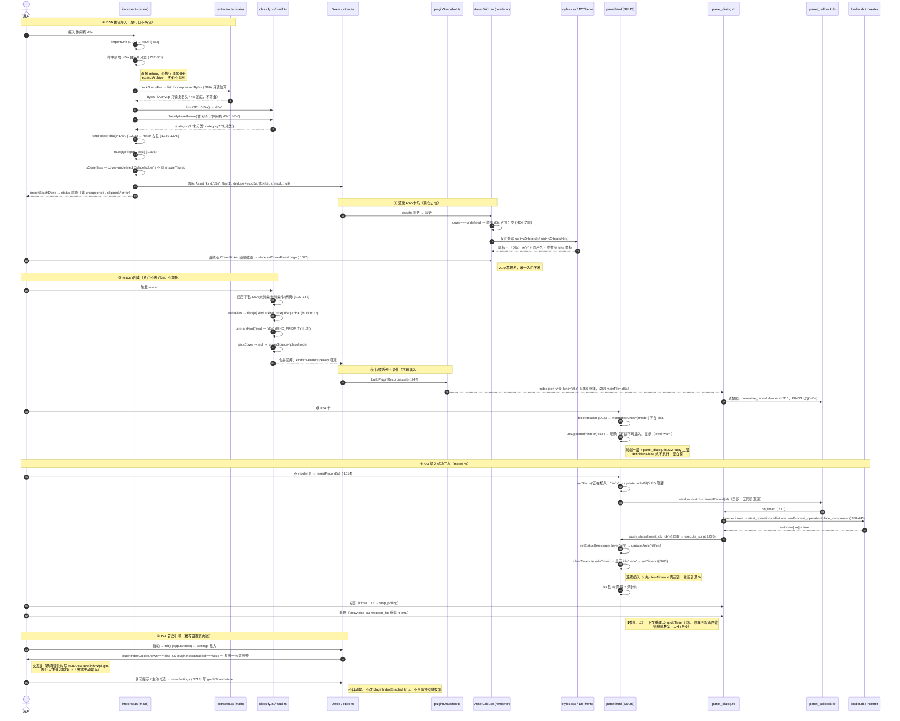
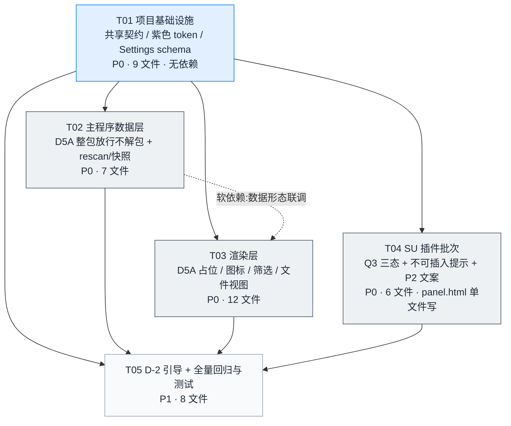

# 46 · V1.0 增量系统设计与任务分解（待批注）

> 文档版本：**v1.0（待批注稿）** ｜ 撰写：高见远（架构师） ｜ 日期：**2026-11-08** ｜ 语言：简体中文
> 性质：**增量系统设计 + 有序任务分解**。只描述 `docs/45` V1.0 增量 PRD 带来的改动；不重写 `docs/38` / `docs/39` / `docs/42`，不写实现代码，不改任何 `src/` / `plugin-src/` / `tests/` / 其它 `docs/`。
> **权威需求输入**：`docs/45-V1.0增量PRD-待批注.md`（**v1.0.2**，244 行；v1.0.2 只落档紫色口径 D-3，需求主体与 v1.0.1 一致）。
> ⚠️ **引用精度复核补记（初读 → 发稿前二次复核）**：本轮初读时 PM 升版中（`TaskList #252 in_progress`），`docs/45` 正文 §5.A 尚只有 D-1 / D-2；**发稿前复核时 PM 已完成 v1.0.2**（现 244 行）：§5.A 已含 **D-3 逐字回签（`45:193`）**、§4 已含 **R-9 全局禁紫红线风险（`45:177`）**、§5.B **A-1 附注已转「已回签 · 按破例口径执行」（`45:209`）**，§2.2 P1-1 判据亦补「紫色不扩散 grep 反向断言」（`45:110`）。⇒ 本文紫色口径同时引用**一手回签 `44 §13:223-231`**、派工单逐字「§紫色口径」与 **`45 §5.A D-3:193` / `45 §4 R-9:177`**；三处口径（含三条施工约束）逐字一致，本设计结论不受影响。**初稿曾以「PM 升版中」登记，已按最终版校正，未推测填充、未替 PM 补写。**
> ⚠️ **U-1 依据层级校正（team-lead 2026-11-08 独立复核，主体结论不变）**：初稿 §1.2 M20 / §11 U-1 曾把 `42 §12 C-5:752` 当作「主程序左栏不许新增 D5A 节点」的**用户拍板依据**，属**文档层级错位** —— C-5 约束的是 **SU 插件面板** `KIND_GROUPS`（`panel.html:561-568`；`42 §12` 整节是 T02 `panel.html` 换皮任务的九处报备裁定），主程序左栏另有一套 `KIND_NAV_ORDER`（`classify.ts:184-192`，5 项、**无「不许新增」的用户拍板记录**，且 `cad` 为 2026-10-29 新增节点之先例）。⇒ 已就地修订：C-5 降为「保持两套结构一致」的**参照**、不是禁止依据；「不新增节点」改写为**设计取舍 + 待主理人/用户回签**，不再表述为「用户已拍板不许改」。**设计结论、5 张任务卡、其余 11 项待明确事项一律不变。**
> ✅ **流程门状态登记（team-lead 2026-11-08 裁定同步，已落 `docs/44 §15:265-276`）**：`docs/44` 已被追加 **`§14` 架构师交付复核（`:235-263`）与 `§15` U 组四条用户回签（`:265-276`）**，实测 **276 行**。**用户弹窗回签结论**：`U-11` **只主程序用**、`U-1` **不新增第 6 导航节点**（前提已按 `§14.2` 校正为设计取舍，不是「用户 11-06 拍板不许改」）、`U-2` **设置页内嵌**一次性提示带 ⇒ **三条已结案**；`U-5` 用户**未选推荐**、拍板「**先查 D5 官方色卡再定**」⇒ **仍待回签**，本文 §1.5 的工程值（浅 `#6d28d9` / 深 `#c9b0ff`，6.15:1 / 7.88:1）**降级为候选、暂不落为最终色值**。⇒ **T01 紫色 token 与 T03 占位色值部分挂起**，`§15:274` 明确「紫色 token 属于 T01 地基、其余 T02/T03/T04 都依赖 T01，为避免先落色值再返工改写（U4 铁律），**本轮仍不派工程师施工**」。本文 §11 已按裁定同步四条状态、§7 的 T01/T03 已加挂起说明、§12 行数已统一为 `45` 244 行 / `44` 276 行；**过程留痕**：初稿曾把状态登记为「待主理人裁定」，本条为 team-lead 裁定后的结论态（已同步）。三条复核通过的结论（`§0` `isCoverless`、`§1.3` 放行点、`§1.5` 对比度计算）、5 张任务卡主体、10 类风险回归一律未改。
> **权威事实输入**：`docs/44-拖入与D5a调研实证包-待批注.md`（§9 四项拍板 / §11 D-1、D-2 回签 / §12 三处勘误 / §13 紫色冲突回签）；`docs/43-真机首验单`；`docs/42-插件UI与工具栏-增量设计`（v1.6 口径）；`docs/39-插件架构`（**v1.6**）；`docs/38-插件产品需求`（**v1.4**）；三份一手调研 `docs/probe/d5a-format-probe.md`(R1) / `su-drag-competitor.md`(R2, v1.1) / `su-drag-github.md`(R3, v1.1)。
> **三态标注**：`【查证】`=有一手依据（源码文件:行号 / 官方逐字 / 实跑输出，本轮逐条复跑）；`【推断】`=由查证事实推出、不写成事实；`【待核实】`=源码/资料查不到或需真机、D5 官方资料才能定论，一律不推测填充。
> **引用纪律**：全文引用给「文件:行号」。引用简写沿用 `45:11`（文档头「引用简写」行）：`types.ts`=`src/shared/types.ts`、`classify.ts`=`src/shared/classify.ts`、`extractor.ts`=`src/main/extractor.ts`、`importer.ts`=`src/main/importer.ts`、`rescan.ts`=`src/main/rescan.ts`、`fsutil.ts`=`src/main/fsutil.ts`、`naming.ts`=`src/shared/naming.ts`、`taxonomy.ts`=`src/shared/taxonomy.ts`、`classifyAsset.ts`=`src/shared/classifyAsset.ts`、`pluginSnapshot.ts`=`src/shared/pluginSnapshot.ts`、`pluginExport.ts`=`src/main/pluginExport.ts`、`settings.ts`=`src/main/settings.ts`、`AssetGrid.tsx`=`src/renderer/components/AssetGrid.tsx`、`styles.css`=`src/renderer/styles.css`、`fileView.ts`=`src/renderer/logic/fileView.ts`、`contextMenu.ts`=`src/renderer/logic/contextMenu.ts`、`SettingsDialog.tsx`=`src/renderer/components/SettingsDialog.tsx`、`CoverPicker.tsx`=`src/renderer/components/CoverPicker.tsx`、`DetailPanel.tsx`=`src/renderer/components/DetailPanel.tsx`、`coverImage.ts`=`src/renderer/logic/coverImage.ts`、`store.ts`=`src/renderer/store.ts`、`App.tsx`=`src/renderer/App.tsx`、`icons.tsx`=`src/renderer/icons.tsx`、`tailwind.config.js`=`tailwind.config.js`、`panel.html`=`plugin-src/idbox_panel/panel.html`、`core.rb`/`loader.rb`/`panel_callback.rb`/`panel_dialog.rb`=`plugin-src/idbox_panel/lib/<同名>.rb`、`44`/`45`/`43`/`42`/`39`/`38`/`R1`/`R2`/`R3` 见 `45:11`。
> ⚠️ `docs/probe/` 三份一手报告按 `.gitignore:16` 不入库（`44:122`）；本文只引用其结论，正式编号归并由主理人另行派工。
> **纪律声明（本轮逐条遵守）**：① 只新建本文件；② 不改 `src/` / `plugin-src/` / `tests/` / 其它 `docs/`；③ 不写实现代码（仅接口签名与状态机表格）；④ 不 commit / push / 打包 / 启动 SketchUp 或 ID BOX；⑤ **不替用户新增决策**，未定项一律列 §11「待明确事项」回传主理人；⑥ 四项拍板（`44 §9`）与 D-1 / D-2（`44 §11`）、紫色破例（`44 §13`）逐字不改。

---

## 0. TL;DR（给主理人 / 工程师的三句话）

| # | 结论 | 三态 | 依据 |
| --- | --- | --- | --- |
| 1 | V1.0 增量 = **三条施工线**：① 主程序新增一种资产类型 `d5a`（整包存档、不解包）+ 紫色 D5A 卡片占位；② SU 插件 Q3 撤销胶囊三态；③ 主程序 D-2 首启引导一次。Q1「沿用点击插入」**不改代码**（`loader.rb:388-443` 落位链原样保留，仅留档 + 反向断言）；Q2 的 0.9.3 小包**不进本设计**（`44:133`） | `【查证】` | `45:24`、`44:126-137` |
| 2 | **「白名单放行但不解包」的落点在 `importer.ts:782-801` 单文件直导分流**，不在 `extractor.ts:61` 的解压白名单：`.d5a` 必须被单文件分流拦下并走「与 HDR 同构」的单文件直导，从而**根本不进入** `extractArchive`（`:837`），`extractor.ts:284-290` 的 `unsupported` 抛出块与 `detectZipContent`（`:79`）均保持不变、不会被 ZIP 魔数旁路 | `【查证】` | 本轮复跑 `importer.ts:782-801/:826-844`、`extractor.ts:61/:79/:283-290/:318/:342/:386-429`、`R1 §2.2:152-162` |
| 3 | ⚠️ **本轮新发现一处上游未登记的施工陷阱**：`importMediaOne` 尾部把「非 HDR 单文件」**自身设为封面**（`importer.ts:1456` `cover: isHdr ? undefined : itemName`、`:1419` `coverAbs`、`:1427-1437` `ensureThumb`）。若 `.d5a` 无脑复用该分支，会把一个 8 MB ZIP 当 `cover` 并尝试 `nativeImage` 解码 → 破图 / 缩略图失败足迹，**直接违反 D-1「不留白、不显示纹理或二维码」与 P1-1⑤「库内无自动生成 D5 缩略图」**。⇒ 必须把「无封面」判定从 `isHdr` 推广为 `isCoverless`，走 HDR 同款「`cover=undefined` / `coverSource='placeholder'` / 不调 `ensureThumb`」路径 | `【查证】` | 本轮复跑 `importer.ts:1230-1238/:1417-1419/:1421-1422/:1424-1437/:1444/:1454-1457` |

> ⛔ **流程门状态（用户 2026-11-08 回签，`44 §15:274`）**：U-1 / U-2 / U-11 已结案，**仅 U-5（D5 官方品牌色）待回签** ⇒ 紫色 hex 降级为**候选**、`T01` 紫色 token 与 `T03` 占位色值挂起，**本轮仍不派工程师施工**（避免 U4 铁律下的返工改写）。详见文档头「流程门状态登记」与 §11。
>
> 本设计的 5 张任务卡（§7）严格按依赖排序，T01 为共享契约地基、其余卡尽量只依赖 T01；每张卡标注文件边界供**放行之后**的并行/串行判断。

---

# Part A · 系统设计

## 1. 实现方案与改动面

### 1.1 技术难点与框架选型（无新增依赖）

| 难点 | 判定（三态） | 选型 / 处置 | 依据 |
| --- | --- | --- | --- |
| D1 整包存档、不解包，但 `.d5a` 内容是标准 ZIP | `【查证】` 样本 10 条目全 STORED、前 4 字节 `PK\x03\x04`；`detectZipContent` 会认出它是 ZIP | 不引入/不复用任何解压路径；在**导入分流层**加白名单，走既有 `fs.copyFile` 单文件直导 | `R1 §1.1:29-49`、`44:85-86`、`extractor.ts:68-92/:413` |
| D2 现有导入链路有 3 条路径（压包 / 单文件直导 / 文件夹），扩展名判定分散 | `【查证】` | 只在 `importer.ts:782-801` 单文件分支加一处分流；共用 `kindFolder` / `classifyAssetName` / `dedupeKeyOf` / `rescan` 既有实现，不新造模型（用户 D-1 明确「和 HDR 一样」） | `R1 §2.1:136-150`、`importer.ts:1274-1275`、`44:174/178` |
| D3 新 kind 会让所有 `Record<AssetKind, …>` / `KINDS` 全量映射失效 | `【查证】` TypeScript 全量映射漏补即 typecheck 失败；Ruby 侧 `KINDS.include?` 漏补会把 kind 归 `other` | 逐处补齐（§1.2 大表 + §8 共享知识）；这是 `b59de52` 16 文件改动面的机械根源 | 本轮复跑 `classify.ts:40/56/144`、`AssetGrid.tsx:219`、`DetailPanel.tsx:37`、`Sidebar.tsx:28`、`core.rb:62`、`loader.rb:311` |
| D4 紫色破例不能扩散 | `【查证】` 用户 2026-11-08 拍板「只允许 D5A 卡片占位这一处」 | 只在主程序 `styles.css` + `tailwind.config.js` + `AssetGrid.tsx` 加 2 个变量 1 个分支；**`panel.html` 不加紫 token**、`--preview` 不动、UI 规范写一条显式例外 | `44 §13:223-231`（一手回签逐字）、`45 §5.A D-3:193`（逐字口径 + 三条施工约束）、`45 §4 R-9:177`（红线代价）、`45 §2.2 P1-1:110`（紫色不扩散反向断言）、派工单 §紫色口径 |
| D5 Q3 判定点是异步回执，不是同步返回 | `【查证】` `insertRecord` 无同步返回；成功唯一来自 `push_status(…, 'ok')` | 显隐控制收口在 `setStatus` 内一处；计时器放 IIFE 闭包（非全局） | `panel.html:1014-1021/:610-617/:1066-1069`、`panel_dialog.rb:238/:272-276`、本轮 grep `push_status(` 确认 `'ok'` 全文件仅 `:238` 一处 |
| D6 「只提示一次」的状态存哪 | `【查证】` 现 `SettingsSchema` 无任何 onboarding / firstRun / guide 字段（本轮 grep 全 `src/` 0 命中） | 新增一个 `settings.json` 布尔字段，走既有 `.optional().catch(false)` 单项降级；与 `pluginIndexEnabled` 分离 | `settings.ts:54-208`（尤其 `:195-205`）、`types.ts:845-853` |
| 架构模式 | — | 沿用既有 **MVC 式分层**：`shared/` 纯数据+纯函数（renderer 与 main 共用、零 IPC 依赖，`taxonomy.ts:4`）／`main/` IO 与导入编排／`renderer/` React + zustand 视图／SU 插件 `lib/` 单一模块 Ruby 装配（`39 §4.2:201`）。**不引入 MVVM / 新状态机框架 / 新服务层** | `taxonomy.ts:1-4`、`39 §4.2:196-201`、`docs/42 §3` |
| 开源框架 | — | 全部沿用现网（`package.json:17-38`）：React 18 / zustand / Dexie / Tailwind / adm-zip / zod / vitest / electron-vite；Ruby 侧只用 stdlib `json`/`digest`（`core.rb:24`）。**本批零新增依赖**，详见 §6 | `package.json:17-38`、`core.rb:12-24` |

### 1.2 逐文件改动面（相对路径 / 新增 or 改造 / 改什么 / 依据行号）

> 「核查不改」= 本轮复跑确认行为已满足新需求，**本批不改代码**，但列入任务卡回归断言（防止工程师误改）。行号均为当前工作树实测值。

#### 1.2.1 主程序 · 共享层与配置

| # | 相对路径 | 新增/改造 | 改什么 | 依据行号（【查证】） |
| --- | --- | --- | --- | --- |
| M01 | `src/shared/types.ts` | 改造 | ① `AssetKind` 联合类型由 6 值加 `'d5a'`（第 7 种）；② `DEFAULT_SETTINGS` 新增引导态布尔字段 `pluginIndexGuideShown: false` | `types.ts:19`（`export type AssetKind = 'model'…'other'`）、`:292`（「一条资产记录 = 库内的一个文件夹」）、`:293-312`（`Asset` 全字段，无 `mainFile`）、`:845-853`（`DEFAULT_SETTINGS` 末两项 `sidebar*Collapsed` / `pluginIndexEnabled: false`） |
| M02 | `src/shared/classify.ts` | 改造（6 处） | ① `EXT_KIND` 加 `d5a: 'd5a'`；② `KIND_LABEL` 加 `d5a: 'D5A'`；③ `KIND_FOLDER` 加 `d5a: 'D5A'`（独立第 7 个顶层目录）；④ `KIND_FILTER_CAPS` 加 `d5a: {resolution:false, style:false, modelFormat:false}`（仿 `cad:151`）；⑤ `KIND_PRIORITY` 加 `'d5a'`（置于 `'texture'` 后、`'other'` 前）；⑥ `pickPrimaryFile`/`PRIMARY_MODEL_EXTS`/`pickCover` **不改**（见 §1.4 裁定） | `classify.ts:9-30`、`:40-47`、`:56-64`、`:144-153`、`:200`、`:302`、`:391-420`、`:436-446`、`:34-37`（硬约束：`KIND_LABEL` 只用于显示，拼路径只能用 `kindFolder()`）、`:454-455` |
| M03 | `src/shared/taxonomy.ts` | **核查不改** | 不新建 D5 一级册、不新增任何词条、不生成 slug；`CHANNEL_LEVEL1` 不加 `d5a` 键 ⇒ `isLevel1AllowedForKind('d5a', …)` 恒 `false` ⇒ 双未分类。**铁律：逐项照抄、禁止生成 slug** | `taxonomy.ts:6-10`（词表纪律原文）、`:127-143`（`CHANNEL_LEVEL1` 键为 `model/texture/material/cad/hdri`，非 `Record<AssetKind,…>`，加 kind 不需改）、`:1151-1161`（`allowed === undefined ⇒ false`）、`R1 §5:292-301`（esbuild 实跑）、`customTaxonomy.ts:14-15`（自定义词表不参与自动分类） |
| M04 | `src/shared/naming.ts` | **核查不改** | `dedupeKeyOf(name, kind)` 靠 kind 前缀天然隔离 → `d5a:休闲椅`，与 `model:休闲椅` 不撞 | `naming.ts:330-332`、`R1 §6.2:314-317` |
| M05 | `src/main/settings.ts` | 改造 | `SettingsSchema` 新增 `pluginIndexGuideShown: z.boolean().optional().catch(false)`（单项降级，脏值不拖垮整份 settings.json） | `settings.ts:54-208`、`:195-205`（`sidebar*Collapsed` / `pluginIndexEnabled` 同款纪律）、`:40-42`（对象级脏值不拖垮配置的教训） |
| M06 | `src/renderer/styles.css` | 改造 | ① 新增 `--d5-brand` / `--d5-brand-tint` 两变量（浅 `:root` 与深色 `@media` 块各一套值）；② `:9` 全局禁紫注释块**追加一条逐字显式例外**（草稿见 §1.5）；③ `:42-43` / `:482` 两处红线**保留原文不改**，只在例外段里点名；④ `.badge` 等既有组件**不改**（D5A kind 角标沿用中性灰 tint） | `styles.css:9`、`:42-45`、`:47-60`（浅品牌色组）、`:106-119`（深品牌色组）、`:300-323`（`.badge` / `.badge-su` / `.badge-max`）、`:482` |
| M07 | `tailwind.config.js` | 改造 | 加 `'d5': token('--d5-brand')` / `'d5-tint': token('--d5-brand-tint')` 两个映射，供 `AssetGrid.tsx` 用 `bg-d5-tint text-d5` | `tailwind.config.js:52-77`（`token()` 映射表，`:66-77` 为 su/max/cad 品牌色同族）、`:76-77`（`'cad-tint'` / `cad`） |

#### 1.2.2 主程序 · 导入 / 重扫 / 快照层

| # | 相对路径 | 新增/改造 | 改什么 | 依据行号（【查证】） |
| --- | --- | --- | --- | --- |
| M08 | `src/main/importer.ts` | **改造（本批核心）** | ① `:782-801` 单文件直导块新增 `.d5a` 白名单分支（**放行但不解包**，见 §1.3）；② `importMediaOne` 内把「无封面」判定由 `isHdr` 推广为 `isCoverless = isHdr ‖ kind==='d5a'`，使 `coverAbs`/`cover`/`coverSource`/`ensureThumb`/`fillImageSizes` 走 HDR 同款「不做封面」路径；③ `isHdr` 仍单独控制 emit 文案与 `panoramaNoteFromName`（不得套用到 d5a） | `importer.ts:782-801`（分流三分支）、`:826-844`（`extractArchive` 调用点）、`:1230-1238`（`importMediaOne` 签名 `kind: AssetKind` + `isHdr`）、`:1262`（emit 文案）、`:1265-1275`（ext / assetName / `files[]` / `kindFolder`）、`:1281`（`classifyAssetName`）、`:1294`（`zhimoIdFromSources`）、`:1324`（「不是 `moveDir(contentRoot)` 而是 mkdir 旧路径 + copyFile」）、`:1349-1376`（mkdir 占位锁 + `uniqueName`）、`:1395`（`fs.copyFile`）、`:1417-1419`/`:1421-1422`/`:1424-1437`/`:1444`/`:1454-1457`（**陷阱所在**）、`:1460`（`files: [file]`）、`:1481`（`dedupeKeyOf`）、`:1619`（同义注释） |
| M09 | `src/main/extractor.ts` | **核查不改（关键）** | `SUPPORTED_EXTS` **不得**加 `.d5a`（加进去 = 会走解压）；`:284-290` 的 `unsupported` 抛出块保持原样作为兜底防线；`detectZipContent` 保持只在 `extractArchive` 内被调用，不得为 `.d5a` 新增嗅探旁路 | `extractor.ts:60-61`（`const SUPPORTED_EXTS = new Set(['.zip','.rar','.7z'])`）、`:79-92`（`detectZipContent`）、`:283-290`（`extractArchive` 首句白名单 + 抛出）、`:318`/`:342`/`:413`（三处嗅探调用点）、`:386-429`（`listUncompressedBytes` 只读估算，见 §1.3 注） |
| M10 | `src/main/rescan.ts` | 改造（仅注释/断言）+ 行为核查 | 四层结构、第 4 层必须是目录的既有实现**不改**；确认新增顶层目录 `D5A/` 能被「任意顶层目录都扫描」的兼容设计读到；确认 `primaryKind(files)` 在 `KIND_PRIORITY` 加 `'d5a'` 后回读仍为 `d5a`（不再走 `fallbackKindOf`） | `rescan.ts:126-143`（固定四层）、`:155-158`（**不校验**顶层目录名属于 `KIND_FOLDER`，任意顶层目录都扫）、`:186-204`（第 4 层必须 `st.isDirectory()`，`files.length===0` 跳过）、`:209-212`（`kind` 由 `primaryKind` 决定，仅 `other` 才 `fallbackKindOf`）、`:215`+`:254-255`（`pickCover`→`null`⇒`coverSource='placeholder'`）、`:220-229`（metaJson 只在有 `.json` 时解析）、`:262-269`（zhimoId 回读）、`:282`（dedupeKey 回读） |
| M11 | `src/main/fsutil.ts` | **核查不改** | `walkFiles` 的 `kind: kindOfExt(ext)` 在 `EXT_KIND` 加 `d5a` 后自动把 rescan 回读的 `files[0].kind` 判为 `'d5a'`，这是 kind 稳定的关键；`isSkippedFile` 不拦 `.d5a`（`JUNK_EXTS` 只含 html/htm/txt/url） | `fsutil.ts:5`（import `kindOfExt`）、`:14-16`、`:19-41`（`walkFiles`）、`:37`（`kind: kindOfExt(ext)`）、`classify.ts:273-299`（`JUNK_NAME_RE` / `JUNK_EXTS`） |
| M12 | `src/shared/pluginSnapshot.ts` | **核查不改** | `kind: asset.kind` 原样透传（P0-4③）；`mainFile = pickPrimaryFile(files)` 对整包 `files[]`（恰 1 个 `.d5a`）退到 `files[0]`，语义正确 | `pluginSnapshot.ts:106-112`（`PluginSnapshotRecord.kind: AssetKind`）、`:247-273`（`buildPluginRecord`）、`:252`/`:256`/`:261`/`:264`/`:265` |
| M13 | `src/main/pluginExport.ts` | **核查不改** | 写盘判定只看 `pluginIndexEnabled`；引导态字段**不得**加进写快照触发集（A1 触发集封闭） | `pluginExport.ts:222-238`（`writePluginSnapshot` 首段）、`38 §8.1:174`（A1 触发点已拍板） |
| M14 | `src/shared/classifyAsset.ts` | **核查不改** | `level2ScopeOf('d5a')` 返回 `undefined`；`isLevel1AllowedForKind('d5a',…)` 恒 `false` ⇒ 恒返回双未分类（实测结论，见 §1.4） | `classifyAsset.ts:77-84`（`level2ScopeOf`）、`:94-158`（`classifyAssetName`）、`:142`/`:154`/`:157`（闸门 + 双未分类返回） |

#### 1.2.3 主程序 · 渲染层

| # | 相对路径 | 新增/改造 | 改什么 | 依据行号（【查证】） |
| --- | --- | --- | --- | --- |
| M15 | `src/renderer/components/AssetGrid.tsx` | 改造 | ① `KIND_ICON: Record<AssetKind,…>` 补 `d5a` 项；② 卡片封面渲染在 `const Icon = KIND_ICON[asset.kind]` 之前新增 `asset.kind === 'd5a'` 分支：**紫色底板 + 居中「D5a」大字 + 资产名底条 + 中性灰 kind 角标**，不引用任何图片；③ `FILE_ROW_ICON: Record<FileRow['kind'],…>` 补 `d5a` 项；④ 文件视图内 `.d5a` 行封面沿用同一占位语言（**同一处紫色、不新增第二套**） | `AssetGrid.tsx:219-226`（`KIND_ICON` 6 值）、`:385-403`（`.max` 品牌占位，注释逐字「用户可随后手动贴封面」）、`:404`（`const Icon = KIND_ICON[asset.kind]`）、`:638`（`FILE_ROW_ICON`）、`:759-790`（CAD 红「CAD」大字占位，同族先例）、`:791+`（`fileThumbUrl` 常规路径） |
| M16 | `src/renderer/icons.tsx` | 改造 | 新增 `IconD5a`（纯自绘 SVG 几何，**不引用 D5 官方 logo 文件**，规避商标风险；与 `b59de52` 新增 `IconCad` 同构 +17 行） | `b59de52` 清单 `src/renderer/icons.tsx \| 17 +++`、`AssetGrid.tsx:228-233`（「自绘 SVG 几何抽象——不引用任何官方 logo 文件」纪律） |
| M17 | `src/renderer/components/DetailPanel.tsx` | 改造 | `KIND_ICON: Record<AssetKind,…>` 补 `d5a`；详情封面无图时走同一占位 | `DetailPanel.tsx:37`（`KIND_ICON`）、`:919`（`const Icon = KIND_ICON[kind]`）、`:498-508`（更换封面按钮，D-1 零开发不动）、`:499-504`（`CoverPicker` 接线） |
| M18 | `src/renderer/components/DuplicateCompareDialog.tsx` | 改造 | `KIND_ICON: Record<AssetKind,…>` 补 `d5a` | `DuplicateCompareDialog.tsx:27`、`:49` |
| M19 | `src/renderer/components/QuickLookOverlay.tsx` | 改造 | `KIND_ICON: Record<AssetKind,…>` 补 `d5a`（`:154` 已有 `?? IconOther` 兜底，仍须补齐全量映射） | `QuickLookOverlay.tsx:53`、`:154` |
| M20 | `src/renderer/components/Sidebar.tsx` | 改造 | `KIND_ICON: Record<AssetKind,…>` 补 `d5a`（全量映射，必补）；**U-1 已由用户 2026-11-08 回签结案：不新增第 6 导航节点**（`44 §15:270`），`KIND_NAV_ORDER` 不加 D5A，D5A 经「全部」视图与搜索可见；前提按层级校正，这是设计取舍的回签、非「11-06 拍板不许改」 | `Sidebar.tsx:28`、`:430`（`KIND_ICON[node]`）、`classify.ts:184-192`（`KIND_NAV_ORDER` 5 项，无「不许新增」拍板，`:178-179` 记 `cad` 于 2026-10-29 新增节点之先例）、`42 §12 C-5:752`（**仅约束插件面板 `KIND_GROUPS`，作「两套结构一致」参照，不是禁止依据**） |
| M21 | `src/renderer/logic/fileView.ts` | 改造 | `FileRowKind` 加 `'d5a'`；`FILE_ROW_KIND_LABEL` / `KIND_ORDER` / `fileRowKindOf` / 新增 `D5A_EXTS = ['d5a']` 同族补齐（与 `b59de52` 中 `fileView.ts +42` 加 `cad` 组同构）；整包唯一主文件应排在文件视图首位 | `fileView.ts:27`（`FileRowKind`）、`:59-72`（`IMAGE_EXTS`）、`:80-102`（`MODEL_EXTS`）、`:111`（`CAD_EXTS`）、`:114-119`（`FILE_ROW_KIND_LABEL`）、`:139`（`KIND_ORDER`）、`:145-153`（`fileRowKindOf`） |
| M22 | `src/renderer/logic/contextMenu.ts` | 改造 | `kind`→菜单能力分派补 `d5a` 分支；D5A 不提供「插入 / 材质球」等不适用项 | `contextMenu.ts:189-190`（`if (kind === 'hdri') … if (kind === 'model' ‖ 'texture' ‖ 'material' ‖ 'cad')`）、`b59de52` 清单 `contextMenu.ts \| 10 +-` |
| M23 | `src/renderer/components/CoverPicker.tsx` / `src/renderer/logic/coverImage.ts` / `src/renderer/store.ts`（`setCoverFromImage`） | **核查不改** | D-1 已回签：封面由用户走现成三通道（剪贴板粘贴 / 拖图 / 选文件）自行补，**V1.0 零开发**；`setCoverFromImage` 是唯一入口，不改 | `CoverPicker.tsx:31-40`（三来源逐字）、`:128`、`:151`、`coverImage.ts:5-16`、`DetailPanel.tsx:499-504`、`store.ts:1668-1678`（`setCoverFromImage`）、`44:176-178` |

#### 1.2.4 SU 插件（`plugin-src/idbox_panel/`）

| # | 相对路径 | 新增/改造 | 改什么 | 依据行号（【查证】） |
| --- | --- | --- | --- | --- |
| P01 | `plugin-src/idbox_panel/panel.html` | **改造（单文件写）** | ① **Q3**：给 `.undo-pill` 加 `id="undo"`（第 12 个 id，只增不删）+ 默认隐藏类；`setStatus` 内一处 `updateUndoPill(level)` 显隐与 5 s 计时；`title` 按 P2-2 改文案；② **P0-4**：`unsupportedHintFor()` 加 `d5a` 专属「可读不可插入」提示；③ **P2-1**：`:659-662` 兜底文案去掉 `manifest.generatedAt` 等内部字段名；④ `state` 只增字段（C-8 先例）；⑤ `window.IDBOX` / 5 契约 / 11 既有 id **一个不动**；⑥ **不加紫 token** | `panel.html:10-23`（契约注释）、`:229/:239/:266/:389-390/:423/:458-459/:469/:483-491`（11 个既有 id，`42 §4.1:296-297`）、`:369-377`（`.undo-pill` CSS）、`:536-538`（静态常显 DOM + `title`）、`:546-557`（`state`）、`:605`（`iconForKind`）、`:610-617`（`setStatus`）、`:708-713`（`unsupportedHintFor`）、`:715-723`（`blockReason` 前端一层拦截）、`:779`（kind 角标）、`:1014-1021`（`insertRecord` 无同步返回）、`:1050-1064`（`render`）、`:1066-1069`（`window.IDBOX`）、`:1083-1096`（click 事件委托）、`:1199-1200`（`sketchup.ready()`） |
| P02 | `plugin-src/idbox_panel/lib/core.rb` | 改造 | ① `KINDS` 六值 → 七值加 `'d5a'`（否则 `normalize_record` 会把快照 kind 归 `other`，破坏 P0-4③「原样透传」）；② `KIND_LABELS` 加 `'d5a' => 'D5A'`；③ 新增 D5A 专用不可插入提示常量（或复用 `UNSUPPORTED_INSERT_HINT` 的同族新常量）；④ **`INSERTABLE_KINDS` 保持 `%w[model].freeze` 一个字不动**；⑤ `PLUGIN_VERSION` / `MIN_SU_MAJOR` 不动 | `core.rb:12-22`（硬约束 7 条）、`:24`（`require 'json'`）、`:31`（`PLUGIN_VERSION='1.1.0'`）、`:44`（`MIN_SU_MAJOR=2021`）、`:61-72`（`KINDS` / `INSERTABLE_KINDS` / `KIND_LABELS`）、`:74-75`（`UNSUPPORTED_INSERT_HINT` / `SETTINGS_HINT`）、`:356-358`（`insert_ok`） |
| P03 | `plugin-src/idbox_panel/lib/loader.rb` | **核查不改（Q1 铁律）** | `loader.rb:388-443` 的 `start_operation` → `definitions.load` → `commit_operation` → `place_component` 落位链**原样保留**；`normalize_record:306-325` 只因 `KINDS` 变化而自动放行 `d5a`，不改代码 | `loader.rb:306-325`（`normalize_record`，`:311` `kind='other' unless KINDS.include?`）、`:358-404`（`Inserter.insert`，`:392` `definitions.load`）、`:388`/`:409`/`:414`/`:437-447`（落位链）、`44:132`（Q1 拍板） |
| P04 | `plugin-src/idbox_panel/lib/panel_dialog.rb` | **核查不改（+ 回归断言）** | `on_insert:217-246` 的 Ruby 侧二层闸门（`:232` 非 `INSERTABLE_KINDS` 直接拒绝）、`push_status:272-280`、`:238` 唯一 `'ok'` 回执点全部不改；Q3 显隐纯前端实现 | `panel_dialog.rb:217-246`、`:232-235`、`:238-242`、`:272-280`；本轮 grep `push_status(` 确认 `'ok'` 仅 `:238` 一处，其余为 error/info/warn |
| P05 | `plugin-src/idbox_panel/lib/panel_callback.rb` | **核查不改** | `CALLBACK_NAMES = %w[ready refreshIndex insertRecord]` 逐字不变，不新增第 4 个回调 | `panel_callback.rb:45-47`、`42 §16 E-11:823` |
| P06 | `scripts/plugin-smoke.rb` | 改造（回归脚本） | 场景 A/B 补 D5A「不可插入」与 Q3 三态的离线断言；`ruby -c` 范围不变 | `39 §4.4:236-243`、`42 §16 E-1:813`、`42 §16 E-11:823` |

#### 1.2.5 测试

| # | 相对路径 | 新增/改造 | 改什么 | 依据行号 |
| --- | --- | --- | --- | --- |
| T01t | `tests/d5aKind.test.ts` | **新增** | 仿 `tests/cadKind.test.ts`（`b59de52` 新增 165 行）：kind 判定 / 目录名 / 整包 `files[]` / 双未分类 / `dedupeKey` / `pickPrimaryFile` / rescan 回读 / 快照透传 / 紫色 token 对比度断言 | `b59de52` 清单 `tests/cadKind.test.ts \| 165 +++` |
| T02t | `tests/classify.test.ts` / `tests/filterCaps.test.ts` / `tests/kindFolderWiring.test.ts` | 改造 | 全量映射类断言随第 7 个 kind 更新（`Object.keys(KIND_FOLDER)` 等期望值 6→7） | `b59de52` 清单三文件 `+64/+7/+8` |
| T03t | `tests/taxonomy.test.ts` / `tests/cadTaxonomy.test.ts` / `tests/hdriTaxonomy.test.ts` | **核查不改** | 零交集守卫只针对「新册」；本设计不新增册，守卫不触发 | `taxonomy.ts:139/:141`、`tests/taxonomy.test.ts:326-336`、`tests/cadTaxonomy.test.ts:130`、`tests/hdriTaxonomy.test.ts:54` |

### 1.3 「白名单放行但不解包」的具体做法（Q4 核心裁定）

> 派工单点名：`extractor.ts:284-290` 的 `unsupported` 抛出块**在 `extractArchive` 函数内部**，且 `detectZipContent`（`:79`）会认出 `.d5a` 是 ZIP（样本前 4 字节 `PK\x03\x04`，`R1 §1.1`）。因此**不能**靠「把 `.d5a` 加进解压白名单」或「让嗅探放行」来实现兼容 —— 那等于解包。

| 层 | 现状（【查证】） | 本批处置 | 为什么这样才「不解包」 |
| --- | --- | --- | --- |
| L1 导入总分流 | `importOne`（`importer.ts:772`）先判 `!isDir`（`:782`），三分支：`:784` `IMAGE_IMPORT_EXTS`→`importMediaOne('texture')`；`:785-789` `isHdrExt`→`importMediaOne(kindOfExt(ext))`；`:799-800` `extKind==='model'‖'cad'`→`importModelOne` | **在此块新增第 4 条分支**：`ext === 'd5a'` ⇒ `importMediaOne(src, st, deps, kindOfExt('d5a'), batch)`（即 `kind='d5a'`），**早于** `:804` 空间预检与 `:830 createStaging` 直接 `return` | `.d5a` 在 `:801` 之前就被拦下，`importer.ts:826-844` 的 `status:'extracting'` → `createStaging` → `extractArchive(src, staging, …)` **一次都不会执行** |
| L2 解压闸门 | `extractor.ts:61` `SUPPORTED_EXTS={'.zip','.rar','.7z'}`；`:283-290` `extractArchive` 首句判白名单，不在则抛 `ExtractionError(…,'unsupported')`（`:287` 文案 / `:288` kind） | **两处都保持原样**，`SUPPORTED_EXTS` **不得**加 `.d5a` | 保持「兜底防线」：若将来有别的路径误把 `.d5a` 送进 `extractArchive`，仍会报 `unsupported` 而不是被静默解包 |
| L3 ZIP 内容嗅探 | `detectZipContent`（`:79-92`）只在 `extractArchive` 内 `:318` / `:342` 及 `listUncompressedBytes` 内 `:413` 被调用；`:342` `const zipByContent = ext !== '.zip' && (await detectZipContent(src))` 是给「.rar/.7z 后缀实为 zip」的 JS 兜底 | **不改**，不为 `.d5a` 新增嗅探旁路 | `.d5a` 根本不进 `extractArchive` ⇒ `:318`/`:342` 不会被触发；`R1 §2.2:158` 的「不会让 `.d5a` 因内容是 ZIP 而绕过」结论成立 |
| L4 只读空间估算（**需登记的边界**） | `checkSpaceFor`（`importer.ts:804-809` / `:1240-1245`）→ `listUncompressedBytes`（`extractor.ts:386-429`）：`:413` 会 `detectZipContent` 嗅探，命中后 `:417-423` 用 `AdmZip` **只读遍历条目头求和**（不写盘、不落文件），失败则 `:429` `archiveBytes × 3` 兜底 | **不改**；如实登记：这是**只读估算**，不产生 `files[]`、不落盘、不解包，与「整包存档」不冲突 | `R1 §6.3:323` 已判定「相关但不阻断」；估算耗时/内存 `【待核实】`（§10 R-4） |
| L5 落盘 | `importMediaOne` 的 `:1349-1376`（`mkdir` 占名）→ `:1395` `fs.copyFile(src, dest)`；`:1324` 注释逐字「不是 `moveDir(contentRoot)` 而是「mkdir 旧路径 + copyFile」」 | **不改**，直接复用 | 与 HDR 单文件同构（`44:174/178`、`45 §5.A D-1` 独立复核成立）；`rescan.ts:186-200` 第 4 层必须是目录，天然满足 |

> **一句话**：「放行」放的是**资产文件白名单**（在导入分流层），不是**解压白名单**（`extractor.ts:61`）。整包以 1 个文件 `copyFile` 进 `D5A/未分类/未分类/休闲椅/休闲椅.d5a`，`files[]` 恰 1 项，包内 10 条目永不落地。

### 1.4 新资产类型的完整裁定（`docs/45 §5.B A-1` 归架构师）

> **命名裁定**：`kind = 'd5a'`（小写、与扩展名一致、与既有 `model/cad/hdri` 同风格）。这是**程序枚举值**，不是词表词条，故不触犯 `taxonomy.ts:6-10` 的「禁止生成 slug」铁律；同时**不新建任何词表词条 / 一级册**。

| 项 | 裁定 | 三态 | 依据行号 |
| --- | --- | --- | --- |
| **kind 取值** | `'d5a'`，`AssetKind` 第 7 值 | `【查证】` | `types.ts:19`（现 6 值）、`44:96` |
| **KIND_LABEL**（显示名） | `'D5A'`；**只用于 UI 显示，永不拼路径** | `【查证】` | `classify.ts:40-47`、`:34-37`（硬约束注释） |
| **KIND_FOLDER**（落盘目录） | `'D5A'`（独立第 7 个顶层目录）；`kindFromFolderName('D5A')` 遍历 `KIND_FOLDER` 自动反解为 `d5a`；`AMBIGUOUS_KIND_FOLDERS` 派生因独占目录不受影响 | `【查证】` | `classify.ts:56-64`、`:76-84`、`:469-478`、`:454-455`（`kindFolder()`）、`rescan.ts:155-158`（任意顶层目录都扫） |
| **文件扩展名识别** | `EXT_KIND` 加 `d5a: 'd5a'`；`kindOfExt('d5a')='d5a'`；**不**加入 `IMAGE_IMPORT_EXTS`、**不**加入 `isHdrExt`、**不**加入 `PRIMARY_MODEL_EXTS`（否则会被当模型主文件，破坏「不可插入」语义） | `【查证】` | `classify.ts:9-30`、`:302`、`:323-325`；`importer.ts:784-785`；`fsutil.ts:37` |
| **图标与品牌色** | 新增自绘 `IconD5a`（不引用官方 logo，规避商标）；卡片封面 = **紫色底板 + 「D5a」大字 + 资产名 + 中性灰 kind 角标**；紫 token 见 §1.5。插件面板**不**加紫 | `【查证】`+`【推断】` | `AssetGrid.tsx:228-233`（自绘纪律）、`:385-398`/`:759-790`（同族先例）、`icons.tsx`（`b59de52 +17`）、`44:178` |
| **词表频道归属** | **不新建一级册、不改 `CHANNEL_LEVEL1`、不新增词条**。`isLevel1AllowedForKind('d5a',…)` 因 `allowed===undefined` 恒 `false` ⇒ **自动分类恒为 `未分类 / 未分类`（双未分类）**，落盘 `D5A/未分类/未分类/<资产名>/` | `【查证】` | `taxonomy.ts:6-10` 铁律、`:127-143`、`:1151-1161`；`classifyAsset.ts:77-84`/`:142`/`:154`/`:157`；`R1 §5:292-301`（esbuild 实跑：只有 `model` 命中「家具/椅子/凳子」，其余 5 个 kind 全双未分类）；`customTaxonomy.ts:14-15`（自定义词表不参与自动分类） |
| **`primaryKind(files)`** | `KIND_PRIORITY` 加 `'d5a'`（置于 `'texture'` 后、`'other'` 前）。整包 `files[]` 恰 1 个 `kind='d5a'` ⇒ 直接命中 `d5a`，**不**再走 `rescan.ts:212` 的 `fallbackKindOf` | `【查证】` | `classify.ts:200`、`:354-360`、`rescan.ts:209-212` |
| **`pickPrimaryFile(files)`** | **不改**（不加 `PRIMARY_MODEL_EXTS`、不加 `kind==='d5a'` 分支）：`:438-445` 三轮都不命中 → 退到 `files[0]`；整包 `files[]` 恰 1 个 `.d5a`，`files[0]` 即整包主文件，语义正确 | `【查证】`+`【推断】` | `classify.ts:436-446`、`pluginSnapshot.ts:252/:264`、`R1 §3:243`；⚠️ 若将来 `files[]` 多文件则判定会漂移，登记 §10 R-3 |
| **`files[]` 内容** | 恰 1 项：`{ rel:'休闲椅.d5a', name:'休闲椅.d5a', ext:'d5a', size:8_229_266, kind:'d5a' }`；包内 `1.d5mesh` / `d5material.xml` / `info.json` / `textures/*` **一律不进 `files[]`** | `【查证】` | `importer.ts:1267-1273`、`:1460`、`R1 §3:220-230`（形态 A）、`45 §2.1 P0-3②` |
| **`cover` / `coverSource` / 缩略图** | `cover=undefined`、`coverSource='placeholder'`、`thumbStatus='none'`、**不调 `ensureThumb` / `fillImageSizes`**（见 §0 陷阱与本表下方注） | `【查证】` | `importer.ts:1417-1419`/`:1424-1437`/`:1454-1457`、`classify.ts:391-393`（`images.length===0 ⇒ null`）、`rescan.ts:215`/`:254-255`、`R1 §3:229`、`45 §2.5 F7` |
| **`dedupeKey`** | `dedupeKeyOf('休闲椅','d5a') = 'd5a:休闲椅'`，与 `model:休闲椅` / `texture:休闲椅` **不撞**（kind 是前缀）。**不改 `naming.ts`** | `【查证】` | `naming.ts:330-332`、`importer.ts:1481`、`rescan.ts:282`、`R1 §6.2:314-317`（若强指定 `model` 会撞，独立 kind 正是规避手段） |
| **`zhimoId` 通道** | **不改**。整包不解包 ⇒ `zhimoIdFromSources` 只看到 `休闲椅.d5a` 与资产名，通常解析出 `null`；`info.json.productID` 是 D5 侧 32-hex GUID，非知末数字 ID，`【推断】`解析不出（真机 `【待核实】`）。快照 `:261` 原样透传；判重落「双方都无 ID → same-name 弱判定」 | `【查证】`+`【推断】`+`【待核实】` | `importer.ts:1294`、`rescan.ts:262-269`、`pluginSnapshot.ts:261`、`importConflict.ts:165-187`（引用自 `R1 §2.5:206`）、`R1 §6.2:318`/`§7:340` |
| **rescan 回读** | 目录 `D5A/未分类/未分类/休闲椅/` 被 `rescan.ts:155-158` 兼容设计读到 → `walkFiles`（`fsutil.ts:37`）给 `files[0].kind='d5a'` → `primaryKind`=>`d5a` → `pickCover`=>`null`=>`placeholder` → `dedupeKey`=>`d5a:休闲椅` → `zhimoId`=>`null`：**资产不丢、kind 不漂移、封面走占位** | `【查证】` | `rescan.ts:126-143`/`:155-158`/`:186-212`/`:215`/`:254-255`/`:282`、`fsutil.ts:37`、`R1 §3:230` |
| **快照 / 插件侧流向** | `pluginSnapshot.ts:256` kind 原样透传 → `index.json` → `loader.rb:310-311`（`KINDS` 加 `d5a` 后不再归 `other`）→ `panel.html:718` 前端一层 + `panel_dialog.rb:232` Ruby 二层均因 `INSERTABLE_KINDS=['model']` 拒绝 → **不进 `definitions.load`、不产生白模** | `【查证】` | `pluginSnapshot.ts:247-273`、`core.rb:61-64`、`loader.rb:306-311`/`:392`、`panel.html:715-723`、`panel_dialog.rb:232-235`、`R1 §4:254-274` |

> ⚠️ **本表最重要的施工注（§0 第 3 条展开）**：`importMediaOne` 现以 `isHdr`（`importer.ts:1238`）区分「无封面」：`:1417-1419` `coverAbs = isHdr ? null : destFile`、`:1454-1457` `cover: isHdr ? undefined : itemName` / `coverSource: isHdr ? 'placeholder' : 'named'`、`:1424-1437` `ensureThumb(id, coverAbs)`、`:1421-1422` `fillImageSizes`。若 `.d5a` 以 `isHdr=false` 进入，会把 **ZIP 文件本身设为封面**并触发 `nativeImage.createFromPath` 解码（`R1 §6.1:308-312` 整图解码路径）→ 破图 + `thumbStatus='failed'` 足迹，违反 `45 §2.2 P1-1①⑤`。
> ⇒ **裁定**：把「无封面/无缩略图」判定抽成 `isCoverless = isHdr || kind === 'd5a'`（或同义 `NO_PREVIEW_KINDS` 集合），只作用于 `:1417-1419` / `:1424-1437` / `:1454-1457` / `:1421-1422` 四处；`isHdr` **继续单独**控制 `:1262` emit 文案与 `:1444` `panoramaNoteFromName`，不得把 D5A 误当 HDR。这是与用户 D-1「和 HDR 的处理方式是一样的」最贴合、改动面最小的实现。

### 1.5 紫色 token：具体 hex / 对比度 / 落点 / 显式例外逐字草稿

#### 1.5.1 色值与对比度（**候选工程值，U-5 待回签后才可落为最终色值**；仅 D5A 占位一处可用）

| 变量名（带 `d5`） | 浅色 `:root` 值 | 深色 `@media (prefers-color-scheme: dark)` 值 | 用途 |
| --- | --- | --- | --- |
| `--d5-brand` | `#6d28d9` | `#c9b0ff` | D5A 占位上的「D5a」大字 / 文字色（品牌主色） |
| `--d5-brand-tint` | `#f1ecff` | `#2b2148` | D5A 占位底板（浅色淡紫 / 深色「比卡片再深一点」的暗紫） |

**对比度计算**（WCAG 2.x 相对亮度：每通道 `c≤0.03928 ? c/12.92 : ((c+0.055)/1.055)^2.4`，`L=0.2126R+0.7152G+0.0722B`，`CR=(L_max+0.05)/(L_min+0.05)`；本轮用 `node -e` 实跑，脚本不落盘）：

| 组合（字 on 底） | 计算值 | 判定 | 参照（本项目既有注释口径） |
| --- | --- | --- | --- |
| 浅 `#6d28d9` on `#f1ecff` | **6.15 : 1** | ≥ 4.5:1 ✅ | `styles.css:53-54`：CAD 浅 5.28:1、max 浅 4.89:1（本轮脚本复算分别得 5.28 / 4.89，与注释逐字一致 ⇒ 计算口径对齐） |
| 深 `#c9b0ff` on `#2b2148` | **7.88 : 1** | ≥ 4.5:1 ✅ | `styles.css:113`：SU 6.16 / max 6.99 / CAD 5.41 |
| ~~`--preview` 浅 `#7a5af8` on `#efe9fe`~~ | 3.82 : 1 | **< 4.5:1** ❌ | 不复用 `--preview` 除语义冲突外，**对比度亦不达标**；`styles.css:44-45` / `:107-108` |

> `【推断】` D5 Render **官方品牌色的精确色值属 `【待核实】`**（无一手官方色卡 / 品牌规范入库）。上表取的是「紫色识别 + 深浅成对 + ≥ 4.5:1 + 与 `--preview` 明显区分」的**候选工程值**（架构师按派工授权给出）；**对比度计算结论（6.15:1 / 7.88:1 / `--preview` 3.82:1）成立且不随色值裁定变化**。
> ⏳ **状态（`44 §15:272`，用户 2026-11-08 回签）**：用户**未选推荐**，拍板「**先查 D5 官方色卡再定**」⇒ 上表 **hex 暂不落为最终色值，降级为候选**；`U-5` 仍待回签，`T01` 紫色 token 与 `T03` 占位色值部分挂起，须取得官方一手证据 → 复核 → **重算对比度** → 用户拍板后才落地（见 §11 U-5）。⚠️ 本节色值表、落点表与 §1.5.3 显式例外注释草稿**作为候选方案保留**（注释草稿不含具体 hex，可先行准备），但**不得据本节直接施工**。
> `【查证】` 命名带 `d5`、深浅成对、**不复用 `--preview`**（`44:225/229`）；两个变量在 `:root` 与深色块各一套值，共 4 个赋值。

#### 1.5.2 落点（逐处）

| 落点 | 动作 | 依据 |
| --- | --- | --- |
| `styles.css:55-60`（浅色品牌色组 `--brand-su/max/cad-*` 之后） | **追加** `--d5-brand` / `--d5-brand-tint` 两行 + 一行用途注释 | `styles.css:47-60` |
| `styles.css:114-119`（深色品牌色组之后） | **追加**同名两变量（深色值）+ 对比度注释 | `styles.css:110-119` |
| `styles.css:9`（`⛔ 全局禁用：…紫色系…`） | **追加**显式例外段（逐字草稿见 §1.5.3），**不删原文** | `styles.css:5-10` |
| `styles.css:42-43`（`--preview` 用途限定） | **保留原文不改**；例外段里点名「`--preview` 仍只给顶栏 Preview 胶囊」 | `styles.css:42-45` |
| `styles.css:482`（Quick Look 注释重申「禁橙/棕/紫」） | **保留原文不改**；代价如实登记为「红线从此有一个口子」 | `styles.css:479-485`、`44:229` |
| `tailwind.config.js:72-77`（品牌色 `token()` 映射组） | **追加** `'d5': token('--d5-brand')` / `'d5-tint': token('--d5-brand-tint')` | `tailwind.config.js:66-77` |
| `AssetGrid.tsx:404` 之前（`KIND_ICON` 兜底之前） | **新增** `asset.kind === 'd5a'` 分支：`bg-d5-tint` 底 + `text-d5` 居中「D5a」大字 + `fileName` 底条（复用 `:396-400`）+ **中性灰** kind 角标（复用 `:305-309` `.badge`，**不用紫**） | `AssetGrid.tsx:385-404`、`:759-790` |
| `plugin-src/idbox_panel/panel.html` | **不加紫 token、不加紫分支**；D5A 卡沿用中性 `--tint-neutral` 角标 + 通用占位图标 | `42 §4.2:301-329`（插件面板是另一套 36 变量 token 表）、`44:229`（不得扩散） |

> ⏳ **挂起标注（U-5 未结案，`44 §15:272/274`）**：上表 **①`styles.css:55-60` / ②`:114-119` 两处的具体 hex 值、⑦ `tailwind.config.js` 映射落地、⑧ `AssetGrid.tsx` 占位分支的 `bg-d5-tint`/`text-d5` 实际色值** 四处**挂起**，待 D5 官方色卡取证 → 复核 → 重算对比度 → 用户拍板后才落。其余 ③`:9` 显式例外注释草稿（纯文本、不含 hex、可先行准备）、④`:42-43`、⑤`:482` 保留原文、⑥插件面板不加紫（**U-11 已结案，不受挂起影响**）均按 §7 T01/T03 的「不受影响」部分执行。**变量名 / 成对结构 / 使用范围 / 占位构图**不变，只等色值。
>
> **三条硬约束逐条对应**（`44:229`）：① 命名 `--d5-brand` / `--d5-brand-tint` 带 `d5`、深浅成对 ✅；② 只允许 **D5A 卡片占位这一处**（不扩散到 CTA / 选中态 / chip / 强调色 / 插件面板 / kind 角标）✅；③ 例外注释写明来源与适用范围 ✅（下）。

#### 1.5.3 「显式例外」注释逐字草稿（写在 `styles.css:9` 禁紫行之后）

> 以下为**注释文本草稿**（文档内容，非实现代码），工程师照抄进 `styles.css` 头部注释块；`styles.css:9` 原文保留。

```
 * ✅ 显式例外（唯一）：D5 官方品牌识别色（用户 2026-11-08 拍板，来源 docs/44 §13:223-231
 *    紫色冲突用户回签；docs/45 v1.0.2 §5.A D-3 落档逐字口径与三条施工约束、
 *    §4 R-9 登记红线代价）。紫色在本项目被当作「D5 资产类型」的
 *    功能性识别色，不是强调色、不是审美高亮。为此新增且仅新增 --d5-brand / --d5-brand-tint
 *    两个变量（浅深成对，对比度 ≥ 4.5:1），适用范围**仅限主程序 D5A 卡片封面品牌占位**：
 *    紫色底板 + 「D5a」大字 + 资产名 + 中性灰 kind 角标。
 *    ⛔ 不得扩散到：CTA / 选中态 / chip / 强调色 / 顶栏 / Quick Look / 侧栏 / 插件面板
 *       （panel.html 用另一套 token，不引入紫色）/ kind 角标 / 任何非 D5A 占位处。
 *    ⛔ --preview / --preview-tint 仍逐字限定「只给顶栏那颗 Preview 胶囊用、不进任何功能语义」
 *       （见本文件 :42-43 与深色档 :106-108），不得被 D5A 复用或改名。
 *    ⚠️ 代价登记：本条使 :9 的「全局禁用紫色系」与 :482 的「禁橙/棕/紫」红线出现一个口子；
 *       后来者不得把本例外当作「通用紫色许可」。新增任何第二处紫色使用前须重新回签。
```

### 1.6 Q3 撤销胶囊接线设计（A-2 归架构师）

#### 1.6.1 判定点与链路（【查证】，本轮复跑）

| 环节 | 事实 | 依据 |
| --- | --- | --- |
| 发起 | `insertRecord(id)` 先 `setStatus('正在插入…','info')` 再 `window.sketchup.insertRecord(id)`，**无同步返回值** | `panel.html:1014-1021` |
| 回执 | Ruby `on_insert` 成功 ⇒ `push_status(…, 'ok')` ⇒ `execute_script('window.IDBOX.setStatus(…)')` | `panel_dialog.rb:236-242`、`:272-280`、`core.rb:356-358`（`insert_ok` 文案） |
| 唯一性 | 本轮 grep `push_status(` 全文件：`'ok'` **仅 `:238` 一处**，其余为 `error`/`info`/`warn`（`:206/:212/:214/:220/:224/:229/:233/:241/:245/:323`）⇒ **`level==='ok'` 与「插入成功」等价** | `panel_dialog.rb:206-323` |
| 落地点 | `window.IDBOX = { render, setStatus }`；`setStatus(payload)` 读 `payload.level`，默认 `'info'` | `panel.html:610-617`、`:1066-1069` |

#### 1.6.2 接线裁定（表格描述，不写实现代码）

| 项 | 裁定 | 依据 / 理由 |
| --- | --- | --- |
| **DOM 挂载点命名** | 给现有 `<span class="undo-pill">` **加 `id="undo"`**（第 12 个 DOM id，**只增不删**），并加默认隐藏类 `is-hidden`（或等价 `hidden` 属性）。**不新增 DOM 节点、不改名任何既有 id** | `panel.html:536-538`（现状静态常显）、`:369-377`（CSS 只有 `.undo-pill` / `.undo-inner`，无显隐）、`42 §4.1:297`（11 个既有 id 逐个硬引用，换 body 必须同名保留）、`42 §12 C-8:755`（`state` 只增不违规） |
| **`setStatus` 内一处显隐控制** | 收口为一个私有函数 `updateUndoPill(level)`，`setStatus` 内**只调用它一次**：`level==='ok'` ⇒ 显示 + 重新起 5 s 计时；其它 `level`（`error`/`warn`/`info`）⇒ 立即隐藏 + 清计时。状态栏 `#status` 文字 / `.status-mark` 绿勾逻辑**一字不动** | `panel.html:610-617`、`45 §2.4:127-129`、`42 §5.6:490`（`setStatus({message, level})` 签名不变） |
| **计时器存放** | `var undoTimer = null` 放在 `panel.html:543` 的 `(function(){ 'use strict'; … })()` **IIFE 闭包内**，与 `state`（`:546`）同层；**不挂 `window.*`、不用 `$` 全局** | `panel.html:543-546`、`39 §4.2:192`（无全局变量硬约束）、`core.rb:17`（Ruby 侧同款纪律） |
| **连续插入重新起计** | 每次 `updateUndoPill('ok')` 先 `clearTimeout(undoTimer)` 再 `setTimeout(…, 5000)`，天然覆盖，不叠加计时器、不出现多个胶囊（DOM 只有 1 个 `.undo-pill`） | `45 §2.4:129`（判据③） |
| **关窗重开不残留** | `Panel#close`（`panel_dialog.rb:118-128`）→ `stop_polling`；重开走 `show` 的 else 分支 `reattach_file`（`:83` → `:142-143` 重新 `set_file`）+ `PanelCallback.bind`（`:84`）+ `show`（`:85`）⇒ **重新加载 `panel.html`、JS 上下文重建** ⇒ IIFE 重新执行、`undoTimer` 归零、`.undo-pill` 回到默认隐藏态 | `【推断】`（官方未明文 `close` 是否保留 JS 上下文；`42 §5.3:441` 已把「close 后 visible? / show」列【待核实】）；**须真机核实**（§11 U-4 / §10 R-6）。`39 §3.5:153-158`（面板关闭即停轮询，同类清理纪律） |
| **不重载 HTML 的路径** | `:69 if @dialog.visible? → bring_to_front`（面板已开只置前）不重建 JS 上下文；但「关窗再开」走的是 `visible?` 为 false 的 else 分支，故不影响本判据 | `panel_dialog.rb:69-85` |
| **A8 契约不变（逐项断言）** | ① `CALLBACK_NAMES` 仍 `ready/refreshIndex/insertRecord`（不新增第 4 个）；② 5 个契约签名全在且不变；③ **11 个既有 DOM id 同名保留**（新增 `id="undo"` 是第 12 个，不算改动）；④ `window.IDBOX` 两方法签名不变；⑤ 不新增 Ruby 回调、不发网络请求、成功路径零写盘 | `panel_callback.rb:47`、`42 §5.6:484-497`、`42 §16 E-11:823`、`39 §4.1:169-174` |
| **P2-2 文案（随本批）** | `title`（`panel.html:536`）改为区分「提示收起」与「撤销」：草稿「提示会在 5 秒后收起；撤销始终在 SketchUp 里用 Ctrl+Z」；删除旧句「面板不实现撤销计时」 | `45 §2.3 P2-2:119`、`42 §12 C-7:754`（「撤销 Ctrl+Z」文案定稿，本批不改胶囊文字本身） |
| **P2-1 文案（随本批）** | `:659-662` 兜底分支去掉 `manifest.generatedAt` 等内部字段名，改为使用者语言；`stale:true` 与刷新行为不变 | `45 §2.3 P2-1:118`、`43 §4:72`（真机截图所见原文） |

#### 1.6.3 三态状态机（等价表）

| 态 | 触发 | `updateUndoPill` 动作 | `#status` | 验收判据（`45 §2.4`） |
| --- | --- | --- | --- | --- |
| ① 平时隐藏 | 面板首开 / `render` / 刷新索引 / 搜索 / 选中 / hover / 任何非 `'ok'` 的 `setStatus` | 清计时 + 加 `is-hidden` | 正常显示 level 对应文案与颜色 | 冷启动 / 刷新 / 点搜索 / 选中卡片后胶囊不可见 |
| ② 插入成功显示 | `setStatus({message, level:'ok'})`（唯一来源 `panel_dialog.rb:238`） | 清计时 + 去 `is-hidden` + 起 5 s | 「已插入：…（可用 Ctrl+Z 单步撤销）」 | 插 `model` 卡成功胶囊出现；构造失败（如 `IDBOX-103`）胶囊**不**出现 |
| ③ 5 s 计时收起 | 进入态②起 5 s | 计时到 ⇒ 清计时 + 加 `is-hidden` | 不变 | 约 5 s 消失；3 s 时再插一次从第二次重新计满 5 s；关窗重开不残留；`level`/回调契约不变 |

> 计时**只管显隐**，不实现撤销、不改 `Ctrl+Z` 语义（`45 §2.4:129`、`42 §12 C-7:754`）。计时容差由 QA 定。

### 1.7 D-2 首启引导落点（P1-2）

| 项 | 裁定 | 三态 | 依据 |
| --- | --- | --- | --- |
| **状态存哪** | 新增 `settings.json` 字段 `pluginIndexGuideShown`（布尔，默认 `false`），落 `SettingsSchema`（`settings.ts:54`）与 `DEFAULT_SETTINGS`（`types.ts:845-853`）；走 `z.boolean().optional().catch(false)` 单项降级（脏值只让该项回落，**不拖垮整份 settings.json**）。与功能开关 `pluginIndexEnabled` **分离**：前者是 UI 引导态，后者是写盘开关 | `【查证】` 现 schema 无任何 onboarding / firstRun / guide / welcome 字段（本轮 grep 全 `src/` 0 命中） | `settings.ts:54-208`、`:195-205`（`sidebar*Collapsed` / `pluginIndexEnabled` 同款纪律）、`:40-42`（对象级脏值教训）、`types.ts:852`（`pluginIndexEnabled: false` 默认不动） |
| **落点** | **推荐 (a) 设置页内嵌一次性提示带**，挂在 `SettingsRow title="SketchUp 插件"` 那一行内（`SettingsDialog.tsx:2700-2719`），与开关同屏、用户可当场主动勾。理由：① D-2 核心是「让用户知道有这个开关 + 讲清落盘位置 + 由用户主动勾」，开关本就在设置页；② 零新增浮层组件、不碰 `App.tsx:507-509` 启动链与 `logic/zStack.ts` 层级；③ 改动面最小。**字面「首次启动」与落点存在张力 ⇒ 列 §11 U-2 回传主理人，不替用户裁定** | `【推断】`+`【待核实】` | `43 §6:86-100`、`44:180-181`、`SettingsDialog.tsx:2700-2719`、`App.tsx:507-509` |
| **「只一次」判定** | 当 `pluginIndexGuideShown === false && pluginIndexEnabled === false` 时显示；用户关闭提示或勾选开关后经既有 `saveSettings`（`store.ts:1718`）写 `true`，跨重启不再重复。**不自动替用户勾选、不改 `pluginIndexEnabled` 默认值** | `【查证】` | `types.ts:852`、`settings.ts:205`、`store.ts:1718`/`:372`、`45 §2.2 P1-2`、`44:181` |
| **不得触发写快照** | 引导态字段**不得**加入 `pluginExport.ts` 的写盘触发集（A1 触发集已封闭） | `【查证】` | `pluginExport.ts:229-238`、`38 §8.1:174`（A1 拍板：启动 + `importBatchDone`/`rescan`/分类指派/软删还原/手动刷新，缩略图涓流不入集，无定时兜底） |
| **文案口径（逐字草稿）** | 「开启插件索引导出后，ID BOX 会在**确有变化时**把 `manifest.json` 与 `index.json` 两个 UTF-8 JSON 写入 `%APPDATA%\idbox\plugin\`。此项**默认关闭、由你主动勾选**；SketchUp 插件只读取这两个文件，不会写回。此提示只显示一次。」 | `【查证】` 含派工要求的三个语义 | `44:181`（逐字口径）、`38 §8.1:172`（D1 路径）、`43 §6:98`（链路）、`39 §3.1:72`（`IDBOX-101` 文案语义） |
| **与既有文案的关系** | `SettingsDialog.tsx:2705` 现有 `notice` 已写「落盘位置：用户目录下的 idbox/plugin/」；新提示带是否与其合并 / 并存 ⇒ 列 §11 U-3 | `【查证】` | `SettingsDialog.tsx:2703-2706` |

### 1.8 明确不做 / 反向断言（写死，与 `45 §3` 对齐）

| # | 不做项 | 反向断言（QA 可测） | 依据 |
| --- | --- | --- | --- |
| 1 | 真·面板内拖拽 / 主程序窗口拖出 / `44 §2.1` 的 `startDrag` + `Importer` 线索 | `.rbz` 全文 grep `dragstart\|dragover\|drop\|draggable\|DoDragDrop\|RegisterDragDrop` = 0；`loader.rb:388-443` 落位链不改 | `44:132/137`、`45 §3:154` |
| 2 | 解包 `.d5a` / 把 6 张贴图收进 `files[]` / 拿二维码或编织纹理当封面 | 整包 `files[]` 长度 = 1；库内无 `1.d5mesh`；`extractor.ts:61` 白名单仍 3 值 | `44:135`、`R1 §3:232-246`、`45 §3:160` |
| 3 | 新增 D5 缩略图生成 / 自研解析 `.d5mesh` / 读 D5 SDK | 库内无自动生成 D5 缩略图；无 `.d5mesh` 解析代码；`ensureThumb` 对 d5a 不调用 | `44:176`、`45 §3:161`、§0 陷阱裁定 |
| 4 | 为 D5A 开插入洞 / 把 kind 伪造为 `model` | `core.rb:64` 仍 `%w[model].freeze`；`pluginSnapshot.ts:256` 原样透传；无 `IDBOX-101..106` 之外新错误码 | `45 §2.1 P0-4`、`39 §5:264-272` |
| 5 | 本地 HTTP+token 桥 / GPL 代码抄用 / Electron `startDrag` 照搬 / 任何网络或原生件 | `.so/.dll/.bundle` 数 0；`http(s)://`/`socket`/`Net::HTTP`/`fetch(` 代码态 0；无端口监听/常驻线程 | `45 §2.1 P0-5`、`39 §4.1:169-175`、`core.rb:12-19` |
| 6 | 紫色扩散到第二处 | `styles.css` 中 `var(--d5-brand*)` 引用点仅 D5A 占位分支；`panel.html` 无紫 token | `44:229` |
| 7 | `docs/38` 已拍板项重开（只导出 `.rbz` / SU 2021+ / D1 路径 / 点一下即插入） | 不重开、不新增 | `38 §8.1:170-178`、`45 §1.4:86` |

---

## 2. 文件清单（按层次，全部相对路径）

```
# ── 共享层 / 配置（T01）────────────────────────────────────────────
src/shared/types.ts                      改造  AssetKind 第 7 值 + DEFAULT_SETTINGS 引导态
src/shared/classify.ts                   改造  EXT_KIND / KIND_LABEL / KIND_FOLDER / KIND_FILTER_CAPS / KIND_PRIORITY
src/shared/taxonomy.ts                   核查不改（词表纪律：不新建册、不自创词条）
src/shared/naming.ts                     核查不改（dedupeKey 靠 kind 前缀隔离）
src/shared/classifyAsset.ts              核查不改（d5a 恒双未分类）
src/shared/pluginSnapshot.ts             核查不改（kind 原样透传）
src/main/settings.ts                     改造  SettingsSchema 新增引导态字段
src/renderer/styles.css                  改造  --d5-brand / --d5-brand-tint + :9 显式例外
tailwind.config.js                       改造  d5 / d5-tint token 映射

# ── 主程序 导入/重扫（T02）──────────────────────────────────────────
src/main/importer.ts                     改造（核心）单文件分流白名单 + isCoverless
src/main/extractor.ts                    核查不改（白名单/抛出块/嗅探一律不动）
src/main/rescan.ts                       核查 + 断言（四层 / primaryKind 回读稳定）
src/main/fsutil.ts                       核查不改（walkFiles 的 kindOfExt 自动生效）
src/main/pluginExport.ts                 核查不改（引导态不入触发集）

# ── 主程序 渲染层（T03）─────────────────────────────────────────────
src/renderer/components/AssetGrid.tsx    改造  KIND_ICON / D5A 紫色占位 / FILE_ROW_ICON
src/renderer/icons.tsx                   改造  新增 IconD5a
src/renderer/components/DetailPanel.tsx  改造  KIND_ICON 补项
src/renderer/components/DuplicateCompareDialog.tsx 改造 KIND_ICON 补项
src/renderer/components/QuickLookOverlay.tsx      改造 KIND_ICON 补项
src/renderer/components/Sidebar.tsx      改造  KIND_ICON 补项（左栏节点待 U-1）
src/renderer/logic/fileView.ts           改造  FileRowKind 加 d5a 组
src/renderer/logic/contextMenu.ts        改造  kind 分派补 d5a
src/renderer/components/CoverPicker.tsx  核查不改（D-1 零开发）
src/renderer/logic/coverImage.ts         核查不改
src/renderer/components/SettingsDialog.tsx → 归 T05
src/renderer/store.ts                    核查不改（setCoverFromImage / saveSettings 现成）
src/renderer/App.tsx                     核查不改（若 U-2 选浮层则改造）

# ── SU 插件（T04，单文件写 panel.html）──────────────────────────────
plugin-src/idbox_panel/panel.html        改造  Q3 三态 + P0-4 提示 + P2-1/P2-2 文案
plugin-src/idbox_panel/lib/core.rb       改造  KINDS 七值 / KIND_LABELS / D5A 提示常量
plugin-src/idbox_panel/lib/loader.rb     核查不改（Q1 落位链原样）
plugin-src/idbox_panel/lib/panel_dialog.rb    核查不改（Ruby 二层闸门 / push_status）
plugin-src/idbox_panel/lib/panel_callback.rb  核查不改（CALLBACK_NAMES 逐字）
scripts/plugin-smoke.rb                 改造  回归断言

# ── 测试 / 引导（T05）──────────────────────────────────────────────
src/renderer/components/SettingsDialog.tsx 改造 D-2 一次性提示带
tests/d5aKind.test.ts                    新增
tests/classify.test.ts                   改造
tests/filterCaps.test.ts                 改造
tests/kindFolderWiring.test.ts           改造
tests/taxonomy.test.ts / cadTaxonomy.test.ts / hdriTaxonomy.test.ts 核查不改
```

---

## 3. 数据结构与接口（类图 + 等价表）

### 3.1 Mermaid 类图（数据结构 + 服务，含关系）

```mermaid
classDiagram
  class AssetKind {
    <<type union · src/shared/types.ts:19>>
    model / texture / hdri / material / cad / other
    +d5a  (本批新增第 7 值)
  }
  class Asset {
    <<interface · types.ts:293>>
    +id: string  UUID 稳定主键
    +name: string
    +kind: AssetKind
    +kind: 'd5a' 时 files.length === 1
    +folder / relFolder: string
    +cover?: string  d5a 恒 undefined
    +coverSource?: CoverSource  d5a 恒 'placeholder'
    +thumbPath? / thumbStatus?  d5a 恒 'none'
    +files: AssetFile[]
    +dedupeKey: string  'd5a:休闲椅'
    +zhimoId?: string  d5a 通常 null
    +category1 / category2: string  恒 '未分类'
  }
  class AssetFile {
    <<interface>>
    +rel / name: '休闲椅.d5a'
    +ext: 'd5a'
    +kind: 'd5a'
    +size: number
  }
  class ClassifyConst {
    <<module · shared/classify.ts>>
    +EXT_KIND: Record  d5a→'d5a' (:9)
    +KIND_LABEL: Record  d5a→'D5A' (:40)
    +KIND_FOLDER: Record  d5a→'D5A' (:56)
    +KIND_FILTER_CAPS: Record (:144)
    +KIND_PRIORITY: array (:200)
    +kindOfExt(ext) AssetKind (:323)
    +primaryKind(files) AssetKind (:354)
    +pickCover(files) CoverPick|null (:391)
    +pickPrimaryFile(files) AssetFile (:436)
    +kindFolder(kind) string (:454)
  }
  class ImportFlow {
    <<service · main/importer.ts>>
    +importOne(src, deps, batch) (:772)
    +单文件分流白名单 (:782-801) 新增 .d5a 分支
    +importMediaOne(src, st, deps, kind, batch) (:1230)
    +isCoverless = isHdr || kind==='d5a'（新增）
    +importModelOne (:1548) 不改
  }
  class ExtractorGate {
    <<service · main/extractor.ts>>
    +SUPPORTED_EXTS = zip/rar/7z (:61) 不改
    +detectZipContent(src) (:79) 不改
    +extractArchive(src,dest,opts) (:283) 不改
    +listUncompressedBytes(src,opts) (:386) 只读估算 不改
  }
  class Rescan {
    <<service · main/rescan.ts>>
    +rescanLibrary(dir, opts) (:144)
    +固定四层 / 第4层必须是目录 (:127-143 / :186-200)
    +primaryKind→kind (:209-212)
  }
  class PluginSnapshot {
    <<service · shared/pluginSnapshot.ts>>
    +buildPluginRecord(asset) (:247)
    +kind 原样透传 (:256)
    +mainFile = pickPrimaryFile(files) (:264)
  }
  class Settings {
    <<schema · main/settings.ts:54 / types.ts:845>>
    +pluginIndexEnabled: false 默认不动 (:205)
    +pluginIndexGuideShown: false 本批新增
  }
  class D5Theme {
    <<CSS · renderer/styles.css + tailwind.config.js>>
    +--d5-brand 浅#6d28d9 / 深#c9b0ff
    +--d5-brand-tint 浅#f1ecff / 深#2b2148
    +显式例外 :9 仅 D5A 占位可用
  }
  class AssetGridUI {
    <<component · renderer/components/AssetGrid.tsx>>
    +KIND_ICON: Record~AssetKind~ (:219)
    +D5A 紫色品牌占位 (:404 之前新增)
    +FILE_ROW_ICON (:638)
  }
  class PanelHTML {
    <<单文件 · plugin-src/idbox_panel/panel.html>>
    +state (:546) 只增字段
    +setStatus(payload) (:610) 内一处 updateUndoPill(level)
    +updateUndoPill(level) 新增私有函数
    +undoTimer var 闭包内 新增
    +id='undo' 新增第12个DOM id (:536)
    +unsupportedHintFor(kind) (:708) 加 d5a 分支
    +window.IDBOX {render,setStatus} (:1066) 签名不变
  }
  class CoreConstants {
    <<module · lib/core.rb>>
    +KINDS 七值 加 'd5a' (:62)
    +INSERTABLE_KINDS %w[model] (:64) 不改
    +KIND_LABELS 加 d5a (:65)
    +D5A 不可插入提示常量 新增 (:74 同族)
  }
  class PanelDialog {
    <<module · lib/panel_dialog.rb>>
    +on_insert(id) (:217)  Ruby 二层闸门 (:232)
    +push_status(text, level) (:272)  'ok' 唯一来源 (:238)
    +reattach_file (:142)  关窗重开重载 HTML
  }
  class PanelCallback {
    <<module · lib/panel_callback.rb:47>>
    +CALLBACK_NAMES ready/refreshIndex/insertRecord 逐字不变
  }

  AssetKind <|-- ClassifyConst : 全量映射 Record~AssetKind~
  Asset *-- AssetFile : files[1] 整包唯一文件
  Asset ..> ClassifyConst : kind 由 primaryKind / kindOfExt 判定
  ImportFlow ..> ExtractorGate : .d5a 不进入（分流层拦下）
  ImportFlow --> Asset : 产出（copyFile 进 D5A/未分类/未分类/名/）
  Rescan ..> Asset : 回读重建（kind/cover/dedupeKey 稳定）
  Asset ..> PluginSnapshot : buildPluginRecord（kind 原样透传）
  PluginSnapshot ..> CoreConstants : index.json → normalize_record → KINDS 闸门
  CoreConstants <-- PanelDialog : INSERTABLE_KINDS 拒绝非 model
  PanelDialog --> PanelHTML : execute_script(setStatus{level:'ok'})
  PanelCallback --> PanelDialog : 3 个回调委托 on_*
  PanelHTML ..> PanelCallback : window.sketchup.*
  AssetGridUI ..> D5Theme : 仅 D5A 占位用 var(--d5-brand*)
  AssetGridUI ..> Asset : 渲染卡片（cover=undefined ⇒ 占位）
  Settings ..> AssetGridUI : 引导态不影响资产数据
```

### 3.2 等价接口表（ Engineer 可直接照此对接，非实现代码）

| 接口 / 签名 | 归属 | 本批动作 | 契约 |
| --- | --- | --- | --- |
| `AssetKind` | `types.ts:19` | 加 `'d5a'` | 联合类型，第 7 值 |
| `kindOfExt(ext): AssetKind` | `classify.ts:323` | 不改签名 | `kindOfExt('d5a') === 'd5a'` |
| `kindFolder(kind): string` | `classify.ts:454` | 不改签名 | `kindFolder('d5a') === 'D5A'`；**拼路径唯一入口** |
| `primaryKind(files): AssetKind` | `classify.ts:354` | 不改签名，`KIND_PRIORITY` 加值 | 单文件 d5a 包 ⇒ `'d5a'` |
| `pickCover(files, opts?): CoverPick \| null` | `classify.ts:391` | 不改 | 整包 ⇒ `null`（`images.length===0`） |
| `pickPrimaryFile(files): AssetFile \| undefined` | `classify.ts:436` | 不改 | 整包 ⇒ `files[0]` |
| `importMediaOne(src, st, deps, kind: AssetKind, batch)` | `importer.ts:1230-1236` | 不改签名，内部加 `isCoverless` | 对 `kind='d5a'` 产出 `cover=undefined` / `placeholder` / `thumbStatus='none'` |
| `extractArchive(src, dest, opts)` | `extractor.ts:283` | 不改 | `.d5a` 从不调用 |
| `buildPluginRecord(asset): PluginSnapshotRecord` | `pluginSnapshot.ts:247` | 不改 | `kind` 原样、`mainFile` 指向 `.d5a` |
| `window.IDBOX.setStatus({message, level})` | `panel.html:610` / `42 §5.6:490` | **签名不变**，内部加一处 `updateUndoPill(level)` | `level:'ok'` ⇒ 显示胶囊；其它 ⇒ 隐藏 |
| `window.IDBOX.render(payload)` | `panel.html:1066` | 不改 | payload 字段只增不删 |
| `sketchup.ready / refreshIndex / insertRecord` | `panel_callback.rb:47` | 不改 | A8 三回调逐字 |
| `CALLBACK_NAMES` | `panel_callback.rb:47` | 不改 | 仍 3 值 |
| `INSERTABLE_KINDS` | `core.rb:64` | 不改 | 仍 `%w[model].freeze` |
| `KINDS` | `core.rb:62` | 加 `'d5a'` | 七值 |
| `SettingsSchema` / `DEFAULT_SETTINGS` | `settings.ts:54` / `types.ts:845` | 各加 1 布尔字段 | `pluginIndexGuideShown: false`，`.optional().catch(false)` |

---

## 4. 程序调用流（时序图 + 等价表）

### 4.1 Mermaid 时序图（覆盖：D5A 导入 / rescan 回读 / Q3 插入成功三态 / D-2 引导）



### 4.2 等价调用表（关键操作，供工程师核对）

| # | 操作 | 调用链（文件:行号） | 结果断言 |
| --- | --- | --- | --- |
| 1 | D5A 导入 | `importer.ts:772→782(新分支)→1230→1275→1349-1376→1395→1454-1457(isCoverless)` | 不进 `:837 extractArchive`；`files.length===1`；`cover===undefined` |
| 2 | D5A 卡片渲染 | `AssetGrid.tsx:404 之前 d5a 分支` ← `styles.css --d5-brand*` ← `tailwind.config.js d5/d5-tint` | 紫色占位、无破图/无纹理/无二维码 |
| 3 | 用户补封面 | `DetailPanel.tsx:499-504` → `CoverPicker.tsx:31-40` → `store.ts:1675` | 唯一入口，零改动 |
| 4 | rescan 回读 | `rescan.ts:144→186-204→203 walkFiles→209 primaryKind→215 pickCover→247-285` | kind 稳定 `d5a`、`coverSource='placeholder'`、资产不丢 |
| 5 | 快照透传 | `pluginSnapshot.ts:247-273` → `pluginExport.ts:222` → `index.json` → `loader.rb:306-325` | kind 原样、未被强改 `model`/`other` |
| 6 | D5A 不可插入 | `panel.html:715-723`（前端一层）+ `panel_dialog.rb:232`（Ruby 二层） | 明确提示、不进 `loader.rb:392`、无白模 |
| 7 | Q3 成功三态 | `panel.html:1014-1021` → `panel_callback.rb:47` → `panel_dialog.rb:217-246/:238/:272-280` → `panel.html:610-617` | `level==='ok'` ⇒ 显示 + 5 s；其它 ⇒ 隐藏 |
| 8 | 关窗重开 | `panel_dialog.rb:118-128/:69-85/:142-143` | 【推断】JS 上下文重建、计时器清零；真机核实 |
| 9 | D-2 引导 | `App.tsx:507-509` → `store.ts:1718` → `settings.ts:54` → `SettingsDialog.tsx:2700-2719` | 只显示一次、不自动勾、不改默认 |

---

## 5. Anything UNCLEAR（待明确事项 → 见 §11，不在此裁定）

本节不重复列项。U 组 12 项统一收在 **§11**，架构师不替用户裁定。**状态（用户 2026-11-08 回签，已落 `44 §15:265-276`）**：U-1（主程序左栏导航节点）/ U-2（D-2 引导形态）/ U-11（插件面板是否加紫）**三条已结案**；**仅 U-5（D5 官方品牌色）待回签**，故 T01/T03 紫色部分挂起、本轮不派工程师施工。其余 8 项（引导字段与既有文案关系 / 关窗清理真机 / D5 官方规范 / 单样本 / zhimoId 实跑 / SU 2021 门槛机 / 撤销粒度 / 测试归属 / 计时容差等）归架构师 / 真机 / QA / PM，照旧列示、不占用户拍板额度。

---

# Part B · 任务分解

## 6. 依赖包清单（本批 **零新增依赖**）

| 现状 | 结论 |
| --- | --- |
| 运行时依赖（`package.json:17-29`）：`adm-zip ^0.5.16` / `chokidar ^4.0.3` / `dexie ^4.2.0` / `iconv-lite ^0.6.3` / `react ^18.3.1` / `react-dom ^18.3.1` / `three ^0.186.1` / `trash ^10.1.1` / `zod ^3.23.8` / `zustand ^4.5.5` | **全部沿用，不增不减不升版** |
| 开发依赖（`package.json:30-45`）：`typescript ^5.6.2` / `vite ^5.4.8` / `vitest ^2.1.9` / `tailwindcss ^3.4.17` / `electron-vite ^2.3.0` / `electron-builder ^25.1.8` 等 | **全部沿用** |
| Ruby 侧（`core.rb:24` `require 'json'`；`39 §4.1:170`） | 只用 stdlib `json` / `digest` + SU 自带 API，**零 gem、零原生件** |

**显式冲突声明（若有人提议新增依赖，须先回签）**：

| 若新增 | 与哪条硬约束冲突 |
| --- | --- |
| 任何 D5 SDK / `.d5mesh` 解析库 / glTF 转换库 | ① 与 `44:135`「整包存档、不解包」冲突；② 与 `44:176`「候选③明确不做、V1.0 零开发」冲突；③ `R1 §1.2:83-87` 已证 99.7% 为 D5 私有二进制、无公开签名，`【待核实】`需官方规范 |
| 任何新 ZIP/解压包 | 与 §1.3 白名单裁定冲突（`.d5a` 不得进解压链路）；既有 `adm-zip` 只用于 `extractor.ts:417-423` 的**只读估算** |
| 任何原生 `.so`/`.dll`/`.bundle` | `39 §4.1:170` 零原生件、`core.rb:14` |
| 任何网络 / 本地 HTTP / token / 端口 | `39 §4.1:169-171`、`core.rb:13/15`、`44:104` |
| 任何计时器 / 动画 / 颜色库 | 纯前端 `setTimeout`（IIFE 闭包）+ 纯 CSS 变量即可，无需库 |

> 结论：**本批零新增依赖，与「零网络 / 零原生件」硬约束无冲突**。唯一新增的「外部输入」是 `settings.json` 的一个布尔字段与 `styles.css` 的两个 CSS 变量，均为本地、无 IO 外部性。

---

## 7. 任务列表（有序、按依赖，5 张卡）

> **分组原则**：按功能模块 / 层次分组，不按单文件拆；**每卡 ≥ 3 个相关文件**；**T01 为项目基础设施**（配置 + 类型 + 常量 + 依赖声明全部放一卡）；**其余卡尽量只依赖 T01**，以支持并行。
> **文件边界（并发写冲突规避，照 `42 §8.2:596-607` 纪律）**：`panel.html` 是**单文件写**，T04 一卡独占；`styles.css` / `tailwind.config.js` / `types.ts` / `classify.ts` / `settings.ts` 只在 T01；`importer.ts` 只在 T02；`AssetGrid.tsx` 只在 T03；`SettingsDialog.tsx` 只在 T05。**T01 未合入前，T02/T03/T04/T05 不得先改共享类型**（否则 typecheck 必红）。

| 任务 ID | 任务名称 | 源文件（文件边界） | 依赖 | 优先级 | 交付判据（可测） |
| --- | --- | --- | --- | --- | --- |
| **T01** | **项目基础设施：共享契约地基、紫色 token、Settings schema**（配置 + 入口 + 依赖声明集中一卡） | `src/shared/types.ts`（M01）、`src/shared/classify.ts`（M02）、`src/main/settings.ts`（M05）、`src/renderer/styles.css`（M06）、`tailwind.config.js`（M07）、`src/shared/taxonomy.ts`（M03 核查）、`src/shared/naming.ts`（M04 核查）、`src/shared/classifyAsset.ts`（M14 核查）、`package.json`（**核查不改**，零新增依赖声明） | 无 | **P0** | ① `AssetKind` 7 值、`KIND_LABEL/KIND_FOLDER/KIND_FILTER_CAPS/KIND_PRIORITY` 全量映射齐 7 项；② `kindFolder('d5a')==='D5A'` 且 `KIND_LABEL` 未用于拼路径；③ `--d5-brand*` 浅深各 2 值、对比度 ≥4.5:1（脚本断言）、`:9` 显式例外逐字草稿落位、`:42-43/:482` 原文未改；④ `pluginIndexGuideShown` 单项降级；⑤ `npm run typecheck:node` + `typecheck:web` 双绿；⑥ `taxonomy.ts` / `package.json` diff = 0。<br>⏳ **挂起（U-5 未结案）**：判据③ 的 `--d5-brand*` 色值落地、`styles.css` 紫色 token 追加、`tailwind.config.js` `d5`/`d5-tint` 映射**挂起**；其余共享契约地基（`AssetKind` 7 值 / 全量映射 / `kindFolder`）、`Settings schema`（`pluginIndexGuideShown`）、`styles.css:9` 显式例外注释草稿（仅文本、不含色值）**不受影响** |
| **T02** | **主程序数据层：D5A 整包放行不解包 + rescan/快照回归** | `src/main/importer.ts`（M08 核心）、`src/main/extractor.ts`（M09 核查不改，加注释断言）、`src/main/rescan.ts`（M10）、`src/main/fsutil.ts`（M11 核查）、`src/shared/pluginSnapshot.ts`（M12 核查）、`src/main/pluginExport.ts`（M13 核查）、`tests/d5aKind.test.ts`（T01t 新增，可归此卡或 T05，见下方注） | **T01** | **P0** | ① 拖入 `休闲椅.d5a` 不报 `unsupported`、状态成功；② `files.length===1` 且不含 `1.d5mesh`/`textures/*`；③ `extractor.ts:61` 仍 3 值、`:284-290` 未改、`detectZipContent` 调用点不变；④ `cover===undefined`、`coverSource==='placeholder'`、`thumbStatus==='none'`、**`ensureThumb` 未调用**（防 §0 陷阱）；⑤ `category1/2` 双未分类、`dedupeKey==='d5a:休闲椅'`；⑥ rescan 后资产不丢、kind 仍 `d5a`；⑦ 快照 `kind` 原样透传、`mainFile` 指向 `.d5a` |
| **T03** | **渲染层：D5A 紫色品牌占位 + 图标 / 筛选 / 侧栏 / 文件视图** | `src/renderer/components/AssetGrid.tsx`（M15）、`src/renderer/icons.tsx`（M16）、`src/renderer/components/DetailPanel.tsx`（M17）、`DuplicateCompareDialog.tsx`（M18）、`QuickLookOverlay.tsx`（M19）、`Sidebar.tsx`（M20）、`src/renderer/logic/fileView.ts`（M21）、`src/renderer/logic/contextMenu.ts`（M22）、`CoverPicker.tsx`/`coverImage.ts`/`store.ts`（M23 核查） | **T01**（软依赖 T02 的数据形态，可并行开发、T02 完成后联调） | **P0** | ① 全部 `Record<AssetKind,…>` 补齐 7 项、双 typecheck 绿；② D5A 卡 = 紫底 + 「D5a」大字 + 资产名 + 中性灰 kind 角标，无破图/空白/纹理/二维码；③ `var(--d5-brand*)` 引用点**仅此一处**，`panel.html` 无紫；④ 现有 6 种 kind 的筛选/图标/文件视图逐类回归不退化（`b59de52` 清单）；⑤ `CoverPicker` 粘贴补封面可用且 `store.ts:1675` 未改。<br>⏳ **挂起（U-5 未结案）**：判据② 的 D5A 占位**色值**（`bg-d5-tint` / `text-d5` 的实际 hex）与判据③ 的 `var(--d5-brand*)` 引用落地**挂起**；「仅主程序用紫、`panel.html` 不加紫」已由 U-11 结案、不受挂起影响。其余图标（自绘 `IconD5a`）、5 处 `KIND_ICON` 全量映射、筛选 / 侧栏 / 文件视图 / 右键分派、占位结构（紫底 + 「D5a」大字 + 资产名 + 中性灰角标）**均不受影响** |
| **T04** | **SU 插件批次：Q3 撤销胶囊三态 + D5A「不可插入」提示 + P2 文案**（`panel.html` 单文件写） | `plugin-src/idbox_panel/panel.html`（P01）、`lib/core.rb`（P02）、`lib/loader.rb`（P03 核查）、`lib/panel_dialog.rb`（P04 核查）、`lib/panel_callback.rb`（P05 核查）、`scripts/plugin-smoke.rb`（P06） | **T01**（kind 常量）；不与 T03 共享文件 | **P0** | ① 三态逐态可触发（平时隐藏 / `'ok'` 显示 / 5 s 收起）；② 失败或 `warn/info` 不显示；③ 连续两次成功第二次重新起计、无叠加计时器；④ 11 个既有 DOM id 逐个 grep = **11/11**，`CALLBACK_NAMES` 逐字一致、5 契约签名不变、新增 id 仅 `id="undo"`；⑤ D5A 卡给明确「可读不可插入」提示，不进 `definitions.load`、无白模、无裸异常；⑥ `INSERTABLE_KINDS` 仍 `%w[model].freeze`、`loader.rb:388-443` 落位链 diff=0；⑦ `ruby -c` 全绿 + `scripts/plugin-smoke.rb` 场景 A/B 通过；⑧ 插件包零网络 / 零原生件 / 成功路径零写盘断言全过 |
| **T05** | **D-2 首启引导 + 全量回归与测试收口** | `src/renderer/components/SettingsDialog.tsx`（D-2 提示带）、`src/renderer/App.tsx`（U-2 若选浮层则改造，否则核查不改）、`src/renderer/store.ts`（核查 `saveSettings`）、`tests/d5aKind.test.ts`（新增，若 T02 未纳入则归此）、`tests/classify.test.ts` / `tests/filterCaps.test.ts` / `tests/kindFolderWiring.test.ts`（改造）、`tests/taxonomy.test.ts` 等（核查不改） | **T01**（+ 依赖 T02/T03/T04 完成后做集成回归） | **P1** | ① 新装机首次出现**一次**引导、文案含「确有变化时写 `%APPDATA%\idbox\plugin\` 两个 UTF-8 JSON」+「由你主动勾选」；② `pluginIndexEnabled` 默认仍 `false`（`types.ts:852`/`settings.ts:205` 未改）；③ 不自动勾选、引导态不入写快照触发集；④ 用户主动勾开后 `%APPDATA%\idbox\plugin\` 出 `manifest.json` + `index.json`；⑤ 两种 vitest 形态 + 双 typecheck 全绿；⑥ `IDBOX-101` 文案语义与 101–106 码表不变 |

> **注（测试归属）**：`tests/d5aKind.test.ts` 与 T02 数据层强相关，建议随 T02 一起写；若排期上要并行，也可归 T05 统一收口，**但不得两卡都写同一文件**。主理人派工时二选一即可（§11 U-6 登记）。
> **并行建议**：T01 合入后，T02 / T03 / T04 可三线并行（文件边界互不重叠）；T05 的设置页引导可先于 T02/T03 开工（只依赖 T01），集成回归放最后串行。
> ⛔ **流程门状态（`44 §15:274` 裁定，本轮不改）：U-5 未结案 ⇒ 本轮仍不派工程师施工**。因 T01 是 T02 / T03 / T04 的地基，若先按候选色值落地、待 D5 官方色卡取证回来再改，会造成同版本号下重复发布不同内容（U4 铁律）。⇒ **T01 / T03 的紫色部分挂起**（见两卡判据末尾），**T02 / T04 / T05 三张卡内容与判据一律不变**；下一步按 `44 §15:276`：派只读调研查 D5 官方品牌色 → team-lead 独立复核 → 转呈用户拍板色值（一次一条）→ 结案后才放行 T01。本文上述「并行建议」是**放行之后**的排期参考，不代表当前可开工。

---

## 8. 共享知识（跨文件约定，Engineer 必读）

| # | 约定 | 依据 |
| --- | --- | --- |
| K1 | **`AssetKind` 是全量映射**：`KIND_LABEL` / `KIND_FOLDER` / `KIND_FILTER_CAPS`（`classify.ts:40/56/144`）、5 处 `KIND_ICON`（`AssetGrid.tsx:219`、`DetailPanel.tsx:37`、`DuplicateCompareDialog.tsx:27`、`QuickLookOverlay.tsx:53`、`Sidebar.tsx:28`）、`FileRowKind` 系列（`fileView.ts:27/114/139/145`）、Ruby `KINDS`/`KIND_LABELS`（`core.rb:62/65`）**任一漏补都会 typecheck 失败或把 kind 静默归 `other`** | 本轮复跑 + `b59de52` 16 文件清单 |
| K2 | **拼路径只能用 `kindFolder()`**（`classify.ts:454-455`），`KIND_LABEL` 只用于 UI 显示；两者已解耦，`texture` 与 `material` 共用「材质」目录 | `classify.ts:34-37`（硬约束注释逐字）、`:50-64` |
| K3 | **kind 由内容 `primaryKind(files)` 决定，不由目录名决定**；只有判出 `'other'` 才 `fallbackKindOf` 兜底 | `rescan.ts:209-212`、`:126-143` |
| K4 | **词表纪律**：`taxonomy.ts:6-10`「逐项照抄，禁止凭记忆敲、禁止生成 slug」；本批**不新建册 / 不自创词条 / 不改 `CHANNEL_LEVEL1`**；`customTaxonomy.ts:14-15` 自定义词表只进 UI、不参与自动分类；`LEVEL3_ALIAS` / 知末映射均不为 D5A 开新类 | `taxonomy.ts:6-15`/`:127-143`/`:487`、`R1 §5:302`、`38 §3.2 P1-1:71`、`README.md:78/283` |
| K5 | **插件 A8 契约**：`CALLBACK_NAMES` 仍 3 值；5 个契约签名不变；**11 个既有 DOM id 同名保留**（`#list #empty #status #banner #count #fresh #ver #refresh #q #clear #notes`）；`state` 字段 / 函数名改动「只增不删」不违规（C-8 / C-9 先例） | `panel_callback.rb:47`、`42 §5.6:484-497`、`42 §4.1:296-297`、`42 §12 C-8:755` / `C-9:756`、`42 §16 E-11:823` |
| K6 | **插件硬约束（不得放开）**：零网络 / 零原生 `.so|.dll|.bundle` / 零 token / 零端口 / 零服务 / 纯读方（唯一写盘例外 = 建窗失败写 `%TEMP%\idbox_panel_diag.txt`）/ Ruby 2.7 / SU 2021+ / 单一模块 `module IDBoxPanel` / 无 `$` 全局 / `Sketchup.require` 白名单 / 不用 `__FILE__` 拼路径 / `rescue` 必须暴露真实异常 | `39 §4.1:166-175`、`:201`、`:203-204`、`core.rb:12-22`、`39 §4.4:245-252` |
| K7 | **「入库管理 ≠ 可拖入 SU」**：`INSERTABLE_KINDS` 恒 `['model']`；前端 `blockReason`（`panel.html:715-723`）与 Ruby `panel_dialog.rb:232` 双层拦截；`pluginSnapshot.ts:256` kind 原样透传；`loader.rb:392` `definitions.load` 对 `.d5mesh` 必失败 | `45 §2.1 P0-4`、`R1 §4:254-274`、`core.rb:64` |
| K8 | **紫色只 1 处**：`--d5-brand` / `--d5-brand-tint` 仅主程序 D5A 卡片封面占位；`--preview` 仍限顶栏 Preview 胶囊；`panel.html` 不引紫（U-11 已结案）；新增任何第二处紫色使用前须重新回签。⚠️ **色值本身为候选**（U-5 待回签），变量命名 / 成对结构 / 使用范围这三条约定不随色值裁定变化 | `44:225-231`、`44 §15:269/272`、`styles.css:9/:42-43/:482` |
| K9 | **`dedupeKey = `<kind>:<归一化名>``**（`naming.ts:330-332`）；所有落盘名 / `Asset.name` / 封面路径 / 分类段保持既有口径，`uniqueName` 追加 `-2` 后要 `baseNameOf` 剥回 | `naming.ts:305-332`、`rescan.ts:280-282`、`db.ts:69-86` |
| K10 | **日期 / 编码**：所有日期 ISO 8601 UTC（`pluginSnapshot.ts:269-272` 用 `toISOString()`）；`manifest.json` / `index.json` UTF-8 无 BOM（`39 §4.2:204`）；`settings.json` 原子写 + 单项降级 | `pluginSnapshot.ts:269-272`、`39 §4.2:204`、`settings.ts:40-42` |
| K11 | **API 响应 / 状态**：插件状态统一 `{ message, level }`（`level` ∈ `ok/error/warn/info`）；导出器错误码 `IDBOX-101..106` 不扩张（`39 §5:264-272`）；导入事件 `status` 用 `error/skipped/cancelled/success` 既有枚举，不新增 | `42 §5.6:490`、`39 §5:272`、`R1 §6.3:320-323` |
| K12 | **反推链是【推断】**：`docs/40 §4` 的反推链不得当事实；施工以 **`docs/42` + api-report** 为准 | 派工纪律、`42 §5.3:419`（官方 Note 逐字） |
| K13 | **Q1 沿用点击插入**：`loader.rb:388-443` 落位链、`INSERTABLE_KINDS` 语义、`44 §2.1` 的 `startDrag`+Importer 线索**仅存档、不进设计、不进需求** | `44:132`、`45 §1.3:63-77` |

---

## 9. 任务依赖图



> 依赖说明：T02/T03/T04/T05 **均只硬依赖 T01**；T02→T03 是「数据形态联调」软依赖（可并行开发，联调时对齐）；T05 的集成回归需等 T02/T03/T04 完成。无过长的线性依赖链。

---

## 10. 风险与回归面（派工点名的 8 类 + 本轮新增 2 类）

| # | 风险 / 回归面 | 三态 | 出处（文件:行号） | 回归动作 |
| --- | --- | --- | --- | --- |
| **R-1** | **SU 2021 门槛机 API 差异**：`place_component` 空组件在 2026.0 前会崩、2026.0 起抛 `ArgumentError`；`DefinitionList#load allow_newer` 2021.0 / `import` 2021.1 / 同路径重复 load 修复 2023.0；`Sketchup.focus()` 2021.1；CEF 88→137。门槛 `MIN_SU_MAJOR=2021`（`core.rb:44`，`38 §8.1:176` 已定） | `【查证】`+`【待核实】`（门槛机真机） | `44:105`、`R2 §3.5:209-221`、`R3 §6:366`、`core.rb:44` | Q1 不改落位链，但 V1.0 出包前须在 **SU 2021 门槛机**跑 `place_component` / `definitions.load` 回归；不得只验 SU 2024。T04 的 `ruby -c`（实测 Ruby 3.2.11）结论**不可外推**到 2.7（`42 §16 E-1:813`） |
| **R-2** | **`.d5mesh` 私有不可解析**：头部 TLV 可解析（`dccDataVer:701` 等），99.7% 二进制段无公开格式；`@0 uint32=11` 语义未定；是否存在 D5↔SU 官方桥未知 | `【查证】`+`【待核实】`（需 D5 官方规范 / SDK） | `44:90`、`R1 §1.2:66-87`、`§7:334-336`、`:343` | 候选③「新增 D5 缩略图生成」已由 D-1 明确不做（`44:176`）⇒ 本风险 V1.0 **不触发**，仅留档；仍列为 §11 U-6 待核实项 |
| **R-3** | **单样本局限**：所有格式结论基于 1 个 `休闲椅.d5a`（8,229,266 B / 10 条目全 STORED）；其它 D5 版本导出结构、`dccDataVer` 演进、`productID` 是否都存在未验 | `【查证】`+`【待核实】` | `R1 §6.4:328`、`§7:336`、`44:86` | 白名单/字段设计按「结构可能变化」留扩展，**不得写死 10 条目 / 固定条目名**（`45 §2.5 F4`）；`pickPrimaryFile` 依赖 `files[0]` 兜底，若将来多文件会漂移 ⇒ 单测钉住 |
| **R-4** | **8 MB STORED 包的成本**：`listUncompressedBytes`（`extractor.ts:386-429`）会用 `AdmZip` 只读遍历条目头求和；`nativeImage.createFromPath` 整图解码 2908² JPEG ≈ 33.8 MB 位图（`【推断】`，按 RGBA 估算未实测） | `【查证】`+`【推断】`+`【待核实】` | `R1 §6.1:308-312`、`§7:339`、`extractor.ts:413-429` | 整包不解包 ⇒ 不会遍历 6 张贴图、不生成缩略图（§0 陷阱裁定已封死 `ensureThumb`）；`AdmZip` 只读估算的耗时/内存 `【待核实】`；`fillImageSizes` 对 d5a 不调用 |
| **R-5** | **`b59de52` 16 文件改动面的逐类回归**（本轮 `git show --stat` 复跑一致：`16 files changed, 364 insertions(+), 42 deletions(-)`） | `【查证】` | `b59de52`、`R1 §2.4:181-188`、`44:96` | **逐类**：① 导入（`importer.ts` +8/-?）② 重扫（`rescan.ts` +5）③ 卡片/详情/对比/快览/侧栏（5 个 `.tsx` 各 +3）④ 图标（`icons.tsx` +17）⑤ 右键/文件视图（`contextMenu.ts` +10、`fileView.ts` +42）⑥ 常量/类型（`classify.ts` +48、`types.ts` +15）⑦ 测试（`cadKind` +165、`classify` +64、`filterCaps` +7、`kindFolderWiring` +8）。本批按同一清单逐类补 `d5a` 并回归既有 6 种 kind 不退化 |
| **R-6** | **Q3 计时器清理 / 触发点**：`insertRecord` 异步无返回，结果经 `setStatus(level='ok')` 回传；关窗再开时旧计时器是否残留未真机验 | `【查证】`+`【推断】`+`【待核实】` | `panel.html:1014-1021`/`:610-617`、`panel_dialog.rb:238/:272-276`、`42 §5.3:419`、`39 §3.5:153-158`、`45 §4 R-6:174` | 显隐逻辑只能接在 `setStatus`（**不得接同步返回**）；关窗重开依赖 `reattach_file` 重载 HTML【推断】⇒ 真机核实（§11 U-4）；若未清，是否允许在 `render()` 加一次前端 reset（会超出「`setStatus` 内一处」约束）须回签 |
| **R-7** | **撤销事务边界**：`place_component` 在 `commit_operation` **之后**调用 ⇒ 落位点击 `【推断】`不在 Ruby 事务内，与胶囊文案「Ctrl+Z 单步撤销」可能不完全一致 | `【推断】`+`【待核实】` | `44:107`、`R2 §7.1:369`、`loader.rb:409`/`:414`/`:437-447`、`core.rb:356-358` | Q3 胶囊只做「提示 + 显隐」，**不实现撤销计时**；P2-2 文案澄清「提示收起 ≠ 撤销」；真机核对撤销粒度（§11 U-9） |
| **R-8** | **零网络 / 零原生件 / 纯读方**：8 条硬约束 + Ruby 单一模块 / 无全局变量 / `require` 白名单 | `【查证】` | `39 §4.1:166-175`、`:201`、`:192`、`core.rb:12-19`、`44:61/102-104` | T04 交付前跑：`.so/.bundle/.dll`=0；`http(s)://`/`socket`/`Net::HTTP`/`open-uri`/`fetch(` 代码态 0（注释态按 `42 §16 E-3/E-7` 口径分开登记）；成功路径写盘 0；`.rbz` 顶层恰好两项；无 `$` 全局；`require` 按 stdlib / `Sketchup.require` 两类分别判定（`42 §16 E-4:816`） |
| **R-9**（与 `45 §4 R-9:177` 同源） | **紫色破例的回归面**：`styles.css:9`/`:42-43`/`:482` 全局禁紫红线从此有一个口子 | `【查证】` | `44:227-229`、`45 §4 R-9:177`、`45 §5.A D-3:193`、`styles.css:9/:42-45/:107-108/:482` | 断言：① `--d5-brand*` 引用点仅 D5A 占位 1 处；② `--preview` / `--preview-tint` 值未改、用途注释未删；③ `panel.html` 无紫 token；④ CTA / 选中态 / chip / 强调色 / 侧栏 / kind 角标 全部未引紫；⑤ 对比度双档 ≥4.5:1；⑥ `42 §4.3` 的语义覆盖集 S=36 变量断言（插件面板侧）不受影响 |
| **R-10**（新增） | **整包不解包的边界回归 + §0 陷阱**：`importMediaOne` 非 HDR 分支会把单文件自身设为 `cover` | `【查证】`（本轮新发现） | `importer.ts:1417-1419`/`:1424-1437`/`:1454-1457`、`classify.ts:391-393` | 断言：`extractor.ts:61` 仍 3 值；`.d5a` 导入不产生 `status:'extracting'`→`extractArchive` 调用；库内无 `1.d5mesh` / 无二维码图 / 无自动生成缩略图；`cover===undefined`、`coverSource==='placeholder'`、`thumbStatus==='none'`；rescan 前后 `cover` 一致（不出现「导入有破封面、重扫变占位」的漂移） |

---

## 11. 待明确事项与已回签结论登记（✅ U-1 / U-2 / U-11 已结案；⏳ 仅 U-5 待回签；架构师不替用户裁定）

| # | 事项（✅ 已结案 / ⏳ 待回签） | 归属 / 状态 | 结论（已结案项）或**推荐默认**（未结案项不裁定） | 依据 |
| --- | --- | --- | --- | --- |
| **U-1 · ✅ 已结案** | **D5A 在「主程序左栏」是否新增第 6 个导航节点？** 初稿曾误把 `42 §12 C-5:752` 当作「不许新增节点」的用户拍板依据 —— 经 team-lead 复核为**层级错位**：C-5 约束的是 **SU 插件面板 `KIND_GROUPS`**（`panel.html:561-568`），**不约束主程序左栏**（详见文档头「U-1 依据层级校正」）。「是否独立一级册 / 词表频道归属」已由本文 §1.4 裁定为不新建册、双未分类，不属本项 | **用户 2026-11-08 回签**（推荐项，`44 §15:270`） | **结论：不新增**第 6 导航节点。`KIND_NAV_ORDER`（`classify.ts:184-192`）不加 D5A；D5A 经「全部」视图与搜索可见。**前提保留**：这是**设计取舍的回签**，不是「用户 11-06 拍板不许改」（那次拍板约束的是 SU 插件面板）；主程序左栏本无「不许新增」约束且 `:178-179` 记 `cad` 于 2026-10-29 新增节点之先例。⇒ `KIND_ICON`（`Sidebar.tsx:28/:430` 等 5 处）**仍须补齐 `d5a` 全量映射**，只是不新增导航项（M20 按此施工） | `44 §15:270`、`44 §14.2:248-251`（层级校正）、`classify.ts:184-192`/`:178-179`、`Sidebar.tsx:28/:430`、`42 §12 C-5:752` + `panel.html:561-568`（**仅插件面板 `KIND_GROUPS`，作「两套结构一致」参照，不是禁止依据**）、`45 §5.B A-1:209` |
| **U-2 · ✅ 已结案** | **D-2 引导形态**：用户原话「首次启动引导一次」，而本设计推荐「设置页内嵌一次性提示带」。字面张力已由回签消解 | **用户 2026-11-08 回签**（推荐项，`44 §15:271`） | **结论：设置页内嵌**一次性提示带（§1.7 方案 a）。落在 `SettingsDialog.tsx:2700-2719` 与开关同屏、可当场主动勾；新增 `pluginIndexGuideShown`（`settings.ts:54` + `types.ts:845`，`.optional().catch(false)`），与 `pluginIndexEnabled` 分离、**不入写快照触发集**；**不碰 `App.tsx` 启动链与 `zStack`**（⇒ §7 T05 的 `App.tsx` 按「核查不改」施工） | `44 §15:271`、`44:180-181`、`SettingsDialog.tsx:2700-2719`、`settings.ts:54`、`types.ts:845` |
| **U-3** | **D-2 新增字段名 `pluginIndexGuideShown` 是否合适、与 `SettingsDialog.tsx:2705` 现有 `notice`（已写落盘位置）合并还是并存** | 主理人 / PM | 并存，新提示带讲「确有变化时写两个 UTF-8 JSON + 由你主动勾 + 只一次」，既有 `notice` 保持不动 | `SettingsDialog.tsx:2703-2706`、`44:181` |
| **U-4** | **Q3 关窗重开计时器是否真被清掉**：依赖 `reattach_file`（`panel_dialog.rb:142-143`）重新 `set_file` 重建 JS 上下文【推断】；若真机发现未清，是否允许在 `render()` 加一次前端 `resetUndoPill()`（会超出派工「`setStatus` 内一处显隐控制」的字面约束） | QA / 真机 + 主理人 | 先按 §1.6 主方案实现，真机核实；若需加 reset 先回签 | `42 §5.3:419/441`、`45 §4 R-6:174`、`panel_dialog.rb:69-85/:142-143` |
| **U-5 · ⏳ 待回签（等 D5 官方品牌色一手证据）** | **紫色是否按 D5 官方品牌色定最终色值**：用户 2026-11-08 **未选推荐**，拍板「**先查 D5 官方色卡再定**」。D5 官方色卡 / 品牌规范 **无一手资料入库**；本文 §1.5 的工程值是满足「紫色识别 + 深浅成对 + ≥4.5:1 + 不复用 `--preview`」的候选 | 主理人 / 用户（**未结案**） | **工程值作为候选保留，暂不落为最终色值**：浅 `#6d28d9` / 深 `#c9b0ff`（6.15:1 / 7.88:1，对比度计算结论成立，仅色值待定）。须先取得 D5 Render 官方品牌色一手证据 → team-lead 独立复核 → **重算对比度** → 转呈用户拍板色值（一次一条）→ 结案后才可落为最终色值。`【裁定】` **由主理人一次一条转呈用户；取证回来前不派工程师施工**（`44 §15:274-276`），T01 紫色 token 与 T03 占位色值部分挂起 | `【待核实】`（官方色卡），`44 §15:272`（用户拍板 + 工程值暂不落最终色值）、`44 §15:273-276`（流程门部分解除 / U-5 未结案 / 本轮不派工程师 / 取证与回签步骤）、`44:225`、`45 §5.A D-3:193`（「D5 官方品牌识别色」为用户口径，非实测色值；PM 逐字「**不裁定色值**，具体 hex 由架构师在设计里给」⇒ 架构师给出的 hex 属**候选**，最终值仍待用户回签） |
| **U-6** | **D5 官方资料类（沿用 `45 §5.B A-3` / `R1 §7`）**：① `1.d5mesh` 二进制布局 / `@0 uint32=11` 语义；② 是否存在 D5↔SU 官方转换桥；③ D5 Render 打开该 `.d5a` 是否成功、`<diffuse_map>` 绝对路径是否变相对、是否有「导出内嵌预览图」选项；④ `.d5a` 是否官方唯一容器扩展名、不同版本导出结构是否一致 | D5 官方 / 真机 | V1.0 **不触发**（整包不解包 + 候选③不做），仅留档 | `R1 §7:334-345`、`44:90/171`、`45 §4 R-2/R-3` |
| **U-7** | **`zhimoIdFromSources` 对本样本是否真的解析不出知末 ID**（`info.json.productID` 是 32-hex GUID，非知末数字 ID） | 真机 / QA | `【推断】`解析不出 ⇒ 判重落「双方都无 ID」同名弱判定；实跑核实 | `R1 §6.2:318`、`§7:340`、`importConflict.ts:165-187` |
| **U-8** | **SU 2021 门槛机 `place_component` / `definitions.load` 真机回归结果**（R-1） | QA / 真机 | 出包前必跑；不得只验 SU 2024 | `44:105`、`R2 §3.5:209-221`、`42 §16 E-1:813` |
| **U-9** | **`Ctrl+Z` 撤销粒度**：`place_component` 在 `commit_operation` 之后 ⇒ 落位点击【推断】不在 Ruby 事务内（R-7） | QA / 真机 | 胶囊文案按 P2-2 澄清「提示收起 ≠ 撤销」，不实现撤销计时 | `44:107`、`loader.rb:409/:414`、`R2 §7.1:369` |
| **U-10** | **`tests/d5aKind.test.ts` 归 T02 还是 T05**（两卡不得写同一文件） | 主理人派工 | 随 T02 数据层一起写（强相关） | §7 注 |
| **U-11 · ✅ 已结案** | **插件面板内 D5A 卡是否也要紫色占位**：用户 D-1 原话「在**我们的软件**上」，字面指主程序 | **用户 2026-11-08 回签**（推荐项，`44 §15:269`） | **结论：只主程序用**。紫色仅用于 ID BOX 主程序 D5A 卡片占位；**SU 插件面板 `panel.html` 不加紫 token / 不加紫变量**，沿用中性角标 + 通用占位。`44 §13:229`「只允许一处、不得扩散」维持不变，**破例口子不扩大**（§1.5.2 落点表末行与 §1.8 反向断言按此施工） | `44 §15:269`、`44 §13:229`、`44:168`（D-1 原话）、`42 §4.2:301-329` |
| **U-12** | **Q3 5 秒计时的容差** | QA | 由 QA 定（`45 §2.4:129` 已注明） | `45 §2.4` |

> ✅ **U 组状态（用户 2026-11-08 弹窗回签，已落 `44 §15:265-276`，team-lead 裁定同步）**：**U-1 / U-2 / U-11 已回签结案**（均为推荐项），**仅 U-5 待回签**（用户未选推荐、要等 D5 官方品牌色一手证据）；其余 8 项（U-3 / U-4 / U-6～U-10 / U-12）归架构师 / 真机 / QA / PM，按 `44:137` 纪律「不替用户新增决策」照旧列示、不占用户拍板额度。⇒ **流程门部分解除但本轮仍不派工程师施工**（`44 §15:274`）：U-5 未结案且紫色 token 属于 T01 地基（T02/T03/T04 都依赖 T01），为避免先落色值、查完官方色卡再返工改写（U4 铁律：同版本号不重复发布不同内容）；下一步按 `44 §15:276` 派只读调研 → team-lead 独立复核 → 转呈用户拍板色值（一次一条）→ 结案后放行 T01。

---

## 12. 本轮做了什么 / 没做什么

- **做了**：按派工顺序通读 `docs/45`（**v1.0.2，244 行**，§5.A D-3 / §4 R-9 / §5.B A-1 已落档；初读时 PM 升版中，发稿前二次复核按最终版校正，见文档头补记）/ `docs/44`（**276 行**，含 §9/§11/§12/§13 及追加的 §14 复核 / §15 U 组用户回签；过程留痕见文档头流程门状态登记）/ `docs/43` / `docs/38`（v1.4）/ `docs/39`（v1.6）/ `docs/42`（关键段 §4.1/§4.2/§5.3/§5.6/§12/§16/附 C）/ `R1`（§1–§7）/ `R2`/`R3`（结论经 `44` 汇编）；**逐条复跑**派工点名与新增的全部源码行号：`types.ts:19/:292/:293-312/:845-853`、`classify.ts:9-30/:34-37/:40-47/:56-64/:144-153/:184-192/:200/:302/:323-325/:354-360/:391-420/:436-446/:454-455/:469-478`、`taxonomy.ts:6-10/:127-143/:1151-1161`、`classifyAsset.ts:77-84/:94-158`、`naming.ts:305-332`、`extractor.ts:60-61/:79-92/:283-290/:318/:342/:386-429`、`importer.ts:772-801/:826-844/:1230-1238/:1262/:1265-1275/:1281/:1294/:1324/:1349-1376/:1395/:1417-1457/:1460/:1481/:1548-1588/:1619`、`rescan.ts:126-143/:155-158/:186-285`、`fsutil.ts:5/:14-41`、`pluginSnapshot.ts:106-112/:247-273`、`pluginExport.ts:222-238`、`settings.ts:40-42/:54-208`、`styles.css:5-10/:42-60/:106-119/:300-323/:479-485`、`tailwind.config.js:52-77`、`AssetGrid.tsx:219-226/:385-404/:638/:759-790`、5 处 `KIND_ICON`、`fileView.ts:27/:59-153`、`contextMenu.ts:189-190`、`CoverPicker.tsx:31-40`、`coverImage.ts:5-16`、`DetailPanel.tsx:37/:498-508`、`store.ts:1668-1678/:1718`、`panel.html:369-377/:536-557/:605-617/:708-723/:1014-1021/:1050-1069/:1083-1096/:1199-1200`、`core.rb:12-22/:31/:44/:61-75/:356-358`、`loader.rb:306-325/:358-447`、`panel_callback.rb:45-47`、`panel_dialog.rb:64-92/:117-143/:206-323`；`git show --stat b59de52` 复跑 = 16 文件 / +364 −42；`package.json:17-45` 依赖清单核对；用 `node -e` **实跑 WCAG 对比度**（浅 6.15:1 / 深 7.88:1，并用既有 CAD 5.28 / max 4.89 反证计算口径一致）。产出本文一个文件。
- **本轮新发现（如实登记，未改上游文档）**：`importer.ts:1417-1419`/`:1424-1437`/`:1454-1457` 的「非 HDR 单文件自身设封面」分支，是 `.d5a` 复用 `importMediaOne` 时的破图 / 缩略图失败陷阱，`44` / `45` / `R1` 均未登记；已在 §0、§1.2 M08、§1.4、§10 R-10 给出裁定与回归断言。
- **没做**：改任何 `src/` / `plugin-src/` / `tests/` / 其它 `docs/`；写任何实现代码（本文只有接口签名、状态机表格、CSS 注释草稿）；跑测试 / 构建 / typecheck；commit / push / 打包；启动 SketchUp 或 ID BOX；改写四项拍板（`44 §9`）、D-1/D-2（`44 §11`）、紫色破例（`44 §13`）；把 `44 §2.1` 的 `startDrag` 线索写进设计；把 Q2 的 0.9.3 写成任何设计条目；**替用户新增任何决策**（U 组 12 项列 §11；其中 U-1 / U-2 / U-11 由用户回签结案，仅 U-5 待回签，架构师未代裁）。
- **产出格式说明**：按派工「只写 `docs/46-…md` 一个文件」的纪律，类图与时序图以 Mermaid **内嵌于本文 §3 / §4**，未另存 `docs/class-diagram.mermaid` / `docs/sequence-diagram.mermaid`（那两个是既有文件，写它们会违反「不改其它 `docs/`」）。

---

*文档结束 · 本文是**增量系统设计 + 任务分解（待批注稿）**，不是实现说明、不是设计定稿。U 组 12 项中 U-1 / U-2 / U-11 已由用户 2026-11-08 回签结案，**仅 U-5（D5 官方品牌色）待回签**；按 `44 §15:274` 裁定，**本轮仍不派工程师施工**（T01 紫色 token / T03 占位色值挂起，避免 U4 铁律下的返工改写）。取证 → 复核 → 用户拍板色值 → 结案后，才按 `44 §15:276` 放行 T01。*
