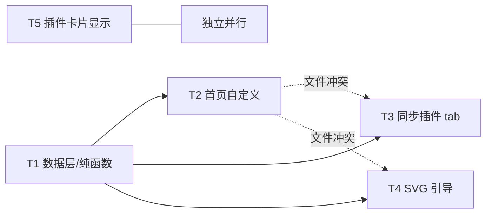

# 55 · 首页自定义 / 同步插件 / SVG 引导 / 插件卡片显示 —— 增量设计（待批注）

> 文档版本：**v1.0（待批注稿）** ｜ 撰写：架构师 ｜ 日期：**2026-11-20** ｜ 语言：简体中文
> 性质：**增量技术设计**，供工程师随后施工。本轮**只新建本文件**：未改任何既有文件、未改代码、未 commit / push / 出包。
> 仓库根：`E:/workbuddy/2026-10-13-01-03-46/modvault`；本文所有「文件:行号」均相对此根。
>
> **权威来源与优先级**（冲突时从上到下）：
> 1. **用户 19 条拍板台账** = `.workbuddy/memory/2026-11-12.md`「2026-11-20 · 19 条待拍板全部拍完」段 —— **施工依据，逐条照办**；
> 2. `docs/54-首页自定义与同步插件与引导-增量PRD-待批注.md`（412 行，§2.1~§2.4 / §3 Q-1~Q-19 / §4 调研 / §5 风险）—— PRD 的「推荐」只是建议，**已被用户选择覆盖**（尤其 Q-2/Q-5/Q-6/Q-8/Q-17）；
> 3. 当前工作树源码（本轮已逐行查证，见 §6）。
>
> **三态标注**：`【查证】` 有文件:行号 / 源码逐字 / 实跑依据 ｜ `【推断】` 由查证事实推出、不写成事实 ｜ `【待核实】` 查不到或需用户 / 真机 / 官方资料才能定论，一律不推测填充。
> **引用简写**：`types.ts`=`src/shared/types.ts`、`settings.ts`=`src/main/settings.ts`、`SettingsDialog.tsx`=`src/renderer/components/SettingsDialog.tsx`、`HomeParticles.tsx`=`src/renderer/components/home/HomeParticles.tsx`、`particleTide.ts`=`src/renderer/components/home/particleTide.ts`、`HomeCover.tsx`=`src/renderer/components/home/HomeCover.tsx`、`pluginSnapshot.ts`=`src/shared/pluginSnapshot.ts`、`panel.html`=`plugin-src/idbox_panel/panel.html`、`loader.rb`=`plugin-src/idbox_panel/lib/loader.rb`、`App.tsx`=`src/renderer/App.tsx`、`zStack.ts`=`src/renderer/logic/zStack.ts`。

---

## 0. 范围与权威口径（先写死边界）

| 项 | 口径 | 依据 |
| --- | --- | --- |
| 本版本做四组 | ① 首页自定义（海浪色/大小/背景图）② 设置页独立「同步插件」tab ③ SVG 首页引导 ④ 插件卡片副标题显示改动 | 用户五件事中第四件只调研；拍板台账 Q-1~Q-19 |
| **不做**：项目快速入口 | PRD §4 是**未拍板调研**，不进本版本、**不产任务卡**、不动 `rescan.ts:127-143` 固定四层、不新增侧栏节点 | 用户原话「需要产品经理给我调研」；PRD §4.5；台账 |
| **不做**：重开 SU 插件功能验证 | 用户已确认「插件没什么问题」，功能验证收口；第四组只是**显示口径改动**，不动落位链 `loader.rb:388-443` / A8 回调契约 | PRD §1.2；台账 |
| **不动**：D-2 一次性引导 | `pluginIndexGuideShown` / `pluginIndexEnabled`（`settings.ts:191`/`:201`、`SettingsDialog.tsx:2580-2650`）与 D-2 提示带**逐字不动**；新 SVG 引导字段完全独立，任何交互都不写这两个字段 | 用户硬约束；`docs/46 §1.7`；`docs/48 §13` |
| 硬约束 | 零新增 npm 依赖；UI 只能靠源码守卫测（vitest `environment:'node'`、`vitest.config.ts:6`，无 jsdom/RTL）；深色底色中性 + 系统蓝强调、禁渐变 / `backdrop-filter` / 玻璃拟态（`styles.css:5-32`）；D5A 紫是**唯一**显式例外（`styles.css:10-31`），新增色板与引导 SVG **不得复用紫**；设置项三处齐全 + 单项降级；tab 四处真源同步；浮层 z 层走 `zStack.ts` 真源；快照 A 级只增不删 | 用户硬约束 1-8 |
| 验收底线 | 双 typecheck（`package.json:12-13` `typecheck:node` / `typecheck:web`）+ 两种 vitest 全绿（`npx vitest run` 与 `MODVAULT_7Z=... npm run verify:real7z`，见 `docs/04:634-638`） | 用户硬约束 8 |

---

## §0 拍板映射表（19 条逐条 → 落地位置，供一眼核对）

| # | 用户拍板（台账） | 改哪个文件 | 改哪个函数 / 加哪个字段 | 本文位置 |
| --- | --- | --- | --- | --- |
| Q-1 | 水体 + 浪峰，底色不动 | `HomeParticles.tsx`、`types.ts`、`settings.ts` | `resolveTidePalette()` 只覆盖 `waterColor`/`crestColor`；`backgroundColor` 仍走 `readCanvasBackground()`（`:287-291`）原样 | §2.1.2 / §1.1 |
| Q-2 | 色板 + HEX 都要 | `SettingsDialog.tsx`、`shared/homeTide.ts`（新） | 首页卡每色一个 `<input type="color">` + HEX 文本框；复用 `HEX_PATTERN`（`HomeParticles.tsx:274`，迁到 shared 后原处 re-export） | §2.1.3 |
| Q-3 | 浅深各存一份色 | `types.ts`、`settings.ts`、`HomeParticles.tsx` | `homeWaveColors.light/dark` 各一组；主题 observer 按 `resolveThemeName()` 取对应组 | §1.1 / §2.1.2 |
| Q-4 | `waveHeight` 单滑块 + clamp | `shared/homeTide.ts`（新）、`SettingsDialog.tsx`、`HomeParticles.tsx` | `homeWaveHeight` + `clampWaveHeight()`（安全域 `[0.2, 1.5]`，【架构师定】） | §1.1 / §2.1.2 |
| Q-5 | 本地文件 + URL 都支持 | `main/homeBackground.ts`（新）、`main/protocol.ts`、`preload/index.ts`、`shared/ipc.ts` | 新增 `bg://` scheme（镜像 `hdr://`，`protocol.ts:49-58/:74`）+ `saveHomeBackground()`（下载/复制 + sha256 缓存 + 失败兜底） | §2.1.4 |
| Q-6 | 背景图一张共用 | `types.ts`、`settings.ts` | 单个 `homeBackground`（无 light/dark 分组） | §1.1 |
| Q-7 | 纯色半透明压暗层、禁渐变 | `HomeCover.tsx` | 图片层之上插 `<div>`，`background: rgba(0,0,0,dimAlpha)`（非 gradient、非 backdrop-filter） | §2.1.4 |
| Q-8 | 灰掉项文案「后续开发」 | `SettingsDialog.tsx` | 同步插件页 3ds Max / Blender 卡禁用按钮文案 | §2.2.2 |
| Q-9 | SketchUp 按钮「安装插件」 | `SettingsDialog.tsx` | SketchUp 卡按钮文案常量 | §2.2.2 |
| Q-10 | 全 8 张卡 + 说明态（不联网） | `SettingsDialog.tsx`、`icons.tsx` | 8 卡全渲染；`onExplain()` 仅开可读说明，零 http/fetch/shell 调用 | §2.2.2 / §4-T3 |
| Q-11 | 视频卡 / Render-Lite 都不做 | — | 不产代码；§4 无对应任务卡 | §0 |
| Q-12 | 新建独立左栏分组（组名已拍板：**扩展**） | `SettingsDialog.tsx` | `TAB_GROUPS` 新增一组 + `syncPlugins` tab 四处真源 | §2.2.1 / §3-A |
| Q-13 | 首启 + 每版本独立记位 | `types.ts`、`settings.ts`、`App.tsx` | `homeGuideFirstRunShown` + `homeGuideLastVersion` 两位；触发条件见 §2.3.1 | §1.3 / §2.3 |
| Q-14 | 分步高亮真实元素 | `HomeGuide.tsx`（新）、`HomeCover.tsx`、`HomeStats.tsx`、`zStack.ts` | `data-guide` 锚点 + `getBoundingClientRect()` + resize/ResizeObserver 联动 | §2.3.2 |
| Q-15 | 跳过本次 + 独立「下次不再显示」 | `HomeGuide.tsx`（新）、`types.ts`、`settings.ts` | 第三个位 `homeGuideDisabled`（架构师补，理由 §3-B）；勾选框默认**不勾选** | §1.3 / §2.3.3 |
| Q-16 | 材质分辨率取主贴图 `mainFile` | `pluginSnapshot.ts` | `deriveDisplayMetric()`：kind∈{texture,material,hdri} → `primary.w×primary.h` | §1.2 / §2.4.2 |
| Q-17 | 模型大小取主模型文件 size（用户已知悉低估） | `pluginSnapshot.ts` | 同函数：kind∈{model,cad} → `formatBytes(primary.size)`，`primary=pickPrimaryFile(asset.files)` | §1.2 / §2.4.2 / §5-R3 |
| Q-18 | 删「N 个文件」+ 保留分类路径 | `panel.html`、`pluginSnapshot.ts`、`loader.rb` | `:1092-1095` 去掉拼接、保留 `categoryPath()`；**排序档内部字段保留**（【架构师定】，§3-C） | §2.4.3 / §3-C |
| Q-19 | 旧快照无 w/h/size 只显示分类路径 | `panel.html`、`pluginSnapshot.ts` | `displayMetric` 缺失/非法 → `null` → 副标题只留 `categoryPath()`，不出现 NaN/undefined/- | §2.4.3 |

> **编号事故登记**（台账原文）：引用 Q-16~Q-19 **以 docs/54 当前文档为准**（PM 曾合并旧 Q-18/Q-19 并重排）。本文严格按该口径。

---

## §1 数据模型设计

### 1.1 Settings 新增字段清单（名 / 类型 / 默认值 / schema 降级）

> 落盘三处齐全：`Settings` 接口（`types.ts:639` 附近）+ 默认值 `DEFAULT_SETTINGS`（`types.ts:835` 起）+ zod 单项降级（`settings.ts` `SettingsSchema :37-204`）。**每个新字段/每个叶子 `.optional().catch(<默认>)`**，脏值只回落该项，绝不拖垮整份 settings.json（否则 `libraryDir` 一起丢，`settings.ts:48-57/:65-74/:191-201` 既有纪律）。

| 字段 | 类型 | 默认值 | zod schema（单项降级） | 关联 |
| --- | --- | --- | --- | --- |
| `homeWaveColors` | `{ light: ThemeWaveColors; dark: ThemeWaveColors }`，其中 `ThemeWaveColors = { waterColor: string \| null; crestColor: string \| null }` | `{ light: { waterColor: null, crestColor: null }, dark: { waterColor: null, crestColor: null } }` | 对象 schema，**每个叶子** `z.string().regex(HEX6).nullable().optional().catch(null)`；非法 hex → 该叶子回落 `null`（= 走原 palette 兜底），不炸整份 | Q-1/Q-2/Q-3 |
| `homeWaveHeight` | `number` | `0.65`（`HomeParticles.tsx:201/:256` 定稿值） | `z.number().optional().catch(0.65)` + `normalizeSettings()` 内 `clampWaveHeight()` 收口到 `[0.2,1.5]` | Q-4 |
| `homeBackground` | `{ source: 'none'\|'local'\|'url'; fileName: string\|null; sourceUrl: string\|null; dimAlpha: number }` | `{ source: 'none', fileName: null, sourceUrl: null, dimAlpha: 0.35 }` | 对象 schema，叶子逐项 `.optional().catch(默认)`；`source` 用 `z.enum([...]).catch('none')`；`dimAlpha` `z.number().catch(0.35)` + normalize clamp `[0,0.85]` | Q-5/Q-6/Q-7 |
| `homeGuideFirstRunShown` | `boolean` | `false` | `z.boolean().optional().catch(false)`（回落 `false`＝引导再显示一次，宁可多提示；同 D-2 `settings.ts:195-201` 方向） | Q-13 |
| `homeGuideLastVersion` | `string \| null` | `null` | `z.string().nullable().optional().catch(null)` | Q-13 |
| `homeGuideDisabled` | `boolean` | `false` | `z.boolean().optional().catch(false)` | Q-15 |

**新增共享纯模块 `src/shared/homeTide.ts`（零依赖）**：

```
export const HEX_PATTERN: RegExp                       // = /^#[0-9a-f]{6}$/i，从 HomeParticles.tsx:274 迁入；原处改为 re-export
export function clampWaveHeight(value: unknown): number // 非数 → 0.65；clamp [0.2, 1.5]
export function validHexOrNull(value: unknown): string | null // HEX_PATTERN 校验，非法 → null
export function clampDimAlpha(value: unknown): number   // 非数 → 0.35；clamp [0, 0.85]
```

- `【架构师定】` 把 `HEX_PATTERN` 迁到 shared 是为了让主进程 `settings.ts` 与渲染层 `SettingsDialog.tsx` 共用**同一份**校验，避免两处正则漂移；`HomeParticles.tsx:274` 改为 `export { HEX_PATTERN } from '../../../shared/homeTide'`，保持既有引用点语义不变。
- `homeWaveColors` null 语义 = **未自定义**，渲染层回落 `LIGHT_PALETTE`/`DARK_PALETTE`（`HomeParticles.tsx:181`/`:242`）；旧档缺键 → 全 null → 行为与今天逐字一致（零迁移）。
- `homeBackground.source === 'none'` 时不渲染图片层与压暗层 → 首页与今天一致。

### 1.2 插件快照新增字段清单（A 级只增不删）

> 纪律：`apiVersion` 仍 `"1"`（`docs/39 §4.2`）；既有 13 字段（`pluginSnapshot.ts:106-132`）**一个不删、语义不变**；`PluginFileEntry` 仍**只 `rel`/`ext` 两键**（`:97-103`/`:234-239`）—— Q-16/Q-17 **不动** files 级结构。

| 新增字段 | 类型 | 位置 | 派生规则 | 旧快照 |
| --- | --- | --- | --- | --- |
| `displayMetric` | `string \| null`（可选） | `PluginSnapshotRecord`（`pluginSnapshot.ts:106-132` 尾）+ `buildPluginRecord`（`:247-274`） | `deriveDisplayMetric(kind, primary)`，`primary = pickPrimaryFile(safeFiles)`（`:252`，`classify.ts:528`）：<br>· `texture`/`material`/`hdri` → `primary.w`/`h` 均有限且 >0 → `` `${w}×${h}` ``（Q-16）<br>· `model`/`cad` → `primary.size` 有限且 >0 → `formatBytes(primary.size)`（`format.ts:3-14`，Q-17）<br>· 其它 kind / 取值非法 → `null` | 字段缺失 → 插件侧当 `null`（Q-19） |

**纯函数签名（放 `pluginSnapshot.ts`，可单测）**：

```
export function deriveDisplayMetric(
  kind: AssetKind,
  primary: AssetFile | undefined
): string | null
```

- `【查证】` 三个源字段都在主程序侧已存在且是**逐文件**口径：`AssetFile.size`（`types.ts:239`，`fsutil.ts:20-37` 每个文件 stat 写入）、`AssetFile.w/h`（`types.ts:248-249`，`imageSize.ts` 解析写）、`Asset.size` 整目录总量（`types.ts:273`，`importer.ts:1167` `files.reduce`）。Q-17 明确取 `primary.size`（主文件），**不是** `Asset.size`。
- `【推断】` 取数路径：`buildPluginRecord` 已经有 `primary`（`:252`），直接读 `primary.size` / `primary.w/h`，**不需要额外 fs.stat**——导入时 `walkFiles()` 已逐文件 stat（`fsutil.ts:37`）。代价如实登记见 §5-R3。
- `loader.rb` `normalize_record`（`:341-360`）透传 `'displayMetric' => Support.nil_text(raw_record['displayMetric'])`（A 级只增）；`fileCount` 派生（`:358`）**保留**（§3-C）。
- `fileCount` **不进** `PluginSnapshotRecord`（`【查证】` 它本就是插件侧从 `files.length` 派生的，`loader.rb:358`）；副标题删显示后该派生仍供排序档内部使用（§3-C）。

### 1.3 SVG 引导记位字段（两个独立位 + 架构师补一个开关位）

| 字段 | 类型 | 默认 | 用途 | 独立性 |
| --- | --- | --- | --- | --- |
| `homeGuideFirstRunShown` | `boolean` | `false` | **首启位**：首次完整看完引导后置 `true` | 与 D-2 两字段**完全独立** |
| `homeGuideLastVersion` | `string \| null` | `null` | **上次展示版本号**：`getAppVersion()`（`preload/index.ts:412`、`ipc.ts:153`）字符串，不同即视为新版本 | 同上 |
| `homeGuideDisabled` | `boolean` | `false` | Q-15 的「下次不再显示」勾选位；**仅用户主动勾选才写 true** | 同上 |

> 用户 Q-13 说「两个独立持久化位（记上次展示版本号）」= 上表前两位；第三位是 Q-15「下次不再显示」勾选框的必要落点，属**同一功能的第三个语义位**，理由见 §3-B。三个位都进 §1.1 的三处 + 单项降级；**任何读写都不触碰** `pluginIndexGuideShown` / `pluginIndexEnabled`。

---

## §2 分模块设计

### 2.1 第一组 · 首页自定义

#### 2.1.1 调用链总览（【查证】现状 + 【推断】改动）

```
App.tsx (useVault settings)
  └─ <HomeCover ... waveColors={memo} waveHeight={n} homeBackground={memo} />   ← props 扩
       ├─ <div z-0><HomeParticles quality waveColors waveHeight /></div>        ← HomeCover.tsx:287-291
       │    └─ resolveTidePalette(base, colors[theme], waveHeight)             ← 新纯函数
       │         └─ buildSettings(palette, quality)  (HomeParticles.tsx:299)    ← 不改签名
       │              └─ renderer.render(time, settings)  (:350)
       ├─ [新] 背景图层 z-[1] + 压暗层 z-[2]                                    ← Q-5/Q-6/Q-7
       ├─ 设置齿轮 (HomeCover.tsx:299-307) / 数据卡 (:321) / 搜索 (:331-338) / 文件夹 (:376-413)
```
- `HomeParticlesProps`（`HomeParticles.tsx:34-38`）**扩展**为：

```
export interface HomeParticlesProps {
  quality: MotionQuality
  waveColors?: ThemeWaveColors          // 当前主题的自定义色（null 字段 = 回落 palette）
  waveHeight?: number                   // 已 clamp 的浪高
}
```

- `HomeCover` props 同步增加 `waveColors` / `waveHeight` / `homeBackground`（透传，不改 `quality` 契约，`HomeCover.tsx:287-291` 的层级锚点不动）。`App.tsx:1449-1456` 是 `<HomeCover>` 唯一挂载点，设置来源 `useVault(s => s.settings)`（同 `App.tsx:906` 读法）。

#### 2.1.2 海浪颜色 / 大小：函数、状态、边界

**新纯函数（放 `HomeParticles.tsx`，紧邻 `buildSettings` `:299`）**：

```
function resolveTidePalette(
  base: TidePalette,
  custom: ThemeWaveColors | undefined,
  waveHeight: number
): TidePalette
// → { ...base,
//     waterColor:  validHexOrNull(custom?.waterColor) ?? base.waterColor,
//     crestColor:  validHexOrNull(custom?.crestColor) ?? base.crestColor,
//     waveHeight:  clampWaveHeight(waveHeight) }
//   backgroundColor 原样保留 = base.backgroundColor（Q-1 底色不动）
```

**状态流转 / 主题联动**：
1. 首帧：`let palette = resolveTidePalette(PALETTES[resolveThemeName()], waveColors, waveHeight)`（替换 `HomeParticles.tsx:336` 的 `PALETTES[...]`）；`settings = buildSettings(palette, quality)`（`:337`）。
2. 主题切换：`MutationObserver`（**实际在 `HomeParticles.tsx:529-541`**，PRD 记 `:324-338` 有偏差，见 §6）回调里把 `const next = PALETTES[resolveThemeName()]` 改为 `resolveTidePalette(PALETTES[resolveThemeName()], waveColors, waveHeight)`；`if (next === palette) return` 的引用相等短路会失效（新对象每次不同）→ 改为比较「键 + 颜色 + 浪高」的标量快照，避免无意义重绘（`【推断】`）。
3. 用户在设置页改色/滑块：把 `waveColors` / `waveHeight` 加入主 `useEffect` 依赖（现 `HomeParticles.tsx:560` 为 `[quality]`）→ `[quality, waveColors, waveHeight]`，改值走与主题切换同款「重建 renderer + 重绘」。代价：改设置会重建一次渲染器（低频，可接受，`【架构师定】`）；`waveColors` 对象须在 App 侧 `useMemo` 稳定引用，否则每次 render 都会重建（`【待核实】` 实现细节，由工程师保证）。
4. 兜底：自定义值非法/缺失 → `validHexOrNull` 返回 null → 回落 base palette；`readCanvasBackground()`（`:287-291`）读不到 CSS 变量或非法 → 回落 `base.backgroundColor`；首页不白屏、不报错。

**边界**：
- 只覆盖两色 + 浪高；`opacity`/`alphaScale`/`density`/`particleSize`/`swell`/`parallax`/`clickRipples` 一律不动（不碰 `particleTide.ts` 引擎，符合 PRD §1.2）。
- 浪高 clamp `[0.2, 1.5]`：`0.65` 为定稿值（`HomeParticles.tsx:118/:201/:256`），`1.5` 取自历史浅色曾用的可渲染值（`:144` 标注已作废但证明可渲染）；GPU 真机帧率 `【待核实】`（QA 观察）。
- 密度 clamp 仍走 `buildSettings:300` 的 `[MIN_DENSITY, MAX_DENSITY]`（`:41-42`），本改动不触碰。

#### 2.1.3 HEX + 色板两种输入如何共存（Q-2）

**落点**：设置·外观「首页」卡（`SettingsDialog.tsx:1723-1740`，现仅 `showHomeStats` 一行）内新增三块行：

| 行 | 控件 | 行为 |
| --- | --- | --- |
| 海浪颜色 · 浅色 | 水体/浪峰各一组：色板 `<input type="color">` + HEX 文本框 + 「重置」 | 两者**双向绑定同一字段** `homeWaveColors.light.waterColor/crestColor`：色板 onChange 写 6 位 hex；文本框 onBlur/Enter 用 `validHexOrNull` 校验，合法写值，非法给可读提示并**不保存**；重置写 `null`。色板显示值 = 自定义值 ?? 该主题 palette 默认值 |
| 海浪颜色 · 深色 | 同上，字段换 `homeWaveColors.dark.*` | 同上 |
| 海浪大小 | `<input type="range" min=0.2 max=1.5 step=0.05>` + 数值回显 | onChange → `clampWaveHeight` → `saveSettings({homeWaveHeight})` |
| 首页背景图 | source 单选（无 / 本地文件 / 图片 URL）+ 文件选择或 URL 输入 + 压暗滑块 | 见 §2.1.4 |

- 两个控件写同一字段 ⇒ 天然同步，无双状态。色板给「所见即所得」，HEX 给精确输入，都复用 `HEX_PATTERN`（`HomeParticles.tsx:274` → shared re-export）。
- 源码守卫：`SettingsDialog.tsx` 首页卡区域内须同时出现 `type="color"` 与 `validHexOrNull(`/`HEX_PATTERN`；单测 `validHexOrNull('#abc') === null`、`validHexOrNull('#00A1fF') === '#00A1fF'`。
- 主题 token 纪律：色板预设（若有）不含紫；HEX 由用户输入，界面不预置 D5A 紫（`styles.css:10-31`）；压暗层走纯黑 rgba，不引入紫/渐变。

#### 2.1.4 背景图：本地 + URL、缓存、离线降级、压暗（Q-5/Q-6/Q-7）

**为什么必须加 `bg://` scheme**：`particleTide.ts:627` 每帧 `ctx.fillStyle = s.backgroundColor` **不透明填充**画布（`:94` 注释「不透明，和页面底色一致」）。因此图片不能放在粒子画布之下（永远看不见）。`【架构师定】` 图片层放画布**之上**、内容层（`z-10`，`HomeCover.tsx:324`）之下，作为内容层（≤40，**不走 zStack 真源**——真源只管浮层/弹窗）。当 `source='none'` 时不渲染该层，首页与今天逐字一致。

**层栈（在 `HomeCover.tsx:287-291` 粒子层之后、`z-10` 底部组之前插入）**：

```
{homeBackground.source !== 'none' && homeBackground.fileName && (
  <>
    <div aria-hidden className="pointer-events-none absolute inset-0 z-[1]"
         style={{ backgroundImage: `url(bg://${encodeURIComponent(homeBackground.fileName)})`,
                  backgroundSize: 'cover', backgroundPosition: 'center' }} />
    <div aria-hidden className="pointer-events-none absolute inset-0 z-[2]"
         style={{ background: `rgba(0,0,0,${homeBackground.dimAlpha})` }} />
  </>
)}
```
- 压暗层是**纯色 rgba**，非 gradient、非 `backdrop-filter`、非 `filter: blur`（Q-7 / `styles.css:9`）。`dimAlpha` 默认 `0.35`、clamp `[0,0.85]`，保证搜索/文件夹/数据卡/提示字可读（QA 截图留档，`【待核实】` 真机目视）。

**主进程 `src/main/homeBackground.ts`（新）关键签名**：

```
export function backgroundCacheDir(): string         // <userData>/home-bg/
export async function saveHomeBackground(
  input: { kind: 'local'; filePath: string } | { kind: 'url'; url: string }
): Promise<{ ok: true; fileName: string } | { ok: false; error: string }>
export function clearHomeBackground(fileName: string | null): Promise<void>  // 单槽位：替换时删旧文件
```

**URL 缓存 / 失败兜底 / 离线降级（Q-5 明确要求纳入设计）**：
1. **下载**：主进程用 Electron `net.fetch`（`protocol.ts:1` 已在用 `net`）GET，校验 `content-type` 为 `image/*`、限制大小（建议 ≤ 20 MB，`【架构师定】`）；失败/超时/非图 → 返回 `{ok:false, error}` 中文原因，界面保留旧图或明确提示，**不写** `homeBackground.fileName`。
2. **缓存**：成功下载后写入 `<userData>/home-bg/<sha256(url 或文件内容)>.<ext>`；文件名 sha256 保证同一 URL 命中同一槽位、免重复下载。Settings 存 `fileName` + `sourceUrl`（供刷新）。本地文件：读取后同样复制到该目录，存 `fileName`（不存绝对路径——路径非稳定契约，PRD §4.4 同教训）。
3. **离线降级**：渲染层只加载 `bg://<fileName>`（本地缓存文件），**运行期不发起任何网络请求**；断网时缓存文件仍在 → 图片照常显示。用户主动点「刷新 URL」才重新下载，失败则保持旧缓存。
4. **scheme 改动**（镜像 `hdr://`，`protocol.ts:49-58/:74/:99-104`）：
   - `registerVaultScheme()` 的数组加一项 `scheme:'bg'`, privileges 同 hdr（`:49-58`）；
   - `VaultDirs`（`:62-69`）加 `bgDir`；`serveVault()`（`:71-75`）加 `protocol.handle('bg', ...)`；
   - `serveStatic()` 的 `scheme` 联合类型加 `'bg'`（`:87`），分支仿 `:99-104`：root = `path.resolve(dirs.bgDir)`，rel = pathname/host；沿用 `isWithinRoot` 越界检查（`:5/:114-116`）。
   - `【待核实】` `bgDir` 的注入点（`main/index.ts` 构造 `getDirs` 处）需工程师定位（grep `hdrDir` 即可找到同构注入点）。
   - IPC：`shared/ipc.ts`（现存 `:153` 一带）+ `preload/index.ts`（`:412` 一带）+ main handler 新增 `homeBackground:save/clear` 两条；**不新增 npm 依赖**。
5. **文字可读性**：压暗层之上才是内容；QA 在浅/深主题各截图一张留档。

### 2.2 第二组 · 同步插件 tab

#### 2.2.1 tab 真源 + 独立分组

四处真源同步（`【查证】` `SettingsDialog.tsx:77/:79-88/:96-101/:104-112` + `:1033` useState 类型）：

```
type SettingsTab = ... | 'syncPlugins'                       // :77
TABS 追加 { key:'syncPlugins', label:'同步插件' }              // :79-88
TAB_GROUPS 追加独立一组（组名待确认，候选见 §3-A）             // :96-101
TAB_SUB.syncPlugins = '插件同步入口与安装说明'                 // :104-112（文案【架构师定】）
useState<SettingsTab>('appearance') 仅类型扩展，初值不动       // :1033
```
- 独立分组含且只含 `syncPlugins`，落在「数据」组与「其他」组之间（`【架构师定】`，视觉上把「扩展」类入口与业务数据分开）。
- `showPluginIndexGuide`（`:1031-1032`）与 D-2 提示带（`:2580-2594`）、既有「SketchUp 插件」行（`:2635-2650`）**逐字不动**；新 tab 不搬动该行。

#### 2.2.2 8 张卡 + 说明态按钮（Q-8/Q-9/Q-10/Q-11）

**卡片数据**（`【查证】` 来自 PRD §1.1 竞品字段，本轮按台账口径渲染）：常量数组 `SYNC_PLUGIN_CARDS`，8 项 —— Rhino `0.11.0` / Cinema 4D `0.5.1` / SketchUp `0.8.0` / ARCHICAD `0.5.3` / 3DS MAX `3.3.1` / Blender `0.7.0` / Revit `0.4.2` / SketchUp LiveSync `1.3.0`。每项字段 `{ name, version, supportText, icon, disabled }`。

- 布局：两列卡片网格；每卡 = 软件图标（内联 SVG 或 `icons.tsx`，**零外链**）+ 名称 + 版本号 + 「支持 xx 版本」+ 按钮。
- 灰掉：`3DS MAX` / `Blender` 的 `disabled = true`，图标灰度 + 文案 **「后续开发」**（Q-8，非 PRD 推荐的「排期开发」）。
- SketchUp 按钮文案 **「安装插件」**（Q-9，非「下载插件」）；其余可装卡同文案。
- **说明态（Q-10）**：所有按钮 `onClick` 只调用 `onExplain(card)`，打开**同 tab 内**一段可读说明（组件内 state，不新增 z 层、不发请求）。文案形态（`【架构师定】`，示例）：

  > 「{name} {version}」插件安装说明：本版本仅展示插件入口，暂不提供下载或安装。请通过软件官方渠道获取对应插件；开启 SketchUp 插件索引导出请在「数据」tab 的「SketchUp 插件」行操作。

  - `3DS MAX` / `Blender` 灰卡按钮 `disabled`，点击无动作（或开同一说明并注明「后续开发」，`【架构师定】` 取前者）。
  - **零网络可证**：syncPlugins 内容区源码中不出现 `fetch(` / `http` / `net.` / `openExternal` / `shell`；源码守卫 grep 命中 0（§4-T3）。
- **不产代码**：「快速上手」视频卡、Render/Lite tab（Q-11）；不新增设置字段、不碰安装/落盘链。

### 2.3 第三组 · SVG 首页引导

#### 2.3.1 触发判定（Q-13）

```
shouldShowHomeGuide(settings, currentVersion): boolean
  = !settings.homeGuideDisabled
    && (!settings.homeGuideFirstRunShown || settings.homeGuideLastVersion !== currentVersion)
```
- `currentVersion` 来自 `window.modvault.getAppVersion()`（`preload/index.ts:412`、`ipc.ts:153`；`SettingsDialog.tsx:1233` 已有同款调用）；字符串**不等即视为新版本**（不做 semver 排序，零依赖，`【架构师定】`）。
- 挂载点：`App.tsx` 根布局内（`<HomeCover>` 同级，`App.tsx:1449` 附近），条件 `isHome && ready && shouldShow`；版本异步拿到后再判，`【待核实】` 首帧版本为空时的处理（建议：`''` 时不触发，避免闪现）。
- **写完位时机**：完整走完最后一步 → `saveSettings({ homeGuideFirstRunShown: true, homeGuideLastVersion: version })`；两个位独立写、互不覆盖其它字段。

#### 2.3.2 分步高亮 + 坐标联动（Q-14）

**四个真实元素的锚点**（在 `HomeCover.tsx` 加 `data-guide`，纯属性、不改布局）：

| 步 | 元素 | 锚点位置（`【查证】`） |
| --- | --- | --- |
| 1 搜索 | `HomeSearchCommand` 包裹 | `HomeCover.tsx:331-338` |
| 2 文件夹 | `.hc-folder-row` | `HomeCover.tsx:376-413` |
| 3 数据卡 | `HomeStats` 根（或条件渲染包裹） | `HomeCover.tsx:309-321`（`showHomeStats=false` 时元素不存在 → 跳过该步） |
| 4 设置齿轮 | 左下角按钮 | `HomeCover.tsx:299-307` |

**纯函数 / 状态**：

```
interface GuideStep { key: 'search'|'folders'|'stats'|'settings'; title: string; body: string }
interface HighlightRect { top: number; left: number; width: number; height: number }
function measureStep(key: GuideStep['key']): HighlightRect | null  // querySelector([data-guide]) → getBoundingClientRect()
```
- 高亮框 `position: fixed`，坐标直接取 `getBoundingClientRect()`（视口坐标，与 fixed 对齐）；每步渲染前 `measureStep()`；`【推断】` 加 4~6px padding 与 2px 描边（系统蓝，`--accent` token，中性深底、`styles.css:5-32`）。
- **窗口 resize / 布局变化**：`window.addEventListener('resize', recalc)` + `ResizeObserver(document.body 或各锚点父)` → `recalc()` 重算当前步 rect；cleanup 全部移除（StrictMode 幂等，参照 `HomeParticles.tsx` 的 observer 清理）。
- **元素缺失**（`showHomeStats=false`）：`stats` 步被过滤掉，步骤数组运行时按 `measureStep() !== null` 生成；四步全缺则不渲染引导（兜底）。
- **内联 SVG**：组件内 `<svg>`，图标/箭头用 `currentColor`，随主题 token 走；**无 ``、无外链、无紫**（`styles.css:10-31`）。
- **z 层走真源**：`zStack.ts` 新增 `export const Z_HOME_GUIDE = 100`（高于 `Z_STAGE_FLYING=90`，引导是一次性置顶浮层；不进 Esc 层栈，因为它有自己的按钮语义）；组件用 `style={{ zIndex: Z_HOME_GUIDE }}`（内联，避开 Tailwind 字面量类名约束，`zStack.ts:54-56/:110-113`）。`【架构师定】` 100 的取值理由：现有占用 45/48/50-80/90，取 100 留一格且不写 1000 级失控数（`zStack.ts:77-82` 同款考量）。

#### 2.3.3 跳过 / 「下次不再显示」（Q-15）

| 用户动作 | 写哪个位 | 行为 |
| --- | --- | --- |
| 跳过（本次） | **一个都不写** | 仅本地 state 关闭浮层；下次启动仍触发（firstRunShown 未置、版本未记） |
| 走完最后一步 | `homeGuideFirstRunShown=true` + `homeGuideLastVersion=version` | 首启位与版本位各就位；下个新版本再来 |
| 勾「下次不再显示」+ 任意关闭 | 仅 `homeGuideDisabled=true` | 永久不再显示；**绝不写 D-2 两字段** |

- 勾选框**默认不勾选**，代码不得出现任何「进入即 `setHomeGuideDisabled(true)`」或预填 true 的路径（源码守卫：勾选项 `defaultChecked` 不存在 / 恒 false）。
- 与 D-2 隔离守卫：`HomeGuide.tsx` 及新引导相关代码 `grep` 不出现 `pluginIndexGuideShown` / `pluginIndexEnabled` 的**写入**（`saveSettings` 参数只含 3 个 homeGuide* 字段）。

### 2.4 第四组 · 插件卡片副标题显示（Q-16~Q-19）

#### 2.4.1 副标题现格式（【查证】基线）

`panel.html:1092-1095`：`var meta = categoryPath(record); var files = Number(record.fileCount); if (isFinite(files) && files > 0) { meta += ' · ' + files + ' 个文件'; }` ⇒ 现＝「分类路径 · N 个文件」。`categoryPath()` 在 `panel.html:956-967`（PRD 记 `:955-966`，微偏），单行省略 CSS 在 `panel.html:382`（`.card-meta`）。

#### 2.4.2 取数路径（Q-16 / Q-17）

- 主贴图分辨率：`deriveDisplayMetric` 用 `pickPrimaryFile(asset.files)`（`pluginSnapshot.ts:252` → `classify.ts:528`）取主贴图 `w/h` → `` `${w}×${h}` ``（如 `1920×1080`）。封面常是缩略小图、最大图可能是二维码推广件（D5A 教训 `R1 §1.5`），故取 `mainFile` 而非它们。
- 主模型大小：同一 `primary`，取 `primary.size`（`AssetFile.size`，逐文件 stat，`types.ts:239`/`fsutil.ts:37`）→ `formatBytes()`（`format.ts:3-14`，如 `1.2 MB`）。**不是** `Asset.size`（`types.ts:273`，整目录）。
- 派生在**主进程**完成并写进快照 `displayMetric`；插件纯只读、不格式化（`panel.html` 无 `formatBytes` 可 import，落此设计）。零新增依赖。
- Q-17 代价如实登记见 §5-R3（会低估多文件模型，用户已知悉仍坚持）。

#### 2.4.3 副标题拼装 + 旧快照回退（Q-18 / Q-19）

`panel.html:1092-1095` 改为：

```
var meta = categoryPath(record);
var metric = textOf(record.displayMetric);          // textOf 已存在，非字符串→''
if (metric) { meta += ' · ' + metric; }
body.appendChild(make('div', 'card-meta', meta));
```
- **保留分类路径前缀**（Q-18）：形如「家具 / 沙发 · 1920×1080」「模型 / 沙发 · 1.2 MB」。
- **删「N 个文件」**：卡片副标题与 HTML 中不再出现「个文件」字样（守卫 grep 命中 0）；`var files = Number(record.fileCount)` 这一段删除。
- **旧快照回退**（Q-19）：`displayMetric` 缺失 → `textOf(undefined) === ''` → 只显示 `categoryPath()`；非法值（NaN / `-` / `undefined`）不会出现，因为主进程 `deriveDisplayMetric` 只在有限正数时产出，其余产 `null`；`formatBytes` 对非法返回 `'-'`（`format.ts:4`）但**调用前已 guard**，不进快照。
- 单行省略 CSS（`panel.html:382`）不动；新指标短，不换行、不撑高。
- 排序档「按文件数」（`panel.html:667-668` SORT_KEYS/SORT_LABELS、`:1156-1157` 比较函数、`loader.rb:358` 派生）**保留内部实现**，仅不显示指标 —— 去留理由见 §3-C。

---

## §3 我替用户定的小项（逐项给理由并标注）

| 项 | 决定 | 标注 | 理由 |
| --- | --- | --- | --- |
| **A. 新分组名**（Q-12 附带） | **「扩展」** | **【已拍板】**（用户 2026-11-20 弹窗单答，选「扩展」） | 用户明确「新建独立分组」，组名在「扩展 / 工作流」二选一中拍板为「扩展」。工程师按此 label 施工，无需占位 |
| **B. `homeGuideDisabled` 第三字段** | 增第三个持久化位承载 Q-15「下次不再显示」 | **【架构师定】** | Q-13 的「两个位」只覆盖「首启 + 版本」触发；Q-15 的「下次不再显示」是独立的永久开关语义，复用任何一位都会污染触发逻辑（勾了不再显示却仍要记版本、或跳过被误当永久） |
| **C. 排序档「按文件数」去留**（Q-18 附带） | **保留内部字段 + 保留排序档**，只删副标题显示 | **【架构师定】** | ① 快照 A 级只增不删，`fileCount` 由 `loader.rb:358` 派生、不进快照，保留零成本；② 删排序档要动 `SORT_KEYS`/`SORT_LABELS`/比较函数三处并可能引入回归，用户只反对「显示 N 个文件」、没说反对排序；③ 保留能力、去掉无意义展示，最小改动面。**备选**：若用户也想隐藏「按文件数」排序入口，一行 label/键移除即可 —— 此备选标 **【待用户确认】** |
| **D. 「同步插件」tab 副标题** | `'插件同步入口与安装说明'` | **【架构师定】** | 需填 `TAB_SUB`；文案不承诺真安装，与说明态一致 |
| **E. 浪高 clamp 区间** | `[0.2, 1.5]`，step `0.05` | **【架构师定】**，`【待核实】` 真机帧率 | 0.65 定稿值居中、1.5 有历史可渲染依据（`HomeParticles.tsx:144`） |
| **F. 说明态按钮文案 / 灰卡按钮** | 见 §2.2.2 示例；灰卡按钮 `disabled` | **【架构师定】** | 必须零网络、不承诺真安装；灰卡 disabled 与「后续开发」一致 |
| **G. URL 图片大小上限 / 缓存命名** | ≤20 MB；sha256 文件名 | **【架构师定】** | 防大图拖垮启动/包体；sha256 免重复下载、稳定命中 |
| **H. 背景图 scheme** | 新增 `bg://`，不动 `vault://` host 白名单 | **【架构师定】** | 照 `hdr://` 先例（`protocol.ts:17-20`）：独立生命周期（单槽位替换）语义清楚，且不动被单测锁死的 `routeVaultHost` |
| **I. 引导 z 层值** | `Z_HOME_GUIDE = 100` | **【架构师定】** | 现有 45/48/50-80/90 均占用；取 100 不写死在组件、不写失控大数 |
| **J. 版本判断** | 字符串不等即新版本，不做 semver | **【架构师定】** | 零依赖；`getAppVersion()` 返回稳定版本号字符串 |

> **用户拍板状态（2026-11-20 全部闭环）**：19 条主拍板 + §3-A 分组名（**「扩展」**）已全部单答完成，无待用户确认项。§3-C 排序档「按文件数」按【架构师定】保留内部实现、仅删副标题显示（用户未另行表态，采用推荐）。其余均为架构师定。设计可直接交付工程师施工。

---

## §4 施工任务卡拆分（T1..T5，按可独立提交 / 可独立验收）

> 并行性：T1 为地基；T2、T3、T4 均依赖 T1 的数据模型；**T2 与 T3 都改 `SettingsDialog.tsx`、T2 与 T4 都改 `HomeCover.tsx` → T2/T3/T4 之间按文件冲突串行**；T5 与 T1~T4 **完全并行**（不同文件域）。
> 每张卡的测试方式都遵循：vitest node 环境、无 jsdom/RTL → **源码守卫（读文件文本 + 断言字段/文案/分支存在性）+ 纯函数单测**；`readSrc()` 范式见 `tests/classifyUiWiring.test.ts:1-45`（换行归一 `\n`、必要时剥注释）。

### T1 · 数据层与共享纯函数（地基）

- **涉及文件**：`src/shared/types.ts`（+6 字段 + 默认值）、`src/main/settings.ts`（schema 单项降级 + `normalizeSettings` clamp）、`src/shared/homeTide.ts`（新）、`tests/settingsHomeCustom.test.ts`（新）、`tests/homeTide.test.ts`（新）
- **依赖**：无（可立即开工；与 T5 并行）
- **验收判据**：
  1. 6 个字段出现在 `Settings`（`types.ts:639` 附近）与 `DEFAULT_SETTINGS`（`:835` 起）；
  2. `SettingsSchema`（`settings.ts:37`）每项叶子 `.optional().catch(<默认>)`，脏值（`"yes"`/`1`/`null`/非法 hex）只回落该项；`normalizeSettings()`（`:412`）clamp 浪高/压暗；
  3. 构造含全部脏值的 settings 对象 → `settingsFilePath` 主字段 `libraryDir` 保持；
  4. `HEX_PATTERN` 在 `HomeParticles.tsx:274` re-export 且 shared 与渲染层同一份。
- **测试方式**：纯函数单测 `clampWaveHeight`/`validHexOrNull`/`clampDimAlpha` 边界；源码守卫 grep 六字段名 + `.catch(` 计数；`SettingsSchema.safeParse(脏对象).success === true` 且各字段回落默认。

### T2 · 首页自定义（海浪色/大小 + 背景图，含 `bg://`）

- **涉及文件**：`src/renderer/components/home/HomeParticles.tsx`、`src/renderer/components/home/HomeCover.tsx`、`src/renderer/components/SettingsDialog.tsx`（首页卡）、`src/main/protocol.ts`、`src/main/homeBackground.ts`（新）、`src/main/index.ts`（`bgDir`/IPC 注入，`【待核实】` 定位）、`src/shared/ipc.ts`、`src/preload/index.ts`、`tests/homeCustomWiring.test.ts`（新）
- **依赖**：T1（数据在先）；与 T3/T4 按 `SettingsDialog.tsx`/`HomeCover.tsx` 冲突串行
- **验收判据**：① `resolveTidePalette` 只覆盖 water/crest，`backgroundColor` 仍 `readCanvasBackground()`（Q-1）；② 色板 + HEX 同字段双向绑定（Q-2）；③ 两主题各一份、observer 按主题取（Q-3）；④ 浪高单滑块 clamp（Q-4）；⑤ 本地+URL 都支持、URL 离线可读缓存（Q-5/Q-6）；⑥ 压暗层纯色 rgba、无 gradient/backdrop-filter（Q-7）；⑦ 首页不白屏、`bg://` 越界检查在；⑧ 双 typecheck + 两种 vitest 绿。
- **测试方式**：源码守卫 —— 首页卡区域同时有 `type="color"` 与 `validHexOrNull(`；`resolveTidePalette` 函数体不含 `backgroundColor:` 覆盖；压暗层 `rgba(` 命中且 `gradient|backdrop-filter|filter:` 命中 0；`protocol.ts` 有 `scheme: 'bg'` 与 `protocol.handle('bg'`。纯函数单测 `resolveTidePalette` 覆盖两主题 + 非法值回落。

### T3 · 同步插件 tab（8 卡 + 说明态）

- **涉及文件**：`src/renderer/components/SettingsDialog.tsx`（四处真源 + 内容区）、`src/renderer/icons.tsx`（如需新图标）、`tests/syncPluginsTab.test.ts`（新）
- **依赖**：T1（类型基）；与 T2 按 `SettingsDialog.tsx` 串行
- **验收判据**：① 四处真源 + `:1033` 类型含 `syncPlugins`，其余 7 tab 副标题不变（S-8）；② 独立分组入口（组名先「扩展」占位，待 §3-A 拍板）；③ 8 卡全显示；SketchUp「安装插件」（Q-9）；3ds Max/Blender 灰 + 「后续开发」（Q-8）；④ 按钮说明态、零网络（Q-10）；⑤ 无视频卡 / Render / Lite（Q-11）；⑥ D-2 行与提示带逐字不动（S-2）；⑦ 双 typecheck + 两种 vitest 绿。
- **测试方式**：源码守卫 —— `SettingsTab`/`TABS`/`TAB_GROUPS`/`TAB_SUB` 四处含 `'syncPlugins'`；内容区 `grep` 得到 `'安装插件'`/`'后续开发'`，且「下载插件」「排期开发」「个文件」「快速上手」命中 0；syncPlugins 区块 `fetch(|openExternal|http|net.` 命中 0；D-2 三处字符串（原有）逐字仍在。

### T4 · SVG 首页引导（分步高亮 + 双位记位）

- **涉及文件**：`src/renderer/App.tsx`（触发 + 挂载）、`src/renderer/components/home/HomeGuide.tsx`（新）、`src/renderer/components/home/HomeCover.tsx`（`data-guide`）、`src/renderer/components/home/HomeStats.tsx`（`data-guide`，`【待核实】` 根元素位置）、`src/renderer/logic/zStack.ts`（`Z_HOME_GUIDE`）、`tests/homeGuideWiring.test.ts`（新）
- **依赖**：T1（记位字段）；与 T2 按 `HomeCover.tsx` 串行；**可与 T3 并行**（文件域不交）
- **验收判据**：① 首启/版本双位独立、脏值回落方向正确（Q-13，S-1）；② 四步高亮真实元素、resize 对齐（Q-14）；③ 跳过仅本次、勾选项默认不勾、与 D-2 零互写（Q-15，S-2）；④ 内联 SVG 零外链、不复用紫（S-7）；⑤ z 层走 `zStack.ts`（S-5/硬约束 5）；⑥ 关闭后首页功能全在（`HomeCover.tsx:287-428`）；⑦ 双 typecheck + 两种 vitest 绿。
- **测试方式**：源码守卫 —— `App.tsx` 含 `shouldShowHomeGuide` 与 `getAppVersion()`；`HomeGuide.tsx` 含四步 `data-guide` 键、`getBoundingClientRect`、`resize`/`ResizeObserver`、`Z_HOME_GUIDE`；引导相关 `grep` 不含 `pluginIndexGuideShown` 写入、`pluginIndexEnabled` 写入；`defaultChecked` / `= true` 预勾命中 0；`zStack.ts` 导出 `Z_HOME_GUIDE`。纯函数单测 `shouldShowHomeGuide()` 的真值表（首启/新版本/已禁用/相同版本四象限）。

### T5 · 插件卡片显示口径（displayMetric + 副标题）

- **涉及文件**：`src/shared/pluginSnapshot.ts`（`displayMetric` + `deriveDisplayMetric`）、`plugin-src/idbox_panel/panel.html`（副标题）、`plugin-src/idbox_panel/lib/loader.rb`（透传）、`tests/pluginExport.test.ts`（只增不删扩展）、`tests/pluginCardMetric.test.ts`（新）
- **依赖**：无（**全程与 T1~T4 并行**，文件域不交）
- **验收判据**：① 快照新增 1 个可选字段、13 旧字段一个不删、两键纪律不动、`apiVersion` 仍 `"1"`（A 级只增）；② texture/material/hdri → `mainFile` 的 `w×h`；model/cad → `mainFile.size` 经 `formatBytes`（Q-16/Q-17）；③ 旧快照/非法值 → 只显示分类路径、无 NaN/undefined/-（Q-19）；④ 「N 个文件」全仓 grep 命中 0、分类路径前缀保留（Q-18）；⑤ 单行省略不变；⑥ 不动落位链 `loader.rb:388-443` / A8 契约；⑦ 双 typecheck + 两种 vitest 绿。
- **测试方式**：纯函数单测 `deriveDisplayMetric()` 六类 kind + 缺字段/非法/0 值回退；`buildPluginRecord()` 新字段存在且旧字段快照断言不删（`tests/pluginExport.test.ts` 扩展）；源码守卫 `panel.html` 副标题区域含 `displayMetric` 与 `categoryPath`、不含「个文件」。

### §4.1 任务依赖图



> 说明：T3 与 T4 之间**无**文件冲突，可真正并行；T2 完成后 T3/T4 可同时开工。实线箭头为硬依赖，虚线为建议串行（文件冲突）。

---

## §5 风险与回归（PRD §5 九条 + 设计层补充）

| # | 风险 / 边界 | 三态 | 依据 | 设计层处置 |
| --- | --- | --- | --- | --- |
| S-1 | 设置迁移：新字段三处齐全、单项降级不拖垮整份 settings.json（`libraryDir` 别丢） | 【查证】 | `types.ts:639/:835`；`settings.ts:48-57/:65-74` | T1 每叶子 `.catch(<默认>)` + 脏值 safeParse 单测 |
| S-2 | SVG 引导与 D-2 一次性引导冲突 | 【查证】+【推断】 | `SettingsDialog.tsx:2580-2650/:1031-1032`；`settings.ts:191/:201` | 三字段完全独立；引导代码不写 D-2 两字段（守卫） |
| S-3 | 自定义色与主题切换相互作用 | 【查证】 | `HomeParticles.tsx:529-541`（observer 实际位置）；`settings.ts:77` | `resolveTidePalette` 按 `resolveThemeName()` 取色；未自定义走原 palette；标量快照避免无效重绘 |
| S-4 | 背景图与页面底色接缝 / 文字可读性 | 【查证】+【推断】 | `HomeParticles.tsx:20-21/:282-291`；`HomeCover.tsx:309-428` | 图片层在画布**之上**（画布仍不透明填充 `particleTide.ts:627`，底色不动符合 Q-1）；纯色 rgba 压暗；QA 双主题截图 |
| S-5 | 性能：浪高极值 / 大图背景掉帧 | 【查证】clamp 存在 +【待核实】真机 | `HomeParticles.tsx:41-42/:300` | 浪高 clamp `[0.2,1.5]`、URL 图 ≤20MB；QA 真机帧率观察 |
| S-6 | 包体 / 零新增依赖 / 图片清理 | 【查证】 | `HomeParticles.tsx:26-27`；项目纪律 | 单槽位 `<userData>/home-bg/` 替换即删旧（`clearHomeBackground`）；内联 SVG；UI 源码守卫 |
| S-7 | 紫例外不扩散 | 【查证】 | `styles.css:9-32` | 预设色板不含紫；引导 SVG 走 currentColor/系统蓝；守卫断言新代码无 `--d5-brand`/紫色 hex |
| S-8 | tab 真源漂移 | 【查证】 | `SettingsDialog.tsx:77/:79/:96/:104/:1033` | T3 四处逐处守卫 + 双 typecheck |
| S-9 | 第四件被误当已拍板 | 【查证】 | PRD §4.5；台账 | §0 写死不做；§4 无对应任务卡；不动 `rescan.ts:127-143` / 侧栏节点 |
| **R-10** | 不透明画布 → 图片层位置选择 | 【查证】 | `particleTide.ts:94/:627` 每帧不透明 `fillStyle` | 图片层放画布之上、内容之下；`source='none'` 时零渲染，与今天一致（§2.1.4） |
| **R-11** | URL 下载安全 / 失败 | 【推断】 | 本地优先纪律（`README.md:271/:350`） | 主进程 net.fetch + 类型/大小校验 + sha256 缓存；运行期零网络；失败保留旧图；不写坏 `fileName` |
| **R-12** | Q-17 低估多文件模型 | 【查证】用户知悉仍坚持 | `types.ts:239` 逐文件 size vs `:273` 整目录 | 按主文件 size 实现，不擅自改回整目录；在说明文案/注释登记「仅主文件体积」口径，避免后续误解 |
| **R-13** | 引导高亮随 resize/布局漂移 | 【推断】 | PRD §2.3 验收 6【待核实】 | `getBoundingClientRect` + resize/ResizeObserver 重算；元素缺失跳步；QA 真机窗口缩放目视 |
| **R-14** | 引导改动误触 D-2 / 浮层 z 冲突 | 【推断】 | `zStack.ts:1-93` | 独立字段 + 独立 z 常量 `Z_HOME_GUIDE=100`；不进 Esc 层栈（自有按钮语义） |
| **R-15** | `waveColors` 对象引用不稳 → HomeParticles 反复重建 | 【推断】 | 主 effect 依赖拟改 `[quality, waveColors, waveHeight]` | App 侧 `useMemo` 稳定引用；或改以标量依赖。`【待核实】` 由工程师实测选择 |

---

## §6 三态标注与引用登记（含查证偏差）

### 6.1 本轮逐行查证的关键引用（【查证】）

| 主题 | 引用（实际行号） | 内容 |
| --- | --- | --- |
| 海面旋钮/调色板 | `HomeParticles.tsx:81-108`、`:181-210`、`:242-266`、`:268-271` | TidePalette 13 项；浅/深两套 palette；`PALETTES` |
| HEX / 底色 / 组 settings | `HomeParticles.tsx:274`、`:277-279`、`:287-291`、`:299-317` | `HEX_PATTERN`；`resolveThemeName()`；`readCanvasBackground()`；`buildSettings()` |
| 主题 observer | **`HomeParticles.tsx:529-541`**（注释 `:18-21`） | `new MutationObserver` + `attributeFilter:['data-theme']` |
| 粒子挂载 | `HomeCover.tsx:287-291`；`App.tsx:1449-1456` | 粒子层 `z-0`；`<HomeCover>` 挂载点 |
| 不透明画布 | `particleTide.ts:94/:627` | `backgroundColor` = clearColor、`ctx.fillStyle` 不透明填充 |
| Settings 模型 | `types.ts:97`(ThemeMode)、`:233-250`(AssetFile, size:239, w/h:248-249)、`:273`(Asset.size)、`:639`(Settings)、`:718`(showHomeStats)、`:835`起(默认值) | 逐字 |
| schema / 降级 | `settings.ts:37`(SettingsSchema)、`:51`(gridDensity)、`:57`(materialStage)、`:191`(pluginIndexEnabled)、`:201`(pluginIndexGuideShown)、`:412`(normalizeSettings) | 逐字 |
| 设置页真源 | `SettingsDialog.tsx:77/:79-88/:96-101/:104-112/:1033`、`:1031-1032`、`:1233`(getAppVersion)、`:1723-1740`(首页卡)、`:2580-2594`(D-2 带)、`:2635-2650`(插件行) | 逐字 |
| 快照结构 | `pluginSnapshot.ts:97-103/:234-239`(两键纪律)、`:106-132`(13 字段)、`:247-274`(buildPluginRecord，primary:252/mainFile:264/files map:265)、`:284`(envelope)、`:298`(serializeCompact) | 逐字 |
| 快照落盘链 | `src/main/pluginExport.ts:247-248` | `buildPluginEnvelope` → `serializeCompact` |
| 取数字段 | `format.ts:3-14`(formatBytes)、`classify.ts:528`(pickPrimaryFile)、`fsutil.ts:20-37`(逐文件 stat)、`importer.ts:1167`(Asset.size=reduce) | 逐字 |
| 插件面板 | `panel.html:382`(.card-meta)、`:647`(ALLOWED_KINDS)、`:667-668`(SORT_KEYS/LABELS)、`:956-967`(categoryPath)、`:1092-1095`(副标题)、`:1156-1157`(fileCount 排序) | 逐字 |
| loader | `loader.rb:341-360`(normalize_record)、`:358`(fileCount 派生)、`:388-443`(落位链，不动) | 逐字 |
| z 层 | `zStack.ts:32/35/38`(modal base/step/max)、`:41`(stage)、`:58`(notice)、`:90-93`(flying)、`:101/:118`(纯函数)、`tailwind.config.js:169-174`(zIndex 48/60/70/80) | 逐字 |
| 版本桥 | `preload/index.ts:412`、`shared/ipc.ts:153` | `getAppVersion` |
| 测试环境 | `vitest.config.ts:6`(`environment:'node'`)、`tests/classifyUiWiring.test.ts:1-45`(readSrc 范式) | 逐字 |

### 6.2 相对 PRD 的行号偏差登记（【查证】，仅精度、不影响结论）

| PRD 记法 | 本轮实测 | 说明 |
| --- | --- | --- |
| `HomeParticles.tsx:324-338` = 主题切换 observer | **`:529-541`** 才是 `new MutationObserver`；`:324-338` 是组件体内 canvasRef/settings 初始化段，注释在 `:18-21` | 本文按实测 `:529-541` 引用；与 `docs/54 §7` 的偏差同源于早期行号快照，不改上游文档 |
| `classify.ts:436` = `pickPrimaryFile` | **`:528`** | 本文按实测；`buildPluginRecord:252` 调用点一致 |
| `panel.html:955-966` = `categoryPath` | **`:956-967`** | 微偏 1 行 |
| `pluginSnapshot.ts:233-239` = `toPluginFileEntry` | 注释 `:233`、函数体 **`:234-239`** | 微偏 |
| `loader.rb:352-359` = `normalize_record` | **`:341-360`**（fileCount `:358` 准确） | 函数头在 `:341` |
| `types.ts:242-249` = w/h | 注释 `:242-246`、字段 **`:248-249`** | 微偏 |
| `settings.ts:195-201` = D-2 字段 | 注释 `:192-201`，`pluginIndexEnabled` 实际 **`:191`**、`pluginIndexGuideShown` **`:201`** | 微偏，语义不变 |

### 6.3 【待核实】清单（需用户 / 真机 / 工程师定位，不推测填充）

1. **§3-A 新分组名**：用户拍板前只有候选（「扩展」/「工作流」），施工前须单答。
2. **浪高 `[0.2,1.5]` 真机帧率**：QA 真机观察（`HomeParticles.tsx:40` 密度边界、`:300` clamp 同款纪律）。
3. **压暗层可读性**：双主题截图目视（`HomeCover.tsx:309-428` 四层内容）。
4. **`bgDir` / IPC 注入点**：`main/index.ts` 构造 `getDirs` 的位置（工程师 grep `hdrDir` 找同构点）；`HomeStats.tsx` 根元素位置（加 `data-guide`）。
5. **版本异步首帧**：`getAppVersion()` 返回前 `currentVersion=''` 时是否触发引导（建议不触发）。
6. **`waveColors` 引用稳定性**：`useMemo` vs 标量依赖，由工程师实测决定（R-15）。
7. **快照实测条数**：PRD §2.4 实读 `%APPDATA%\idbox\plugin\index.json` = 94,839 B / **139 条**（派工写 104 条）；本文不依赖条数，仅登记。

---

*文档结束 · 本文是增量技术设计（待批注），不是代码、不是定稿实现说明。施工以用户 19 条拍板台账为准；§3-A 分组名为唯一需用户施工前单答项；§0 写死的「不做」边界（项目快速入口、重开 SU 功能验证、改 D-2 字段）任何任务卡不得越界。*
