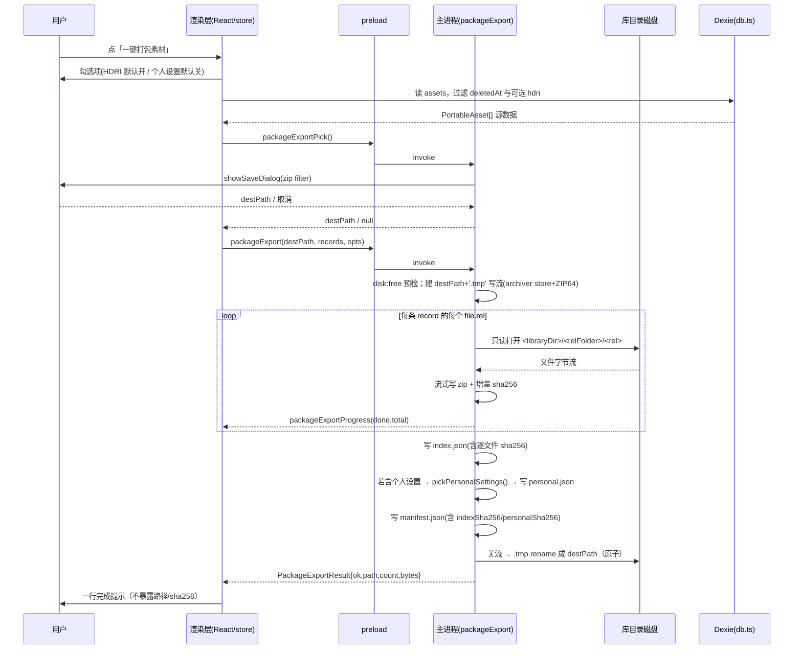
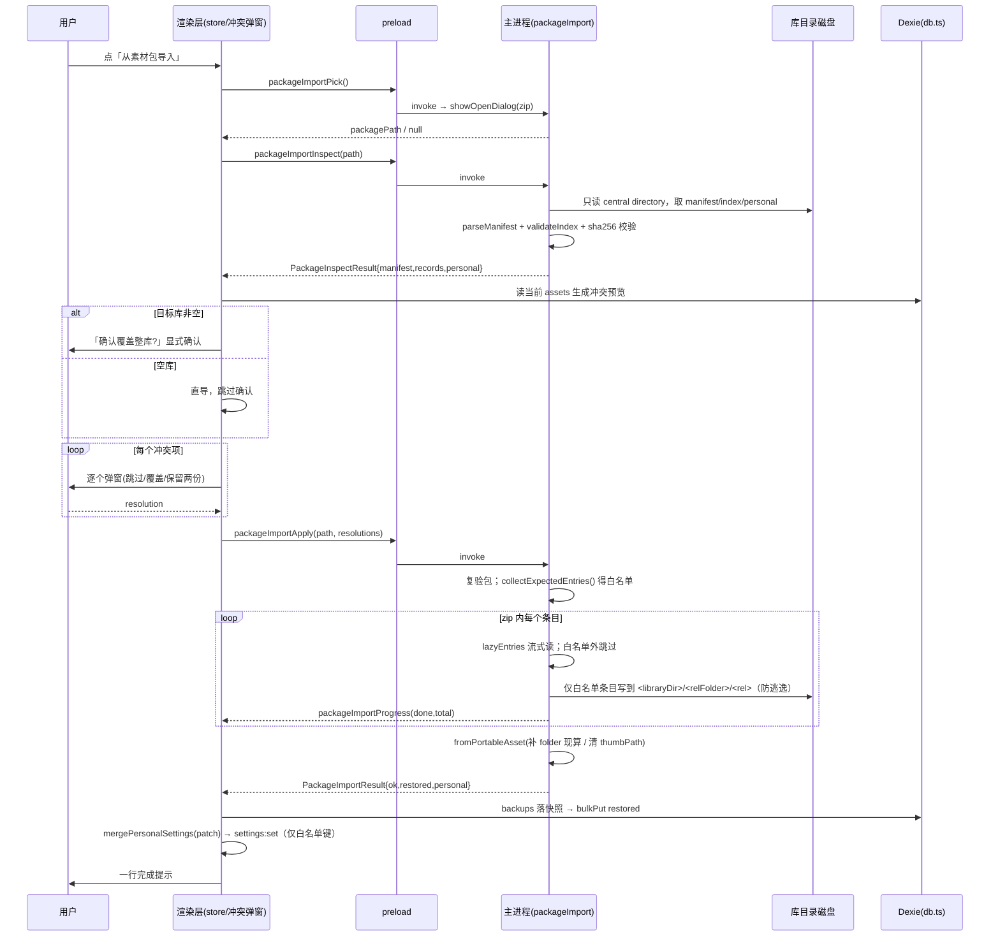
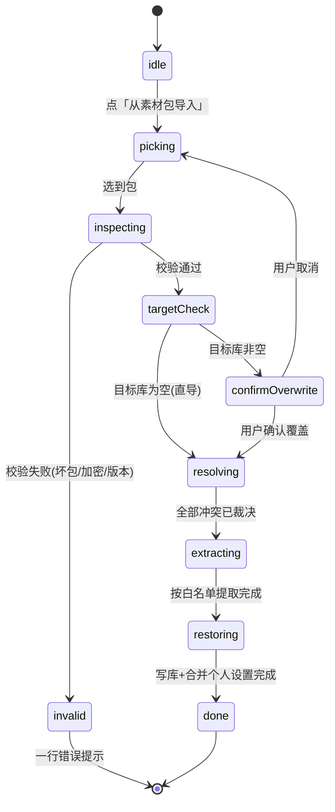

# 58 · 一键打包与素材同步 —— 增量系统设计 + 任务分解（待批注）

> 文档版本：**v1.0（增量设计·待批注稿）** ｜ 撰写：高见远（架构师） ｜ 日期：**2026-11-23** ｜ 语言：简体中文
> 性质：**纯设计**。不改任何 `src/` / `tests/` / 其它 `docs/`，不 commit / push / 出包，不碰用户真实库（`E:/ModVault/Library/`、`%APPDATA%/idbox/` 均只读引用）。
> **真源**：`docs/57-一键打包与素材同步-拍板台账-20261123.md`（用户逐条拍板的 9 条决定，唯一真源）。事实底盘：`docs/56-一键打包与素材同步-调研.md`。PRD 口径：`docs/01-PRD-模库.md`（v1.2，P2-5 / S9 已翻案）。
> **冲突处理规则**：docs/56 里的「推荐」若与 docs/57 拍板冲突，**一律以 docs/57 为准**。已识别两处：Q-4 单文件 zip（非分卷）、Q-9 翻案授权。架构不再提分卷方案。
> **三态标注**：`【查证】` 有「文件:行号」或只读实测证据 ｜ `【推断】` 由查证事实推出、不写成事实 ｜ `【待核实】` 需真机 / 用户 / 官方资料才能定论，不推测填充。
> **四段式**：§0 与每张契约表按「① 事实 → ② 结论 → ③ 形态 → ④ 判据」展开，正文表格优先。
> **引用简写**（相对仓库根 `E:/workbuddy/2026-10-13-01-03-46/modvault`）：`types.ts`=`src/shared/types.ts`、`db.ts`=`src/renderer/db.ts`、`settings.ts`=`src/main/settings.ts`、`importer.ts`=`src/main/importer.ts`、`extractor.ts`=`src/main/extractor.ts`、`naming.ts`=`src/shared/naming.ts`、`ipc.ts`=`src/shared/ipc.ts`、`preload/index.ts`=`src/preload/index.ts`、`main/index.ts`=`src/main/index.ts`、`rescan.ts`=`src/main/rescan.ts`、`logger.ts`=`src/main/logger.ts`、`pluginExport.ts`=`src/main/pluginExport.ts`、`aliasIndex.ts`=`src/renderer/logic/aliasIndex.ts`。

---

## 0. TL;DR（四段式）

| 段 | 内容 |
| --- | --- |
| ① 事实 | `【查证】` 用户拍板 9 条（docs/57 §1）：**单文件 zip（ZIP64 / 流式）**、**导出原样带只排 `.trash`/`.idbox` + 导入按清单 `files[]` 严格提取**、**单向全量导出 + 全量导入 + 冲突弹窗**、**HDRI 可勾选默认带**、**离职带走 = 同功能加「含个人设置」勾选项**、**个人设置仅别名 + 自定义词表 + 首页布局**。真实库 13.935 GB / 743 文件 / HDRI 占 73%（docs/56 §2.1），`Asset.id` 是跨机唯一稳定锚点（`types.ts:254`），`folder` 绝对路径跨机失效（`types.ts:260-263`），数据散在库目录 + Dexie 三表（`db.ts:113-117`）+ userData `settings.json`（`settings.ts:297-298`）。 |
| ② 结论 | 本功能 = **一条新的「库包」导出/导入链路**，不复用 `import:paths`（那条按资产压缩包语义做解压/判重/分类，`ipc.ts:7`、`importer.ts:855-896`，与「整库搬家」不同构）。三件套包格式：`manifest.json`（信封 + 校验）+ `index.json`（完整资产快照，去 `folder`/缓存）+ `assets/<relFolder>/...`（按清单铺开的明文素材）。导出端主进程流式写 zip，渲染层只交 JSON 快照（沿用 `indexBackup`「渲染层生成内容、主进程落盘」先例 `main/index.ts:2103`）；导入端主进程按 `files[]` 精确提取到库目录，渲染层写 Dexie。 |
| ③ 形态 | 8 条新 IPC（`package:*`，三处同改 `ipc.ts` / `preload/index.ts` / `main/index.ts`，`ipc.ts:3` 硬约定）+ 1 个共享纯函数校验器（`src/shared/packageFormat.ts`，新）+ 主进程导出器/导入器（新）+ 渲染层冲突弹窗（复用 `ImportConflictDialog` + 三档 resolution `types.ts:553`）。落盘走 `.tmp` 再原子 rename，避免半包；不做分卷、不做断点续导、不引入任何网络层。 |
| ④ 判据 | 每条设计给「事实 → 结论 → 形态 → 判据」；三态标注全程沿用；**9 条拍板逐条落点对照见 §1**（无一条漏落、无一条违背）；拍板没覆盖的岔路**不替用户拍板**，单列 §8 待确认项并给推荐。14 GB 真机导出耗时 **不编数字**，交 QA 实测（§7）。 |

---

## 1. 九条拍板 → 设计落点对照（逐条落实，无遗漏）

| # | 用户拍板（docs/57 §1） | 本设计的落点 | 三态 |
| --- | --- | --- | --- |
| **Q-1** | 换机同步优先；离职带走做成同功能「含个人设置」勾选项 | §2.3 导出只有一个入口，`includePersonalSettings` 布尔开关切换；个人设置子集见 §4.3；不做第二套功能 | 【查证】docs/57:24 |
| **Q-2** | 导出端原样带只排 `.trash`/`.idbox`；导入端按清单 `files[]` 严格提取、跳过缓存、不误删 | §2.1 包格式 + §2.4 导入链路：导出遍历库目录仅跳两个隐藏目录；导入用 `collectExpectedEntries()` 生成白名单，zip 内清单外条目一律跳过（zip-slip 同守卫） | 【查证】docs/57:25；docs/56:158 |
| **Q-3** | A 本地包手动搬运；B 网盘直连不做；C 只写说明不写代码 | §7「不做」清单写死；零网络层（不新增 `fetch`/上传通道）；README 补 C 方案说明归 T5，**不写代码、不做集成**（README:350 硬约束） | 【查证】docs/57:26 |
| **Q-4** | 单文件 zip，不做分卷，ZIP64 + 流式，代价无断点续导 | §2.2 zip 引擎选型（`archiver` + `forceZip64`、`store:true`）+ §3.1 流式序列；无分卷字段、无续导通道；`.tmp` 原子落盘 | 【查证】docs/57:27；docs/57:40 推翻推荐 |
| **Q-5** | 索引快照完整字段；`folder` 绝对路径永不带，只存 `relFolder` 现算 | §2.1 `index.json` 契约（PortableAsset 字段表）+ §4.1：`folder` 不进包，导入 `folder = path.join(libDir, relFolder)` 现算 | 【查证】docs/57:28 |
| **Q-6** | 单向全量导出 + 全量导入 + 冲突弹窗；空库或确认覆盖；冲突逐个选；不做双向/自动合并 | §5 冲突状态机（空库直导 / 非空库确认覆盖 / 同名逐个选，复用三档 resolution）；无合并/墓碑/时间戳新机制 | 【查证】docs/57:29 |
| **Q-7** | 「包含 HDRI」勾选项，默认带；取消可从 14 GB 降到约 3.7 GB | §2.3 导出选项 `includeHdri`（默认 `true`），按 `Asset.kind==='hdri'`（`types.ts:29`）从 `index.json` 与素材同时剔除；体积数属【待核实】真机量 | 【查证】docs/57:30；docs/56:73 |
| **Q-8** | 「含个人设置」= 别名 + `customTaxonomy` + 首页布局，默认关；整个 userData 不带；主体词表不覆盖 | §4.3 precise 字段白名单（带 3 组 / 不带全部其余）；`personal.json` 是补丁合并非整份 `settings.json`；词表主体是代码常量（`taxonomy.ts:1-12`）不进包 | 【查证】docs/57:31；docs/56:83 |
| **Q-9** | 翻案，个人双机同步纳入 V1.1；团队/NAS 仍不做 | docs/01 已升 v1.2（`docs/01:8/:364/:547`），本设计不回头改历史 PRD；§7 写死团队/NAS 不做 | 【查证】docs/57:32 |

---

## 2. 架构总览

### 2.1 包格式定义（三件套契约）

**① 事实**：`Asset` 与磁盘靠 `id` + `relFolder` 对齐（`types.ts:254/:262-263`）；`folder` 是绝对路径跨机失效（`types.ts:260`）；复用 `docs/39 §3.2` 快照思路但字段范围更大（docs/56:130-132）。
**② 结论**：包 = **自描述信封 + 完整快照 + 明文素材**三件套，单一 `.zip` 文件。
**③ 形态**（zip 内相对路径）：

```
IDBOX-Library-<YYYYMMDD-HHmm>.zip          ← 单文件，ZIP64，store（不二次压缩）
├── manifest.json              【必带】信封：格式标识/版本/校验和/统计/导出选项
├── index.json                 【必带】资产快照数组（PortableAsset[]，去 folder/缓存）
├── personal.json              【可选】仅 includePersonalSettings=true 时出现，个人设置白名单子集
└── assets/                    【必带】素材本体，按 record.relFolder 原样铺开（posix 分隔）
    └── <大类>/<一级>/<二级>/<资产名>/<file.rel...>
```

**④ 判据 / 字段契约表**：

**manifest.json**（写入的**同一份文本**上算 SHA256，沿用 `pluginExport.ts:154/:272-273` 口径）：

| 字段 | 类型 | 来源 / 约束 | 三态 |
| --- | --- | --- | --- |
| `format` | `"idbox-library-package"` | 固定魔数，防把普通压缩包误当库包 | 【推断】 |
| `formatVersion` | `1` | 包格式版本；大于支持值 → 拒绝（§3.3） | 【推断】 |
| `apiVersion` | `"1"` | 对齐 `docs/39 §3.2` 只增不删口径；不等于 `"1"` → 拒绝（§3.3） | 【查证】docs/56:113 |
| `appVersion` | `string` | 导出端 `app.getVersion()`，**仅记录不校验** | 【推断】 |
| `generatedAt` | ISO8601 UTC | 落盘时刻 | 【推断】 |
| `count` | `number` | `index.json` 记录数；与实读条数不符 → 坏包 | 【查证】docs/56:126 |
| `assetsBytes` | `number` | 素材总字节，导出前预检磁盘余量用（§3.3） | 【推断】 |
| `includeHdri` | `boolean` | 导出选项回执 | 【查证】docs/57:30 |
| `includePersonalSettings` | `boolean` | 导出选项回执；决定 `personal.json` 是否存在 | 【查证】docs/57:31 |
| `indexSha256` | `string` | `index.json` **落盘文本**的 sha256 | 【查证】docs/56:126；pluginExport.ts:154 |
| `personalSha256` | `string?` | `personal.json` 存在时必填 | 【推断】 |
| `sourceLibraryRoot` | `string?` | **默认不带**，见 §8 待确认 C-3 | 【待核实】 |

**index.json**（`PortableAsset[]`；字段范围 = `Asset` 去掉下表排除项）：

| 分组 | 携带字段 | 排除字段 | 三态 / 出处 |
| --- | --- | --- | --- |
| 身份 / 路径 | `id`、`name`、`kind`、`source`、`relFolder` | **`folder`（绝对路径永不带）** | 【查证】types.ts:254/:260/:262-263；docs/57:28 |
| 文件清单 | `files[]`（`rel`/`name`/`ext`/`size`/`kind`/`w?`/`h?`，每项可带 `sha256?`）、`size` | — | 【查证】types.ts:233-249；§8 待确认 C-2 定 sha256 |
| 封面 / 元数据 | `cover`、`coverSource`、`suVersion`、`suMajor`、`mojibake`、`materialMeta`、`zhimoId`、`dedupeKey`、`importedAt`、`updatedAt` | `thumbPath`、`thumbStatus`（缓存，目标机重建） | 【查证】types.ts:264-290/:268-271/:414-416 |
| 分类 / 标记（Q-5 完整字段） | `category1`、`category2`、`styles`、`tags`、`note`、`favorite`、`rating`、`colorTag`、`aliasOverride`、`renderParams`、`renderShape`、`useCount`、`lastUsedAt` | `deletedAt`、`trashRel`（软删资产整条不进包，见 §8 C-4） | 【查证】types.ts:280-309/:339/:350/:357/:362/:367-375 |
| 计算字段 | — | `mainFile`、`displayMetric` 等派生值（目标机重算） | 【推断】pluginSnapshot.ts:121 |

**personal.json**（白名单子集，字段精确清单见 §4.3）：`aliases` + `customTaxonomy` + 首页布局 9 键；**整份 `settings.json` 不进包**。

**素材目录命名安全**：`relFolder` 必须过四段 + 无 `..` + 无绝对路径守卫（沿用 `rescan.ts:127-143` 四层约束、`importer.ts:318-337` 的 `folder` 漂移真 bug 教训）；`files[].rel` 必须相对资产文件夹（`naming.ts:429-436` 的 posix 口径）。校验器统一收口（§2.6）。

### 2.2 复用既有能力 vs 新代码

| 能力 | 复用 / 新写 | 依据 | 说明 |
| --- | --- | --- | --- |
| 渲染层生成内容、主进程落盘 | **复用范式** | `main/index.ts:2103`（indexBackup）、`:2172`（rbz）、`:2576`（logExport） | 新导出器照此分层，渲染层不碰 `node:fs` |
| 保存 / 打开文件对话框 | **复用范式** | `main/index.ts:2105/:2577`、`ipc.ts:36-38` | `showSaveDialog` 定名 + zip filter；`showOpenDialog` 选包 |
| zip 写（流式 / ZIP64） | **新写**（需声明直接依赖） | 现有 `adm-zip@0.5.16`（`logger.ts:451-462`）整包读入内存，14 GB 不可用；`archiver@5.3.2` 仅 electron-builder 传递依赖（`npm ls archiver`） | 见 §8 C-1；`store:true` + `forceZip64` 单遍流式 |
| zip 读（按清单选择提取） | **新写** | `extractor.ts:216-220` 用 AdmZip 整包解压；`yauzl@2.10.0` 仅 electron 传递依赖 | 用 `lazyEntries` 流式、只提取白名单条目 |
| SHA256 | **复用口径** | `pluginExport.ts:154` `sha256Hex`、`:272-273` 同串计算 | 抽到 `packageFormat` 或在导出器内复用 createHash |
| 磁盘余量查询 | **复用** | `ipc.ts:89` `disk:free`、`main/index.ts:2097` | 导出/导入前预检（§3.3） |
| 冲突三档 resolution + 弹窗 | **复用** | `types.ts:553`、`renderer/logic/importConflict.ts:38/:97/:120/:170`、组件 `ImportConflictDialog.tsx` | 语义从「资产包判重」适配为「库包恢复」，不改既有导入链路 |
| 别名导入导出（合并非覆盖） | **复用语义** | `README.md:513`、`aliasIndex.ts:137/:204/:273` | 个人设置里 `aliases` 走同一合并口径 |
| 分类词表 | **不进包** | `taxonomy.ts:1-12` | 代码常量随版本走，包不覆盖（Q-8） |
| 恢复前备份 | **复用先例** | `db.ts:115/:126` backups 表、`docs/16`、`main/index.ts:1964` 备份思路 | 导入写库前先落一份 `backups`（§4.1） |
| 网络层 | **不引入** | README:350「不收集遥测，不上传任何素材或路径」 | 零 `fetch` / 零上传通道 |

### 2.3 导出链路

**① 事实**：真实库 13.935 GB、HDRI 10.218 GB（73%）、顶层 7 目录（docs/56:66-68）；`.trash` 0.361 GB、`.idbox` 隐藏目录同列（docs/56:68）。
**② 结论**：导出 = 「渲染层交 JSON 快照 → 主进程遍历库目录流式写 zip」。**唯一入口**，`includePersonalSettings` 只切 `personal.json` 有无（Q-1），`includeHdri` 只切快照与素材的 HDRI 记录（Q-7）。
**③ 形态**：

| 步 | 执行方 | 动作 | 依据 |
| --- | --- | --- | --- |
| E1 | 渲染 | 弹对话框收 `includeHdri`（默认 `true`）/ `includePersonalSettings`（默认 `false`） | docs/57:30-31 |
| E2 | 渲染 | 读 Dexie `assets`，过滤 `deletedAt` 有值与（未勾时的）`kind==='hdri'`，组装 `PortableAsset[]` | types.ts:29/:357；§8 C-4 |
| E3 | 渲染 | `ipc package:exportPick` → 主进程 `showSaveDialog`（默认 `IDBOX-Library-<stamp>.zip`，filter zip）→ 返回路径或 `null`（取消即停） | main/index.ts:2105 |
| E4 | 渲染 | `ipc package:export(path, records, opts)` | 新通道（§2.5） |
| E5 | 主进程 | 用**自身** `settings.libraryDir`（不信渲染层传的路径）为根；`disk:free` 预检；以 `<dest>.tmp` 建写流 | main/index.ts:2097；settings.ts:72 |
| E6 | 主进程 | 遍历库目录（跳 `.trash`/`.idbox`），按每条 `record.relFolder + file.rel` 把文件流式压入 `assets/...`；逐文件算 `sha256`、发 `package:exportProgress` | Q-2；docs/56:158 |
| E7 | 主进程 | 写 `index.json`（带逐文件 sha256）→ 写可选 `personal.json`（从主进程内存 settings 截取白名单）→ 写 `manifest.json`（含两个 sha256） | §2.1 |
| E8 | 主进程 | 关流 → `<dest>.tmp` rename 成 `<dest>`（原子）；返回结果；任何异常 unlink `.tmp` | §3.3 |

**④ 判据**：① 单文件、ZIP64、`store:true`（素材多为已压缩二进制，二次压缩收益低且慢）【推断】；② 取消/失败**不留半包**；③ 全程无网络调用（源码守卫 `fetch(` / `net.` 命中 0）；④ `folder` 不出现在任何写出 JSON（源码守卫 + 单测断言）。

### 2.4 导入链路

**① 事实**：现有 `importPaths` 是「资产压缩包 → 解压/判重/分类/缩略图/杂质剔除」单资产语义（`ipc.ts:7`、`importer.ts:855-896`），与「整库搬家」不同构；`folder ≠ libraryDir + relFolder` 曾是真 bug（`importer.ts:318-337`）。
**② 结论**：导入 = 「验包 → 按 `files[]` 精确提取 → 渲染层写库」，不经过 `importPaths`。
**③ 形态**：

| 步 | 执行方 | 动作 | 依据 |
| --- | --- | --- | --- |
| I1 | 渲染 | `ipc package:importPick` → `showOpenDialog`（openFile, filter zip）→ 包路径 | ipc.ts:37 |
| I2 | 渲染 | `ipc package:importInspect(path)`：只读 central directory，取 `manifest.json`/`index.json`/`personal.json`，校验（§2.6），返回快照 + 冲突预览；**不落盘、不改库** | §2.6 |
| I3 | 渲染 | 用本库 `assets` 与快照比对生成冲突列表（按 `id` 命中 / `zhimoId`/`dedupeKey` 弱命中），进 §5 状态机 | types.ts:549；naming.ts:330 |
| I4 | 渲染 | 用户裁决后 `ipc package:importApply(path, resolutions)` | 新通道 |
| I5 | 主进程 | 重新验包 → 按 `collectExpectedEntries()` 白名单，用 yauzl `lazyEntries` 流式提取 `assets/...` 到 `libraryDir`（路径防逃逸）→ 跳过清单外条目 | Q-2；§2.6 |
| I6 | 主进程 | 对每条被恢复记录算 `folder = path.join(libraryDir, relFolder)`、`thumbPath`/`thumbStatus` 清空 → 返回 `Asset[]` | Q-5；§4.1/:4.2 |
| I7 | 渲染 | 写库前 `backups` 落快照 → `bulkPut` 记录 → 合并 `personal.json`（白名单补丁，见 §4.3）→ 广播 `settings:changed` 若个人设置变更 | db.ts:115；ipc.ts:23 |
| I8 | 渲染 | 完成提示（一行文案，不暴露路径/sha256/approx） | 文案红线 |

**④ 判据**：① 空库直导不弹确认；非空库必须显式确认覆盖（§5）；② 提取条目数 == 白名单数，清单外条目零落盘（单测用含伪造条目的包验证）；③ 目标机任何 `libraryDir` 不被包内值覆盖（个人设置白名单排除 `libraryDir`，§4.3）；④ 不误删：既有资产未被恢复记录命中时保持原样（源码守卫「无批量 clear/delete」）。

### 2.5 IPC 通道设计（8 条新增，三处同改）

> 约定：`ipc.ts:3` —— 新增通道必须同时改 `shared/ipc.ts` + `preload/index.ts` + `main/index.ts`，缺一不可。全部「不抛错、结果带 `ok`/`error`」沿用 `HomeBackgroundSaveResult` 先例（`ipc.ts:384-387`）。

| # | 通道名（key → value） | 方向 / 类型 | 载荷与返回 | 三态 |
| --- | --- | --- | --- | --- |
| 1 | `packageExportPick` → `'package:exportPick'` | invoke | `() => string \| null`（保存路径 / 取消） | 【推断】 |
| 2 | `packageExport` → `'package:export'` | invoke | `({ destPath, records: PortableAsset[], includeHdri, includePersonalSettings }) => PackageExportResult`（`{ok, path?, count?, bytes?, error?}`） | 【推断】 |
| 3 | `packageExportProgress` → `'package:exportProgress'` | main→renderer on | `{ phase:'assets'\|'finalize', done, total }`，仿 `hdrProgress`（`ipc.ts:242`） | 【推断】 |
| 4 | `packageExportCancel` → `'package:exportCancel'` | send | `() => void`，仿 `cancelImport`（`ipc.ts:163`）；只置代次计数，正在写的那一个正常收尾后删 `.tmp` | 【推断】 |
| 5 | `packageImportPick` → `'package:importPick'` | invoke | `() => string \| null`（打开路径 / 取消） | 【推断】 |
| 6 | `packageImportInspect` → `'package:importInspect'` | invoke | `(path) => PackageInspectResult`（`{ok, manifest?, records?, personal?, reason?}`，只读） | 【推断】 |
| 7 | `packageImportApply` → `'package:importApply'` | invoke | `({ path, resolutions }) => PackageImportResult`（`{ok, restored: Asset[], personal?, error?}`） | 【推断】 |
| 8 | `packageImportProgress` → `'package:importProgress'` | main→renderer on | `{ done, total }` | 【推断】 |

### 2.6 清单校验器（新代码，`src/shared/packageFormat.ts`）

**① 事实**：zip 内条目来自外部文件，存在 zip-slip（`../` 逃逸）、假包、版本不匹配三类风险；`docs/56:100` 明确需要一个「包内清单校验器」。
**② 结论**：校验器做成 `shared` 纯函数，主进程与测试共用；导入 `inspect`/`apply` 都过同一套。
**③ 形态**（纯函数清单，全部可独立单测）：

| 函数 | 签名要点 | 职责 | 三态 |
| --- | --- | --- | --- |
| `parseManifest` | `(text) => PackageManifest \| null` | JSON 解析 + 必填字段类型收口 | 【推断】 |
| `validateManifest` | `(m, {supportedFormatVersion, apiVersion}) => string \| null` | `format` 魔数 / `formatVersion` / `apiVersion` / `count ≥ 0`；返回人类可读中文错误或 `null` | 【推断】 |
| `parseIndex` | `(text) => PortableAsset[] \| null` | JSON 解析 | 【推断】 |
| `validateIndex` | `(records, manifest) => string \| null` | 条数 == `count`、`indexSha256` 匹配、每条 `id`/`relFolder` 合法、`id` 不重复 | 【推断】 |
| `isSafeRelFolder` | `(rel) => boolean` | 四段、无 `..`、无盘符/绝对、`/posix` | 【查证】rescan.ts:127-143 约束 |
| `isSafeFileRel` | `(rel) => boolean` | 相对资产文件夹、无 `..`/绝对 | 【查证】types.ts:235 |
| `collectExpectedEntries` | `(records) => Set<string>` | 生成 `assets/<relFolder>/<file.rel>` 白名单；导入只提取集合内条目 | 【查证】docs/57:25 |
| `toPortableAsset` / `fromPortableAsset` | `(Asset) ↔ PortableAsset` | 去/补 `folder`、清缓存字段；`from` 里 `folder = path.join(libDir, relFolder)` | 【查证】types.ts:260/:268 |
| `pickPersonalSettings` / `mergePersonalSettings` | `(Settings) => PersonalPatch` / `(Settings, patch) => Settings` | §4.3 白名单截取与**补丁合并**（非覆盖） | 【查证】docs/57:31 |

**④ 判据**：① 所有函数纯、无 IO、无 `node:` import，可在 node 环境 vitest 直接测（`tests/` 现有风格，如 `naming.test.ts`）；② 坏包在 `inspect` 阶段就被拦下，不进提取；③ 白名单是唯一提取依据（§2.4 I5）。

---

## 3. 关键流程

### 3.1 导出序列（选目录 → 扫库 → 生成清单 → 流式写 zip + SHA256 → 落盘）



### 3.2 导入序列（选包 → 校验 → 解包 → 按清单还原 → 冲突弹窗 → 写库）



### 3.3 异常与边界

| 异常 | 检测点 | 处置（文案不暴露内部词） | 三态 |
| --- | --- | --- | --- |
| 加密压缩包 | `inspect` 读条目遇加密标志 | 拒绝：「这是加密压缩包，请在导出时不要设置密码」；不落盘 | 【待核实】yauzl 对加密条目的具体报错形态需真机样本 |
| 磁盘不足 | `export` E5 / `apply` I5 前 `disk:free` 与 `assetsBytes` 比较 | 导出前拒绝：「目标磁盘空间不足，换一个位置再试」；导入前提示清空间 | 【推断】ipc.ts:89 |
| 坏包（缺清单 / JSON 坏 / sha256 不符 / 条数不符） | `validateManifest` / `validateIndex` | `inspect` 阶段返回 `reason`，不进提取；一行提示「素材包已损坏或不完整」 | 【推断】§2.6 |
| `formatVersion` 过新 | `validateManifest` | 拒绝：「素材包版本更新，请升级 ID BOX 后再导入」 | 【推断】 |
| `apiVersion` 不匹配（≠ `"1"`） | `validateManifest` | 拒绝：「素材包格式不兼容」 | 【查证】docs/39 §3.2 口径 |
| zip-slip / 清单外条目 | `isSafeRelFolder` / `isSafeFileRel` / 白名单 | 跳过并计数，提示「N 个非清单内容已跳过」；**不写库、不误删** | 【查证】docs/57:25 |
| 导出中途取消 / 写失败 | `packageExportCancel` 代次 + E8 try/catch | unlink `.tmp`，返回 `canceled`；不留半包，不续导（Q-4 代价） | 【查证】docs/57:27 |
| 目标库非空未确认 | §5 状态机 `confirm-overwrite` | 停在确认态，未确认不写任何记录 | 【查证】docs/57:29 |
| 软删资产 / `.trash` | E2 过滤 `deletedAt`；E6 跳 `.trash` | 不进包（见 §8 C-4） | 【推断】 |

---

## 4. 数据一致性

### 4.1 `Asset.id` 稳定主键跨机沿用 + `relFolder` 现算规则

- **① 事实**：`Asset.id` 是「永不因改名/改库/改大类而变」的 UUID（`types.ts:254`），是全链路唯一锚点（docs/38 §7）；`folder` 是绝对路径（`types.ts:260`），`relFolder` 是 posix 相对库根（`types.ts:262-263`）。rescan 按 `folder` 命中已有记录沿用旧 id（新 UUID 仅在没有匹配时生成，`rescan.ts:138`）；历史上 `folder ≠ libraryDir + relFolder` 是真 bug（`importer.ts:318-337`/`:927-932`）。
- **② 结论**：包**只带 `id` + `relFolder`**，不带 `folder`；目标机一律现算。
- **③ 形态**：`fromPortableAsset(record, targetLibraryDir)` → `folder = path.join(targetLibraryDir, record.relFolder)`；`bulkPut` 以 `record.id` 为主键，同 id 覆盖、不同 id 新增（冲突由 §5 裁决，不做静默合并）。写库前 `db.backups` 落一份当前快照（`db.ts:115/:126`）可回滚。
- **④ 判据**：① 所有写出 JSON 中 `folder` 命中数 0（源码守卫 + 单测）；② `fromPortableAsset` 单测断言现算结果 == `path.join`；③ 跨机导出→导入后 id 集合一致（QA 端到端）。

### 4.2 缓存不进包

- **① 事实**：`thumbs` / `hdr-cache` / `home-bg` / `plugin` / `logs` 在 userData（`docs/56:71`），可由素材重建；`Asset.thumbPath`/`thumbStatus` 是缓存指针（`types.ts:268-271`）。
- **② 结论**：缓存一律不进包；目标机导入后置 `thumbPath=undefined`、`thumbStatus='none'`，由既有惰性升级链路重建（`docs/26` / `docs/55` 先例）。
- **③ 形态**：`toPortableAsset` 剔除两字段；`fromPortableAsset` 补 `undefined`/`'none'`。
- **④ 判据**：index.json 中 `thumbPath`/`thumbStatus` 命中数 0（单测）。

### 4.3 个人设置勾选项：精确字段清单

> Q-8：`【查证】` 带别名 + 自定义词表 + 首页布局，默认关；整个 userData 不带；主体分类词表是代码常量不覆盖（docs/57:31；`taxonomy.ts:1-12`）。

**携带（白名单，`personal.json` 的全部内容）**：

| 组 | 键 | 出处 | 备注 |
| --- | --- | --- | --- |
| 别名 | `aliases`（`AliasRecord[]`） | `types.ts:826` | 生产用 settings 里的这份（`aliasIndex.ts:58`）；导入走**合并非覆盖**（README:513） |
| 自定义词表 | `customTaxonomy`（`CustomTaxonomy`） | `types.ts:841`、结构 `:634-637` | 只是自定义部分；**主体词表不进包** |
| 首页布局 | `homeWaveColors` | `types.ts:891` | |
| 首页布局 | `homeWaveHeight` | `types.ts:893` | |
| 首页布局 | `homeWaveSpeed` | `types.ts:898` | |
| 首页布局 | `homeWaveLength` | `types.ts:903` | |
| 首页布局 | `homeParticleSize` | `types.ts:908` | |
| 首页布局 | `homeParticleDensity` | `types.ts:913` | |
| 首页布局 | `homeWaveInteractive` | `types.ts:919` | |
| 首页布局 | `homeWaveClickRipples` | `types.ts:925` | |
| 首页布局 | `homeBackground` | `types.ts:930` | 图片本体不进包，见 §8 C-5 |

**明确不带（节选，其余 `Settings` 键一律不带）**：

| 不带 | 原因 | 出处 |
| --- | --- | --- |
| `libraryDir`、`watchDir`、`sevenZipPath` | **机器相关路径**，跨机失效且隐私敏感；目标机库目录必须保持自己的值 | types.ts:706/:708-709；settings.ts:297-298 |
| `homeGuideFirstRunShown` / `homeGuideLastVersion` / `homeGuideDisabled` | 引导记位，Q-8 未列「引导」，属机器/版本状态 | types.ts:931-936；docs/56:269 |
| `sidebarLeftCollapsed` / `sidebarRightCollapsed` | 侧栏折叠，非「首页布局」，Q-8 未列 | types.ts:849-850；§8 C-5 |
| `pluginIndexEnabled` / `pluginIndexGuideShown` / `autoCheckUpdate` / `zhimoCover*` / `zhimoAutoCategory` | 插件/网络/抓取偏好，Q-8 未列；`autoCheckUpdate` 涉网络（§7 零网络） | types.ts:821/:862/:884 |
| `savedViews` / `renameTemplate` / `archiveDisposal` / `trashRetention` / `undoGraceMs` / `theme` / `gridDensity` / `motionLevel` 等 | Q-8 只列三组，其余一律不带（最小权限） | types.ts:704+ |
| 整份 `settings.json`、Dexie `aliases` 表、thumbs / logs / IndexedDB | 缓存 + 机器相关，Q-8「整个 userData 不带」 | docs/57:31；db.ts:116（C 线只建表不写逻辑） |

**合并语义**：`mergePersonalSettings(current, patch)` 只用白名单键覆盖，其余键**逐字保留**目标机值 → 保证换机导入不会把目标机 `libraryDir` 改坏（`importer.ts:318-337` 同类 bug 防御）。`aliases` 用 `aliasIndex.ts:137` 的 `mergeAliasRecords` 合并口径，不覆盖目标机已有别名。

---

## 5. 冲突弹窗的交互与状态机

**① 事实**：`ImportConflictResolution` 三档 `skip`/`overwrite`/`keep-both`（`types.ts:553`）与 `ImportConflictDialog` + `importConflict.ts` 纯函数（`buildDedupeSnapshot`/`applyBatchDefault`/`setRowChoice`/`resolutionOf` 等，`:38/:97/:130/:138/:150`）已存在、可复用；Q-6 要求「空库或显式确认覆盖，冲突逐个选，不静默合并」（docs/57:29）。
**② 结论**：V1 冲突策略 = **整库级确认 + 记录级逐个裁决**；不做自动合并（无墓碑/时间戳/双向）。
**③ 形态**（状态机）：



| 状态 | UI 交互 | 数据动作 | 文案约束 |
| --- | --- | --- | --- |
| `idle` / `picking` | 设置「数据」卡入口按钮，弹自绘对话框（零系统默认控件） | `package:importPick` | 说明文字一行 |
| `inspecting` | 进度态 | 只读 `inspect`，不改库 | 不显示 sha256/路径 |
| `invalid` | 一行错误 + 关闭 | 无写入 | 人类可读中文 |
| `targetCheck` → `confirmOverwrite` | 非空库：**必须**显式确认「会覆盖已有 N 条」 | 未确认零写入 | 数字可用，不暴露路径 |
| `resolving` | 逐个弹窗复用 `ImportConflictDialog` 行三档：跳过 / 覆盖 / 保留两份 | 记录每 `id` 的 resolution | Esc 走 `useEscLayer`（T-ESC / `escLayer.ts` 层栈），不重复关两层 |
| `extracting` | 进度条 | 白名单提取，清单外跳过 | 一行「正在导入」 |
| `restoring` | 进度态 | backups → bulkPut → 个人设置补丁合并 | — |
| `done` | 一行完成提示 + 结果计数 | — | 不用 approx 等内部词 |

**④ 判据**：① 空库路径**不出现** `confirmOverwrite`（单测真值表）；② 非空库未确认时零 `bulkPut`（源码守卫）；③ 每个冲突项都有 resolution 才进 `extracting`（单测断言 resolution 覆盖度）；④ Esc 只关顶层浮层（`useEscLayer` 约定，`escLayer.ts` 头注释）；⑤ z-index 走 `logic/zStack.ts`，不写魔法数字。

---

## 6. 施工任务卡拆分（T1..T5，按可独立提交 / 可独立验收）

> 并行性：**T1 为地基**（配置 + 依赖声明 + 入口 + 共享纯函数）；T2（导出）/ T3（导入）都改 `main/index.ts` → **按文件冲突串行**；T4（渲染冲突与写库）依赖 T2/T3 的契约但文件域不交，**可与 T3 并行**；T5（入口 + 说明）依赖 T4 的 UI 挂载点。
> 每张卡测试范式：vitest node 环境，无 jsdom/RTL → **源码守卫（读文件文本 + 断言字段/分支存在性）+ 纯函数单测**，`readSrc()` 范式见 `tests/classifyUiWiring.test.ts:1-45`。每卡都必须跑**两种 vitest 形态 + 两个 typecheck**（`npm run verify`）。

### T1 · 地基：包格式契约 + 清单校验器 + 依赖声明 + IPC 骨架

- **涉及文件**：`src/shared/packageFormat.ts`（新）、`src/shared/ipc.ts`（+8 通道 + 结果类型）、`src/preload/index.ts`（+8 暴露）、`src/main/index.ts`（+8 handler 空壳/注册位，仅占位）、`package.json`（+`archiver`/`yauzl` 直接依赖 + `@types`）、`tests/packageFormat.test.ts`（新）
- **依赖**：无（可立即开工）
- **新增纯函数**：§2.6 全表（`parseManifest` / `validateManifest` / `parseIndex` / `validateIndex` / `isSafeRelFolder` / `isSafeFileRel` / `collectExpectedEntries` / `toPortableAsset` / `fromPortableAsset` / `pickPersonalSettings` / `mergePersonalSettings`）
- **验收判据**：① `PackageManifest`/`PortableAsset`/`PersonalPatch` 三类型定型，`folder` 不在 `PortableAsset`（源码守卫）；② 11 个纯函数单测覆盖：四段 relFolder / `..` 逃逸 / 绝对 / 条数不符 / sha256 不符 / `formatVersion` 过新 / `apiVersion` 错 / 白名单生成 / 去 folder 补 folder / 个人设置白名单合并不覆盖 `libraryDir`；③ 8 通道三处齐（ipc.ts/preload/index.ts 各 8 命中）；④ 双 typecheck + 两种 vitest 绿。
- **可独立验证**：只跑 `tests/packageFormat.test.ts` + 三处通道守卫即可验收，无需真机。

### T2 · 导出链：主进程流式 zip 写入

- **涉及文件**：`src/main/packageExport.ts`（新）、`src/main/index.ts`（接 `package:export*` 四通道实现）、`src/shared/ipc.ts` / `src/preload/index.ts`（若签名微调）、`tests/packageExport.test.ts`（新）
- **依赖**：T1（契约 + 依赖）
- **新增函数**：`writePackage(destPath, records, opts, deps)`（依赖注入 `diskFree`/`walk`/`zipFactory` 便于测）、`sha256Incremental`
- **验收判据**：① 单文件、ZIP64、`store:true` 落盘（源码守卫 + zip 元数据断言）；② 遍历仅跳 `.trash`/`.idbox`（用临时目录造树，断言两目录 0 条目）；③ 未勾 HDRI 时 `kind==='hdri'` 记录与素材同时缺席；④ 失败/取消 unlink `.tmp`、无半包；⑤ `folder` 不出现在写出 JSON；⑥ 全程 `fetch(`/`net.` 命中 0；⑦ 双 typecheck + 两种 vitest 绿。
- **可独立验证**：临时小目录端到端导一个 zip，解包断言三件套 + sha256；不碰真实库。

### T3 · 导入链：验包 + 按清单精确提取

- **涉及文件**：`src/main/packageImport.ts`（新）、`src/main/index.ts`（接 `package:import*` 四通道）、`tests/packageImport.test.ts`（新）
- **依赖**：T1；与 T2 按 `main/index.ts` **串行**
- **新增函数**：`inspectPackage(path)`、`applyPackage(path, resolutions, deps)`、`extractByWhitelist(zip, entries, targetDir)`
- **验收判据**：① `inspect` 只读不改库（源码守卫）；② 造一个含「清单外伪造条目」的包，导入后该条目磁盘 0 落盘、白名单条目全到；③ zip-slip 条目（`../evil`）被跳过并计数；④ `fromPortableAsset` 补的 `folder == path.join(libDir, relFolder)`；⑤ 加密/坏包/版本错在 `inspect` 拦下；⑥ 双 typecheck + 两种 vitest 绿。
- **可独立验证**：用 T2 产出的临时包 + 手工伪造包，纯磁盘断言，不碰真实库。

### T4 · 渲染层：冲突状态机 + 写库 + 个人设置合并

- **涉及文件**：`src/renderer/store.ts`（+导出/导入动作 + 冲突预览）、`src/renderer/components/PackageDialog.tsx`（新，导出选项 + 导入确认 + 逐个冲突挂载）、`src/renderer/logic/packageRestore.ts`（新，冲突比对/状态机纯函数）、`src/renderer/components/ImportConflictDialog.tsx`（复用适配）、`src/renderer/logic/zStack.ts`（如需新层）、`tests/packageRestore.test.ts`（新）
- **依赖**：T1；与 T3 文件域不交可并行（契约已由 T1 冻结）；T5 需其挂载点
- **新增纯函数**：`buildPackageConflicts(localAssets, snapshot)`、`conflictStateReducer`（状态机）、`shouldSkipConfirm(localAssets)`（空库直导真值表）
- **验收判据**：① 空库直导不弹确认、非空库必须确认（真值表单测）；② 每条冲突有 resolution 才放行（单测）；③ 写库前 `backups` 落快照（源码守卫）；④ 个人设置走 `mergePersonalSettings`，目标机 `libraryDir` 不变（单测）；⑤ Esc 走 `useEscLayer`，z-index 走 `zStack.ts`，零系统默认控件；⑥ 文案单行、无路径/sha256/approx（源码守卫）；⑦ 双 typecheck + 两种 vitest 绿。
- **可独立验证**：纯函数状态机真值表 + 源码守卫，不需要真机包。

### T5 · 入口、说明与端到端收口

- **涉及文件**：`src/renderer/components/SettingsDialog.tsx`（「数据」卡加导出/导入入口按钮）、`README.md`（C 方案「库目录放同步文件夹」说明 + 两按钮用法；不动 README:350 隐私行）、`src/renderer/components/PackageDialog.tsx`（T4 挂载点接线，如需）、`tests/packageWiring.test.ts`（新）
- **依赖**：T4（UI 挂载点）；T1~T3 已就绪
- **验收判据**：① 设置「数据」卡出现两个入口，零网络文案（源码守卫）；② README 补 C 方案但不写任何网盘 API 承诺（守卫「百度网盘/阿里云盘支持」命中 0）；③ README:350 隐私行逐字未动；④ 两按钮分别触发 `package:exportPick` / `package:importPick`；⑤ 双 typecheck + 两种 vitest 绿。
- **可独立验证**：源码守卫 + 设置页静态截图；端到端真机导出耗时交 QA（§7），不在本卡编数字。

### 任务依赖图

```mermaid
graph LR
  T1[T1 地基:契约/校验器/依赖/IPC] --> T2[T2 导出链]
  T1 --> T3[T3 导入链]
  T1 --> T4[T4 渲染冲突与写库]
  T2 -.main/index.ts 冲突.-> T3
  T3 --> T5[T5 入口/说明/收口]
  T4 --> T5
```

> 说明：实线 = 硬依赖；虚线 = 文件冲突建议串行。T3 与 T4 无文件冲突，可真正并行；T2 完成后 T3 开工，T4 可与 T3 同时推进。

---

## 7. 风险与不做

**明确不做（本版本，写死）**：

| # | 不做 | 依据 |
| --- | --- | --- |
| 1 | 双向同步 / 自动合并 / 墓碑 / `updatedAt`  merge | Q-6（docs/57:29）；现状三表无同步字段（db.ts:113-117） |
| 2 | 网盘直连（B）/ 任何网络层 / 云 API 承诺 | Q-3（docs/57:26）；README:350 硬约束 |
| 3 | 分卷 zip | Q-4 推翻 PM 推荐（docs/57:40），用户明确否掉 |
| 4 | 断点续导 | Q-4 代价已接受（docs/57:27） |
| 5 | 整份 userData / 缓存 / 日志 / IndexedDB 进包 | Q-8（docs/57:31） |
| 6 | 团队 / NAS 自动同步 | Q-9（docs/57:32）；docs/01:547 |
| 7 | C 方案写集成代码（Syncthing / 绿联 NAS） | Q-3 只写说明（docs/57:26） |
| 8 | 主体分类词表随包覆盖 | Q-8；`taxonomy.ts:1-12` 代码常量 |

**性能 / 工程风险**：

| # | 风险 | 三态 | 处置 |
| --- | --- | --- | --- |
| R-1 | 14 GB 流式导出耗时 / 磁盘 IO 峰值 | 【待核实】 | **交 QA 真机实测，不编数字**；store 模式已是最省 CPU 路径；进度条反馈 |
| R-2 | ZIP64 在 `archiver`/`yauzl` 上的实际支持（>4 GB 单文件、条目数 >65535） | 【待核实】 | T1 先用小样本 + 手工构造的 ZIP64 大条目样本验证；不行则退回 7-Zip CLI（§8 C-1） |
| R-3 | 单文件 >4 GB 在 FAT32 U 盘不可写 | 【查证】docs/57:27 | 导出前 `disk:free` + 文件系统探测，给「请格式化为 exFAT/NTFS」建议（用户已认可「给建议即可」） |
| R-4 | 目标机库大小 / 目录结构未知 | 【待核实】docs/56:73 | `inspect` 阶段显示条数与预估体积，用户确认后导入 |
| R-5 | 导出/导入半途失败留下脏文件 | 【推断】 | `.tmp` 原子落盘 + 异常清理；导入写库前 backups |
| R-6 | 新增直接依赖的打包体积 / 供应链 | 【推断】 | 只加 `archiver`/`yauzl` 两个轻依赖；如已被 electron 链路带入优先复用已安装版本（需显式声明） |

---

## 8. 待确认项（拍板台账未覆盖的设计岔路，**不替用户拍板**，每条给推荐）

| # | 岔路 | 为什么台账没覆盖 | 推荐（非裁定） | 三态 |
| --- | --- | --- | --- | --- |
| **C-1** | zip 引擎：新增 `archiver`/`yauzl` 直接依赖 vs 复用 7-Zip CLI | Q-4 只定「单文件 zip + ZIP64 + 流式」，未定库；现 `archiver@5.3.2`/`yauzl@2.10.0` 仅传递依赖，直接声明更稳 | **推荐**显式声明 `archiver@^7`（store + forceZip64）+ `yauzl@^3`（lazyEntries）；若 R-2 真机不过再退 7-Zip CLI | 【待核实】 |
| **C-2** | `index.json` 每条 `files[]` 是否带逐文件 `sha256` | Q-4 只说「流式写 zip + SHA256」，未定粒度（包级 vs 逐文件） | **推荐**带逐文件 sha256（单遍流式计算，导入可验单文件）；`manifest.indexSha256` 保留包级校验 | 【推断】 |
| **C-3** | `manifest.sourceLibraryRoot` 是否留档原库根 | docs/56:126 曾建议「原值仅留档」，Q-5 只禁 `folder` 绝对路径、未禁库根 | **推荐不带**：机器相关路径 + 隐私画像（README:350），换机本就无效 | 【待核实】 |
| **C-4** | 软删资产（`deletedAt` 有值 / `.trash` 内）是否进包 | Q-2 只说导出端排 `.trash`/`.idbox`，未说索引里的软删记录 | **推荐整条不进包**（`.trash` 不导出，带记录会指向不存在的素材） | 【推断】 |
| **C-5** | 「首页布局」的精确边界：`homeBackground` 图片本体 / 侧栏折叠 | Q-8 只列「首页布局」三字，未逐键；`homeBackground.fileName` 指向 userData 缓存图（`types.ts:930`、`docs/56:71`） | **推荐**只带 9 个 `home*` 配置键、图片本体不带（目标机缺图则回落 `none`）；侧栏折叠**不带**（非首页布局） | 【待核实】 |
| **C-6** | 同名冲突「保留两份」时的目录命名 | Q-6 定了三档语义，未定 `keep-both` 的落盘命名 | **推荐**复用 `uniqueName()`（`naming.ts:283`）对 `relFolder` 末段加 `-2`，新 UUID，与既有导入一致 | 【查证】naming.ts:283；docs/56:209 |
| **C-7** | 导出落点：保存对话框选文件 vs 选目录自动命名 | Q-3 只说「本地包手动搬运」，未定交互 | **推荐**沿 `indexBackup` 保存对话框 + 默认文件名（main/index.ts:2105），比选目录少一步 | 【推断】 |

> 以上 7 条**均为待批注**，用户未答前施工按「推荐」列临时推进；若用户裁定与推荐不同，改对应任务卡即可（影响面见各条）。

---

## 9. 本轮做了什么 / 没做什么

- **做了**：逐条读 docs/57（9 拍板 + 两处推翻推荐）、docs/56（调研事实底盘 + 三态纪律）、docs/01（v1.2 翻案口径）；复核源码行号 —— `types.ts`（Asset/Settings/AliasRecord/CustomTaxonomy/Home*）、`db.ts`（三表 v1→v5、Dexie aliases 表）、`settings.ts`（路径 + zod + aliases）、`importer.ts`/`extractor.ts`/`naming.ts`（判重键、uniqueName、路径 bug、zip 读）、`rescan.ts`（四层 + UUID）、`ipc.ts`/`preload/index.ts`/`main/index.ts`（8 通道位置 + 三种落盘先例 + 对话框范式 + disk:free）、`logger.ts`/`pluginExport.ts`（zip 写 + sha256 口径）、`aliasIndex.ts`（别名合并）、`escLayer.ts`（层栈）、`package.json`（依赖现状）、`tests/`（纯函数测试风格）；产出本文一个文件。
- **没做**：改任何 `src/` / `tests/` / docs/56 / docs/57；跑构建 / 测试；commit / push / 出包；启动软件；改动或删除真实库任何文件；替用户裁定 §8 任一待确认项。

*文档结束 · 本文是增量系统设计（待批注），不是代码、不是定稿实现说明。施工以用户拍板台账 docs/57 为唯一真源；§8 七条待确认按用户习惯批注后再定。用户原话「整体做完以后再出 V1.1.0 的包」——本文不排版本节奏、不建议提前出包。*
