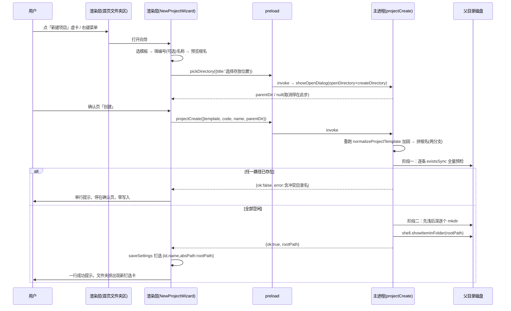

# 60 · 项目文件夹模板与新建项目 + 首页快速访问 —— 增量系统设计 + 任务分解（待批注 → 已批注 v1.1）

> 文档版本：**v1.1（增量设计·批注已收口）** ｜ 撰写：Bob（架构师） ｜ 日期：**2026-11-24** ｜ 语言：简体中文
> **v1.1 修订说明**：用户对 v1.0 §6 七条待批注**全部批注完毕**（Q-1/Q-2/Q-3/Q-6/Q-7 改口径，Q-4/Q-5 按原推荐），并**追加三项首页功能**（快速访问钉选与排序 / 悬停自动滚动 / 文件夹底纹自定义），全部纳入本次范围。本文就地增补，不新建文档；v1.0 的「待批注」措辞全部收敛为「已批注落点」。
> 性质：**纯设计**。不改任何 `src/` / `tests/` / 其它 `docs/`，不 commit / push / 出包，不碰用户真实库（`E:/ModVault/Library/` 只读引用）。
> **真源**：用户（杨雯丞）2026-11-24 拍板原话（主理人转呈）——① 内置模板 4×15 两级；② **A 向导 + B 可编辑模板一起做**；③ v1.1 批注 7 条 + 追加 3 项（§1 逐条登记）。
> **三态标注**：`【查证】` 有「文件:行号」或只读实测证据 ｜ `【推断】` 由查证事实推出、不写成事实 ｜ `【待核实】` 需真机才能定论，不推测填充。
> **四段式**：§0 与各节按「① 事实 → ② 结论 → ③ 形态 → ④ 判据」展开，正文表格优先。
> **引用简写**（相对仓库根）：`types.ts`=`src/shared/types.ts`、`settings.ts`=`src/main/settings.ts`、`naming.ts`=`src/shared/naming.ts`、`ipc.ts`=`src/shared/ipc.ts`、`preload/index.ts`=`src/preload/index.ts`、`main/index.ts`=`src/main/index.ts`、`packageFormat.ts`=`src/shared/packageFormat.ts`、`homeBackground.ts`=`src/main/homeBackground.ts`、`GlassFolder.tsx`=`src/renderer/components/home/GlassFolder.tsx`、`homeKinds.ts`=`src/renderer/logic/homeKinds.ts`、`SettingsDialog.tsx`=`src/renderer/components/SettingsDialog.tsx`、`App.tsx`=`src/renderer/App.tsx`。

---

## 0. TL;DR（四段式）

| 段 | 内容 |
| --- | --- |
| ① 事实 | `【查证】` 用户批注 7 条（§1）：**向导入口放首页底部文件夹区域 + 生成成功自动钉到快速访问**；**多模板这次就做**（`projectTemplates: ProjectTemplate[]`）；**编号建议填但可跳过**；占位符只限根名、冲突整体拒绝（按 v1.0 推荐）；**模板树深度 4 级封顶**；**模板纳入打包白名单**。追加三项首页功能。机制底盘：打包白名单 = `packageFormat.ts:82-94` 的 `PERSONAL_SETTINGS_KEYS`（11 键，`PersonalPatch` 类型由它自动派生 `:96`，`pickPersonalSettings`/`mergePersonalSettings` 按键遍历 `:520/:540`）；底纹图落盘可复用 `saveHomeBackground`（`homeBackground.ts:176`，本地图复制到 `<userData>/home-bg/<sha256>.<ext>` 并回 fileName，`:8/:26`）+ 既有 `bg://` 协议（`protocol.ts:14`）+ 拾图先例「复用 pickArchives、零新增通道」（`SettingsDialog.tsx:1429-1432`）；动效降级口径 = `motionQuality` 三档（`motionQuality.ts:35`，App 订阅 `logic/motionProfile.ts:5`）；首页文件夹行候选 = `HOME_FOLDER_KEYS`（`homeKinds.ts:45`，只有计数 >0 的大类出现，`homeKinds.ts:36-37`）；`shell:openPath` 的 0.9.2 守卫只放行库根 ∪ 日志目录（`main/index.ts:1315-1330`）→ 钉选文件夹打开**不能**走它。 |
| ② 结论 | 本批 = **模板数据层（多模板 · 深 4 级）+ 向导（首页入口、编号可选、成功自动钉选）+ 设置页多模板管理 + 首页文件夹行三项增强**，共五张施工卡。模板随包走的落点 = `PERSONAL_SETTINGS_KEYS` 加一键（类型自动对齐，`packageFormat.ts:156`）；钉选与底纹**不入包**（机器路径 / 缓存引用，§5.3）。钉选打开走独立通道 `home:pinnedOpen`：主进程按 id 从**自己的 settings** 解析路径（不信渲染层路径，`mergeMaterial` 同款防御，`ipc.ts:108-114`），0.9.2 守卫不放宽。 |
| ③ 形态 | 3 条新 IPC 三处同改（`ipc.ts:3` 硬约定）：`dialog:pickDirectory`（标题参数化的通用选目录，向导与钉选共用）、`project:create`（两阶段：全量预检 → 逐个 mkdir，任一冲突整体拒绝零创建）、`home:pinnedOpen`。新文件：`shared/projectTemplate.ts`（类型 + 默认模板 + 归一化，纯函数）、`main/projectCreate.ts`（生成器）、渲染层 `ProjectTemplateEditor.tsx` / `NewProjectWizard.tsx` / `logic/homePinned.ts`。底纹复用 `homeBackground:save` 落盘 + `homeFolderWallpaper` 映射落 Settings，渲染走 `bg://`。 |
| ④ 判据 | 三态标注全程沿用；§1 七条批注逐条落点（无一条漏落）；安全铁律（整体拒绝 / 名称清洗 / 零半成品 / 打开路径按 id 白名单）写进任务卡验收判据；`homePinnedFolders`（含 absPath 机器路径）与 `homeFolderWallpaper`（缓存引用）**明确不入**打包白名单（§5.3，与 `libraryDir` 同理由，`packageFormat.ts:77`）。 |

---

## 1. 七条批注 → v1.1 落点对照（逐条登记，无遗漏）

| # | 议题 | v1.0 推荐 | **用户批注（唯一真源）** | v1.1 落点 |
| --- | --- | --- | --- | --- |
| **Q-1** | 向导入口位置 | 设置·库 tab | **改：首页底部文件夹区域**；生成成功后**自动把新建项目文件夹钉到首页快速访问** | §4（入口形态 + 自动钉选 W9）；钉选数据结构与打开通道见 §6.1 |
| **Q-2** | 多模板是否留口 | 首版单模板 | **改：多模板这次就做**。`projectTemplates: ProjectTemplate[]`，默认含内置 4×15 一项；可新建 / 复制 / 删除；向导里选模板 | §2（多模板结构）、§3（管理 UI）、§4 W2（选模板步） |
| **Q-3** | 项目编号是否必填 | 必填 | **改：建议填写但允许跳过**。填了 → 「（编号）+名称」；没填 → 直接「名称」 | §2.4 根名规则两条分支 + §4 W1 校验放宽 |
| **Q-4** | 占位符边界 | 只限根名 | **按原推荐** | §2.4：`{编号}`/`{名称}` 只出现在根目录名，子目录名纯字面量 |
| **Q-5** | 冲突粒度 | 整体拒绝零创建 | **按原推荐** | §4 安全分支表（两阶段预检，不留半棵树） |
| **Q-6** | 模板树深度 | 2 级 | **改：深度 4 级封顶**；总节点上限放大 | §2.3：深度 4、总节点 256（合理性复核见该节）；设置编辑 UI 同步支持 4 级 |
| **Q-7** | 模板是否入打包白名单 | 本版不纳入 | **改：模板随「一键打包」导出**，纳入 docs/58 的 PERSONAL_SETTINGS_KEYS 白名单 | §5.3：`packageFormat.ts:82-94` 加 `'projectTemplates'`，`PersonalPatch` 自动派生（`:96`）；导入语义 = 整数组替换（§5.3 注） |

**追加三项（本次范围，不另立文档）**：

| # | 功能 | 落点 |
| --- | --- | --- |
| F-1 | 快速访问钉选 + 左右移动排序（首页右键 / 文件浏览器右键常用文件夹） | §6.1（含「素材大类卡 vs 磁盘钉选卡」两种东西的形态推荐） |
| F-2 | 悬停自动横向滚动（排超过 5 个时，鼠标移到排左右边缘自动滚动） | §6.2（与 `motionQuality` 降级口径兼容） |
| F-3 | 文件夹底纹自定义（右键文件夹换最底部那张图；图片复制进 userData，非临时路径） | §6.3（复用 `saveHomeBackground` + `bg://`，引用具体实现） |

---

## 2. 模板数据结构（多模板 · 深度 4 级）

### 2.1 ① 事实

- 用户实测抄录的内置模板（唯一真源，4 一级 × 15 二级；**用户批注把能力上限放宽到 4 级，但内置默认模板仍是两级**——上限是编辑能力，不是默认形状）。
- `Settings` 落档范式：`types.ts` 定字段 → `settings.ts` SettingsSchema 加键（单项降级 `.optional().catch(默认)`，`settings.ts:82-91` 纪律）→ `DEFAULT_SETTINGS` 加默认值（`types.ts:941` 起）。
- 清洗与防重现成函数：`sanitizeName`（`naming.ts:11-20`）、`uniqueName` 语义（`naming.ts:283-288`）、单段上限 `MAX_SEGMENT_LEN = 40`（`naming.ts:337`）。

### 2.2 ② 结论

模板从单数改复数：`projectTemplates: ProjectTemplate[]`，每项带 `id`（稳定锚点，向导选择 / 删除 / 打包替换都按 id）+ `name`（界面名）+ `root`（树）。默认数组只含内置 4×15 一项。

### 2.3 ③ 形态（类型 + 默认值 + 归一化）

| 项 | 定义 | 说明 | 三态 |
| --- | --- | --- | --- |
| `ProjectTemplateNode` | `{ name: string; children?: ProjectTemplateNode[] }` | 树节点；**深度上限 4**（根 + 3 层子级，Q-6） | 【查证】用户批注 |
| `ProjectTemplate` | `{ id: string; name: string; root: ProjectTemplateNode }` | `id` 用 UUID（内置项固定 `'builtin'`）；`name` 是模板的界面名（如「公司标准模板」），**不落盘** | 【推断】 |
| **总节点上限** | **256** | 合理性复核：4 层深 × 每层几十个兄弟的充足余量；MAX_PATH 压力主要来自「父目录深度 + 根名 + 每段 ≤40 字」（`naming.ts:337`），256 节点不会构造出超过路径上限的分支（单分支深度固定 4）；超出剪掉多余节点并在归一化里静默截断 | 【推断】 |
| 模板条数上限 | 20 | 防设置膨胀；超出时新建 / 复制入口禁用 | 【推断】 |
| `DEFAULT_PROJECT_TEMPLATES` | `[{ id:'builtin', name:'公司标准模板', root: 4×15 树 }]` | 4×15 逐字抄录用户标准；单测硬编码比对 | 【查证】用户拍板 |
| `normalizeProjectTemplate(t): ProjectTemplate` | 单棵归一化 | 逐节点 `sanitizeName`；深度 >4 剪枝；兄弟重名 `uniqueName` 去重；超长按码点截断到 40；总节点 256 上限；根名占位符 `{编号}`/`{名称}` 字面量**原样保留**（归一化不清洗占位符） | 【推断】 |
| `normalizeProjectTemplates(v: unknown): ProjectTemplate[]` | 整表归一化 | 逐项过单棵归一化，坏项丢弃；`id` 缺失 / 重复 → 重新生成；**整表坏 / 空 → 回落默认数组**；条数 >20 截断 | 【推断】 |
| zod `ProjectTemplatesSchema` | `z.unknown().optional()` + normalize 收口 | 照 `customTaxonomy` 同款分工：schema 放行任意形状、语义清洗交给 normalize（`settings.ts:202-208` 注释先例） | 【查证】settings.ts:202-208 |

**JSON 示例**（`settings.json` 落档形状，节选）：

```json
{
  "projectTemplates": [
    {
      "id": "builtin",
      "name": "公司标准模板",
      "root": {
        "name": "（{编号}）+{名称}",
        "children": [
          { "name": "1-工作资料", "children": [
            { "name": "1.1-设计资料" }, { "name": "1.2-专业资料" },
            { "name": "1.3-供应商资料" }, { "name": "1.4-现场过程照片" }
          ] },
          { "name": "2-工作文件", "children": [
            { "name": "2.1-方案" }, { "name": "2.2-施工图" }, { "name": "2.3-软装" },
            { "name": "2.4-模型文件" }, { "name": "2.5-渲染文件" }, { "name": "2.6-成果文件" }
          ] },
          { "name": "3-协调文件", "children": [
            { "name": "3.1-收文件" }, { "name": "3.2-发文件" }, { "name": "3.3-管理文件" }
          ] },
          { "name": "4-归档文件", "children": [
            { "name": "4.1-施工图" }, { "name": "4.2-完工照片" }
          ] }
        ]
      }
    }
  ]
}
```

### 2.4 根名规则（Q-3 改口径：编号可选）

| 分支 | 规则 | 示例 |
| --- | --- | --- |
| 编号已填 | `rootName = sanitizeName(模式.replace('{编号}', sanitizeName(编号)).replace('{名称}', sanitizeName(名称)))` | 编号 `2026-018`、名称 `江畔会所` → `（2026-018）+江畔会所` |
| 编号留空 | **直接** `rootName = sanitizeName(名称)`（忽略模板根名里的占位符结构，无论用户把模式改成什么都走这条分支——与用户批注语义逐字对齐） | 名称 `江畔会所` → `江畔会所` |

- 占位符**只支持根目录名**（Q-4 按推荐）：子目录名（`1.1-设计资料` 等）是纯字面量，生成时**不做任何替换**。
- 向导 W1 实时预览两条分支的实际根名；编号留空时输入框旁给一行建议文案（「建议填写项目编号，方便归档识别」），不阻断。

### 2.5 ④ 判据

- ① `normalizeProjectTemplates` 单测：脏类型 / 坏项丢弃 / id 去重重生成 / 深度 5 层剪枝 / 257 节点截断 / 兄弟重名去重 / 占位符字面量保留 / 整表空回落默认。
- ② 旧 settings.json（无此键）加载后 == `DEFAULT_PROJECT_TEMPLATES`（零迁移、升级无感）。
- ③ 一棵脏树 / 脏表不会拖垮 `libraryDir` 等其它键（单项降级纪律）。
- ④ 编号留空分支与已填分支各一条端到端单测（`buildProjectPlan` 纯函数级）。

---

## 3. 设置页：多模板管理（B · 可编辑模板）

### 3.1 ① 事实

- 设置页 8 tab（`SettingsDialog.tsx:111-123`），左栏分组（`:131-138`）；「库」tab 副标题「库目录、索引维护、结构迁移」（`:145`）。v1.0 批注前的编辑卡设计（行内改名 / 增删 / 恢复默认）在多模板下直接复用，外面包一层模板级管理。
- 设置写入口唯一：`saveSettings(patch)` → `setSettings` → 主进程 `normalizeSettings` 双保险（`store.ts:5747-5748`）。
- 红线：零系统默认控件；Esc 走 `useEscLayer`（`logic/escLayer.ts`）；z-index 走 `logic/zStack.ts`。

### 3.2 ② 结论

「库」tab 里放一张「项目文件夹模板」卡：**模板列表 + 选中一棵树编辑**。模板级操作（新建 / 复制 / 删除 / 改名）与节点级操作（改名 / 增删，现支持 4 级）分层。

### 3.3 ③ 形态

| 层 | 交互 | 约束 |
| --- | --- | --- |
| 模板列表 | 卡顶横向列表：模板名 chip，点选切换编辑对象；`builtin` 显示「内置」角标 | 条数 20 封顶；列表尾「+ 新建模板」（空树起步）与当前项「复制」按钮 |
| 模板改名 | chip 双击行内改名 | 过 `sanitizeName`；不为空 |
| 模板删除 | chip 尾「×」+ 二次确认（自绘） | **至少保留 1 个模板**：删最后一个时按钮禁用；`builtin` 可删（删了就只剩用户模板，不强制保留内置——它只是出厂默认，不是必需品）【推断】 |
| 节点编辑 | 沿 v1.0 设计：树形列表行内改名、行尾「+ / ×」 | 深度上限 **4**（Q-6）；总节点 256；兄弟重名自动去重并即时提示；单名 ≤40 字；保存走 `saveSettings({ projectTemplates })` |
| 恢复默认 | 「恢复出厂模板」按钮 | 二次确认；语义 = 把 `builtin` 那一项重置为 4×15（不动用户自建模板）【推断】 |
| Esc | 编辑浮层（行内输入 / 二次确认）注册 `useEscLayer` 一层 | 只关顶层浮层 |

### 3.4 ④ 判据

- ① 多模板增删改复制后重启读回一致（主进程归一化幂等）。
- ② 「至少保留 1 个模板」「20 封顶」「深度 4」三条在 UI 与 `normalizeProjectTemplates` 双份生效。
- ③ 源码守卫：零系统控件关键词；Esc / zStack 走既有模块；不动其它 tab。

---

## 4. 新建项目向导（A · 首页入口 · 编号可选 · 成功自动钉选）

### 4.1 ① 事实

- **Q-1 改口径**：入口在**首页底部文件夹区域**（不是设置页）；生成成功后自动钉到首页快速访问（F-1 的数据结构与打开通道见 §6.1）。
- 首页文件夹行现状：候选 = `HOME_FOLDER_KEYS`（`homeKinds.ts:45`），`App.tsx` 的 `homeFolders` 只渲染计数 >0 的大类卡（`homeKinds.ts:36-37`）；卡片组件 `GlassFolder.tsx`（588 行）+ `glass-folder.css`。
- 通用目录选择：v1.0 计划的 `project:templatePickDir` 在多入口（向导选位置 + 钉选添加目录）下改为**标题参数化**的通用通道（§5.1），两处共用一条。
- 安全铁律（用户拍板，不变）：目标已存在同名目录必须拒绝，绝不覆盖 / 合并；`sanitizeName`（`naming.ts:11-20`）现成。

### 4.2 ② 结论

向导 = 四步自绘对话框（选模板 → 填编号名称 → 选位置 → 确认），从首页文件夹区唤起；生成请求一次交主进程两阶段执行；**成功后渲染层自动把根目录写进 `homePinnedFolders`**（W9），钉选卡立刻出现在文件夹排末尾。

### 4.3 ③ 形态（步骤表 + 安全拒绝分支 + 序列图）

| 步 | 执行方 | 动作 | 约束 |
| --- | --- | --- | --- |
| W0 入口 | 渲染 | 文件夹排末尾追加一张**「新建项目」虚卡**（同 GlassFolder 尺寸、虚线边框区分）+ 文件夹区右键菜单项「新建项目」 | 双入口同开一个向导；虚卡不动既有 4 卡布局（docs/57 §1.1 理由④ 边界保持：不新增导航节点，虚卡属于文件夹排内容） |
| W1 选模板 | 渲染 | 模板列表（`projectTemplates` 的 `id`+`name`），默认选中 `builtin` | 单选；空表不可能（归一化兜底至少 1 项） |
| W2 填写 | 渲染 | 项目编号（**可选**，建议文案不阻断）+ 项目名称（必填）；实时预览根名（§2.4 两分支） | 两输入实时过 `sanitizeName` 回显；名称空 → 禁用下一步 |
| W3 选位置 | 渲染 | `dialog:pickDirectory`（标题「选择存放位置」、按钮「在此新建项目」） | 取消 → 停在 W3 |
| W4 确认 | 渲染 | 完整树预览（根名已替换）+ 父目录名 + 所选模板名；「创建」 | 零系统控件 |
| W5 生成请求 | 渲染 | `project:create({ template, code, name, parentDir })`（新通道，§5.1） | 等待态，按钮防重复点击 |
| W6 主进程加固 | 主进程 | **不信渲染层的树**：对收到的 `template.root` 重跑 `normalizeProjectTemplate`（清洗 / 剪枝 / 去重 / 256 上限），再拼根名（§2.4 两分支） | 防渲染层被注入后借通道在任意父目录写超深 / 超多目录（`mergeMaterial`「主进程自己重算」同款防御，`ipc.ts:108-114`） |
| W7 预检 | 主进程 | **阶段一**：父目录存在性 + 目标路径清单逐条 `existsSync` | **任一已存在 → 整体拒绝、零创建**（Q-5），返回首个冲突目录**名**（相对父目录，不暴露绝对路径） |
| W8 落盘 | 主进程 | **阶段二**：先浅后深逐个 `fs.mkdir`（不带 recursive），失败即停并上报已完成数 | 此阶段失败只可能是权限 / 盘符掉线等 IO 异常；**不回滚、不删已建目录**（删用户盘上的目录比留半棵树更危险） |
| W9 成功收尾 | 主进程 → 渲染 | 主进程 `shell.showItemInFolder(rootPath)`（**不经**渲染层 `shell:reveal`——0.9.2 守卫只放行库根 ∪ 日志目录会拒，`main/index.ts:1315-1330`；先例 `plugin:exportRbz`，`main/index.ts:2191-2229`）→ 返回 `{ok:true, rootPath}`；渲染层自动钉选：`saveSettings({ homePinnedFolders: [...pins, { id: uuid, name: rootName, absPath: rootPath }] })` | 钉选失败不回滚创建结果（钉选只是 Settings 写入，失败给一行提示不阻断成功提示） |
| W10 提示 | 渲染 | 一行成功提示（「项目文件夹已创建并加入快速访问」） | 文案单行、不暴露绝对路径、无内部词 |

**安全拒绝分支（写死，不接受批注推翻「拒绝」本身）**：

| 异常 | 检测点 | 处置 |
| --- | --- | --- |
| 根目录名已存在 | W7 | 整体拒绝：「该位置已存在同名文件夹，请换个名称或位置」，停在 W4，已填内容保留 |
| 任一子目录已存在（残留半成品等） | W7 | 同上整体拒绝、零创建；提示指到冲突目录名 |
| 名称清洗后为空 | W2 | 「下一步」禁用 + 单行提示；编号空是合法态（§2.4） |
| 父目录不存在 / 无权限 | W7 | 拒绝：「存放位置不可用，请重新选择」 |
| W8 阶段 IO 失败 | W8 | `{ok:false, error, dirsCreated}`；不回滚不删；错误文案含具体原因（reason 直传，不做关键词翻译——docs/57 §6 F-3 教训） |
| 根名超长导致 mkdir 失败 | W8 | 同上，文案含「名称过长」 |
| 模板树被注入超深 / 超多节点 | W6 | 主进程重跑归一化剪到 4 级 / 256 节点，照常执行 |

**序列图**：



### 4.4 ④ 判据

- ① 冲突场景**零落盘**（单测：预置同名目录后调用，断言父目录条目数不变）。
- ② 成功场景目录树 == 归一化后模板树逐名一致；`dirsCreated` == 节点数。
- ③ 编号空 / 已填两条分支各一条端到端单测；根名与 §2.4 表逐字一致。
- ④ 成功路径上渲染层**没有** `reveal(` / `openPath(` 调用（守卫会拒）；`showItemInFolder` 只在主进程（源码守卫）。
- ⑤ W6 加固：注入 10 层深 / 500 节点的树，实际落盘 ≤4 级 / ≤256 节点（单测）。
- ⑥ Esc 只关顶层；z-index 走 `zStack.ts`；零系统默认控件（源码守卫）。

---

## 5. IPC 与落盘设计

### 5.1 ① 事实与 ② 结论

- 硬约定：新增通道同时改 `shared/ipc.ts` + `preload/index.ts` + `main/index.ts`（`ipc.ts:3`）。
- 「不抛错、结果带 ok/error」先例（`ipc.ts:406-409`）；目录选择返回 `string | null` 先例（`main/index.ts:1297-1304`）。
- 结论：**3 条** `新通道`（v1.0 的 `project:templatePickDir` 升级为通用的 `dialog:pickDirectory`，向导选位置与 F-1 钉选添加共用；`project:create` 不变；新增 `home:pinnedOpen`）。无进度 / 取消通道（mkdir 亚秒级；`project:create` 单次 invoke 原子性足够）。

### 5.2 ③ 通道契约表（三处同改）

| # | 通道名（key → value） | 方向 / 类型 | 载荷与返回 | 三态 |
| --- | --- | --- | --- | --- |
| 1 | `pickDirectory` → `'dialog:pickDirectory'` | invoke | `(opts: { title: string; buttonLabel: string }) => string \| null`；`showOpenDialog({ properties:['openDirectory','createDirectory'], title, buttonLabel })`。**不改既有 `pickWatchDir`**（两通道并存，老通道零风险） | 【推断】 |
| 2 | `projectCreate` → `'project:create'` | invoke | `(input: ProjectCreateInput) => ProjectCreateResult`；`ProjectCreateInput = { template: ProjectTemplate; code: string; name: string; parentDir: string }`；`ProjectCreateResult = { ok:true, rootPath:string, dirsCreated:number } \| { ok:false, error:string, dirsCreated?: number }`（永不 reject） | 【推断】 |
| 3 | `homePinnedOpen` → `'home:pinnedOpen'` | invoke | `(id: string) => string \| null`（null = 成功打开，字符串 = 中文错误）。主进程按 `id` 从**自己的 settings** 查 `homePinnedFolders` 拿 `absPath`，`existsSync` 后 `shell.openPath`；查不到 / 不存在 → 错误串。**0.9.2 守卫（`allowedOpenRoots`）不放宽**——钉选打开不走 `shell:openPath` 通道，走本通道的 id 白名单 | 【推断】 |

### 5.3 打包白名单闭环（Q-7）

| 项 | 决定 | 依据 |
| --- | --- | --- |
| `projectTemplates` | **加入** `PERSONAL_SETTINGS_KEYS`（`packageFormat.ts:82-94` 数组加一项） | `PersonalPatch` 类型由该数组自动派生（`:96`，注释 `:156`「Settings 侧新增/改名键时这里自动对齐」）→ 导出 `pickPersonalSettings`（`:520`）与导入 `mergePersonalSettings`（`:540`）**零代码改动**即闭环，只需同步更新两处测试的键数断言（11 → 12） |
| 导入语义 | 整数组**替换**（非逐模板合并） | `mergePersonalSettings` 白名单键整键覆盖（`:540-545`）；模板是自包含实体，整组替换语义清晰；目标机自建模板会被包覆盖 → 属「离职带走」场景的预期行为，导入前整库确认弹窗已覆盖告知（docs/58 §5）【推断】 |
| `homePinnedFolders` | **不加入**白名单 | `absPath` 是机器相关路径，与 `libraryDir`/`watchDir` 同理由（`packageFormat.ts:77` 明确不含清单）；换机后路径失效，带过去只会指向不存在的目录 |
| `homeFolderWallpaper` | **不加入**白名单 | 值是 userData 缓存文件名，文件本体不随包走（docs/58 C-5 对 `homeBackground` 图本体的既有裁定同款）；目标机缺文件回落默认底纹 |
| manifest | 不加字段 | 白名单键数不是 manifest 契约的一部分（docs/58 §2.1 无此字段）；`personal.json` 内容随白名单自然多一键，`count` 类校验不涉及 |

### 5.4 ④ 判据

- ① 3 通道在 `ipc.ts` / `preload/index.ts` / `main/index.ts` 各命中（源码守卫三处计数）。
- ② `project:create` 全程 try/catch 收口 `{ok:false, error:中文}`；失败日志记 `project:create-failed`（含 parentDir / 冲突名 / dirsCreated——docs/57 §6 F-3/F-4：失败必须留日志、reason 直传）。
- ③ 白名单测试断言更新后，导出包的 `personal.json` 含 `projectTemplates`、**不含** `homePinnedFolders` / `homeFolderWallpaper`（单测双向断言）。
- ④ `homePinnedOpen` 对未知 id / 已消失路径返回错误串，**绝不** `shell.openPath` 任意路径（单测：id 不在 settings → 无 shell 调用）。

---

## 6. 首页三项（F-1 快速访问 / F-2 悬停滚动 / F-3 底纹）

### 6.1 F-1 · 快速访问钉选 + 排序

**① 事实**：首页底部一排现在是**素材大类文件夹卡**（`GlassFolder`，数据 = 素材库统计 + `HOME_FOLDER_KEYS` 候选序 + 计数 >0 过滤，`homeKinds.ts:36-45`）；钉选的是**磁盘文件夹快捷方式**，两种东西语义不同。右键菜单体系已存在（`logic/contextMenu.ts`，508 行）。`shell:openPath` 有 0.9.2 守卫（`main/index.ts:1315-1330`），任意磁盘路径会被拒。

**② 结论**：钉选卡**追加在素材大类卡之后同排滚动**（推荐形态，理由见下）；数据落 `Settings.homePinnedFolders`；打开走 §5.2 通道 3。

**③ 形态**：

| 项 | 决定 | 理由 |
| --- | --- | --- |
| **形态推荐** | **同排追加滚动**（不分区显示） | ① 首页布局刚多轮返工稳定（docs/57 §1.1 理由④），分区 = 第二行 = 新一轮布局/审美返工；② 单排 + 滚动让 F-2（悬停滚动）成为两种卡共用的同一能力，实现只有一份；③ 语义区分用**视觉手段**解决：钉选卡沿用 GlassFolder 玻璃质感但右上角加「回形针/定位」小角标 + 不显示素材计数（底纹区默认用系统底纹或用户自定义，§6.3），一眼可分、布局不变【推断】 |
| 数据结构 | `homePinnedFolders: { id: string; name: string; absPath: string }[]`，**数组顺序即显示顺序**（不存 `order` 字段——双真源（字段 + 数组序）迟早漂移，数组本身就是唯一 order；主理人原 sketch 的 `order` 字段在此收编为数组序）【推断】 | 左右移动 = 交换相邻两元素后整体 `saveSettings`，O(1) 无重排 |
| 添加入口 | ① 首页文件夹区右键菜单「添加快速访问」；② 文件浏览器（中栏文件视图）右键文件夹菜单「添加到首页快速访问」 | 两条入口都先 `dialog:pickDirectory`（①）或直接用右键目标路径（②）→ `saveSettings` 追加；**查重**：同 `absPath` 已钉 → 单行提示「已在快速访问中」，不重复追加 |
| 排序 | 钉选卡 hover / 右键菜单给「左移 / 右移」 | 只在钉选卡之间交换（素材大类卡位置固定在排首，不参与排序——它们是产品口径候选序，`homeKinds.ts:41-43`） |
| 打开 | 点钉选卡 → `home:pinnedOpen(id)` → 资源管理器打开该文件夹 | §5.2 通道 3 的 id 白名单机制；**不放宽 0.9.2 守卫** |
| 删除 | 右键钉选卡「从快速访问移除」 | 只删 Settings 键，**绝不**删磁盘目录（红线） |
| 名称漂移 | 磁盘目录被用户改名后钉选卡仍显示旧 `name` | 首版不追踪改名（重扫 / watcher 不覆盖库外目录）；右键「移除后重新添加」即可纠正，文档注明边界【推断】 |

**④ 判据**：① `homePinnedFolders` 归一化单测（脏类型 / absPath 非绝对 / 重名 absPath 去重 / 上限 32 条封顶防排爆）；② 添加查重真值表；③ 源码守卫：钉选卡点击路径上无 `shell:openPath` 通道调用；④ 零系统控件、Esc/zStack 合规。

### 6.2 F-2 · 悬停自动横向滚动

**① 事实**：排容器现状一行铺开（4-5 张 GlassFolder），钉选后可超 5 张 → 需横向滚动；App 有自己的动效档位机制 `motionQuality` 三档（`motionQuality.ts:35`：smooth=低动效 / balanced / ultra），App 层订阅 `settings.motionQuality`（`logic/motionProfile.ts:5`）。**没有**直接用 `prefers-reduced-motion`——项目降级口径以 `motionQuality` 为准。

**② 结论**：排容器改为横向可滚（`overflow-x:auto`，隐藏滚动条用滚轮/拖拽也可滚）；鼠标进入排左右 48px 边缘区时 rAF 匀速滚动；`motionQuality === 'smooth'` 档**禁用**悬停自动滚（保留手动滚动能力），与项目既有降级口径一致。

**③ 形态**：

| 项 | 决定 |
| --- | --- |
| 触发区 | 排两端各 48px 宽的热区；移入即滚、移出即停（rAF 循环，速度 ≈320px/s，按 dpr 无关的 CSS px） |
| 边界 | 滚到头自动停（scrollLeft 触界检测）；边缘热区给出淡入渐隐提示（箭头微光，零布局位移） |
| 降级 | `motionQuality === 'smooth'` → 不启动 rAF 循环、不显示箭头微光，仅保留滚轮 / 触控板 / 拖动滚动条（档位判定走既有 `motionProfileOf`，`motionQuality.ts:73-74`） |
| 与 F-1 关系 | 素材大类卡与钉选卡同排，滚动是**容器级**能力，两种卡零差别 |
| 性能 | 纯前端 transform/scrollLeft，无重排；不进 three.js 舞台链路 |

**④ 判据**：① 边缘热区逻辑抽纯函数（`edgeScrollDirection(x, rect): -1|0|1`）可单测真值表；② `smooth` 档下 rAF 循环不启动（源码守卫 + 单测）；③ 滚动只改 scrollLeft，不动卡片 DOM 顺序（排序仍走 Settings，双真源不出现）。

### 6.3 F-3 · 文件夹底纹自定义

**① 事实**：GlassFolder 最底部是底图区；图片落盘已有完整先例链：`saveHomeBackground(input)` 把本地图复制到 `<userData>/home-bg/<sha256>.<ext>` 并返回 fileName（`homeBackground.ts:8/:26/:176`）——**图片持久化 ≠ 存临时路径**，Settings 只存 fileName；渲染走 `bg://<fileName>` 协议（`protocol.ts:14`，bg host 就是 home-bg 目录）；拾图先例 = 复用 `dialog:pickArchives` 图片过滤器、零新增通道（`SettingsDialog.tsx:1429-1432` 注释原文）。

**② 结论**：底纹 = 「按文件夹 key 的单图引用映射」，**完全复用** `homeBackground:save` 落盘通道与 `bg://` 读取协议，只新增一个 Settings 映射键 + 右键入口，不新建图片管理机制。

**③ 形态**：

| 项 | 决定 | 依据 |
| --- | --- | --- |
| Settings 键 | `homeFolderWallpaper: Record<string, string>`（key → fileName） | key 命名空间：素材大类卡 = `kind:<AssetKind\|KindGroup>`（对齐 `HomeFolderItem['key']`，App.tsx:1192）；钉选卡 = `pin:<id>`；两命名空间互不碰撞 |
| 更换流程 | 右键 GlassFolder →「更换底纹」→ `pickArchives()` 拾一张图（先例 SettingsDialog.tsx:1429-1432）→ `homeBackground:save({kind:'local', filePath})` 得 fileName → `saveSettings({ homeFolderWallpaper: {...map, [key]: fileName} })` | 落盘由 `saveHomeBackground` 完成：复制进 `<userData>/home-bg/<sha256>.<ext>`，**临时路径绝不入 Settings**（homeBackground.ts:176 契约原样复用） |
| 渲染 | GlassFolder 底图区按 key 查 map，命中 → `bg://<fileName>`；未命中 → 现状默认底纹 | `protocol.ts:14` bg scheme 已注册 home-bg 目录，零新协议 |
| 恢复默认 | 右键 →「恢复默认底纹」→ 删 map 键（**不删**缓存文件——低频小量操作，目录膨胀风险可忽略；删文件反而要处理「同图被多个文件夹引用」的引用计数，首版不做）【推断】 | |
| 同图复用 | 同一张图可设给多个文件夹（fileName 按 sha256 命名天然去重，同图同文件零额外占用） | homeBackground.ts:8 sha256 命名契约 |
| 与首页背景关系 | `homeBackground` 是全屏背景层，`homeFolderWallpaper` 是文件夹卡内底图，两层独立、互不读写 | `homeBackground.ts` 单槽位逻辑只服务全屏背景，不动它 |
| URL 来源 | 首版底纹只支持本地图片（`pickArchives` 拾图）；`homeBackground:save` 的 url 分支对底纹不开放（URL 图需下载器，且底纹无「先下载后预览」的交互位） | 【推断】 |

**④ 判据**：① 底纹 key 归一化单测（未知命名空间键丢弃 / fileName 空 / 上限 64 键封顶）；② 换底纹后重启读回一致（fileName 幂等）；③ 源码守卫：Settings 中**无任何**底纹临时路径（只允许 `<sha256>.<ext>` 形态 fileName，单测正则断言）；④ Esc / zStack / 零系统控件合规。

---

## 7. 文件清单与任务分解（T-01..T-05）

### 7.1 文件清单（全量）

| 文件 | 状态 | 归属任务 |
| --- | --- | --- |
| `src/shared/projectTemplate.ts` | 新（多模板类型 + 默认 + 两级归一化） | T-01 |
| `src/shared/types.ts` | 改（+`projectTemplates` / `homePinnedFolders` / `homeFolderWallpaper` + 默认值） | T-01 |
| `src/main/settings.ts` | 改（3 个 schema 键 + normalize 收口） | T-01 |
| `src/shared/packageFormat.ts` | 改（白名单 +`projectTemplates`，键数 11→12） | T-01 |
| `tests/projectTemplate.test.ts` | 新 | T-01 |
| `src/renderer/components/ProjectTemplateEditor.tsx` | 新（多模板管理 + 树编辑） | T-02 |
| `src/renderer/components/SettingsDialog.tsx` | 改（库 tab 加模板卡） | T-02 |
| `tests/projectTemplateUi.test.ts` | 新 | T-02 |
| `src/shared/ipc.ts` | 改（+3 通道 + 契约类型） | T-03 |
| `src/preload/index.ts` | 改（+3 暴露） | T-03 |
| `src/main/projectCreate.ts` | 新（buildProjectPlan 纯函数 + createProjectDirs IO） | T-03 |
| `src/main/index.ts` | 改（+3 handler） | T-03 |
| `src/renderer/components/NewProjectWizard.tsx` | 新 | T-03 |
| `src/renderer/store.ts` | 改（+钉选增删移 action、向导成功自动钉选动作；T-05 也加底纹/排序 action → 文件冲突） | T-03 / T-05 |
| `tests/projectCreate.test.ts` | 新 | T-03 |
| `src/renderer/logic/homePinned.ts` | 新（钉选归一化 / 查重 / 左右移纯函数 + 边缘滚动方向纯函数） | T-05 |
| `src/renderer/App.tsx` | 改（文件夹排：钉选卡追加、右键菜单项、向导虚卡入口、悬停滚动容器） | T-05 |
| `src/renderer/components/home/GlassFolder.tsx` | 改（钉选变体角标 / 底纹渲染 / 无计数形态） | T-05 |
| `src/renderer/logic/contextMenu.ts` | 改（+钉选 / 底纹 / 新建项目菜单项） | T-05 |
| `tests/homePinned.test.ts` | 新 | T-05 |
| `tests/projectWiring.test.ts` | 新（三处守卫 + 白名单双向断言 + 钉选打开守卫） | T-04 |

> 无新增第三方依赖（zod / fs / shell / UUID 全部已有；UUID 用现有生成方式——`Asset.id` 同款）。

### 7.2 任务卡（按可独立提交 / 可独立验收）

> 测试范式：vitest node 环境，纯函数单测 + 源码守卫（范式 `tests/classifyUiWiring.test.ts`）。每卡跑双 typecheck + 两种 vitest（`npm run verify`）。

**T-01 · 数据层：多模板 + 首页两键 + 打包白名单**

- 涉及文件：`src/shared/projectTemplate.ts`（新）、`src/shared/types.ts`、`src/main/settings.ts`、`src/shared/packageFormat.ts`、`tests/projectTemplate.test.ts`（新）
- 依赖：无（可立即开工，T-02/T-03/T-05 的共同地基）
- 交付：§2.3 全部类型与默认值；`normalizeProjectTemplates`；Settings 三键落点；`PERSONAL_SETTINGS_KEYS` 加键
- 验收判据：§2.5 四条 + §5.3 白名单双向断言（含 `projectTemplates`、不含 `homePinnedFolders`/`homeFolderWallpaper`）+ 白名单键数测试同步 11→12

**T-02 · 设置编辑 UI：多模板管理卡**

- 涉及文件：`src/renderer/components/ProjectTemplateEditor.tsx`（新）、`src/renderer/components/SettingsDialog.tsx`、`tests/projectTemplateUi.test.ts`（新）
- 依赖：T-01；与 T-03 **无文件冲突**（v1.0 的冲突源是向导挂载点在 SettingsDialog，v1.1 入口已移到首页 → 冲突解除）；与 T-05 无冲突
- 交付：§3.3 全部交互（模板列表 / 新建 / 复制 / 删除 / 改名 / 4 级树编辑 / 恢复出厂）
- 验收判据：§3.4 三条全绿；深度 4 / 节点 256 / 模板 20 / 至少留 1 双份生效

**T-03 · 向导 + 生成链 + 自动钉选（3 通道 + 主进程生成器）**

- 涉及文件：`src/shared/ipc.ts`、`src/preload/index.ts`、`src/main/index.ts`、`src/main/projectCreate.ts`（新）、`src/renderer/components/NewProjectWizard.tsx`（新）、`src/renderer/store.ts`（+自动钉选动作）、`tests/projectCreate.test.ts`（新）
- 依赖：T-01；**与 T-05 在 `App.tsx` / `store.ts` 有文件冲突 → 建议串行**（T-05 先行铺首页容器与钉选渲染，T-03 后接向导入口与自动钉选；或反之，二选一，不并行）
- 交付：§5.2 三通道三处同改；§4.3 W0-W10 全流程（含 W6 主进程加固、W9 自动钉选）
- 验收判据：§4.4 六条 + §5.4 四条全绿

**T-05 · 首页渲染：钉选卡 + 排序 + 悬停滚动 + 底纹**

- 涉及文件：`src/renderer/logic/homePinned.ts`（新）、`src/renderer/App.tsx`、`src/renderer/components/home/GlassFolder.tsx`、`src/renderer/logic/contextMenu.ts`、`src/renderer/store.ts`（+钉选/底纹 action）、`tests/homePinned.test.ts`（新）
- 依赖：T-01（数据契约）；与 T-03 文件冲突 → 串行（见 T-03）；与 T-02 无冲突
- 交付：§6.1-§6.3 全部（同排追加形态、左右移、边缘滚动 + smooth 降级、底纹全链路复用 saveHomeBackground + bg://）
- 验收判据：§6.1-§6.3 四组判据全绿；`motionQuality==='smooth'` 下悬停滚动不启动（源码守卫）；Settings 中底纹值全部为 `<sha256>.<ext>` 形态（单测正则）

**T-04 · 测试收口：守卫 + 真值表 + 端到端**

- 涉及文件：`tests/projectWiring.test.ts`（新）、`tests/projectTemplate.test.ts` / `tests/projectCreate.test.ts` / `tests/homePinned.test.ts`（补边界）、`docs/60`（验收发现口径偏差时回写本文）
- 依赖：T-01~T-03、T-05 全部合入
- 交付：三处通道命中守卫；「冲突零落盘 / 成功全量 / 半程 IO 失败不回滚」真值表；归一化幂等；白名单导出/导入双向断言（`projectTemplates` 进包、`homePinnedFolders` 不进包）
- 验收判据：`npm run verify` 全绿；守卫断言向导成功路径无 `reveal(` / `openPath(`

### 7.3 任务依赖图

```mermaid
graph LR
  T01[T-01 数据层:多模板/首页两键/白名单] --> T02[T-02 设置多模板管理]
  T01 --> T03[T-03 向导+生成链+自动钉选]
  T01 --> T05[T-05 首页:钉选/排序/滚动/底纹]
  T03 -.App.tsx+store.ts 冲突.-> T05
  T02 --> T04[T-04 测试收口]
  T03 --> T04
  T05 --> T04
```

> 实线 = 硬依赖；虚线 = 文件冲突建议串行。T-02 与 T-03/T-05 无文件冲突（v1.1 入口移到首页后 SettingsDialog 冲突解除），可真正并行；T-03 与 T-05 必须串行。

---

## 8. 风险与不做

**明确不做（本版本，写死）**：

| # | 不做 | 依据 |
| --- | --- | --- |
| 1 | C 库内分类预设（不碰素材库 Dexie 分类 / 四段路径 / rescan） | 用户拍板「不做」 |
| 2 | 自动往生成的目录里导入素材 / 建任何文件 | 用户拍板范围 |
| 3 | 素材大类卡参与排序 / 被移除 | §6.1：大类卡是产品口径候选序（`homeKinds.ts:41-43`），排序只在钉选卡之间 |
| 4 | 钉选目录改名追踪 / 消失目录自动清理 | §6.1 名称漂移边界：首版右键移除重加即可 |
| 5 | 底纹缓存文件的自动清理 / 引用计数 | §6.3：低频小量，删除需引用计数，首版不值 |
| 6 | 底纹 URL 来源 / 网络图 | §6.3：只支持本地拾图 |
| 7 | 钉选 / 底纹入打包白名单 | §5.3：机器路径与缓存引用（与 libraryDir 同理由） |
| 8 | 首页分区显示（第二行）钉选区 | §6.1 形态推荐同排追加 |

**工程风险**：

| # | 风险 | 三态 | 处置 |
| --- | --- | --- | --- |
| R-1 | Windows MAX_PATH：4 级树 + 长名 + 深父目录 → mkdir 失败 | 【待核实】 | W7 预检算全长；单段 ≤40（`naming.ts:337`）+「名称过长」文案 |
| R-2 | 网络盘（用户模板源自 `Y:` 盘）mkdir 慢 / 权限怪异 | 【待核实】 | 全程收口 + dirsCreated 回传；不重试不静默 |
| R-3 | 钉选目录被用户在资源管理器删除 | 【推断】 | `home:pinnedOpen` `existsSync` 失败 → 中文错误「文件夹不存在，可从快速访问移除」；不自动清 |
| R-4 | 手改 settings.json 弄脏三个新键 | 【推断】 | 三键各自归一化兜底 + 单项降级，不拖垮其它键 |
| R-5 | 打包导入把目标机自建模板整组覆盖 | 【推断】 | §5.3 明示语义（整组替换）；导入前整库确认弹窗已覆盖告知（docs/58 §5） |
| R-6 | 悬停滚动与 F-1 排序点击冲突（边缘热区吃掉卡片点击） | 【推断】 | 热区只在排两端 48px 且卡片不铺到热区下（padding 让位）；T-05 验收含此交互项 |

---

## 9. 本轮做了什么 / 没做什么（v1.1）

- **做了（v1.1 增补）**：登记用户 7 条批注并逐条落点（§1）；模板升级多模板（`id`+`name`+`root`，深度 4 / 节点 256 合理性复核）、根名两分支规则（编号可选）、设置页多模板管理、向导四步流程 + 首页入口 + W6 主进程加固 + W9 自动钉选；追加三项首页设计——钉选数据结构收编 `order` 为数组序、同排追加形态推荐与理由、悬停滚动 `motionQuality` 降级口径、底纹全链路复用 `saveHomeBackground`（`homeBackground.ts:176`）+ `bg://`（`protocol.ts:14`）+ `pickArchives` 拾图先例（`SettingsDialog.tsx:1429-1432`）；打包白名单闭环核实（`packageFormat.ts:82-94/:96/:156`——加键后 pick/merge **零代码改动**，仅测试键数 11→12）；新增 `home:pinnedOpen` 通道论证（0.9.2 守卫不放宽、主进程按 id 自查路径）；任务卡扩为 T-01~T-05，冲突面重划（T-02 冲突解除，T-03/T-05 在 App.tsx+store.ts 串行）。复核源码新增行号：`packageFormat.ts`（白名单机制）、`homeBackground.ts`（落盘契约）、`protocol.ts`（bg:// host）、`homeKinds.ts`（首页候选序与计数过滤）、`GlassFolder.tsx`、`motionQuality.ts` / `motionProfile.ts`（动效档位）、`contextMenu.ts`。
- **没做**：改任何 `src/` / `tests/` / 其它 docs；跑构建 / 测试；commit / push / 出包；启动软件；碰用户真实库。

*v文档结束 · v1.1 批注已收口，七条岔路以 §1「用户批注」列为准，施工可直接按 T-01 开工；三态标注保留处（【待核实】R-1/R-2/R-3）交 QA 真机验证，不在本文编数字。*
